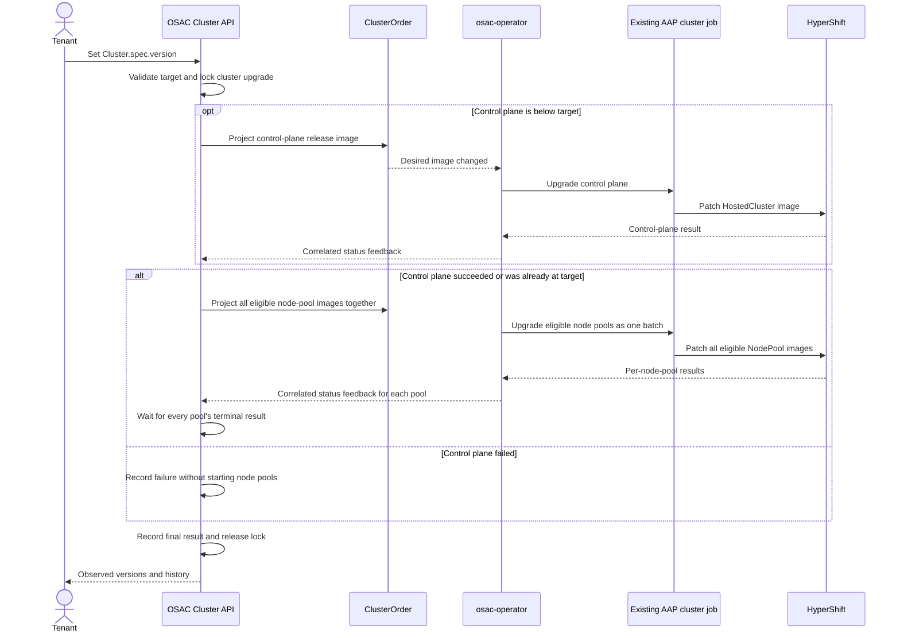

# Cluster Upgrade — CaaS

## Summary

This design enables tenants to request one version upgrade for an entire HCP cluster through OSAC. OSAC upgrades the control plane first, then automatically starts node-pool upgrades through the existing AAP path without re-provisioning the cluster. It holds the per-cluster upgrade gate from acceptance of the new version until all participating components have a terminal result, reports progress, and records control-plane and node-pool outcomes in `Cluster` history.

## Motivation

Tenants have no supported OSAC API for upgrading an HCP cluster. A direct change to a HyperShift resource would be overwritten by OSAC's desired-state reconciliation.

### Goals

- Represent cluster upgrade intent in the existing `Cluster` API.
- Validate version relationships and admit only one cluster upgrade request at a time.
- Track upgrades separately from cluster provisioning.

### Non-Goals

- Concurrent control-plane and node-pool upgrades.
- Tenant-initiated control-plane-only or node-pool-only upgrades.
- Upgrade channels, upgrade-graph discovery, and OSAC risk assessment or acknowledgment. Without an update channel, OSAC cannot assess or acknowledge risks; tenants check them externally. These capabilities have separate feature proposals.
- A cancellation window before HyperShift starts, version-divergence and end-of-life notifications, and a fleet view; these have separate feature proposals.
- SNO or non-HCP clusters.
- Rollback or downgrade.
- Cluster upgrades initiated by the platform without a tenant request.
- Cancel running upgrades (HyperShift does not support it).

### Assumptions

- A `ClusterVersion`'s OpenShift semver and release image are immutable after creation. Distinct selectable versions resolve to distinct release images. This design relies on those catalog invariants for validation and AAP dispatch.

## Proposal

The `Cluster` resource holds the single target version and upgrade intent. Fulfillment first projects its release image to the HostedCluster in `ClusterOrder`. Once HyperShift reports control-plane success, Fulfillment projects the same target to the node pools that need an upgrade. The operator uses AAP to update each existing HyperShift resource, and HyperShift progress returns to `Cluster` status.

### Workflow Description

Tenants request an upgrade by updating `Cluster.spec.version`. They can use the Cluster API, `osac edit cluster`, or the new CLI command:

```bash
osac upgrade cluster <cluster-name> --version <version>
```

`--version` uses the same catalog-name or version-string lookup and canonicalization as `osac create cluster`; a name takes precedence if both match.

The request always covers the control plane and every node set in the cluster. The tenant-facing node-set spec has no version field; tenants select the target only through `Cluster.spec.version`. After control-plane success, OSAC patches all node pools that need an upgrade as one batch, without waiting for one pool's upgrade before starting another.

The UI applies the [admission rules](#admission-and-version-validation) to version choices. It disables a blocked upgrade action and displays the reason.



### API Extensions

#### Public Cluster contract

| Field | Type | Purpose |
|---|---|---|
| `Cluster.spec.version` | Existing `ClusterVersionReference` | Tenant-selected target for the entire cluster upgrade. |
| `Cluster.status.node_sets[<name>].observed_version` | Output-only string | Observed node-pool semver; status only. |
| `ClusterStatus.observed_cp_version` | Output-only string | Observed control-plane semver. |
| `ClusterStatus.upgrade_history` | Output-only list of `ClusterUpgradeHistoryEntry` | Current and previous component upgrade attempts, newest accepted first. |
| `CLUSTER_CONDITION_TYPE_CAN_UPGRADE` | `ClusterConditionType` | Fulfillment-owned admission gate in `Cluster.status.conditions`. |

An entry is created in `Pending` as soon as each component upgrade is accepted, before AAP starts it: the control plane at tenant-request acceptance if it needs an upgrade, and eligible node sets when OSAC schedules them after control-plane success. If the control plane is already at target, eligible node sets are accepted with the tenant request. An entry records its component, observed source and selected target semver, request acceptance time, current state, message, and `last_state_time`. The latter starts at acceptance and changes only when that component's new state is first observed. Entries remain ordered by acceptance time as their states change; earlier entries can still receive observations. The control plane and each node set have independent observed versions.

Public components are `control_plane` or `node_pool:<node-set-name>`. All observed, target, and history versions are OpenShift semver strings such as `4.21.2`, not catalog names such as `4-21-2`.

#### ClusterOrder contract

| Field | Purpose |
|---|---|
| `ClusterOrderSpec.ReleaseImage` | Desired control-plane image, resolved from `Cluster.spec.version`. |
| `ClusterOrderSpec.NodeRequests[].ReleaseImage` | Desired image for each named node set; absent values use the control-plane image fallback. |
| `ClusterOrderStatus.ObservedVersion` | Observed control-plane version. |
| `NodeRequestStatus.ObservedVersion` | Observed NodePool version for the named node set. |

Internal component attempts identify a node set by its OSAC node-set ID. The order maps that ID to its NodePool; the public history keeps the node-set identity rather than the infrastructure resource name.

#### Data migration

New Clusters start with one selected cluster version. Creation stores that version and `CanUpgrade=False` together. HyperShift readiness and version feedback establish the observed control-plane and node-pool baselines and open the gate. Observed versions may diverge while a cluster upgrade is running or after a partial failure. A ready HyperShift cluster may become eligible while post-install tasks keep `ClusterOrder` in `Progressing` under the [OSAC-1604 cluster status model](../OSAC-1604-granular-cluster-status-reporting/).

No eager migration or backfill is planned. This feature assumes the Clusters it serves were created by an OSAC deployment that already included OSAC-1415.

### Implementation Details

#### Admission and version validation

The target `ClusterVersion` must exist, be enabled, and not be OBSOLETE. DEPRECATED versions remain allowed. OSAC compares the catalog's semver with observed semver, never with its catalog name. An accepted request selects a different stored `ClusterVersion` reference and must advance at least one component. Repeating the stored reference does not create a new attempt, even if an observed version still lags; OSAC continues observing or retrying the existing work.

| Component | Required version relationship |
|---|---|
| Control plane | Target is no older than the observed control plane and leaves every observed node pool within three minor versions while the control plane upgrades first. |
| Each node pool | Target is no older than that pool's observed version and no newer than the completed control-plane version. A pool already at target is skipped. |

An upgrade is blocked when the target fails these rules, Cluster state is `FAILED`, `DELETING`, or `DELETE_FAILED`, or `CanUpgrade` is not True. The API explains why the cluster upgrade cannot be triggered.

Fulfillment checks the current observed versions and `CanUpgrade` under the Cluster row lock. It stores the desired cluster version, the initial Pending component entries, and `CanUpgrade=False` in one transaction. The gate stays False for the complete cluster request; a competing request sees it and is rejected. After control-plane success, Fulfillment accepts eligible node-set attempts and adds their Pending entries before projecting the node-pool images. Node-set additions and size increases are rejected while an upgrade is active. Size reductions and removals follow normal update rules and serialize with active AAP work. If an active node-set attempt is removed, its entry records `NodeSetRemoved` once its NodePool is deleted.

`PROGRESSING` Cluster state does not itself block an upgrade when `CanUpgrade=True`. The gate reflects completion of the previous cluster upgrade, not HyperShift health.

#### ClusterVersion deletion protection

The `ClusterVersion` soft-deletion guard protects every version referenced by an active control plane or node set. Node-set references are internal even though tenants do not select them separately.

#### Desired-state projection

The Cluster stores selected version references, not release images. Fulfillment resolves them and projects the control-plane image to `ClusterOrder.spec.releaseImage` first. On control-plane success, or immediately if it was already at target, Fulfillment projects the accepted target image for all node pools below target together. Internal node-set references and `NodeRequest` images retain each component's selected version; pools already observed at target are skipped.

The operator hashes the complete `ClusterOrder.spec`, including control-plane and node-pool release images, and uses the existing AAP cluster job when that desired config differs from the latest job. A changed accepted version reference changes its release image under the catalog invariant above. The generic lifecycle compares the latest job, so A → B → A launches a new job even though its final spec equals an older one. An unchanged reference changes neither the spec nor the hash and launches no new job.

#### Upgrade execution

The operator uses the configured AAP cluster job or workflow for each change in projected desired state. AAP receives the full `ClusterOrder`, applies the control-plane image first, and applies all eligible NodePool images together after control-plane success. Reconciliation or restart must not launch duplicate jobs for one desired config. Fulfillment persists the accepted request and per-component history so it can resume orchestration after a restart.

The existing per-cluster AAP job lifecycle serializes updates to a `ClusterOrder`; after a job finishes, the operator re-evaluates the latest desired spec. The node-pool batch does not wait for any one pool's HyperShift upgrade to complete before patching the others. This job serialization is distinct from the Fulfillment upgrade gate, which remains held until the cluster attempt ends.

AAP uses the existing HostedCluster and NodePool reconciliation path, identifying node pools by their OSAC node-set mapping and applying the projected images. A successful AAP job confirms that its work completed, not that HyperShift finished upgrading.

OSAC-provisioned NodePools currently use `spec.management.upgradeType: InPlace` because their workers are bare metal. This setting may change later with introduction of virtualization-backed clusters.

Later reconciliation must preserve each NodePool's selected image. A partial upgrade must not revert an upgraded pool or advance one whose image application failed. A NodeRequest without its own image uses the control-plane image fallback.

#### Upgrade progress and feedback

| State | Description |
|---|---|
| Pending | OSAC accepted the target or scheduled a component; HyperShift has not signaled that component's start, even if AAP applied its patch. |
| Progressing | HyperShift is working toward the requested version of the control plane or one or more node pools. |
| TimedOut | An implementation-defined timeout has elapsed before a participating component's definitive result; observation continues. |
| Succeeded | This component reached the target version. |
| Failed | HyperShift reported a terminal error for this component. |
| NodeSetRemoved | A participating node set and its NodePool were removed before that component completed. |

The operator determines whether the selected HyperShift control plane or node pool has started upgrading, completed the requested version, or reached a terminal failure. The concrete HyperShift fields and signals used to make those determinations are left to implementation. Control-plane success is the prerequisite for starting any node-pool upgrade.

The operator reports HyperShift observations and observed semver through the existing private Cluster Update path. Fulfillment correlates each observation with the participating component's private attempt ID and target image; a later entry for another component does not hide an active earlier one. Success advances only that component's observed version, while failure leaves it unchanged. Replayed or stale feedback cannot change a different attempt, duplicate history, or release the gate.

As soon as control-plane success is recorded, Fulfillment projects one batch that upgrades all node pools below target without another tenant request. If the control plane was already at target when the request was accepted, that batch starts directly. A failed node pool is recorded while the other pools continue. The gate opens when every participating component has a definitive result, or when control-plane failure prevents node-pool work. An unchanged target reference is not a new request and does not restart a completed or stalled component attempt.

A participating entry may change to `TimedOut` after a defined threshold. This does not create another entry or release `CanUpgrade`; the operator continues monitoring HyperShift, and a later definitive result updates the same entry.

Initial readiness feedback sets the observed baselines and `CanUpgrade=True` together while no upgrade is active. An upgrade never changes Cluster or `ClusterOrder` provisioning state. Upgrade status describes only application of the requested version, independently of cluster health: a cluster may remain ready and serve workloads after a failed upgrade, or become degraded after a successful one.

This feature exposes `Cluster.status.upgrade_history`. Fulfillment creates each component entry when that component upgrade is accepted, newest first by acceptance time, and updates its state in place. Components already at target and node pools never started after control-plane failure have no entry for that cluster request. A later changed target creates new entries; replayed feedback creates none. OSAC does not copy HyperShift history or count initial installation as an upgrade. A node-set entry identifies its public node-set name; the attempt ID remains private.

Fulfillment owns attempt IDs. It stores them in private Cluster state and projects them to a top-level `ClusterOrder` metadata annotation so AAP can stamp the corresponding HostedCluster or NodePool. They are absent from the tenant-facing API and `ClusterOrder.spec`. Kubernetes clients with direct write permission can technically edit the annotation; such edits do not change the spec hash or initiate an AAP job, and feedback must match the ID stamped on the HyperShift component.

### Security Considerations

OSAC resolves target images from the `ClusterVersion` catalog. Tenant input cannot supply an arbitrary release-image pullspec.

### Failure Handling and Recovery

| Failure | Behavior and recovery | Tenant-visible result |
|---|---|---|
| AAP is unavailable or a job error is retryable | The existing job lifecycle retries with backoff after AAP or hub API access recovers. | The component entry remains Pending with an upgrade-specific message. |
| AAP cannot reconcile a HyperShift resource | The AAP job reports its error. Control-plane failure prevents node-pool work; a node-pool failure is recorded while other pool upgrades continue. | The component entry reports the error; provisioning state is independent. |
| Fulfillment or operator restarts during an upgrade | Fulfillment resumes persisted component progress; the operator resumes reconciliation without launching a duplicate upgrade or repeating an already-applied patch. | Status updates may pause briefly; the cluster gate remains held. |
| AAP succeeds but HyperShift has not started or completed | The operator continues observing HyperShift. | The component stays Pending until the start signal, then Progressing until completion. |
| A component takes too long | OSAC updates its existing entry to TimedOut and keeps monitoring; SRE can investigate. | TimedOut in `Cluster.status.upgrade_history`, with no new entry or gate release. |
| Catalog lookup fails during projection | Reconciliation retries after catalog access returns. | The accepted upgrade remains Pending. |
| HyperShift reports an upgrade error | The operator exposes the component-specific message. Control-plane failure prevents node-pool work; other node pools continue after one fails. | The existing component entry changes to Failed; provisioning state is unchanged. |
| A participating node set is removed | OSAC waits for its NodePool deletion before ending that component's observation. | The existing entry changes to NodeSetRemoved; other components continue. |

This feature does not query the OpenShift Update Service (OSUS) for upgrade-graph reachability or assess upgrade risks. Before initiating an upgrade, tenants must use the [Red Hat OpenShift Container Platform Update Graph](https://access.redhat.com/labs/ocpupgradegraph/update_path/) outside OSAC to check the path from the current to target OpenShift version and review associated risks. OSAC applies the catalog-resolved release image without verifying that path or surfacing those risks; channels and conditional-update risk review have a separate feature proposal.

### RBAC / Tenancy

The upgrade path preserves existing tenant isolation. The tenant's existing `Update` permission on its `Cluster` gates requests; `ClusterOrder` retains the `osac.openshift.io/tenant` annotation and existing OPA isolation.

The osac-operator retains read-only access to `HostedCluster` and NodePool resources. The existing AAP cluster execution identity performs the patch after checking the target's namespace and `ClusterOrder` association. No new permissions or OPA policies are required.

### Drawbacks

The entire cluster upgrade holds one gate: node pools wait for control-plane success, and any stalled pool delays gate release. Patching all node pools together may temporarily reduce tenant workload capacity; this design does not guarantee that one pool remains operational throughout the upgrade. Reusing AAP adds scheduling time and makes each component depend on AAP availability before HyperShift can begin.

## Alternatives (Not Implemented)

**On-demand HyperShift history:** OSAC could display upgrade history directly from HyperShift instead of storing it. HyperShift does not provide node-pool upgrade history, so this would not cover both components.

**Health-based upgrade gate:** `CanUpgrade` could be updated continuously from cluster health, such as degradation. However, this design uses it to serialize complete cluster upgrade attempts; cluster health and upgrade status remain independent, so a later health change does not change the gate.

**Direct operator patching:** The operator could update HyperShift images itself. That would require write access and a second mutation path alongside AAP. The design keeps one controlled path.

**Repeated attempts for an unchanged target:** OSAC could accept another request when an observed version lags the already selected release image and assign a new attempt ID. The current design creates an attempt only for a changed stored version reference. The ID is transported in metadata, while AAP dispatch depends on the `ClusterOrder.spec` hash; an ID-only change would not launch a job. Supporting repeated attempts would require attempt-aware dispatch independent of the image without introducing a tenant-editable attempt field. It is not part of this feature's selected behavior.

## Test Plan

The [test plan](testplan.md) is the companion verification artifact and must assign tiers and owners to detailed cases. This design requires these scenarios:

### Unit

- Reject invalid catalog targets, OpenShift version downgrades, and version-skew violations across the complete cluster; verify an unchanged stored target creates no new attempt even when an observed version lags.
- Verify the tenant-facing node-set spec has no version field and reject node-set additions or size increases during an active cluster upgrade.

### Integration

- Accept only one of two concurrent cluster upgrade requests; retain the gate after control-plane and individual node-pool results, then release it once every participating node pool has a terminal result or the control plane fails.
- Dispatch a new AAP job when the projected spec image changes; after control-plane success project all eligible NodePool images in one batch, and resume component progress after Fulfillment or operator restart.
- Create component history entries at request acceptance and update them by attempt ID; timeout and replay create no new entries and do not release the gate. Continue other node pools after one fails.
- Establish observed version baselines for newly created Clusters and preserve each node pool's image during later reconciliation.

### E2E

- Request one whole-cluster upgrade through the tenant-facing API, CLI, and UI; observe control-plane completion before all eligible NodePools are patched, then a terminal result for every participating pool before gate release.
- Verify retryable AAP errors, nonterminal timeout warnings, terminal HyperShift failures, and the no-new-attempt rule for an unchanged target follow the recovery and gate rules.

## Graduation Criteria

No release target or maturity stage is specified here. Dev Preview, Tech Preview, and GA graduation gates will be defined when a release is targeted; the following checks define this feature's technical readiness.

- A single upgrade request through the API, CLI, or UI upgrades the control plane and then all eligible node pools without separate tenant actions.
- `Cluster.status` reports current and previous component upgrade states, observed versions, and acceptance and last-transition times in history.
- Integration tests verify OpenShift version downgrade and N-3 skew rejection, image-driven AAP dispatch, and the no-new-attempt rule for an unchanged target.
- The operator needs no new HyperShift write permission and uses the existing AAP cluster job.

## Deployment Strategy

The status contract is deployed with the feature. Under the [data-migration assumption](#data-migration), supported Clusters were created with that contract and require no eager backfill.

## Dependencies

- [PR #1418](https://github.com/osac-project/osac/pull/1418): Makes NodePools addressable by name; it must be merged and deployed before node-pool upgrades.

## Version Skew Strategy

Fulfillment-service, osac-operator, osac-aap, and osac-ui ship in a coordinated deployment. Upgrade requests remain disabled until fulfillment-service, osac-operator, and the AAP upgrade path are available. Older UI builds simply omit the new status fields.

## Support Procedures

This feature introduces no new support tooling or separate runtime enable/disable procedure. SREs inspect `Cluster.status.upgrade_history` for stalled or failed components and follow [Failure Handling and Recovery](#failure-handling-and-recovery); upgrade request enablement during rollout follows [Version Skew Strategy](#version-skew-strategy).

## Infrastructure Needed

No new runtime infrastructure or AAP job template is needed; this feature reuses the configured AAP cluster job or workflow and existing HyperShift resources. The companion test plan records unresolved deployed provider, browser, and failure-injection test prerequisites.

---

## Provenance

Authored: draft @ design 0.11.1 - f1d6a4b, workspace main @ b14c881c5 (dirty)
Final: revise @ design 0.11.3 - 2bd6607, workspace main @ 9c26507ef

> Context changed between draft and revise.

<!-- ai-workflow-provenance:{"schema_version":1,"provenance_kind":"session","workflow":"design","workflow_version":"0.11.3","ai_workflows":"2bd6607","source_repo":"9c26507ef","source_repo_branch":"main","commits_behind_main":0,"commits_ahead_main":0,"main_ref":"main","phases":["draft","draft","revise","revise","revise","revise","revise","revise","revise","revise","revise","revise","revise","revise","revise","revise","revise","revise","revise","revise","revise"],"authoring_modes":["skill"],"context_changed":true,"origin_untracked":false} -->
