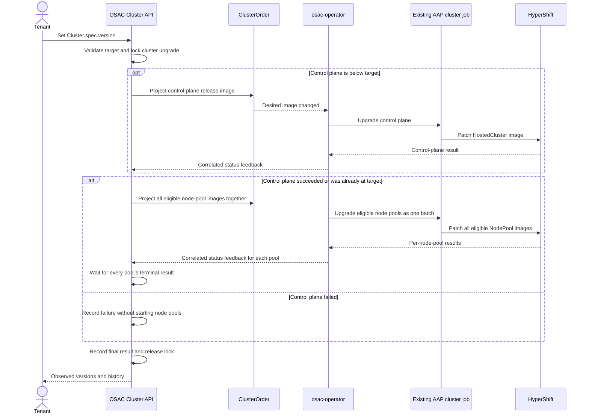

# Cluster Upgrade — CaaS

## Summary

This design enables tenants to request one version upgrade for an entire HCP cluster through OSAC. OSAC upgrades the control plane first, then automatically starts node-pool upgrades through the existing AAP path without re-provisioning the cluster. It holds the per-cluster upgrade gate from acceptance of the new version until all participating components have a terminal result, reports progress, and records control-plane and node-pool outcomes in `Cluster` history.

## Motivation

Tenants have no supported OSAC API for upgrading an HCP cluster. A direct change to a HyperShift resource would be overwritten by OSAC's desired-state reconciliation.

### Goals

- Represent cluster upgrade intent in the existing `Cluster` API.
- Validate version relationships and admit only one cluster upgrade request at a time.
- Track upgrades separately from cluster provisioning.

### Non-Goals

- Concurrent control-plane and node-pool upgrades.
- Tenant-initiated control-plane-only or node-pool-only upgrades.
- Upgrade channels, upgrade-graph discovery, and OSAC risk assessment or acknowledgment. Without an update channel, OSAC cannot assess or acknowledge risks; tenants check them externally. These capabilities have separate feature proposals.
- A cancellation window before HyperShift starts, version-divergence and end-of-life notifications, and a fleet view; these have separate feature proposals.
- SNO or non-HCP clusters.
- Rollback or downgrade.
- Cluster upgrades initiated by the platform without a tenant request.
- Cancel running upgrades (HyperShift does not support it).

### Assumptions

- A `ClusterVersion`'s OpenShift semver and release image are immutable after creation. This design relies on that stability for validation and image projection.

## Proposal

The `Cluster` resource holds the single target version and upgrade intent. Fulfillment first projects its release image to the HostedCluster in `ClusterOrder`. Once HyperShift reports control-plane success, Fulfillment projects the same target to the node pools that need an upgrade. The operator uses AAP to update each existing HyperShift resource, and HyperShift progress returns to `Cluster` status.

### Workflow Description

Tenants request an upgrade by updating `Cluster.spec.version`. They can use the Cluster API, `osac edit cluster`, or the new CLI command:

```bash
osac upgrade cluster <cluster-name> --version <version>
```

`--version` accepts a `ClusterVersion` catalog name or version string; a name takes precedence if both match.

The request always covers the control plane and every node set in the cluster. The tenant-facing node-set spec has no version field; tenants select the target only through `Cluster.spec.version`. After control-plane success, OSAC patches all node pools that need an upgrade as one batch, without waiting for one pool's upgrade before starting another.

The UI applies the [admission rules](#admission-and-version-validation) to version choices. It disables a blocked upgrade action and displays the reason.



### API Extensions

#### Public Cluster contract

| Field | Type | Purpose |
|---|---|---|
| `Cluster.spec.version` | Existing `ClusterVersionReference` | Tenant-selected target for the entire cluster upgrade. |
| `Cluster.status.node_sets[<name>].observed_version` | Output-only string | Observed node-pool semver; status only. |
| `ClusterStatus.observed_cp_version` | Output-only string | Observed control-plane semver. |
| `ClusterStatus.version_history` | Output-only list of `ClusterVersionHistoryEntry` | Terminal results for each control-plane and node-pool component in a cluster upgrade, successful or failed. |
| `CLUSTER_CONDITION_TYPE_CAN_UPGRADE` | `ClusterConditionType` | Fulfillment-owned admission gate in `Cluster.status.conditions`. |

A history entry, newest first, conveys a component's source and target versions, start and latest state time, and last observed state. Entries are correlated with their cluster component upgrade attempt; the exact fields are left to implementation.

Public components are `control_plane` or `node_pool:<node-set-name>`. All observed, target, and history versions are OpenShift semver strings such as `4.21.2`, not catalog names such as `4-21-2`.

#### ClusterOrder contract

| Field | Purpose |
|---|---|
| `ClusterOrderSpec.ReleaseImage` | Desired control-plane image, resolved from `Cluster.spec.version`. |
| `ClusterOrderStatus.ObservedVersion` | Observed control-plane version. |

The internal component uses `node_pool:<node-pool-name>` for a node pool. Fulfillment maps it to the public node-set name.

#### Data migration

New Clusters start with one selected cluster version. Creation stores that version and `CanUpgrade=False` together. Observed control-plane and node-pool versions may diverge while a cluster upgrade is running or after a partial failure.

Existing Clusters become eligible only when HyperShift readiness is established under the [OSAC-1604 cluster status model](../OSAC-1604-granular-cluster-status-reporting/) and observed control-plane and node-pool version baselines resolve. The migration initializes the upgrade gate; readiness feedback sets `CanUpgrade=True` when those conditions hold. Unresolved or not-yet-ready Clusters remain blocked.

HyperShift cluster readiness under that model can be established while post-install tasks keep `ClusterOrder` in `Progressing`. Those tasks do not block upgrades once HyperShift is ready and `CanUpgrade=True`.

### Implementation Details

#### Admission and version validation

The target `ClusterVersion` must exist, be enabled, and not be OBSOLETE. DEPRECATED versions remain allowed. OSAC compares the catalog's semver with observed semver, never with its catalog name. A request must advance at least one component; selecting the already-observed control-plane version is allowed to retry node pools left behind by a failed cluster upgrade.

| Component | Required version relationship |
|---|---|
| Control plane | Target is no older than the observed control plane and leaves every observed node pool within three minor versions while the control plane upgrades first. |
| Each node pool | Target is no older than that pool's observed version and no newer than the completed control-plane version. A pool already at target is skipped. |

An upgrade is blocked when the target fails these rules, Cluster state is `FAILED`, `DELETING`, or `DELETE_FAILED`, or `CanUpgrade` is not True. The API explains why the cluster upgrade cannot be triggered.

Fulfillment checks the current observed versions and `CanUpgrade` under the Cluster row lock. It stores the desired cluster version, a Pending upgrade with the resolved target semver and a snapshot of the participating node sets, and `CanUpgrade=False` in one transaction. The gate stays False for the complete attempt; a competing request sees it and is rejected. Node-set additions and removals are rejected while the attempt is active so that its membership cannot change. Size changes wait for active upgrade work through the existing job serialization.

`PROGRESSING` Cluster state does not itself block an upgrade when `CanUpgrade=True`. The gate reflects completion of the previous cluster upgrade, not HyperShift health.

#### ClusterVersion deletion protection

The existing `ClusterVersion` soft-deletion guard continues to protect `Cluster.spec.version`. This feature adds no tenant-facing node-set version references to protect.

#### Desired-state projection

The Cluster stores the selected version reference, not a release image. Fulfillment resolves it to an image and first projects it to `ClusterOrderSpec.ReleaseImage` if the control plane is below target. On control-plane success, or immediately if it was already at target, Fulfillment supplies the same accepted target image for all node pools below target together. A retry skips components already observed at the target. How the implementation retains and conveys per-pool target images is left open.

Image-only upgrade changes must not trigger re-provisioning or scaling through the creation and scaling `DesiredConfigVersion` hash. The operator instead detects a difference between the desired and live release images. Other spec changes continue through the existing provisioning path, which must preserve images already selected for the control plane and each node pool.

#### Upgrade execution

The operator uses the configured AAP cluster job or workflow to patch all eligible NodePools in one batch after control-plane success, passing the upgrade operation and target image. Reconciliation or restart must not repeat a patch for the same component and cluster attempt. Fulfillment persists the accepted attempt, participating node sets, and per-component state so it can resume orchestration after a restart.

Upgrade AAP work waits for any active create or scale job. A create or scale job also waits for active upgrade AAP work. After a job finishes, the operator re-evaluates the latest `ClusterOrder`. These jobs use the existing per-cluster lease; the node-pool batch patches every eligible NodePool without waiting for any one pool's HyperShift upgrade to complete. The lease is distinct from the Fulfillment upgrade gate, which remains held until the cluster attempt ends.

The AAP upgrade path selects each NodePool by name. It checks that the selected `HostedCluster` or NodePool exists and belongs to this `ClusterOrder`, then patches only `spec.release.image` and confirms the live image afterward.

It does not create a missing resource or run installation, infrastructure, readiness, or post-install tasks. A successful AAP job confirms the patch, not completion of the HyperShift upgrade.

OSAC-provisioned NodePools currently use `spec.management.upgradeType: InPlace` because their workers are bare metal. This setting may change later with introduction of virtualization-backed clusters.

The create and scale path must preserve each NodePool's selected image during later re-provisioning or scaling. A partial upgrade must not revert an upgraded pool or advance one whose image patch failed. The implementation determines where the images are retained and how older `ClusterOrder` resources fall back to the cluster image.

#### Upgrade progress and feedback

| State | Description |
|---|---|
| Pending | OSAC accepted the target or scheduled a component; HyperShift has not signaled that component's start, even if AAP applied its patch. |
| Progressing | HyperShift is working toward the requested version of the control plane or one or more node pools. |
| TimedOut (Cluster status only) | An implementation-defined timeout has elapsed before a participating component's terminal result; this is a warning, not a HyperShift failure signal. |
| Succeeded | Every participating component has reached the target version. |
| Failed | The control plane failed, or at least one node pool failed after all participating node pools reached a terminal result. |

The operator determines whether the selected HyperShift control plane or node pool has started upgrading, completed the requested version, or reached a terminal failure. The concrete HyperShift fields and signals used to make those determinations are left to implementation. Control-plane success is the prerequisite for starting any node-pool upgrade.

The operator reports HyperShift completion signals and observed semver through the existing private Cluster Update path. Fulfillment accepts success only when the reported cluster attempt, participating component, and observed semver match the accepted target. It records one terminal history entry per component; success also advances that component's observed version, while failure leaves it unchanged. Replayed or stale feedback cannot schedule duplicate work, duplicate history, or release the gate.

As soon as control-plane success is recorded, Fulfillment starts one batch that patches all node pools below target without another tenant request; a retry whose control plane is already at target starts that batch directly. Pools already observed at target are skipped. A failed node pool is recorded while the other pool upgrades continue. Fulfillment waits for every participating node pool to reach a terminal result, then sets the cluster attempt to Succeeded if every required component succeeded, otherwise Failed, and sets `CanUpgrade=True` in the same transaction. If the control plane fails, no node pool starts; Fulfillment records Failed and releases the gate then. If no node pool needs an upgrade, control-plane success completes the attempt. A new request for the same target may retry components still below it.

A participating component may be marked `TimedOut` if it is taking too long according to a defined threshold. OSAC sets `Cluster.status.upgrade.state=TimedOut` with a tenant-visible warning, but leaves `CanUpgrade=False` and does not add a history entry for that component. The operator continues monitoring HyperShift; a later component result replaces TimedOut and contributes to the cluster attempt's outcome under the rules above.

Initial readiness feedback sets the observed baselines and `CanUpgrade=True` together while no upgrade is active. An upgrade never changes Cluster or `ClusterOrder` provisioning state. Upgrade status describes only application of the requested version, independently of cluster health: a cluster may remain ready and serve workloads after a failed upgrade, or become degraded after a successful one.

This feature exposes `Cluster.status.version_history`. Fulfillment adds one entry when each control-plane or node-pool component in an accepted cluster attempt first succeeds or fails; replayed feedback adds none, while a separately accepted retry adds another entry even for the same target. Skipped components do not create new entries. OSAC does not copy HyperShift history or count initial installation as an upgrade. A node-pool entry uses the public `node_pool:<node-set-name>` component.

### Security Considerations

OSAC resolves target images from the `ClusterVersion` catalog. Tenant input cannot supply an arbitrary release-image pullspec.

### Failure Handling and Recovery

| Failure | Behavior and recovery | Tenant-visible result |
|---|---|---|
| AAP is unavailable or a patch error is retryable | The operator retries with backoff after AAP or hub API access recovers. | Upgrade remains Pending with an upgrade-specific message. |
| The selected resource is absent or belongs to another `ClusterOrder` | AAP fails before patching that resource. A control-plane failure ends the cluster attempt; a node-pool failure is recorded while other pool upgrades continue. After the resource or association is restored, the tenant can retry the cluster target. | Failed result with a target-validation message for that component; provisioning state is unchanged. |
| Fulfillment or operator restarts during an upgrade | Fulfillment resumes persisted component progress; the operator resumes reconciliation without launching a duplicate upgrade or repeating an already-applied patch. | Status updates may pause briefly; the cluster gate remains held. |
| AAP succeeds but HyperShift has not started or completed | The operator continues observing HyperShift. | Pending until the start signal, then Progressing until completion. |
| A component takes too long | OSAC records a nonterminal timeout warning and the operator keeps monitoring; SRE can investigate the stalled component. | TimedOut in `Cluster.status.upgrade`, with no terminal history entry or gate release. |
| Catalog lookup fails during projection | Reconciliation retries after catalog access returns. | The accepted upgrade remains Pending. |
| HyperShift reports an upgrade error | The operator exposes the component-specific message. A control-plane failure ends the attempt; a node-pool failure is recorded while other pool upgrades continue. | The failure appears in component history and the final cluster result; provisioning state is unchanged. |

This feature does not query the OpenShift Update Service (OSUS) for upgrade-graph reachability or assess upgrade risks. Before initiating an upgrade, tenants must use the [Red Hat OpenShift Container Platform Update Graph](https://access.redhat.com/labs/ocpupgradegraph/update_path/) outside OSAC to check the path from the current to target OpenShift version and review associated risks. OSAC applies the catalog-resolved release image without verifying that path or surfacing those risks; channels and conditional-update risk review have a separate feature proposal.

### RBAC / Tenancy

The upgrade path preserves existing tenant isolation. The tenant's existing `Update` permission on its `Cluster` gates requests; `ClusterOrder` retains the `osac.openshift.io/tenant` annotation and existing OPA isolation.

The osac-operator retains read-only access to `HostedCluster` and NodePool resources. The existing AAP cluster execution identity performs the patch after checking the target's namespace and `ClusterOrder` association. No new permissions or OPA policies are required.

### Drawbacks

The entire cluster upgrade holds one gate: node pools wait for control-plane success, and any stalled pool delays gate release. Patching all node pools together may temporarily reduce tenant workload capacity; this design does not guarantee that one pool remains operational throughout the upgrade. Reusing AAP adds scheduling time and makes each component depend on AAP availability before HyperShift can begin.

## Alternatives (Not Implemented)

**On-demand HyperShift history:** OSAC could display upgrade history directly from HyperShift instead of storing it. HyperShift does not provide node-pool upgrade history, so this would not cover both components.

**Health-based upgrade gate:** `CanUpgrade` could be updated continuously from cluster health, such as degradation. However, this design uses it to serialize complete cluster upgrade attempts; cluster health and upgrade status remain independent, so a later health change does not change the gate.

**Direct operator patching:** The operator could update HyperShift images itself. That would require write access and a second mutation path alongside AAP. The design keeps one controlled path.

## Test Plan

The [test plan](testplan.md) is the companion verification artifact and must assign tiers and owners to detailed cases. This design requires these scenarios:

### Unit

- Reject invalid catalog targets, OpenShift version downgrades, and version-skew violations across the complete cluster; allow a same-target retry when some node pools remain behind.
- Verify the tenant-facing node-set spec has no version field and reject node-set membership changes during an active cluster upgrade.

### Integration

- Accept only one of two concurrent cluster upgrade requests; retain the gate after control-plane and individual node-pool results, then release it once every participating node pool has a terminal result or the control plane fails.
- Route image-only changes to the AAP upgrade path without re-provisioning; after control-plane success patch all eligible NodePools in one batch, and resume component progress after Fulfillment or operator restart.
- Record one history result per attempted component; timeout and replay neither count as terminal nor release the gate. Attempt other node pools after one fails and mark the final cluster result Failed.
- Establish observed version baselines and the upgrade gate for existing Clusters; preserve each node pool's image during later scaling.

### E2E

- Request one whole-cluster upgrade through the tenant-facing API, CLI, and UI; observe control-plane completion before all eligible NodePools are patched, then a terminal result for every participating pool before gate release.
- Verify retryable AAP errors, nonterminal timeout warnings, terminal HyperShift failures, and a same-target retry follow the recovery and gate rules.

## Graduation Criteria

No release target or maturity stage is specified here. Dev Preview, Tech Preview, and GA graduation gates will be defined when a release is targeted; the following checks define this feature's technical readiness.

- A single upgrade request through the API, CLI, or UI upgrades the control plane and then all eligible node pools without separate tenant actions.
- `Cluster.status` reports the current or last cluster upgrade state, observed versions, and successful and failed component results in history.
- Integration tests verify OpenShift version downgrade and N-3 skew rejection, migration, and the AAP upgrade path.
- The operator needs no new HyperShift write permission, and upgrades do not rerun cluster creation.

## Deployment Strategy

New status fields are additive. The [data migration](#data-migration) backfills existing Clusters before upgrade requests are enabled.

## Dependencies

- [PR #1418](https://github.com/osac-project/osac/pull/1418): Makes NodePools addressable by name; it must be merged and deployed before node-pool upgrades.

## Version Skew Strategy

Fulfillment-service, osac-operator, osac-aap, and osac-ui ship in a coordinated deployment. Upgrade requests remain disabled until fulfillment-service, osac-operator, and the AAP upgrade path are available. Older UI builds simply omit the new status fields.

## Support Procedures

This feature introduces no new support tooling or separate runtime enable/disable procedure. SREs inspect `Cluster.status.upgrade` for stalled or failed components and follow [Failure Handling and Recovery](#failure-handling-and-recovery); upgrade request enablement during rollout follows [Version Skew Strategy](#version-skew-strategy).

## Infrastructure Needed

No new runtime infrastructure or AAP job template is needed; this feature reuses the configured AAP cluster job or workflow and existing HyperShift resources. The companion test plan records unresolved deployed provider, browser, and failure-injection test prerequisites.

---

## Provenance

Authored: draft @ design 0.11.1 - f1d6a4b, workspace main @ b14c881c5 (dirty)
Final: revise @ design 0.11.3 - 2bd6607, workspace main @ 9c26507ef

> Context changed between draft and revise.

<!-- ai-workflow-provenance:{"schema_version":1,"provenance_kind":"session","workflow":"design","workflow_version":"0.11.3","ai_workflows":"2bd6607","source_repo":"9c26507ef","source_repo_branch":"main","commits_behind_main":0,"commits_ahead_main":0,"main_ref":"main","phases":["draft","draft","revise","revise","revise","revise","revise","revise","revise","revise","revise","revise","revise","revise","revise","revise","revise","revise","revise","revise","revise"],"authoring_modes":["skill"],"context_changed":true,"origin_untracked":false} -->
