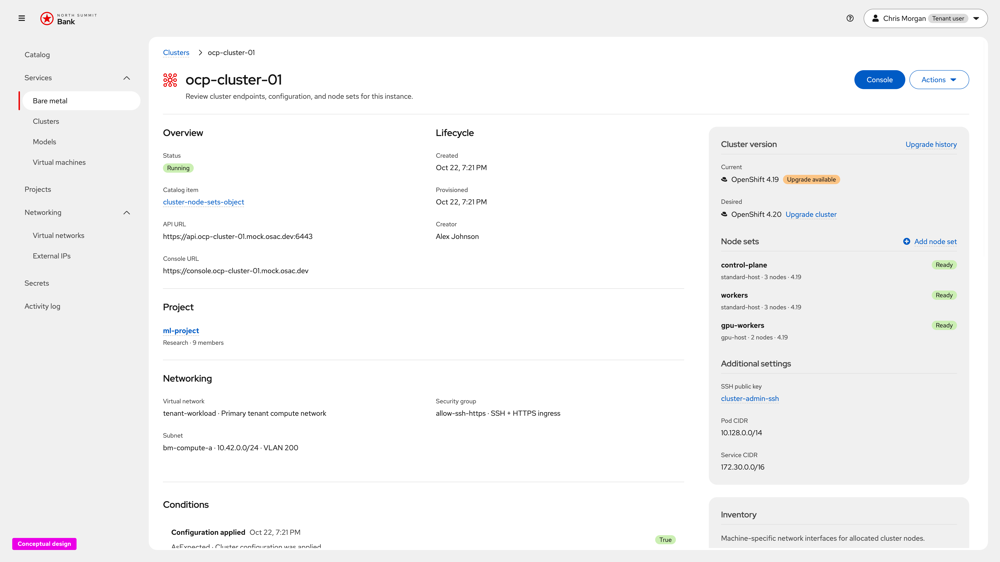
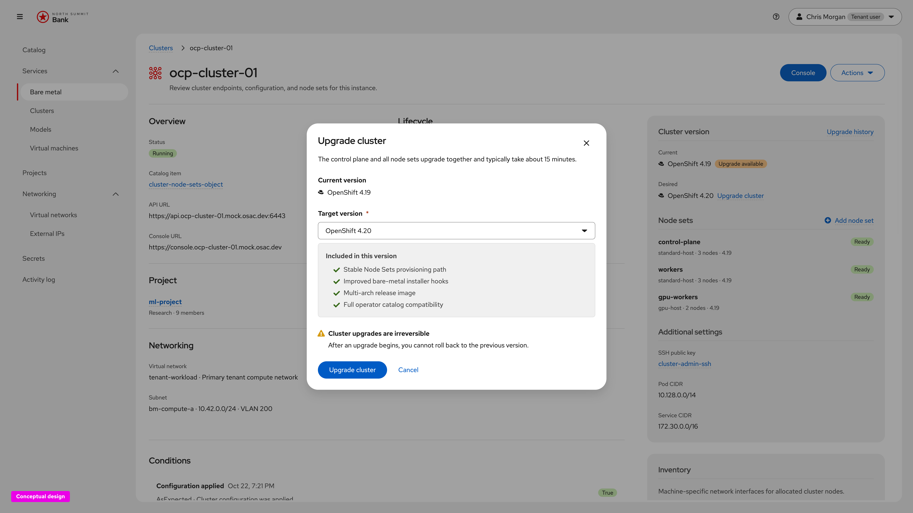
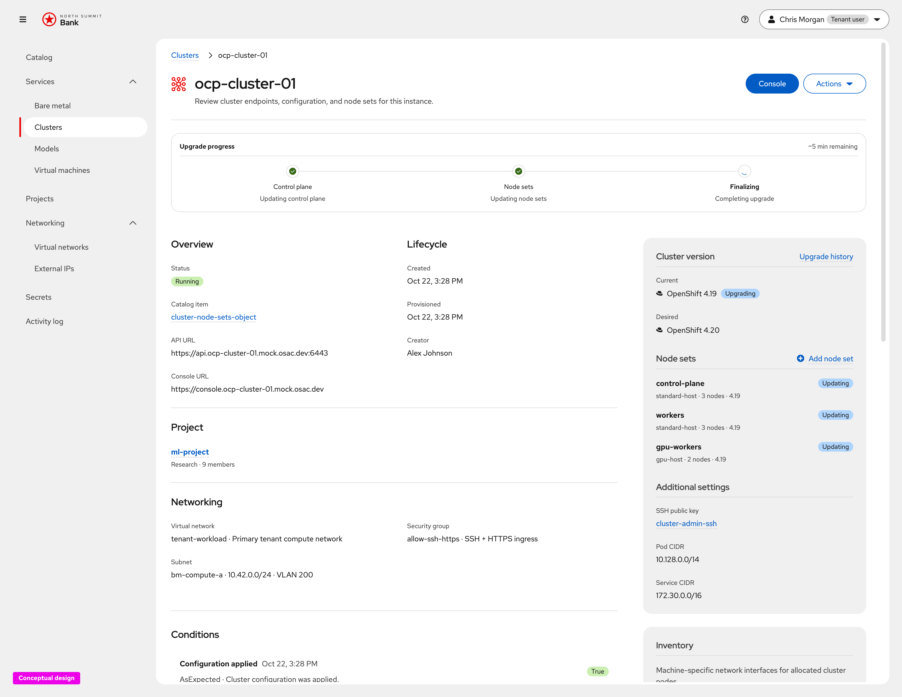
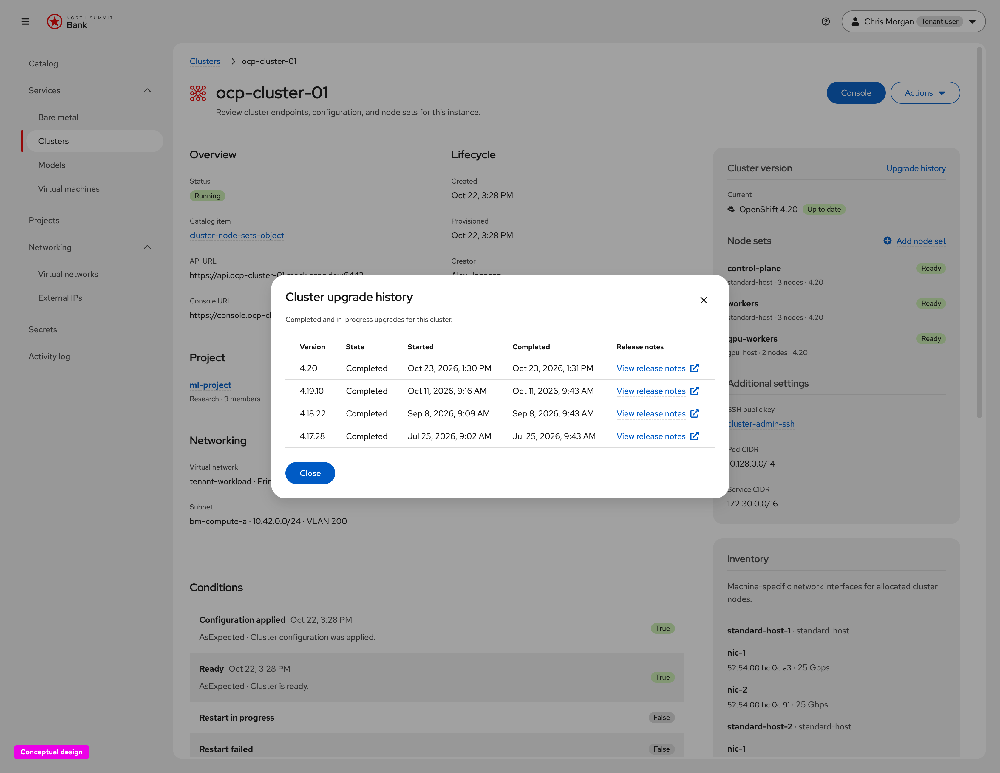

# Cluster Upgrade — CaaS UX Design

Conceptual UX for **tenant cluster version upgrade**
([OSAC-1415](https://redhat.atlassian.net/browse/OSAC-1415)), captured from the
live click-through prototype.

**Prototype (developers):**
[Open cluster upgrade flow](https://heyethankim.github.io/osac-bmaas/tenant-admin/northsummit/workspace?nav=services-clusters&instance=ocp-cluster-01)

Requirements: [prd.md](prd.md). Phase plan: [design.md](design.md).
Implementation addendum: [ui-design.md](ui-design.md).

## Product decisions (this release)

- **Simultaneous components.** A cluster upgrade updates the **control plane and
  node sets at the same time**. The UI presents one cluster upgrade, not
  separate control-plane and node-set actions.
- **Direct version hops.** Tenants choose a **direct upgrade from the current
  version X to a target version Y**. The console does not walk multi-hop paths
  or intermediate versions in this release.
- **Operators unchanged.** Existing **operator versions stay as they are** during
  the cluster upgrade for this release. The UX does not promise or surface
  operator upgrades as part of this flow.
- **History from details.** **Upgrade history** opens from the Cluster version
  rail as a modal over the cluster details page (lightbox + dialog).

Phase 2+ (upgrade-graph risk acknowledgment, cancellation window, fleet
attention) remains out of scope for these screens.

---

## 1. Upgrade available on cluster detail

**What this screen is for.** Tell the tenant that a newer OpenShift version is
allowed for this cluster, show current vs desired, and give a clear path to
start a direct X→Y upgrade—without crowding the header with secondary actions.

**Explanation.** When an allowed target exists, the **Cluster version** rail
shows **Current** with an **Upgrade available** badge and **Desired** with an
**Upgrade cluster** link. That link opens the upgrade modal for a single hop to
Y. Header chrome stays **Console** | **Actions** (kubeconfig, password, Delete);
upgrade stays with version context in the rail. Node sets list observed short
versions so the tenant can see the fleet that will move with the control plane
in the same upgrade. **Upgrade history** on the rail opens the history modal
(see §4) when past attempts exist.

---

## 2. Upgrade cluster modal

**What this screen is for.** Confirm a **direct upgrade from X to Y** and set
expectations before the irreversible start.

**Explanation.** **Upgrade cluster** opens a compact modal (not a full-page
wizard). It shows read-only **Current version** (X), a required **Target
version** selector for allowed catalog versions (Y), and short “included in this
version” offer copy when available. The lede states that the **control plane and
all node sets upgrade together** (same operation, simultaneous), with a typical
duration hint. A warning states upgrades are irreversible (no rollback after
start). The UX does **not** offer a component picker, per–node-set version list,
multi-hop path builder, or any control that implies operators will change as
part of this upgrade—**operator versions remain unchanged** in this release.
Primary CTA **Upgrade cluster**; **Cancel** dismisses without starting.

---

## 3. Upgrade progress

**What this screen is for.** Show that the accepted X→Y upgrade is running and
that control plane and node sets are progressing as one cluster operation.

**Explanation.** After confirmation, an **Upgrade progress** card appears above
the main detail content, reusing the provisioning-style ProgressStepper. Stages
(control plane, node sets, finalizing) communicate progress of the **same**
upgrade; they do not imply a tenant-driven sequence of separate upgrades or a
second confirmation. Remaining-time estimate sits on the right. The Cluster
version rail switches to **Upgrading**; node sets can show **Updating** while
work is in flight. Progress stays separate from cluster provisioning status.
Copy and stage labels should stay consistent with **simultaneous** control-plane
and node-set updates, not “finish the control plane, then start node sets as a
second upgrade.”

---

## 4. Upgrade history

**What this screen is for.** Let the tenant review prior (and in-progress) X→Y
upgrades for this cluster without leaving the details page context.

**Explanation.** From the **Cluster version** rail, **Upgrade history** opens a
modal over the cluster details page (lightbox behind the dialog). The table
lists Version, State, Started, Completed, and **View release notes**. The link
is omitted when history is empty. Capture this state on a steady cluster (no
**Upgrade progress** widget at the top)—history is independent of an in-flight
upgrade UI.

---

## Notes vs ui-design.md

| Topic | This UX design | [ui-design.md](ui-design.md) |
| --- | --- | --- |
| Components | Control plane and node sets update **simultaneously** in one upgrade | Control plane first, then node sets automatically |
| Version path | Direct **X → Y** selection | Same one-target model; align copy with “direct” |
| Operators | Unchanged this release; not part of the upgrade UX | Not called out; keep out of UI promises |
| History | Rail link → history modal on details | Upgrades card / stage + history on Overview |
| Entry | Detail **Upgrade cluster** (rail) | Header **Upgrade version** and list **Actions** |

Align [ui-design.md](ui-design.md) and backend sequencing language with
**simultaneous** control-plane and node-set updates and **direct** X→Y hops
before implementation freeze.
