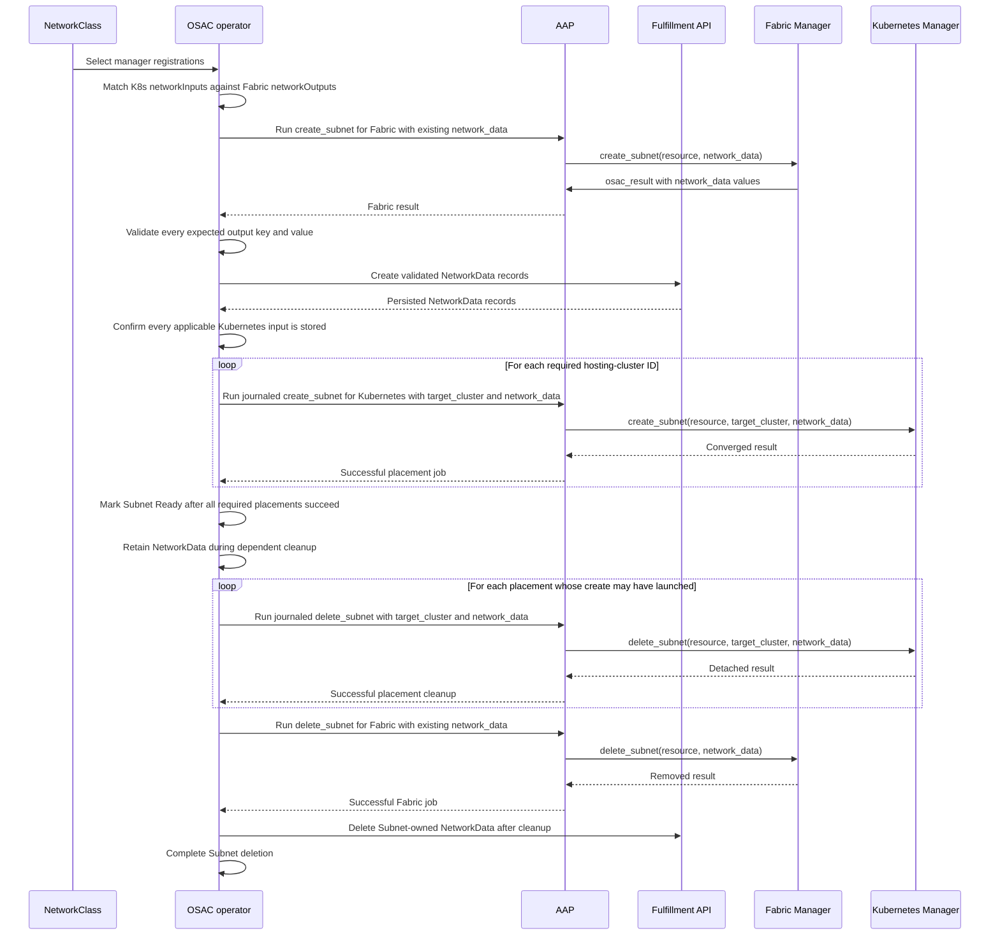

# OSAC Network Manager Integration Contract

| Field | Value |
|-------|-------|
| Author(s) | Dan Manor (dmanor@redhat.com) |
| Jira | https://redhat.atlassian.net/browse/OSAC-1433 |
| PRD | [Network Manager Integration Contract PRD](prd.md) |
| Date | 2026-10-08 |

## Contents

- [1. Overview](#1-overview)
- [2. Goals and Non-Goals](#2-goals-and-non-goals)
  - [2.1 Goals](#21-goals)
  - [2.2 Non-Goals](#22-non-goals)
- [3. Motivation and Background](#3-motivation-and-background)
- [4. Design](#4-design)
  - [4.1 Architecture and Manager Roles](#41-architecture-and-manager-roles)
    - [Fulfillment-group settings and secrets](#fulfillment-group-settings-and-secrets)
  - [4.2 NetworkDataModel and NetworkManager Registration](#42-networkdatamodel-and-networkmanager-registration)
    - [East-West capability boundary](#east-west-capability-boundary)
  - [4.3 API and Manager Task Contract](#43-api-and-manager-task-contract)
    - [Tenant address-space isolation](#tenant-address-space-isolation)
    - [Fulfillment-service API operations](#fulfillment-service-api-operations)
    - [Provider API routes and requests](#provider-api-routes-and-requests)
    - [NetworkData API and resource-scoped exchange](#networkdata-api-and-resource-scoped-exchange)
    - [Common AAP input](#common-aap-input)
      - [Placement-scoped Kubernetes access](#placement-scoped-kubernetes-access)
    - [Canonical serialized task inputs](#canonical-serialized-task-inputs)
    - [Workload attachment policy input](#workload-attachment-policy-input)
    - [Resource action, manager, and task table](#resource-action-manager-and-task-table)
    - [DHCP-based tenant IPv4 addressing](#dhcp-based-tenant-ipv4-addressing)
    - [Generic AAP role invocation](#generic-aap-role-invocation)
    - [Manager result envelope](#manager-result-envelope)
    - [Stable backend ownership and projection recovery](#stable-backend-ownership-and-projection-recovery)
    - [Idempotency for every manager task](#idempotency-for-every-manager-task)
    - [AAP job identity, polling, and retries](#aap-job-identity-polling-and-retries)
    - [Durable operation journal and uncertain launch recovery](#durable-operation-journal-and-uncertain-launch-recovery)
  - [4.4 Manager Stage Ordering and NetworkData Lifecycle](#44-manager-stage-ordering-and-networkdata-lifecycle)
    - [Workload attachment policy lifecycle](#workload-attachment-policy-lifecycle)
  - [4.5 Scalability and Performance](#45-scalability-and-performance)
  - [4.6 Security Considerations](#46-security-considerations)
  - [4.7 Failure Handling and Recovery](#47-failure-handling-and-recovery)
  - [4.8 RBAC and Tenancy](#48-rbac-and-tenancy)
  - [4.9 Extensibility and Future-Proofing](#49-extensibility-and-future-proofing)
    - [Provider-runnable qualification](#provider-runnable-qualification)
  - [4.10 Risks and Mitigations](#410-risks-and-mitigations)
  - [4.11 Drawbacks](#411-drawbacks)
- [5. Interface Changes](#5-interface-changes)
  - [IC-1: Immutable manager and model registry APIs](#ic-1-immutable-manager-and-model-registry-apis)
  - [IC-2: Generic AAP task invocation](#ic-2-generic-aap-task-invocation)
  - [IC-3: Network data matching and fixed role dispatch](#ic-3-network-data-matching-and-fixed-role-dispatch)
  - [IC-4: Manager results and retry behavior](#ic-4-manager-results-and-retry-behavior)
  - [IC-5: Resource-scoped Fabric-to-Kubernetes data exchange](#ic-5-resource-scoped-fabric-to-kubernetes-data-exchange)
  - [IC-6: Workload attachment and SecurityGroup enforcement](#ic-6-workload-attachment-and-securitygroup-enforcement)
  - [IC-7: Provider-installed network data model registry](#ic-7-provider-installed-network-data-model-registry)
  - [IC-8: Durable operation recovery and provider qualification](#ic-8-durable-operation-recovery-and-provider-qualification)
- [6. Alternatives Considered](#6-alternatives-considered)
  - [Fetch the schema from a URL](#fetch-the-schema-from-a-url)
  - [Store the model schema in a separate ConfigMap](#store-the-model-schema-in-a-separate-configmap)
  - [Keep runtime values in owner-scoped ConfigMaps](#keep-runtime-values-in-owner-scoped-configmaps)
  - [Keep a hard-coded manager-pair table in Go](#keep-a-hard-coded-manager-pair-table-in-go)
  - [Let managers call each other directly](#let-managers-call-each-other-directly)
  - [Keep the manager jobs independent](#keep-the-manager-jobs-independent)
  - [Let NetworkManager select an arbitrary collection role](#let-networkmanager-select-an-arbitrary-collection-role)
  - [Pass an opaque vendor-specific artifact](#pass-an-opaque-vendor-specific-artifact)
- [7. Observability and Monitoring](#7-observability-and-monitoring)
- [8. Impact and Compatibility](#8-impact-and-compatibility)
  - [Installation and profile bootstrap order](#installation-and-profile-bootstrap-order)

## 1. Overview

A Fabric Manager configures the provider's physical network fabric for OSAC. A Kubernetes Manager connects Kubernetes-hosted workloads to that fabric. NetworkClass selects one implementation for each configured role. NetworkDataModel defines one value's meaning, owner scope, and JSON Schema; NetworkData stores one validated value for a model and owner; NetworkManager registers an implementation, its role, capabilities, and NetworkData inputs or outputs.

This design defines the source-neutral role contract, registration APIs, Ansible
Automation Platform (AAP) task interface, and OSAC-owned exchange between
managers. Every successful manager request returns the same structured AAP job
artifact, `osac_result`; it is a manager response, not an OSAC API resource.
Ansible publishes it with `set_stats`, AAP exposes it under the completed job's
`artifacts` field, and the OSAC operator reads it from the exact tracked job.
The result identifies the reconciled resource UID and observed specification
generation, and carries any NetworkData values or request-specific output. For
workload attachment jobs, the reconciled resource is the internal
`SubnetAttachment` request; its referenced workload is a separate target.
OSAC already knows the resource lifecycle action, manager stage, and any
request phase from reconciliation, so managers do not send an operation
identifier. OSAC validates the result before treating the request as complete
and validates and stores Fabric values through the NetworkData API before
starting a consumer manager. OSAC coordinates both roles, and one manager does
not call another directly. After generic OSAC support exists, onboarding an
implementation requires NetworkManager and NetworkDataModel resources plus
Ansible content, with no implementation-specific Go code. See the [Network
Manager Integration Contract PRD](prd.md) for the outcomes this design
supports and the [Unified Networking Design](/enhancements/OSAC-1433-unified-networking/design.md)
for the shared tenant-resource semantics.

## 2. Goals and Non-Goals

### 2.1 Goals

- Specify the complete implementation contract for each manager role, including registration, NetworkDataModel definitions, operations, task inputs, results, and retries.
- Let OSAC validate selected manager combinations by matching the Kubernetes Manager's declared network inputs to outputs declared by the Fabric Manager.
- Pass only the required, schema-validated JSON values through a stable OSAC-owned interface with owner scope and lifetime.
- Allow a conforming implementation from any source to use the same tenant networking application programming interface (API) and OSAC dispatch behavior.
- Keep future manager onboarding within registration and Ansible content after generic OSAC contract support is implemented.
- Let providers supply backend settings and credentials through the existing networking fulfillment group's ConfigMap and Secret, which AAP exposes to its job pods.

### 2.2 Non-Goals

- Change the meaning, fields, or lifecycle of tenant networking resources defined by Unified Networking.
- Require every Fabric Manager to work with every Kubernetes Manager.
- Define vendor-specific configuration schemas or backend behavior inside generic OSAC APIs.
- Let an implementation add resource kinds, operation identifiers, workload targets, or tenant API fields that OSAC does not understand.
- Migrate existing backend resources when a provider changes the manager selected by a NetworkClass.

## 3. Motivation and Background

The current operator discovers manager implementations and dispatches provider work through Ansible Automation Platform (AAP). Its networking path currently uses the `implementation-strategy` annotation to select a provider playbook, which then includes a role from the `osac.templates` collection. These entries are executable Ansible roles; `templates` is the historical collection name, not a statement that the network manager itself is a template. The existing role's `meta/osac.yaml` declares `template_type: network`, which currently keeps it out of generic template discovery; its `fabric_manager` and `capabilities` fields do not register a NetworkManager or validate manager pairings. The target replaces that path with a single OSAC networking job template and a role derived from the selected NetworkManager's `managerName` in the dedicated `osac.networking` collection. It also adds first-class NetworkDataModel, NetworkManager, and NetworkData objects, schema-validated manager results, and an input resolver so selected managers exchange only the declared values they need. Current OSAC code does not yet enforce this generic contract; platform implementation work must add it.

A provider must be able to declare the data each implementation produces or needs, and OSAC must reject invalid object references and incompatible selections before a NetworkClass is persisted. The declarations establish a data boundary; they do not replace conformance to the shared networking behavior. Managers remain separate implementations.

## 4. Design

### 4.1 Architecture and Manager Roles

A Fabric Manager implements the shared resource operations assigned to that role and configures the provider's physical network fabric. It owns operations for VirtualNetworks, Subnets, external address pools and attachments, and network address translation gateways. It also enforces SecurityGroup policy on physical workload interfaces.

A Kubernetes Manager configures Kubernetes-native workload interfaces and enforces their SecurityGroup policy. It does not replace the Fabric Manager or implement shared networking-resource operations. Every NetworkClass selects one Fabric Manager. It may select one Kubernetes Manager when an enabled service extension requires Kubernetes-native networking.

OSAC coordinates manager selection and operation order. Managers do not call one another. A workload extension maps its workload API and lifecycle to these role-neutral networking operations.

Every networking resource keeps the same meaning across workload services and infrastructure types. Each manager role is backend-agnostic: any implementation that fulfills its assigned contract can provide that behavior. The Unified Networking Design defines tenant resource semantics; this design defines provider registration, execution, data exchange, and recovery.

#### Fulfillment-group settings and secrets

Provider backend settings use the existing networking fulfillment group's
Kubernetes ConfigMap and Secret. OSAC runs manager jobs in the AAP networking
fulfillment instance group; its pod spec imports both with `envFrom`, so every
job pod in that group receives each key as an environment variable. Providers
add non-secret values, such as API endpoints and resource selectors, to the
group's ConfigMap and sensitive values, such as passwords, tokens, or private
client keys, to its Secret.
The manager role owns the environment-variable names it reads and validates
their presence and format. Providers should prefix names for each backend to
avoid collisions among independently authored roles. The pod spec supplies
these values as environment variables rather than mounting arbitrary
provider files; a role may write a value to a job-local file when its backend
client requires one. There is no second `NetworkManager.configuration` field
or AAP Credential-ID binding.

These values are shared across all manager jobs in the networking fulfillment
group. The role for a selected manager should use the variables it needs, but
the shared Secret does not isolate one manager's credentials from another
manager's job. Providers must treat all installed roles in this group as
trusted to read the group's configuration and Secret. Values are not copied
into `osac_job_vars`, NetworkData, or result artifacts, and secret-bearing
Ansible tasks must prevent values from appearing in logs.

A public provider CA bundle can be stored in the ConfigMap. The manager role
can read the environment value, write it to a job-local temporary file, and
pass that path to its backend client or Ansible module's CA-file option. This
configures that manager's client without changing the trust store for every
process in the pod. A role that needs a pod-wide trust-store change requires
execution-environment or pod-spec configuration beyond these environment
values. A private client certificate or key belongs in the Secret; the role
must write temporary key files with restrictive permissions and remove them
after the task.

The OSAC AAP chart accepts provider values through
`aap.instanceGroups.networkFulfillment.config` and
`aap.instanceGroups.networkFulfillment.secret`. These values populate the
`network-fulfillment-ig` ConfigMap and Secret referenced by the networking
instance-group pod spec. Updating them does not change NetworkManager,
NetworkClass, or tenant resources. AAP job pods created after the update
receive the new values through the existing group pod spec.

### 4.2 NetworkDataModel and NetworkManager Registration

A NetworkDataModel is a cluster-scoped OSAC API object that defines one reusable value exchanged between manager roles. Its Kubernetes `metadata.name` is the canonical name managers reference; the API has no second identifier field.

The name identifies the value's meaning and schema contract, so matching JSON types alone do not make two models interchangeable. For example, a VLAN ID and a VXLAN VNI are different models even when both are represented as integers. `metadata.name` follows the fulfillment-service RFC 1123 DNS-label rule: 1–63 lowercase letters, digits, or hyphens, with an alphanumeric first and last character. OSAC reserves the `osac-` prefix; providers use their own hyphenated prefix, such as `acme-`.

The fulfillment-service `id` is the stable API identity of a network resource. The hub assigns a Kubernetes `metadata.uid` to each projection lifetime; this UID fences a particular request/result and is not the NetworkData owner key. A NetworkData owner is `(kind, resource_id)`. `network_owner_context` carries both the stable `id` and current `projection_uid`. Recreating the hub projection preserves the owner and its values; deleting and recreating the API resource produces a new resource ID and cannot inherit prior values. Manager declarations reference a model by its stable `metadata.name`. [Kubernetes names and UIDs](https://kubernetes.io/docs/concepts/overview/working-with-objects/names/).

The model's `spec.ownerScope` identifies the single OSAC resource that owns each value. OSAC stores one value for each `(model name, owner kind, owner resource ID)` key; a JSON array or object represents one value with multiple members. NetworkClass scope means a value is shared by resources using that provider profile; resource scope means each instance of that resource kind owns its own value. OSAC resolves values only from the operation resource and its available networking context. A model whose owner is not present in that context is not applicable to that operation. New resource kinds and operation contexts still require OSAC API and lifecycle support.

NetworkDataModel objects use API version `osac.openshift.io/v1alpha1` and are cluster-scoped. The fulfillment-service API stores the authoritative object in its database; the existing controller path projects it as a CRD in the networking hub for the operator. The OSAC installation supplies the common networking models through the API. Providers create additional model objects before creating managers that reference them.

| Field | Required | Meaning |
|---|---|---|
| metadata.name | Yes | Stable, unique RFC 1123 DNS label (1–63 lowercase letters, digits, or hyphens). Managers use this exact name as the reference. |
| spec.description | Yes | Human-readable meaning and intended use of the value. |
| spec.ownerScope | Yes | One supported data owner: NetworkClass, VirtualNetwork, or Subnet. Adding another owner kind requires OSAC resource-context support. |
| spec.schema | Yes | Inline JSON Schema Draft 2020-12 object for the value. It may describe a JSON scalar, array, or object. The CRD preserves this nested object, including `$schema`; that keyword is data inside `spec.schema`, not a top-level CRD field. The root `$schema` must be `https://json-schema.org/draft/2020-12/schema`; only same-document references and supported standard vocabularies are accepted. |

The NetworkDataModel name, meaning, owner scope, and schema are immutable. Provider-facing actions are Create, Read/List, and Delete; Update and Patch are rejected. A change to meaning, owner scope, or schema requires a new resource name. A NetworkDataModel contains only the reusable contract; each NetworkData object contains one concrete value for that model and one owner resource ID. The model registry contains no runtime values, credentials, or secrets.

For example, this provider-defined model carries an object with two fields:

~~~yaml
apiVersion: osac.openshift.io/v1alpha1
kind: NetworkDataModel
metadata:
  name: acme-networking-subnet-segment
spec:
  description: Provider segment identity consumed by a Kubernetes Manager.
  ownerScope: Subnet
  schema:
    $schema: https://json-schema.org/draft/2020-12/schema
    type: object
    properties:
      fabric:
        type: string
        minLength: 1
      segment:
        type: integer
        minimum: 1
    required: [fabric, segment]
    additionalProperties: false
~~~

Providers submit each schema inline in `NetworkDataModel.spec.schema`; this is content, not a schema URL or reference to a remote document.

In this example, `additionalProperties: false` makes the JSON value closed: only the `fabric` and `segment` keys declared in `properties` are allowed. A misspelled or undocumented key therefore fails NetworkData value validation. Without this keyword, unmatched properties are unrestricted by default. Each model author chooses whether to close the object; a model that intentionally permits extension fields can omit the keyword or provide a schema for additional fields. It applies to the JSON value validated by the fulfillment service, not to the Kubernetes CRD's fields. See the [Draft 2020-12 specification](https://json-schema.org/draft/2020-12/json-schema-core#section-10.3.2.3).

The NetworkDataModel CRD declares the outer `spec.schema` field as an object and sets `x-kubernetes-preserve-unknown-fields: true` on that object. This focused excerpt is from the CRD's `openAPIV3Schema`:

```yaml
type: object
properties:
  spec:
    type: object
    properties:
      schema:
        type: object
        x-kubernetes-preserve-unknown-fields: true
```

The Kubernetes API server validates the fields the CRD defines, including that `spec.schema` is an object. It preserves arbitrary JSON members within that object instead of pruning keys such as `type`, `properties`, and `$schema`. In the NetworkDataModel example, `$schema` is the nested JSON key `.spec.schema.$schema`; it is not a top-level Kubernetes field. The API server does not interpret those JSON Schema keywords. The fulfillment service separately validates the preserved object as JSON Schema Draft 2020-12. See the [Kubernetes CRD schema documentation](https://kubernetes.io/docs/tasks/extend-kubernetes/custom-resources/custom-resource-definitions/#specifying-a-structural-schema).

| NetworkDataModel name | Owner scope | JSON Schema assertions | Meaning and additional conformance |
|---|---|---|---|
| osac-networking-virtual-network-vxlan-l3-vni | VirtualNetwork | Integer from 1 through 16,777,215. | Identifies the VirtualNetwork Layer 3 VXLAN domain. It may be allocated during the first Subnet operation but remains owned by the VirtualNetwork. [RFC 7348](https://www.rfc-editor.org/rfc/rfc7348.html) |
| osac-networking-subnet-vxlan-l2-vni | Subnet | Integer from 1 through 16,777,215. | Identifies the Subnet's VXLAN Layer 2 segment. [RFC 7348](https://www.rfc-editor.org/rfc/rfc7348.html) |
| osac-networking-subnet-vlan-id | Subnet | Integer from 1 through 4094. | Identifies the Subnet's IEEE 802.1Q VLAN segment. [RFC 2674](https://www.rfc-editor.org/rfc/rfc2674.html) |
| osac-networking-subnet-reserved-ipv4-cidrs | Subnet | JSON array, possibly empty, whose items are strings. | Each value is an IPv4 CIDR reserved by the fabric and contained within the Subnet. Managers validate this resource-relative meaning; an overlay IP address manager excludes every listed range from workload allocation. |

A NetworkData is a cluster-scoped OSAC API object that stores one validated JSON value for one NetworkDataModel and one owner resource. Its immutable `spec.modelName` references the model by `metadata.name`; `spec.owner.kind` and `spec.owner.resourceId` identify the owning fulfillment-service resource. `resourceId` is its stable API `id`; it is not the Kubernetes projection's `metadata.uid`. The hub UID is carried separately as a projection fence for manager dispatch and result acceptance. It is an OSAC-managed runtime record, not a tenant configuration object. The same model may have many NetworkData objects when different owners produce separate values.

The `NetworkData` protobuf object uses the standard resource `id` and `Metadata`, plus a `NetworkDataSpec` containing `model_name`, `owner`, and `value`. `id` identifies this NetworkData resource, not its model. The fulfillment service generates its Kubernetes object name. The unique key is `(model_name, owner.kind, owner.resourceId)`; a second value for the same key is rejected unless it is an identical retry, in which case the existing object is returned. NetworkData has no independent readiness or status: a successful Create means the value has passed model and owner validation.

The NetworkData CRD preserves the dynamic `value` JSON tree without interpreting it:

```yaml
spec:
  value:
    x-kubernetes-preserve-unknown-fields: true
```

The value schema cannot be embedded in the CRD because it is selected by `spec.modelName` from a separate NetworkDataModel. The fulfillment service validates the value against that registered schema before committing its authoritative database record. Its controller later projects that record as the hub CRD. Kubernetes callers and AAP manager jobs cannot write NetworkData CRDs directly, so they cannot bypass this cross-resource validation. See the [Kubernetes CRD schema documentation](https://kubernetes.io/docs/tasks/extend-kubernetes/custom-resources/custom-resource-definitions/#field-pruning).

The fulfillment-service proto exposes the new object data without generating model-specific fields:

```protobuf
import "google/protobuf/struct.proto";

message NetworkDataModel {
  string id = 1;
  Metadata metadata = 2;
  NetworkDataModelSpec spec = 3;
}

message NetworkDataModelSpec {
  string description = 1;
  string owner_scope = 2;
  google.protobuf.Struct schema = 3;
}

message NetworkManager {
  string id = 1;
  Metadata metadata = 2;
  NetworkManagerSpec spec = 3;
}

message NetworkManagerSpec {
  string manager_name = 1;
  NetworkManagerRole role = 2;
  repeated string network_outputs = 3;
  repeated string network_inputs = 4;
  optional string description = 5;
  reserved 6, 7;
  reserved "configuration", "aap_credential_ids";
  repeated NetworkManagerCapability capabilities = 8;
}

enum NetworkManagerRole {
  NETWORK_MANAGER_ROLE_UNSPECIFIED = 0;
  NETWORK_MANAGER_ROLE_FABRIC = 1;
  NETWORK_MANAGER_ROLE_KUBERNETES = 2;
}

enum NetworkManagerCapability {
  NETWORK_MANAGER_CAPABILITY_UNSPECIFIED = 0;
  NETWORK_MANAGER_CAPABILITY_EAST_WEST_ETHERNET = 1;
}

message NetworkData {
  string id = 1;
  Metadata metadata = 2;
  NetworkDataSpec spec = 3;
}

message NetworkDataSpec {
  string model_name = 1;
  NetworkDataOwner owner = 2;
  google.protobuf.Value value = 3;
}

message NetworkDataOwner {
  string kind = 1;
  string resource_id = 2;
}
```

The provider APIs expose Create/Get/List/Delete for NetworkDataModel and NetworkManager. The operator-facing NetworkData API exposes the same object shape, but authorization restricts Create and Delete to OSAC lifecycle code. NetworkData has no status field because it has no asynchronous readiness state; API creation itself means schema and owner validation succeeded. `NetworkData.id` is the record's own fulfillment-service identity; `NetworkData.spec.model_name` references the definition by name, not a separate model UUID.

`google.protobuf.Struct` carries the JSON object that defines a schema, including its nested `$schema` key. `google.protobuf.Value` carries one runtime JSON value: null, boolean, number, string, object, or array. In Go, the fulfillment service uses the generic `structpb.Struct` and `structpb.Value` representations; it converts schemas and values to JSON and validates them with a Draft 2020-12 validator rather than generating message types for provider models. Because both types encode JSON numbers as IEEE-754 doubles, schema keywords and values that need exact integers outside the safely representable range must use strings. The standard OSAC VNI and VLAN identifiers are within the exact range. See [Protocol Buffers well-known types](https://protobuf.dev/reference/protobuf/google.protobuf/).

OSAC accepts only the exact Draft 2020-12 `$schema` dialect identifier, validates the submitted schema against a locally bundled meta-schema, and never fetches a schema or meta-schema over the network. All schema reference keywords, including `$ref` and `$dynamicRef`, must resolve to fragments in the same document. Remote and file references, schema-level `$id` values, unsupported vocabularies and owner scopes, malformed schemas, and duplicate NetworkDataModel names are rejected with a fulfillment-service validation error naming the object and invalid field. Because schemas are provider input, OSAC enforces finite schema-size, nesting, and validation-work limits through the fulfillment-service API on Create. The service converts the schema `Struct` to JSON, validates it against the bundled meta-schema, and compiles a Draft 2020-12 validator with network and filesystem resolution disabled. It caches the compiled validator by immutable `NetworkDataModel.id`; managers still reference the model by `metadata.name`. On NetworkData Create, the service converts the `Value` to JSON and runs that validator before committing the authoritative database row; the existing controller path later projects the row as a CRD. JSON Schema validates structure, types, and expressible constraints; it does not prove that a manager configured its backend correctly or that a value satisfies a relationship with other OSAC resources unless that relationship is encoded in a generic OSAC rule. Managers remain responsible for resource-relative semantics, and conformance verifies they honor the model description and shared networking behavior.

A NetworkManager is a cluster-scoped OSAC API object that registers one Fabric or Kubernetes Manager implementation. It uses API version osac.openshift.io/v1alpha1. Its immutable `spec.managerName` is both the logical name selected by NetworkClass and the role directory name in OSAC's fixed `osac.networking` Ansible collection; `metadata.name` is the separate DNS-safe Kubernetes object name. The generic AAP playbook derives the role `osac.networking.<managerName>` from the selected registration. The provider installs that role in the execution environment used by the generic networking job template. Provider settings and credentials come from the networking fulfillment group's ConfigMap and Secret, not from NetworkManager fields.

| Field | Required | Meaning |
|---|---|---|
| metadata.name | Yes | DNS-safe Kubernetes object name, unique across NetworkManager objects. It need not match the logical manager name. |
| spec.managerName | Yes | Immutable manager name referenced by NetworkClass and used as the Ansible role directory name. It must be a lowercase role identifier beginning with a letter and containing only lowercase letters, digits, or underscores. It is globally unique across Fabric and Kubernetes managers. |
| spec.role | Yes | `NETWORK_MANAGER_ROLE_FABRIC` or `NETWORK_MANAGER_ROLE_KUBERNETES`. These are the Fabric and Kubernetes manager roles. |
| spec.networkOutputs | Fabric only | List, possibly empty, of model names this Fabric Manager can produce. It supports compatibility checks and expected-result validation; the provider keeps it aligned with the Fabric role's implementation. For each create or reconcile action, OSAC expects one value for each listed model whose owner scope is in the operation context and whose value is not already stored. |
| spec.networkInputs | Kubernetes only | List, possibly empty, of model names this Kubernetes Manager requires whenever the model owner is present for one of its assigned operations. |
| spec.description | No | Human-readable description for provider administration. |
| spec.capabilities | No | Values from OSAC's fixed capability enum. Only `NETWORK_MANAGER_CAPABILITY_EAST_WEST_ETHERNET` is currently defined; it is valid for the Fabric role only. |

A Fabric Manager may populate `networkOutputs` and must leave `networkInputs` empty; a Kubernetes Manager may populate `networkInputs` and must leave `networkOutputs` empty. Omitted and empty repeated fields have the same meaning in the protobuf API. Each listed name must identify an existing NetworkDataModel; duplicate and unknown names are rejected. An empty list means the manager has no declarations for that direction. The fulfillment-service API validates these fields and references before committing the record; Kubernetes schema validation enforces field types and immutability on its CRD projection.

The fulfillment-service API rejects duplicate `spec.managerName` values across all NetworkManager objects so each role directory and each NetworkClass reference resolve to exactly one registration. Kubernetes already requires `metadata.name` to be unique across all NetworkManager objects. Manager specs, including role, data declarations, and capability declarations, are immutable; changes require replacing the registration after its dependents are removed. Provider settings in the fulfillment-group ConfigMap and Secret are deployment configuration and are not part of the immutable NetworkManager registration. The API can validate the role-name format and uniqueness, but the provider must ensure that the matching role is packaged in the AAP execution environment.

~~~yaml
apiVersion: osac.openshift.io/v1alpha1
kind: NetworkManager
metadata:
  name: netris-manager
spec:
  managerName: netris
  role: NETWORK_MANAGER_ROLE_FABRIC
  description: Fabric integration
  capabilities:
    - NETWORK_MANAGER_CAPABILITY_EAST_WEST_ETHERNET
  networkOutputs:
    - osac-networking-virtual-network-vxlan-l3-vni
    - osac-networking-subnet-vxlan-l2-vni
    - osac-networking-subnet-reserved-ipv4-cidrs
~~~

~~~yaml
apiVersion: osac.openshift.io/v1alpha1
kind: NetworkManager
metadata:
  name: cudn-evpn
spec:
  managerName: cudn_evpn
  role: NETWORK_MANAGER_ROLE_KUBERNETES
  description: Kubernetes workload overlay integration
  networkInputs:
    - osac-networking-virtual-network-vxlan-l3-vni
    - osac-networking-subnet-vxlan-l2-vni
    - osac-networking-subnet-reserved-ipv4-cidrs
~~~

The selection sequence is NetworkDataModel objects, then NetworkManager objects, then NetworkClass. NetworkClass continues to store the existing logical manager names. On NetworkClass Create, the fulfillment service resolves each name against the authoritative NetworkManager records by role and `spec.managerName`, then checks that every NetworkDataModel name in the Kubernetes Manager's inputs appears in the selected Fabric Manager's outputs. IPv4 is the fixed address-family contract for all managers; no registration-time family negotiation is needed. If the fulfillment-service registry records cannot be read, NetworkClass creation fails closed. An invalid or incompatible selection is rejected before NetworkClass is persisted; no tenant networking resource or AAP job can use it.

Although NetworkClass and NetworkManager specifications continue to reference logical names, the fulfillment service stores an immutable internal binding from the accepted NetworkClass to the exact NetworkManager API IDs and current hub projection identities used during validation. Every resource lifetime and operation journal captures that profile/registration binding; retries and cleanup use the captured identities rather than resolving a reused name. NetworkDataModel API IDs used by declarations are captured in the same operation context. These bindings are internal lifecycle state, not additional provider or tenant spec fields.

NetworkClass Create also checks enabled deployment capabilities against the selected Fabric Manager. If `NetworkClass.spec.east_west_capabilities.supports_east_west_ethernet` is true, the selected Fabric Manager must declare `NETWORK_MANAGER_CAPABILITY_EAST_WEST_ETHERNET` (called `EAST_WEST_ETHERNET` in the operation descriptions); otherwise the profile is rejected before persistence. A manager capability alone does not enable the feature: when the NetworkClass field is false or omitted, OSAC rejects Ethernet FabricDomain requests before dispatch. IPv4 is mandatory for every conforming manager and is not an optional capability.

NetworkClass follows the shared networking resource lifecycle in the [Unified Networking Design's API operation constraint](/enhancements/OSAC-1433-unified-networking/design.md#api-operation-constraint): Create, Read (`List` and `Get`), and Delete. Update and Patch are rejected, and its specification and metadata are immutable after creation. Deletion is blocked until all resources and unresolved operations bound to the profile are drained. NetworkClass deletion submits no provider job; after dependents drain, OSAC deletes NetworkClass-owned NetworkData through fulfillment-service owner cleanup before removing the profile. A cleanup write failure keeps profile deletion pending. Tenant-owned VirtualNetwork and Subnet data is removed with those owners. To change the selected managers, defaults, or enabled capabilities, the provider must remove dependent resources, delete the NetworkClass, and create its replacement.

The comparison uses exact model names, not only JSON shape, because identity, meaning, and owner scope are part of the contract. A matching declaration establishes that the selected implementation advertises required data; it does not prove that either manager preserves the shared VirtualNetwork L3, Subnet L2, attachment, or SecurityGroup behavior. Before selecting a manager in a production NetworkClass, the provider must verify every lifecycle action and target assigned to that role against the [Test Plan](testplan.md). OSAC validates declarations but does not operate a hosted provider certification service or infer behavioral conformance from a schema or registration. OSAC does not contain a manager-name compatibility table.

| Fabric Manager | Kubernetes Manager | Result |
|---|---|---|
| netris outputs VXLAN L3 VNI, VXLAN L2 VNI, and reserved IPv4 CIDRs | cudn_evpn requires those same model names | Accepted |
| agentless_net outputs the Subnet VLAN ID | A Kubernetes Manager requires VXLAN VNIs and reserved IPv4 CIDRs | Rejected because the required model names are absent |
| agentless_net outputs the Subnet VLAN ID | A future LocalNet Manager requires the Subnet VLAN ID | Accepted by the data contract; this does not claim LocalNet support in the current CUDN proposal |

A provider-defined model uses the same path. The Fabric Manager lists its model name in `networkOutputs`, and the Kubernetes Manager lists the same NetworkDataModel name in `networkInputs`. The Fabric task returns the JSON value in `osac_result.data.network_data`; OSAC validates and stores it as NetworkData, then passes the matching entry to the consumer. The consumer's Ansible role interprets the documented fields and maps them to its backend API. OSAC does not need a Go type or branch for a provider-defined model; the provider still supplies both managers' Ansible behavior and conformance evidence.

Manager and data model specs are immutable. Providers may Create, Read/List, and Delete NetworkDataModel and NetworkManager objects; OSAC rejects Update and Patch. Fulfillment-service Create/Delete operations use transactional reference guards. A NetworkManager delete is blocked while any accepted NetworkClass binding, resource lifetime, NetworkData consumer, or active/uncertain operation intent references that exact registration API ID. A NetworkDataModel delete is blocked while a registration, NetworkData value, unconsumed result, or operation intent references that exact model API ID. NetworkClass deletion is blocked until all bound VirtualNetworks, ExternalIPPools, ExternalIPs, endpoint reservations, and active or uncertain operations are drained; deletion submits no provider job. Once those dependencies drain, OSAC deletes NetworkClass-owned NetworkData through fulfillment-service owner cleanup before removing the profile. A failed cleanup write keeps deletion pending. Reusing a `managerName` creates a new registration API identity and cannot redirect an old attempt. To replace a manager, remove bound dependents, drain captured operations, delete the old NetworkClass and NetworkManager, then create and validate the replacements. Changes to fulfillment-group configuration use the existing AAP configuration path and do not require replacing NetworkManager. A change to a model's meaning, owner scope, or JSON Schema requires a new model name.

#### East-West capability boundary

Capabilities are a small, predefined OSAC list of optional behaviors that
need explicit validation before dispatch. They are not provider-defined names
and do not replace the fixed manager task contract. `NetworkManager.spec.capabilities`
declares what an implementation can perform; `NetworkClass.spec.east_west_capabilities`
declares which supported east-west behavior the deployment exposes. The
fulfillment service rejects unknown enum values and rejects a NetworkClass
that enables a capability absent from its selected Fabric Manager. A manager
capability does not enable a deployment feature by itself.

The only capability in this contract is the
`NETWORK_MANAGER_CAPABILITY_EAST_WEST_ETHERNET` enum value, referred to as
`EAST_WEST_ETHERNET` below. A Fabric Manager that declares it must implement
the `create_fabric_domain` and `delete_fabric_domain` tasks. Those tasks
create and remove the Ethernet
east-west isolation domain for its participating servers, using the associated
VirtualNetwork and the provider settings available to that manager's AAP job.
They do not replace the
VirtualNetwork's north-south routing or alter OSAC Subnet broadcast domains.
OSAC dispatches them only when the NetworkClass enables
`supports_east_west_ethernet` and the selected Fabric Manager declares
`EAST_WEST_ETHERNET`. NetworkClass Create validates that pairing; a FabricDomain
Create with the deployment capability disabled fails before an AAP job starts.
The manager implementation is responsible for validating its required
environment values and reporting backend errors.

IPv4 addressing and the shared attachment and SecurityGroup semantics
are mandatory parts of the base contract, not optional capabilities. Each
manager implements the operations assigned to its role and interface type. The data-model match between Fabric and Kubernetes Managers is
validated separately: every Kubernetes input must match a Fabric output.
Exact model-name matching verifies declared data availability, while provider
conformance verifies actual behavior. OSAC has no manager-name compatibility
table.

The [Unified Networking Design](/enhancements/OSAC-1433-unified-networking/design.md)
defines the deployment capability field and the user-visible FabricDomain
behavior. This manager design defines how the selected Fabric Manager
implements that behavior.

### 4.3 API and Manager Task Contract

#### Tenant address-space isolation

The Unified Networking Design defines the tenant meaning of VirtualNetwork and
Subnet. Every conforming manager preserves those boundaries in its backend:
separate VirtualNetworks may use identical or overlapping private CIDRs,
including two networks owned by the same tenant. A CIDR, IP address, MAC
address, or display name alone is not an ownership key. Routing, policy, NAT,
address lookup, allocation, and cleanup use the captured VirtualNetwork
identity and, where applicable, Subnet identity.

Sibling Subnets inside one VirtualNetwork have non-overlapping CIDRs.
Independently owned endpoints attached to one Subnet receive distinct IPv4
addresses and share its L2 broadcast domain; separate Subnets route through
their parent VirtualNetwork. A manager must not infer tenant isolation from a
workload-service boundary, hosting cluster, or separate backend API instance.
Deleting one network owner cannot remove routing, policy, or an address owned
by another, even when their private addresses are equal. Service extensions
define any additional endpoint reservation key while preserving the shared
VirtualNetwork and Subnet scope.

#### Fulfillment-service API operations

The fulfillment service exposes `NetworkDataModels` and `NetworkManagers` with `Create`, `List`, `Get`, and `Delete` operations. Cloud Infrastructure Admins may manage these immutable provider registrations; tenant users cannot read or modify them. The fulfillment-service database is authoritative. Its existing controller path asynchronously projects each object as a cluster-scoped CRD in the networking hub for the operator to watch. OSAC installation bootstraps built-in registrations through the API; providers use the same API for provider-defined objects. `NetworkData` is also exposed by the fulfillment service, but it is a system-managed runtime value rather than a provider registration.

A successful registry API write commits before its hub CRD projection is guaranteed to be visible. If reconciliation cannot yet find a referenced NetworkDataModel or NetworkManager projection, the operator performs no AAP dispatch and retries when the projection becomes available. Runtime NetworkData reads and writes use the authoritative fulfillment-service API, so manager input resolution does not wait for the NetworkData CRD projection.

| Resource | Create | List/Get | Delete | Update/Patch |
|---|---|---|---|---|
| NetworkDataModel | Validate name, scope, description, and schema, then commit the authoritative record. The controller projects its CRD. | Return the stored definition. | Reject while a manager or NetworkData value references it. | Rejected. |
| NetworkManager | Validate role, managerName, and model references, then commit the authoritative record. The controller projects its CRD. | Return the stored registration. | Reject while a NetworkClass selects it. | Rejected. |
| NetworkData | OSAC-only: validate owner and value against the named model, then commit the authoritative record. The controller projects its CRD. | Authorized provider read and OSAC resolution return the stored value. | OSAC owner cleanup removes it after dependent manager work succeeds. | Rejected. |

The fulfillment service also checks that manager names are globally unique across Fabric and Kubernetes registrations and that each NetworkData model/owner key is unique. Kubernetes CRD schemas enforce outer field shape and immutability on backing objects. If an API read or write fails, the service returns an error and does not report the request as successful.

These APIs manage provider registrations and OSAC-managed runtime data. The existing NetworkClass API selects managers by logical name. The operation and target table below describes AAP backend reconciliation, not fulfillment-service CRUD operations.

#### Provider API routes and requests

The private Fulfillment API exposes these provider registration services and
REST routes. The equivalent gRPC services use package `osac.private.v1` and
the RPC names shown. Create request bodies contain the resource object
directly; the response body is the created object. The service assigns the
resource `id`. References between registrations use `metadata.name`, not that
generated ID. Get and Delete routes address the generated resource ID; use
List with the `metadata.name` filter to find an ID when needed.

| Resource | gRPC service | Create | List | Get | Delete |
|---|---|---|---|---|---|
| NetworkDataModel | `NetworkDataModels` | `POST /api/private/v1/network_data_models` | `GET /api/private/v1/network_data_models` | `GET /api/private/v1/network_data_models/{id}` | `DELETE /api/private/v1/network_data_models/{id}` |
| NetworkManager | `NetworkManagers` | `POST /api/private/v1/network_managers` | `GET /api/private/v1/network_managers` | `GET /api/private/v1/network_managers/{id}` | `DELETE /api/private/v1/network_managers/{id}` |
| NetworkData | `NetworkData` | `POST /api/private/v1/network_data` (OSAC service identity only) | `GET /api/private/v1/network_data` | `GET /api/private/v1/network_data/{id}` | `DELETE /api/private/v1/network_data/{id}` (OSAC lifecycle identity only) |

Cloud Infrastructure Admins use their existing private-Fulfillment API
authentication for NetworkDataModel and NetworkManager Create, List, Get, and
Delete. They may List and Get NetworkData values for troubleshooting. Only
OSAC service identities may create or delete NetworkData. Update and Patch
methods are not defined for any of these resources. There is no new CLI in
this contract; administrators use the private REST API or generated gRPC
client. The List request's `filter` field uses the private API's existing CEL
syntax; for example, `this.metadata.name == "acme-fabric-manager"` selects a
registration by its Kubernetes object name.

For example, after preparing a JSON resource body in `network-manager.json`,
an administrator creates the registration with:

```sh
curl --fail-with-body --request POST \
  "${FULFILLMENT_API}/api/private/v1/network_managers" \
  --header "Authorization: Bearer ${OSAC_PROVIDER_TOKEN}" \
  --header "Content-Type: application/json" \
  --data-binary @network-manager.json
```

The private API's configured provider identity determines authorization; the
body cannot grant itself permission. A successful response contains the
created object's generated `id` and the submitted `metadata.name` and `spec`.
The provider stores the returned ID for later Get/Delete operations, while a
NetworkClass and other managers continue to reference the object by logical
name.

#### NetworkData API and resource-scoped exchange

`NetworkData` is the durable runtime record for one model value and one owner. It is a distinct OSAC API object from `NetworkDataModel`: the model defines the value's meaning and schema; NetworkData stores the concrete value produced by a Fabric Manager. NetworkData records are immutable. The fulfillment service enforces uniqueness for `(model_name, owner.kind, owner.resourceId)`, returns the existing record for an identical retry, and rejects a different value for the same key. This lets one schema describe a composite JSON object when related fields share an owner and lifecycle, while values owned by different resources remain separate records. For example, a model may carry `{fabric, segment}` for one Subnet; separate VirtualNetwork and Subnet values use separate models because their owners and lifetimes differ.

The fulfillment service exposes NetworkData through its internal API. Its database is authoritative, and its existing controller path projects each record as a cluster-scoped `NetworkData` CRD into the networking hub. `Get` and `List` are available to authorized Cloud Infrastructure Admins and OSAC components. Only the operator's authenticated service identity may `Create` values from manager results; only OSAC owner cleanup may `Delete` them. Provider callers cannot create, update, patch, or directly delete runtime values. OSAC resolves values from the fulfillment-service API and passes them in AAP job variables; manager roles do not read or write the CRDs directly. Every operation is scoped to a model and owner resource ID. For tenant-owned VirtualNetwork and Subnet records, OSAC copies the tenant and owner-reference annotations from the owner; NetworkClass-scoped records are provider-owned.

On `Create`, the fulfillment service verifies that the model exists, the owner kind matches `NetworkDataModel.spec.ownerScope`, the caller is authorized for that owner, and the JSON value validates against the registered schema. Before calling the service, the OSAC operator verifies that the owner resource ID matches the fulfillment-service `id` for the live owner and validates the complete Fabric result. For a create or reconcile action, it derives the expected `(model_name, owner.kind, owner.resourceId)` keys from the selected Fabric Manager's `networkOutputs`, matching owners in `network_owner_context`, and values not already stored. The task must return each expected key exactly once and no other key. OSAC also verifies that every returned owner matches an entry in `network_owner_context`, matches the model's `ownerScope`, and has a value matching the registered schema. Delete tasks have no expected new outputs; they receive existing NetworkData and owner context for cleanup. Before a Kubernetes stage starts, OSAC separately verifies that each applicable model declared in that manager's `networkInputs` has exactly one valid stored value. The fulfillment service enforces uniqueness for the model/owner key and treats an identical retry as success while rejecting a different value for the same key. Kubernetes validates the NetworkData CRD's outer fields and preserves the arbitrary JSON `value`; the fulfillment service performs the cross-resource schema validation. NetworkDataModel deletion is blocked while either a NetworkManager or a NetworkData object references the model. An owner cleanup removes its NetworkData only after all manager operations that may consume it have succeeded.

For a Fabric create or reconcile operation, OSAC passes the task's resource, `network_owner_context`, and existing NetworkData values for owners in that context. `network_owner_context.owners` lists each applicable live owner as `{kind, resourceId, projectionUID}`; it may contain NetworkClass, VirtualNetwork, and Subnet entries, with at most one entry per kind. Each owner entry carries the stable fulfillment-service resource ID and the current hub object's `metadata.uid` as `projectionUID`. OSAC computes the expected model/owner keys internally; it does not pass that list to the job. The provider authors both the NetworkManager registration and its Fabric role, so the task has manager-specific logic for the model names declared in `networkOutputs`. It produces each applicable value, uses the owner context to label it, and uses existing NetworkData to skip values already stored. OSAC independently derives the required keys and verifies the task returned each exactly once. Delete tasks receive existing values and owner context for cleanup and return no new NetworkData values. The Fabric task does not write to Kubernetes or call the fulfillment API. It returns output values in the standard `osac_result` envelope:

```yaml
osac_result:
  resourceID: "<authoritative resource API ID>"
  resourceUID: "<subnet-uid>"
  observedGeneration: 3
  data:
    network_data:
      - model_name: osac-networking-subnet-vxlan-l2-vni
        owner: {kind: Subnet, resourceId: "<subnet-api-id>", projectionUID: "<subnet-hub-uid>"}
        value: 40120
      - model_name: osac-networking-subnet-reserved-ipv4-cidrs
        owner: {kind: Subnet, resourceId: "<subnet-api-id>", projectionUID: "<subnet-hub-uid>"}
        value: ["192.0.2.0/28", "192.0.2.32/27"]
```

The Fabric Manager may return only expected model/owner keys and at most one value for each key. The result's resource UID and generation must match the dispatched Subnet even when an output belongs to its parent VirtualNetwork or NetworkClass. OSAC validates the complete result envelope and verifies that every expected key appears exactly once before writing any value. It then creates one NetworkData object per `(model_name, owner)` through the fulfillment service API. Before starting the Kubernetes stage, the operator confirms that every applicable model in the Kubernetes Manager's `networkInputs` has a stored value; if one is missing, it reports the missing model and does not launch the consumer job. The operator resolves authoritative values for AAP job inputs; CRD projection is handled by the fulfillment service's existing controller path. If persistence fails partway through, a retry reuses identical records; a changed value for an existing key fails rather than replacing it.

Different resource operations can run concurrently while the same parent or
profile-owned model value is missing. NetworkData uniqueness prevents one
value from replacing another, but it does not serialize provider-side work.
For every output key, the Fabric implementation must therefore make backend
creation atomic and idempotent by `(model_name, owner.kind,
owner.resourceId)`. Every eligible task entry point must return the same
immutable value for that key, including when two operations race to produce
it; use backend idempotency or provider-side coordination where needed. A
conflicting result is rejected without overwriting the stored value, and
dependent manager work remains blocked. If different task outputs need
different values, they require different NetworkDataModel names or owner
scopes.

For example, the stored Subnet-scoped value is a first-class API object:

```yaml
apiVersion: osac.openshift.io/v1alpha1
kind: NetworkData
metadata:
  name: "<generated-by-fulfillment-service>"
  annotations:
    osac.openshift.io/tenant: "<tenant-id>"
    osac.openshift.io/owner-reference: "<subnet-uid>"
spec:
  modelName: osac-networking-subnet-vxlan-l2-vni
  owner:
    kind: Subnet
    resourceId: "<subnet-api-id>"
  value: 40120
```

Before dispatching a Kubernetes operation, OSAC resolves the selected manager's `networkInputs` from the operation resource and its available context. A model applies when its owner scope is represented in that context; OSAC requires exactly one valid NetworkData record for each applicable declared input and fails before dispatch if a value is missing or invalid. It passes only those records in `osac_job_vars.network_data`. A Subnet operation may receive NetworkClass-, VirtualNetwork-, and Subnet-owned values. A workload-attachment operation may receive values owned by the attached Subnet, its parent VirtualNetwork, and NetworkClass. For example:

```yaml
osac_job_vars:
  network_data:
    - model_name: osac-networking-virtual-network-vxlan-l3-vni
      resource_kind: VirtualNetwork
      resource_id: "<virtual-network-api-id>"
      value: 4020
    - model_name: osac-networking-subnet-vxlan-l2-vni
      resource_kind: Subnet
      resource_id: "<subnet-api-id>"
      value: 40120
    - model_name: osac-networking-subnet-reserved-ipv4-cidrs
      resource_kind: Subnet
      resource_id: "<subnet-api-id>"
      value: ["192.0.2.0/28", "192.0.2.32/27"]
```

The Kubernetes Manager receives only NetworkData values whose model names it declared and whose owner scopes apply to the operation. Its Ansible role maps the JSON value to its backend API fields; it cannot write NetworkData or alter the registered value. Fabric job results and `osac_job_vars` do not carry credentials, but all manager jobs in the same networking fulfillment group can read that group's environment variables, including Secret values. NetworkData remains available during create retries and consumer cleanup. OSAC deletes each record after its owner is being removed and every dependent manager operation that could consume it has succeeded.

#### Common AAP input

OSAC launches the generic playbook with an `osac_job_vars` envelope and an
`osac_network_task_from` value. For shared network resources, OSAC derives the
task name from resource kind and lifecycle action. For `SubnetAttachment`, the
normalized interface type selects the role: `overlay` uses the Kubernetes
Manager and `physical` uses the Fabric Manager. The workload extension maps its
target-specific interface fields to this shared descriptor. Providers do not
set the task name or choose the lifecycle action. OSAC derives the task from
the tracked resource kind and action, with the normalized interface type
selecting the role for a SubnetAttachment.

`resource` is the OSAC object whose reconciliation owns the job. For attachment
tasks it is the `SubnetAttachment` request; for other tasks it is the shared
networking resource being reconciled. The request identifies the target; the
separate `target` field carries the referenced workload object as projected in
the networking hub. Its API resource `id` is stable across projection
recreation, while its `metadata.uid` identifies the current projection.
`network_attachment` contains the normalized Subnet, interface, and
SecurityGroup input defined below.

When a workload extension needs placement details to address its backend
target, it captures those immutable details in the `SubnetAttachment` request
before dispatch. The manager receives the complete request in `resource` and
the authoritative workload projection in `target`; the extension defines the
placement fields. A manager must use the captured target selector and identity
and must not discover a target by tenant or name alone.

##### Placement-scoped Kubernetes access

A workload extension records the selected hosting cluster's stable ID in a
workload request's immutable placement. For a placement-scoped Subnet stage,
the extension supplies the ID in that stage's durable context. OSAC passes the
captured ID to a Kubernetes Manager task as
`osac_job_vars.target_cluster.id`. The value is non-secret and selects the
exact kubeconfig context the task must use. The existing Secret mounted to
the networking AAP group at
`OSAC_REMOTE_CLUSTER_KUBECONFIG` must contain a context whose name exactly
matches each supported cluster ID. A single-cluster deployment needs one such
context; a multi-cluster deployment needs one context per supported ID.

The manager must explicitly use `target_cluster.id` for every Kubernetes API
call. It must not rely on kubeconfig's current context or select a different
cluster. The credential stays in the mounted Secret and is never copied into
the SubnetAttachment, `osac_job_vars`, NetworkData, or a result artifact. If
the selected context is absent or cannot access the exact target, the task
fails before changing it and cannot advance readiness; an overlay VM remains
halted.
Fabric tasks and physical attachment tasks omit `target_cluster`.

A Kubernetes Subnet stage scoped to a hosting cluster is a distinct journaled
manager stage. Its stable stage key includes the Subnet API resource ID, the
lifecycle action, the captured Kubernetes Manager registration ID, and
`target_cluster.id`; this tuple is the journal's stable operation identity,
and the cluster ID is part of the persisted input snapshot. OSAC tracks one
exact AAP attempt/job for each such stage; the task result still identifies
the Subnet resource, while the tracked job's captured inputs identify the
placement. A Subnet is Ready
only after every hosting-cluster placement required by its service extension
has completed successfully. When deleting the Subnet, OSAC cleans every
placement whose create stage may have launched, using the journaled cluster
IDs even if the extension's current supported-cluster set has changed. It
starts the single shared Fabric delete only after all those Kubernetes
cleanup stages complete.

The `manager.name` field carries the selected NetworkManager's
`spec.managerName` and selects the same-named role in the `osac.networking`
collection; `metadata.name` identifies the registration object only.
`manager.registration_id` carries the exact immutable NetworkManager API ID.
The `network_class` object carries the bound profile API ID and current hub
projection UID. When `NetworkClass.spec.vip_prefix_length` is set, OSAC also
passes that immutable profile value as `network_class.vip_prefix_length`; the
manager does not resolve the profile or fetch its fields. OSAC derives the
profile identity and value from the persisted binding and operation snapshot.
`manager.role` is normalized by OSAC to exactly `fabric` or `kubernetes`; a
collection cannot choose or override it. Provider settings are not included
in `osac_job_vars`; the role reads the environment variables supplied to every
networking fulfillment-group job.

When applicable, `network_owner_context.owners` contains live owner identities
for NetworkData values, each with `kind`, stable `resourceId`, and current
`projectionUID`. A Fabric role uses this context and existing `network_data`
to produce only applicable values. OSAC derives the expected model/owner keys
internally and validates the task's complete output. A Kubernetes task receives
only applicable NetworkData values whose model names appear in its
`networkInputs`; the list is empty when no declared owner scope applies.

```yaml
osac_dispatch_attempt_id: "<unique-osac-attempt-id>"
osac_network_task_from: create_subnet
osac_job_vars:
  manager:
    name: netris
    role: fabric
    registration_id: "<netris-manager-api-id>"
  network_class:
    resource_id: "<networkclass-api-id>"
    projection_uid: "<networkclass-hub-uid>"
    vip_prefix_length: 28
  network_owner_context:
    owners:
      - {kind: NetworkClass, resourceId: "<networkclass-api-id>", projectionUID: "<networkclass-hub-uid>"}
      - {kind: VirtualNetwork, resourceId: "<virtual-network-api-id>", projectionUID: "<virtual-network-hub-uid>"}
      - {kind: Subnet, resourceId: "<subnet-api-id>", projectionUID: "<subnet-hub-uid>"}
  network_data:
    - model_name: osac-networking-virtual-network-vxlan-l3-vni
      resource_kind: VirtualNetwork
      resource_id: "<virtual-network-api-id>"
      value: 4020
  resource:
    apiVersion: osac.openshift.io/v1alpha1
    kind: Subnet
    metadata: {uid: "<subnet-hub-uid>", generation: 1}
    id: "<subnet-api-id>"
    spec:
      virtualNetwork: {name: app-network}
      ipv4Cidr: 192.0.2.0/24
```

The Fabric role implements the model names declared in its `networkOutputs`.
It returns values not already stored for applicable owners. For example, a
Subnet operation may have a VirtualNetwork-scoped VNI available already; OSAC
then expects only newly required Subnet-scoped outputs. OSAC independently
derives those keys, validates the manager declarations and schemas, and writes
no values unless the complete result is valid. After persistence, OSAC resolves
the Kubernetes Manager's declared inputs and starts that stage. A manager task
has no fulfillment-service credential and cannot change registered values or
OSAC resource semantics. An overlay Kubernetes Manager may use only the
separately supplied workload-cluster connection described above to update the
network/interface fields of its exact target.

#### Canonical serialized task inputs

Before each AAP launch, OSAC persists an operation record with a stable
operation ID and a unique attempt ID. The operation ID stays in the journal;
the attempt ID is copied to the top-level AAP `extra_vars` field
`osac_dispatch_attempt_id` so OSAC can recover a lost launch response. This
reserved correlation value is not part of `osac_job_vars` or the manager
result. Although visible in the AAP job context, manager roles must not use it
to choose backend behavior or return it. OSAC supplies `osac_network_task_from`
separately to the generic playbook and constructs one OSAC-owned
`osac_job_vars` object for the selected manager stage. Providers do not add
backend-specific fields to this payload; their settings and credentials remain
in the fulfillment-group environment. Each field is present exactly when the
contract requires it. A task receives the complete resource and resolved
reference snapshots it needs, not an empty spec placeholder or a provider-built
Kubernetes lookup. The durable journal section below defines the operation
record and recovery states.

| Common key | Contract |
|---|---|
| manager | Selected manager name, normalized role, and immutable registration API ID for this stage. |
| network_class | Bound profile API resource ID and current hub projection UID. If `NetworkClass.spec.vip_prefix_length` is set, includes that captured immutable value as `vip_prefix_length`; otherwise the field is omitted. Manager bindings are captured by OSAC; Ansible does not resolve them by role name. |
| resource | Complete current hub resource, including its actual immutable spec, current UID/generation, and stable fulfillment-service API ID. Field spelling follows its resource CRD. |
| network_owner_context | Applicable NetworkClass, VirtualNetwork, and Subnet owners, each with kind, stable API resource ID, and current projection UID. |
| network_data | Applicable values only: model name, owner kind/API ID, and JSON value that passed the registered schema. An empty list is supplied when none apply. |
| target | Complete current target object, required only when the task operates on a workload endpoint. |
| target_cluster | Stable hosting-cluster ID captured from a workload's immutable placement or a placement-scoped Subnet stage context. Required when a Kubernetes Manager task operates against that cluster; the value names its context in the configured remote-cluster kubeconfig. It contains no credential. |
| network_attachment | Normalized Subnet, interface, and complete SecurityGroup rules, required only for workload attachment tasks and defined below. |

Task-specific resolved context is supplied alongside these common keys:

| Assigned task | Additional resolved context |
|---|---|
| create_virtual_network, delete_virtual_network | routing_domain identifies the tenant VirtualNetwork owner. |
| create_subnet, delete_subnet | virtual_network contains the full parent resource snapshot; routing_domain identifies both the parent VirtualNetwork and the Subnet. A service extension that realizes a Subnet in a hosting cluster also supplies that placement's `target_cluster`; OSAC runs the Kubernetes stage once per such placement while the Fabric stage remains one per Subnet. |
| create_fabric_domain, delete_fabric_domain | Full parent VirtualNetwork and FabricDomain membership/ownership context. |
| create_external_ip_pool, delete_external_ip_pool | Complete provider-owned pool resource; network_class carries its bound provider profile. |
| create_external_ip, delete_external_ip | Complete ExternalIP and its pool. existing_address is present only when OSAC has already accepted an address. |
| attach_external_ip, detach_external_ip | Allocated ExternalIP and pool, confirmed destination address, service-defined endpoint selector, optional port mappings, and routing-domain context. The extension defines the endpoint and readiness source. |
| create_nat_gateway, delete_nat_gateway | Full VirtualNetwork, NATGateway, ExternalIP, and pool. The translated source range is the complete VirtualNetwork CIDR, never a snapshot of its current Subnets. |
| apply_subnet_attachment, delete_subnet_attachment | Target-only SubnetAttachment request, separate target, normalized network_attachment, and owner-scoped routing context. For `overlay`, also include `target_cluster` from the immutable placement; `physical` attachment tasks omit it. |

Resolved objects include the fields declared by their resource contract and
the immutable input snapshot captured for the attempt. Optional unavailable
values are omitted; OSAC does not substitute empty objects, zero addresses, or
fabricated data. Empty arrays are present where the contract requires arrays.
Provider-defined values appear only in registered network_data entries. These
serialized shapes are normative: contract fixtures cover every shared task and
role variant, and provider qualification uses the same fixtures. The manager
test plan defines the positive and negative fixture cases.

#### Workload attachment policy input

`SecurityGroup` is an immutable OSAC rule resource, not a separately
provisioned backend object. The workload extension creates a target-only
`SubnetAttachment` request. The networking controller reads its target,
validates tenant ownership and resource references, resolves the ready Subnet
and selected SecurityGroups, and sends complete normalized rules with the
`apply_subnet_attachment` task. The request does not copy Subnet, interface,
or SecurityGroup fields from the workload. It is the durable OSAC request and
job owner. The selected manager applies the network attachment to its target:
for a physical interface, it changes fabric membership; for an overlay
interface, it adds the required network/interface fields to the exact stopped
workload object and installs policy before that workload starts.

Each rule carries `protocol`, optional TCP/UDP `port_from` and `port_to`, and
an IPv4 `ipv4_cidr`. The payload preserves each group's stable ID and complete
rule arrays so managers can remove only policy owned by that attachment.
Protocols are `TCP`, `UDP`, `ICMP`, and `ALL`. TCP/UDP require a port range
from 1 through 65535 with `port_to >= port_from`; ICMP and ALL omit port
fields. Ingress CIDRs match sources and egress CIDRs match destinations. For a
new flow between workload A and workload B, A's egress rule and B's ingress
rule must both match; established replies are allowed statefully. If the other
endpoint is outside OSAC workload policy and has no selected SecurityGroup,
the rule on the attached workload in the traffic's direction controls the
flow. If multiple SecurityGroups are selected at either endpoint, their rules
combine as a union for that endpoint's directional check. A manager enforces
only the rules for the attachment it owns; a connection between two OSAC
workloads must pass the independent checks at both endpoints. Managers do not
look up peer SecurityGroups. The legacy IPv6 field is omitted because the API
rejects non-empty IPv6 values.

The `network_attachment` object is a sibling of `resource` and `target` in
`osac_job_vars`. Its normalized fields are:

| Field | Meaning |
|-------|---------|
| `subnet` | Resolved Subnet API ID, name, IPv4 CIDR, and parent VirtualNetwork API ID and name. |
| `interface` | One descriptor with `type` (`overlay` or `physical`) and `name`; an extension may include `mac_address` when its interface resolution requires one. The extension design defines how its workload API maps to this descriptor. |
| `security_groups` | Entries containing stable group ID, name, and complete immutable `ingress` and `egress` rules. Rule order does not affect behavior; attached groups' allow rules combine as a union. |

The networking controller validates that the Subnet and all selected
SecurityGroups are Ready and belong to the same VirtualNetwork before
dispatch. The shared `apply_subnet_attachment` entry point has role-specific
behavior and workload-service timing:

- For `physical`, the Fabric Manager makes the selected host port's fabric
  membership match the requested Subnet by binding it to that Subnet's
  provider segment. It installs the complete effective SecurityGroup policy
  before tenant traffic is enabled. The workload service owns any additional
  handoff or address-discovery phases.
- For `overlay`, the workload extension identifies the exact target object and
  its network/interface fields. The Kubernetes Manager adds or updates only
  those fields on the exact stopped target and installs policy. Apply must
  finish before the workload can start. The manager must not change workload
  run control or start it. A VM workload is created halted with no tenant
  interface; its first VMI starts only after the request reports
  `NetworkAttachmentsReady=True`, so the network fields and policy are already
  present. A manager that requires a running VMI to configure the attachment
  does not meet this lifecycle contract. Other workload extensions define
  their target fields and enablement gate.

The manager job runs asynchronously through AAP, but the workload lifecycle is
strictly ordered by request conditions. On the `SubnetAttachment`,
`NetworkAttachmentsReady=True` means the exact apply job succeeded, its result
was validated and persisted, and the requested target network configuration
and policy were confirmed. The workload lifecycle cannot start an overlay
target or hand off a physical target to tenant traffic before this condition.
`IPDiscoveryComplete=True` is a separate later condition, written only after
the workload's tenant address is observed after its start or handoff.

Both paths keep new traffic unavailable until policy is active.
`delete_subnet_attachment` removes attachment-owned policy. For a physical
target, it returns the selected port to the baseline defined by that workload
extension, but only after the extension confirms it is safe to move the port.
For an overlay target, the service stops the workload first; the Kubernetes
Manager removes its network/interface fields and policy from the exact stopped
object, and the service deletes that object only after cleanup completes. For
a physical target that requires shutdown before a port move, the workload
extension reports `NetworkOffboardShutdownComplete=True` only after the host
is powered off while still on tenant connectivity. The networking controller
then runs `delete_subnet_attachment` and records `NetworkOffboardComplete=True`
on the request only after cleanup succeeds. The service does not deprovision or
release the target until request cleanup completes. Both operations are
idempotent by stable target resource ID and logical interface. Apply failure
keeps the request non-ready; delete failure retains its finalizer and blocks
the workload teardown gate. Apply and delete receive the same normalized
attachment input.

#### Resource action, manager, and task table

OSAC knows the shared resource kind and lifecycle action it is reconciling. For
a `SubnetAttachment`, the normalized interface type selects the assigned role.
OSAC passes the fixed task file stem as `osac_network_task_from` to the generic
playbook. This is an OSAC dispatch rule; managers do not send or select an
operation identifier, and `NetworkManager` does not declare an operation
subset.

| Resource lifecycle action | Assigned role and order | Target | Fixed task file (`tasks_from`) | Required behavior and result |
|---------------------------|-------------------------|--------|-------------------------------|------------------------------|
| Create/delete VirtualNetwork | Fabric | N/A | `create_virtual_network` / `delete_virtual_network` | Create or remove the isolated VirtualNetwork routing domain and associated allocation. Subnets in the same VirtualNetwork are L3-routable to one another; separate VirtualNetworks remain isolated. |
| Create/delete Subnet | Create: Fabric once, then Kubernetes when configured. Delete: Kubernetes, then Fabric. A service extension may scope the Kubernetes stage to one call per hosting-cluster placement. | N/A | `create_subnet` / `delete_subnet` | Fabric creates/removes one L2 broadcast domain for the Subnet and returns declared values for their NetworkClass, VirtualNetwork, or Subnet owners. OSAC persists validated values as NetworkData. Both managers receive the same applicable values on delete that they used on create. Kubernetes receives only its declared, matched inputs, which may include parent VirtualNetwork and current Subnet values. Workloads in one Subnet share that L2 domain and are L3-routable within their parent VirtualNetwork. OSAC removes Subnet NetworkData after consumer cleanup and Fabric deletion; parent-VirtualNetwork values persist through individual Subnet deletion. The Subnet CIDR belongs to its parent VirtualNetwork and cannot overlap a sibling Subnet. |
| Create/delete FabricDomain | Fabric, only when the selected manager declares `EAST_WEST_ETHERNET` | N/A | `create_fabric_domain` / `delete_fabric_domain` | Create or remove the requested Ethernet east-west isolation for participating endpoints. The task receives the FabricDomain, its associated VirtualNetwork context, provider settings through the job environment, and applicable NetworkData. It must preserve the VirtualNetwork's north-south routing and the Subnets' broadcast domains. |
| Apply/delete SubnetAttachment | Kubernetes Manager for `overlay`; Fabric Manager for `physical` | `SubnetAttachment` referencing an extension-defined workload target | `apply_subnet_attachment` / `delete_subnet_attachment` | For `physical`, bind the selected port to the Subnet's provider segment and install policy before the service's handoff gate. For `overlay`, use the `target_cluster` context and update only the service-defined network/interface fields on the exact stopped target; install policy before the service starts it after `NetworkAttachmentsReady=True`. For a new flow between two OSAC workloads, both source egress and destination ingress must allow it. On delete, remove policy; restore the extension-defined physical baseline after its safe-offboard gate, or clean the stopped overlay target before the service deletes it. |
| Create/delete ExternalIPPool | Fabric | N/A | `create_external_ip_pool` / `delete_external_ip_pool` | Register or remove the provider address pool. The pool has one canonical IPv4 CIDR prefix; OSAC owns API capacity counters. |
| Allocate/release ExternalIP | Fabric | N/A | `create_external_ip` / `delete_external_ip` | Reserve or release one address from the selected pool. On allocation, return the address in `osac_result.data.external_ip.address`; repeated allocation for the same stable resource ID returns the same address. The manager does not write to the ExternalIP resource. |
| Create/delete ExternalIPAttachment | Fabric | Service-defined workload endpoint | `attach_external_ip` / `detach_external_ip` | Add or remove inbound translation for the selected endpoint. Remove the attachment before releasing its ExternalIP. |
| Create/delete NATGateway | Fabric | N/A | `create_nat_gateway` / `delete_nat_gateway` | Add or remove outbound source network address translation (SNAT) for the VirtualNetwork using its ExternalIP. It does not provide inbound access. |

#### DHCP-based tenant IPv4 addressing

Attached tenant interfaces receive IPv4 configuration through DHCP: an
address within the Subnet, prefix, default gateway, and DNS resolver
settings. The Fabric Manager ensures each Subnet is served by provider
DHCP/IPAM, directly or through the provider's integration, and that
active endpoints receive distinct addresses. The manager that owns the
interface (Kubernetes for `overlay`, Fabric for `physical`) ensures the
DHCP exchange can reach that trusted service.

A workload guest or host is expected to run a DHCP client on its tenant
interface. Manager tasks configure the backend network path; they do not
write a static tenant IP into the guest or host operating system. Before
tenant traffic is enabled, the interface-owning manager allows the
required DHCP exchange with the trusted provider service and gateway
address resolution even when tenant SecurityGroups deny application
traffic. It must prevent tenant endpoints from offering DHCP or sending
accepted DHCP responses to other tenant endpoints.

When a Kubernetes Manager needs provider-specific segment, relay, or
DHCP context, the Fabric Manager declares the value through a
`NetworkDataModel` output and the Kubernetes Manager declares the same
model as an input. There is no universal DHCP-specific model; providers
register only the backend-specific values their combination needs.
Schema validation checks the value's shape, while behavioral
qualification verifies the actual DHCP path.

Address discovery remains service-specific. VMaaS reads the assigned
address from VM/VMI status after first start. BMaaS uses its separate
`query_dhcp_lease` task after the tenant-network handoff and matches the
selected interface MAC. That lease-query task is not part of the generic
VM attachment operation.

Each implementation provides the complete set of resource actions assigned to
its role. A Fabric Manager that declares `EAST_WEST_ETHERNET` also implements
both FabricDomain task entry points. A manager with a different internal model
translates the fixed OSAC request into that model; it cannot route the request
to the other manager role. A service extension may define an additional
workload-specific action when its flow requires one; the extension owns its
trigger, inputs, readiness gates, and output semantics, and the action must use
the common AAP invocation and result envelope.

#### Generic AAP role invocation

OSAC launches one generic networking job template for each manager stage or
request phase. The template runs the OSAC-owned
`playbook_osac_network_manager.yml`; it does not select a provider playbook or
use `implementation-strategy`. For shared resource operations, the operator
derives the task file from resource kind and lifecycle action. For
`SubnetAttachment`, it derives the manager role from the normalized interface
type. A service extension defines any additional action it requires and how
its controller requests that action; OSAC still chooses the task stem and
manager registration. Providers do not set a task name in a NetworkManager.

The generic playbook derives the role FQCN from the selected registration's
`manager.name`:

```yaml
- name: Invoke the selected network manager
  hosts: localhost
  gather_facts: false
  tasks:
    - name: Run the selected manager task
      ansible.builtin.include_role:
        name: "osac.networking.{{ osac_job_vars.manager.name }}"
        tasks_from: "{{ osac_network_task_from }}"
```

`manager.name` is the same immutable, globally unique `managerName` registered
in `NetworkManager`; it is not a separate implementation reference. A provider
packages its role at
`collections/ansible_collections/osac/networking/roles/<managerName>/tasks/`
in the collection source, with one task file for each assigned entry point,
such as `create_subnet.yml`, `delete_subnet.yml`, and
`apply_subnet_attachment.yml`. The role FQCN is therefore
`osac.networking.<managerName>`. Each task reads `osac_job_vars` and the
provider settings it needs from the job environment, then returns the required
result. The role must be installed in the execution environment used by the
generic job template. The provider controls the role's tasks and backend
implementation; OSAC owns role and task naming rules and dispatch selection.
[Ansible `include_role` supports dynamic role names and `tasks_from`](https://docs.ansible.com/projects/ansible-core/2.17/collections/ansible/builtin/include_role_module.html);
[collection roles are addressed by FQCN](https://docs.ansible.com/projects/ansible/latest/collections_guide/collections_using_playbooks.html).

The generic networking job uses the ConfigMap and Secret already referenced
by the networking fulfillment instance-group pod spec. Their keys enter the
worker container as environment variables; OSAC does not attach AAP Credential
objects or copy these values into job `extra_vars`. Each provider role defines
which variable names it reads. All roles in the group can access all group
values, so the group is the configuration and secret-sharing boundary.

#### Manager result envelope

Every successful manager request returns one AAP artifact named
`osac_result`. `resourceID` identifies the stable fulfillment-service resource;
`resourceUID` identifies its exact Kubernetes hub projection;
`observedGeneration` identifies the specification version the manager
processed. OSAC associates the artifact with the attempt through the exact
tracked AAP job and its reserved launch correlation; the manager does not echo
an operation or attempt identifier. For attachment tasks, the envelope identifies the
`SubnetAttachment` request, while the separately supplied `target` identifies
the workload. `data.network_data` is always present and is an empty list when
the task has no new values. `data.external_ip` is present only when the task
allocates an ExternalIP. Other shared task-specific fields are defined by the
operation table; extension-specific task outputs are defined in the relevant
service extension design and use this same envelope.

```yaml
- name: Return manager result to OSAC
  ansible.builtin.set_stats:
    data:
      osac_result:
        resourceID: "<authoritative resource API ID>"
        resourceUID: "<resource projection UID>"
        observedGeneration: 3
        data:
          network_data: []
```

An ExternalIP allocation uses the same envelope and adds its task-specific
output:

```yaml
osac_result:
  resourceID: "<authoritative resource API ID>"
  resourceUID: "<external IP projection UID>"
  observedGeneration: 1
  data:
    network_data: []
    external_ip:
      address: 198.51.100.19
```

AAP exposes the `osac_result` stat in the completed job's `artifacts` field
(`artifacts.osac_result`), which the OSAC operator reads. The artifact is
transport, not durable NetworkData storage: manager playbooks do not write
NetworkData or call the fulfillment-service API. The operator validates the
result and each output, creates corresponding NetworkData records through the
fulfillment-service API, and starts a consuming Kubernetes Manager only after
those writes succeed. The result's resource identity, projection UID, and
generation must match the exact job's original `osac_job_vars`. The tracked
job ID and OSAC-reserved launch correlation bind it to the journaled attempt;
the manager result does not carry those internal identifiers. OSAC uses the tracked manager stage and
`osac_network_task_from` to determine task-specific result fields and validate
returned values. For `create_external_ip`, OSAC validates the canonical IPv4
address against the selected pool, writes it to `ExternalIP.status.address`,
and reports allocation through the existing status feedback path.
Extension-specific outputs are validated as their extension design specifies.
The envelope has no version field; changing its shared fields requires a
coordinated OSAC and manager contract update. See the [Ansible `set_stats`
documentation](https://docs.ansible.com/projects/ansible/latest/collections/ansible/builtin/set_stats_module.html)
and [AAP step outputs documentation](https://docs.redhat.com/en/documentation/automation_orchestrator/2026.8/develop-understand_inputs_and_outputs_for_aap_steps).

OSAC validates the artifact name and all required fields before accepting task
success. A missing, malformed, stale, or mismatched envelope fails the request
and cannot advance readiness or release capacity. A manager must not report
success with output that does not match the task's required result shape,
resource identity, projection UID, or generation.

**Successful no-op tasks:** A role may implement an assigned task as a
successful no-op only when it intentionally performs no backend change. It
still returns a well-formed result for the task's resource, projection,
generation, and required outputs. OSAC binds the result to the operation attempt
through the exact tracked AAP job and its reserved launch correlation. The role
must not include operation or attempt identifiers in the result. A valid result
completes the assigned manager stage; OSAC does not independently observe the
backend effect or certify network behavior. The role cannot fabricate an
allocation or claim that policy, connectivity, or cleanup occurred. A no-op
does not waive other tasks assigned to the role.
The provider owns the behavioral consequences and retains evidence for any
behavior it advertises.

#### Stable backend ownership and projection recovery

A fulfillment-service API resource ID is immutable and is never reused after
deletion. It owns provider allocations and manager-created backend state.
Kubernetes metadata.uid, generation, and resourceVersion identify and fence one
hub projection; they are not backend ownership or idempotency keys. resourceID
in the result and network_owner_context use the stable API ID, while
resourceUID and generation echo the original dispatched projection. A manager
never uses an AAP job ID, resource name, CIDR, IP, or MAC alone as its owner key.

For a workload attachment, Fulfillment keeps a durable internal request
identity keyed by target kind, target API resource ID, and logical interface.
The projected SubnetAttachment UID may change without creating a second
attachment lifetime or independent apply. The target API ID identifies the
workload; its current projection UID separately fences each attempt. The
workload extension owns the transition from Attached to DetachRequested after
its own pre-teardown gates. Projection deletion or garbage collection alone
cannot authorize detach or physical network cleanup.

A missing or recreated hub object is not evidence that provider state should
be deleted or allocated again. OSAC rebinds a projection only after confirming
that it represents the same live API owner, tenant, immutable specification,
and manager/profile binding. An old job result is evaluated against its
original journal snapshot. It may complete that same owner's durable operation
only if the owner and captured binding are still valid; it never writes
directly to a replacement projection with the old UID. Accepted status is
applied through the current projection identity. A same-name foreign object
fails closed.

Provider deletion requires authoritative API deletion intent. Losing a CR,
retiring a projection, or removing a finalizer cannot authorize backend delete.
OSAC retains the owner record, reverse references, captured inputs, and job
history until required cleanup completes. If deletion supersedes an in-flight
create, OSAC first resolves every possibly running create, suppresses new
NetworkData writes and consumer stages, then cleans up using the original
stable owner key and captured manager/profile. Service extensions own their
workload stop, power, and handoff gates.

#### Idempotency for every manager task

Every assigned AAP task is idempotent by the stable API owner and captured
desired input, including retries after interruption at any backend side-effect
boundary. Repeating create, apply, or allocation recovers partial state and
converges on the same owned result without duplicate resources, addresses, or
policy. A read or lease lookup has no unintended mutation. Delete and release
accept already-absent state only for that same owner and cannot remove another
owner's state. A successful asynchronous delete means the backend has reached
the required terminal state; it is not enough that removal was queued.

Idempotency does not permit a retry or opposite lifecycle action while an
earlier launch or backend effect may still be running. OSAC serializes jobs for
the same resource owner and attachment target/interface. When one resource has
placement-scoped manager stages, each hosting-cluster ID has its own journaled
stage and exact attempt; OSAC resolves uncertain work for each stage before
retrying, starting a later stage, or deleting it. One-time handoff actions are
defined by the service extension and require durable phase identity and
completion evidence; a resumed task must not repeat them blindly. Idempotency
supports safe reconciliation, but it does not make immutable resource
specifications or NetworkData values mutable.

#### AAP job identity, polling, and retries

Every launched task has one durable operation attempt and, when AAP accepts
the launch, one tracked AAP job ID. OSAC polls only that job and reads its
original extra_vars and artifacts.osac_result; it never chooses the most
recent job for a resource. A retry after a definitive terminal failure has a
new attempt ID and job ID. No retry or opposing action launches while the
previous attempt is nonterminal or uncertain.

The Fulfillment operation journal is the source of dispatch authority.
Resource status and AAP job history mirror progress for operators, but their
retention limits do not control recovery safety. Trimming a status-history
entry cannot retire an unresolved attempt or authorize another launch. AAP
must retain the original inputs and artifact until OSAC has durably accepted
and consumed the result.

The retry policy has no maximum attempt count. It starts with a two-minute
backoff and caps at thirty minutes after a definitive failure. Ambiguous
launch outcomes do not use ordinary retry backoff and remain blocked until
authoritative recovery or administrator repair. All tasks remain idempotent by
the stable owner identity defined above, not by a projection UID or AAP job ID.

#### Durable operation journal and uncertain launch recovery

A controller can stop between AAP launch, result handling, and Fulfillment
writes. The authoritative journal is persisted before launch and updated with
transactional compare-and-swap operations. It survives hub projection
replacement and contains the stable resource owner, original projection fence,
observed generation, exact profile and manager/model API IDs, target/interface,
task, complete non-secret serialized input snapshot and digest, frozen expected
output keys, AAP job ID when known, accepted result, output-persistence state,
and the execution environment plus fulfillment-group configuration revision
used by the attempt. It never stores Secret values.

| Journal state | Meaning |
|---|---|
| Prepared | Owner/profile references and serialization locks are valid; complete non-secret input and expected outputs are durably captured. |
| LaunchUnknown | Persisted before the AAP request. The exact attempt correlation is in the launch inputs; a lost response does not authorize a duplicate launch. |
| JobTracked | A unique accepted AAP job ID is durably associated with the attempt. |
| ExecutionTerminal | Every possibly accepted job for the attempt is authoritatively terminal. AAP success alone does not mean its result or outputs are accepted. |
| ResultAccepted | The entire result matches the original attempt and current authoritative owner/profile binding, and is retained durably. No NetworkData writes happen before full validation. |
| OutputsPersisted | All validated NetworkData and task-specific resource feedback have been persisted idempotently. A retry replays the accepted result rather than rerunning the manager task. |
| StageComplete | Persisted outputs and cleanup effects are confirmed; only now may the next manager stage or workload lifecycle phase proceed. |
| SupersededByDelete | A terminal create was superseded by owner deletion. OSAC writes no new owner data or consumer input and proceeds to cleanup using the captured owner and manager/profile snapshot. |

OSAC recovers LaunchUnknown by finding the exact persisted attempt correlation
in the original AAP extra_vars. It does not use timestamp, resource UID, task
name, or action alone to select a job. A unique match is adopted. If multiple
jobs match, OSAC tracks and drains every match before allowing another action.
A timeout, incomplete search, purged job, or zero matches is not proof that no
task can still run; an unknown attempt remains blocked until authoritative
evidence or administrator repair resolves it. This contract provides safe
recovery, not exactly-once launch.

OSAC accepts a result only from the tracked terminal job and verifies its
resource ID, original projection UID/generation, captured input, and complete
output set against the original job inputs. The tracked job ID and
OSAC-reserved launch correlation establish which operation, attempt, manager
stage, and task produced it; the manager artifact does not repeat those
internal identifiers. A malformed result fails closed. After ResultAccepted,
partial Fulfillment writes resume from the retained result without recomputing
expected keys or launching a new
job. If deletion arrives while create work is unresolved, OSAC drains the
possible create, suppresses result consumers, then performs cleanup; deleted
owner records remain available to that cleanup until completion.

The journal captures immutable NetworkClass, NetworkManager, and
NetworkDataModel API identities. Reference-guarded deletion blocks their
removal while a resource lifetime, NetworkData consumer, or unresolved
operation still needs those exact identities. Reusing a logical manager or
model name cannot redirect an old attempt. Updating fulfillment-group
configuration does not migrate backend state; providers preserve access to
resources created under existing profile bindings until cleanup is complete.

### 4.4 Manager Stage Ordering and NetworkData Lifecycle

For create, OSAC runs Fabric first. The role returns its `osac_result`, then OSAC validates the complete result and stores each value as a NetworkData resource through the fulfillment service before starting Kubernetes. An operation may create a value for any declared owner present in its `network_owner_context`, even when that owner is the parent VirtualNetwork or NetworkClass; for example, the first Subnet operation may allocate a VirtualNetwork-scoped VNI. During resource deletion, OSAC passes stored values to Kubernetes cleanup, waits for it to succeed, then passes them to Fabric cleanup. OSAC deletes resource-scoped NetworkData after its owner enters cleanup and every dependent manager operation that can consume it has succeeded. NetworkClass-scoped values remain available until all bound resources and operations drain, then OSAC deletes them as part of NetworkClass owner cleanup.

When a workload-service extension requires the Kubernetes Manager to realize
one Subnet in multiple hosting clusters, the extension supplies the required
stable cluster IDs. OSAC runs one separately journaled Kubernetes stage per
ID, reusing the persisted Fabric outputs, and aggregates their completion into
Subnet readiness. A placement change adds or removes a separately tracked
stage: new placements must finish creation before they can receive workloads;
removed placements are cleaned only after their consumers are gone. Deleting
the Subnet cleans all placements whose create may have started, regardless of
the current extension configuration, before the one Fabric delete. The
tenant-facing Subnet API remains shared and cluster-agnostic.



#### Workload attachment policy lifecycle

Each workload extension maps its workload attachment to the common
`SubnetAttachment` request and manager input defined in Section 4.3. The
extension defines any additional handoff or address-discovery phase and its
inputs, readiness gate, and output. The networking controller owns request
job history and finalization; the workload extension owns its readiness
mirror and teardown gate. For a physical target, the Fabric task maps the
selected port to the Subnet's provider segment and installs policy; the
extension completes its handoff only after the task succeeds. For an overlay
target, the workload creates its target with the Subnet interface reference
before enabling it; the Kubernetes task verifies that reference and installs
policy before enablement. On deletion, policy cleanup completes before
physical-port restoration or target deletion. Each extension defines its
exact workload fields, interface reference, readiness gate, and
service-specific ordering.

### 4.5 Scalability and Performance

NetworkManager and NetworkDataModel objects contain small declarations and schemas that OSAC reads during API and NetworkClass validation. Schemas are loaded once and reused to validate runtime values. Each NetworkData record contains one small value and owner reference in the existing fulfillment-service database; the existing controller path projects it as a hub CRD, so the design adds no separate database. NetworkData creation adds a fulfillment-service write after the Fabric job, and Subnet provisioning adds an ordered Kubernetes stage when that role is configured, so readiness waits for both manager stages and value persistence to succeed.

### 4.6 Security Considerations

NetworkManager objects contain manager identity, role selection, capabilities, and NetworkData declarations. Provider backend settings and credentials are supplied through the existing networking fulfillment group's Kubernetes ConfigMap and Secret. The AAP networking instance-group pod exposes those keys as environment variables to every manager job in the group. These values are shared across roles; the group does not provide per-manager credential isolation, so providers must treat every installed networking role as trusted to read them. NetworkDataModel objects contain schemas, not secrets. Cluster-scoped RBAC limits registry administration to Cloud Infrastructure Admins. The fulfillment service serves the provider registry APIs; the operator reads registrations for manager resolution and dispatch. AAP jobs cannot modify registry objects or NetworkData CRDs. A Fabric AAP job returns values only in its result artifact; the OSAC operator submits them through the fulfillment-service API, which checks model, owner, tenant, and schema before committing the database record. The fulfillment service's existing controller path projects the record as a CRD. The Kubernetes Manager receives validated NetworkData values, not fulfillment-service credentials. Model values are JSON data and must not contain credentials or secrets. Provider settings and secrets are not copied into `osac_job_vars`, NetworkData, or result artifacts, and Ansible tasks and logs must not disclose secret values. Manager tasks act only on the tenant-scoped resources OSAC passes and must preserve existing tenant and owner-reference boundaries.

The remote-cluster Secret can contain several kubeconfig contexts, and every
installed networking role can read that Secret. `target_cluster.id` selects
the context by contract; it is not a security boundary between manager roles.
Providers must trust every installed role with access to those cluster
credentials and use credentials with only the permissions the managers need.
OSAC does not report a task ready unless the selected context can access the
exact placement and the required target update or cleanup succeeds.

### 4.7 Failure Handling and Recovery

- **Invalid registry object:** The fulfillment-service API rejects a NetworkDataModel or NetworkManager with a diagnostic naming the object and invalid field or model name. Kubernetes enforces the outer CRD shape and preserves the raw schema object; the fulfillment service validates its JSON Schema semantics.
- **Invalid NetworkClass selection:** Fulfillment-service validation rejects unresolved manager names, role mismatches, unsatisfied Kubernetes inputs before persisting the profile.
- **Registry lookup failure:** NetworkClass creation fails closed if OSAC cannot read the referenced NetworkManager objects. It does not persist the profile or start provider work.
- **Registry projection delay:** A successful registration may not yet be visible in the networking hub. The operator does not dispatch against a partial registry view; it retries reconciliation after the referenced NetworkDataModel and NetworkManager projections arrive.
- **Unmatched manager input:** NetworkClass creation reports the model name required by the Kubernetes Manager but absent from the Fabric Manager outputs; no NetworkClass is persisted and no AAP job can start.
- **Missing collection role or task:** AAP fails with the missing fully qualified collection role or task name. The diagnostic names the registration or task.
- **Invalid or incomplete Fabric output:** A missing or malformed `osac_result` envelope, missing expected key, unexpected or duplicate key, owner outside the operation context, wrong owner scope, or value that fails the registered JSON Schema prevents all NetworkData writes. OSAC reports the model and owner resource ID.
- **Missing required Kubernetes input:** If an applicable `networkInputs` value is absent after Fabric outputs are persisted, OSAC reports the missing model and does not launch the Kubernetes stage. This check protects against missing or inconsistent pre-existing NetworkData.
- **NetworkData persistence failure:** The operator does not start Kubernetes work until every returned value is stored and every applicable Kubernetes input is present. It retries identical NetworkData creates idempotently; a different value for an existing model/owner key fails and is never written as an update.
- **Kubernetes create failure after Fabric success:** OSAC retains NetworkData records and retries the same placement stage with the same values. The Fabric task receives existing values on retry and must reuse them. A Subnet is not Ready until every required hosting-cluster stage succeeds.
- **Unavailable placement context:** A Kubernetes task cannot proceed when the context named by `target_cluster.id` is absent or cannot access the selected placement. The manager fails before changing the target; that operation remains non-ready and, for overlay attachment, the VM remains halted. The provider corrects the configured kubeconfig Secret before retrying.
- **Kubernetes delete failure:** OSAC does not start Fabric deletion or remove NetworkData, so Kubernetes cleanup can retry using the same values.
- **Fabric delete failure after Kubernetes Subnet cleanup:** OSAC retains job state and retries Fabric cleanup. The Kubernetes Subnet realization has already been removed; repeated Fabric deletion of absent state succeeds.
- **Backend timeout or transient error:** The AAP task returns a diagnostic and a non-success result. Existing OSAC job retry/backoff behavior retries the operation. Shared resource tasks are idempotent by stable fulfillment-service API resource ID; placement-scoped Kubernetes tasks additionally include `target_cluster.id`; workload attachment apply/delete tasks are idempotent by stable target API resource ID, logical interface, and placement.
- **Workload attachment policy apply failure:** The manager keeps traffic unavailable; the networking controller leaves the SubnetAttachment request non-ready and retries the same normalized `network_attachment`. The workload lifecycle owner does not report its target Ready. Policy delete failure retains the request finalizer and blocks the workload teardown gate until cleanup succeeds.
- **Invalid manager result:** A missing, malformed, stale, or mismatched result fails the request; OSAC does not advance readiness or release capacity.
- **Invalid ExternalIP result:** A missing or invalid allocated address fails the operation and OSAC does not report allocation as successful. Extension-specific outputs follow their extension design.

### 4.8 RBAC and Tenancy

No tenant-facing RBAC changes are required. Cloud Infrastructure Admins manage NetworkDataModel and NetworkManager registrations and may inspect NetworkData values. Only the OSAC operator identity may create NetworkData from validated manager results; owner cleanup deletes values through the fulfillment service. The operator reads registrations and values for manager resolution and dispatch. AAP jobs have no write access to NetworkData or registry CRDs. Tenant-owned values inherit the owner's tenant annotation, and managers receive only data and resource context authorized for the requested tenant.

### 4.9 Extensibility and Future-Proofing

A new manager is onboarded by creating any provider-defined NetworkDataModel objects first, creating a NetworkManager object that references those models, installing its collection into the AAP execution environment, and selecting the manager in NetworkClass. During reconciliation, its Fabric task returns generic JSON values and OSAC validates and stores them as NetworkData; the selected Kubernetes Manager receives its declared inputs. Before selection, the provider verifies all operations and targets assigned to that role, confirms that the role receives and validates its required networking-group environment variables, and checks backend behavior against the cases in the [manager integration test plan](/enhancements/OSAC-1433-network-manager-integration-contract-networking/testplan.md). OSAC may run those cases for its own supported implementations; it does not issue provider certification. After OSAC ships the generic CRDs, fulfillment-service APIs, fulfillment-service API validation, JSON Schema validator, owner-scope resolver, and manager contract, adding a model or manager requires provider registration objects, Ansible content, and any required settings or secrets in the networking fulfillment group's ConfigMap and Secret; it does not require manager-specific Go changes. Adding an OSAC resource kind, manager role, operation, or workload target requires platform support. A model name, meaning, scope, and schema remain a provider-level contract and do not require a new OSAC manager integration.

#### Provider-runnable qualification

OSAC publishes a versioned qualification selection, environment profile, preflight checks, runner, and machine-readable report format for the manager contract. The provider runs the same OSAC-owned cases against its deployed manager roles and backend, after preflight confirms required OSAC/AAP versions, registered data models, enabled capability set, and environment prerequisites.

The selection covers every assigned operation and target plus each enabled optional capability. Results distinguish pass, fail, and incomplete; missing backend access or skipped required behavior is incomplete and is not a pass. The report retains the tested OSAC/AAP versions, NetworkClass and manager registrations, test selection, attempt/job references, and redacted diagnostics. Provider qualification demonstrates the provider's tested configuration; registration validation alone remains only a structural check. A deliberate no-op can pass only cases whose asserted behavior is genuinely a no-op, and cannot satisfy an assertion that connectivity, address allocation, policy enforcement, or cleanup occurred.

### 4.10 Risks and Mitigations

- **Matching declarations may not preserve the shared network and policy semantics.** Treat input/output matching as necessary but not sufficient; require each manager and selected network path to pass conformance for VirtualNetwork L3 routing, Subnet L2 broadcast behavior, and workload attachment policy.
- **The generic protobuf `Value` number representation cannot preserve every integer.** Restrict numeric schema values to the exactly representable range and require providers to model larger integer identifiers as strings; current OSAC VNI and VLAN values fit that range.
- **Policy installation failure could expose a workload without its requested rules.** Require deny-by-default behavior until policy is installed, keep the SubnetAttachment request and workload non-ready on failure, and retain the request finalizer until policy cleanup and extension-specific target cleanup succeed.
- **A manager may receive rules for a different tenant or attachment.** The networking controller verifies that the target matches the SubnetAttachment reference, validates tenant ownership and the Subnet/SecurityGroup relationship before dispatch, and scopes the operation to the target workload UID and interface. The task receives no cross-tenant lookup authority.
- **The normalized operation may grow as OSAC adds rule types or attachment targets.** Treat new rule fields and targets as contract changes and require both OSAC and manager conformance updates before dispatching them.

### 4.11 Drawbacks

Each manager must implement OSAC's complete role-specific operation set and
match its SecurityGroup semantics, which increases provider integration and
conformance work. Workload readiness and teardown also depend on manager
availability while an attachment is applied or removed. The fixed normalized
rule model does not expose backend-specific ACL features to tenants. These
costs keep the tenant API consistent and allow providers to replace manager
implementations without changing workload attachment behavior.

## 5. Interface Changes

### IC-1: Immutable manager and model registry APIs

**Requirements:** FR-1, FR-2, FR-3, FR-5, FR-6, FR-7

OSAC adds cluster-scoped NetworkDataModel and NetworkManager registration objects and a system-managed NetworkData runtime object. Model schemas and scopes are validated when NetworkDataModel objects are created; manager role declarations and references to existing models are validated when NetworkManager objects are created. Provider-facing operations for registrations are Create, Read/List, and Delete only; Update and Patch are rejected. Providers may inspect NetworkData but cannot create, modify, or delete it directly. Deletes are blocked while dependents reference the object. Section 4.2 defines the object fields, API validation rules, examples, and dependency order.

### IC-2: Generic AAP task invocation

**Requirements:** FR-1, FR-2, FR-3, FR-8

AAP playbooks derive the role FQCN from the selected NetworkManager's `managerName` and run the task file selected by OSAC from the resource lifecycle and fixed dispatch table. Each registered role provides the complete task set for its role.

### IC-3: Network data matching and fixed role dispatch

**Requirements:** FR-2, FR-3, FR-4, FR-6

NetworkClass creation requires a Fabric Manager and validates that its declared outputs cover every input declared by a selected Kubernetes Manager. An invalid selection is rejected before NetworkClass persistence with a diagnostic naming unresolved references or unsatisfied model names. At runtime, each Fabric task returns the declared values it creates; OSAC validates each returned value and checks that all applicable Kubernetes inputs have been stored before dispatching that stage. OSAC routes each operation only to its contract-assigned role.

### IC-4: Manager results and retry behavior

**Requirements:** FR-6, FR-10

Manager tasks follow the lifecycle action, target, artifact, idempotency, and
error rules in Sections 4.3 and 4.7. Shared task outputs use the fixed result
envelope; each service extension defines any additional result fields for its
own workload-specific actions.

### IC-5: Resource-scoped Fabric-to-Kubernetes data exchange

**Requirements:** FR-1, FR-2, FR-3, FR-4, FR-5

For each Fabric create or reconcile action, OSAC derives the expected model/owner keys from the selected manager's `networkOutputs`, the owner scopes in the operation context, and values already stored. It does not pass that set to AAP. The Fabric task must return every expected key exactly once and no other key; OSAC validates the complete result before storing it as NetworkData. Before a dependent Kubernetes operation, OSAC verifies that each applicable declared input has a stored value and passes only those inputs. Section 4.3 defines the result and AAP schemas; Section 4.4 defines NetworkData lifetime and ordering.

### IC-6: Workload attachment and SecurityGroup enforcement

**Requirements:** FR-3, FR-4, FR-12

The workload extension creates a target-only SubnetAttachment request. The
networking controller resolves the request's Subnet, interface descriptor,
and complete SecurityGroup rules, then selects a manager from the normalized
interface type. The AAP job is tracked on the request, while the target
workload and normalized `network_attachment` are separate inputs. Apply and
delete ordering, normalized fields, stateful rule semantics, and failure
behavior are specified in Sections 4.3 and 4.4; each extension specifies its
workload API mapping and lifecycle gate.

### IC-7: Provider-installed network data model registry

**Requirements:** FR-5, FR-6

**Contract:** Providers can define and register schemas for supported owner-scoped values without manager-specific OSAC code. OSAC validates the schema definition and every produced JSON value before storing it or passing it to a consumer. The model registry does not add new OSAC owner scopes or resource kinds.

### IC-8: Durable operation recovery and provider qualification

**Requirements:** FR-9, FR-10, FR-11

**Contract:** OSAC journals each manager attempt before AAP launch, recovers only the exact correlated job, and blocks duplicate or opposite operations while launch state is uncertain. Providers can run OSAC's versioned qualification cases against the deployed roles and retain pass/fail/incomplete evidence for their selected profile.

FR-2 is satisfied by publishing this contract design and the provider implementation guide. It has no runtime interface change; the testplan includes a manual review of the provider-facing contract.

## 6. Alternatives Considered

### Fetch the schema from a URL

A URL keeps the NetworkDataModel small but makes schema validation and value validation depend on an external service. Fetching a provider-controlled URL would also give an OSAC component a path to cluster-internal or otherwise restricted endpoints, and remote content could change without changing the immutable registration. OSAC therefore accepts schema content inline and performs no network or filesystem resolution.

### Store the model schema in a separate ConfigMap

A ConfigMap reference avoids outbound URL fetching, but splits one immutable model definition across two objects and introduces another lookup, permission, and lifecycle dependency. Inline schema content keeps the name, meaning, scope, and validation rules together in the NetworkDataModel that OSAC validates.

### Keep runtime values in owner-scoped ConfigMaps

An owner-scoped ConfigMap can hold several values in one JSON document, but managers would need write access to a Kubernetes object and OSAC would have to parse, validate, and manage that untyped document separately from the fulfillment API. First-class NetworkData objects let the fulfillment service validate each model/owner/value tuple, enforce uniqueness and immutable values, and provide one consistent read path to the operator. A manager therefore returns values in AAP results and never writes Kubernetes objects directly.

### Keep a hard-coded manager-pair table in Go

A central pair table gives OSAC direct control over every combination, but requires a Go change whenever a provider adds a manager or a new pairing. Matching input and output model names from provider-registered NetworkDataModels lets the generic validator assess new implementations without a vendor-specific pair table.

### Let managers call each other directly

Direct calls can pass segment data without OSAC persistence. They couple managers to one another's APIs and credentials, bypass OSAC job tracking, and make retries and partial failure depend on vendor-specific coordination. OSAC-owned sequencing preserves separate manager implementations and one audited handoff.

### Keep the manager jobs independent

Independent jobs cannot guarantee that a Kubernetes Manager receives values published by Fabric, and they can report partial readiness. The ordered create and delete stages ensure NetworkData is persisted before consumption and retained through retries and cleanup.

### Let NetworkManager select an arbitrary collection role

An explicit `implementationRef` permits any Ansible collection, but duplicates the role identity already represented by `managerName` and requires the provider to maintain two values that can disagree. This design has the operator derive `osac.networking.<managerName>` and the task file from the resource lifecycle. A provider packages the named role and its task files in the execution environment. The naming rule leaves OSAC with one registration name to validate and one generic invocation path.

### Pass an opaque vendor-specific artifact

An opaque vendor map would let each Fabric Manager return its own schema, but the Kubernetes Manager and OSAC could not validate the data before use. Registered model names, JSON Schemas, and owner scopes let providers extend the data vocabulary while keeping validation generic and backend-only identifiers inside the Fabric Manager.

## 7. Observability and Monitoring

No new metrics are required. Existing NetworkClass state/message, resource conditions, events, AAP job history, and reconciliation logs report registry validation, profile validation, NetworkData validation and persistence, operation, and backend errors. Diagnostics identify the NetworkManager, NetworkDataModel, or NetworkData object, manager role and logical name, operation stage, model name, owner resource UID, and schema or scope failure. Logs do not include credential values.

## 8. Impact and Compatibility

This is the target contract; the current operator and AAP implementation do not yet enforce all of it. Generic OSAC implementation work adds the NetworkDataModel, NetworkManager, and NetworkData CRDs; fulfillment-service APIs; write and read validation; read-only registry resolution for NetworkClass creation; dependency-safe deletion; JSON Schema validation; owner-scope resolution; AAP result parsing; NetworkData publication and input resolution; generic collection-role invocation; and value-lifetime handling. During migration, providers convert ConfigMap registrations to NetworkManager objects, package each manager's executable tasks under `osac.networking/roles/<managerName>/tasks/`, and ensure NetworkClass references that same logical manager name. OSAC replaces the legacy `implementation-strategy` selection with its single generic networking job template before removing ConfigMap discovery and the old role path. Once this generic support ships, a provider can add models and conforming managers through registry objects plus Ansible content; no manager-specific Go changes are required.

During rollout, install the NetworkDataModel, NetworkManager, and NetworkData CRDs and built-in model objects; convert existing model and manager ConfigMaps to their API-object forms; package provider roles and fixed task files in the `osac.networking` collection; and verify each NetworkClass passes preflight validation before replacing the legacy `implementation-strategy` path and disabling ConfigMap discovery. Existing flat Subnet output must migrate to schema-validated NetworkData records. The manager contract adds no tenant-facing networking configuration fields. An unmatched required input or invalid runtime value prevents dependent dispatch with a diagnostic.

Changing manager names in NetworkClass does not automatically migrate backend state for existing resources. Providers must follow an explicit migration or resource replacement procedure before switching manager assignments. This contract guarantees common API behavior for newly reconciled resources, not transparent state transfer between different backends.


### Installation and profile bootstrap order

OSAC must expose and reconcile each registration before another object can depend on it. Registration creation validates declarations but does not launch provider jobs.

1. Install the CRDs and fulfillment-service database migrations, then start the fulfillment APIs and projection controllers. Start the networking operator after its watched CRDs are served.
2. Configure the generic AAP job template, execution environment, provider Ansible collection and roles, and the networking fulfillment group's ConfigMap and Secret. These provide the execution path and shared backend settings used by selected managers.
3. Create built-in and provider-defined NetworkDataModels. The fulfillment service validates each inline schema and owner scope before accepting a model.
4. Create NetworkManager registrations that reference existing models. The fulfillment service validates manager role, declared inputs and outputs, and capability values.
5. Create NetworkClass through the fulfillment API. It validates manager identities, required roles, declared data compatibility, and enabled capability settings before persisting the profile.
6. Admit networking operations only after the authoritative records, required hub projections, selected NetworkClass, and captured manager bindings are ready. Workload services also apply their extension-specific readiness gates.

A missing registration, projection, execution role, or incompatible profile fails with a diagnostic at the earliest applicable validation boundary; OSAC does not fall back to an unrelated manager.

---

## Provenance

Authored: draft @ design 0.11.3 - 2bd6607, workspace main @ 1f3b63b82 (52 behind origin/main)
Final: revise @ design 0.11.5 - 1c6e8de, workspace main @ 97d046f86 (16 behind origin/main)

> Context changed between draft and revise.

<!-- ai-workflow-provenance:{"schema_version":1,"provenance_kind":"session","workflow":"design","workflow_version":"0.11.5","ai_workflows":"1c6e8de","source_repo":"97d046f86","source_repo_branch":"main","commits_behind_main":16,"commits_ahead_main":0,"main_ref":"main","phases":["draft","revise","revise","revise","revise","revise","revise","revise","revise","revise","revise","revise","revise","revise","revise","revise","revise","revise","revise","revise","revise","revise","revise","revise","revise","revise","revise","revise","revise","revise","revise","revise","revise","revise","revise","revise","revise","revise","revise","revise","revise","revise","revise","revise","revise","manual-edit","revise"],"authoring_modes":["manual","skill"],"context_changed":true,"origin_untracked":false} -->
