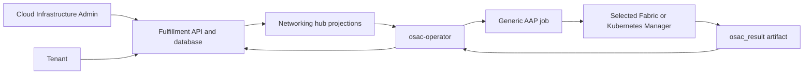

# Unified Networking Design

| Field | Value |
|-------|-------|
| Jira | https://redhat.atlassian.net/browse/OSAC-1433 |
| Target release | OSAC 0.2 |
| PRD | [Unified Networking PRD](prd.md) |

## Contents

- [1. Summary](#1-summary)
- [2. Motivation: Goals and Non-Goals](#2-motivation-goals-and-non-goals)
  - [2.1 Goals](#21-goals)
  - [2.2 Non-Goals](#22-non-goals)
- [3. Background and Rationale](#3-background-and-rationale)
- [4. Proposal](#4-proposal)
  - [4.1 Resource Model](#41-resource-model)
    - [Provider Profile and Manager Roles](#provider-profile-and-manager-roles)
    - [Resource API Meaning](#resource-api-meaning)
  - [4.2 Data Model and Schema Changes](#42-data-model-and-schema-changes)
    - [API Extensions](#api-extensions)
    - [ExternalIPPool](#externalippool)
  - [4.3 Architecture and Manager Integration](#43-architecture-and-manager-integration)
    - [Manager Dispatch and Integration Contract](#manager-dispatch-and-integration-contract)
  - [4.4 API Changes](#44-api-changes)
    - [API operation constraint](#api-operation-constraint)
    - [Resource Hierarchy](#resource-hierarchy)
    - [Creation Readiness Gates](#creation-readiness-gates)
    - [Workload attachment presence and defaulting](#workload-attachment-presence-and-defaulting)
    - [Deletion Dependency Guards](#deletion-dependency-guards)
    - [NetworkClass Examples](#networkclass-examples)
    - [UX Alignment](#ux-alignment)
    - [Auto-provisioned External Access](#auto-provisioned-external-access)
  - [4.5 Scalability and Performance](#45-scalability-and-performance)
  - [4.6 Security Considerations](#46-security-considerations)
  - [4.7 Failure Handling and Recovery](#47-failure-handling-and-recovery)
    - [Risks and Mitigations](#risks-and-mitigations)
    - [Provider Networking Control](#provider-networking-control)
  - [4.8 RBAC and Tenancy](#48-rbac-and-tenancy)
  - [4.9 Extensibility and Future-Proofing](#49-extensibility-and-future-proofing)
- [5. Interface Changes](#5-interface-changes)
  - [IC-1: Shared networking resource API](#ic-1-shared-networking-resource-api)
  - [IC-2: Workload network attachments](#ic-2-workload-network-attachments)
  - [IC-3: External access](#ic-3-external-access)
  - [IC-4: Provider manager registration and settings](#ic-4-provider-manager-registration-and-settings)
  - [IC-5: Provider networking control](#ic-5-provider-networking-control)
  - [IC-6: Unified networking UI and documentation](#ic-6-unified-networking-ui-and-documentation)
  - [IC-7: SecurityGroup enforcement on workload attachments](#ic-7-securitygroup-enforcement-on-workload-attachments)
- [6. Alternatives Considered](#6-alternatives-considered)
  - [Drawbacks](#drawbacks)
- [7. Observability and Monitoring](#7-observability-and-monitoring)
- [8. Impact and Compatibility](#8-impact-and-compatibility)
  - [Current implementation alignment](#current-implementation-alignment)
  - [Upgrade and Downgrade Strategy](#upgrade-and-downgrade-strategy)
  - [Version Skew Strategy](#version-skew-strategy)
  - [Support Procedures](#support-procedures)
  - [Infrastructure Needed](#infrastructure-needed)
- [Test Plan](#test-plan)
  - [Unit and component tests (DEV)](#unit-and-component-tests-dev)
  - [Integration tests (DEV)](#integration-tests-dev)
- [Graduation Criteria](#graduation-criteria)
- [Support Boundaries](#support-boundaries)
  - [Deployment Support Boundary](#deployment-support-boundary)
  - [Networking Hub Support Boundary](#networking-hub-support-boundary)

## 1. Summary

This design defines OSAC's shared networking resources, their tenant-visible meaning, common validation and lifecycle rules, and the architecture that carries networking intent between the fulfillment service, the networking hub, the OSAC operator, and provider managers. The same network resources retain the same meaning across workload services and infrastructure types. Service-specific designs extend this contract with workload API fields, lifecycle gates, status mapping, and concrete service flows. The [Network Manager Integration Contract](/enhancements/OSAC-1433-network-manager-integration-contract-networking/design.md) owns the manager registration and execution protocol.

## 2. Motivation: Goals and Non-Goals

### 2.1 Goals

- Define one tenant networking resource model whose semantics do not depend on a workload service, infrastructure type, or provider backend.
- Define the shared API validation, readiness, ownership, security, and cleanup rules used by service extensions.
- Keep tenant networking requests independent of provider manager selection and backend configuration.
- Let a new workload service document its integration as an extension without changing this design when it follows the existing shared resource and manager contracts.
- Limit the shared address contract to IPv4 and one tenant network attachment per workload interface.

### 2.2 Non-Goals

- Internet Protocol version 6 (IPv6), dual-stack networking (IPv4 and IPv6 together), or multiple tenant network attachments per workload.
- Tenant-managed Domain Name System (DNS) zones, VirtualNetwork peering, load balancers, or Internet gateways.
- Advanced interface configuration such as bonding, VLAN trunking, or multiple attachments per workload.

## 3. Background and Rationale

OSAC needs one stable tenant networking contract that can be used by multiple workload services and by different provider backends. The shared design owns the meaning and lifecycle of the networking resources. A service extension owns the fields and controllers that translate its workload lifecycle into the shared networking contract. The manager integration design owns provider registration, task dispatch, data exchange, result validation, and recovery.

## 4. Proposal

### 4.1 Resource Model

This section defines the provider configuration, manager roles, and networking resources used throughout the design.

#### Provider Profile and Manager Roles

A **NetworkClass** is a provider-managed profile for one deployment. It selects the implementations used for the OSAC-defined manager roles, sets deployment-level networking behavior, and reports whether the selected configuration is usable. Tenants do not select a NetworkClass, and it does not contain backend credentials.

A **Fabric Manager** configures the provider's physical network fabric for OSAC networking resources and physical workload interfaces. A **Kubernetes Manager** configures Kubernetes-native networking when a service extension requires that role. The Network Manager Integration Contract defines registration, validation, task invocation, data exchange, result handling, and recovery for both roles.

A **NetworkDataModel** names and validates one provider-defined value that managers exchange. A **NetworkManager** registers a manager implementation and declares its role and model inputs or outputs. **NetworkData** stores a validated value for its declared owner. These objects are provider or OSAC implementation resources, not tenant networking configuration; the manager design defines their schemas, API operations, validation, and lifecycle.

The fulfillment service is the authoritative API and database for networking resources. Its controllers project resources into the provider-designated **networking hub**, the Kubernetes cluster where the networking operator reconciles those projections. The OSAC operator coordinates provider work through Ansible Automation Platform (AAP). The selected provider manager configures its backend and returns an operation result; OSAC validates that result before updating authoritative resource status.

#### Resource API Meaning

The following table defines shared resource meaning. Provider-managed resources configure the deployment; tenant-managed resources express tenant network intent. Service extensions define how a workload API refers to these shared resources and how its lifecycle consumes them.

| Resource | Owner | Meaning |
|---|---|---|
| **NetworkClass** | Provider | The deployment's manager selections, shared capability settings, defaults, and readiness. |
| **NetworkDataModel** | Provider | The immutable meaning, owner scope, and schema for one value exchanged between manager roles. |
| **NetworkManager** | Provider | An immutable registration of one manager implementation and its declared role and data-model inputs or outputs. |
| **NetworkData** | OSAC-managed | One schema-validated value associated with its model and owning network resource. |
| **VirtualNetwork** | Tenant | An isolated tenant IPv4 routing domain and parent of Subnets, SecurityGroups, and optional FabricDomains and NATGateways. |
| **Subnet** | Tenant | An IPv4 range and Layer 2 network segment within one VirtualNetwork. Workloads attached to the same Subnet share its broadcast domain and obtain tenant IPv4 configuration through DHCP; Subnets in one VirtualNetwork are connected by Layer 3 routing, subject to SecurityGroup policy. |
| **SecurityGroup** | Tenant | Stateful incoming and outgoing traffic rules applied to a workload's network attachment. Matching rules allow traffic, established connections allow replies, and unmatched new traffic is denied. |
| **ExternalIPPool** | Provider | Capacity of IPv4 addresses outside tenant VirtualNetworks. |
| **ExternalIP** | Tenant | One address allocated, or pending allocation, from an ExternalIPPool. “External” means outside the tenant VirtualNetwork; it does not guarantee public Internet reachability. |
| **ExternalIPAttachment** | Tenant | Associates one allocated ExternalIP with a service-defined workload endpoint for inbound destination network address translation (DNAT). |
| **NATGateway** | Tenant | Associates one ExternalIP with one VirtualNetwork for outbound source network address translation (SNAT); it does not provide inbound access. |
| **FabricDomain** | Tenant | An east-west isolation domain for participating workloads on a high-performance fabric. It is associated with one VirtualNetwork and does not change that VirtualNetwork's north-south routing or its Subnet broadcast domains. |
| **Workload network attachment** | Workload API | Selects one Subnet and applicable SecurityGroups for a workload interface. The service extension owns its API shape, target mapping, and status fields. |

The shared capability list is defined by OSAC and enforced by the fulfillment-service API. At present, the only optional capability is Ethernet east-west support. A manager declares whether it implements that capability; NetworkClass enables it for the deployment only when the selected Fabric Manager declares support. When enabled, it permits FabricDomain operations while preserving VirtualNetwork routing and Subnet broadcast-domain behavior. A manager declaration alone does not enable tenant operations.

For each normalized attachment type used by a workload service, the manager assigned to that interface must preserve the Subnet semantics above. A backend that offers only routed endpoint reachability where the contract requires a shared Subnet broadcast domain is not conforming for that attachment type. The Network Manager Integration Contract's provider qualification verifies the selected manager profile against this behavior.

### 4.2 Data Model and Schema Changes

This section gives the fields and status shapes for the resources defined above. Network address ranges use Classless Inter-Domain Routing (CIDR) notation. The Protocol Buffers (protobuf) messages below are the normative target for field names, cardinality, defaults, and status; the PRD describes their user-visible effects.

#### API Extensions

##### NetworkClass

As defined in [Provider Profile and Manager Roles](#provider-profile-and-manager-roles),
NetworkClass is the provider-managed configuration container for the active
deployment profile. It is not a tenant network; tenant VirtualNetworks refer
to the service-resolved profile. This schema carries the provider's manager
role selections, defaults, east-west capability declarations, and status.

```protobuf
message NetworkClass {
  string id = 1;
  Metadata metadata = 2;
  string title = 3;
  string description = 4;
  NetworkClassConstraints constraints = 6;
  reserved 7; // Manager-derived IP-family output is not part of the target API.
  NetworkClassStatus status = 8;             // read-only readiness and hub
  string fabric_manager = 10;          // required role for shared network operations
  optional string k8s_manager = 11;    // Kubernetes-side networking role
  NetworkClassSpec spec = 12;
}

message NetworkClassSpec {
  NetworkDefaults defaults = 1;
  reserved 2; // Legacy field number retained; this API does not use it.
  optional int32 vip_prefix_length = 3; // virtual IP (VIP) reservation prefix; valid range 1 through 32
  reserved 4; // Backend settings and credentials are supplied through the networking fulfillment group.
  NetworkClassEastWestCapabilities east_west_capabilities = 5; // enabled FabricDomain behavior
}

message NetworkDefaults {
  string virtual_network_cidr = 1; // required canonical IPv4 CIDR for the tenant's default VirtualNetwork
  string ipv4_subnet_cidr = 2;     // required canonical IPv4 CIDR contained in virtual_network_cidr
  repeated SecurityRule ingress_rules = 3; // rules for the default SecurityGroup
  repeated SecurityRule egress_rules = 4;  // rules for the default SecurityGroup
}

message NetworkClassStatus {
  NetworkClassState state = 1; // system-reported readiness
  optional string message = 2;
  string hub = 3; // provider-configured networking hub for resource placement
}

enum NetworkClassState {
  NETWORK_CLASS_STATE_UNSPECIFIED = 0;
  NETWORK_CLASS_STATE_PENDING = 1;
  NETWORK_CLASS_STATE_READY = 2;
  NETWORK_CLASS_STATE_FAILED = 3;
}

message NetworkClassConstraints {} // reserved for future provider constraints

message NetworkClassEastWestCapabilities {
  bool supports_east_west_ethernet = 1;
}
```

`NetworkDefaults` supplies the default VirtualNetwork and Subnet CIDRs and
the default SecurityGroup's ingress and egress rules. Both CIDRs use
canonical IPv4 notation, and the Subnet range must be contained by the
VirtualNetwork range. Rules use the same `SecurityRule` schema and stateful
behavior as tenant-created SecurityGroups. Tenant onboarding and default
resource readiness are defined by the separate
[Default Networking Design](/enhancements/OSAC-1433-default-networking/design.md).

###### East-West Capability Declaration

A **capability** here is an OSAC-defined, deployment-level declaration that
gates an optional networking behavior. The API has a predefined, finite set
of typed fields on `NetworkClass.spec.east_west_capabilities`. It is not a
free-form list, and providers cannot register new capability names. The only
capability currently defined is Ethernet east-west (`supports_east_west_ethernet`).
Fulfillment-service validates it when creating NetworkClass and when a
FabricDomain request uses it. This lets a provider enable a behavior only
when the selected Fabric Manager declares support for it.

These declarations gate optional east-west FabricDomain behavior only. They
do not describe the shared north-south VirtualNetwork and Subnet contract,
address-family support, or whether two managers can exchange data. Manager
compatibility is validated separately when NetworkClass is created: every
NetworkDataModel name required by the selected Kubernetes Manager must also
be declared as an output by the selected Fabric Manager. That check establishes
declared data compatibility, not behavioral conformance; see the
[Network Manager Integration Contract](/enhancements/OSAC-1433-network-manager-integration-contract-networking/design.md).

An omitted capability message or a false Ethernet field means that Ethernet
FabricDomain requests are unavailable and fail with `FAILED_PRECONDITION`
before a manager job starts. To enable them, the selected Fabric Manager must
declare `NETWORK_MANAGER_CAPABILITY_EAST_WEST_ETHERNET` in its immutable
`NetworkManager.spec.capabilities` and the NetworkClass must set
`supports_east_west_ethernet` to true.
Fulfillment-service rejects NetworkClass creation if the enabled behavior is
absent from the selected manager. Backend-specific settings, such as a
provider template name, are supplied through the networking fulfillment
group's ConfigMap or Secret and arrive in the manager job as environment
variables. They are not stored on NetworkClass or NetworkManager. Every
manager job in the group can read these values, so providers must treat all
installed roles as trusted. The Fabric Manager validates its required
environment values when it executes the `create_fabric_domain` task. A
missing or invalid backend setting fails that operation and leaves the
FabricDomain non-ready. A manager capability alone does not enable the
behavior.

The [Multi-Fabric East-West Networking
Design](/enhancements/OSAC-1382-multi-fabric-east-west-networking/design.md)
defines the FabricDomain resource semantics. The [Network Manager Integration
Contract](/enhancements/OSAC-1433-network-manager-integration-contract-networking/design.md)
defines its generic Fabric Manager dispatch and result contract.

##### Provider-reserved Subnet prefix

When `NetworkClass.spec.vip_prefix_length` is set, it defines the prefix
length of an IPv4 range that the provider reserves within each Subnet for
provider-managed endpoint addresses. The range must be contained in the
Subnet. When omitted, this setting requests no provider-reserved prefix. The
Fabric Manager receives the captured value in its canonical `network_class`
task context during Subnet creation. A manager that shares the reserved range
with another manager publishes the exact CIDR through declared NetworkData;
every allocator using that Subnet excludes the reserved range. A service
extension defines whether and how its workflow consumes the reservation.

##### Manager registrations and runtime data

NetworkDataModel, NetworkManager, and NetworkData are OSAC API resources. Providers create models before managers and managers before NetworkClass. Their immutable schemas, Create/Read/Delete operations, validation, manager compatibility rules, data exchange, and cleanup are defined in the [Network Manager Integration Contract](/enhancements/OSAC-1433-network-manager-integration-contract-networking/design.md).

##### ExternalIPPool

ExternalIPPool is provider-managed address capacity available to all workload
types. Its CIDR is provider input and is not a tenant-selected backend or
workload setting. The provider-facing create API accepts one canonical IPv4
CIDR and the IPv4 family; capacity and readiness are system-reported.

```protobuf
message ExternalIPPool {
  string id = 1;
  Metadata metadata = 2;
  ExternalIPPoolSpec spec = 3;
  ExternalIPPoolStatus status = 4;
}

message ExternalIPPoolSpec {
  repeated string cidrs = 2; // private/provider input: exactly one canonical IPv4 CIDR
  IPFamily ip_family = 3;    // required provider input: IP_FAMILY_IPV4
}

message ExternalIPPoolStatus {
  ExternalIPPoolState state = 1;
  optional string message = 2;
  string hub = 3; // provider-configured networking hub for resource placement
  int64 total = 4;
  int64 allocated = 5;
  int64 available = 6;
}
```

The public tenant projection exposes pool identity, metadata, family, and
available capacity. CIDR configuration and detailed provider status remain
provider-managed.

##### VirtualNetwork

```protobuf
message VirtualNetworkSpec {
  NetworkClassReference network_class = 1; // required; service-resolved provider profile, immutable
  string ipv4_cidr = 2;                    // required canonical IPv4 CIDR, immutable
}
```

The fulfillment service resolves the deployment's provider-managed
NetworkClass; tenants do not choose a manager or provider profile. The
NetworkClass selects registered manager implementations. Tenant-facing
networking specs do not select a workload type or concrete backend. The same
resource model applies across supported workloads and does not depend on workload implementation or host infrastructure.
Each Subnet in the VirtualNetwork is a separate L2 broadcast domain. The
VirtualNetwork routes traffic between its Subnets at L3, subject to the
SecurityGroups selected on each workload attachment; it does not join those
Subnets into one broadcast domain.

##### Subnet

```protobuf
message SubnetSpec {
  VirtualNetworkLocalReference virtual_network = 1; // required, immutable
  string ipv4_cidr = 2; // required canonical IPv4, within parent CIDR, immutable
}
```

The Subnet's CIDR range must be contained by its VirtualNetwork range and must not
overlap another Subnet in that VirtualNetwork. Workloads attached to one Subnet
share that Subnet's L2 broadcast domain and have L3 connectivity through the
parent VirtualNetwork. A different Subnet remains a separate L2 broadcast
domain, with inter-Subnet traffic routed by the VirtualNetwork subject to
SecurityGroup policy. A Subnet is the workload attachment point; it does not
select a workload type or a manager. Attached workload interfaces use DHCP
to receive an IPv4 address, prefix, default gateway, and DNS resolver
configuration. The assigned address is unique among active endpoints in the
Subnet and is reported through the workload service's normal status path.

##### SecurityGroup

```protobuf
message SecurityGroupSpec {
  VirtualNetworkLocalReference virtual_network = 1; // required, immutable
  repeated SecurityRule ingress = 2;
  repeated SecurityRule egress = 3;
}
```

Each `SecurityRule` matches a protocol, optional TCP/UDP port range, and an
IPv4 CIDR (source for ingress, destination for egress). A SecurityGroup is a
reusable rule set scoped to one VirtualNetwork. The workload API selects
SecurityGroups on each network attachment. OSAC resolves the selected groups
and their complete rules into the workload attachment operation. The manager
that owns the interface applies them at the Subnet-to-interface boundary: the
Kubernetes Manager for Kubernetes-native interfaces and the Fabric Manager
for physical interfaces. A matching rule allows traffic; unmatched new
traffic is denied; return traffic for an established connection is allowed
automatically, so the rules are stateful. The interface-owning manager
also allows DHCP exchange with the trusted provider service and required
gateway address resolution independently of tenant rules. This infrastructure
baseline does not permit tenant workloads to provide DHCP or accept DHCP
responses from untrusted endpoints; tenant rules continue to govern all other
new traffic.
For a new connection from workload A to workload B, at least one selected
SecurityGroup on A must allow the packet under A's egress rules, and at least
one selected SecurityGroup on B must allow it under B's ingress rules. Both
checks must pass, whether the Subnets are the same or are routed Subnets in one
VirtualNetwork. When the other endpoint is outside OSAC workload policy and has
no selected SecurityGroup, the attached workload's rule in the traffic's
direction controls the connection. Rules contain match criteria, not an
explicit allow/deny action, so list order does not change their meaning. When
multiple SecurityGroups are attached to one workload interface, their allow
rules combine as a union for that interface's ingress or egress check. Each
manager enforces policy only on its own attachment; it does not look up or
evaluate the peer's SecurityGroups. Every selected SecurityGroup must belong
to the VirtualNetwork that owns the attachment's Subnet. SecurityGroup rules
are immutable; creating or deleting a SecurityGroup does not itself dispatch
a provider operation.

```protobuf
message SecurityRule {
  Protocol protocol = 1;         // TCP, UDP, ICMP, or ALL
  optional int32 port_from = 2;  // required for TCP/UDP, 1 through 65535
  optional int32 port_to = 3;    // required for TCP/UDP, >= port_from
  optional string ipv4_cidr = 4; // required canonical IPv4 CIDR
  optional string ipv6_cidr = 5; // legacy wire field; non-empty values rejected
}

enum Protocol {
  PROTOCOL_UNSPECIFIED = 0;
  PROTOCOL_TCP = 1;
  PROTOCOL_UDP = 2;
  PROTOCOL_ICMP = 3;
  PROTOCOL_ALL = 4;
}
```

`PROTOCOL_UNSPECIFIED` is invalid. Port bounds apply only to TCP and UDP;
ICMP and ALL ignore them. The IPv6 field remains only for wire compatibility
and must be empty.

##### ExternalIP

```protobuf
message ExternalIPSpec {
  ExternalIPPoolReference pool = 1; // required, immutable
}
```

The allocated address is system-provided in `ExternalIP.status.address`; a
tenant requests a pool, not a specific address. See
[ExternalIP Address Selection and Ownership](#externalip-address-selection-and-ownership)
for the manager allocation and release contract.

##### ExternalIPAttachment: Inbound Traffic (DNAT)

An ExternalIPAttachment binds one allocated ExternalIP to one inbound endpoint exposed by a workload service. It requests DNAT from the external address to that endpoint. Each service extension defines the target reference and endpoint selector it supports, the readiness signal for the endpoint, and how the target address reaches the provider manager. The shared contract requires the ExternalIP to be Allocated and the selected endpoint to be ready before the attachment is created.

##### NATGateway: Outbound Traffic (SNAT)

Handles **outbound traffic only**.

```protobuf
message NATGatewaySpec {
  VirtualNetworkLocalReference virtual_network = 1; // required, immutable
  ExternalIPLocalReference external_ip = 2;         // required, immutable
}
```

An ExternalIP can only be used by one consumer (either an
ExternalIPAttachment or a NATGateway, not both). One NATGateway per
VirtualNetwork. A NATGateway associates its ExternalIP with its
VirtualNetwork and uses that address as the network's outbound SNAT identity;
it does not provide inbound access. NATGateway is optional. Without one,
resources may still have default egress but without a controlled source IP.

All fields are immutable after creation.

**Direction summary:**

| Resource | Direction | Mechanism |
|----------|-----------|-----------|
| ExternalIPAttachment | Inbound (DNAT) | External IP → resource |
| NATGateway | Outbound (SNAT) | Resource → external IP |

#### ExternalIPPool

"External" in ExternalIPPool/ExternalIP means **outside the tenant's
VirtualNetwork**. The provider controls where the address is reachable; the
API does not promise Internet reachability. Deployment reachability
requirements are defined in [Support Boundaries](#support-boundaries).

ExternalIPPools are provider-managed and deployment-scoped. The required
Fabric Manager handles ExternalIP pool registration, allocation, and release.
One provider-managed pool serves all workload types in the deployment.
Each pool uses exactly one canonical IPv4 CIDR. The API's repeated `cidrs`
field is retained for compatibility, but validation rejects an empty list or
more than one entry; IPv6 and dual-stack pools are not supported.
Pool creation requires `spec.ipFamily` to be `IP_FAMILY_IPV4`;
`IP_FAMILY_UNSPECIFIED`, IPv6, and dual-stack values are rejected before
persistence. The provider create API supplies `cidrs` and `ipFamily`; the
provider configures that range in the Fabric Manager before
the pool becomes Ready. The pool does not carry a tenant-selectable implementation field. On Create, the fulfillment service binds it to the deployment's ready NetworkClass and selected Fabric Manager using their immutable API identities. Every ExternalIP allocated from the pool inherits that binding, so later allocation, attachment, release, and cleanup use the same provider profile. The binding is internal lifecycle state, not a tenant-selectable pool field.

**Eligible address capacity:** For prefixes from `/0` through `/30`, the pool excludes the lowest network address and highest broadcast address; `total = 2^(32-prefix) - 2`. Both addresses in a `/31` and the single address in a `/32` are eligible. The provider dedicates every eligible address to the pool and excludes infrastructure reservations before configuring the CIDR; it applies no additional hidden exclusions. If the backend cannot serve the full eligible range, pool creation fails rather than reporting the pool Ready. Separate pools may not claim overlapping eligible addresses within the same provider routing scope.

The fulfillment service reserves pool capacity atomically when it creates an ExternalIP. `allocated` counts live ExternalIP reservations, including Pending allocations, and `available` is `total - allocated`. A failed allocation retains its slot until the ExternalIP is deleted. With provider networking enabled, deletion returns the slot only after the manager confirms release; disabled-mode logical deletion follows the documented provider-leftover cleanup rule. `/31` and `/32` eligibility is part of provider qualification when either prefix is configured.

##### Address-Family and CIDR Contract

All user-supplied network CIDRs use canonical dotted-decimal IPv4 notation
(`a.b.c.d/prefix`) with host bits zero. A Subnet CIDR must be contained by its
parent VirtualNetwork, and sibling Subnet CIDRs must not overlap. Private
VirtualNetwork ranges may overlap across separate VirtualNetworks, including
VirtualNetworks owned by different tenants. Routing, policy, address
allocation, manager input, and cleanup retain the owning VirtualNetwork so
overlapping ranges remain isolated. Within one shared Subnet, independently
owned workload endpoints receive distinct addresses; address uniqueness is
scoped to that Subnet rather than imposed globally. Provider and
controller-produced addresses are canonical IPv4 addresses without a CIDR
suffix. Any IPv6, dual-stack, malformed, or non-canonical value is rejected
before persistence or backend dispatch.

Every explicit or automatic ExternalIP allocation path requests
`IP_FAMILY_IPV4`; `IP_FAMILY_UNSPECIFIED` is not a valid default for this
contract.

##### ExternalIP Address Selection and Ownership

The ExternalIPPool defines the eligible range; it does not choose the concrete
address. OSAC supplies the Fabric Manager with the ExternalIP's stable
fulfillment-service resource ID, the selected pool identity and IPv4 CIDR, and
the current projection UID and generation in the tracked job context. The
manager durably reserves a free address under the stable resource ID.
Allocations from one pool are unique, and retrying the same resource ID returns
the same reservation. The selection order is implementation-specific; the
contract does not require first-fit or another particular algorithm.

After confirming the reservation, the Fabric Manager returns the address in
`osac_result.data.external_ip.address`. The shared result envelope also binds
that result to the stable resource ID, current projection UID, and generation.
OSAC associates it with the operation attempt through the exact tracked job
and its reserved launch correlation, then validates that the address is
canonical IPv4 and belongs to the selected
pool. Only after those checks does OSAC write `ExternalIP.status.address` and
report the ExternalIP as Allocated through the existing status feedback path.
A missing or invalid address leaves the ExternalIP non-ready with no accepted
address. A retry for the same resource ID reuses the provider reservation.
The Fabric Manager does not write to the ExternalIP resource.

The fulfillment service reserves API-side pool capacity in the transaction
that creates the ExternalIP. On deletion, OSAC first requires dependent
ExternalIPAttachments and NATGateways to be removed, then invokes the
`delete_external_ip` task. The manager releases the reservation for that
resource ID and reports success only after the address is absent. OSAC returns
pool capacity only after confirmed release; uncertain provider work retains
the operation journal and blocks the opposite lifecycle action. The
[Network Manager Integration Contract](/enhancements/OSAC-1433-network-manager-integration-contract-networking/design.md)
defines the durable operation and result correlation rules.

### 4.3 Architecture and Manager Integration

The fulfillment-service database is authoritative for networking resources and
provider registrations. Its existing controllers project resources into the
networking hub. The `osac-operator` reconciles those projections and submits
provider work through the generic AAP job; the selected manager reports the
result through the tracked job artifact. This design owns the tenant resource
semantics. The separate [Network Manager Integration Contract Design](/enhancements/OSAC-1433-network-manager-integration-contract-networking/design.md)
owns manager registration, task inputs and outputs, NetworkData exchange, and
retry behavior.



#### Manager Dispatch and Integration Contract

The OSAC operator coordinates manager work; managers do not call one another. NetworkClass selects the registered implementations, while OSAC's fixed networking operations determine which role performs each shared resource action. OSAC validates manager declarations and capability compatibility before accepting a profile, then validates manager results before changing resource status. The full registration, task, input, output, result, ordering, retry, and recovery contract is defined in the separate [Network Manager Integration Contract](/enhancements/OSAC-1433-network-manager-integration-contract-networking/design.md).

### 4.4 API Changes

The resource schemas and field meanings are defined in [Data Model and Schema
Changes](#42-data-model-and-schema-changes). This section defines how clients
create and remove resources and how OSAC orders the provider work. The provider
manager APIs and their registration order are defined in the [Network Manager
Integration Contract Design](/enhancements/OSAC-1433-network-manager-integration-contract-networking/design.md).

#### API operation constraint

Shared networking resources support Create, Read (`List` and `Get`), and Delete. Specifications and metadata are immutable after creation; Update and Patch are rejected. A changed configuration requires removing dependents, deleting the old object, and creating its replacement. NetworkData is managed by OSAC and is not directly writable by provider or tenant clients.

#### Resource Hierarchy

All resources in this hierarchy are defined in Section 4.2 before these relationships are used:

- A `NetworkClass` provides the profile selected by each `VirtualNetwork`.
- A `VirtualNetwork` contains `Subnets`, `SecurityGroups`, and optional `FabricDomains` and `NATGateways`.
- A workload attachment references one `Subnet` and zero or more `SecurityGroups` from the same `VirtualNetwork`; its service-specific fields are defined by its extension design.
- An `ExternalIPPool` owns address capacity; each `ExternalIP` references one pool. An `ExternalIP` is used by either one `ExternalIPAttachment` for inbound access or one `NATGateway` for outbound SNAT, never both.
- Manager registrations and their data models follow the dependency order defined in the Network Manager Integration Contract.

#### Creation Readiness Gates

The fulfillment service checks references synchronously before persisting a
Create request. Missing, deleting, or non-ready dependencies reject the
request; they do not create a resource that waits for the reference.

| Created resource | Required referenced-resource state |
|---|---|
| `VirtualNetwork` | Selected `NetworkClass` is Ready. |
| `Subnet`, `SecurityGroup` | Parent `VirtualNetwork` is Ready. |
| Workload attachment | `Subnet` and every selected `SecurityGroup` are Ready and share one `VirtualNetwork`. |
| `ExternalIPPool` | The deployment's `NetworkClass` is Ready; the pool captures its immutable profile and Fabric Manager binding. |
| `ExternalIP` | `ExternalIPPool` is Ready and has capacity. |
| `ExternalIPAttachment` | `ExternalIP` is Allocated and the service-defined target endpoint is Ready. |
| `NATGateway` | `VirtualNetwork` is Ready and `ExternalIP` is Allocated. |
| `FabricDomain` | Parent `VirtualNetwork` is Ready and the selected profile enables Ethernet east-west support. |

`NetworkClass` creation separately resolves the registered manager names,
checks their roles and capabilities, and verifies manager data declarations
before saving the profile; see the manager contract.

#### Workload attachment presence and defaulting

The workload service extension defines the attachment field and target
identity. Fulfillment-service resolves the selected Subnet and
SecurityGroups before accepting the workload request:

- An omitted attachment, an empty attachment object, or an empty attachment
  list requests the tenant's default Subnet and default SecurityGroup.
- For one supplied attachment, defaults fill missing fields independently. A
  missing Subnet uses the tenant's default Subnet. A missing or empty
  SecurityGroup list uses the default SecurityGroup only when the resolved
  Subnet belongs to the tenant's default VirtualNetwork. Otherwise the caller
  must supply SecurityGroups from the resolved Subnet's VirtualNetwork.
- Supplied references are preserved. The resolved Subnet and every selected
  SecurityGroup must be Ready and belong to the same VirtualNetwork. An
  explicit SecurityGroup from a different VirtualNetwork is rejected.
- The fully resolved attachment is stored with the workload and is immutable
  after creation. An empty SecurityGroup list means “use the normal defaults”; it
  does not disable policy.
- A workload extension owns any interface-selection field and its service-
  specific default. OSAC validates and passes that resolved selection; it does
  not infer a hardware interface from backend details.

If a required default or supplied dependency is unavailable, workload
creation fails with a diagnostic before the workload is persisted. The
service extension defines the exact request field and target-specific
lifecycle; it does not redefine these shared resolution rules.

#### Deletion Dependency Guards

The fulfillment service rejects deletion while active dependents remain. A
resource being deleted still counts as active until its cleanup finishes.
Auto-created ExternalIP children are the exception: OSAC deletes them in
dependency order as part of their owning workload's cleanup.

| Resource being deleted | Required cleanup first |
|---|---|
| `VirtualNetwork` | Delete its Subnets, SecurityGroups, FabricDomains, NATGateways, and referencing workloads. |
| `Subnet` or `SecurityGroup` | Remove workload attachments that reference it. |
| `ExternalIP` | Delete its ExternalIPAttachment or NATGateway. |
| `ExternalIPPool` | Delete all ExternalIPs allocated from it and resolve their provider reservations. |
| Workload | Delete manually created ExternalIPAttachments; OSAC cleans up auto-created ExternalIP children. |
| `NetworkClass` | Drain all bound VirtualNetworks, ExternalIPPools, ExternalIPs, endpoint reservations, and active or uncertain operations, then delete the configuration. Deletion submits no provider job; after dependents drain, OSAC removes NetworkClass-owned NetworkData through fulfillment-service owner cleanup. |

NetworkManager and NetworkDataModel deletion dependencies, and OSAC owner
cleanup of NetworkData, are defined in the manager contract. Provider-side
cleanup completes before OSAC removes the corresponding owner or reports
deletion complete.

#### NetworkClass Examples

The profile below selects registrations by their logical names. The provider
creates the selected NetworkManager objects first. Ethernet east-west is
enabled only when the selected Fabric Manager declares the matching capability.

```json
{
  "id": "connected-region-a",
  "metadata": {"name": "connected-region-a"},
  "fabricManager": "acme_fabric",
  "k8sManager": "acme_kubernetes",
  "spec": {
    "eastWestCapabilities": {"supportsEastWestEthernet": true}
  }
}
```

The tenant API does not accept a manager name or provider-specific settings;
the fulfillment service resolves the deployment's active NetworkClass.

#### UX Alignment

The UI follows the same immutable Create/Read/Delete API and readiness gates. It offers only ready Subnets and SecurityGroups from the selected VirtualNetwork, shows whether an ExternalIP is pending or allocated, and does not imply that an ExternalIP is Internet-reachable. Screen-level work is tracked by [OSAC-2226](https://redhat.atlassian.net/browse/OSAC-2226).

#### Auto-provisioned External Access

When a supported workload request asks OSAC to create external access automatically, the fulfillment service reserves pool capacity and creates the ExternalIP with the parent workload operation. OSAC allocates the address through the selected Fabric Manager. After the address is Allocated and the service-defined endpoint is Ready, the fulfillment service creates the ExternalIPAttachment. Deletion removes the DNAT attachment before releasing the address and returning pool capacity. The service extension defines endpoint count and readiness; the manager design defines provider tasks and result validation.

### 4.5 Scalability and Performance

Provider-side operations are asynchronous and tracked per networking resource or attachment request. Resource API validation, dependency checks, and persistence happen in the fulfillment service. Manager stage count and workload placement are defined by the selected service extension and manager contract. The design specifies no throughput or latency target; release qualification must assess deployment capacity against its resource counts and manager topology.

### 4.6 Security Considerations

VirtualNetworks provide tenant isolation. SecurityGroup rules are evaluated on each workload attachment: the selected manager installs policy before the workload service enables traffic and removes it before extension-specific target cleanup. Unmatched new traffic is denied. Fulfillment authorization and owner references scope tenant resources; provider registrations and backend settings remain provider-managed. Manager credentials and result handling follow the separate Network Manager Integration Contract. OSAC must not report connectivity from logical resource readiness alone when provider work is disabled or intentionally implemented as a no-op.

### 4.7 Failure Handling and Recovery

Fulfillment rejects creates whose referenced resources are missing, deleting, or not ready, and rejects deletes while active dependents remain. The detailed gates and dependency tables are in [Creation Readiness Gates](#creation-readiness-gates) and [Deletion Dependency Guards](#deletion-dependency-guards). Manager failures leave resources non-ready for reconciliation; an ExternalIP allocation is accepted only after OSAC validates the successful manager result and the address against the ExternalIP UID, generation, and selected pool.

Before persisting NetworkClass, OSAC validates each selected NetworkManager reference, the required Fabric role, and that Fabric outputs cover every Kubernetes Manager input. An invalid selection is rejected with a diagnostic naming the object, field, or unsatisfied model name; no invalid NetworkClass or provider job is created. The [Network Manager Integration Contract](#manager-dispatch-and-integration-contract) defines NetworkDataModel and NetworkManager registration, schema validation, and model matching rules.

#### Risks and Mitigations

| Risk | Mitigation |
|---|---|
| A manager reports success while required behavior is absent. | Keep registration/schema validation separate from behavioral qualification; define the provider's evidence responsibility in the manager contract and support boundary. |
| A stale or incomplete resource projection triggers work against the wrong owner. | Bind reconciliation and accepted results to the authoritative API resource identity and the current hub projection; the manager contract defines the durable operation journal. |
| Disabled provider work is mistaken for real network connectivity or cleanup. | Keep logical OSAC lifecycle separate from provider-side state and expose disabled behavior explicitly in status and documentation. |
| Tenant address ranges overlap across independent networks. | Preserve the owning VirtualNetwork in routing, policy, allocation, manager input, and cleanup; reject overlapping sibling Subnets inside one VirtualNetwork. |

#### Provider Networking Control

`global.networking.provisioningEnabled` is the shared Helm boolean and
defaults to `true`. Enclave Wizard presents the same setting during
installation and upgrade. Fulfillment admission and networking controllers use that value; workload-service Create paths also consult the persisted shared activation state. A change takes
effect after the coordinated rollout completes. This is an installation or
upgrade setting, not a live OSAC console toggle.
[PRD: FR-10] [User]

The setting controls provider-network operations only. Networking APIs and
OSAC object lifecycle remain available in both modes, with the same
authorization, tenant isolation, validation, defaulting, available API actions,
and dependency rules. Logical resource status continues to reflect the OSAC
object lifecycle; it does not claim a provider change occurred. The setting
does not change the enabled-services list. [PRD: FR-10] [User]

When disabled, OSAC submits no provider-network operations for any supported
network resource, regardless of the selected manager profile. No provider-side networking operation is submitted or claimed, and OSAC submits no substitute or no-op work. Non-networking service operations remain available as specified by their service extensions. [User]

##### Resource operation behavior

API create/read/delete semantics, immutable fields, readiness preconditions,
and deletion dependency guards apply in both modes. All networking specification
and metadata updates remain rejected, including SecurityGroup rule changes; the
switch does not add an Update/Patch operation. OSAC object status continues to
reflect logical lifecycle and unmet prerequisites. [PRD: FR-8, FR-9, FR-10]

| Resource | Enabled provider create / rejected update / delete | Disabled provider create / rejected update / delete |
|----------|---------------------------------------------------|----------------------------------------------------|
| VirtualNetwork | Create and remove the manager's tenant network; specification updates rejected | OSAC object create/delete remains available; no provider network is created or removed; specification updates rejected |
| Subnet | Create/remove the selected managers' subnet/network resources; specification updates rejected | No provider segment, overlay, namespace, or pool is provisioned or removed; specification updates rejected |
| Workload network attachment | Apply Subnet connectivity and selected SecurityGroup rules through the manager that owns the interface; complete before the workload is Ready; remove policy and complete extension-specific cleanup before workload teardown | No provider attachment or policy work is submitted; workload provisioning follows its service extension's documented fallback behavior |
| SecurityGroup | Create/delete the OSAC rule object; apply/delete provider policy with each workload attachment; specification and metadata updates rejected | OSAC create/delete remains available; no attachment policy work is submitted; existing backend policy may remain until provider-side cleanup; updates rejected |
| ExternalIPPool | Create/remove provider pool integration; specification updates rejected | Logical create/delete remains available without creating or removing a provider pool; specification updates rejected |
| ExternalIP | The Fabric Manager durably allocates an address and returns it in `osac_result.data.external_ip.address`; OSAC validates the result and pool membership before writing `status.address`. On deletion, OSAC returns pool capacity only after confirmed provider release; specification updates rejected | No provider allocation or release occurs. Without a confirmed allocation it remains Pending with an empty address; a previously confirmed allocation retains its real validated address and Allocated state, marked last-known while disabled. Logical deletion releases OSAC capacity but may leave a provider reservation for manual cleanup. Specification updates rejected |
| ExternalIPAttachment | Create/remove inbound routing for an Allocated IP and Ready target; specification updates rejected | No inbound routing is configured; creation still requires the existing API prerequisites, so a newly unallocated ExternalIP cannot satisfy them; specification updates rejected |
| NATGateway | Create/remove outbound routing for the supported profile; specification updates rejected | No outbound routing is configured; creation retains the VirtualNetwork Ready and ExternalIP Allocated gates; specification updates rejected |

Read (List/Get) continues to expose persisted desired state and conditions.
While provider networking is disabled, VirtualNetwork, Subnet, SecurityGroup,
ExternalIPPool, ExternalIPAttachment, and NATGateway report `Ready=True`, reason
`ProvisioningDisabled`, and a message identifying the unavailable provider
operation, but only after the existing logical
preconditions are satisfied. Dependency checks remain specific to the
existing API gates: an ExternalIPAttachment or NATGateway requires ExternalIP
`state=Allocated`; references such as VirtualNetwork, ExternalIPPool, and
workload targets require `Ready`. A backend-confirmed ExternalIP that remains
`Allocated` during disablement satisfies an `Allocated` reference gate even
though its own condition is `Ready=False`/`ProvisioningDisabled`; its last-known
address does not imply provider reachability. If an existing resource's logical
prerequisite is unmet, it remains in its ordinary waiting state, and new create
requests retain their existing API precondition errors. This is logical OSAC
readiness only; it does not claim provider connectivity, policy enforcement, or
routing. `Skipped` describes the message/result and is not a Kubernetes
condition status.

If a legacy ExternalIPAttachment points to an ExternalIP whose fake
`0.0.0.0` address is cleared during migration, it remains
`phase=Progressing` with `Ready=False`, reason `ExternalIPNotAllocated`, and a
message that routing is waiting for a real allocation. It launches no routing
job while disabled. This waiting case does not weaken API validation: new
ExternalIPAttachments still require an Allocated ExternalIP and a Ready target.

ExternalIP is the allocation exception. If no real manager-confirmed
allocation has completed, it remains `state=Pending`, `phase=Progressing`, with an empty
`address` and `Ready=False`, reason `ProvisioningDisabled`; the message says
allocation is waiting for provider networking to be enabled. The backend remains
the address allocator when enabled; OSAC does not select an address from the
pool CIDR. If a real allocation completed before the setting was disabled,
retain its last manager-confirmed `state=Allocated` and validated address, set
`phase=Progressing` while provider networking is disabled, and set
`Ready=False`, reason `ProvisioningDisabled`. The message identifies the
address as last-known information that is not being reconciled or guaranteed
reachable. If an allocation already in progress finishes while networking is
being disabled, OSAC waits for terminal job state and records the allocation
only after validating the successful result envelope and the real IPv4 address
returned in `data.external_ip.address`. It does not dispatch a new allocation or
compensating operation. Never write `0.0.0.0` or another placeholder. On rollout
to this behavior, convert
existing disabled-mode `0.0.0.0` records to Pending with an empty address;
attachments that depended on the placeholder remain waiting until a real
allocation is confirmed. [User]

##### In-Flight Provider Work and Deletion

Any provider-network operation already in progress must reach a terminal
state before OSAC reports work skipped or completes deletion. If an operation
cannot be confirmed terminal, the resource remains pending and deletion stays
incomplete so the operation can be checked again. If the operation completes
before disablement takes effect, OSAC records that confirmed result and does not
start a compensating cleanup operation. This applies to shared operations spanning multiple manager stages and resource types. Service extensions define how provider-network disablement composes with their additional handoffs. [User]

Once in-progress provider work is terminal, live resources report provider
work skipped. Live resources with unmet logical prerequisites remain waiting as
specified above. Deletes still respect dependency guards and auto-created child
deletion order, then complete OSAC object deletion without provider cleanup.
Logical cascade deletion does not imply provider cleanup. Turning the setting
off also does not withdraw existing provider state or public exposure. Existing
ExternalIPAttachment DNAT and NATGateway SNAT routes, allocated addresses,
segments, security rules, overlays may remain effective
until provider-side cleanup. Disabled reconciliation does not remove
them. [User]

When the setting is enabled again after rollout, Pending ExternalIPs may proceed
to provider allocation. An automatic attachment is created only after a real
allocation and workload readiness are confirmed. Deleted OSAC objects are not recreated to
clean up provider leftovers; those leftovers require provider/manual cleanup.

##### Re-enabling Provider Networking

A change from disabled to enabled is a coordinated maintenance transition; it
does not move a running workload from its existing network to a tenant network.
The fulfillment service persists the accepted provider-networking mode and its
activation phase as installation state: Disabled, PreparingEnable,
ReconcilingEnable, or Enabled. This state is not a tenant API. An initial
enabled installation follows normal initialization. When upgrading an
installation that predates this state, the installer seeds the prior mode from
the last deployed release configuration. If the prior mode cannot be
established, activation fails closed with a diagnostic rather than assuming
that the deployment was enabled.

On a disabled-to-enabled request, the installer and fulfillment service first
persist PreparingEnable before rolling out processes configured for enabled
provider work. The coordinated rollout drains older processes before any
enabled provider dispatch; changing the Helm value alone cannot bypass the
persisted gate.
Every workload-service Create path uses the same admission guard. While the
phase is PreparingEnable or ReconcilingEnable, a new workload Create returns
FAILED_PRECONDITION with reason NetworkingActivationPending; workload reads and
deletes, plus networking-resource cleanup under the current mode's rules,
remain available. Each service
extension identifies which of its workload resources and subordinate resources
count as live, and its normal delete path must remove them. The shared
activation check includes previously accepted Create operations. Fulfillment
serializes the phase change, workload admission, and the zero-live-workload
check in its authoritative database so a Create cannot race the drain check.
A workload remains counted until its service has completed teardown and
retired its authoritative record.
A service extension that cannot expose its live workloads to this check cannot
participate in the shared activation contract.

Before reconciliation begins, every accepted provider-network operation must
have an authoritative terminal outcome. An unknown launch or result keeps the
deployment in PreparingEnable; activation never assumes the job did not run.
The Cloud Provider Admin also attests, by requesting the enabled setting,
that provider-side leftovers from disabled logical deletion have been removed
or reconciled. OSAC cannot infer backend absence from a deleted API record and
does not create a fabricated cleanup operation or separate confirmation API.
The installation preflight reports remaining workload resource IDs and
unresolved operation IDs. No workload is stopped or deleted automatically.

After the live-workload, operation, and rollout guards pass, fulfillment
persists ReconcilingEnable. Provider operations for networking resources are
allowed in this phase, but workload Creates remain blocked. The operator
reconciles surviving networking resources in dependency order under their
captured NetworkClass and manager identities. ProvisioningDisabled status does
not satisfy enabled-mode readiness; previously skipped resources must be
reconciled against their providers. Global activation waits until the selected
NetworkClass and configured ExternalIPPools have real provider readiness.
Tenant defaults and other tenant-owned resources then retain their ordinary
per-resource readiness gates, so one tenant's failed defaults do not block
unrelated ready tenants. Fulfillment records Enabled and opens workload
admission only after the global readiness condition passes.

The transition phase is durable. A restart resumes it without reopening
workload admission, while an ordinary restart of an already enabled deployment
does not require a new drain. If reconciliation fails, the barrier remains
visible as NetworkingActivationPending until an administrator repairs the
reported issue. A coordinated rollback to disabled first waits for transition
jobs to reach terminal outcomes and records Disabled; it does not undo provider
changes that already completed. Deleted OSAC objects are never recreated to
clean up provider leftovers.

##### Workload flow boundary

This design defines the shared attachment semantics and lifecycle invariants.
A service extension defines its workload API fields, which controller creates
the internal attachment request, when the workload may proceed, how status is
mirrored, and how deletion waits for cleanup. It also identifies its live
workload resources for the shared provider-networking activation check and
routes every workload Create through that check. The extension owns its
service-specific drain and delete sequence. A new service documents that
mapping in its own extension design while reusing the shared network resources
and manager protocol; the shared design changes only if this common contract
changes.

### 4.8 RBAC and Tenancy

Role-based access control (RBAC) requires no new authorization role. Provider-owned NetworkClass and ExternalIPPool resources remain provider-managed. The fulfillment service exposes provider-only registration APIs for NetworkDataModel and NetworkManager; authorized provider administrators may read NetworkData values, while only OSAC's service identity may create them from validated manager results or delete them during owner cleanup. The fulfillment-service database is authoritative, and its existing controller path projects registrations and values as CRDs in the networking hub. Every tenant-scoped networking resource, its NetworkData values, and workload attachment carries the `osac.openshift.io/tenant` annotation on its Kubernetes representation. Controller-created child resources also preserve the applicable `osac.openshift.io/owner-reference` annotation when OSAC owns them; references between resources do not by themselves establish ownership. Existing fulfillment service authorization continues to enforce tenant access. A conforming manager must preserve these annotations and must not act on resources outside its authorized tenant scope. The assigned manager implementation enforces policy uniformly for each supported workload.

### 4.9 Extensibility and Future-Proofing

The shared network resource contract is stable across workload services and provider backends. A provider may add a conforming manager or provider-defined NetworkDataModel through the registration and data contracts without changing tenant resource meaning or adding manager-specific OSAC code.

Each workload service documents its integration in a service extension design that references this design and the Network Manager Integration Contract. An extension specifies its workload-side attachment and external endpoint fields, resource identity mapping, manager role use, readiness gates, status flow, provisioning handoff, cleanup order, service-specific failure behavior, and tests. Adding a service that uses the existing shared resource meanings and manager protocol requires an extension design; this design changes only when a shared resource meaning, common lifecycle rule, capability, or manager-facing contract changes.

NetworkDataModel schemas describe JSON shape and supported owner scope. They do not add OSAC resource kinds, operations, manager roles, or workload targets. Such platform contract changes require a coordinated OSAC design and implementation change.

## 5. Interface Changes

The following interface changes map the technical design to the stable PRD requirements. Schemas, manager integration, and API lifecycle behavior are defined in Sections 4.2 through 4.4; failure handling is in Section 4.7.

### IC-1: Shared networking resource API

**Requirements:** FR-1, FR-2, FR-3, FR-4, FR-5, FR-8, FR-9

The fulfillment service public API and operator resource surfaces cover NetworkClass, VirtualNetwork, Subnet, SecurityGroup, ExternalIPPool, ExternalIP, ExternalIPAttachment, and NATGateway. The API actions and resource lifecycle constraints are defined in [API Changes](#44-api-changes).

### IC-2: Workload network attachments

**Requirements:** FR-7

**Contract:** A workload service may express one attachment to a ready Subnet and select SecurityGroups from the same VirtualNetwork. The shared design defines the network meaning, ownership, and policy behavior. The service extension defines the workload API fields, target identity, request creation, readiness/status mapping, and teardown gate. The manager contract defines the internal attachment request and task protocol.

### IC-3: External access

**Requirements:** FR-4, FR-5

ExternalIPAttachment exposes inbound access to supported workload endpoints. NATGateway exposes optional outbound source identity. The resource and endpoint shapes are defined in [API Extensions](#api-extensions).

### IC-4: Provider manager registration and settings

**Requirements:** FR-6

Provider registration uses the fulfillment-service APIs to create NetworkDataModel and NetworkManager objects, then creates a NetworkClass that selects each manager by role and spec.managerName. The fulfillment service validates model references when each registry object is created and checks manager roles and input/output compatibility before persisting NetworkClass. Providers supply backend settings and secrets through the networking fulfillment group's ConfigMap and Secret, which are exposed as environment variables to every manager job in that group; NetworkManager does not carry a separate configuration field or AAP credential references. A manager role validates and uses the environment variables it requires. Tenant APIs do not expose manager choices or provider settings. The [Network Manager Integration Contract](#manager-dispatch-and-integration-contract) defines manager onboarding, object schemas, immutable lifecycle, the shared group environment, and conformance.

### IC-5: Provider networking control

**Requirements:** FR-10

The shared `global.networking.provisioningEnabled` installation setting and Enclave Wizard control select whether OSAC submits provider networking operations. The default is enabled; the setting takes effect through rollout. The fulfillment service persists the accepted mode and activation phase, and every workload-service Create path uses the shared admission guard described in [Provider Networking Control](#provider-networking-control).

### IC-6: Unified networking UI and documentation

**Requirements:** FR-11

The unified UI supports the shared create/read/delete resource lifecycle,
authorized workload pickers, provider views for NetworkClass and ExternalIP
pool capacity, and accurate readiness and reachability information. User
documentation explains those workflows and the disabled-provider behavior.
Screen-level design and implementation are tracked by OSAC-2226.

### IC-7: SecurityGroup enforcement on workload attachments

**Contract:** Stateful SecurityGroup rules apply to every workload attachment using the shared network API. The selected manager installs the complete effective policy before the workload service enables traffic and removes it before extension-specific target cleanup. A new flow between two OSAC workloads succeeds only when the source attachment's egress rules and destination attachment's ingress rules both allow it; each manager enforces its own attachment without looking up the peer's groups. A manager integration success alone does not demonstrate that backend policy is enforced; providers retain behavioral evidence for their selected implementation.

## 6. Alternatives Considered

**Separate tenant networking models for each workload service.** This avoids a shared API initially, but duplicates tenant concepts, validation, and provider integration. A common resource model with service-owned extension designs gives tenants consistent semantics while leaving workload lifecycle details with each service.

**Tenant-selected NetworkClass.** This lets tenants choose a NetworkClass per VirtualNetwork, but exposes provider implementation choices and makes tenant networking depend on infrastructure details. Provider-owned selection keeps the tenant contract consistent, so this option is rejected.

**One fabric-only policy enforcer.** Sending every SecurityGroup rule to the Fabric Manager could reuse physical network policy. Traffic that stays within a Kubernetes-managed interface may not traverse that fabric, leaving part of the attachment outside the policy boundary. The interface-owning manager therefore enforces the same rule semantics for its attachment type.

**Provision SecurityGroups as standalone backend objects.** A Fabric Manager could create a reusable rule set when the tenant creates a SecurityGroup, then resolve references when a workload attaches. That requires the interface-owning manager to discover or receive backend-specific policy state. OSAC instead sends complete normalized rules with each workload attachment.

**Workload-specific networking resource variants.** Separate VirtualNetwork or Subnet kinds for different workload or infrastructure types would couple tenant network intent to placement details and prevent one tenant network model from serving mixed deployments. The shared, infrastructure-agnostic resources avoid that coupling.

**Lazy Subnet provisioning.** Waiting until a workload is placed to select a manager could defer provider setup, but leaves Subnet readiness and manager selection ambiguous. The selected Fabric Manager provisions the Subnet when the Subnet is created; a configured Kubernetes Manager participates only when the shared contract assigns it a stage.

### Drawbacks

Every supported deployment requires a Fabric Manager. A deployment also requires a Kubernetes Manager when a service extension uses Kubernetes-native networking. Coordinating both roles adds integration and operational work, so OSAC validates their declared data compatibility before accepting NetworkClass and tracks their stages independently. Providers still need behavioral qualification to show that the selected managers implement the shared contract.

The shared contract also places workload-specific attachment fields and lifecycle gates in extension designs. This keeps the common design stable as services are added, but requires each extension to state its mapping to the shared Subnet, SecurityGroup, ExternalIP, and manager contracts clearly.

## 7. Observability and Monitoring

No new standalone metrics, alerts, or tracing spans are specified. Existing resource status and conditions expose logical readiness, provider-operation progress, and disabled-mode skips. Installation state exposes the activation phase and NetworkingActivationPending diagnostic, and the activation preflight reports blocking workload resource IDs and unresolved operation IDs; the exact status contract is defined in [API Extensions](#api-extensions) and [Provider Networking Control](#provider-networking-control).

## 8. Impact and Compatibility

### Current implementation alignment

This proposal describes the target contract, not a claim that every part is already enforced. Implementation must align the fulfillment-service API, authoritative database, hub projections, OSAC controllers, and AAP integration with the shared resource semantics and manager contract. In particular, implementation must enforce immutable Create/Read/Delete APIs, owner and dependency guards, IPv4-only CIDR validation, capability validation, safe provider-work gating, schema-validated manager data, and result-bound status updates. Service-specific workload fields and lifecycle gates are tracked by their extension designs.

### Upgrade and Downgrade Strategy

Shared resource schemas, provider registrations, manager protocol, and operator behavior must be rolled out in a coordinated order. Existing manager registrations and output data are migrated according to the Network Manager Integration Contract. Workload-specific rollout and compatibility gates are owned by service extension designs. A downgrade that lacks the shared contracts cannot claim their validation, recovery, or cleanup guarantees.

### Version Skew Strategy

The fulfillment service, operator, AAP template, and selected manager roles must support the same networking contract. Mixed versions that disagree on task inputs, result fields, schema validation, or operation-journal state cannot provide the target guarantees. Deployment qualification verifies compatible versions before manager selection.

### Support Procedures

Inspect the NetworkClass state, resource conditions, authoritative resource identifiers, hub projection identity, operation journal, and exact AAP job history. A `ProvisioningDisabled` state describes an OSAC logical transition and does not prove provider connectivity, allocation, or cleanup. Resolve an uncertain operation before retrying the opposite lifecycle action. Provider-side leftovers require the manager's repair procedure; service-specific workload symptoms and recovery gates are documented by each extension.

### Infrastructure Needed

No additional infrastructure beyond existing OSAC components and managers.

## Test Plan

### Unit and component tests (DEV)

- Validate IPv4 CIDR parsing, parent containment, and non-overlapping sibling Subnets while permitting overlapping private ranges in separate VirtualNetworks.
- Validate shared resource Create/Read/Delete behavior, immutable specifications, tenant ownership, readiness gates, and deletion dependency diagnostics.
- Validate the shared Subnet and SecurityGroup contract: same-Subnet broadcast-domain membership, routed connectivity between Subnets in one VirtualNetwork, default-deny stateful policy, and established replies. A new flow between OSAC workloads must succeed only when source egress and destination ingress both allow it; allowing only one side must fail. Multiple groups combine as a union independently at each endpoint. For a flow to or from an endpoint outside OSAC workload policy, only the attached workload's rule in the traffic direction applies.
- Verify an attached workload configured for DHCP receives a unique IPv4 address, prefix, gateway, and resolver configuration from its Subnet even when tenant SecurityGroups deny application traffic; verify untrusted tenant DHCP responses are blocked.
- Validate that Ethernet east-west requests are rejected before provider dispatch unless NetworkClass enables the capability and the selected Fabric Manager declares it.
- Validate ExternalIP pool range accounting, atomic reservation, address ownership, result checks, and capacity release only after confirmed provider cleanup.
- Validate provider-disabled status and activation transitions without claiming backend connectivity or cleanup; verify new workload admission remains closed until shared readiness and accepted work are resolved.

### Integration tests (DEV)

- Run the Network Manager Integration Contract conformance suite for registration, model compatibility, task results, ordering, retries, uncertain-operation recovery, and cleanup.
- Exercise shared networking resource operations with independent conforming manager implementations and verify that API results and resource semantics remain the same.
- Exercise the shared attachment contract through a generic service-extension fixture and verify the workload owner waits for attachment readiness and cleanup. Each service extension owns its exact workload API and lifecycle tests.
- Exercise provider-network disablement and re-enablement with a generic extension fixture, including persisted-phase restart recovery, create admission, read/delete availability, in-flight operation draining, and restoration of shared provider readiness.

## Graduation Criteria

The shared contract is ready for release when:

- The fulfillment API enforces the shared resource meanings, tenant ownership, immutability, readiness gates, dependency guards, and IPv4 boundaries.
- NetworkClass validation rejects missing roles, unsupported capability settings, and unsatisfied declared data dependencies before provider work starts.
- The manager integration contract validates data and results, safely recovers uncertain work, and completes dependent cleanup before releasing owned data.
- Shared component and integration coverage passes, including overlapping private ranges across separate VirtualNetworks and stateful default-deny SecurityGroup behavior.
- Disabled provider networking does not imply connectivity or provider cleanup, and re-enablement does not admit workloads before the shared activation barrier is satisfied.
- Each workload service using the shared model has an extension design and service-owned qualification for its API mapping, readiness, status, and teardown flow.

## Support Boundaries

These limits define the deployments and hub topology supported by the shared networking contract. Workload-specific support is defined by each service extension.

### Deployment Support Boundary

The current OSAC networking contract supports connected deployments only. Air-gapped and disconnected networking deployments are outside the supported boundary and must not be advertised as supported profiles. A connected deployment has reachability among the provider-owned networking hub, selected managers, provider-controlled networking services, and provider-controlled address infrastructure. The provider owns this configuration; connectivity is not tenant-selectable. Every supported profile selects a Fabric Manager. Other manager roles are required only when an enabled service extension depends on them.

### Networking Hub Support Boundary

OSAC networking supports exactly one provider-owned networking hub per deployment. Multi-hub networking placement, cross-hub resource coordination, and cross-hub network connectivity are unsupported. This boundary applies only to the networking area and does not define hub behavior for other OSAC areas. A service extension may support workload placement across multiple domains only when it explicitly defines that placement behavior.

---

## Provenance

Authored: revise @ design 0.11.3 - 2bd6607, workspace main @ 1f3b63b82 (58 behind origin/main)
Final: revise @ design 0.11.5 - 1c6e8de, workspace main @ 97d046f86 (16 behind origin/main)

> Context changed between revise and revise.

> This document's phase history does not include an initial /draft — structure was not verified against the template from origin.

<!-- ai-workflow-provenance:{"schema_version":1,"provenance_kind":"session","workflow":"design","workflow_version":"0.11.5","ai_workflows":"1c6e8de","source_repo":"97d046f86","source_repo_branch":"main","commits_behind_main":16,"commits_ahead_main":0,"main_ref":"main","phases":["revise","manual-edit","revise","revise","revise","revise","revise","revise","revise","revise","revise","revise","revise","revise","revise","revise","revise","revise","revise","revise","revise","revise","revise","revise","revise","revise","revise","revise","revise","revise","revise","revise","revise","revise","revise","revise","revise","revise","revise","revise","revise","revise","revise","revise","revise","revise","revise","revise","manual-edit","revise"],"authoring_modes":["manual","skill"],"context_changed":true,"origin_untracked":true} -->
