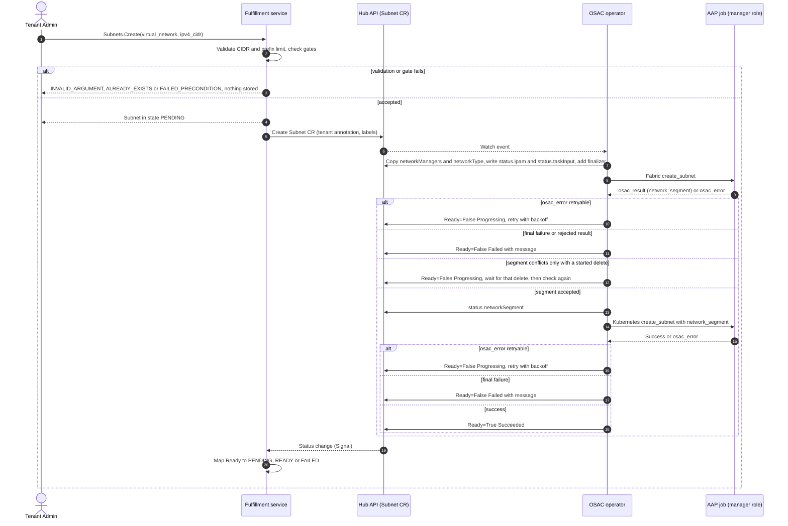

# Unified Networking

## Contents

- [Summary](#summary)
- [Motivation](#motivation)
  - [Goals](#goals)
  - [Non-Goals](#non-goals)
- [Proposal](#proposal)
  - [Workflow Description](#workflow-description)
  - [API Extensions](#api-extensions)
  - [UX Alignment](#ux-alignment)
  - [Implementation Details/Notes/Constraints](#implementation-detailsnotesconstraints)
    - [Terms](#terms)
    - [Resource hierarchy](#resource-hierarchy)
    - [API operation constraint](#api-operation-constraint)
    - [Status](#status)
    - [Error codes](#error-codes)
    - [NetworkClass](#networkclass)
    - [VirtualNetwork](#virtualnetwork)
    - [Subnet](#subnet)
    - [Subnet address plan](#subnet-address-plan)
    - [Subnet address layout](#subnet-address-layout)
    - [SecurityGroup](#securitygroup)
    - [ExternalIPPool](#externalippool)
    - [ExternalIP](#externalip)
    - [ExternalIPAttachment](#externalipattachment)
    - [NATGateway](#natgateway)
    - [FabricDomain](#fabricdomain)
    - [NetworkAttachment](#networkattachment)
    - [Network attachment field: presence and defaulting](#network-attachment-field-presence-and-defaulting)
    - [Creation readiness gates](#creation-readiness-gates)
    - [Deletion dependency guards](#deletion-dependency-guards)
    - [Concurrent requests](#concurrent-requests)
    - [Automatic external access](#automatic-external-access)
    - [Provider networking control](#provider-networking-control)
    - [Workload service design checklist](#workload-service-design-checklist)
    - [Deployment support boundary](#deployment-support-boundary)
    - [Networking hub support boundary](#networking-hub-support-boundary)
    - [Requirement traceability](#requirement-traceability)
  - [Security Considerations](#security-considerations)
  - [Failure Handling and Recovery](#failure-handling-and-recovery)
  - [RBAC / Tenancy](#rbac--tenancy)
  - [Observability and Monitoring](#observability-and-monitoring)
  - [Risks and Mitigations](#risks-and-mitigations)
  - [Drawbacks](#drawbacks)
- [Edge cases that need handling](#edge-cases-that-need-handling)
  - [Fulfillment service concurrency](#fulfillment-service-concurrency)
  - [Hub CR tracking and restarts](#hub-cr-tracking-and-restarts)
  - [SecurityGroup rule update races](#securitygroup-rule-update-races)
  - [Automatic external access races](#automatic-external-access-races)
  - [Installation settings](#installation-settings)
- [Alternatives (Not Implemented)](#alternatives-not-implemented)
- [Test Plan](#test-plan)
  - [Unit Tests](#unit-tests)
  - [Integration Tests](#integration-tests)
  - [E2E Tests](#e2e-tests)
  - [Edge-case tests (later)](#edge-case-tests-later)
- [Graduation Criteria](#graduation-criteria)
- [Upgrade and Downgrade Strategy](#upgrade-and-downgrade-strategy)
- [Version Skew Strategy](#version-skew-strategy)
- [Support Procedures](#support-procedures)
- [Infrastructure Needed](#infrastructure-needed)

## Summary

This design defines OSAC's shared networking resources: their API, validation, readiness, and deletion rules, and how OSAC turns them into manager tasks. The [Network Manager Integration Contract](/enhancements/OSAC-1433-network-manager-integration-contract-networking/design.md) ("the contract") defines manager behavior; [Default Networking](/enhancements/OSAC-1433-default-networking/design.md) defines tenant defaults. Requirements: [PRD](prd.md).

## Motivation

VMaaS, BMaaS, and CaaS all need tenant networks, traffic policy, and external addresses. Without a shared model, each service defines its own resources and each provider backend must support all of them. This design gives every workload service the same resources and every provider one manager contract.

### Goals

- One set of networking resources whose meaning does not depend on the workload service or provider backend.
- The fulfillment service checks all validation, readiness gates, and deletion guards synchronously.
- No provider-specific code in the fulfillment service or the OSAC operator.
- A workload service integrates by writing a workload service design that follows the [checklist](#workload-service-design-checklist), without changing this design.

### Non-Goals

- IPv6, dual-stack, or more than one network attachment per workload.
- VirtualNetwork peering, tenant DNS zones, load balancers, Internet gateways, NIC bonding, VLAN trunking, and quotas.
- FabricDomain behavior, which [OSAC-1382](/enhancements/OSAC-1382-multi-fabric-east-west-networking/design.md) owns.
- Enabling BMaaS or CaaS on a deployment that already has networking resources ([Subnet address plan](#subnet-address-plan)).
- A hub CR created, edited, or deleted outside OSAC (for example `kubectl delete`, a finalizer removal, or a `spec` or `status` edit), or lost (for example an etcd restore), is not supported. A ValidatingAdmissionPolicy that the installer creates rejects, from any identity other than the OSAC controllers' service accounts (fulfillment controllers, OSAC operator, BMF), with the message "OSAC manages this resource; change it through the fulfillment API":
  - CREATE, UPDATE (including `status`), and DELETE of every OSAC networking CR and NetworkAttachment;
  - DELETE of ComputeInstance, BareMetalInstance, and ClusterOrder CRs;
  - any UPDATE that removes an `osac.openshift.io/` finalizer from an OSAC CR.

  Any other UPDATE of a workload CR stays allowed, for example the CaaS reconcile-trigger annotation (`metadata.annotations`) on a ClusterOrder. A lost CR cannot be validated; OSAC does not detect, recreate, or clean up after it. The installer's uninstall removes the policy and its binding first, so deleting the whole installation stays possible.
- Manager non-goals: [contract §2.2](/enhancements/OSAC-1433-network-manager-integration-contract-networking/design.md#22-non-goals).

## Proposal

The fulfillment service stores every networking resource and serves it over gRPC. Its controllers create one CR per resource in the hub networking namespace. The OSAC operator reconciles each CR: it runs the contract's tasks through AAP, validates the results, and reports status. Workload services create a NetworkAttachment CR for each workload interface.

### Workflow Description

Starting state: OSAC is installed on the hub, and the execution environment image holds the provider's Fabric Manager collection ([Infrastructure Needed](#infrastructure-needed)).

1. The Cloud Provider Admin sets, at installation, `global.networking.provisioningEnabled` (fixed afterwards), `global.networking.excludedIpv4Cidrs`, and the enabled services ([OSAC-3046](/enhancements/OSAC-3046-per-service-enablement/design.md)) in Helm or the Enclave Wizard.
2. The Cloud Infrastructure Admin sets the managers, tenant defaults, and optional [Subnet address plan](#subnet-address-plan) in Helm (`global.networking.fabricManager`, `global.networking.k8sManager`, `global.networking.networkClass`); the installer creates the [NetworkClass](#networkclass).
3. The Cloud Infrastructure Admin creates the Fabric Manager's registration ConfigMap (kubectl; [contract §4.2](/enhancements/OSAC-1433-network-manager-integration-contract-networking/design.md#42-registration-and-capabilities)) and the ExternalIPPools (private gRPC API).
4. The Cloud Provider Admin creates a Tenant; Default Networking creates its default resources.
5. A Tenant Admin creates VirtualNetworks, Subnets, SecurityGroups, and NATGateways (public gRPC API or CLI). Each create returns at once as PENDING.
6. A Tenant User creates a workload with a network attachment field. The workload service creates a NetworkAttachment CR from it; the managers connect the interface to the Subnet and bind it to its SecurityGroups at each enforcement point ([NetworkAttachment](#networkattachment)).
7. A Tenant User creates an ExternalIP and an ExternalIPAttachment, or asks for [automatic external access](#automatic-external-access).
8. Deletes run in reverse, under the [deletion dependency guards](#deletion-dependency-guards).

Subnet create with provider networking enabled and a Kubernetes Manager. The other resources follow the same pattern with their own tasks; jobs and retries: [contract §4.7](/enhancements/OSAC-1433-network-manager-integration-contract-networking/design.md#47-ordering-concurrency-retries-and-ownership).



### API Extensions

- **fulfillment-service.** Private gRPC services (List, Get, Create, Update, Delete, Signal) for NetworkClass, ExternalIPPool, VirtualNetwork, Subnet, SecurityGroup, ExternalIP, ExternalIPAttachment, NATGateway, and FabricDomain; public services as the [API operation constraint](#api-operation-constraint) lists them.
- **osac-operator.** One CRD per resource above, plus `NetworkAttachment`. A CR with manager tasks holds a finalizer; [contract §4.7](/enhancements/OSAC-1433-network-manager-integration-contract-networking/design.md#47-ordering-concurrency-retries-and-ownership) defines when OSAC removes it.
- **Workload APIs.** ComputeInstance, BareMetalInstance, and Cluster get a network attachment field and an automatic external access field, defined by their workload service designs.
- **Controllers down.** Without the fulfillment controllers, creates are stored but no CR appears. Without the OSAC operator, no task runs: resources stay PENDING or DELETING, and workloads wait for their NetworkAttachment.

### UX Alignment

The UI uses the same calls and gates: [UI design addendum](ui-design.md), [OSAC-2226](https://redhat.atlassian.net/browse/OSAC-2226).

### Implementation Details/Notes/Constraints

#### Terms

[Contract §4.1](/enhancements/OSAC-1433-network-manager-integration-contract-networking/design.md#41-manager-types) defines manager, Fabric Manager, Kubernetes Manager, hub, hub networking namespace, task, API ID, workload service, overlay and physical interface, child, and NetworkAttachment; [§4.9](/enhancements/OSAC-1433-network-manager-integration-contract-networking/design.md#49-network-types-and-the-network-segment) defines network type and network segment. This design says "network attachment field" for the workload API field and NetworkAttachment for the hub CR, and adds:

- **Fulfillment service**: OSAC's API server; its database is the source of truth for networking resources.
- **OSAC operator**: the hub controller manager that reconciles OSAC CRs and runs manager tasks.
- **Network attachment field**: the workload API field that selects one Subnet and its SecurityGroups (ComputeInstance and BareMetalInstance `network_attachments`, a repeated field with at most one entry kept for compatibility; Cluster `network_attachment`).
- **Networking controller**: the OSAC operator controller that reconciles the networking CRs and NetworkAttachments, runs their manager tasks, and builds ExternalIPAttachment `destination`.
- **Workload service design**: the VMaaS, BMaaS, or CaaS networking design.
- **Cluster** is the fulfillment API resource; **ClusterOrder** is its hub CR.
- **Provider networking enabled / disabled**: the value of the Helm setting `global.networking.provisioningEnabled`, fixed at installation ([Provider networking control](#provider-networking-control)). OSAC runs networking jobs only with provider networking enabled. Otherwise "enabled" and "disabled" describe only services (for example "BMaaS enabled", [OSAC-3046](/enhancements/OSAC-3046-per-service-enablement/design.md)).

#### Resource hierarchy

| Resource | Owner | Parent | Meaning |
|---|---|---|---|
| NetworkClass | Cloud Infrastructure Admin | none | Manager selection, tenant defaults, Subnet address plan. Exactly one per deployment. |
| ExternalIPPool | Cloud Infrastructure Admin | NetworkClass | One IPv4 range outside tenant VirtualNetworks, shared by all tenants. |
| VirtualNetwork | Tenant | NetworkClass | An isolated IPv4 routing domain. |
| Subnet | Tenant | VirtualNetwork | One IPv4 range and one L2 segment. |
| SecurityGroup | Tenant | VirtualNetwork | A set of stateful traffic rules. |
| NATGateway | Tenant | VirtualNetwork | Outbound SNAT for the VirtualNetwork through one ExternalIP. |
| FabricDomain | Tenant | VirtualNetwork | An Ethernet east-west domain. |
| ExternalIP | Tenant | ExternalIPPool | One IPv4 address from a pool. |
| ExternalIPAttachment | Tenant | ExternalIP | Inbound DNAT from the ExternalIP to one workload endpoint. |
| NetworkAttachment | OSAC (hub CR only, not in the fulfillment API) | Subnet | One workload interface's attachment to one Subnet and its SecurityGroups. |

A network attachment field references one Subnet and one or more SecurityGroups of the same VirtualNetwork. An ExternalIP has at most one consumer: an ExternalIPAttachment or a NATGateway.

Each CR records its managers (and, under a VirtualNetwork, the network type) at create, and every task uses them: [contract §4.1](/enhancements/OSAC-1433-network-manager-integration-contract-networking/design.md#41-manager-types).

#### API operation constraint

- The public API has List, Get, Create, and Delete for tenant resources, plus `SecurityGroups.Update` (below); public ExternalIPPool has only List and Get, and NetworkClass has no public service. Every other public Update reports `UNIMPLEMENTED`. The private Update lets OSAC controllers write `status` only; a `spec` change fails with `INVALID_ARGUMENT` (exceptions below). Create rejects a request that sets `status`.
- `spec` and `metadata.labels` are immutable; to change a resource, delete and recreate it. A workload's network attachment is fixed at creation. The one exception is SecurityGroup rules (below); the NetworkClass spec, `spec.address_plan` included, is immutable too.
- **Not supported in this release:** changing FabricDomain `spec.servers`; to change the servers, delete and recreate the FabricDomain. A private-API Update that changes it fails with `INVALID_ARGUMENT`, message "FabricDomain servers cannot change in this release; delete and recreate the FabricDomain", and the FabricDomain CRD rejects the change with the CEL rule `self.servers == oldSelf.servers`.
- **SecurityGroup rule update** ([OSAC-5679](https://redhat.atlassian.net/browse/OSAC-5679)). `SecurityGroups.Update` replaces the complete `spec.ingress` and `spec.egress` lists of an existing SecurityGroup, also the tenant's default SecurityGroup. The server fixes the update mask to those two fields, so the ID, name, parent VirtualNetwork, metadata, and status stay unchanged. The rules are validated as at create ([SecurityGroup](#securitygroup)). An Update without the object, its ID, or its spec fails with `INVALID_ARGUMENT`; an Update of an automatic SecurityGroup (`auto-sg-`), of a SecurityGroup being deleted, or of one that is PENDING or updating ([Rule updates](#securitygroup)) fails with `FAILED_PRECONDITION`. OSAC replaces the rules of the group's backend policy objects, and every interface bound to the group follows them ([rule updates](#securitygroup)); concurrent Updates: [Concurrent requests](#concurrent-requests). Broader selective updates are future scope ([OSAC-5281](https://redhat.atlassian.net/browse/OSAC-5281)).
- Every CIDR and address is canonical IPv4 ([contract §4.5](/enhancements/OSAC-1433-network-manager-integration-contract-networking/design.md#45-task-input)); anything else, including IPv6, fails with `INVALID_ARGUMENT` before it is stored.

#### Status

Every resource status has `state`, optional `message`, and private `hub` (the ID of the hub holding the CR, set as [Hub CRs](#hub-crs) states; with one hub, all values are equal). States: `<KIND>_STATE_` `UNSPECIFIED` = 0, `PENDING` = 1, `READY` = 2 (ExternalIP: `ALLOCATED`), `FAILED` = 3, `DELETING` = 4; 5 reserved. NetworkClass has no `DELETING`.

Each hub CR:
- stores its task input in `status.taskInput` once, before its first job; only a SecurityGroup rule update replaces it, and a VM's NetworkAttachment adds the VM's address once, before its Fabric apply ([NetworkAttachment](#networkattachment), [contract §4.5](/enhancements/OSAC-1433-network-manager-integration-contract-networking/design.md#45-task-input));
- has one `Ready` condition;
- becomes `Ready=True`, reason `Succeeded`, after the task successes that [contract §4.7](/enhancements/OSAC-1433-network-manager-integration-contract-networking/design.md#47-ordering-concurrency-retries-and-ownership) (**Readiness**) names; [SecurityGroup](#securitygroup) adds its own rule, and an [ExternalIP](#externalip)'s state follows its address.

The fulfillment controller maps `Ready` to the API status:

| CR | API `state` | API `message` |
|---|---|---|
| Not created yet | PENDING | empty |
| `Ready=False`, reason `Progressing` | PENDING | The running task and AAP job ID, or what the resource waits for; after a retryable failure, also the manager's message and next retry time. |
| `Ready=True`, reason `Succeeded` | READY | empty |
| `Ready=True`, reason `Updating` (SecurityGroup [rule update](#securitygroup)) | READY | `Updating`, set by the Update itself; then the running task and AAP job ID; after a retryable failure, also the manager's message and next retry time. |
| `Ready=True`, reason `ProvisioningDisabled` | READY | The skipped provider operation. |
| `Ready=False`, reason `Failed` | FAILED | The manager's `osac_error.message`, the AAP failure text when the job published none, or why OSAC rejected the result. |
| Delete accepted, any condition | DELETING | The delete task; after a failed attempt, its message and next retry time. |

Once a delete is accepted, the API state stays DELETING until the record is removed; workload state mappings follow the same rule. [ExternalIP](#externalip) differs as stated there. A Delete of a record that is already DELETING returns OK with the record and changes nothing: no guard check, the same deletion time and cleanup order, no new task.

##### Hub CRs

- **Create.** Each hub CR of a fulfillment API resource (not a NetworkAttachment) has the label `osac.openshift.io/<kind>-uuid: <API ID>` (CR kind in lower case, for example `subnet-uuid`; a ComputeInstance CR has `computeinstance-uuid`). The fulfillment controller creates the CR, then sets the record's `hub`. Other keys that carry an API ID keep their existing names: `osac.openshift.io/compute-instance-id` on a VM and its objects ([VMaaS design](/enhancements/OSAC-1435-vmaas-networking/design.md)), `osac.openshift.io/cluster-api-id` on a CaaS worker BareMetalInstance ([CaaS design](/enhancements/OSAC-1436-caas-networking/design.md)), and `osac.openshift.io/owner-id` on hub objects a manager creates ([contract §4.3](/enhancements/OSAC-1433-network-manager-integration-contract-networking/design.md#43-invocation-settings-and-secrets)).
- **Delete completion.** Each such hub CR has the feedback finalizer `osac.openshift.io/<kind>-feedback`. The feedback controller removes it last, when no other finalizer is left, and then signals. The fulfillment service removes the DELETING record once a read from the API server, not a cache, finds its CR gone.

#### Error codes

| Code | When |
|---|---|
| `INVALID_ARGUMENT` | The request fails validation (cases below the table). |
| `FAILED_PRECONDITION` | A referenced resource is not READY; a [creation readiness gate](#creation-readiness-gates) or a [deletion dependency guard](#deletion-dependency-guards) fails; an Update of an automatic SecurityGroup, of a SecurityGroup being deleted, or of a PENDING or updating SecurityGroup; an ExternalIP create with [provider networking disabled](#provider-networking-control). |
| `ALREADY_EXISTS` | The VirtualNetwork already has a NATGateway; a Subnet CIDR overlaps a sibling. |
| `NOT_FOUND` | Get or Delete of an unknown ID or another tenant's resource. |
| `ABORTED`, `INTERNAL` | A concurrent change conflicts (`ABORTED`, [Concurrent requests](#concurrent-requests)), or a database error (`INTERNAL`). Nothing is stored; the client retries. |

`INVALID_ARGUMENT` cases:
- A field is missing, malformed, or non-canonical.
- A size, containment, excluded-range, or pool-overlap rule fails, including a VirtualNetwork or Subnet prefix longer than the plan's [prefix limit](#subnet-address-layout). A Subnet CIDR that overlaps a sibling fails with `ALREADY_EXISTS` instead.
- A create references a missing ID or another tenant's.
- A network attachment field selects a SecurityGroup of another VirtualNetwork, or lists one SecurityGroup ID twice.
- A required tenant default is missing.
- A FabricDomain create when the NetworkClass does not set `supports_east_west_ethernet`.
- A request changes `spec` beyond what the [API operation constraint](#api-operation-constraint) allows, or sets `status`; a SecurityGroup Update lacks the object, its ID, or its spec.
- A creator other than `system` uses a reserved name prefix (`auto-eip-`, `auto-eipa-`, or `auto-sg-`).
- A create sets the label `osac.openshift.io/default`; only the fulfillment service sets it ([Default Networking](/enhancements/OSAC-1433-default-networking/design.md#inspecting-default-resources)).

Each error message names the field, the unmet state, or the number of blocking resources and the first blocking ID. An error reason, when a design defines one, is the `reason` of a `google.rpc.ErrorInfo` detail in the gRPC status; clients read it there, never from the message.

#### NetworkClass

```protobuf
message NetworkClass {
  string id = 1;
  Metadata metadata = 2;
  string title = 3;
  string description = 4;
  reserved 5, 6, 7, 9;
  NetworkClassStatus status = 8;
  string fabric_manager = 10;       // required: registered Fabric Manager name
  optional string k8s_manager = 11; // OSAC Kubernetes Manager name; required to run VMs
  NetworkClassSpec spec = 12;
}
message NetworkClassSpec {
  NetworkDefaults defaults = 1;         // required
  reserved 2, 3, 4;
  NetworkClassEastWestCapabilities east_west_capabilities = 5;
  AddressPlan address_plan = 6;         // set by the installer at creation; immutable
}
message AddressPlan {                   // shares of every Subnet, sum 1
  double overlay = 1;
  double fabric = 2;
  double lb_vip = 3;
}
message NetworkDefaults {
  string virtual_network_ipv4_cidr = 1;    // required
  string subnet_ipv4_cidr = 2;             // required; inside virtual_network_ipv4_cidr
  repeated SecurityRule ingress_rules = 3; // default SecurityGroup
  repeated SecurityRule egress_rules = 4;  // default SecurityGroup
  reserved 5, 6, 7;
}
message NetworkClassEastWestCapabilities { bool supports_east_west_ethernet = 1; }
message NetworkClassStatus {
  NetworkClassState state = 1;          // PENDING, READY, FAILED
  optional string message = 2;
  string hub = 3;                       // private
  reserved 4, 5;
  NetworkManagers network_managers = 6; // private: resolved managers
  string network_type = 7;              // private: resolved network type; empty without k8s_manager
}
message NetworkManagers { NetworkManager fabric = 1; optional NetworkManager kubernetes = 2; }
message NetworkManager { string name = 1; string ansible_role = 2; }
```

- Helm values: `global.networking.fabricManager` holds the registration `name` of the provider's Fabric Manager; `global.networking.k8sManager` (may be empty) selects an OSAC Kubernetes Manager (this release: `cudn_evpn`); `global.networking.networkClass` holds `defaults` (`virtualNetworkIPv4CIDR`, `subnetIPv4CIDR`, `ingressRules`, `egressRules`; each rule is a [SecurityGroup rule](#securitygroup) in camelCase, for example `{protocol: PROTOCOL_TCP, ipv4Cidr: 0.0.0.0/0, portFrom: 22, portTo: 22}`), `eastWestCapabilities.supportsEastWestEthernet`, and the optional `addressPlan` (`overlay`, `fabric`, `lbVip`; [Subnet address plan](#subnet-address-plan)).
- The installer's NetworkClass step creates the NetworkClass through the private API when none exists. When one exists, it compares `fabric_manager`, `k8s_manager`, `spec.defaults`, `spec.east_west_capabilities`, and `spec.address_plan` (the plan in force, [set or derived](#subnet-address-plan)) with the Helm values; on any difference the step fails, and with it the rollout, with the message "NetworkClass <field>[, <field>] cannot change after installation; see Replacing the NetworkClass" ([Replacing the NetworkClass](/enhancements/OSAC-1433-default-networking/design.md#replacing-the-networkclass).
- With `k8sManager: cudn_evpn`, the installer's NetworkClass step also fails the rollout unless the setting `CUDN_EVPN_DNS_RESOLVERS` (`aap.instanceGroups.networkFulfillment.config`, [contract §4.3](/enhancements/OSAC-1433-network-manager-integration-contract-networking/design.md#43-invocation-settings-and-secrets)) is a comma-separated list of IPv4 addresses, each inside `excludedIpv4Cidrs`, with the message "CUDN_EVPN_DNS_RESOLVERS must list the DNS resolver addresses, each inside excludedIpv4Cidrs".
- Default CIDRs are canonical, and the default `subnet_ipv4_cidr` meets the plan's [prefix limit](#subnet-address-layout); the default `virtual_network_ipv4_cidr` does not overlap `global.networking.excludedIpv4Cidrs` (else `INVALID_ARGUMENT`). Default rules follow [SecurityGroup](#securitygroup); [Default Networking](/enhancements/OSAC-1433-default-networking/design.md) defines their use.
- NetworkClass has no manager task. The OSAC operator resolves it per [contract §4.2](/enhancements/OSAC-1433-network-manager-integration-contract-networking/design.md#42-registration-and-capabilities): success writes `status.network_managers` and `status.network_type` and makes it READY; failure makes it FAILED with the reason in `message`.

#### VirtualNetwork

```protobuf
message VirtualNetworkSpec {
  string ipv4_cidr = 1; // required, immutable
  reserved 2, 3, 4;
}
```

- The VirtualNetwork routes between its Subnets at L3; each Subnet stays its own L2 domain. SecurityGroups filter all of this traffic.
- Separate VirtualNetworks, even of one tenant, may have identical or overlapping CIDRs; managers keep them isolated ([contract §4.7](/enhancements/OSAC-1433-network-manager-integration-contract-networking/design.md#47-ordering-concurrency-retries-and-ownership)). The prefix length is at most the plan's [prefix limit](#subnet-address-layout), so it holds at least one Subnet.
- `global.networking.excludedIpv4Cidrs` is an installation setting: canonical IPv4 CIDRs (default empty) that the provider's infrastructure uses, such as management, provisioning, and node networks, and the DNS resolver addresses given to workloads, which must be listed there. A VirtualNetwork CIDR that overlaps one, or any ExternalIPPool CIDR, is rejected (`INVALID_ARGUMENT`). The fulfillment service refuses to start when the setting overlaps the NetworkClass default `virtual_network_ipv4_cidr`, an existing VirtualNetwork, an ExternalIPPool, or a Cluster pod or service CIDR, with the message "excludedIpv4Cidrs range <CIDR> overlaps <kind> <ID or CIDR>" for the first overlap, so Helm values adding such a range fail the rollout.
- Without a NATGateway, OSAC promises no outbound path outside the VirtualNetwork.

#### Subnet

```protobuf
message SubnetSpec {
  VirtualNetworkLocalReference virtual_network = 1; // required, immutable
  string ipv4_cidr = 2;                             // required, immutable
  reserved 3;
}
```

- The CIDR is inside the parent's and does not overlap a sibling Subnet. Workloads on one Subnet share its L2 domain.
- Each interface gets its address by DHCP from its owning manager ([contract §4.8](/enhancements/OSAC-1433-network-manager-integration-contract-networking/design.md#48-addressing)). The address is unique among the Subnet's active interfaces; the workload service reports it in the workload status. Tenants never set a static address.
- With a Kubernetes Manager, the Subnet CR also records `status.networkSegment` next to `status.ipam` ([contract §4.9](/enhancements/OSAC-1433-network-manager-integration-contract-networking/design.md#49-network-types-and-the-network-segment)).

#### Subnet address plan

The address plan splits each Subnet into three ranges; each share is a fraction of the Subnet's addresses. The Cloud Infrastructure Admin sets the plan in the Helm value `global.networking.networkClass.addressPlan`; the installer stores it in the NetworkClass `spec.address_plan`. [Contract §4.8](/enhancements/OSAC-1433-network-manager-integration-contract-networking/design.md#48-addressing) places the ranges and defines the `ipam` keys.

| Share | `ipam` range | Used for |
|---|---|---|
| `overlay` | `overlay_ipv4_cidrs` | VM addresses from the Kubernetes Manager. |
| `fabric` | `physical_ipv4_cidrs` | The Fabric Manager's range ([contract §4.8](/enhancements/OSAC-1433-network-manager-integration-contract-networking/design.md#48-addressing)): Fabric DHCP for physical interfaces (bare-metal servers, CaaS workers) and the provider's own devices. Also used with only VMaaS enabled, for provider devices. |
| `lbVip` | `lb_vip_ipv4_cidrs` | CaaS ingress address reservations. |

**Default plan.** Without `addressPlan`, the installer derives the plan from the enabled services ([OSAC-3046](/enhancements/OSAC-3046-per-service-enablement/design.md); MaaS adds nothing) and the Kubernetes Manager:

| Enabled services | With `k8sManager` (`overlay` / `fabric` / `lbVip`) | Without `k8sManager` |
|---|---|---|
| VMaaS, BMaaS, CaaS | 0.5 / 0.25 / 0.25 | not allowed |
| VMaaS, BMaaS | 0.5 / 0.5 / 0 | not allowed |
| VMaaS | 0.75 / 0.25 / 0 | not allowed |
| BMaaS, CaaS | 0.5 / 0.25 / 0.25 | 0 / 0.75 / 0.25 |
| BMaaS | 0.5 / 0.5 / 0 | 0 / 1 / 0 |
| None of them | 0.75 / 0.25 / 0 | 0 / 1 / 0 |

**Validation.** The installer validates the plan in force, set or derived, in Helm `values.schema.json` and in its NetworkClass step. A failure fails the rollout with a message that names the field.
- Each share is a multiple of 0.0625 from 0 to 1. These values are exact as floats, so the sum check is exact. A negative value, NaN, any other value, or a plan that sets only some shares is rejected.
- The shares sum to exactly 1.
- `overlay` > 0 exactly when `k8sManager` is set, because only VMs use the overlay range. VMaaS enabled needs `k8sManager`. BMaaS or CaaS enabled needs `fabric` > 0. CaaS enabled needs `lbVip` > 0. CaaS enabled needs BMaaS enabled (workers are BareMetalInstances).
- The NetworkClass default `subnetIPv4CIDR` meets the plan's [prefix limit](#subnet-address-layout).

So every Subnet has the ranges of the services enabled when it was created, and no workload needs a range check: `k8sManager` is fixed at installation, and enabling BMaaS or CaaS later is not supported (below).

**Plan changes.** The plan is fixed when the installer creates the NetworkClass, like every other NetworkClass value. A rollout whose plan in force (set or derived) differs from the stored plan fails with "NetworkClass spec.address_plan cannot change after installation; see Replacing the NetworkClass" ([Replacing the NetworkClass](/enhancements/OSAC-1433-default-networking/design.md#replacing-the-networkclass)). Enabling a service that needs a different plan (for example CaaS, which needs `lbVip` > 0) therefore replaces the NetworkClass; the fulfillment service also refuses a newly enabled BMaaS or CaaS once networking resources exist (Service changes, below). The private NetworkClass Update accepts status only.
- One plan both validates and lays out every Subnet: the fulfillment controller copies the stored plan to the Subnet CR's immutable `spec.addressPlan` (`overlay`, `fabric`, `lbVip`). The OSAC operator computes the layout from it once and records it in `status.ipam` ([contract §4.8](/enhancements/OSAC-1433-network-manager-integration-contract-networking/design.md#48-addressing)).

**Service changes.**
- `fabric` 0: no Fabric DHCP and no provider device on the Subnet beyond the gateway ([contract §4.8](/enhancements/OSAC-1433-network-manager-integration-contract-networking/design.md#48-addressing)).
- Disabling a service never changes the plan.
- VMaaS needs `k8sManager` set from installation; adding it later replaces the NetworkClass ([Replacing the NetworkClass](/enhancements/OSAC-1433-default-networking/design.md#replacing-the-networkclass)).
- **Not supported in this release:** enabling BMaaS or CaaS on a deployment that already has networking resources, because existing Subnets and SecurityGroups may lack the Fabric state bare metal needs, for example a no-op DHCP scope or SecurityGroup ([contract §4.10](/enhancements/OSAC-1433-network-manager-integration-contract-networking/design.md#410-task-reference) Enabled services). The fulfillment service stores the enabled services at its first start, as it does `provisioningEnabled` ([Provider networking control](#provider-networking-control)). When a later start finds BMaaS or CaaS newly enabled while any VirtualNetwork record exists, it refuses to start with the message "Enabling BMaaS or CaaS after networking resources exist is not supported in this release; delete every VirtualNetwork or reinstall", so the rollout fails. Otherwise it stores the current set. This also refuses re-enabling BMaaS or CaaS after it was disabled while networking resources existed.

#### Subnet address layout

Each Subnet is split into three ranges by the [address plan](#subnet-address-plan). OSAC computes the layout from the plan in the Subnet CR's `spec.addressPlan`, by [contract §4.8](/enhancements/OSAC-1433-network-manager-integration-contract-networking/design.md#48-addressing), and records it in `status.ipam`.

Every CIDR of the layout holds at least 16 addresses. So the plan sets a prefix limit: let g be the largest power of two, at most 1, that divides every non-zero share; the largest allowed prefix length is 28 − log2(1/g).

| Plan (`overlay` / `fabric` / `lbVip`) | g | Prefix limit |
|---|---|---|
| 0.5 / 0.25 / 0.25, 0 / 0.75 / 0.25, 0.75 / 0.25 / 0 | 0.25 | /26 |
| 0.5 / 0.5 / 0 | 0.5 | /27 |
| One range, for example 0 / 1 / 0 | 1 | /28 |
| Sixteenths, for example 0.5625 / 0.4375 / 0 | 0.0625 | /24 |

A Subnet or VirtualNetwork create with a longer prefix fails with `INVALID_ARGUMENT`, and the message names the limit.

#### SecurityGroup

```protobuf
message SecurityGroupSpec {
  VirtualNetworkLocalReference virtual_network = 1; // required, immutable
  repeated SecurityRule ingress = 2;
  repeated SecurityRule egress = 3;
}
message SecurityRule {
  Protocol protocol = 1;        // required
  optional int32 port_from = 2; // TCP/UDP only, required: 1..65535
  optional int32 port_to = 3;   // TCP/UDP only, required: port_from..65535
  string ipv4_cidr = 4;         // required: ingress source or egress destination
  reserved 5;
}
enum Protocol {
  PROTOCOL_UNSPECIFIED = 0; // invalid
  PROTOCOL_TCP = 1;
  PROTOCOL_UDP = 2;
  PROTOCOL_ICMP = 3;        // no ports
  PROTOCOL_ALL = 4;         // no ports
}
```

- Each SecurityGroup runs on the managers that [contract — SecurityGroup rules](/enhancements/OSAC-1433-network-manager-integration-contract-networking/design.md#fabric-create_security_group--delete_security_group) names.
- The OSAC operator runs `create_security_group` on each recorded manager, again on each rule update, and `delete_security_group` at delete, in the order of [contract §4.7](/enhancements/OSAC-1433-network-manager-integration-contract-networking/design.md#47-ordering-concurrency-retries-and-ownership). The create builds the group's backend policy object, keyed by its API ID, with its complete rules; nothing is bound to it yet, so no traffic changes. The SecurityGroup is `Ready=True`, reason `Succeeded`, once the create of each recorded manager succeeded.
- A SecurityGroup acts only on interfaces bound to it, and only a NetworkAttachment binds: `apply_network_attachment` gets the selected groups' API IDs (`network_attachment.security_group_ids`) and binds the interface to their policy objects ([NetworkAttachment](#networkattachment)); `delete_network_attachment` unbinds it. The workload [gate](#creation-readiness-gates) needs every selected group READY, so the objects exist before any bind, and the [guard](#deletion-dependency-guards) blocks the group's delete while a workload selects it.

**Rules.**
- A rule allows new connections matching its protocol, ports, and CIDR. There is no deny action, so order does not matter.
- Unmatched new traffic is denied; replies on an established connection are allowed.
- The rules of all groups on one interface combine as a union per direction.
- A new connection between two OSAC workloads (same Subnet or Subnets of one VirtualNetwork) needs an egress allow on the source and an ingress allow on the destination.
- For a peer outside OSAC workload policy, only the attached workload's rule for that direction applies.
- Rules filter IPv4 only. DHCP from the owning manager and ARP are always allowed.
- A rule with ports on ICMP or ALL, a TCP or UDP rule without ports, or `PROTOCOL_UNSPECIFIED` fails with `INVALID_ARGUMENT`.

**Rule updates.** A [rule update](#api-operation-constraint) stores the new rules and, in the same transaction, updates the record's status ([Status](#status)), so the tenant sees the update at once: a READY group stays READY with the message `Updating`, and a FAILED group becomes PENDING.
1. The fulfillment controller copies the rules to the SecurityGroup CR.
2. The OSAC operator stores them in `status.taskInput` as the next attempt's input ([contract §4.5](/enhancements/OSAC-1433-network-manager-integration-contract-networking/design.md#45-task-input)) and sets the CR's reason to `Updating` (a FAILED group: `Ready=False`, reason `Progressing`).
3. It runs `create_security_group` again on each recorded manager, in manager order (Fabric, then Kubernetes), as the next attempt ([contract §4.7](/enhancements/OSAC-1433-network-manager-integration-contract-networking/design.md#47-ordering-concurrency-retries-and-ownership)).
4. Each manager replaces its object's rules atomically; on failure, the object keeps its previous rules. NetworkAttachments are not touched; bound interfaces follow the object.
5. Once the run of each recorded manager with the new rules has succeeded, the reason returns to `Succeeded`.

- A final failure sets `Ready=False`, reason `Failed` (FAILED), with the manager's message. Each manager's object keeps the rules of its last successful run, and bound workloads keep running. New workloads cannot select the group ([gate](#creation-readiness-gates)). The tenant fixes the rules with another Update or deletes the group once no workload uses it.
- An Update is accepted only while the SecurityGroup is READY with no update in progress, or FAILED. Otherwise (PENDING, or READY with the message `Updating`) it fails with `FAILED_PRECONDITION` and the message "SecurityGroup <id> is being created or updated; retry when it is READY or FAILED", so no job of the group runs when an Update is stored.
- With provider networking disabled, an Update only stores the rules; the group stays READY, reason `ProvisioningDisabled`, without the `Updating` message ([Provider networking control](#provider-networking-control)).

#### ExternalIPPool

```protobuf
message ExternalIPPoolSpec {
  reserved 1, 4;
  repeated string cidrs = 2; // private, immutable: exactly one IPv4 CIDR
  IPFamily ip_family = 3;    // immutable: IP_FAMILY_IPV4 only
}
message ExternalIPPoolStatus {
  ExternalIPPoolState state = 1; // private
  optional string message = 2;   // private
  string hub = 3;                // private
  int64 total = 4;               // private: eligible addresses
  int64 allocated = 5;           // private: live ExternalIPs of this pool
  int64 available = 6;           // total - allocated
}
```

- Tenants see `id`, `metadata`, `spec.ip_family`, and `status.available`.
- The CIDR holds no address the provider's infrastructure uses. A CIDR that overlaps another pool, a range in `global.networking.excludedIpv4Cidrs`, the NetworkClass default `virtual_network_ipv4_cidr`, any VirtualNetwork CIDR, or any existing Cluster's pod or service CIDR is rejected (`INVALID_ARGUMENT`).
- `total` is 2^(32 − prefix) − 2 up to /30, 2 for a /31, and 1 for a /32 (eligibility: `create_external_ip_pool` in [contract §4.10](/enhancements/OSAC-1433-network-manager-integration-contract-networking/design.md#410-task-reference)).
- `allocated` counts every ExternalIP of the pool, in any state, from the transaction that creates it until its record is removed.

#### ExternalIP

"External" means outside the tenant VirtualNetwork. The provider decides where the address is reachable; OSAC does not promise Internet reachability.

```protobuf
message ExternalIPSpec {
  ExternalIPPoolReference pool = 1; // required, immutable
}
message ExternalIPStatus {
  ExternalIPState state = 1;     // PENDING, ALLOCATED, FAILED, DELETING
  optional string message = 2;
  string address = 3;            // set only from an accepted manager result
  string pool = 4;               // pool API ID
  bool attached = 5;             // true while a READY ExternalIPAttachment uses it
  string hub = 6;                // private
  ExternalIPAttribution attribution = 7; // private: target of its ExternalIPAttachment
  optional google.protobuf.Timestamp attachment_transition_time = 8; // private
  optional google.protobuf.Timestamp state_transition_time = 9;      // private
}
```

`state` is ALLOCATED exactly when `address` is set and the ExternalIP is not being deleted. Gates check `state`, not `Ready`.

##### ExternalIP address selection and ownership

- The tenant chooses a pool, never an address.
- The Fabric Manager picks the address in `create_external_ip`; OSAC writes `status.address` only from an accepted result ([contract §4.10](/enhancements/OSAC-1433-network-manager-integration-contract-networking/design.md#410-task-reference)).
- An ExternalIP keeps its pool slot until its record is removed: after `delete_external_ip` succeeds, or, when no create job ever started, at its delete.

#### ExternalIPAttachment

```protobuf
message ExternalIPAttachmentSpec {
  ExternalIPLocalReference external_ip = 1; // required, immutable
  oneof target {                            // required, immutable
    ComputeInstanceLocalReference compute_instance = 2;
    ClusterLocalReference cluster = 3;
    BareMetalInstanceLocalReference baremetal_instance = 4;
  }
  ExternalIPAttachmentEndpoint target_endpoint = 5; // cluster: API or INGRESS; others: UNSPECIFIED
}
message ExternalIPAttachmentStatus {
  ExternalIPAttachmentState state = 1;
  string external_ip_address = 2;
  optional string message = 3;
  string hub = 4;                                               // private
  optional google.protobuf.Timestamp state_transition_time = 5; // private
}
```

- The target belongs to the same tenant. For a ComputeInstance or BareMetalInstance target, a `target_endpoint` other than `UNSPECIFIED` fails with `INVALID_ARGUMENT`.
- The tenant chooses the ExternalIP and target, never ports. OSAC builds the `destination` of `attach_external_ip` ([contract §4.10](/enhancements/OSAC-1433-network-manager-integration-contract-networking/design.md#410-task-reference)) from the target; translation is one-to-one over all protocols and ports. The target kind's workload service design defines endpoint readiness (may differ per endpoint and for automatic ExternalIPAttachments), `destination.address`, and `destination.routing_domain`.
- The fulfillment service sets `external_ip_address` when it stores the ExternalIPAttachment, from the ExternalIP's `status.address` (the [gate](#creation-readiness-gates) requires ALLOCATED); it never changes.
- The networking controller records the sent `destination` in the CR's `status.destination`.

#### NATGateway

```protobuf
message NATGatewaySpec {
  VirtualNetworkLocalReference virtual_network = 1; // required, immutable
  ExternalIPLocalReference external_ip = 2;         // required, immutable
}
message NATGatewayStatus {
  NATGatewayState state = 1;
  optional string message = 2;
  string hub = 3;                                               // private
  optional google.protobuf.Timestamp state_transition_time = 4; // private
}
```

A NATGateway translates outbound traffic from the VirtualNetwork's CIDR to the ExternalIP's address (SNAT); it gives no inbound access. A VirtualNetwork has at most one.

#### FabricDomain

A FabricDomain belongs to one VirtualNetwork (`spec.virtual_network`); its create needs BMaaS enabled and `supports_east_west_ethernet` ([gates](#creation-readiness-gates)). Its task inputs (`spec.type`, `spec.servers`) are in [contract §4.10](/enhancements/OSAC-1433-network-manager-integration-contract-networking/design.md#410-task-reference). `spec.servers` cannot change ([API operation constraint](#api-operation-constraint)). BMaaS marks a released host for repair when a FabricDomain whose create ever started lists it ([BMaaS — Delete](/enhancements/OSAC-1437-bmaas-networking/design.md#delete), step 8). Everything else follows [OSAC-1382](/enhancements/OSAC-1382-multi-fabric-east-west-networking/design.md).

#### NetworkAttachment

The workload service creates one NetworkAttachment CR per workload from the workload's network attachment field: the attachment of the workload's interface to a Subnet, plus its SecurityGroups. The OSAC operator runs `apply_network_attachment` and `delete_network_attachment` on it, on each manager with an enforcement point for the interface ([SecurityGroup](#securitygroup), [contract §4.10](/enhancements/OSAC-1433-network-manager-integration-contract-networking/design.md#410-task-reference)):
- **VM (overlay interface): both managers.**
  1. Kubernetes `apply_network_attachment`, before the VM exists: it returns `vm_attachment.namespace`, where VMaaS creates the VM, and binds the VM's pod to the groups' NetworkPolicy.
  2. Fabric `apply_network_attachment`, after VMaaS has discovered the VM's address, which stays the same across restarts and live migration: the networking controller adds the address to the task input, and the Fabric Manager binds it to the groups' policy objects in the fabric. This overlay bind may be a documented no-op in every deployment, because the Kubernetes Manager always enforces VM SecurityGroups.

  The NetworkAttachment is Ready once both applies succeeded; the VM is network-ready only then ([VMaaS design](/enhancements/OSAC-1435-vmaas-networking/design.md)). The deletes run after the VM is gone: Fabric, then Kubernetes.
- **Bare-metal server (physical interface): the Fabric Manager only**, because the Kubernetes Manager has no enforcement point on a physical port. With a Fabric Manager whose design documents its SecurityGroup tasks as no-ops, bare-metal traffic is not filtered. The NetworkAttachment is Ready once the Fabric apply succeeded.

```yaml
apiVersion: osac.openshift.io/v1alpha1
kind: NetworkAttachment
metadata:
  name: computeinstance-<API ID>        # <target kind in lower case>-<target API ID>
  namespace: <hub networking namespace>
  annotations:
    osac.openshift.io/tenant: <tenant>  # copied from the workload by the creator; system for CaaS workers
spec:                                    # immutable
  target: {kind: ComputeInstance, id: <API ID>}       # or BareMetalInstance
  subnet: <Subnet API ID>
  interface: {type: overlay}                           # physical: {type: physical, name: data-0, macAddress: aa:bb:cc:dd:ee:ff}
  securityGroups: [<SecurityGroup API ID>]
status:
  conditions: [{type: Ready, status: "True"}]
  networkManagers: {fabric: {name, ansibleRole}, kubernetes: {name, ansibleRole}}   # copied from the Subnet
  networkType: evpn                                    # copied from the Subnet; empty without a Kubernetes Manager
  vmAttachment: {namespace: osac-net-7f3a}            # overlay only
  dhcpLease: {ipAddress: 10.0.1.130, macAddress: aa:bb:cc:dd:ee:ff}   # physical only
  taskInput: {...}                                     # contract §4.5 input, stored before the first job
  jobs: [...]                                          # contract §4.7 Job tracking
```

The networking controller adds the finalizer `osac.openshift.io/networkattachment` before the first `status.jobs` entry and holds it until [contract §4.7](/enhancements/OSAC-1433-network-manager-integration-contract-networking/design.md#47-ordering-concurrency-retries-and-ownership) allows its removal. [Contract §4.7](/enhancements/OSAC-1433-network-manager-integration-contract-networking/design.md#47-ordering-concurrency-retries-and-ownership) (**Job tracking**) defines the `status.jobs` entries and their states (OSAC never removes one).

The workload controller that creates the NetworkAttachment also adds its own finalizer (named in the workload service design) and removes it after the networking finalizer is gone.

#### Network attachment field: presence and defaulting

The fulfillment service resolves the field before it stores the workload:

| Request | Stored network attachment field |
|---|---|
| Field omitted, empty object, or empty list | The tenant's default Subnet and default SecurityGroup. |
| Subnet missing | The tenant's default Subnet. |
| SecurityGroups missing or empty; Subnet in the tenant's default VirtualNetwork | The tenant's default SecurityGroup. |
| SecurityGroups missing or empty; Subnet in another VirtualNetwork | Rejected: `INVALID_ARGUMENT`. |
| Subnet and SecurityGroups supplied | As supplied. |
| More than one network attachment | Rejected: `INVALID_ARGUMENT`, message "at most one network attachment is supported". |

- The stored field always has one Subnet and at least one SecurityGroup, all READY and in one VirtualNetwork. A SecurityGroup from another VirtualNetwork, or one listed twice, fails with `INVALID_ARGUMENT`.
- A missing default fails with `INVALID_ARGUMENT`; Default Networking defines how defaults are found.
- OSAC never infers a hardware interface; interface selection is the workload service design's ([checklist](#workload-service-design-checklist)).

#### Creation readiness gates

The fulfillment service checks these gates before storing a create; a failure returns `FAILED_PRECONDITION` unless stated otherwise. A resource being deleted never satisfies a gate.

| Created resource | Gate |
|---|---|
| NetworkClass | No other NetworkClass record or CR exists. |
| VirtualNetwork, ExternalIPPool | The NetworkClass is READY. |
| Subnet, SecurityGroup | The parent VirtualNetwork is READY. In a tenant's default VirtualNetwork, any other Subnet also needs the default Subnet READY (message "the default Subnet of this VirtualNetwork is not READY yet"), so the default Subnet owns `cudn_evpn`'s hub network ([contract §4.10](/enhancements/OSAC-1433-network-manager-integration-contract-networking/design.md#osac-kubernetes-manager-tasks-osac-internal)). |
| FabricDomain | The parent VirtualNetwork is READY, and BMaaS is enabled (the FabricDomain's servers are bare-metal hosts). The NetworkClass sets `supports_east_west_ethernet`, else `INVALID_ARGUMENT`. Every `spec.servers` entry is the host name of a BareMetalInstance of the same tenant that is not being deleted, else `INVALID_ARGUMENT`, message "FabricDomain server <name> is not a bare-metal host of this tenant". |
| ExternalIP | The pool is READY and `available` > 0. |
| ExternalIPAttachment | The ExternalIP is ALLOCATED and is not a tenant default (label `osac.openshift.io/default`). It is not automatic, except for the system's own create of `auto-eipa-<ExternalIP API ID>`; this check runs before the consumer check. It has no consumer (else `FAILED_PRECONDITION`). The target endpoint is ready, per its workload service design. |
| NATGateway | The VirtualNetwork is READY and has no NATGateway (else `ALREADY_EXISTS`); on a tenant's default VirtualNetwork only the fulfillment service creates it. The ExternalIP is ALLOCATED, not automatic, not a tenant default unless the create is the tenant's default NATGateway, and has no consumer. |
| Workload | The resolved Subnet and SecurityGroups are READY. No selected SecurityGroup is automatic, except in the network attachment field of a worker of the Cluster it was created for ([CaaS design](/enhancements/OSAC-1436-caas-networking/design.md)). |
| Cluster, provider networking enabled | The Subnet's VirtualNetwork has a READY NATGateway, through which workers reach the management endpoints ([CaaS design](/enhancements/OSAC-1436-caas-networking/design.md)). |
| Workload with any network attachment field filled from tenant defaults, provider networking enabled | The tenant's `DefaultNetworkingReady` condition is True ([Default Networking](/enhancements/OSAC-1433-default-networking/design.md)). |

#### Deletion dependency guards

The fulfillment service rejects a delete with `FAILED_PRECONDITION` while a dependent exists, with the number of blocking resources and the first blocking ID; for a CaaS worker BareMetalInstance (tenant `system`) it names the owning Cluster ID, never the worker's. A dependent being deleted counts until its record is removed. A guard counts every dependent, also in projects the caller cannot see and in tenant `system` (CaaS workers).

| Deleted resource | Rejected while |
|---|---|
| NetworkClass | Any VirtualNetwork or ExternalIPPool exists. |
| ExternalIPPool | Any ExternalIP of the pool exists. |
| VirtualNetwork | Any of its Subnets, SecurityGroups, NATGateways, or FabricDomains exists. |
| Subnet, SecurityGroup | Any workload whose stored network attachment references it exists. |
| ExternalIP | An ExternalIPAttachment or NATGateway references it. |
| NATGateway | Any Cluster, in any state including DELETING, has a network attachment on its VirtualNetwork. |
| Workload | A non-automatic ExternalIPAttachment targets it. |
| Automatic ExternalIP, ExternalIPAttachment, or SecurityGroup | Always, for a tenant. Only the fulfillment service deletes it, during its owner's cleanup. |
| Tenant default resource (label `osac.openshift.io/default`) | Always, unless the fulfillment service deletes it with the Tenant ([Default Networking](/enhancements/OSAC-1433-default-networking/design.md)). |
| Tenant | Any workload, or any of its networking resources without the label `osac.openshift.io/default`, exists. |

A workload record is removed only after its NetworkAttachment is gone, so these guards also protect the hub. Delete tasks run children first and in reverse manager order ([contract §4.7](/enhancements/OSAC-1433-network-manager-integration-contract-networking/design.md#47-ordering-concurrency-retries-and-ownership)).

#### Concurrent requests

Each create, Update, and delete runs in one database transaction that checks its [gates](#creation-readiness-gates) or [guards](#deletion-dependency-guards). Concurrent requests give the same result as if they ran one after the other:
- A create and the delete of a record it depends on never both succeed.
- Two creates never take the same ExternalIP or the last pool slot, never store overlapping sibling Subnet CIDRs, and never give a VirtualNetwork a second NATGateway. An ExternalIPPool create never overlaps a VirtualNetwork or Cluster CIDR that is created at the same time.
- Updates of one SecurityGroup apply one after the other, and none succeeds after its delete is accepted.
- An ExternalIPAttachment never becomes READY while it or its target workload is being deleted.

The losing request fails its gate or guard, or fails with `ABORTED` and the client retries ([Error codes](#error-codes)). The fulfillment API server may run several replicas; these rules hold for any number. The fulfillment controllers run as one active instance.

Hub job concurrency: [contract §4.7](/enhancements/OSAC-1433-network-manager-integration-contract-networking/design.md#47-ordering-concurrency-retries-and-ownership).

How the fulfillment service enforces these rules: [Fulfillment service concurrency](#fulfillment-service-concurrency).

#### Automatic external access

The fulfillment service owns automatic external access. The workload service design defines the request field (for example `auto_external_ip_attachment`), the endpoints (for example a Cluster's API and ingress), and their readiness ([ExternalIPAttachment](#externalipattachment)), and may make it mandatory; CaaS does so for every Cluster created with provider networking enabled.

Create:
1. In the transaction that stores the workload, the fulfillment service creates one ExternalIP per endpoint and reserves all of them in one READY IPv4 pool whose `available` covers them: the pool with the largest `available` (ties: lowest pool API ID). If none fits, the workload create fails with `FAILED_PRECONDITION`, message `ExternalIPPool exhaustion: no available capacity in any READY pool for IPv4`, and nothing is stored. With [provider networking disabled](#provider-networking-control), it accepts the request but creates no automatic ExternalIP and reserves nothing, so the workload gets no external access.
2. Each automatic ExternalIP is named `auto-eip-<workload API ID>` (Cluster: `auto-eip-<Cluster API ID>-api` and `-ingress`) and has creator `system`, the workload's tenant, the annotation `osac.openshift.io/owner-reference: <workload API ID>`, and the labels `osac.openshift.io/auto-created: "true"`, `osac.openshift.io/auto-created-for: <workload API ID>`, `osac.openshift.io/auto-created-kind: compute_instance | baremetal_instance | cluster`, and, for a Cluster, `osac.openshift.io/auto-created-endpoint: <endpoint>`.
3. Once the ExternalIP is ALLOCATED and the endpoint is ready, the ExternalIPAttachment `auto-eipa-<ExternalIP API ID>` is created through the fulfillment private API, with the same creator, tenant, and annotation and the `auto-created`, `auto-created-for`, and (Cluster) `auto-created-endpoint` labels. The create is idempotent by name.
   - **Who.** The fulfillment service's automatic ExternalIPAttachment controller creates it for a ComputeInstance; the OSAC operator's ClusterOrder controller requests it for a Cluster, and its BareMetalInstance cleanup controller for a BareMetalInstance.
   - **When.** On ExternalIP and workload events, and every 30 seconds while an automatic ExternalIP of the workload has no ExternalIPAttachment and the workload is neither FAILED nor being deleted.
   - **FAILED ExternalIP.** The recheck for it stops. The workload runs without that access, and the ExternalIP's `message` says why.

CaaS also creates one automatic SecurityGroup per Cluster, with the same creator, tenant, and annotation, and labels without `auto-created-endpoint`; the [CaaS design](/enhancements/OSAC-1436-caas-networking/design.md#automatic-cluster-securitygroup) owns its rules and lifecycle.

The fulfillment controller copies each automatic record's labels and owner-reference annotation to its hub CR. Only resources with creator `system` and both `auto-created` labels are automatic; tenant-set labels never make a resource automatic. Tenants can List and Get automatic resources; the [gates](#creation-readiness-gates) and [guards](#deletion-dependency-guards) block them, with `FAILED_PRECONDITION`, from deleting them, referencing an automatic ExternalIP, or selecting an automatic SecurityGroup.

Delete: only the fulfillment service deletes automatic resources: first the ExternalIPAttachment, then (once it is gone) the ExternalIP, then (once that is gone) the workload CR. The workload's cleanup finalizer (ComputeInstance controller, ClusterOrder controller, or BareMetalInstance cleanup controller `osac.openshift.io/baremetalinstance-cleanup`) holds the workload CR until no automatic ExternalIPAttachment or ExternalIP CR for it remains; it deletes none of them. The bare-metal-fulfillment-operator takes no part. Workloads are deleted only through the fulfillment API; a direct delete of a workload CR in the hub is rejected ([Non-Goals](#non-goals)). While a failed delete task retries, the workload stays DELETING.

#### Provider networking control

`global.networking.provisioningEnabled` (Helm, default `true`, also in the Enclave Wizard) is set at installation and never changes. It does not change the enabled services. The fulfillment service stores the value at its first start. When a later rollout sets a different value, the fulfillment service refuses to start, with the message "global.networking.provisioningEnabled cannot change after installation; reinstall to change it", so the rollout fails. Changing the value is not supported; it needs a reinstall ([Upgrade and Downgrade Strategy](#upgrade-and-downgrade-strategy)). The OSAC operator and the workload controllers read the value from the deployment's Helm values.

**Who checks fixed settings.** Installer steps check the settings the installer writes (NetworkClass values, `addressPlan`, CaaS DNS settings) and fail the rollout. The fulfillment service refuses to start on a change to a value it reads (`provisioningEnabled`, the enabled services, `excludedIpv4Cidrs` overlaps, the OSAC release). The API rejects spec or shape problems with `INVALID_ARGUMENT` and state problems with `FAILED_PRECONDITION`.

With provider networking enabled, OSAC runs the manager tasks as this design and the [contract](/enhancements/OSAC-1433-network-manager-integration-contract-networking/design.md) define.

With provider networking disabled, OSAC keeps the same authorization, isolation, validation, defaulting, operations, gates (except those marked "provider networking enabled"), and guards, and runs no provider operation:
- OSAC runs no networking job: no manager task, real or no-op, for any networking resource, and no reserve, release, guest ingress, or DNS job from the ClusterOrder controller.
- VirtualNetwork, Subnet, SecurityGroup, ExternalIPPool, and FabricDomain become READY once their gates pass: `Ready=True`, reason `ProvisioningDisabled`, with a message naming the skipped operation. This claims no connectivity, policy, or routing. A SecurityGroup Update stores the rules and reports the same way.
- An ExternalIP create fails with `FAILED_PRECONDITION`, message `provider networking is disabled`, and nothing is stored, so no ExternalIPAttachment or NATGateway can be created either: their gates need an ALLOCATED ExternalIP.
- Workloads still run, with the fallback their workload service design defines for provider networking disabled; workload controllers choose it from the deployment setting. A workload condition for skipped network work is `True`, reason `ProvisioningDisabled`, never `Unknown`. Such a workload is never a ready endpoint: an ExternalIPAttachment create for it fails with `FAILED_PRECONDITION`. Workload services create no NetworkAttachment.
- Deletes follow the guards and the automatic cleanup order and remove the finalizer without a task. No job ever ran, so no provider state is left.
- The deployment still needs the Fabric registration, because VirtualNetwork and pool creates need a READY NetworkClass. With VMaaS enabled (which needs `k8sManager`), the registration declares `network_types: evpn`. No hub prerequisite of the Kubernetes Manager is needed, and no provider image, settings, or secrets, because no networking job runs.

#### Workload service design checklist

Each workload service design defines:
- the network attachment field, the target identity, and any interface-selection field with its default;
- the controller that creates and deletes the NetworkAttachment, its finalizer on it ([NetworkAttachment](#networkattachment)), and when relative to the workload (VMaaS: delete after the VM is gone; BMaaS: delete after power-off, before deprovisioning);
- how the workload waits for the NetworkAttachment and reports the interface address;
- for its ExternalIPAttachment target kind: endpoint readiness (per endpoint, and for automatic ExternalIPAttachments when it differs), `destination.address`, and `destination.routing_domain`;
- its automatic external access field (optional or mandatory), its API compatibility, and its endpoints and their status;
- its fallback with provider networking disabled, chosen from the deployment setting;
- the Subnet ranges it uses ([Subnet address plan](#subnet-address-plan)), including any use of the LB VIP range.

#### Deployment support boundary

OSAC networking supports connected deployments only, not air-gapped or disconnected ones. In a connected deployment, the hub, the managers, and the provider's networking services and address infrastructure reach each other. The provider owns this; tenants cannot choose it. Every deployment selects a provider Fabric Manager; an OSAC Kubernetes Manager only to run VMs. This holds for every set of enabled services ([OSAC-3046](/enhancements/OSAC-3046-per-service-enablement/design.md)); what the Fabric Manager runs with only VMaaS enabled: [contract §4.10](/enhancements/OSAC-1433-network-manager-integration-contract-networking/design.md#410-task-reference) Enabled services.

#### Networking hub support boundary

OSAC networking supports exactly one hub: the management cluster where the OSAC operator, OSAC CRs, AAP, and VMs run. Unsupported: the VMaaS dedicated-cluster option (VMs in a separate cluster), multiple hubs, and cross-hub coordination. A CaaS guest cluster is never the hub.

#### Requirement traceability

| Requirement | Sections |
|---|---|
| FR-1 Isolation and connectivity | [VirtualNetwork](#virtualnetwork), [Subnet](#subnet), [SecurityGroup](#securitygroup) |
| FR-2 Infrastructure-agnostic resources | [Resource hierarchy](#resource-hierarchy), [Workload service design checklist](#workload-service-design-checklist) |
| FR-3 Same resources for every service | [Resource hierarchy](#resource-hierarchy), [ExternalIPPool](#externalippool) |
| FR-4 ExternalIP is external | [ExternalIP](#externalip) |
| FR-5 Inbound and outbound separation | [ExternalIPAttachment](#externalipattachment), [NATGateway](#natgateway) |
| FR-6 Modular backends | [NetworkClass](#networkclass), [the contract](/enhancements/OSAC-1433-network-manager-integration-contract-networking/design.md) |
| FR-7 One network attachment | [Network attachment field](#network-attachment-field-presence-and-defaulting), [NetworkAttachment](#networkattachment) |
| FR-8 Create/read/delete | [API operation constraint](#api-operation-constraint), [RBAC / Tenancy](#rbac--tenancy) |
| FR-9 Lifecycle enforcement | [Creation readiness gates](#creation-readiness-gates), [Deletion dependency guards](#deletion-dependency-guards), [Concurrent requests](#concurrent-requests), [Failure Handling](#failure-handling-and-recovery) |
| FR-10 Provider networking control | [Provider networking control](#provider-networking-control) |
| FR-11 UI and documentation | [UX Alignment](#ux-alignment), [Graduation Criteria](#graduation-criteria) |
| Default Networking automatic external access | [Automatic external access](#automatic-external-access) |

### Security Considerations

- VirtualNetworks isolate tenants; managers key all backend state by API ID ([contract §4.7](/enhancements/OSAC-1433-network-manager-integration-contract-networking/design.md#47-ordering-concurrency-retries-and-ownership)).
- All input is validated before it is stored. SecurityGroup policy is in place before an interface carries traffic; for a VM, the NetworkPolicy binding comes before the VM, and the VM is network-ready only after the Fabric binding ([NetworkAttachment](#networkattachment)).
- Pool CIDRs, manager names, the network type, and `hub` are private. Only `system` creates automatic resources.
- Manager settings, secrets, and job access follow [contract §4.12](/enhancements/OSAC-1433-network-manager-integration-contract-networking/design.md#412-security-rbac-and-tenancy).

### Failure Handling and Recovery

Retries follow [contract §4.6](/enhancements/OSAC-1433-network-manager-integration-contract-networking/design.md#46-task-result-and-errors) and [§4.7](/enhancements/OSAC-1433-network-manager-integration-contract-networking/design.md#47-ordering-concurrency-retries-and-ownership).

| Failure | What the user sees | Recovery |
|---|---|---|
| Gate, guard, or validation fails | Nothing stored; gRPC error with the field or blocking IDs. | Fix the request or dependency. |
| Retryable failure, including a job timeout (contract §4.6) | PENDING with the manager's message and next retry time; retry with backoff and no attempt limit. | Automatic, or the owner deletes the resource. |
| Final failure or rejected result | FAILED with the manager's message; no more retries. | The owner (tenant; Cloud Infrastructure Admin for NetworkClass and ExternalIPPool) deletes the resource; a SecurityGroup can also be fixed by an Update ([SecurityGroup](#securitygroup)). |
| Delete task fails | DELETING with the last message; the finalizer stays; retries continue. | The provider repairs the backend. |
| Delete during a running job | DELETING; the job is cancelled ([contract §4.7](/enhancements/OSAC-1433-network-manager-integration-contract-networking/design.md#47-ordering-concurrency-retries-and-ownership)). | Automatic. |
| NetworkClass resolution fails | NetworkClass FAILED; VirtualNetwork and pool creates fail their gate. | Fix the registration; resolution reruns. For a network-type mismatch, recreate the Fabric registration with the type, or change the selected managers by [replacing the NetworkClass](/enhancements/OSAC-1433-default-networking/design.md#replacing-the-networkclass). |
| Pool exhausted | ExternalIP and automatic-access creates fail. | Add a pool or delete ExternalIPs. |
| Hub CR deleted or lost outside OSAC | A delete, edit, or finalizer removal is rejected by admission; a loss is not supported ([Non-Goals](#non-goals)). | None by OSAC. |

Hub CR labels, feedback finalizers, and delete completion: [Hub CRs](#hub-crs). Restarts and lost signals: [Edge cases that need handling](#edge-cases-that-need-handling).

### RBAC / Tenancy

No RBAC changes.
- Tenant resources store the tenant in `metadata.tenant`; the fulfillment service authorization (OPA) limits List, Get, Create, Delete, and SecurityGroup Update to it. A reference to another tenant's resource fails like a missing one. Exception: a CaaS worker BareMetalInstance in tenant `system` references the Cluster tenant's Subnet and SecurityGroups ([CaaS worker network authorization](/enhancements/OSAC-1436-caas-networking/design.md#caas-worker-network-authorization)).
- Hub CRs carry the annotation `osac.openshift.io/tenant: <tenant>`. A resource OSAC creates for another (for example an automatic ExternalIP) also carries `osac.openshift.io/owner-reference: <owner API ID>`.
- The Cloud Infrastructure Admin manages NetworkClass and ExternalIPPool through the private API. Tenants see only the public ExternalIPPool fields, and never the NetworkClass or a NetworkAttachment.
- Registration ConfigMaps and job permissions follow [contract §4.12](/enhancements/OSAC-1433-network-manager-integration-contract-networking/design.md#412-security-rbac-and-tenancy).

### Observability and Monitoring

No new metrics or alerts. The fulfillment service logs `AutoProvisionedExternalIP` (info) when it creates an automatic ExternalIP and `ExternalIPPoolExhausted` (error) when no pool fits an automatic-access request. Status and diagnostics: [Status](#status), [contract §7](/enhancements/OSAC-1433-network-manager-integration-contract-networking/design.md#7-observability-and-monitoring).

### Risks and Mitigations

| Risk | Mitigation |
|---|---|
| A manager reports success without the behavior. | Result validation and the conformance suite ([contract §4.11](/enhancements/OSAC-1433-network-manager-integration-contract-networking/design.md#411-conformance-tests)). |
| A stale CR triggers work on the wrong owner. | Results come only from OSAC's own job; state is keyed by API ID; one job per resource. |
| Readiness with provider networking disabled is mistaken for connectivity. | Reason `ProvisioningDisabled`, with a message naming the skipped operation. |
| Overlapping tenant CIDRs leak traffic. | Managers key routing and policy by API ID; the follow-up network-behavior tests check overlapping CIDRs. |
| Tenant CIDRs collide with provider infrastructure. | `global.networking.excludedIpv4Cidrs`. |
| A SecurityGroup rule update that a manager cannot enforce exactly fails the group. | The run never allows more traffic than the rules and replaces them atomically ([contract](/enhancements/OSAC-1433-network-manager-integration-contract-networking/design.md#fabric-create_security_group--delete_security_group)), so each manager keeps the rules of its last successful run; the group is FAILED with the manager's message, its workloads keep running, and the tenant fixes the rules with another Update. |
| A persistent provider failure blocks the delete of a workload with automatic external access. | Finalizers and delete retries with no limit keep ownership and the pool slot until the provider is repaired ([Automatic external access](#automatic-external-access)). |

### Drawbacks

- Every provider must write a Fabric Manager and prove it with the conformance suite. VMs also need a fabric that supports the network type of an OSAC Kubernetes Manager (this release: `evpn`).
- No in-place updates besides SecurityGroup rules: changing a Subnet or a workload's SecurityGroup selection means recreating the workloads that use it.
- Each workload service must write and maintain a workload service design.

## Edge cases that need handling

These cases are not normative yet: the body describes the normal flow and does not depend on them. Each entry gives the case, why it matters, and the handling we propose. Job tracking cases (AAP job labels, launch failures, timeouts, operator restarts) are in the [contract](/enhancements/OSAC-1433-network-manager-integration-contract-networking/design.md#restarts-and-job-tracking); service-specific cases are in the [VMaaS](/enhancements/OSAC-1435-vmaas-networking/design.md#edge-cases-that-need-handling), [BMaaS](/enhancements/OSAC-1437-bmaas-networking/design.md#edge-cases-that-need-handling), and [CaaS](/enhancements/OSAC-1436-caas-networking/design.md#edge-cases-that-need-handling) designs.

### Fulfillment service concurrency

How the fulfillment service keeps the [Concurrent requests](#concurrent-requests) guarantees.

| Case | Why it matters | Proposed handling |
|---|---|---|
| A create races the delete of a record it depends on. | Both could succeed and leave an orphan. | Lock before checking. A delete locks its record, then checks its guards. A create locks every record its gates and defaulting read (parent, pool, ExternalIP, target workload, Subnet, SecurityGroups, NATGateway, Tenant, NetworkClass), then checks them. |
| Two sibling creates race (Subnet CIDR overlap, a second NATGateway). | Each check reads the other's absence. | Run the sibling check under the parent VirtualNetwork's row lock. |
| An ExternalIPPool create races a VirtualNetwork or Cluster create. | The pool could overlap a new VirtualNetwork CIDR or Cluster pod or service CIDR. | Run the overlap check under the NetworkClass lock: exclusive for a pool create, shared for a VirtualNetwork or Cluster create. |
| Two SecurityGroup Updates, or an Update and the delete, race. | Rules could apply out of order or after the delete. | An Update locks its record, then checks it. |
| Two transactions take locks in opposite order. | Deadlock. | One lock order: parents before children; the target workload, then the ExternalIP, then the ExternalIPAttachment; records of one kind by API ID. A deadlock the database still detects fails the request with `ABORTED`. |
| An ExternalIPAttachment's READY status write races its own or its target's delete. | A deleted workload could show external access. | The fulfillment service rejects that status change while either is being deleted. |
| A create in a tenant races the Tenant delete. | A record could be stored in a deleted tenant. | Creates lock the Tenant record; the Tenant delete locks it too. [Default Networking](/enhancements/OSAC-1433-default-networking/design.md#edge-cases-that-need-handling) uses the same lock for onboarding steps. |
| Two fulfillment controller instances run. | One could create a hub CR for a record the other has just removed. | Leader election when scaled, so one instance acts. |

### Hub CR tracking and restarts

| Case | Why it matters | Proposed handling |
|---|---|---|
| The fulfillment controller restarts after creating a hub CR and before writing `hub`. | It would create a second CR. | For a record without `hub`, first look up the CR by its `osac.openshift.io/<kind>-uuid` label in the API server and adopt one it finds (store the CR name); create only if none exists. Adopt an `AlreadyExists` reply the same way. Set `hub` after the create or adoption. |
| A DELETING record has no `hub` and no CR. | No signal will ever remove it. | Remove it after its automatic resources (ExternalIPAttachment, ExternalIP, Cluster SecurityGroup) are deleted. |
| The last status signal is lost (for example the feedback controller restarts between its finalizer removal and its signal). | The DELETING record would stay forever. | The fulfillment controller rechecks the CRs of DELETING records on its periodic reconcile, reading from the API server, not a cache. |
| The OSAC operator restarts or loses its leader lease during a job. | A job could run twice or be lost. | Contract job tracking ([contract — Restarts and job tracking](/enhancements/OSAC-1433-network-manager-integration-contract-networking/design.md#restarts-and-job-tracking)). |

### SecurityGroup rule update races

| Case | Why it matters | Proposed handling |
|---|---|---|
| The record maps `Ready` from the CR before the CR holds the new rules. | The tenant would see `Succeeded` from the older run. | The fulfillment controller maps no `Ready` to the record until the CR's `status.taskInput` holds the stored rules. The operator stores the input and sets reason `Updating` in one status write. |
| A NetworkAttachment binds an interface while a rule update runs. | The interface could end with the older rules. | Manager behavior: [contract — Updates while a job runs](/enhancements/OSAC-1433-network-manager-integration-contract-networking/design.md#updates-while-a-job-runs). |

### Automatic external access races

| Case | Why it matters | Proposed handling |
|---|---|---|
| The chosen pool fills between the choice and the commit. | Two workloads could take the last slot. | Recheck the chosen pool under its lock; if it no longer fits, try the next pool in the selection order. [Default Networking](/enhancements/OSAC-1433-default-networking/design.md#edge-cases-that-need-handling) applies the same rule to `default-nat`. |
| An ExternalIP or workload event is lost before the automatic ExternalIPAttachment is created. | The workload never gets its external access. | The 30-second recheck of [Automatic external access](#automatic-external-access) (Create, step 3) creates it without the event. |
| A workload CR delete arrives in the hub before its automatic CRs are gone (out of order). | The automatic CRs lose their owner. | The cleanup finalizer of [Automatic external access](#automatic-external-access) (Delete) holds the CR until they are gone. |

### Installation settings

| Case | Why it matters | Proposed handling |
|---|---|---|
| A rollout that changes `provisioningEnabled` starts the OSAC operator or BMF with the new value before the fulfillment service refuses to start. | The component could run or skip jobs against the stored value. | At start, the OSAC operator and BMF read the value the fulfillment service stored and refuse to start when their own value differs. |

## Alternatives (Not Implemented)

| Alternative | Why rejected |
|---|---|
| A networking model per workload service. | Duplicates tenant concepts, validation, and provider integration. |
| Tenant-selected NetworkClass, or several NetworkClasses. | Exposes provider choices to tenants; complicates manager recording and replacement. |
| One enforcement point per interface (the Fabric Manager for every interface, or the Kubernetes Manager alone for VMs). | Traffic between VMs on the hub may never cross the fabric, and other VM-to-VM traffic crosses the physical switches; traffic must pass every enforcement point it crosses. |
| Complete rules in each `apply_network_attachment`, with no SecurityGroup tasks. | A rule update would re-apply every attachment that uses the group and show on every workload; one policy object per group and manager, bound by the attachment, updates once. |
| Workload-specific VirtualNetwork or Subnet kinds. | Couple tenant intent to placement and block mixed workloads on one Subnet. |
| Lazy Subnet provisioning at workload placement. | Makes Subnet readiness and manager choice unclear. |
| General in-place updates. | Each field change would need its own manager task; recreate is simpler and safe. SecurityGroup rules are the exception, because `create_security_group` replaces them in place. |

## Test Plan

### Unit Tests

Ginkgo, in fulfillment-service and osac-operator:
- CIDR rules: canonical form, containment, sibling overlap, cross-VirtualNetwork overlap allowed, `excludedIpv4Cidrs` and pool overlap, a pool overlapping a Cluster's pod or service CIDR, the default `virtual_network_ipv4_cidr`, or a VirtualNetwork CIDR, and a VirtualNetwork overlapping a pool.
- Address plan validation (Helm schema and installer step): shares not a multiple of 0.0625, negative, NaN, or above 1; a partly set plan; a sum other than 1; `overlay` > 0 without `k8sManager`, and `k8sManager` with `overlay` 0; each enabled-service rule; a default `subnetIPv4CIDR` over the prefix limit. Each fails the rollout and names the field.
- Default plan for every row of the table, with and without a Kubernetes Manager.
- Prefix limit for each plan shape (/24, /26, /27, /28) on Subnet and VirtualNetwork creates; the message names the limit.
- Second NetworkClass rejected; re-resolution of a PENDING or FAILED NetworkClass on each [contract §4.2](/enhancements/OSAC-1433-network-manager-integration-contract-networking/design.md#42-registration-and-capabilities) trigger; installer NetworkClass step fails on a changed `fabric_manager`, `k8s_manager`, `defaults`, `east_west_capabilities`, or `address_plan` and names the field.
- Every gate and guard with its gRPC code. A second Delete of a DELETING ComputeInstance or Subnet returns OK and keeps the first deletion time.
- Specific gates and guards: Tenant delete with workloads or non-default networking resources; a Subnet in the default VirtualNetwork before the default Subnet is READY; second NATGateway; second ExternalIP consumer; tenant use of an automatic ExternalIP (automatic check first) or automatic SecurityGroup; reserved `auto-eip-`, `auto-eipa-`, and `auto-sg-` prefixes; guard naming the Cluster for a worker; guard counting a dependent in a project the caller cannot see; tenant NATGateway on the default VirtualNetwork and tenant use of `default-nat`; FabricDomain create with BMaaS disabled.
- Every defaulting row; a SecurityGroup ID listed twice.
- SecurityRule: ports only for TCP and UDP; `PROTOCOL_UNSPECIFIED` rejected.
- SecurityGroup Update: the mask is fixed to `spec.ingress` and `spec.egress` (name, parent, and metadata in the request ignored), rules validated as at create, the default SecurityGroup accepted, an automatic, PENDING, updating, or being-deleted SecurityGroup rejected with `FAILED_PRECONDITION`, and every other public networking Update `UNIMPLEMENTED`.
- FabricDomain create listing a host that is not a BareMetalInstance of the same tenant, and FabricDomain Update that changes `spec.servers`, rejected with `INVALID_ARGUMENT`; ExternalIP create with provider networking disabled rejected with `FAILED_PRECONDITION`.
- Pool accounting: `total` for /30, /31, /32; atomic reservation; slot release only at record removal, including when no create job started.
- Status mapping from `Ready`, including SecurityGroup `Updating` (READY), DELETING for an accepted delete in any condition, and the AAP failure text as the FAILED message when no `osac_error` was published.
- Automatic resources: names, labels, creator `system`, pool choice and tie-break; tenant-set labels ignored.

### Integration Tests

kind cluster with the fulfillment service, the OSAC operator, and the reference no-op and mock managers ([contract test plan](/enhancements/OSAC-1433-network-manager-integration-contract-networking/testplan.md#test-fixtures)):
- Create and delete of every resource; task order; result validation; delete during a running create cancels the job.
- [SecurityGroup](#securitygroup) lifecycle: the Fabric Manager always recorded and the Kubernetes Manager when the VirtualNetwork has one; `create_security_group` on each recorded manager in create order, READY only after each of their creates succeeded; `delete_security_group` in reverse order, only once no NetworkAttachment selects the group; attachments carry only the group API IDs.
- [NetworkAttachment](#networkattachment): for a VM, Kubernetes `apply_network_attachment` before the VM, Fabric `apply_network_attachment` with the VM's address after its discovery, Ready only after both, and deletes after the VM is gone, Fabric then Kubernetes; for a bare-metal server, Fabric only.
- SecurityGroup [rule updates](#securitygroup): `create_security_group` re-runs on each manager with the new rules as the next attempt and no NetworkAttachment job; the record shows `Updating` from the Update's own transaction, then `Succeeded` after every manager's run with the new rules; a final failure makes the group FAILED, and a later Update of it is PENDING until it succeeds.
- Plan change: a rollout whose plan in force differs from the stored plan fails and names `spec.address_plan`, with or without VirtualNetworks; a private Update of `spec.address_plan` fails with `INVALID_ARGUMENT`.
- [Hub CRs](#hub-crs): the CR carries its API ID label and `hub` is set after the create; a normal delete of every kind removes the record once the CR is gone.
- Automatic access: one-transaction create; ExternalIPAttachment after allocation and endpoint readiness; delete order.
- Provider networking disabled: no networking job and no ClusterOrder reserve, release, guest ingress, or DNS job; resources READY with reason `ProvisioningDisabled` (also FabricDomain); an ExternalIP create is rejected with `FAILED_PRECONDITION`; a SecurityGroup Update stores the rules and starts no job; ExternalIPAttachment creates for a workload rejected; deletes remove the finalizer without a task.
- Fixed setting: a rollout that changes `provisioningEnabled` after installation fails, because the fulfillment service refuses to start and names the setting; the stored value stays.
- Service enablement: a rollout that enables BMaaS or CaaS while a VirtualNetwork exists fails, because the fulfillment service refuses to start with the message of [Service changes](#subnet-address-plan); with no VirtualNetwork it succeeds.
- Excluded ranges: a rollout that adds an `excludedIpv4Cidrs` range overlapping the NetworkClass default `virtual_network_ipv4_cidr` fails, because the fulfillment service refuses to start.
- Release: a rollout to another minor release while a networking record exists fails, because the fulfillment service refuses to start; a patch release succeeds.
- Admission: from a non-OSAC identity, a delete of a Subnet CR, a finalizer removal from a NetworkAttachment, and a delete of a ComputeInstance CR are rejected; an annotation change on a ClusterOrder is allowed.
- `status.jobs`: one entry per task and manager; finalizer before the first entry; a delete cancels a running create and records it `Cancelled`.

### E2E Tests

osac-test-infra pytest, with a real EVPN Fabric Manager and `cudn_evpn`:
- The conformance suite self-test ([contract TC-CONFORMANCE-01](/enhancements/OSAC-1433-network-manager-integration-contract-networking/testplan.md#tc-conformance-01-report-suite-outcomes)).
- A VM and a bare-metal host on one Subnet connect only when both sides' SecurityGroups allow it; replies pass; a one-sided allow fails.
- Two Subnets of one VirtualNetwork route to each other; two VirtualNetworks with the same CIDR stay isolated.
- DHCP gives each interface a unique address, prefix, gateway, and resolver, even when SecurityGroups deny application traffic.
- An ExternalIPAttachment makes a workload reachable on its ExternalIP; a NATGateway makes outbound traffic use its ExternalIP.

### Edge-case tests (later)

Once the [edge-case handling](#edge-cases-that-need-handling) is accepted:
- Concurrent requests with two API replicas: a create racing the delete of a record it depends on, two creates for the last pool slot (the next pool is tried), and a pool create overlapping a VirtualNetwork or Cluster create; exactly one wins, no deadlock is left, and no ExternalIPAttachment becomes READY while its target is being deleted.
- Hub CR adoption after a fulfillment controller restart between the CR create and the `hub` write; delete completion after the feedback controller restarts between its finalizer removal and its signal.
- SecurityGroup update races: the record shows `Succeeded` only once the CR holds the new rules.
- Automatic access: the 30-second recheck runs only while the ExternalIPAttachment is missing and stops when the automatic ExternalIP or the workload is FAILED; hub finalizers hold the workload CR until the automatic CRs are gone.
- Installation settings: an OSAC operator or BMF started with a changed `provisioningEnabled` refuses to start.

## Graduation Criteria

Ready for OSAC 0.2 when:
- The fulfillment API enforces the validation, gates, guards, immutability, and tenancy defined here.
- NetworkClass resolution rejects unknown managers, manager-type and network-type mismatches, and unsupported capabilities before any job.
- Unit, integration, and E2E tests pass.
- Readiness with provider networking disabled never implies connectivity.
- Each workload service has a workload service design that meets the checklist.
- User documentation covers resource workflows, network attachments, ExternalIP reachability, and provider networking control.

## Upgrade and Downgrade Strategy

Upgrade and downgrade between minor releases are not supported in place: the provider deletes all workloads and networking resources, or the whole installation, and reinstalls the target release. The fulfillment service stores its OSAC release at its first start. When a later start runs a release whose major or minor version (x.y) differs while any VirtualNetwork, ExternalIPPool, or workload record exists (the NetworkClass alone does not count), it refuses to start with the message "in-place upgrade or downgrade between minor releases is not supported; delete all workloads and networking resources or reinstall", so the rollout fails. A patch release (x.y.z) of the same minor release starts normally and stores its release.

Removed and changed fields:
- VirtualNetwork `spec.region` (3) is removed; OSAC networking has no regions.
- VirtualNetwork `spec.network_class` (4) is removed; fulfillment accepts one NetworkClass.
- NetworkClass gains `spec.address_plan`; the Subnet CR gains `spec.addressPlan`.
- NetworkClass `constraints` (6), `capabilities` (7), `spec.disable_capabilities` (2), `spec.east_west_config` (4), `spec.vip_prefix_length` (3), `status.manager_state` (4), and `status.manager_message` (5) are removed. Resolution results move to `status.state`, `status.message`, and the new `status.network_managers` and `status.network_type`.
- `NetworkDefaults`: the IPv6 fields (5, 6) and `enable_nat_gateway` (7) are removed; Default Networking always creates the NATGateway with provider networking enabled.
- All IPv6 fields are removed (VirtualNetwork, Subnet, and SecurityRule `ipv6_cidr`); their `ipv4_cidr` fields are no longer `optional`.
- ExternalIPPool `implementation_strategy` (4) is removed; managers are recorded in `status.networkManagers`.
- The `DELETE_FAILED` state (5) is removed; a failing delete stays DELETING. VirtualNetwork gains `DELETING`.
- Networking hub CRs' `status.provisioningJobs` becomes `status.jobs` ([contract §4.7](/enhancements/OSAC-1433-network-manager-integration-contract-networking/design.md#47-ordering-concurrency-retries-and-ownership)).
- ComputeInstance `status.provisioningJobs` becomes `status.jobs` for its provision and deprovision jobs; BareMetalInstance `status.networkingJobs` and `status.ipDiscoveryJobs` are removed (the NetworkAttachment holds those jobs).
- Networking hub CRs report readiness only through `Ready`; `status.phase` and other condition types (for example `ConfigurationApplied`) are removed.

## Version Skew Strategy

The contract has no version field and changes only with an OSAC release. The fulfillment service, the OSAC operator, the AAP job templates, and the execution environment base image, which holds OSAC's Kubernetes Managers, come from one release ([contract §4.3](/enhancements/OSAC-1433-network-manager-integration-contract-networking/design.md#43-invocation-settings-and-secrets)). A Fabric Manager is supported with a release only when it passes that release's conformance tests ([contract §4.11](/enhancements/OSAC-1433-network-manager-integration-contract-networking/design.md#411-conformance-tests)).

## Support Procedures

- **Detect.** Check the resource and NetworkClass `state` and `message`, the CR `Ready` condition and `status.jobs`, and the AAP job by ID. A cancelled job after a delete request is expected.
- **Provider networking disabled.** Set `global.networking.provisioningEnabled=false` at installation; it cannot change later ([Provider networking control](#provider-networking-control)).
- **Recover.** After a final failure, the tenant deletes the resource. A stuck delete retries until the provider repairs the backend; admission rejects removing finalizers by hand ([Non-Goals](#non-goals)). Provider leftovers need the manager's repair procedure. Workload-specific symptoms are in the workload service designs.

## Infrastructure Needed

- An AAP execution environment image built on OSAC's image, with the provider's Fabric Manager collection in `/usr/share/ansible/collections`, set in the Helm value `aap.configAsCode.eeImage` ([contract §4.3](/enhancements/OSAC-1433-network-manager-integration-contract-networking/design.md#43-invocation-settings-and-secrets)).
- MetalLB on the hub, only when the deployment runs CaaS ([CaaS design](/enhancements/OSAC-1436-caas-networking/design.md)).
- CI: a kind environment with the reference no-op and mock managers, and an E2E lab with a real EVPN Fabric Manager and `cudn_evpn`.

---

## Provenance

Authored: commit @ design 0.11.5 - 1c6e8de, workspace docs/unified-networking-docs-structure @ 6e672b1 (dirty)
Final: revise @ design 0.11.5 - a58bdf7, workspace docs/unified-networking-docs-structure @ 64da781 (dirty)

> Context changed between commit and revise.

> This document's phase history does not include an initial /draft — structure was not verified against the template from origin.

<!-- ai-workflow-provenance:{"schema_version":1,"provenance_kind":"session","workflow":"design","workflow_version":"0.11.5","ai_workflows":"a58bdf7","source_repo":"64da781 (dirty)","source_repo_branch":"docs/unified-networking-docs-structure","commits_behind_main":0,"commits_ahead_main":60,"main_ref":"main","phases":["commit","commit","manual-edit","revise","revise"],"authoring_modes":["manual","skill"],"context_changed":true,"origin_untracked":true} -->
