# Unified Networking — UX Design

This is the UX for the shared **Networking** pages of the OSAC console
([OSAC-1433](https://redhat.atlassian.net/browse/OSAC-1433), UX story
[OSAC-7279](https://redhat.atlassian.net/browse/OSAC-7279)). Tenant admins,
tenant users and the provider admin use these pages to create, inspect and
delete virtual networks, subnets, security groups, NAT gateways, external IPs
and their attachments. The provider admin also manages the shared external IP
pools and views the network class.

The screenshots come from a mock-data prototype that mirrors the implemented
pages. Names, addresses and tenants in them are examples.

Requirements: [prd.md](prd.md) (FR-11). Backend design: [design.md](design.md).
For components, routes, hooks, failure handling and tests, see
[ui-design.md](ui-design.md).

## Product decisions (this release)

- **One list per resource.** Every networking resource has its own list page
  under **Networking**, so users can find a subnet or security group without
  knowing its network. External IP attachments are a tab of **External IPs**,
  not a separate item.
- **Children on their parent.** The virtual network page shows its subnets,
  security groups and NAT gateway in tabs, with the creates pre-filled for
  that network.
- **Disable with a reason, do not hide.** An action the user cannot take
  stays in its place, focusable but disabled, and its tooltip says why or
  what to do. **Default** and **Auto** resources carry a badge, and their
  Delete or Detach is disabled with "Created as a tenant default. It is
  deleted with the tenant." or the Auto reason. Delete is also disabled while
  something the user can see still depends on the resource, for example
  "Used by virtual machine web-1. Delete it first." A create waits for its
  parent: "Available when the virtual network is Ready." When the UI cannot
  see the dependent (another project, for example), the server decides and
  the delete dialog shows its message.
- **Every resource shows its project.** Lists have a Project column and a
  Project filter, and details pages show the project, linked to it. The root
  project is called **Root**, as everywhere else in the console.
- **A page only where a row is not enough.** Networks, security groups and
  pools have details pages; subnets, NAT gateways, external IPs and
  attachments show everything in their row. Names link only to a page:
  networks, security groups, projects, workloads and (for the provider admin)
  pools. A NAT gateway links to its network's **NAT gateway** tab, since a
  network has only one. Addresses and tenants are plain text. A name and its
  address stay on one line: `default (203.0.113.2)`.
- **Every status explains itself.** A status with a message shows a help icon
  and opens the message in a popover. A failed resource's details page shows
  the message once, in an alert.
- **One save for all rules.** Security group rules are edited on one
  full-page form. Saving sends both rule lists in one update.
- **Create returns to where it started.** For example, a NAT gateway created
  from the NAT gateways list returns to that list.
- **No Internet promise.** "External" means outside the virtual network.
  Address fields say "Reachable where your provider routes it."
- **Provider admin sees every tenant.** Lists add a Tenant filter and a Tenant
  column. Pickers and filters add the tenant to network names, because every
  tenant has a network called `default`. There is no tenant switcher.
- **Only the API's own edits.** Except for security group rules, there are no
  edit forms. Any other change is delete and recreate.

---

## 1. Networking navigation

**What this screen is for.** Reaching every networking resource from the
sidebar.

**Explanation.** For tenant admins and tenant users, **Networking** lists
**Virtual networks**, **Subnets**, **Security groups**, **NAT gateways** and
**External IPs**. The provider admin also gets **External IP pools** and, last,
**Network class** (see the sidebar in section 2). A resource's item stays
active on its details and create pages.

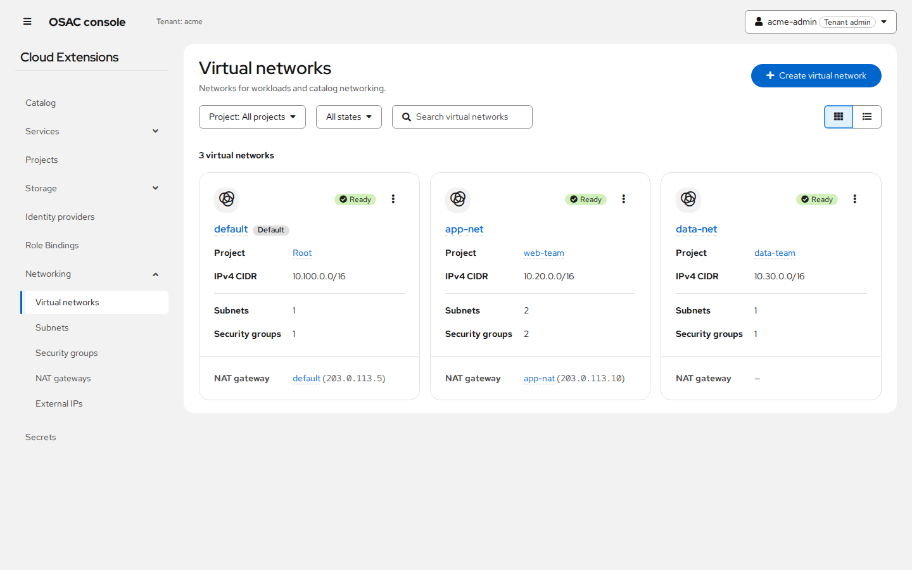

---

## 2. Virtual networks list

**What this screen is for.** Seeing all the tenant's networks at a glance:
state, size, children and outbound address.

**Explanation.** A view switcher toggles between cards (section 1) and a
table. Each network shows its name with a badge, status, IPv4 CIDR, subnet and
security group counts, its NAT gateway on one line (`name (address)`, or a
dash), and its project. Filters cover state, project and name. For the
provider admin, a **Tenant** filter comes
first, cards show the tenant, and the table adds a **Tenant** column at the
end. **Create virtual network** asks for project, name and IPv4 CIDR. For the
provider admin it is disabled with "Available when the network class is
Ready." until the network class is Ready.

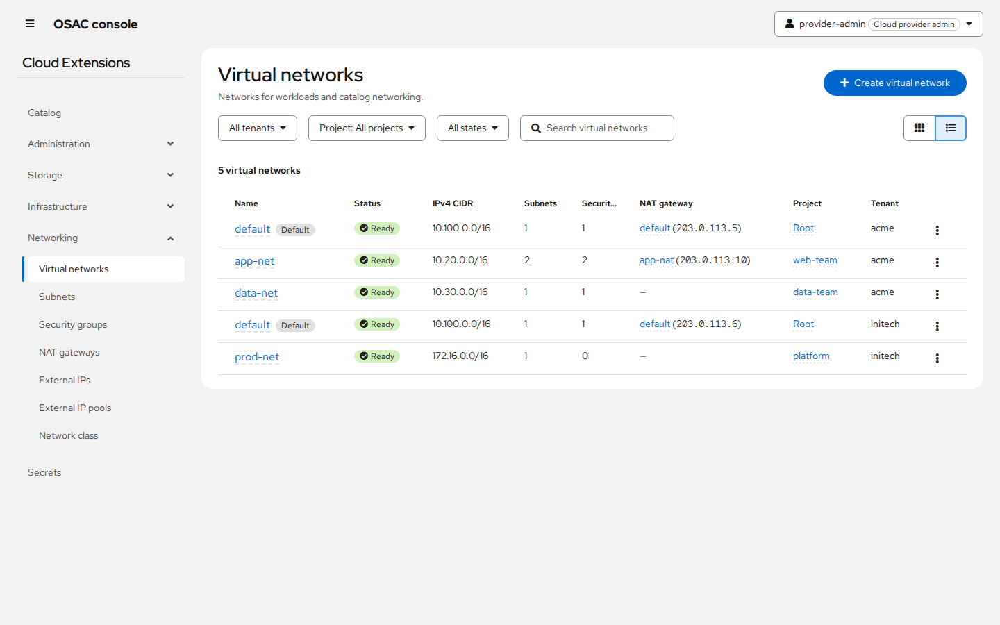

---

## 3. Virtual network details

**What this screen is for.** Inspecting one network and managing its children
in context.

**Explanation.** The page has the tabs **Overview**, **Subnets**,
**Security groups** and **NAT gateway**, and the selected tab is in the URL.
Overview shows the IPv4 CIDR, project, NAT gateway and creation time. When the
network still has subnets, security groups, a NAT gateway or fabric domains,
**Delete virtual network** is disabled, and its tooltip names them: "Delete
its dependents first: subnets (2), security groups (2), NAT gateway app-nat."
While the network is not Ready, each tab says why it is empty, and its create
button is disabled with "Available when the virtual network is Ready."

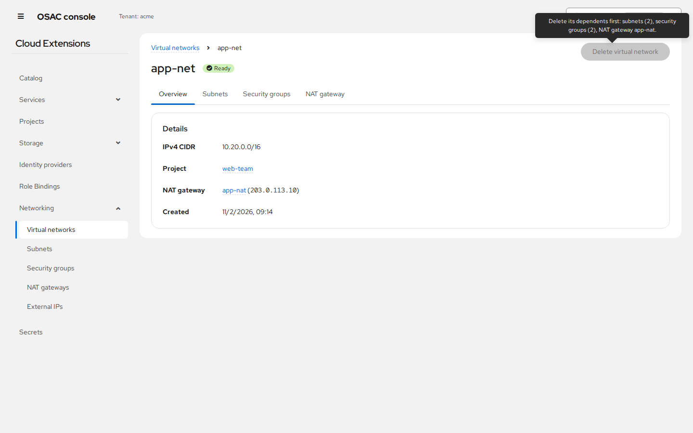

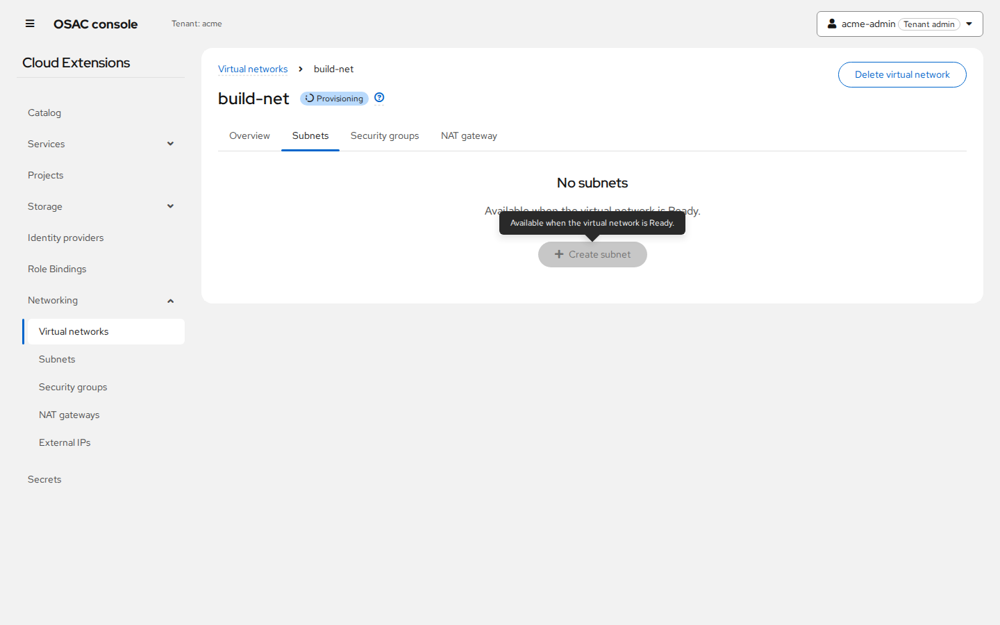

---

## 4. Subnets

**What this screen is for.** Finding any subnet and creating one inside a
ready network.

**Explanation.** The list shows Name (with badge), Status, IPv4 CIDR and
Virtual network (a link) and Project, with filters for name, project and
virtual network. There is no subnet details page. **Create subnet** asks for
the virtual network (only Ready ones; pre-filled and locked when opened from a
network), a name, and a CIDR inside the network's range ("Must be inside
192.168.101.0/24.", with a free range of the network as the placeholder).
Overlaps and out-of-range values are rejected in the form. In a tenant's
default network, **Create** waits until the default subnet is Ready. A
subnet's Delete is disabled while a workload uses it. The provider admin sees
each network option as
`name (CIDR, tenant)`, so two tenants' `default` networks can be told apart.
Tenant users see `name (CIDR)`.

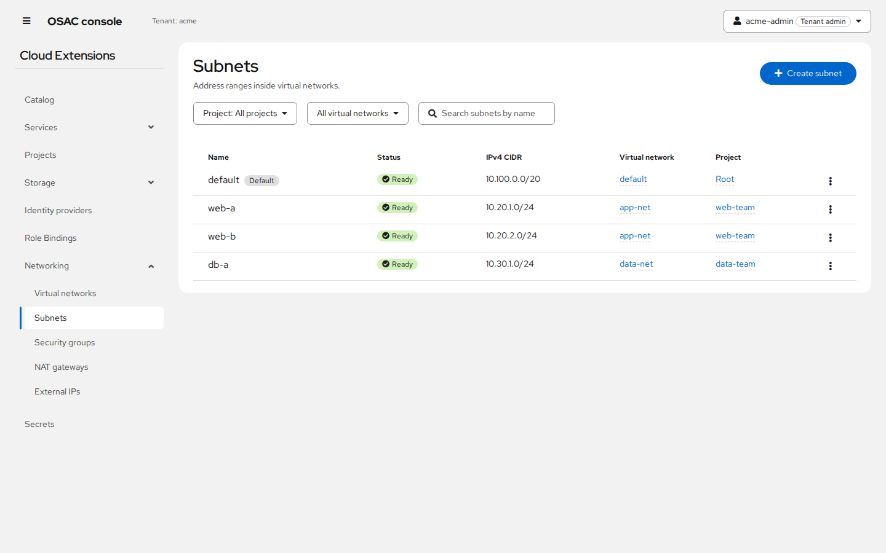

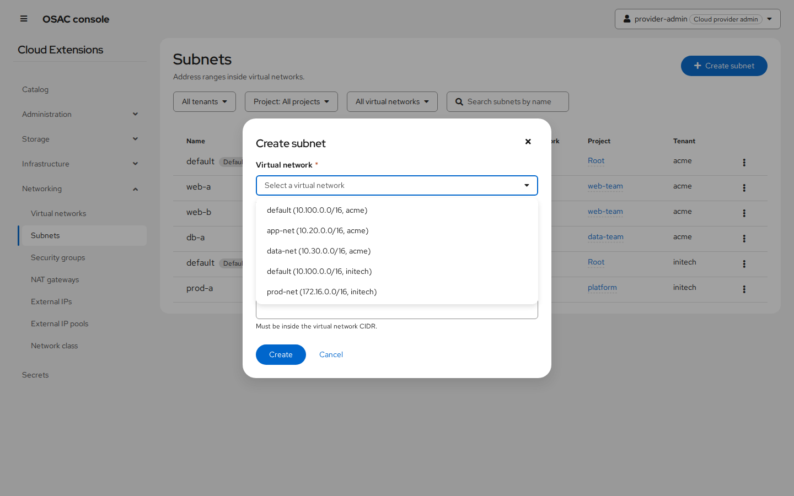

---

## 5. Security groups: details and Edit rules

**What this screen is for.** Reading a group's firewall rules and changing all
of them in one save.

**Explanation.** The details page has the tabs **Details**,
**Inbound rules** and **Outbound rules**, and the rules are read-only there.
Details shows the virtual network, project and creation time. Delete is
disabled while a workload uses the group.
**Edit rules** opens a full-page form with one row per rule: protocol
(TCP, UDP or All), port range for TCP and UDP, and a source (inbound) or
destination (outbound) IPv4 CIDR. Each section
has **Add rule** and **Remove**. **Save** replaces every rule of the group;
**Cancel** discards the changes. New rules never offer ICMP. A stored ICMP
rule keeps its value. If the network does not support ICMP, the server's error
appears above the form, and each ICMP row says to remove the rule or use
**All**, and that **All** also allows TCP and UDP on every port. After a save,
a Ready group shows **Updating** and a Failed group shows **Pending**, and
**Edit rules** is disabled with "Available when the security group is Ready
or Failed." Where provider networking is disabled, a save only stores the
rules and the group stays Ready. The API marks the update only at
its start: once the update's job runs, the group shows Ready with the job in
its status details, and a save made then shows the server's message.

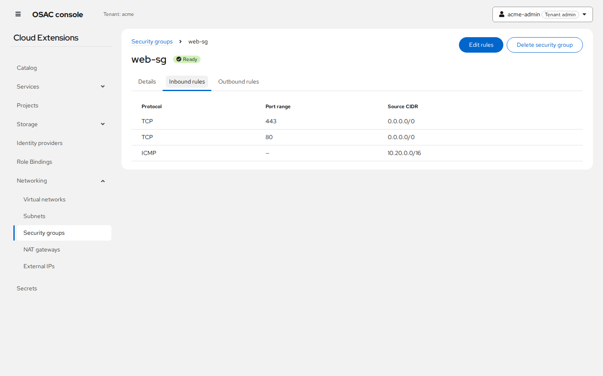

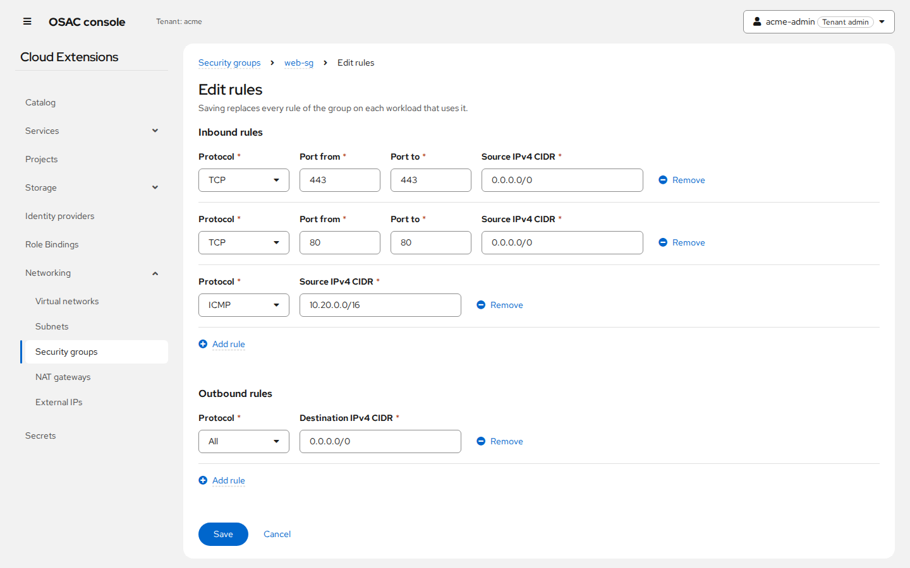

---

## 6. NAT gateways

**What this screen is for.** Giving a network outbound access, and seeing
which networks have it.

**Explanation.** The list shows Name, Status, Virtual network, External IP
and Project. The name opens the network's **NAT gateway** tab; the address is
plain text, because an external IP has no page. Delete is disabled while a cluster on the network uses the
gateway, because clusters reach their management endpoints through it.
**Create NAT gateway** first asks for the network: only Ready networks that
are not a tenant default and have no NAT gateway are offered. It then opens the
create wizard (**NAT gateway**, **Review**), which asks for a name and an
unused external IP. If no external IP is free, an alert links to
**Create external IP**. Create and Cancel return to where the user started:
the NAT gateways list, or the network's **NAT gateway** tab.

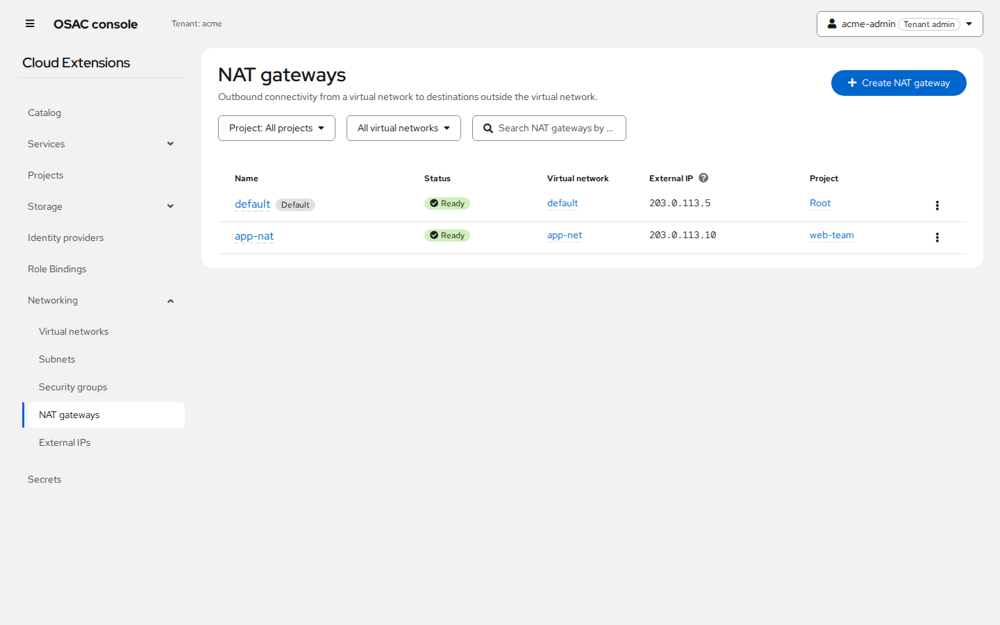

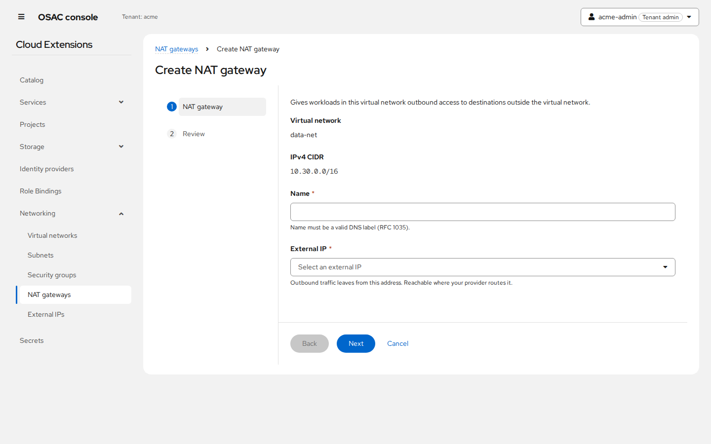

---

## 7. External IPs: addresses and attachments

**What this screen is for.** Allocating addresses from the provider's pools
and attaching them to workloads.

**Explanation.** On the **Addresses** tab, each address shows its status, the
address itself, the IP pool, **Used by** on one line (for example
`default (NAT gateway)`) and the project. Status is the
API state, such
as **Allocated**. **Used by** says whether the address is in use. An address
in use cannot be deleted, and the reason names the next step, for example
"Delete NAT gateway app-nat first." On the **Attachments** tab,
**Create attachment** asks for an unused external IP, a target type (virtual
machine, bare-metal instance or cluster), the target, and, for a cluster, the
endpoint (API or Ingress). Only Ready targets in the external IP's project
are offered.

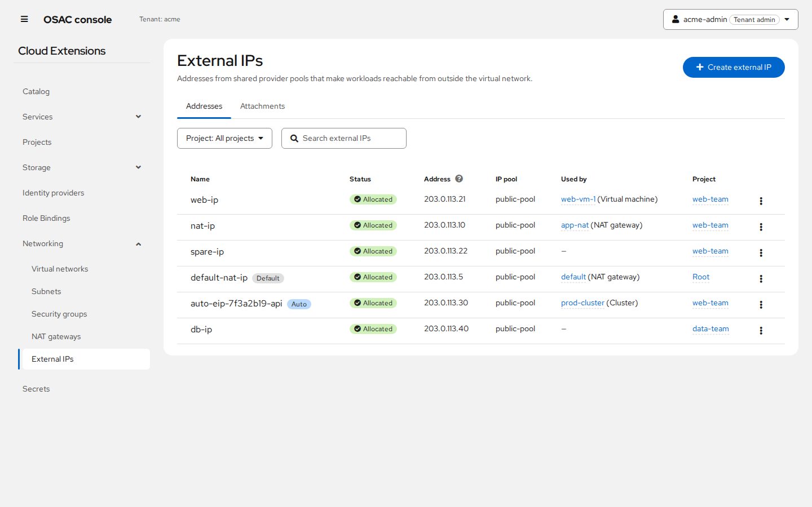

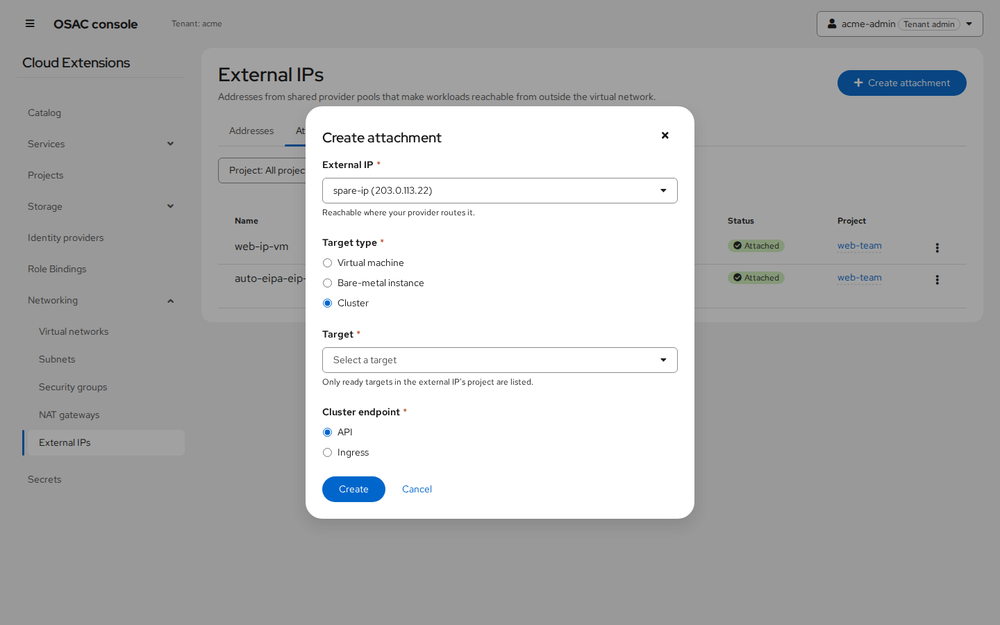

---

## 8. Default and automatic resources

**What this screen is for.** Showing which resources OSAC created and owns.

**Explanation.** A tenant's default network, subnet, security group and NAT
gateway carry a **Default** badge. Resources OSAC creates for a workload carry
an **Auto** badge. Each badge's tooltip says why the resource exists. Delete
and Detach stay in their place for these resources but are disabled, and so is
**Edit rules** for an Auto security group; the tooltip says the resource is
deleted with its tenant or its workload. The default security group's rules
can still be edited.

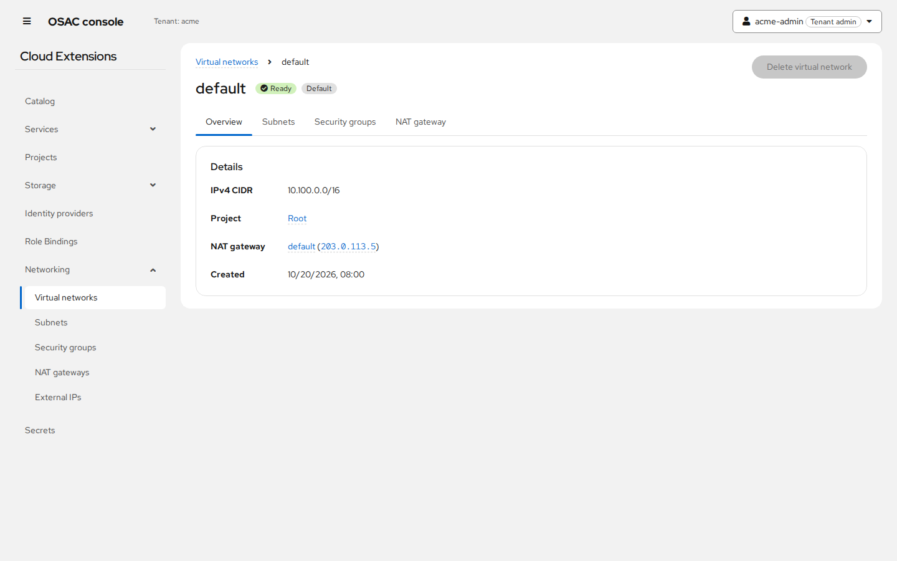

---

## 9. Updating and failed status

**What this screen is for.** Explaining what a resource is doing, or why it
failed.

**Explanation.** In lists, a status with a message (Provisioning, Failed,
Deleting, or Ready with a message) shows a help icon; **Updating** has none. Selecting it opens **Status details**
with the message. On the details page of a failed resource, the message
appears once, in a danger alert titled by what failed, such as "Security
group failed". For a security group, the alert says that the rules shown are
saved but may not be enforced: each part of the network keeps the rules of its
last successful update until a save succeeds, so parts can differ. It adds the
next step: "Fix the rules with Edit rules
and save them again."
An Auto security group's **Edit rules** is disabled; its badge names the
workload
that owns it, and the group is deleted with that workload.

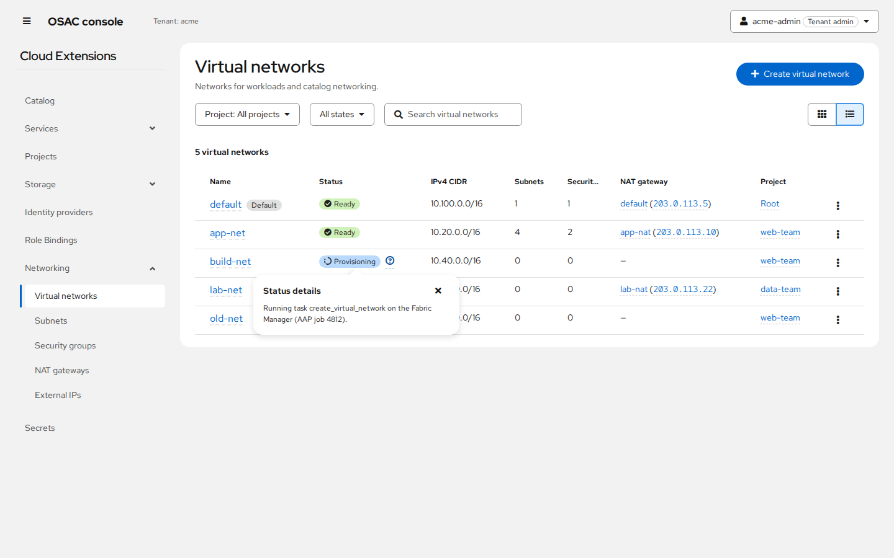

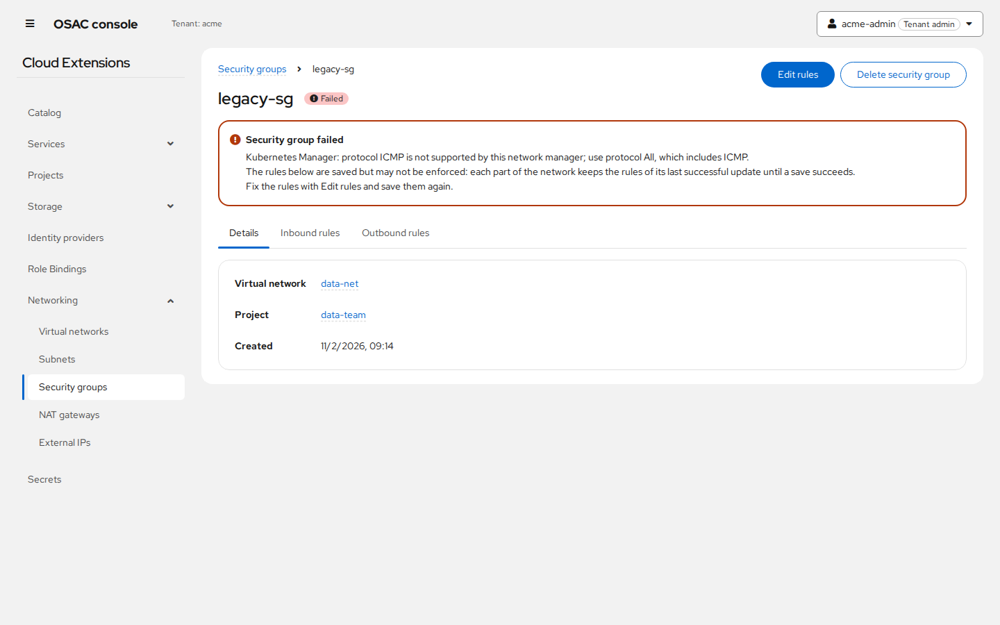

---

## 10. External IP pools (provider admin)

**What this screen is for.** Managing the address pools that all tenants
share.

**Explanation.** The list shows Name, Status, IPv4 CIDR (every range) and
Available as "12 of 16 (75%)", so both small and large pools read at a
glance. A pool with no free addresses shows a **None available** warning.
The details page shows usage as a progress bar ("56 of 256 used") that turns
to a warning at 80% used and to danger when the pool is full. **Create external IP pool** asks for a name and
one IPv4 CIDR, with no tenant, because pools are shared. Delete is disabled
while the pool has addresses in use: "Delete its 2 external IPs first."

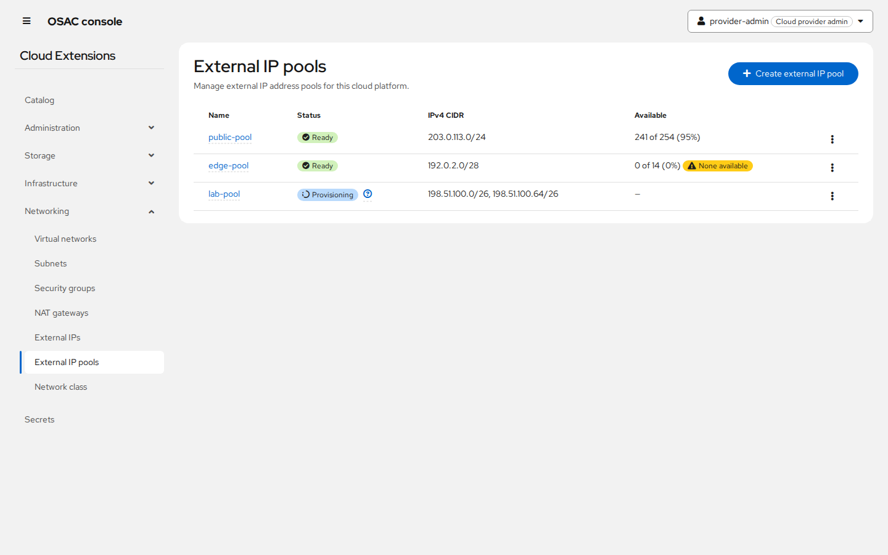

---

## 11. Network class (provider admin)

**What this screen is for.** Checking whether tenant networking is ready, what
the network managers support, and what every tenant and subnet gets.

**Explanation.** This is a read-only view of the network class that the
installer creates. It shows its status, one row each for the fabric manager
and the Kubernetes manager (the manager in use, with its Ansible role, or the
requested one marked "not resolved yet"), the network type, and the capabilities
(east-west Ethernet, and whether security groups support ICMP). It also
shows the tenant defaults (the default virtual network and subnet CIDRs and the
default security group's rules) and the subnet address plan (the share of each
subnet's addresses for virtual machines, the fabric and cluster ingress). The
installer sets both at installation and they cannot change, so they are what
every tenant and subnet got. There are no actions. If the installer has not
created a network class yet, the page says so. A deployment has one network class today; when sites arrive,
this becomes a list with one network class per site.

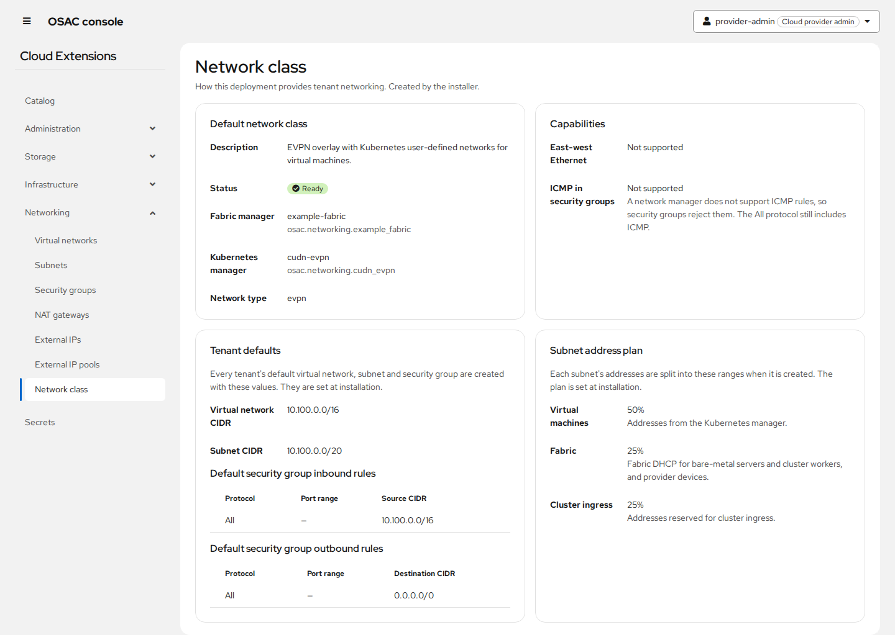
