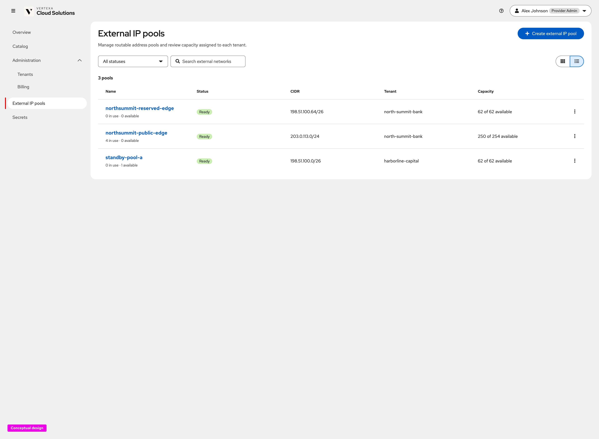
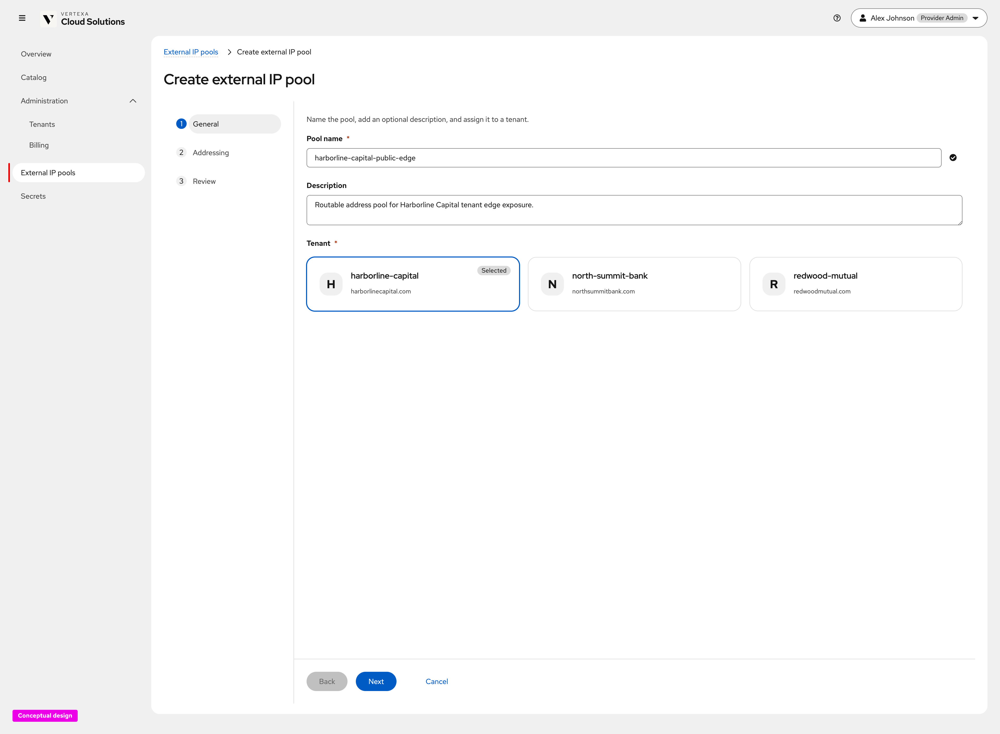
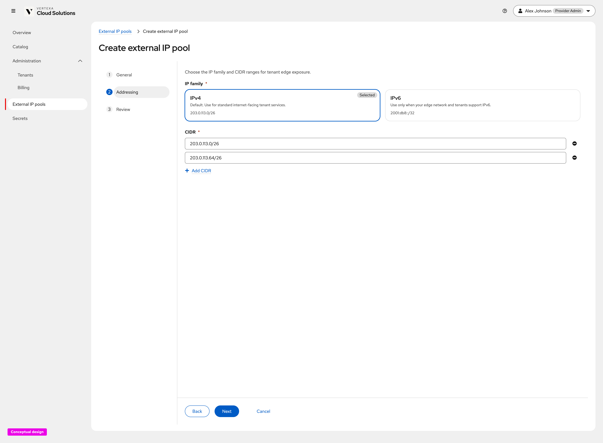
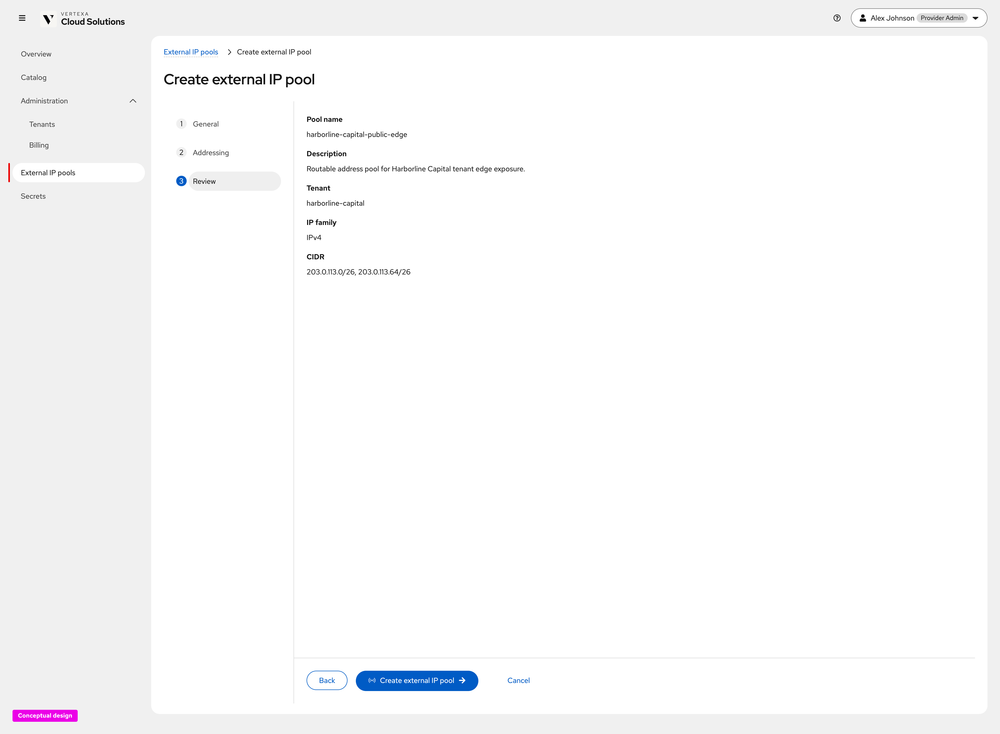
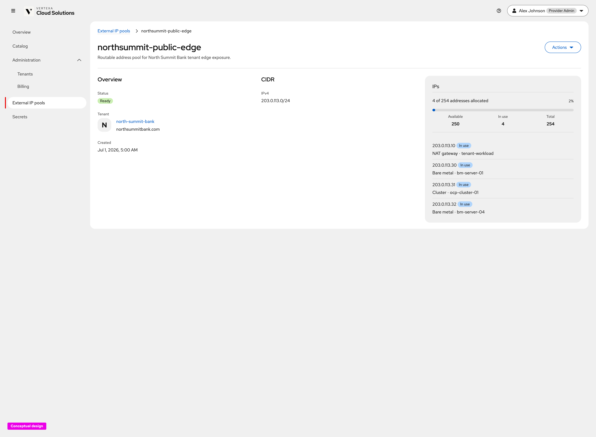

# External IP pool management (Cloud Provider Admin) — UX Design

Conceptual UX for **External IP pool management by the Cloud Provider /
Cloud Infrastructure Admin** ([OSAC-1433](https://redhat.atlassian.net/browse/OSAC-1433)
Unified Networking; screen-level UX
[OSAC-2226](https://redhat.atlassian.net/browse/OSAC-2226)), captured from the
live click-through prototype.

This document covers the provider-admin **External IP pools** list, create
wizard, and pool detail. Tenant External IP allocation and attachment flows
remain in [ui-design.md](ui-design.md) (Tenant Admin / Tenant User).

**Prototype (developers):**

- [External IP pools list](https://heyethankim.github.io/osac-bmaas/provider/workspace?nav=networking-external-ip-pools)
- [Create external IP pool](https://heyethankim.github.io/osac-bmaas/provider/workspace?nav=networking-external-ip-pools&action=create-external-ip-pool&step=details)
- Example detail: open any pool name from the list (for example
  `northsummit-public-edge`)

Requirements: [prd.md](prd.md). Backend design: [design.md](design.md).
Implementation-oriented UI contract: [ui-design.md](ui-design.md)
(ExternalIPPool management).

## Product decisions (this release)

- **Provider owns routable pools.** Cloud Provider Admins create and manage
  External IP pools under **Administration → External IP pools**. Tenants
  consume addresses from pools assigned to them; they do not define provider
  CIDR inventory.
- **List shows capacity and assignment.** Each pool row surfaces status,
  CIDR(s), assigned tenant, and available / total capacity so operators can
  spot exhaustion before launch failures
  ([prd.md](prd.md) / [design.md](design.md) ExternalIPPool capacity).
- **Create is a three-step wizard.** **General → Addressing → Review** names
  the pool, optionally describes it, assigns a tenant, chooses IP family, and
  enters one or more CIDRs.
- **Detail separates inventory from usage.** Overview / CIDR metadata sit
  beside an **IPs** panel with allocated vs available counts and in-use
  addresses linked to consumers (NAT gateway, bare metal, cluster, and so on).
- **No implied Internet reachability.** Address and pool copy must not claim
  public Internet reachability; routing is provider-defined
  ([ui-design.md](ui-design.md) rules for every networking page).
- **Production API shape.** The committed create contract is name + one
  canonical IPv4 CIDR ([ui-design.md](ui-design.md)). The prototype additionally
  explores tenant assignment at create time, multiple CIDRs, and an IPv6 family
  card for conceptual review; align shipping UI with the accepted design unless
  those extensions are formally accepted.

---

## 1. External IP pools list

**What this screen is for.** Let the Provider Admin browse routable address
pools, see which tenant each pool serves, and open create or detail
([ui-design.md](ui-design.md) ExternalIPPool list page).

**Explanation.** Page title **External IP pools** with lede *Manage routable
address pools and review capacity assigned to each tenant.* Primary action
**+ Create external IP pool**. Toolbar: status filter (All / Ready /
Unassigned), search, and grid/list toggle. List columns include **Name** (with
in-use / available subtext), **Status**, **CIDR**, **Tenant**, **Capacity**,
and a kebab for actions (for example create external IP, delete when allowed).

---

## 2. Create external IP pool — General

**What this screen is for.** Name the pool and assign it to a registered tenant
before choosing address ranges.

**Explanation.** Wizard steps: **General → Addressing → Review**. Lede: *Name
the pool, add an optional description, and assign it to a tenant.* Fields:

| Field | Required | Behavior |
| --- | --- | --- |
| Pool name | Yes | Kubernetes DNS label; validated inline (same name helper as other resources). |
| Description | No | Free-text purpose (for example tenant edge exposure). |
| Tenant | Yes | Card radiogroup of registered organizations (name + primary domain). Empty tenant registry shows a warning to register a tenant first. |

---

## 3. Create external IP pool — Addressing

**What this screen is for.** Choose IP family and the CIDR range(s) that make
up the pool’s address inventory.

**Explanation.** Lede: *Choose the IP family and CIDR ranges for tenant edge
exposure.* Fields:

| Field | Required | Behavior |
| --- | --- | --- |
| IP family | Yes | Card select: **IPv4** (default; example `203.0.113.0/26`) or **IPv6** (example `2001:db8::/32`). Changing family resets CIDR defaults. |
| CIDR | Yes (≥1) | One or more CIDR inputs with remove and **+ Add CIDR**. Client validation rejects empty or malformed values. |

Production create currently accepts a single IPv4 CIDR
([ui-design.md](ui-design.md)); multi-CIDR and IPv6 in this prototype are
exploratory unless the design is extended.

---

## 4. Create external IP pool — Review

**What this screen is for.** Confirm pool metadata and addressing before
create.

**Explanation.** Review summarizes **Pool name**, **Description**, **Tenant**,
**IP family**, and **CIDR** list. Primary action **Create external IP pool**.
On success the UI returns to the list (or opens the new pool detail) without
exposing internal manager coordinates.

---

## 5. External IP pool detail

**What this screen is for.** Inspect a pool’s assignment, CIDR inventory, and
which addresses are in use by which workloads
([design.md](design.md) ExternalIPPool status / capacity).

**Explanation.** Breadcrumb `External IP pools > <pool-name>`. Header shows
name, description, and **Actions**. Three regions:

- **Overview** — Status (for example Ready), assigned **Tenant** (link +
  domain), and created time.
- **CIDR** — Configured family and CIDR string(s).
- **IPs** — Capacity summary (allocated / total, available, in use) and a list
  of in-use addresses with consumer kind and name (NAT gateway, bare metal,
  cluster, and so on). Available addresses may appear as capacity counts
  without enumerating every free IP.

