# Unified Networking — UX Design

This is the UX for the shared **Networking** pages of the OSAC console
([OSAC-1433](https://redhat.atlassian.net/browse/OSAC-1433), UX story
[OSAC-7279](https://redhat.atlassian.net/browse/OSAC-7279)). Tenant admins and
tenant users use these pages to create, inspect and delete virtual networks,
subnets, security groups, NAT gateways and external IPs, and to see which
workloads their external IPs are attached to. The provider admin manages the
shared external IP pools and views the network class.

The screenshots come from a mock-data prototype of this design. Names,
addresses and tenants in them are examples.

Requirements: [prd.md](prd.md) (FR-11). Backend design: [design.md](design.md).
For components, routes, hooks, failure handling and tests, see
[ui-design.md](ui-design.md).

## Product decisions (this release)

- **One list per resource.** Every networking resource has its own list page
  under **Networking**, so users can find a subnet or security group without
  knowing its network. External IP attachments are a tab of **External IPs**,
  not a separate item.
- **Children on their parent.** The virtual network page shows its subnets
  and security groups in tabs, and its NAT gateway as a row of its
  **Overview** details, with the creates pre-filled for that network.
- **The provider admin sees provider resources only.** Their **Networking**
  section has **External IP pools** and **Network class**. Tenant-scoped
  resources are not in the provider admin's navigation, as for virtual
  machines and clusters, and the PRD gives the provider admin only the network
  class and the pools (FR-11).
- **Disable with a reason, do not hide.** An action the user cannot take
  stays in its place, focusable but disabled, and its tooltip says why or
  what to do. **Default** and **Auto** resources carry a badge, and their
  Delete is disabled with "Created as a tenant default. It is deleted with
  the tenant." or the Auto reason. Delete is also disabled while something
  the user can see still depends on the resource, for example "Used by
  virtual machine web-1. Delete it first." A create waits for its parent:
  "Available when the virtual network is Ready." When the UI cannot see the
  dependent (another project, for example), the server decides and the
  delete dialog shows its message.
- **Every resource shows its project.** Lists have a Project column and a
  Project filter, and details pages show the project, linked to it. The root
  project is called **Root**, as everywhere else in the console.
- **A page only where a row is not enough.** Networks, security groups and
  pools have details pages; subnets, NAT gateways, external IPs and
  attachments show everything in their row. Names link only to a page:
  networks, security groups, projects, workloads and pools. A NAT gateway
  links to its network's page, where **Overview** shows it, since a network
  has only one. Addresses are plain text. A name and its address
  stay on one line: `default (203.0.113.2)`.
- **Create opens what it created.** As in the rest of the console, creating
  a resource that has a page opens that page: a new virtual network or
  security group opens its details page, and a new NAT gateway opens its
  network's page. A subnet or external IP, which has no page, returns to
  where the user started.
- **Every create is a page.** Each networking create is one page with its
  form and **Create** and **Cancel** at the bottom, like **Create security
  group**: virtual network, subnet, security group, NAT gateway, external IP
  and external IP pool. There are no create wizards or modals, with one
  exception: a create started from inside another form, the create option of
  a picker, opens a modal so the form keeps what the user typed.
- **Details like the VM page.** Details pages use the layout of the virtual
  machine details page: titled sections, each a description list with the
  value under its label, and no cards. A related resource with one action is
  a row of that list with its action button next to the value, as the VM
  page does for its external IP. The read-only **Network class** page groups
  its values in cards (section 11).
- **Every status explains itself.** A status with a message is a clickable
  label that opens the message in a popover. There is no extra icon. A
  failed resource's details page shows the message once, in an alert.
- **Rules at create, one save to change them.** A security group is created
  with its inbound and outbound rules. **Edit rules** opens the same form, and
  saving sends both rule lists in one update; the API allows this one change
  in place (PRD, "No networking resource changes in place").
- **Create from the picker.** When a picker needs a resource that may not
  exist yet, its last option creates one, as the virtual network field of the
  workload wizards does.
- **Attach from the workload.** An external IP is attached on the page of the
  virtual machine or cluster that uses it. **External IPs** lists the
  attachments but does not create them.
- **No Internet promise.** "External" means outside the virtual network.
  Address fields in forms say "Reachable where your provider routes it."
- **Only the API's own edits.** Except for security group rules, there are no
  edit forms. Any other change is delete and recreate.

---

## 1. Networking navigation

**What this screen is for.** Reaching every networking resource from the
sidebar.

**Explanation.** For tenant admins and tenant users, **Networking** lists
**Virtual networks**, **Subnets**, **Security groups**, **NAT gateways** and
**External IPs**. The provider admin's **Networking** has only **External IP
pools** and **Network class** (see sections 10 and 11). A resource's item
stays active on its details and create pages.

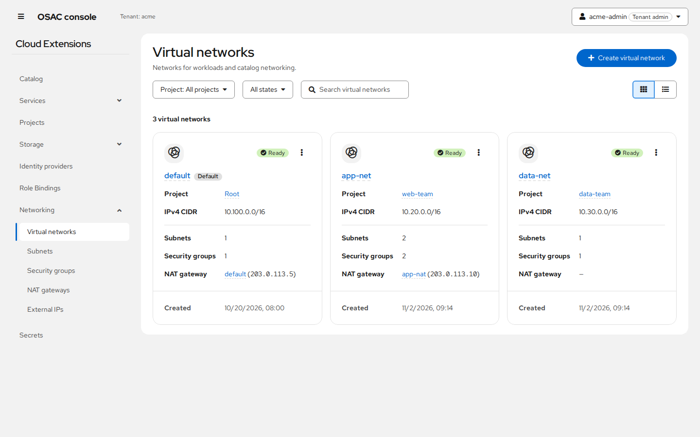

---

## 2. Virtual networks list

**What this screen is for.** Seeing all the tenant's networks at a glance:
state, size, children and outbound address.

**Explanation.** A view switcher toggles between cards (section 1) and a
table. Each network shows its name with a badge, status, IPv4 CIDR, subnet and
security group counts, its NAT gateway on one line (`name (address)`, or a
dash), and its project. A card shows **Created** in its footer, as the other
resource cards do. Filters cover state, project and name. **Create virtual
network** opens a page that asks for project, name and IPv4 CIDR, and then
opens the new network.

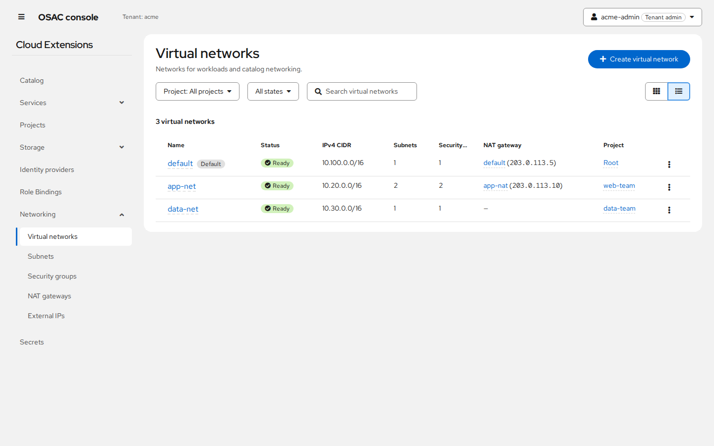

---

## 3. Virtual network details

**What this screen is for.** Inspecting one network and managing its children
in context.

**Explanation.** The page has the tabs **Overview**, **Subnets** and
**Security groups**, and the selected tab is in the URL. **Overview** lists
the IPv4 CIDR, project, NAT gateway and creation time. When the network still has subnets, security groups, a NAT
gateway or fabric domains, **Delete virtual network** is disabled, and its
tooltip names them: "Delete its dependents first: subnets (2), security
groups (2), NAT gateway app-nat." While the network is not Ready, each tab
says why it is empty, and its create button is disabled with "Available when
the virtual network is Ready."

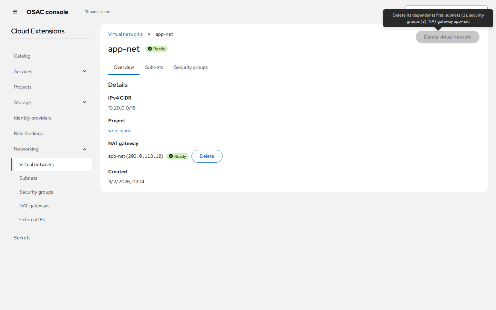

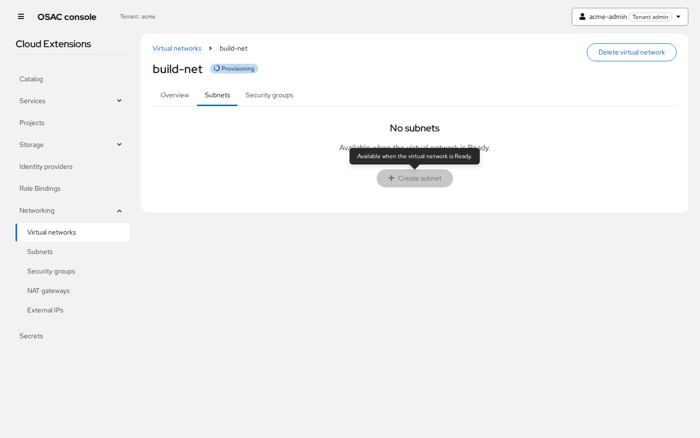

**NAT gateway row.** This is where a network's outbound access is added and
removed, the way the virtual machine page adds and removes its external IP.
With a NAT gateway, the row shows `name (address)`, its status and a
**Delete** button, which removes the gateway from the network; the external IP
stays allocated. Delete is disabled with the reason for a default NAT gateway
and while a cluster on the network uses it. Without one, the row shows a dash
and **Create NAT gateway**, which opens the create page (section 6) for this
network. A tenant's default network has no **Create NAT gateway**, because its
default NAT gateway is created with the tenant.

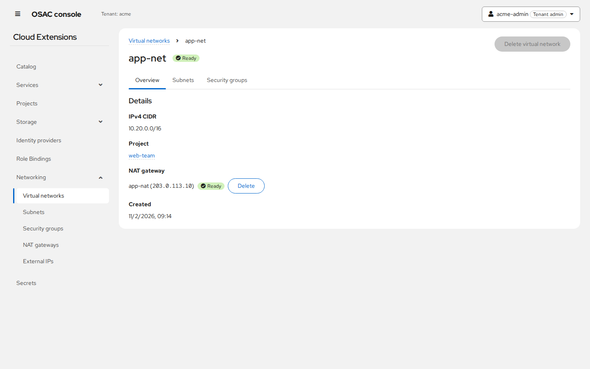

---

## 4. Subnets

**What this screen is for.** Finding any subnet and creating one inside a
ready network.

**Explanation.** The list shows Name (with badge), Status, IPv4 CIDR,
Virtual network (a link) and Project, with filters for name, project and
virtual network. There is no subnet details page. **Create subnet** opens a
page that asks for the virtual network (only Ready ones, shown as `name (CIDR)`; pre-filled and
locked when opened from a network), a name, and a CIDR inside the network's
range ("Must be inside 10.20.0.0/16.", with a free range of the network as
the placeholder). Overlaps and out-of-range values are rejected in the form.
In a tenant's default network, **Create** waits until the default subnet is
Ready. A subnet's Delete is disabled while a workload uses it.

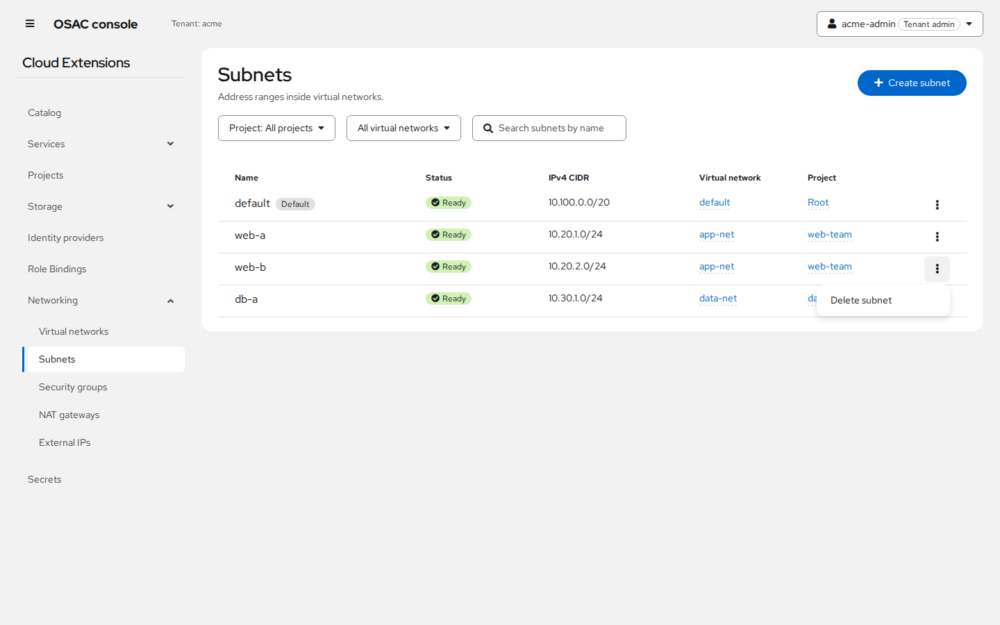

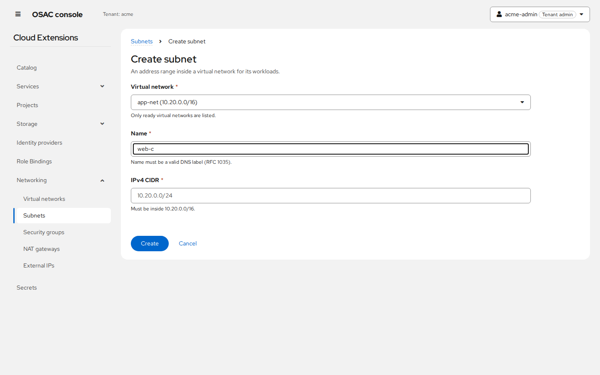

---

## 5. Security groups: create, details and Edit rules

**What this screen is for.** Creating a group with the rules its workloads
need, reading them, and changing all of them in one save.

**Explanation.** **Create security group** opens a page with the virtual
network (only Ready ones; pre-filled and locked when opened from a network),
the name, and an **Inbound rules** and an **Outbound rules** section. Each
row is a rule: protocol (TCP, UDP or All), port range for TCP and UDP, and a
source (inbound) or destination (outbound) IPv4 CIDR. Each section has **Add
rule** and **Remove**. A section with no rules says that its traffic is
blocked. **Create** opens the new group's page.

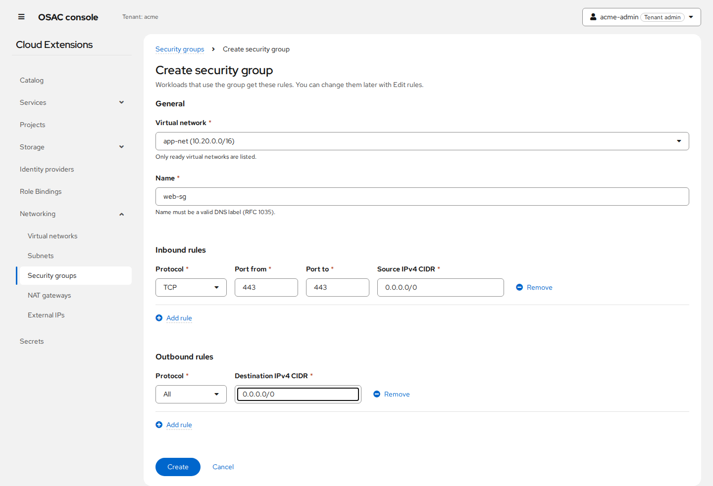

The details page has the tabs **Details** and **Rules**. Details shows the
virtual network, project and creation time, with each value under its label. **Rules** lists the inbound and
then the outbound rules, each with its count, in the order of the form; a
group has a handful of rules, so both fit on one tab. Delete is disabled while
a workload uses the group.

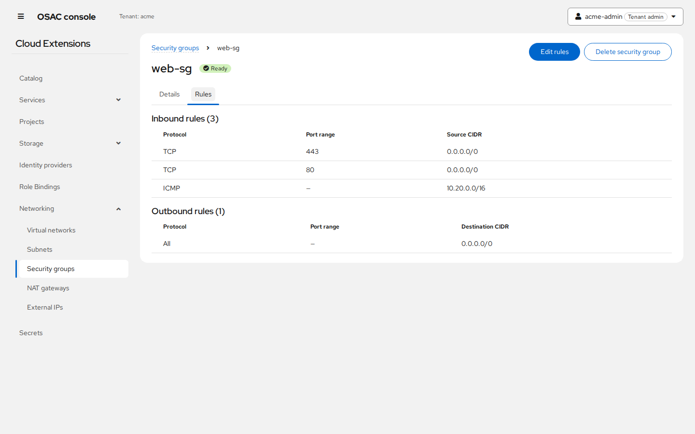

**Edit rules** opens the create form's rule sections with the group's rules.
**Save** replaces every rule of the group; **Cancel** discards the changes.
New rules never offer ICMP. A stored ICMP rule keeps its value. If the network
does not support ICMP, the server's error appears above the form, and each
ICMP row says to remove the rule or use **All**, and that **All** also allows
TCP and UDP on every port. After a save, a Ready group shows **Updating** and
a Failed group shows **Pending**, and **Edit rules** is disabled with
"Available when the security group is Ready or Failed." Where provider
networking is disabled, a save only stores the rules and the group stays
Ready. The API marks the update only at its start: once the update's job
runs, the group shows Ready with the job in its status details, and a save
made then shows the server's message.

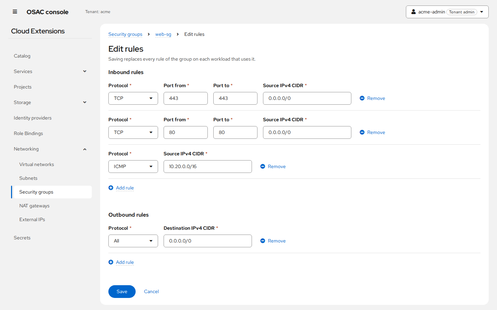

---

## 6. NAT gateways

**What this screen is for.** Giving a network outbound access, and seeing
which networks have it.

**Explanation.** The list shows Name, Status, Virtual network, External IP
and Project. The name opens the network's page; the address is
plain text, because an external IP has no page. Delete is disabled while a
cluster on the network uses the gateway, because clusters reach their
management endpoints through it. **Create NAT gateway** opens one page with
the network (only Ready networks that are not a tenant default and have no
NAT gateway; pre-filled and locked when opened from a network), a name and an
unused external IP. Create opens the network's page; Cancel returns to where
the user started.

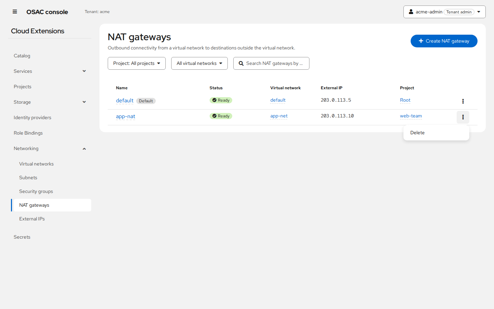

The **External IP** picker lists the unused addresses, and its last option is
**Create external IP**. It opens a small form with the name and the IP pool
(pools with no free address cannot be chosen); the project is the network's.
The new address is then selected in the picker, and the page keeps what the
user typed. When no address is free, the picker says "No unused external IP.
Create one."

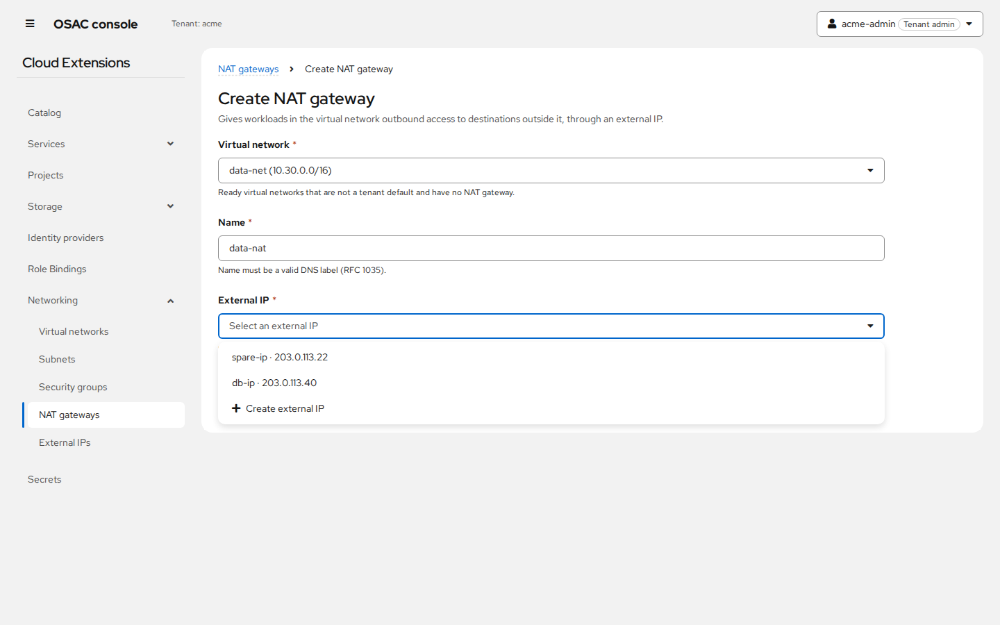

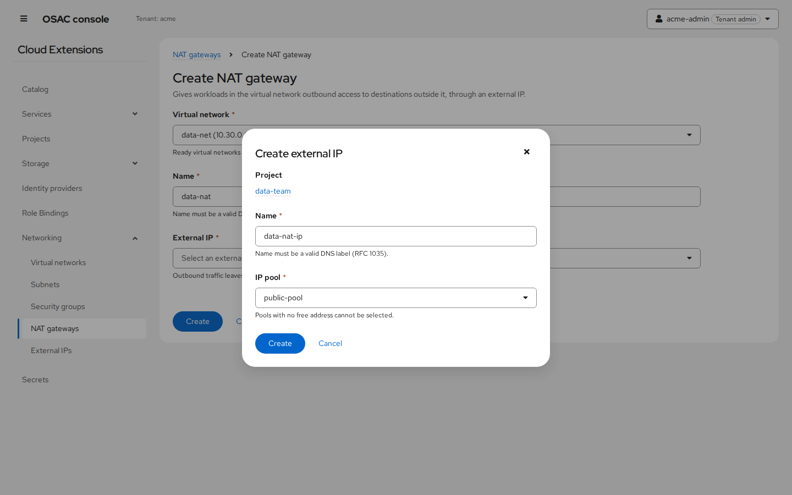

---

## 7. External IPs: addresses and attachments

**What this screen is for.** Allocating addresses from the provider's pools
and seeing what each one is attached to.

**Explanation.** On the **Addresses** tab, each address shows its status, the
address itself, the IP pool, **Attached to** on one line (for example
`app-nat (NAT gateway)`, the same term as attachments in the CLI) and the
project. Status is the API state, such as **Allocated**. An attached address
cannot be deleted, and the reason names the next step, for example "Delete
NAT gateway app-nat first." **Create external IP** opens a page with the
project, the name and the IP pool (pools with no free address cannot be
chosen).

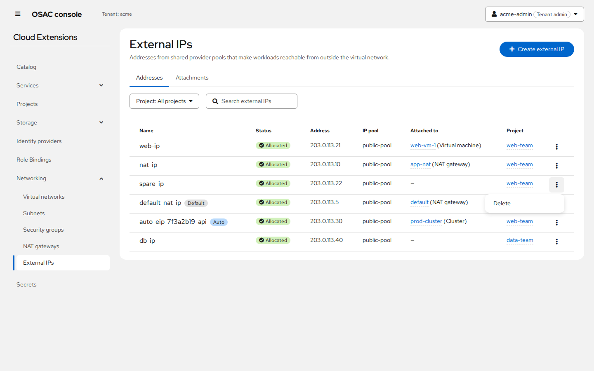

The **Attachments** tab lists every attachment: the address, the target
workload (and, for a cluster, the endpoint), the status and the project,
with **Delete** to detach. Attaching is done from the workload: **Attach
external IP** on a virtual machine's page, or on a cluster's API or Ingress
endpoint. Without attachments, the tab says so and where to attach.

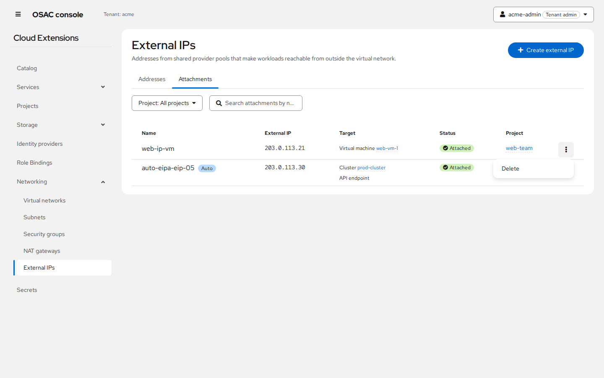

---

## 8. Default and automatic resources

**What this screen is for.** Showing which resources OSAC created and owns.

**Explanation.** A tenant's default network, subnet, security group and NAT
gateway carry a **Default** badge. Resources OSAC creates for a workload carry
an **Auto** badge. Each badge's tooltip says why the resource exists. Delete
stays in its place for these resources but is disabled, and so is **Edit
rules** for an Auto security group; the tooltip says the resource is deleted
with its tenant or its workload. The default security group's rules can
still be edited.

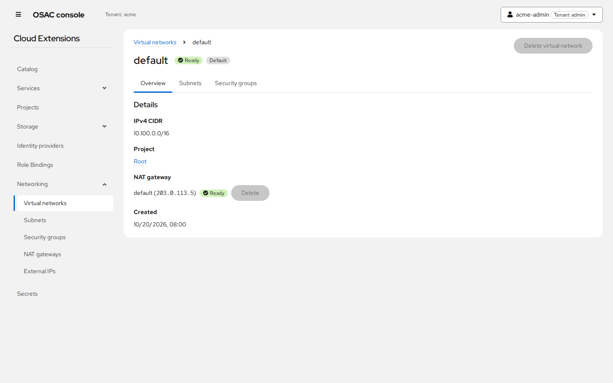

---

## 9. Updating and failed status

**What this screen is for.** Explaining what a resource is doing, or why it
failed.

**Explanation.** In lists, a status with a message (Provisioning, Failed,
Deleting, or Ready with a message) is a clickable label; **Updating** is not.
Selecting it opens **Status details** with the message. This is the console's
status pattern for every networking resource and can serve the other
resources too. On the details page of a failed resource, the message appears
once, in a danger alert titled by what failed, such as "Security group
failed". For a security group, the alert says that the rules shown are saved
but may not be enforced: each part of the network keeps the rules of its
last successful update until a save succeeds, so parts can differ. It adds
the next step: "Fix the rules with Edit rules and save them again." An Auto
security group's **Edit rules** is disabled; its badge names the workload
that owns it, and the group is deleted with that workload.

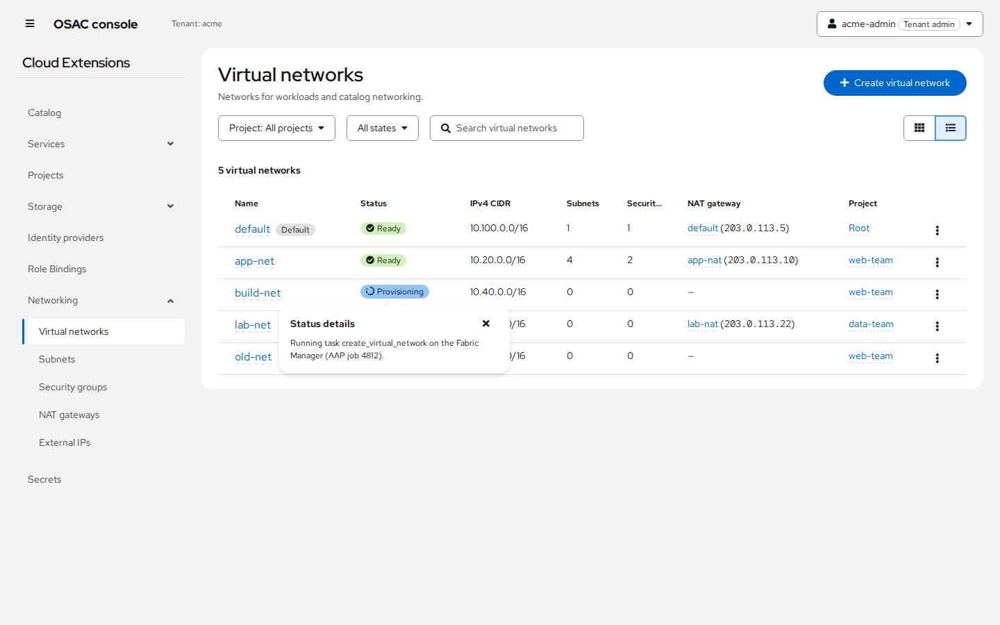

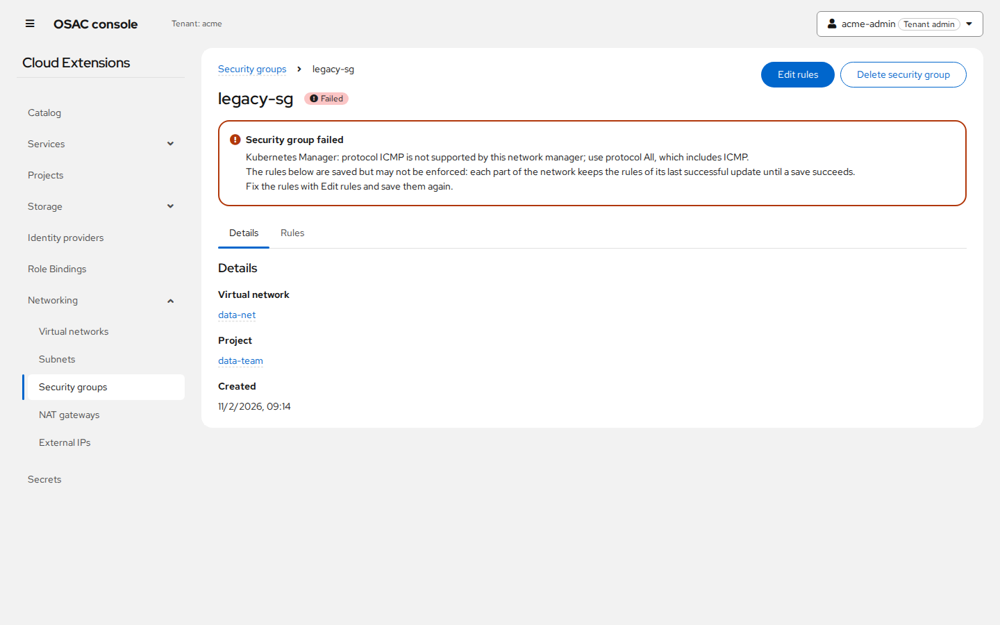

---

## 10. External IP pools (provider admin)

**What this screen is for.** Managing the address pools that all tenants
share.

**Explanation.** The list shows Name, Status, IPv4 CIDR (every range) and
Available as "12 of 16 (75%)", so both small and large pools read at a
glance. A pool with no free addresses shows a **None available** warning.
The details page shows usage as a progress bar ("56 of 256 used") that turns
to a warning at 80% used and to danger when the pool is full. **Create
external IP pool** opens a page that asks for a name and one IPv4 CIDR, with
no tenant, because pools are shared, and then opens the new pool. It is disabled with "Available when
the network class is Ready." until the network class is Ready. Delete is
disabled while the pool has addresses in use: "Delete its 2 external IPs
first."

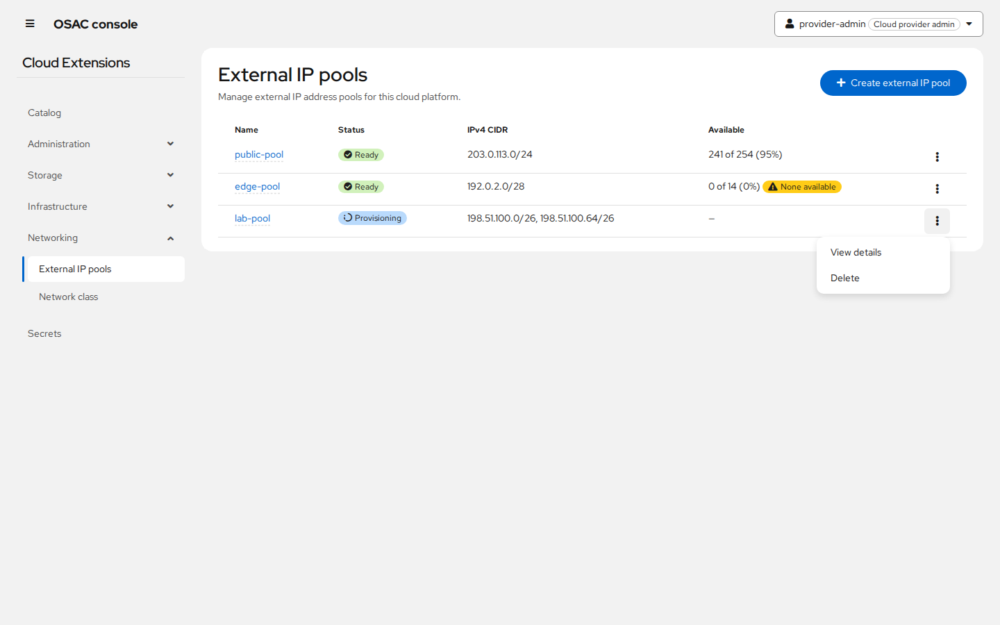

---

## 11. Network class (provider admin)

**What this screen is for.** Checking whether tenant networking is ready, what
the network managers support, and what every tenant and subnet gets.

**Explanation.** This is a read-only view of the network class that the
installer creates, in three cards. The first, across the page, shows its
name, description and status, the fabric manager and the Kubernetes manager
(the manager in use, with its Ansible role, or the requested one marked "not
resolved yet"), the network type, and the capabilities (east-west Ethernet,
and whether security groups support ICMP), in three columns with each value
under its label. Below it, side by side, **Tenant defaults** shows the default
virtual network and subnet CIDRs and one table of the default security
group's rules with a Direction column, and **Subnet address plan** is a table
of each range (virtual machines, fabric and cluster ingress), its share of a
subnet's addresses and what it is used for. The
installer sets both at installation and they cannot change, so they are what
every tenant and subnet got. There are no actions. If the installer has not
created a network class yet, the page says so. A deployment has one network class today; when sites arrive,
this becomes a list with one network class per site.

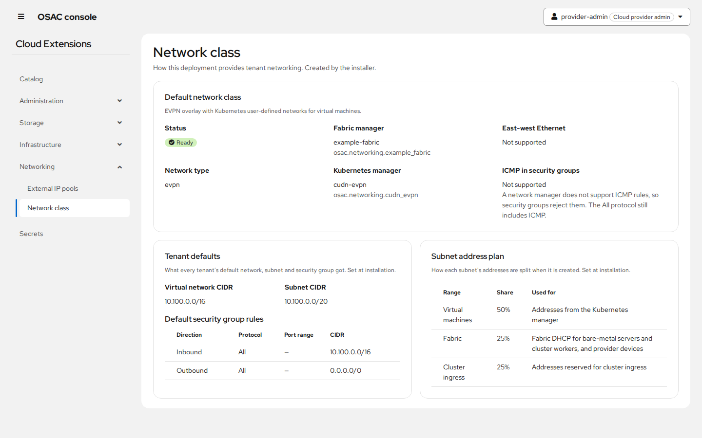
