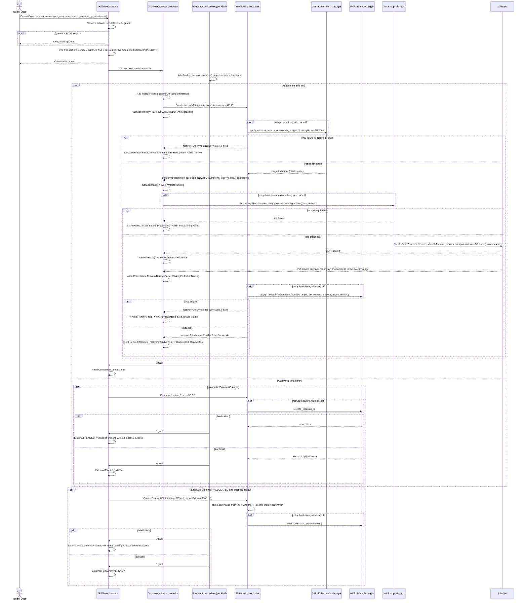
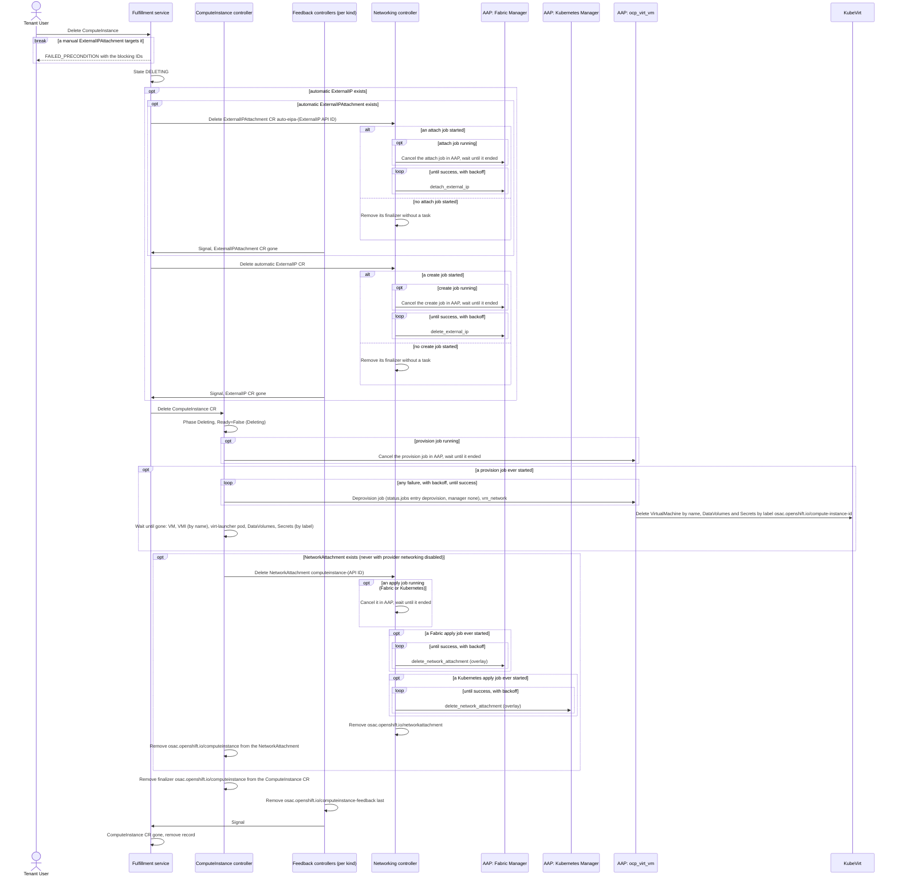

# VMaaS Networking

## Contents

- [Summary](#summary)
- [Motivation](#motivation)
  - [Goals](#goals)
  - [Non-Goals](#non-goals)
- [Proposal](#proposal)
  - [Workflow Description](#workflow-description)
    - [Create](#create)
    - [Delete](#delete)
    - [External access](#external-access)
  - [API Extensions](#api-extensions)
  - [UX Alignment](#ux-alignment)
  - [Implementation Details/Notes/Constraints](#implementation-detailsnotesconstraints)
    - [Network attachment and validation](#network-attachment-and-validation)
    - [VM construction](#vm-construction)
    - [Network status and address discovery](#network-status-and-address-discovery)
    - [ExternalIPAttachment target `compute_instance`](#externalipattachment-target-compute_instance)
    - [Automatic external access](#automatic-external-access)
    - [Provider networking disabled](#provider-networking-disabled)
    - [Component responsibilities](#component-responsibilities)
    - [Workload service design checklist](#workload-service-design-checklist)
  - [Security Considerations](#security-considerations)
  - [Failure Handling and Recovery](#failure-handling-and-recovery)
  - [RBAC / Tenancy](#rbac--tenancy)
  - [Observability and Monitoring](#observability-and-monitoring)
  - [Risks and Mitigations](#risks-and-mitigations)
  - [Drawbacks](#drawbacks)
- [Edge cases that need handling](#edge-cases-that-need-handling)
  - [Restarts and job tracking](#restarts-and-job-tracking)
  - [Delete races](#delete-races)
- [Alternatives (Not Implemented)](#alternatives-not-implemented)
- [Test Plan](#test-plan)
  - [Unit Tests](#unit-tests)
  - [Integration Tests](#integration-tests)
  - [E2E Tests](#e2e-tests)
  - [Edge-case tests (later)](#edge-case-tests-later)
- [Graduation Criteria](#graduation-criteria)
- [Upgrade and Downgrade Strategy](#upgrade-and-downgrade-strategy)
- [Version Skew Strategy](#version-skew-strategy)
- [Support Procedures](#support-procedures)
- [Infrastructure Needed](#infrastructure-needed)

## Summary

This design connects a ComputeInstance to one tenant Subnet with the [Unified Networking](/enhancements/OSAC-1433-unified-networking/design.md) resources and the [Network Manager Integration Contract](/enhancements/OSAC-1433-network-manager-integration-contract-networking/design.md) ("the contract"), and lets a tenant request an ExternalIP in the create call. Requirements: [PRD](prd.md).

## Motivation

A VM needs its tenant network and SecurityGroup policy before first boot.

### Goals

- One network attachment per VM, prepared before the VM exists.
- One VM shape for every OSAC Kubernetes Manager.
- The VM address in ComputeInstance status, read only from KubeVirt.
- Optional automatic external access in the create call.

### Non-Goals

- CaaS and BMaaS networking ([CaaS](/enhancements/OSAC-1436-caas-networking/design.md), [BMaaS](/enhancements/OSAC-1437-bmaas-networking/design.md)).
- Manager behavior (the contract).
- VM runtimes other than KubeVirt, and VMs outside the hub ([hub support boundary](/enhancements/OSAC-1433-unified-networking/design.md#networking-hub-support-boundary)).

## Proposal

The ComputeInstance controller creates a NetworkAttachment before the VM. The Kubernetes Manager returns a namespace whose primary network is the Subnet's network, and VMaaS creates the VM there. Once VMaaS discovers the VM address, the Fabric Manager binds that address to the VM's SecurityGroups. Delete removes automatic external access first, then the VM, then the NetworkAttachment.

### Workflow Description

Actors: the Tenant User (public gRPC API or `osac` CLI) and the [components](#component-responsibilities). Starting state: provider networking is enabled, the NetworkClass is READY, and the [creation readiness gates](/enhancements/OSAC-1433-unified-networking/design.md#creation-readiness-gates) pass (including `DefaultNetworkingReady`); for automatic access, a READY ExternalIPPool has free capacity ([Unified](/enhancements/OSAC-1433-unified-networking/design.md#automatic-external-access)).

#### Create

1. The Tenant User creates a ComputeInstance:
   ```bash
   osac create computeinstance --template rhel9 --name my-vm \
     --network-attachment subnet=my-subnet,security-groups=sg-web,sg-db
   osac create computeinstance --template rhel9 --name my-vm2 --external-ip-attachment
   ```
   Form 1 selects a Subnet and two SecurityGroups, each by name or API ID (`security-groups=` last); the CLI resolves a name with a List in the tenant and fails, sending nothing, when none or several match. Form 2 uses the tenant defaults and requests automatic external access (`auto_external_ip_attachment`).
2. The fulfillment service resolves and validates the attachment and checks the gates ([Network attachment and validation](#network-attachment-and-validation)); a failure rejects the create and stores nothing. Otherwise, in one transaction, it stores the ComputeInstance and, with automatic access and provider networking enabled, the automatic ExternalIP (PENDING) ([Unified](/enhancements/OSAC-1433-unified-networking/design.md#automatic-external-access)), then creates their CRs.
3. The ComputeInstance feedback controller adds its finalizer `osac.openshift.io/computeinstance-feedback`. The ComputeInstance controller adds its finalizer `osac.openshift.io/computeinstance` and creates the NetworkAttachment `computeinstance-<API ID>` with the same finalizer and the annotation `osac.openshift.io/tenant` copied from the ComputeInstance: `target` = `{kind: ComputeInstance, id: <API ID>}`, `subnet` = Subnet API ID, `interface` = `{type: overlay}`, `securityGroups` = SecurityGroup API IDs. It sets `NetworkReady=False`, reason `NetworkAttachmentProgressing`.
4. The networking controller runs Kubernetes `apply_network_attachment`, again after each retryable failure; the manager binds the VM's interface to the policy objects of its SecurityGroups and returns `vm_attachment: {namespace}`.
   - Final failure or rejected result: the NetworkAttachment is `Ready=False`, reason `Failed`. The ComputeInstance controller sets `NetworkReady=False`, reason `NetworkAttachmentFailed`, and phase `Failed`, emits `NetworkAttachmentFailed`, and creates no VM.
   - Result accepted ([Security Considerations](#security-considerations)): the networking controller records `status.vmAttachment`; the NetworkAttachment stays `Ready=False`, reason `Progressing`, until the Fabric bind (step 7). The ComputeInstance controller sets `NetworkReady=False`, reason `VMNotRunning`.
5. Only then does the controller run the `ocp_virt_vm` provision job. It tracks the job in the ComputeInstance `status.jobs` (task `provision`, `manager: none`) like a manager job ([contract §4.7](/enhancements/OSAC-1433-network-manager-integration-contract-networking/design.md#47-ordering-concurrency-retries-and-ownership)); the job template sets the §4.7 AAP job timeout. The job creates the DataVolumes, Secrets, and VM in that namespace with the requested run strategy ([VM construction](#vm-construction)). It is idempotent by VM name and the `osac.openshift.io/compute-instance-id` label: a rerun keeps existing objects and creates only missing ones.
   - A failed provision job is final: the entry is `Failed` with the message, phase `Failed`, `Provisioned=False`, reason `ProvisioningFailed`; the tenant deletes the ComputeInstance.
   - Exception: an infrastructure failure that [contract §4.6](/enhancements/OSAC-1433-network-manager-integration-contract-networking/design.md#46-task-result-and-errors) retries (for example AAP `error` or the job timeout) sets the entry to `Retrying`; the job runs again after the §4.7 backoff.
6. When the VirtualMachineInstance (VMI) is `Running`: `NetworkReady=False`, reason `WaitingForIPAddress`. When the VMI reports the tenant address, the controller writes it to status ([Network status](#network-status-and-address-discovery)) and sets `NetworkReady=False`, reason `WaitingForFabricBinding`.
7. Once the address is in the ComputeInstance status, the networking controller runs Fabric `apply_network_attachment` with that address in its input ([contract task](/enhancements/OSAC-1433-network-manager-integration-contract-networking/design.md#fabric-apply_network_attachment--delete_network_attachment)), again after each retryable failure. The Fabric Manager binds the address to the policy objects of the VM's SecurityGroups, or does nothing when its fabric does not enforce SecurityGroups.
   - Final failure: the NetworkAttachment is `Ready=False`, reason `Failed`. The ComputeInstance controller sets `NetworkReady=False`, reason `NetworkAttachmentFailed`, and phase `Failed`, and emits `NetworkAttachmentFailed`; the VM stays until the tenant deletes the ComputeInstance.
   - Success: the NetworkAttachment is `Ready=True`, reason `Succeeded`. The ComputeInstance controller emits `NetworkAttached` and sets `NetworkReady=True`, reason `IPDiscovered`, then `Ready=True`.
8. In parallel with steps 3–7, the networking controller runs Fabric `create_external_ip`; the automatic ExternalIP becomes ALLOCATED, or FAILED after a final failure.
9. When it is ALLOCATED and the [endpoint is ready](#externalipattachment-target-compute_instance), the fulfillment service's automatic ExternalIPAttachment controller creates the ExternalIPAttachment `auto-eipa-<ExternalIP API ID>` ([Automatic external access](#automatic-external-access)). The networking controller builds `destination`, records it in `status.destination`, and runs Fabric `attach_external_ip`; the ExternalIPAttachment becomes READY, or FAILED after a final failure.



#### Delete

1. The Tenant User deletes the ComputeInstance. The [deletion guard](/enhancements/OSAC-1433-unified-networking/design.md#deletion-dependency-guards) rejects it with `FAILED_PRECONDITION` while a manual ExternalIPAttachment targets it; otherwise the state becomes DELETING ([until the record is removed](/enhancements/OSAC-1433-unified-networking/design.md#status)). A Delete of a DELETING ComputeInstance returns OK.
2. The fulfillment service deletes the automatic ExternalIPAttachment, then the automatic ExternalIP, then the ComputeInstance CR, each once the previous is gone ([Unified order](/enhancements/OSAC-1433-unified-networking/design.md#automatic-external-access)). Jobs and retries follow [contract §4.7](/enhancements/OSAC-1433-network-manager-integration-contract-networking/design.md#47-ordering-concurrency-retries-and-ownership).
3. The ComputeInstance controller sets phase `Deleting` and `Ready=False`, reason `Deleting`. From the deletionTimestamp on, it creates no NetworkAttachment and starts no provision job.
4. The controller removes the VM from its namespace, `status.virtualMachineReference.namespace` ([VM construction](#vm-construction)):
   - It cancels a running provision job and waits until AAP reports it ended.
   - If no provision job ever started, no VM exists and it skips the deprovision job.
   - Otherwise it runs the deprovision job with the provision `vm_network`, tracked like the provision job (task `deprovision`, `manager: none`). The job deletes the VM by name, and its DataVolumes and Secrets by the label `osac.openshift.io/compute-instance-id: <API ID>`. A failed deprovision job, whatever the cause, retries with the §4.7 backoff until it succeeds; the entry shows the message, and the ComputeInstance stays DELETING.
   - Then the controller waits until the VM and VMI (by name) and the virt-launcher pod, DataVolumes, and Secrets (by label) are gone from that namespace.
5. The controller deletes the NetworkAttachment `computeinstance-<API ID>`. The networking controller cancels a running apply job ([contract §4.7](/enhancements/OSAC-1433-network-manager-integration-contract-networking/design.md#47-ordering-concurrency-retries-and-ownership)), runs Fabric `delete_network_attachment`, then Kubernetes `delete_network_attachment`, each until it succeeds and only on a manager whose apply job ever started, then removes its finalizer `osac.openshift.io/networkattachment`. The Kubernetes Manager may delete its namespace. With [provider networking disabled](#provider-networking-disabled) there is no NetworkAttachment, and steps 5 and 6 are skipped.
6. When only `osac.openshift.io/computeinstance` remains on the NetworkAttachment, the ComputeInstance controller removes that finalizer.
7. When the NetworkAttachment is gone, the controller removes `osac.openshift.io/computeinstance` from the ComputeInstance CR. The ComputeInstance feedback controller removes `osac.openshift.io/computeinstance-feedback` last, as [Unified](/enhancements/OSAC-1433-unified-networking/design.md#hub-crs) defines, and the fulfillment service removes the record. No step patches the VM.



#### External access

A Tenant User can expose a ready VM through an ExternalIP. `--externalip` and `--compute-instance` take a name or an ID:

```bash
osac create externalip --pool external-pool-1 --name my-ip
osac create externalipattachment --externalip my-ip --compute-instance my-vm --name vm-att
```

The attach needs a [ready endpoint](#externalipattachment-target-compute_instance); before that it fails with `FAILED_PRECONDITION`. `--external-ip-attachment` makes OSAC attach once the endpoint is ready ([Automatic external access](#automatic-external-access)).

### API Extensions

- **fulfillment-service fields:** `ComputeInstanceSpec.network_attachments` (14, `repeated ComputeNetworkAttachment {subnet, security_groups}`, at most one entry) and `auto_external_ip_attachment` (18); `ComputeInstanceStatus.internal_ip_address` (3) and `compute_network_attachment_statuses` (8, `{subnet_ref, ip_address}`).
- **fulfillment-service, new:** `COMPUTE_INSTANCE_CONDITION_TYPE_NETWORK_READY = 9` in the public and private `ComputeInstanceConditionType`, mapped from the hub condition `NetworkReady`.
- **osac-operator ComputeInstance CRD:** `spec.networkAttachments` ([validation](#network-attachment-and-validation)); condition type `NetworkReady`; the API ID label `osac.openshift.io/computeinstance-uuid` ([Unified](/enhancements/OSAC-1433-unified-networking/design.md#hub-crs)); `status.jobs` for the `ocp_virt_vm` provision and deprovision jobs, in the `NetworkJobStatus` shape of [contract §4.7](/enhancements/OSAC-1433-network-manager-integration-contract-networking/design.md#47-ordering-concurrency-retries-and-ownership), Job tracking. Finalizers: `osac.openshift.io/computeinstance` (ComputeInstance controller; also on the NetworkAttachment) and `osac.openshift.io/computeinstance-feedback` (ComputeInstance feedback controller; removed last).
- **NetworkAttachment** ([Unified](/enhancements/OSAC-1433-unified-networking/design.md#networkattachment)): VMaaS creates and deletes the overlay kind; the networking controller runs its tasks on the Kubernetes and the Fabric Manager.
- **Controllers down:** without the networking controller, no NetworkAttachment becomes Ready and no VM is created.

### UX Alignment

The UI uses these fields, offers only READY Subnets and SecurityGroups of one VirtualNetwork ([Unified](/enhancements/OSAC-1433-unified-networking/design.md#ux-alignment)), has the wizards' "Use tenant default network" toggle ([Unified UI](/enhancements/OSAC-1433-unified-networking/ui-design.md#workload-network-attachment-pickers)), and shows `NetworkReady`. The VM wizard never sets `auto_external_ip_attachment`; automatic external access is API and CLI only.

### Implementation Details/Notes/Constraints

#### Network attachment and validation

The fulfillment service applies the [Unified defaulting table](/enhancements/OSAC-1433-unified-networking/design.md#network-attachment-field-presence-and-defaulting), [creation readiness gates](/enhancements/OSAC-1433-unified-networking/design.md#creation-readiness-gates), and [error codes](/enhancements/OSAC-1433-unified-networking/design.md#error-codes). VMaaS adds these checks:

| Check | Error |
|---|---|
| A second `--network-attachment` (CLI, before sending) | Rejected by the CLI |
| Update of `network_attachments` or `auto_external_ip_attachment` (recreate the VM instead) | `INVALID_ARGUMENT` |

A deployment without a Kubernetes Manager cannot enable VMaaS ([Unified — Subnet address plan](/enhancements/OSAC-1433-unified-networking/design.md#subnet-address-plan) Validation), so a ComputeInstance call there fails with OSAC-3046's `UNAVAILABLE` ("the vmaas service is not enabled on this server"; PRD FR-5).

The attachment is the VM's default route; there is no primary field.

The CRD mirrors the attachment as `spec.networkAttachments[]` with `subnetRef` and `securityGroupRefs` (API IDs, never names). Two CEL rules check it:
- on `networkAttachments`: `size(self) <= 1` (message "at most one network attachment is supported");
- on `spec`: `has(self.networkAttachments) == has(oldSelf.networkAttachments) && (!has(self.networkAttachments) || self.networkAttachments == oldSelf.networkAttachments)` (message "networkAttachments are immutable after creation"). It sits on `spec` because a `self == oldSelf` rule on the field does not run when the field is added or removed.

#### VM construction

The Kubernetes Manager owns the namespace; VMaaS owns the VM, whose `metadata.name` is the hub ComputeInstance CR name. The controller passes one networking input to `ocp_virt_vm`: `vm_network: {namespace, networks, interfaces, labels}`.

- `namespace` = `NetworkAttachment.status.vmAttachment.namespace`. The ComputeInstance's `status.virtualMachineReference` (`namespace` and `kubeVirtVirtualMachineName`, read by [OSAC-55 snapshots](/enhancements/OSAC-55-vm-snapshots/README.md)) holds the VM's namespace and name. The ComputeInstance controller writes it, from `vm_network.namespace` and the CR name, in the same status update that records the CR's first provision entry (before the launch call).
- `networks` = `[{name: tenant, pod: {}}]` for `spec.template.spec.networks`.
- `interfaces` = `[{name: tenant, binding: {name: l2bridge}}]` for `spec.template.spec.domain.devices.interfaces`.
- `labels` = `{osac.openshift.io/compute-instance-id: <ComputeInstance API ID>}`, merged into `spec.template.metadata.labels` and set on the DataVolumes and Secrets.

For Linux and Windows, the job replaces the template's default `networks` and `interfaces` with these and keeps them on later reconciles. The VM also has the label `osac.openshift.io/computeinstance: <hub CR name>` (not the finalizer of that name), which no manager uses. The template has no other networking logic.

```yaml
metadata:
  name: <hub CR name>
  namespace: osac-net-7f3a              # from vmAttachment
spec:
  runStrategy: Always                   # as requested
  template:
    metadata:
      labels:
        osac.openshift.io/computeinstance: <hub CR name>
        osac.openshift.io/compute-instance-id: <ComputeInstance API ID>
    spec:
      networks: [{name: tenant, pod: {}}]
      domain:
        devices:
          interfaces: [{name: tenant, binding: {name: l2bridge}}]
```

**How the VM reaches the Subnet.** The VM spec never names the network; the Kubernetes Manager makes the Subnet's network the returned namespace's primary network. With OSAC's [`cudn_evpn`](/enhancements/OSAC-4291-cudn-evpn-k8s-manager-phase-1-networking/design.md), that is a primary Layer2 EVPN ClusterUserDefinedNetwork selecting the namespace ([contract](/enhancements/OSAC-1433-network-manager-integration-contract-networking/design.md#osac-kubernetes-manager-tasks-osac-internal)); `pod: {}` is that user-defined network and `l2bridge` gives the VM a plain L2 interface on it.

**Why only a namespace.** OSAC validates one small value, and one VM shape works with every OSAC Kubernetes Manager.

**DataVolumes.** The root disk uses a registry source with `source.registry.pullMethod: node`, so the node pulls the image and the import needs no tenant network. Additional disks use `source.blank`. VM create uses no other source type.

#### Network status and address discovery

The Kubernetes Manager's DHCP gives the guest an address from the Subnet's overlay range ([contract §4.8](/enhancements/OSAC-1433-network-manager-integration-contract-networking/design.md#48-addressing), recorded in the Subnet CR `status.ipam`); OSAC never queries DHCP. The controller reads the VMI `status.interfaces` entry whose `name` is the VM's `pod` network name (`tenant`) and takes the first IPv4 address in its `ipAddresses` that lies in the overlay range. It ignores every other entry, including guest-only interfaces from the QEMU guest agent. The NetworkAttachment stores no address. The controller writes the address to:
- `status.computeNetworkAttachmentStatuses[0]` = `{subnetRef: <Subnet API ID>, ipAddress: <address>}` (API `compute_network_attachment_statuses[0]`);
- `status.ipAddress` (API `internal_ip_address`).

With no VMI (for example a `Halted` VM), or while the VMI reports no matching address, the controller clears both. The Kubernetes Manager keeps the address across VM restarts and live migration ([contract task](/enhancements/OSAC-1433-network-manager-integration-contract-networking/design.md#kubernetes-apply_network_attachment--delete_network_attachment)), so the Fabric bind of [Create](#create) step 7 runs once. When the address in status changes to a non-empty value that differs from `interface.ipv4_address` in the NetworkAttachment's `status.taskInput`, the controller emits the Warning event `IPAddressChanged` (a manager defect); the Fabric bind and any ExternalIPAttachment destination keep the old address.

| `NetworkReady` | Reason | When |
|---|---|---|
| False | `NetworkAttachmentProgressing` | The NetworkAttachment does not exist yet, or has no `status.vmAttachment` yet (Kubernetes apply running or retrying). The message comes from its `Ready` condition. |
| False | `NetworkAttachmentFailed` | The NetworkAttachment is `Ready=False`, reason `Failed` (Kubernetes or Fabric apply). The message is its `Ready` message: the manager's `osac_error` message (for example naming the [`cudn_evpn` limit](#risks-and-mitigations)), or why OSAC rejected the result. Phase `Failed` (API state FAILED); after a Kubernetes apply failure no VM is created. |
| False | `VMNotRunning` | The NetworkAttachment has `status.vmAttachment` and no VMI exists or its phase is not `Running` (VM being provisioned or scheduled, or `Halted`). |
| False | `WaitingForIPAddress` | The VMI is `Running` and reports no matching address. |
| False | `WaitingForFabricBinding` | The address is in status and the NetworkAttachment is not Ready yet (Fabric apply running or retrying). The message comes from its `Ready` condition. |
| True | `IPDiscovered` | The address is in status and the NetworkAttachment is Ready. |
| True | `ProvisioningDisabled` | [Provider networking is disabled](#provider-networking-disabled). |

`Ready=True` requires a ready VM and `NetworkReady=True`. `WaitingForIPAddress` has no timeout; its message names the interface and the overlay range. 10 minutes after the VMI's transition to `Running` without an address, the controller emits the Warning event `IPAddressNotFound`, once per VMI.

#### ExternalIPAttachment target `compute_instance`

| Item | VMaaS definition |
|---|---|
| Endpoints | One per ComputeInstance; `target_endpoint` must be `UNSPECIFIED`, else `INVALID_ARGUMENT`. |
| Endpoint ready | API state `COMPUTE_INSTANCE_STATE_RUNNING`, condition `COMPUTE_INSTANCE_CONDITION_TYPE_READY` TRUE (so after the Fabric bind, [Network status](#network-status-and-address-discovery)), `compute_network_attachment_statuses[0].ip_address` set, and not being deleted. |
| `destination.address` | The hub ComputeInstance's `status.computeNetworkAttachmentStatuses[0].ipAddress`. While it is empty, the ExternalIPAttachment stays PENDING (`Progressing`) and no job starts. |
| `destination.routing_domain` | `{type: tenant_virtual_network, virtual_network_id: <API ID of the attachment's VirtualNetwork>, subnet_id: <API ID of the attachment's Subnet>}`. |
| Automatic access | One ExternalIPAttachment for the VM ([Automatic external access](#automatic-external-access)). |

#### Automatic external access

`auto_external_ip_attachment: true` requests one endpoint: the VM. Shared rules, including labels and when the attachment is created: [Unified](/enhancements/OSAC-1433-unified-networking/design.md#automatic-external-access). ComputeInstance readiness never waits for it; if the ExternalIP or ExternalIPAttachment fails, the VM keeps working without external access.

#### Provider networking disabled

Shared rules: [Unified](/enhancements/OSAC-1433-unified-networking/design.md#provider-networking-control). With provider networking disabled, OSAC runs no networking job and the VM still runs. The ComputeInstance controller reads the deployment setting and uses this fallback:
- `vm_network` has `namespace` = the hub Tenant CR's `status.namespace`, `networks` = `[{name: default, pod: {}}]`, `interfaces` = `[{name: default, masquerade: {}}]`, and the same `labels` (the cluster default pod network).
- No NetworkAttachment. `NetworkReady=True`, reason `ProvisioningDisabled`.
- `status.ipAddress` is the first IPv4 address of the VMI interface `default`, not a tenant address. `compute_network_attachment_statuses` stays empty, so the endpoint is never ready.
- Delete deprovisions the VM in that namespace; there is no NetworkAttachment to delete.

#### Component responsibilities

| Component | Responsibility |
|---|---|
| fulfillment-service | Attachment resolution and validation; gates and guards; the automatic ExternalIP and automatic ExternalIPAttachment controller; deletes automatic resources before the ComputeInstance CR; reads status after each signal. |
| ComputeInstance controller | Its finalizer on its CR and the NetworkAttachment; NetworkAttachment create and delete; `ocp_virt_vm` jobs, their `status.jobs` entries, retries, and cancel; address discovery; `NetworkReady` and its events; the disabled fallback. |
| Feedback controllers (per kind) | One per CR kind (ComputeInstance, ExternalIP, ExternalIPAttachment); each signals the fulfillment service on a status change and after it removes its finalizer ([Unified](/enhancements/OSAC-1433-unified-networking/design.md#hub-crs)), and it reads the status. The ComputeInstance one owns `osac.openshift.io/computeinstance-feedback`. |
| Networking controller | Runs and validates the NetworkAttachment tasks (Kubernetes before the VM, Fabric with the VM address from the ComputeInstance status) and the Fabric ExternalIP and ExternalIPAttachment tasks; builds `destination` and records it in the ExternalIPAttachment status; keeps its finalizers. |
| `ocp_virt_vm` | Creates and deletes the VM, DataVolumes, and Secrets in `vm_network.namespace`. |
| KubeVirt | Runs the VM and reports its address in the VMI `status.interfaces`. |
| Kubernetes Manager | Subnet network, namespace, policy, DHCP. Never reads or modifies the VM. |
| Fabric Manager | Binds the VM address to its SecurityGroups' policy objects (or a documented no-op); ExternalIP and DNAT tasks. |

#### Workload service design checklist

| [Checklist](/enhancements/OSAC-1433-unified-networking/design.md#workload-service-design-checklist) item | VMaaS |
|---|---|
| Network attachment field and target identity | `network_attachments` ([validation](#network-attachment-and-validation)); `{kind: ComputeInstance, id: <API ID>}` ([Create](#create)) |
| Interface-selection field and default | None; one overlay interface `tenant` ([VM construction](#vm-construction)) |
| NetworkAttachment owner and timing | ComputeInstance controller; before the VM (Fabric bind after address discovery), deleted after the VM is gone ([Create](#create), [Delete](#delete)) |
| Waiting and address reporting | [Network status](#network-status-and-address-discovery) |
| ExternalIPAttachment target: readiness, `destination.address`, `destination.routing_domain` | [Target `compute_instance`](#externalipattachment-target-compute_instance) |
| Automatic external access field and endpoints | [Automatic external access](#automatic-external-access) |
| Provider networking disabled fallback | [Provider networking disabled](#provider-networking-disabled) |
| Subnet LB VIP range | Not used |

### Security Considerations

- The Kubernetes Manager binds the VM's interface to its SecurityGroups' policy objects before the VM exists. A pod without the API ID label, such as a CDI importer pod, gets only the [baseline deny](/enhancements/OSAC-1433-network-manager-integration-contract-networking/design.md#kubernetes-create_subnet--delete_subnet); importer pods need no network because the node pulls the image.
- The Fabric Manager binds the VM address to the same SecurityGroups once VMaaS discovers it ([contract task](/enhancements/OSAC-1433-network-manager-integration-contract-networking/design.md#fabric-apply_network_attachment--delete_network_attachment)), for VM traffic that crosses the physical switches. `NetworkReady`, `Ready` and the ExternalIPAttachment endpoint wait for that bind.
- OSAC accepts `vm_attachment` only as the [contract task result](/enhancements/OSAC-1433-network-manager-integration-contract-networking/design.md#kubernetes-apply_network_attachment--delete_network_attachment) allows. The tenant comes from the NetworkAttachment annotation ([Create](#create), step 3).

### Failure Handling and Recovery

Retries follow [contract §4.6](/enhancements/OSAC-1433-network-manager-integration-contract-networking/design.md#46-task-result-and-errors) and [§4.7](/enhancements/OSAC-1433-network-manager-integration-contract-networking/design.md#47-ordering-concurrency-retries-and-ownership). Restart, race, and partial-failure cases: [Edge cases](#edge-cases-that-need-handling).

| Failure | What the user sees | Recovery |
|---|---|---|
| Gate or validation fails | Create rejected; nothing stored. | Fix the request. |
| Kubernetes apply fails, retryable | `NetworkAttachmentProgressing`; no VM. | Automatic retry with backoff. |
| Kubernetes apply fails finally | `NetworkAttachmentFailed`; phase `Failed`; no VM. | The tenant deletes the ComputeInstance. |
| Fabric apply fails, retryable | `WaitingForFabricBinding`; the VM runs but is not Ready and gets no automatic ExternalIPAttachment. | Automatic retry with backoff. |
| Fabric apply fails finally | `NetworkAttachmentFailed`; phase `Failed`; the VM stays. | The tenant deletes the ComputeInstance. |
| Provision job fails | Phase `Failed`; `Provisioned=False`, reason `ProvisioningFailed`; the `provision` entry in `status.jobs` is `Failed` with the message. | The tenant deletes the ComputeInstance. |
| Provision job ends with an infrastructure failure (AAP `error`, timeout) | The `provision` entry is `Retrying`. | Automatic retry with backoff ([contract §4.7](/enhancements/OSAC-1433-network-manager-integration-contract-networking/design.md#47-ordering-concurrency-retries-and-ownership)). |
| Deprovision job fails | The `deprovision` entry is `Retrying` with the message; state DELETING. | Automatic retry with backoff until success; repair the cause. |
| No address | `WaitingForIPAddress`; `IPAddressNotFound`. | [Support Procedures](#support-procedures). |
| Address differs from the Fabric-bound address | `IPAddressChanged`; the Fabric bind and any destination keep the old address. | Repair the manager. |
| Any delete step fails | Finalizer stays; state DELETING. | Retries until success; admission rejects removing finalizers by hand ([Unified — Non-Goals](/enhancements/OSAC-1433-unified-networking/design.md#non-goals)). |
| ComputeInstance CR or NetworkAttachment deleted or lost outside OSAC | The OSAC admission policy rejects a delete; a loss is unsupported ([Unified — Non-Goals](/enhancements/OSAC-1433-unified-networking/design.md#non-goals)). | None by OSAC. |

### RBAC / Tenancy

Tenant RBAC: OPA scopes ComputeInstances, ExternalIPs, and ExternalIPAttachments by `metadata.tenant`; tenants never see NetworkAttachments. Hub permissions:
- **osac-operator service account:** in the hub networking namespace, get, list, watch, create, update (its finalizer), delete on `networkattachments`, and get, list, watch on `externalipattachments`, `externalips` and `subnets`. In all namespaces, get, list, watch on `virtualmachines` and `virtualmachineinstances`, and get, list, watch on `datavolumes` (cdi.kubevirt.io), `secrets`, and `pods`. Get on `namespaces`; get, list, watch on `tenants`; create on `events`.
- **`ocp_virt_vm` job:** runs as OSAC's job service account (`cluster-admin`, [contract §4.12](/enhancements/OSAC-1433-network-manager-integration-contract-networking/design.md#412-security-rbac-and-tenancy)); it uses create, get, list, patch, delete on `virtualmachines` (kubevirt.io), `datavolumes` (cdi.kubevirt.io), and `secrets` in all namespaces (managers create namespaces at run time).

### Observability and Monitoring

- Condition `NetworkReady` ([reasons](#network-status-and-address-discovery)).
- Events on the hub ComputeInstance. A failure event is named after the condition reason it reports; `IPAddressNotFound` and `IPAddressChanged` are events only.

| Event | Type | When |
|---|---|---|
| `NetworkAttached` | Normal | The NetworkAttachment became Ready (both applies succeeded). |
| `NetworkAttachmentFailed` | Warning | An apply failed finally. |
| `IPAddressNotFound` | Warning | 10 minutes after the VMI's transition to `Running` without an address. |
| `IPAddressChanged` | Warning | The address in status changed to a non-empty value that differs from the Fabric-bound address. |

- Automatic external access logs: [Unified](/enhancements/OSAC-1433-unified-networking/design.md#observability-and-monitoring).
- No new metrics.

### Risks and Mitigations

| Risk | Mitigation |
|---|---|
| A manager returns a namespace whose primary network is not the Subnet's. | OSAC's TC-DESC-01 ([contract test plan](/enhancements/OSAC-1433-network-manager-integration-contract-networking/testplan.md)) and the `vm` conformance profile; `WaitingForIPAddress` and `IPAddressNotFound` show it. |
| The NetworkClass selects no OSAC Kubernetes Manager. | VMaaS cannot be enabled, so ComputeInstance calls fail with `UNAVAILABLE` ([Network attachment and validation](#network-attachment-and-validation)). |
| `cudn_evpn` serves VMs only on each VirtualNetwork's owner Subnet ([contract](/enhancements/OSAC-1433-network-manager-integration-contract-networking/design.md#osac-kubernetes-manager-tasks-osac-internal)). | The create is accepted; on another Subnet the attachment fails finally and `NetworkAttachmentFailed` names the limit; user documentation names the owner Subnet. |

### Drawbacks

- The VM job waits for a manager job.
- The attachment is fixed; changing it means recreating the VM.

## Edge cases that need handling

These cases are not normative yet: the body describes the normal flow and does not depend on them. Each entry gives the case, why it matters, and the handling we propose. Job-tracking cases shared by every service (AAP label lookup, failed launch calls, not-started jobs, leader election): [contract](/enhancements/OSAC-1433-network-manager-integration-contract-networking/design.md#edge-cases-that-need-handling). Fulfillment service concurrency and status cases: [Unified](/enhancements/OSAC-1433-unified-networking/design.md#edge-cases-that-need-handling).

### Restarts and job tracking

| Case | Why it matters | Proposed handling |
|---|---|---|
| Restart after the NetworkAttachment create, before the status write. | A second NetworkAttachment, or a ComputeInstance without `NetworkReady`. | Fixed name `computeinstance-<API ID>`; create only if missing, and an `AlreadyExists` reply counts as created; set `NetworkAttachmentProgressing` only after the create succeeds. |
| Restart between writing the `provision` entry and recording its job ID. | The provision job runs twice, or a delete misses a running job. | Resolve the empty `jobID` by the AAP label `osac-provision-none-<API ID>-<attempt>` as the contract does for manager jobs; a delete cancels that job and waits for a terminal AAP state before deprovisioning. |
| Provision job lost by AAP, or cancelled in AAP without a delete. | An infrastructure problem would fail the VM finally. | Set the entry `Retrying` and run the job again after the backoff, as for AAP `error` and the timeout. |
| `IPAddressNotFound` after a controller restart. | The warning may repeat once. | Accepted. |
| NetworkAttachment read from a stale cache during delete. | The ComputeInstance finalizer goes while a NetworkAttachment still exists. | Read the NetworkAttachment by name from the API server before deleting it and before removing `osac.openshift.io/computeinstance`. |

### Delete races

| Case | Why it matters | Proposed handling |
|---|---|---|
| A provision job result or a VM address arrives after the delete started. | A deleting ComputeInstance would show `Running` or `Ready=True`. | Phase `Deleting` and `Ready=False` (`Deleting`) stay; a late job or address is only recorded in `status.jobs` and status. |
| The ComputeInstance CR is deleted while an automatic ExternalIPAttachment or ExternalIP CR for it still exists (out of order). | The VM's address could be reused while a DNAT still points at it. | The ComputeInstance controller's finalizer holds the CR until no automatic CR for it remains; it deletes none ([Unified](/enhancements/OSAC-1433-unified-networking/design.md#automatic-external-access)). |
| The automatic ExternalIP becomes ALLOCATED while the ComputeInstance is being deleted. | An ExternalIPAttachment would be created for a VM that is going away. | The automatic ExternalIPAttachment controller creates none for a ComputeInstance that is FAILED or being deleted. |

## Alternatives (Not Implemented)

| Alternative | Why rejected |
|---|---|
| A shared attachment message with a `primary` field. | Each workload kind has its own semantics; with one attachment, a primary flag adds nothing. |
| The manager returns KubeVirt fields or patches the VM. | See [contract §6](/enhancements/OSAC-1433-network-manager-integration-contract-networking/design.md#6-alternatives-considered). |
| Query the manager's DHCP for the address. | KubeVirt already reports it. |

## Test Plan

Shared cases: [contract test plan](/enhancements/OSAC-1433-network-manager-integration-contract-networking/testplan.md) and [Unified](/enhancements/OSAC-1433-unified-networking/design.md#test-plan).

### Unit Tests

- Zero or one attachment; both CEL rules.
- CLI accepts names and IDs in `--network-attachment` and rejects a second one.
- Update of `network_attachments` or `auto_external_ip_attachment` rejected.
- ComputeInstance calls with VMaaS disabled fail with `UNAVAILABLE` (OSAC-3046), also with provider networking disabled.
- NetworkAttachment spec, annotation, and finalizer.
- `vm_network`, VM name, and the `compute-instance-id` label on template, DataVolumes, and Secrets (Linux and Windows).
- With provider networking disabled, the controller selects the `masquerade` fallback and the `default` interface address.
- Address choice: `pod` network interface only; first IPv4 in the overlay range; guest-only interfaces and IPv6 ignored; both cleared without a VMI.
- `IPAddressChanged` once per change of the address to a non-empty value that differs from the Fabric-bound address (also after a VMI restart); none without a difference; no event before the Fabric input has an address.
- Every `NetworkReady` reason and its message source, including `VMNotRunning` for a `Halted` VM and for a VMI not yet `Running`, and `WaitingForFabricBinding` until the Fabric apply succeeds; `Ready` requires `NetworkReady=True`.
- The Fabric `apply_network_attachment` starts only once the address is in status, and its input has the overlay interface, the `ComputeInstance` target, and that address.
- `vm_attachment` rejected: namespace missing, no tenant label, or extra key.
- `provision` and `deprovision` entries; a failed provision is final except the contract's infrastructure-retry cases; a failed deprovision always retries.
- The `ocp_virt_vm` job template sets the 60-minute AAP job timeout; a provision job AAP ended at that timeout is retried.
- Endpoint readiness, `target_endpoint` validation, `destination`; an empty hub address keeps the ExternalIPAttachment PENDING with no job.

### Integration Tests

- No VM before the Kubernetes apply succeeds; a final Kubernetes apply failure gives `NetworkAttachmentFailed` and no VM.
- The Fabric apply runs only after address discovery; `NetworkReady=True` and the automatic ExternalIPAttachment come only after it succeeds; a final Fabric apply failure gives `NetworkAttachmentFailed` and phase `Failed`.
- An apply retry returns the same namespace; the NetworkAttachment stores no IP.
- A VM on a second Subnet of a VirtualNetwork (`cudn_evpn` serves only the owner Subnet): the Kubernetes apply fails finally, `NetworkReady=False`, reason `NetworkAttachmentFailed`, with a message naming the limit, no VM is created, and its delete runs only the Kubernetes `delete_network_attachment`.
- Delete order: automatic ExternalIPAttachment, ExternalIP, VM (with VMI, virt-launcher pod, DataVolumes, Secrets), NetworkAttachment (Fabric delete, then Kubernetes delete; none on a manager whose apply never started).
- A NetworkAttachment delete failure keeps the ComputeInstance finalizer.
- Automatic ExternalIPAttachment or ExternalIP: no Fabric job if its job never started; a running job is cancelled first.
- Deprovision runs in `vmAttachment.namespace` and deletes DataVolumes and Secrets by label.
- Delete during apply cancels it; no VM.
- Delete during provisioning cancels the job, waits for its end, deprovisions; no provision job after the deletionTimestamp; no VM remains.
- A failing deprovision job retries with backoff; the ComputeInstance stays DELETING until it succeeds.
- The feedback finalizer goes last; the record is removed only after the NetworkAttachment is gone.
- Failed ExternalIP allocation: VM Ready, no ExternalIPAttachment.
- `IPAddressNotFound` once after 10 minutes; again for a new VMI.
- A provision job rerun keeps the existing DataVolumes, Secrets, and VM.
- Provider networking disabled: a ComputeInstance gets no NetworkAttachment, and its delete deprovisions in the tenant namespace.
- Provider networking disabled: ExternalIP and ExternalIPAttachment creates are rejected with `FAILED_PRECONDITION`; `--external-ip-attachment` creates no automatic ExternalIP.

### E2E Tests

- No attachment plus `--external-ip-attachment`: VM reachable through its ExternalIP; delete removes everything.
- One `--network-attachment` with two SecurityGroups: default route uses it; a manual ExternalIPAttachment reaches the VM.
- Two VMs on one Subnet with different SecurityGroups get their own policies before traffic; a VM pod without the API ID label gets only the baseline deny.
- A second `--network-attachment` is rejected.
- A `Halted` VM is not Ready (`VMNotRunning`) and gets no ExternalIPAttachment.
- Registry import completes on a Subnet with the baseline deny and no NATGateway.
- Teardown deletes a parent (Subnet, SecurityGroup, VirtualNetwork, ExternalIP, ExternalIPPool) only after Get of each child returns `NOT_FOUND`; a parent delete sent after the child's CR is gone but before its record is removed returns `FAILED_PRECONDITION` naming the child.

### Edge-case tests (later)

For the [edge cases](#edge-cases-that-need-handling), once their handling is accepted:
- Restart between writing the provision entry and recording its job ID: entry resolved by label, running job cancelled, deprovision runs, no second provision job.
- Delete before any provision entry: no deprovision job.
- Restart during apply or delete: no second job, no duplicate; a Create step 3 rerun after the NetworkAttachment create finds it and creates no second one.
- Deleted while its ExternalIP is ALLOCATED and the VM ready: no ExternalIPAttachment.

## Graduation Criteria

Tech Preview:
- Fields, validation, `NetworkReady`, VM construction, and automatic external access.
- Unit, integration, and E2E tests pass.
- User documentation for VM networking and `--external-ip-attachment`.

GA:
- The selected Fabric Manager has a conformant report whose `vm` profile passed ([contract §4.11](/enhancements/OSAC-1433-network-manager-integration-contract-networking/design.md#411-conformance-tests)).
- A verified production deployment.

## Upgrade and Downgrade Strategy

Not supported: delete everything and reinstall ([Unified](/enhancements/OSAC-1433-unified-networking/design.md#upgrade-and-downgrade-strategy)).

## Version Skew Strategy

Shared rules: [Unified](/enhancements/OSAC-1433-unified-networking/design.md#version-skew-strategy). Every supported CLI sends the same field, and the server rejects a second entry from any CLI. Keep osac-cli within one minor version of the fulfillment service.

## Support Procedures

**`NetworkAttachmentProgressing`, `WaitingForFabricBinding` or `NetworkAttachmentFailed`.** Run `kubectl get networkattachment computeinstance-<API ID> -n <hub networking namespace> -o yaml`; read the `Ready` condition and the `osac_error` message of the AAP job in `status.jobs`. Retryable failures resume after repair; after a final failure, delete and recreate the ComputeInstance.

**`WaitingForIPAddress` or `IPAddressNotFound`.** Check `kubectl get vmi -n <namespace> -o yaml`. Either the namespace's primary network is not the Subnet's, or the guest got no lease from the manager's DHCP. Repair the manager, then restart the VM.

**Address but no default route.** The manager's DHCP reply lacks the router option for the Subnet gateway. Repair the manager, then renew the lease in the guest.

**Delete stuck.** The automatic ExternalIPAttachment, ExternalIP, VM, or NetworkAttachment still exists. Check its `Ready` condition and AAP job and repair the provider; retries continue.

## Infrastructure Needed

- An AAP execution environment with the `osac.templates.ocp_virt_vm` Ansible role that builds the VM as in [VM construction](#vm-construction).
- An E2E lab with a real EVPN fabric and `cudn_evpn`.

---

## Provenance

Authored: revise @ design 0.11.3 - cc0daa6, workspace main @ 06d340f90 (43 behind origin/main)
Final: manual-edit [manual] @ design 0.11.5 - 0c7ea35, workspace main @ 14c4d6f1c (17 behind origin/main)

> Context changed between revise and manual-edit.

> This document's phase history does not include an initial /draft — structure was not verified against the template from origin.

<!-- ai-workflow-provenance:{"schema_version":1,"provenance_kind":"session","workflow":"design","workflow_version":"0.11.5","ai_workflows":"0c7ea35","source_repo":"14c4d6f1c","source_repo_branch":"main","commits_behind_main":17,"commits_ahead_main":0,"main_ref":"main","phases":["revise","revise","respond","manual-edit","revise","manual-edit","revise","manual-edit","revise","respond","respond","revise","revise","revise","revise","manual-edit"],"authoring_modes":["manual","skill"],"context_changed":true,"origin_untracked":true} -->
