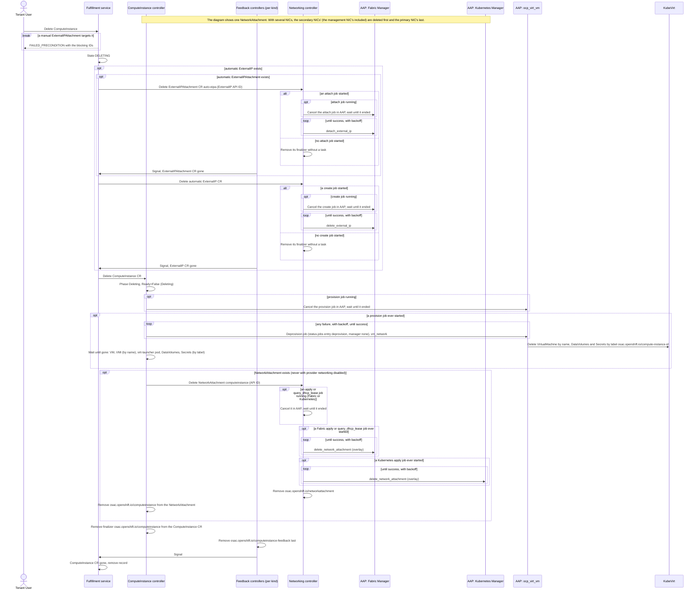

# VMaaS Networking

## Contents

- [Summary](#summary)
- [Motivation](#motivation)
  - [Goals](#goals)
  - [Non-Goals](#non-goals)
- [Proposal](#proposal)
  - [Workflow Description](#workflow-description)
    - [Create](#create)
    - [Delete](#delete)
    - [External access](#external-access)
  - [API Extensions](#api-extensions)
  - [UX Alignment](#ux-alignment)
  - [Implementation Details/Notes/Constraints](#implementation-detailsnotesconstraints)
    - [How the networking pieces fit together](#how-the-networking-pieces-fit-together)
    - [Network attachment and validation](#network-attachment-and-validation)
    - [Network profiles](#network-profiles)
    - [The `vlan` network type](#the-vlan-network-type)
    - [`cudn_localnet` Kubernetes Manager](#cudn_localnet-kubernetes-manager)
    - [Management network](#management-network)
    - [VM construction](#vm-construction)
    - [Guest network configuration](#guest-network-configuration)
    - [Network status and address discovery](#network-status-and-address-discovery)
    - [ExternalIPAttachment target `compute_instance`](#externalipattachment-target-compute_instance)
    - [Automatic external access](#automatic-external-access)
    - [Provider networking disabled](#provider-networking-disabled)
    - [Component responsibilities](#component-responsibilities)
    - [Contract changes](#contract-changes)
    - [Implementation notes](#implementation-notes)
    - [Extensibility](#extensibility)
    - [Workload service design checklist](#workload-service-design-checklist)
  - [Security Considerations](#security-considerations)
  - [Failure Handling and Recovery](#failure-handling-and-recovery)
  - [RBAC / Tenancy](#rbac--tenancy)
  - [Observability and Monitoring](#observability-and-monitoring)
  - [Risks and Mitigations](#risks-and-mitigations)
  - [Drawbacks](#drawbacks)
- [Edge cases that need handling](#edge-cases-that-need-handling)
  - [Restarts and job tracking](#restarts-and-job-tracking)
  - [Delete races](#delete-races)
- [Alternatives (Not Implemented)](#alternatives-not-implemented)
- [Test Plan](#test-plan)
  - [Unit Tests](#unit-tests)
  - [Integration Tests](#integration-tests)
  - [E2E Tests](#e2e-tests)
  - [Edge-case tests (later)](#edge-case-tests-later)
- [Graduation Criteria](#graduation-criteria)
- [Upgrade and Downgrade Strategy](#upgrade-and-downgrade-strategy)
- [Version Skew Strategy](#version-skew-strategy)
- [Support Procedures](#support-procedures)
- [Infrastructure Needed](#infrastructure-needed)

## Summary

This design connects a ComputeInstance to up to eight Subnets, one network interface (NIC) per Subnet, with the [Unified Networking](/enhancements/OSAC-1433-unified-networking/design.md) resources and the [Network Manager Integration Contract](/enhancements/OSAC-1433-network-manager-integration-contract-networking/design.md) ("the contract"), and lets a tenant request an ExternalIP in the create call. One NIC is primary: it holds the default route, the ExternalIP and the NAT path. Each NIC's VirtualNetwork selects a [network profile](#network-profiles), a NetworkClass entry that names the Kubernetes Manager building that kind of network; OSAC runs that manager and the deployment's Fabric Manager for that NIC. The primary NIC is always on the default `evpn` profile; extra NICs can use `vlan` profiles, physical VLANs whose addresses come from the Fabric Manager's DHCP. When the provider configures a [management network](#management-network), OSAC adds a management NIC to every VM, on the tenant's own Subnet of that network. Requirements: [PRD](prd.md).

## Motivation

A VM needs its tenant networks and SecurityGroup policy before first boot. Workloads need several NICs, providers need a management network, and different kinds of networks have different limits: OVN-Kubernetes gives a namespace one primary network, runs EVPN only on primary networks, and offers Localnet (a physical VLAN) only as a secondary network.

### Goals

- Up to eight NICs per VM, all prepared before the VM exists, with exactly one primary. With a management network, one of the eight is the management NIC.
- Managers selected per VirtualNetwork through a NetworkClass network profile and run per NIC; "network type" keeps its contract meaning (segment technology).
- VM interfaces composed only from Kubernetes Manager results, with no manager-specific branch in the operator or `ocp_virt_vm`.
- Each NIC's address in ComputeInstance status, from KubeVirt (`evpn`) or from the Fabric Manager's DHCP lease (`vlan`), always in the Subnet's overlay range; no guest network configuration written by OSAC.
- A management network that OSAC attaches every VM to, with no traffic between VMs over it and no segment shared between tenants.
- Every NIC combination the resolved profiles cannot build rejected at the fulfillment service.
- Optional automatic external access in the create call.

### Non-Goals

- CaaS and BMaaS networking ([CaaS](/enhancements/OSAC-1436-caas-networking/design.md), [BMaaS](/enhancements/OSAC-1437-bmaas-networking/design.md)).
- Manager behavior (the contract).
- VM runtimes other than KubeVirt, and VMs outside the hub ([hub support boundary](/enhancements/OSAC-1433-unified-networking/design.md#networking-hub-support-boundary)). [OSAC-7305](/enhancements/OSAC-7305-remote-vm-cluster-networking/prd.md) (per-tenant VM clusters) lifts this; when it lands, `cudn_localnet` runs on each VM-hosting cluster like `cudn_evpn`, and that cluster's one-time preparation includes the Localnet prerequisites (bridge mappings, OVS bridges, `useMultiNetworkPolicy`).
- EVPN on OSAC secondary NICs: OVN-Kubernetes supports EVPN only on OVN primary networks, so `cudn_evpn` serves only the OSAC primary NIC ([Extensibility](#extensibility)).
- A `vlan` OSAC primary NIC, and deployments without EVPN: the default profile is `evpn` (or has no Kubernetes Manager, without VMaaS), and `vlan` profiles serve only OSAC secondary NICs ([Extensibility](#extensibility)).
- OVN-Kubernetes IPAM on Localnet: OpenShift Virtualization requires IPAM `Disabled` for VMs on Localnet networks, and KubeVirt hands a CNI-assigned address to the guest only on the pod network ([Extensibility](#extensibility)).
- NIC hot-plug or attachment changes after create; SR-IOV or DPDK managers.
- Metering per NIC: NICs are not metered separately.

## Proposal

The ComputeInstance controller creates one NetworkAttachment per NIC before the VM. The OSAC primary NIC's Kubernetes Manager returns the namespace where the VM runs; each OSAC secondary NIC's Kubernetes Manager makes its Subnet's network available in that namespace and returns its name. VMaaS creates the VM there with one interface per NIC, built from those results. Once a NIC's address is known, from the VMI on `evpn` or from the Fabric Manager's DHCP lease on `vlan`, the Fabric Manager binds it to the NIC's SecurityGroups. Delete removes automatic external access first, then the VM, then the NetworkAttachments.

### Workflow Description

Actors: the Tenant User (public gRPC API or `osac` CLI) and the [components](#component-responsibilities). Starting state: provider networking is enabled, the NetworkClass is READY, and the [creation readiness gates](/enhancements/OSAC-1433-unified-networking/design.md#creation-readiness-gates) pass (including `DefaultNetworkingReady`); for automatic access, a READY ExternalIPPool has free capacity ([Unified](/enhancements/OSAC-1433-unified-networking/design.md#automatic-external-access)).

#### Create

1. The Tenant User creates a ComputeInstance:
   ```bash
   osac create computeinstance --template rhel9 --name my-vm \
     --network-attachment subnet=my-subnet,security-groups=sg-web,sg-db
   osac create computeinstance --template rhel9 --name my-vm2 --external-ip-attachment
   ```
   Form 1 selects a Subnet and two SecurityGroups, each by name or API ID (`security-groups=` last); the CLI resolves a name with a List in the tenant and fails, sending nothing, when none or several match. Form 2 uses the tenant defaults and requests automatic external access (`auto_external_ip_attachment`). A multi-NIC VM repeats the flag with `name=` and marks one `primary=true`. No flag asks for the management NIC: OSAC adds it ([Management network](#management-network)):
   ```bash
   osac create computeinstance --template rhel9 --name my-vm3 \
     --network-attachment name=nic0,primary=true,subnet=app,security-groups=web \
     --network-attachment name=data,subnet=backend,security-groups=db
   ```
2. The fulfillment service resolves and validates the attachment and checks the gates ([Network attachment and validation](#network-attachment-and-validation)); a failure rejects the create and stores nothing. Otherwise, in one transaction, it appends the management NIC to the list when the tenant's management network is active ([Management network](#management-network)), stores the ComputeInstance and, with automatic access and provider networking enabled, the automatic ExternalIP (PENDING) ([Unified](/enhancements/OSAC-1433-unified-networking/design.md#automatic-external-access)), then creates their CRs.
3. The ComputeInstance feedback controller adds its finalizer `osac.openshift.io/computeinstance-feedback`. The ComputeInstance controller adds its finalizer `osac.openshift.io/computeinstance` and, for each NIC, creates the NetworkAttachment `computeinstance-<API ID>` (the stored list has one NIC) or `computeinstance-<API ID>-<NIC name>` (it has several; the management NIC counts) with the same finalizer and the annotation `osac.openshift.io/tenant` copied from the ComputeInstance: `target` = `{kind: ComputeInstance, id: <API ID>}`, `subnet` = Subnet API ID, `interface` = `{type: overlay, name: <NIC name>}`, `nicRole` = `primary` or `secondary`, `securityGroups` = SecurityGroup API IDs (empty on a provider network). It sets `NetworkReady=False`, reason `NetworkAttachmentProgressing`.
4. The networking controller runs Kubernetes `apply_network_attachment` for the OSAC primary NIC, again after each retryable failure; the manager binds the VM's interface to the policy objects of its SecurityGroups and returns `vm_attachment: {namespace, network_name?}`. Then it runs the OSAC secondary NICs' Kubernetes applies in parallel, each with `vm_namespace` read from the OSAC primary NIC's `status.vmAttachment.namespace` (the networking controller watches a VM's sibling NetworkAttachments); each manager makes its Subnet's network available there, binds the NIC's policy, and returns `vm_attachment: {namespace, network_name}`. An OSAC secondary NIC's apply never starts before the OSAC primary NIC's result is accepted ([VM construction](#vm-construction) states how results become interfaces).
   - Final failure or rejected result: the NetworkAttachment is `Ready=False`, reason `Failed`. The ComputeInstance controller reads the failing NIC's Subnet's recorded eligibility. If `status.computeInstanceSupported` is explicitly `false`, it sets `NetworkReady=False`, reason `SubnetDoesNotSupportVMs`; otherwise it uses `NetworkAttachmentFailed`. It sets phase `Failed`, emits the Warning event matching the selected reason, and creates no VM. The fixed public message and classification rules are defined in [Network status](#network-status-and-address-discovery); eligibility does not gate the create or prevent the apply from running.
   - Result accepted ([Security Considerations](#security-considerations)): the networking controller records `status.vmAttachment`; the NetworkAttachment stays `Ready=False`, reason `Progressing`, until its Fabric bind (step 7). Once every NIC's result is accepted, the ComputeInstance controller sets `NetworkReady=False`, reason `VMNotRunning`.
5. Only then, when every NIC's Kubernetes apply has succeeded, does the controller run the `ocp_virt_vm` provision job. It tracks the job in the ComputeInstance `status.jobs` (task `provision`, `manager: none`) like a manager job ([contract §4.7](/enhancements/OSAC-1433-network-manager-integration-contract-networking/design.md#47-ordering-concurrency-retries-and-ownership)); the job template sets the §4.7 AAP job timeout. The job creates the DataVolumes, Secrets, and VM in that namespace with the requested run strategy ([VM construction](#vm-construction)). It is idempotent by VM name and the `osac.openshift.io/compute-instance-id` label: a rerun keeps existing objects and creates only missing ones.
   - A failed provision job is final: the entry is `Failed` with the message, phase `Failed`, `Provisioned=False`, reason `ProvisioningFailed`; the tenant deletes the ComputeInstance. A failed job with the same spec stays final; a new spec runs it again as the next attempt.
   - Exception: an infrastructure failure that [contract §4.6](/enhancements/OSAC-1433-network-manager-integration-contract-networking/design.md#46-task-result-and-errors) retries (for example AAP `error` or the job timeout) sets the entry to `Retrying`; the job runs again after the §4.7 backoff.
6. When the VirtualMachineInstance (VMI) is `Running`: `NetworkReady=False`, reason `WaitingForIPAddress`. Each NIC's address comes from its network's owner ([Network status](#network-status-and-address-discovery)), and lies in its Subnet's `overlay_ipv4_cidrs`:
   - an `evpn` NIC: OVN-Kubernetes assigned it; the controller reads it from the VMI and writes it to that NIC's status entry;
   - a `vlan` NIC (tenant or management): the guest got it from the Fabric Manager's DHCP. The networking controller runs Fabric `query_dhcp_lease` with the NIC's MAC, which the ComputeInstance controller copied from the VMI's interface status, until the guest has a lease; it records the lease in the NetworkAttachment's `status.dhcpLease`, and the ComputeInstance controller copies it to that NIC's status entry. A final failure or a rejected lease fails the NetworkAttachment (`Ready=False`, `Failed`); for a tenant NIC the VM gets `NetworkAttachmentFailed` as in step 7, for the management NIC only `ManagementNetworkReady=False`, reason `ManagementAttachmentFailed`.

   The management NIC follows the same steps, but its lease and its Fabric apply report in the condition `ManagementNetworkReady` and never hold `NetworkReady`, `Ready` or the phase ([Management network](#management-network)). In steps 6 and 7, "every NIC" means every tenant NIC: every NIC but the management NIC.

   When every tenant NIC has an address, the controller sets `NetworkReady=False`, reason `WaitingForFabricBinding`, while any tenant NIC's NetworkAttachment is not Ready (step 7).
7. Once a NIC's address is in the ComputeInstance status entry with that NIC's name, the networking controller runs that NIC's Fabric `apply_network_attachment` with that address (and, on `vlan`, the MAC) in its input, again after each retryable failure ([contract task](/enhancements/OSAC-1433-network-manager-integration-contract-networking/design.md#fabric-apply_network_attachment--delete_network_attachment)). The Fabric Manager binds the address to the policy objects of the NIC's SecurityGroups, or does nothing when its fabric does not enforce SecurityGroups; on `vlan` it also keeps that lease for that MAC while the attachment exists.
   - Final failure on a tenant NIC: the NetworkAttachment is `Ready=False`, reason `Failed`. The ComputeInstance controller sets `NetworkReady=False`, reason `NetworkAttachmentFailed`, and phase `Failed`, and emits `NetworkAttachmentFailed`; the VM stays until the tenant deletes the ComputeInstance. On the management NIC it sets only `ManagementNetworkReady=False`, reason `ManagementAttachmentFailed`.
   - Success: the NetworkAttachment is `Ready=True`, reason `Succeeded`. When every tenant NIC's address is in status and every tenant NIC's NetworkAttachment is Ready, the ComputeInstance controller emits `NetworkAttached` and sets `NetworkReady=True`, reason `IPDiscovered`, then `Ready=True`.
8. In parallel with steps 3–7, the networking controller runs Fabric `create_external_ip`; the automatic ExternalIP becomes ALLOCATED, or FAILED after a final failure.
9. When it is ALLOCATED and the [endpoint is ready](#externalipattachment-target-compute_instance), the fulfillment service's automatic ExternalIPAttachment controller creates the ExternalIPAttachment `auto-eipa-<ExternalIP API ID>` ([Automatic external access](#automatic-external-access)). The networking controller builds `destination`, records it in `status.destination`, and runs Fabric `attach_external_ip`; the ExternalIPAttachment becomes READY, or FAILED after a final failure.

```mermaid
sequenceDiagram
    actor U as Tenant User
    participant F as Fulfillment service
    participant CI as ComputeInstance controller
    participant FB as Feedback controllers (per kind)
    participant N as Networking controller
    participant K as AAP: Kubernetes Manager
    participant FM as AAP: Fabric Manager
    participant V as AAP: ocp_virt_vm
    participant KV as KubeVirt
    Note over CI,FM: One NetworkAttachment per NIC. The primary NIC's Kubernetes apply runs first; secondary applies follow with its namespace and return network_name. The VM is provisioned after every Kubernetes apply succeeds; each NIC's Fabric bind runs after its address is known. The diagram shows one NIC.
    U->>F: Create ComputeInstance (network_attachments, auto_external_ip_attachment)
    F->>F: Resolve defaults, validate, check gates
    break gate or validation fails
        F-->>U: Error, nothing stored
    end
    F->>F: One transaction: ComputeInstance and, if requested, the automatic ExternalIP (PENDING)
    F-->>U: ComputeInstance
    F->>CI: Create ComputeInstance CR
    FB->>FB: Add finalizer osac.openshift.io/computeinstance-feedback
    par Attachment and VM
        CI->>CI: Add finalizer osac.openshift.io/computeinstance
        CI->>N: Create NetworkAttachment computeinstance-(API ID)
        CI->>CI: NetworkReady=False, NetworkAttachmentProgressing
        loop retryable failure, with backoff
            N->>K: apply_network_attachment (overlay, target, SecurityGroup API IDs)
        end
        alt final failure or rejected result
            N-->>CI: NetworkAttachment Ready=False, Failed
            alt selected Subnet records VM support false
                CI->>CI: NetworkReady=False, SubnetDoesNotSupportVMs, phase Failed, no VM
            else VM support true or unknown
                CI->>CI: NetworkReady=False, NetworkAttachmentFailed, phase Failed, no VM
            end
        else result accepted
            K-->>N: vm_attachment {namespace}
            N-->>CI: status.vmAttachment recorded, NetworkAttachment Ready=False, Progressing
            CI->>CI: NetworkReady=False, VMNotRunning
            loop retryable infrastructure failure, with backoff
                CI->>V: Provision job (status.jobs entry provision, manager none), vm_network
            end
            alt provision job fails
                V-->>CI: Job failed
                CI->>CI: Entry Failed, phase Failed, Provisioned=False, ProvisioningFailed
            else job succeeds
                V->>KV: Create DataVolumes, Secrets, VirtualMachine (name = ComputeInstance CR name) in namespace
                KV-->>CI: VMI Running
                CI->>CI: NetworkReady=False, WaitingForIPAddress
                KV-->>CI: VMI tenant interface reports an IPv4 address in the overlay range
                CI->>CI: Write IP to status, NetworkReady=False, WaitingForFabricBinding
                loop retryable failure, with backoff
                    N->>FM: apply_network_attachment (overlay, target, VM address, SecurityGroup API IDs)
                end
                alt final failure
                    N-->>CI: NetworkAttachment Ready=False, Failed
                    CI->>CI: NetworkReady=False, NetworkAttachmentFailed, phase Failed
                else success
                    N-->>CI: NetworkAttachment Ready=True, Succeeded
                    CI->>CI: Event NetworkAttached, NetworkReady=True, IPDiscovered, Ready=True
                end
            end
        end
        FB->>F: Signal
        F->>F: Read ComputeInstance status
    and Automatic ExternalIP
        opt automatic ExternalIP stored
            F->>N: Create automatic ExternalIP CR
            loop retryable failure, with backoff
                N->>FM: create_external_ip
            end
            alt final failure
                FM-->>N: osac_error
                FB->>F: Signal
                F->>F: ExternalIP FAILED, VM keeps working without external access
            else success
                FM-->>N: external_ip {address}
                FB->>F: Signal
                F->>F: ExternalIP ALLOCATED
            end
        end
    end
    opt automatic ExternalIP ALLOCATED and endpoint ready
        F->>N: Create ExternalIPAttachment CR auto-eipa-(ExternalIP API ID)
        N->>N: Build destination from the VM tenant IP, record status.destination
        loop retryable failure, with backoff
            N->>FM: attach_external_ip (destination)
        end
        alt final failure
            FB->>F: Signal
            F->>F: ExternalIPAttachment FAILED, VM keeps working without external access
        else success
            FB->>F: Signal
            F->>F: ExternalIPAttachment READY
        end
    end
```

#### Delete

1. The Tenant User deletes the ComputeInstance. The [deletion guard](/enhancements/OSAC-1433-unified-networking/design.md#deletion-dependency-guards) rejects it with `FAILED_PRECONDITION` while a manual ExternalIPAttachment targets it; otherwise the state becomes DELETING ([until the record is removed](/enhancements/OSAC-1433-unified-networking/design.md#status)). A Delete of a DELETING ComputeInstance returns OK.
2. The fulfillment service deletes the automatic ExternalIPAttachment, then the automatic ExternalIP, then the ComputeInstance CR, each once the previous is gone ([Unified order](/enhancements/OSAC-1433-unified-networking/design.md#automatic-external-access)). Jobs and retries follow [contract §4.7](/enhancements/OSAC-1433-network-manager-integration-contract-networking/design.md#47-ordering-concurrency-retries-and-ownership).
3. The ComputeInstance controller sets phase `Deleting` and `Ready=False`, reason `Deleting`. From the deletionTimestamp on, it creates no NetworkAttachment and starts no provision job.
4. The controller removes the VM from its namespace, `status.virtualMachineReference.namespace` ([VM construction](#vm-construction)):
   - It cancels a running provision job and waits until AAP reports it ended.
   - If no provision job ever started, no VM exists and it skips the deprovision job.
   - Otherwise it runs the deprovision job with the provision `vm_network`, tracked like the provision job (task `deprovision`, `manager: none`). The job deletes the VM by name, and its DataVolumes and Secrets by the label `osac.openshift.io/compute-instance-id: <API ID>`. A failed deprovision job, whatever the cause, retries with the §4.7 backoff until it succeeds; the entry shows the message, and the ComputeInstance stays DELETING.
   - Then the controller waits until the VM and VMI (by name) and the virt-launcher pod, DataVolumes, and Secrets (by label) are gone from that namespace.
5. The controller deletes the NetworkAttachments, the secondary NICs' first and the primary NIC's last. For each, the networking controller cancels a running apply or `query_dhcp_lease` job ([contract §4.7](/enhancements/OSAC-1433-network-manager-integration-contract-networking/design.md#47-ordering-concurrency-retries-and-ownership)), runs Fabric `delete_network_attachment` when a Fabric apply or `query_dhcp_lease` job of the NIC ever started, then Kubernetes `delete_network_attachment` when a Kubernetes apply job ever started, each until it succeeds, then removes its finalizer `osac.openshift.io/networkattachment`. With [provider networking disabled](#provider-networking-disabled) there is no NetworkAttachment, and steps 5 and 6 are skipped.
6. When only `osac.openshift.io/computeinstance` remains on a NetworkAttachment, the ComputeInstance controller removes that finalizer.
7. When every NetworkAttachment is gone, the controller removes `osac.openshift.io/computeinstance` from the ComputeInstance CR. The ComputeInstance feedback controller removes `osac.openshift.io/computeinstance-feedback` last, as [Unified](/enhancements/OSAC-1433-unified-networking/design.md#hub-crs) defines, and the fulfillment service removes the record. No step patches the VM.



#### External access

A Tenant User can expose a ready VM through an ExternalIP. `--externalip` and `--compute-instance` take a name or an ID:

```bash
osac create externalip --pool external-pool-1 --name my-ip
osac create externalipattachment --externalip my-ip --compute-instance my-vm --name vm-att
```

The attach needs a [ready endpoint](#externalipattachment-target-compute_instance); before that it fails with `FAILED_PRECONDITION`. `--external-ip-attachment` makes OSAC attach once the endpoint is ready ([Automatic external access](#automatic-external-access)).

### API Extensions

- **fulfillment-service fields:** `ComputeInstanceSpec.network_attachments` (14, `repeated ComputeNetworkAttachment {subnet, security_groups, name, primary}`, at most eight entries) and `auto_external_ip_attachment` (18); `ComputeInstanceStatus.internal_ip_address` (3, the primary NIC's address) and `compute_network_attachment_statuses` (8, `{subnet_ref, ip_address, name, mac_address, primary}`).
- **fulfillment-service, new for multi-NIC:**
  - `ComputeNetworkAttachment.name` (3, `optional string`, DNS-1123 label of at most 15 characters, unique in the ComputeInstance, immutable) and `primary` (4, `optional bool`, immutable). A single attachment without a name is named `tenant`, and without `primary` it is primary; `primary: false` on a single attachment is rejected. Several unnamed attachments are named `nic<index>`, and exactly one must set `primary: true`. The name `mgmt` is reserved for the management NIC while the NetworkClass spec has a provider-network profile, in any state, and provider networking is enabled.
  - CEL: `compute_instance_single_attachment` becomes `compute_instance_attachments_max` (`size() <= 8`), plus `compute_instance_attachment_names_unique`.
  - `ComputeNetworkAttachmentStatus.name` (3), `mac_address` (4), `primary` (5).
  - `VirtualNetworkSpec.network_profile` (5, `optional string`, immutable, default the NetworkClass default profile).
  - `NetworkClassSpec.network_profiles` (7), one marked `default`, and `physical_networks` (8), both append-only; `NetworkClassStatus.network_profiles` (10, `repeated NetworkProfileStatus` with the fields listed in [Network profiles](#network-profiles); 9 is `security_group_physical_noop` in Unified) ([Network profiles](#network-profiles)).
  - A read-only `NetworkProfiles` API (`List`, `Get`) returning `{name, title, description, supports_primary, supports_secondary, supports_bare_metal, supports_clusters, default}` to every tenant user, never manager names, network types or settings; CLI `osac get networkprofiles`. The title and description describe what the profile offers, not how it is built ([Network profiles](#network-profiles)).
  - The label `osac.openshift.io/provider-network: <profile name>` on the VirtualNetwork and Subnet that OSAC creates for each tenant on the management profile ([Management network](#management-network)); only the fulfillment service sets it, like `osac.openshift.io/default`.
  - The Tenant condition `ManagementNetworkReady` (`TENANT_CONDITION_TYPE_MANAGEMENT_NETWORK_READY`) and the ComputeInstance condition `ManagementNetworkReady` (`COMPUTE_INSTANCE_CONDITION_TYPE_MANAGEMENT_NETWORK_READY`), each the next free enum value (public and private, mapped from the hub conditions of the same name) ([Management network](#management-network)).
- **fulfillment-service, existing:** `COMPUTE_INSTANCE_CONDITION_TYPE_NETWORK_READY = 9`, mapped from the hub condition `NetworkReady`.
- **fulfillment-service, new:** `DiskImageSpec.supports_multiple_nics` (`optional bool`, field 7, mutable), set by whoever registers the image ([Guest network configuration](#guest-network-configuration)).
- **osac-operator ComputeInstance CRD:** `spec.networkAttachments` ([validation](#network-attachment-and-validation)); condition types `NetworkReady` and `ManagementNetworkReady`; the API ID label `osac.openshift.io/computeinstance-uuid` ([Unified](/enhancements/OSAC-1433-unified-networking/design.md#hub-crs)); `status.jobs` for the `ocp_virt_vm` provision and deprovision jobs, in the `NetworkJobStatus` shape of [contract §4.7](/enhancements/OSAC-1433-network-manager-integration-contract-networking/design.md#47-ordering-concurrency-retries-and-ownership), Job tracking. Finalizers: `osac.openshift.io/computeinstance` (ComputeInstance controller; also on the NetworkAttachment) and `osac.openshift.io/computeinstance-feedback` (ComputeInstance feedback controller; removed last).
- **NetworkAttachment** ([Unified](/enhancements/OSAC-1433-unified-networking/design.md#networkattachment)): VMaaS creates and deletes the overlay kind, one per NIC; `spec.interface.name` is allowed and required for overlay too, `spec.nicRole` (`primary` or `secondary`, immutable) is new, and `status.vmAttachment` gains `networkName` (`namespace` stays required). A `vlan` NIC's MAC is not in the immutable spec: the ComputeInstance controller copies it from the VMI to the NIC's status entry, and the networking controller adds `interface.mac_address` to the stored input before the first `query_dhcp_lease`, and `interface.ipv4_address` from the accepted lease before the Fabric apply; the lease goes to `status.dhcpLease`, as for bare metal. The networking controller runs its tasks on the NIC's Kubernetes and Fabric Managers.
- **Controllers down:** without the networking controller, no NetworkAttachment becomes Ready and no VM is created.

### UX Alignment

The VM details networking section lists one row per NIC (name, Subnet, address, MAC, primary badge) and falls back to `internal_ip_address` only when the list is empty (provider networking disabled). The VM wizard keeps sending at most one attachment; several tenant NICs use the API, CLI, MCP or catalog items. The management NIC appears as a row like any other, marked as added by the provider, and the VM details show `ManagementNetworkReady`. Network lists and pickers leave out VirtualNetworks and Subnets labelled `osac.openshift.io/provider-network`. The UI uses these fields, offers only READY Subnets and SecurityGroups of one VirtualNetwork ([Unified](/enhancements/OSAC-1433-unified-networking/design.md#ux-alignment)), has the wizards' "Use tenant default network" toggle ([Unified UI](/enhancements/OSAC-1433-unified-networking/ui-design.md#workload-network-attachment-pickers)), and shows `NetworkReady`. The VM wizard never sets `auto_external_ip_attachment`; automatic external access is API and CLI only.

### Implementation Details/Notes/Constraints

#### How the networking pieces fit together

This section explains every piece a VM NIC passes through, from the provider's configuration down to the OVN objects and the fabric, and why each piece exists. Later sections give the exact rules.

**The pieces.**

| Piece | Who sets it | What it is | In this release |
|---|---|---|---|
| Network type | The OSAC release | The technology that keeps a Subnet one isolated segment from the fabric to the VMs, and in particular how the fabric hands the segment to the nodes that run VMs | `evpn`, `vlan` |
| Kubernetes Manager | Registered once (the installer renders OSAC's) | The code that builds the hub side of one network type, and what it can do (capabilities) | `cudn_evpn` (`evpn`), `cudn_localnet` (`vlan`) |
| Fabric Manager | Registered once; one per deployment | The code that builds the fabric side of every network type it declares | Netris, or the provider's own |
| Network profile | The provider, in the NetworkClass | An offering: a name and title, one Kubernetes Manager, the NIC role it serves, and settings | `standard`, `extra-routed`, `management` in the [example](#network-profiles) |
| A VirtualNetwork's profile | The tenant, when creating the VirtualNetwork (default: the default profile); the fulfillment service for the management VirtualNetwork | Which offering the network uses; fixed for the network's life | |
| A NIC's role | The tenant, per attachment; the fulfillment service for the management NIC (always secondary) | OSAC primary NIC or OSAC secondary NIC | |

"Node" below means a node that can run VMs: a hub node, or a node of a registered VM-hosting cluster ([OSAC-7305](/enhancements/OSAC-7305-remote-vm-cluster-networking/prd.md)).

**Network type: where the fabric meets the nodes.**
- A network type names the technology that keeps each Subnet one isolated segment, and each VirtualNetwork one routing domain, end to end. The fabric side and the node side must both speak it ([contract §4.9](/enhancements/OSAC-1433-network-manager-integration-contract-networking/design.md#49-network-types-and-the-network-segment)).
- What it fixes inside the fabric differs:
  - **`evpn`:** the nodes join the fabric's own EVPN, so the contract also fixes how the fabric runs it: VXLAN on UDP 4789, ingress replication, VNIs unique across the fabric, an underlay that carries at least 1550-byte frames.
  - **`vlan`:** the contract fixes only the handoff, a VLAN tag on the links to the nodes. Inside its own fabric the Fabric Manager carries the segment however it likes: VXLAN between switches, plain VLANs, or anything else. OSAC never sees it.

```text
 evpn                                          vlan
 VM -- OVN primary network -- node             VM -- OVN Localnet network -- node
                              (a VTEP)                                       |
                                |  one VXLAN tunnel carries both VNIs;       |  802.1Q tag = vlan_id
                                |  BGP EVPN routes say where each MAC/IP is  |
                                v                                            v
                         leaf switch (VTEP)                           switch port facing the node
                                |                                            |  the fabric maps the tag to
                                |  VXLAN inside the fabric                   |  its own segment (VXLAN or VLAN)
 Fabric returns l3_vni, l2_vni                 Fabric returns vlan_id
```

- **`evpn`:** each node is itself a VXLAN endpoint (VTEP) and exchanges EVPN routes with the fabric over BGP. The Fabric Manager returns the VirtualNetwork's L3 VNI and the Subnet's L2 VNI, and OVN-Kubernetes joins the same VNIs.
- **`vlan`:** the node sends the Subnet's frames out of its uplink with one 802.1Q tag. The Fabric Manager returns the VLAN ID, and every switch port facing a node maps that tag into the Subnet's segment.

**Why there are two types.** OVN-Kubernetes sets the split, not the fabric:
- OVN-Kubernetes runs EVPN only on a primary user-defined network: the ClusterUserDefinedNetwork CRD rejects `transport: EVPN` on any other ("transport 'EVPN' is only supported for Layer2 or Layer3 primary networks"). A namespace has one primary network.
- A VM runs in one namespace, so EVPN can serve one NIC of a VM.
- Every other NIC must be an OVN secondary network attached through Multus. The only OVN secondary network that leaves the node onto the fabric is Localnet. Localnet puts the network on a physical network shared by many Subnets, so each Subnet needs its own VLAN there.
- So in this release the OSAC primary NIC is `evpn`, and every OSAC secondary NIC, the management NIC included, is `vlan`. [Extensibility](#extensibility) lists what changes when OVN-Kubernetes lifts these limits.

**What decides the OSAC primary NIC.**
- **The tenant decides.** With one attachment, it is the primary. With several, exactly one sets `primary: true`. The UI wizard sends one attachment. A catalog item may fix the attachments with its policies.
- **The profile limits the choice.** The primary attachment's Subnet must belong to a VirtualNetwork whose profile has `primary` in `nic_roles`. Only the default profile can, and its Kubernetes Manager must declare `primary_nic`, so in this release the primary NIC is always on a VirtualNetwork of the default profile, which uses `cudn_evpn`.
- **The Subnet must carry VMs.** `cudn_evpn` builds one hub network per VirtualNetwork, owned by one Subnet, and serves VMs only on that owner Subnet. A primary NIC on another Subnet of the VirtualNetwork fails at its Kubernetes apply with `SubnetDoesNotSupportVMs` ([Network status](#network-status-and-address-discovery)).
- **What the primary NIC gets:**
  - the VM's namespace: the VM runs in the namespace of the primary NIC's VirtualNetwork;
  - the default route and DNS, from its DHCP;
  - NAT and the ExternalIP endpoint;
  - `internal_ip_address`.
- **The management NIC is never primary.** OSAC adds it as a secondary NIC.
- **Two pairs of words must not be mixed up:**
  - *OSAC primary or secondary NIC* is the VM role above. It appears in `ComputeNetworkAttachment.primary`, the profile's `nic_roles` and the manager capabilities `primary_nic` and `secondary_nic`.
  - *OVN primary or secondary network* is how a Kubernetes Manager plumbs a network: an OVN primary network (`role: Primary`) is the namespace's pod network; an OVN secondary network (`role: Secondary`) is attached through Multus. These words appear only in manager behavior.
  - In this release they line up, `cudn_evpn` serving the OSAC primary NIC on an OVN primary network and `cudn_localnet` serving OSAC secondary NICs on OVN secondary networks. OSAC does not rely on that to build the VM: it reads only `nic_roles` and the apply result.

**Why a profile and a Kubernetes Manager are separate.** Kubernetes storage has the same split:
- **A Kubernetes Manager is like a CSI driver.** It is code, registered once, with a fixed list of what it can do: its network type and capabilities (`primary_nic`, `secondary_nic`, `provider_network`, `security_group_icmp`). It knows nothing about names, offerings or tenants.
- **A profile is like a StorageClass.** It is the provider's offering: a tenant-visible name and title, one Kubernetes Manager, one NIC role, and settings such as the physical network or the management addresses.
- **What the split buys:**
  - one manager can back several offerings: `extra-routed` and `management` both use `cudn_localnet`, with different settings;
  - the provider names offerings in its own words and never shows tenants how they are built;
  - a new manager or capability is a new profile, and the API, fulfillment checks and VM construction do not change. A new network type is larger: it comes with the OSAC release that defines its segment shape, and the operator's segment checks.
- **The Fabric Manager is not named in a profile.** The deployment has one, and it serves every profile. A profile's network type comes from its Kubernetes Manager, and the Fabric Manager must declare that type.

**How the pieces use each other, from install to a running NIC.**
1. **Registration.** Each manager declares what it can do. A Kubernetes Manager declares one `network_type` and its capabilities. The Fabric Manager declares its `network_types` and capabilities: `evpn` for the default profile of a VMaaS deployment, `vlan` as well once any `vlan` profile exists, and `provider_network` for a management profile.
2. **Resolution.** The operator checks each profile against the registrations ([Network profiles](#network-profiles)):
   - the profile's NIC role is among its Kubernetes Manager's capabilities;
   - the Fabric Manager declares the profile's network type;
   - for the management profile, both managers declare `provider_network`.

   Each profile is READY or FAILED on its own.
3. **The VirtualNetwork.** It names a READY profile. Its hub CR records a snapshot of the profile, with its managers, network type and physical network, which never changes. Its Subnets and their NetworkAttachments copy it. So every task, retry and delete goes to the same managers with the same settings:
   - every task gets `profile` in its input;
   - Fabric VirtualNetwork and Subnet tasks also get `network_type`.
4. **The segment.**
   - **`evpn`:**
     - the Fabric `create_virtual_network` returns `l3_vni`, which OSAC records in `status.l3Vni`;
     - a Subnet's tasks start only after that;
     - the Fabric `create_subnet` returns `{type: evpn, l2_vni}`;
     - OSAC checks that each VNI is unique.
   - **`vlan`:**
     - the Fabric `create_virtual_network` returns no VNI;
     - the Fabric `create_subnet` returns `{type: vlan, vlan_id}`;
     - OSAC checks that the VLAN is in the profile's allowed range and not held by another Subnet of the physical network.
   - **Both:** OSAC records the segment in the Subnet's `status.networkSegment`, adding `physicalNetwork` on `vlan`, and only then runs the Kubernetes `create_subnet`. That task, and every Kubernetes task of the Subnet's NetworkAttachments, gets it as `network_segment`.
5. **The VM's NICs.**
   - Each attachment's role must be one its Subnet's profile serves.
   - Each NIC becomes one NetworkAttachment.
   - The primary NIC's Kubernetes apply runs first and returns `{namespace}`. Each secondary NIC's apply then runs with that namespace as `vm_namespace` and returns `{namespace, network_name}`.
   - OSAC builds the VM only from these results ([VM construction](#vm-construction)), never from the profile or the network type.
6. **After the VM runs.** Here the network type matters to OSAC again:
   - **`evpn` NIC:** OSAC reads the address from the VMI.
   - **`vlan` NIC:**
     - OSAC copies the NIC's MAC from the VMI;
     - it runs `query_dhcp_lease` with that MAC;
     - it records the lease.
   - Then each NIC's Fabric apply runs with its address. On `vlan` the apply also gets the MAC.
   - The tenant NICs then set `NetworkReady`, and the management NIC sets `ManagementNetworkReady` ([Network status](#network-status-and-address-discovery)).

**From a NIC to the hub, the VM and the fabric.**

| | OSAC primary NIC | Tenant OSAC secondary NIC | Management NIC |
|---|---|---|---|
| Profile (example) | `standard`, the default | `extra-routed` | `management`, `provider_network: true` |
| Network type | `evpn` | `vlan` | `vlan` |
| Kubernetes Manager | `cudn_evpn` | `cudn_localnet` | `cudn_localnet` |
| Fabric `create_virtual_network` | A routing domain with an IP-VRF, extended to the nodes; returns `l3_vni` | A routing domain; no VNI | A routing domain that routes only to `routed_ipv4_cidrs` |
| Fabric `create_subnet` | A MAC-VRF in that IP-VRF, extended to the nodes; returns `{type: evpn, l2_vni}` | A VLAN on every switch port facing a node, `gateway_ipv4`, and DHCP for VM NICs; returns `{type: vlan, vlan_id}` | The same, with the VLAN from the profile's own range, plus the source check |
| Subnet `status.networkSegment` | `{type: evpn, l2Vni}` | `{type: vlan, vlanId, physicalNetwork}` | `{type: vlan, vlanId, physicalNetwork}` |
| Kubernetes `create_virtual_network` | The namespace `osac-vn-<VirtualNetwork API ID>`, labelled with the tenant, the VirtualNetwork and, at creation, `k8s.ovn.org/primary-user-defined-network`, and the NetworkPolicy `osac-baseline-deny` | No-op | No-op |
| Kubernetes `create_subnet`: the ClusterUserDefinedNetwork | Only the owner Subnet creates it, one per VirtualNetwork, named `osac-vn-<VirtualNetwork API ID>`: Layer2, `role: Primary`, `transport: EVPN`, label `evpn: "true"`, the VTEP from installation, `macVRF` = `l2_vni` and `ipVRF` = `l3_vni` (route targets `0:<VNI>`), `defaultGatewayIPs: [gateway_ipv4]`, persistent IPAM limited to the overlay range, MTU 1500; it selects that VirtualNetwork's namespace | One per Subnet, named `osac-ln-<Subnet API ID>`: Localnet, `role: Secondary`, `physicalNetworkName`, VLAN access mode with `vlan_id`, IPAM `Disabled`, MTU 1500; it selects every VM namespace of the tenant | The same as a tenant secondary NIC |
| What appears in the VM namespace | The namespace's pod network is this network | The NetworkAttachmentDefinition `osac-ln-<Subnet API ID>` | The NetworkAttachmentDefinition `osac-ln-<Subnet API ID>` |
| Kubernetes `create_security_group` | The NetworkPolicy `osac-sg-<SecurityGroup API ID>` in the VirtualNetwork's namespace | Re-renders the group's per-NIC copies; nothing while none exists | Not used: no SecurityGroups |
| Kubernetes `apply_network_attachment` | Adds the VM to its SecurityGroups' NetworkPolicies; returns `{namespace}` | Creates MultiNetworkPolicies `-deny`, `-dhcp` and one `-sg-<id>` copy per SecurityGroup; returns `{namespace, network_name}` | Creates MultiNetworkPolicies `-deny`, `-dhcp`, `-provider`; returns `{namespace, network_name}` |
| VM `spec.template.spec.networks` | `{name, pod: {}}` | `{name, multus: {networkName}}` | `{name: mgmt, multus: {networkName}}` |
| VM interface binding | `l2bridge` | `bridge` | `bridge` |
| MAC | Not used by OSAC | Set by kubemacpool at create; kept across restarts and migration; the key of the lease | The same as a tenant secondary NIC |
| Who gives the address (IPAM) | OVN-Kubernetes, from the overlay range; kept across restarts and migration | The Fabric Manager's DHCP pool on the overlay range; kept for the MAC by the Fabric apply | The Fabric Manager's DHCP pool on the tenant's whole block |
| What DHCP sends | Address, router `gateway_ipv4`, cluster DNS | Address and option 121 to the VirtualNetwork CIDR; no router, no DNS | Address and option 121 to `routed_ipv4_cidrs`; no router, no DNS |
| Who serves `gateway_ipv4` | OVN-Kubernetes (the Fabric may too, ideally with the same MAC) | The Fabric Manager | The Fabric Manager |
| How OSAC learns the address | The VMI's `status.interfaces` | `query_dhcp_lease` by the NIC's MAC | `query_dhcp_lease` by the NIC's MAC |
| Fabric `apply_network_attachment` | Binds the address to the SecurityGroups, or a documented no-op | Keeps the address for the MAC, and binds the SecurityGroups or a documented no-op | Keeps the address for the MAC |
| Port security | MAC and IP | MAC only (PRD FR-8 limit) | MAC only, plus the fabric's source check against the tenant's block |
| Gates the VM's `Ready` | Yes | Yes | No: `ManagementNetworkReady` |
| NAT, ExternalIP, bare metal, clusters | Yes | Rejected | Rejected |

**Why the VM's namespace comes from the primary NIC.**
- A VM is one pod, so it runs in one namespace.
- An OVN primary network belongs to the namespaces it selects. A namespace gets one only when it was created with the label `k8s.ovn.org/primary-user-defined-network`, which cannot be added later, and a primary network selects it; that network is then the pod network of every pod there. A pod cannot ask for a primary network through Multus: OVN-Kubernetes rejects the request ("unexpected primary network"). So the VM must run in the namespace of its primary NIC's VirtualNetwork.
- A Localnet network can appear in many namespaces. Each Localnet ClusterUserDefinedNetwork selects every namespace with the tenant label and a VirtualNetwork label, so its NetworkAttachmentDefinition is present in whichever namespace the primary NIC chose.
- That is why:
  - the primary NIC's Kubernetes apply runs first;
  - each secondary apply gets that namespace as `vm_namespace`;
  - `cudn_localnet` rejects `nic_role: primary` as final;
  - a secondary result that names another namespace fails its NetworkAttachment.

**What changes for the Fabric Manager.**
- **For `evpn`, the duties stay; the inputs change.**
  - VirtualNetworks, Subnets, VNIs, NAT, ExternalIPs, bare metal and clusters work as before.
  - One VM can now have several NetworkAttachments, so an attachment's identity is `(resource.id, interface.name)`, not `resource.id` alone. Every overlay attachment task carries `interface.name`, and every task carries `profile`.
  - A Fabric Manager that keys VM binds by `resource.id` alone must change ([Contract changes](#contract-changes), §4.5 and §4.7).
- **For `vlan`, there are new duties.** [The `vlan` network type](#the-vlan-network-type) lists them, and [Contract changes](#contract-changes) lists the amendments:
  - a routing domain without a VNI;
  - a VLAN ID per Subnet, the same on every switch port facing a node;
  - `gateway_ipv4`;
  - a DHCP pool for VM NICs that answers unknown MACs, which is never a no-op;
  - `query_dhcp_lease` for VMs;
  - keeping each VM's address for its MAC;
  - releasing the VLAN, the pool and the leases at delete;
  - for the management profile, routes to `routed_ipv4_cidrs` only and the source check.
- **The VLAN at the nodes.** The VLAN ID matters only on the links between the switches and the nodes.
  - Every switch port facing a node must carry each `vlan` Subnet's VLAN, mapped to the same segment, because a Localnet network uses one VLAN ID on every node. A bonded or MLAG uplink means several such ports.
  - The node uplinks trunk the ranges ([`cudn_localnet` prerequisites](#cudn_localnet-kubernetes-manager)).
  - Adding a node is installation work that the provider maintains, like the EVPN peering. OSAC runs no task when nodes change, so the Fabric Manager's design states how a new node's ports join the existing `vlan` Subnets, and the provider keeps the node from running VMs until they have (for example, by keeping it cordoned).
- **VNIs inside the fabric.** A Fabric Manager may give a `vlan` Subnet a VXLAN VNI inside its fabric. OSAC never sees it and does not check it. The Fabric Manager keeps it apart from the VNIs it returns for `evpn`.
- **Who runs the DHCP server.** The contract says what DHCP must do, not where the server runs.
  - A fabric whose switches serve DHCP, such as Netris, uses them.
  - A fabric whose switches only relay DHCP runs its own server, for example Kea. The switches relay to it, and the Fabric Manager answers `query_dhcp_lease` and keeps addresses through it.
  - Either way, the guest must see the DHCP server as `gateway_ipv4` or an address of `physical_ipv4_cidrs`, because the `-dhcp` policy lets DHCP pass only to and from those addresses. With a relay, the relay sets the server identifier to `gateway_ipv4` (RFC 5107), so the guest's unicast renewals reach the relay. A management Subnet has no `physical_ipv4_cidrs`, so there the server is always seen as `gateway_ipv4`.
  - The server hands out addresses from the overlay range, sends option 121 with no router, lets an unkept lease expire within one hour, and never gives a kept address to another MAC.
- **MTU.** On `vlan` the nodes send untunnelled frames at MTU 1500. A fabric that tunnels inside carries the tunnel overhead on its own links.

**How common Fabric Managers fit.**

| Fabric Manager | `evpn` | `vlan` | The one Fabric Manager of a VMaaS deployment with `vlan` profiles? |
|---|---|---|---|
| [Netris](/enhancements/OSAC-2434-netris-fabric-manager-networking/design.md) | Today: a VPC per VirtualNetwork (VNI = `l3_vni`) and a V-Net per Subnet (VXLAN ID = `l2_vni`); the nodes peer EVPN with the leaves | The same VPC and V-Net. The ports facing the nodes join the V-Net as tagged members (tag = `vlan_id`), and the V-Net keeps its VXLAN ID inside the fabric. The V-Net's DHCP serves the overlay range. For the management profile: VPC peering with a prefix list to the management servers, and an ACL for the source check | Yes, after the amendments listed for OSAC-2434. To verify: whether the tag is set per V-Net or per port; DHCP classless routes without a router; keeping an address for a MAC |
| A provider's own manager on an EVPN-VXLAN fabric (for example Arista CloudVision) | Node EVPN peering, as the contract defines | The usual VLAN-to-VNI mapping on the switch ports facing the nodes, with an anycast `gateway_ipv4` in the VirtualNetwork's VRF; a DHCP server run by the manager behind the switches' relay, unless the switches serve DHCP | Yes |
| A manager for a plain VLAN fabric with no EVPN | Not possible | Natural: trunks to the nodes and a routed interface per VLAN | No: the OSAC primary NIC needs `evpn` |
| [AgentlessNet](/enhancements/OSAC-3664-agentless-vlan-fabric-manager/design.md) | Missing | Needs the `vlan` duties: a dynamic dnsmasq range that answers unknown MACs, reached as `gateway_ipv4` (on a management Subnet, through a relay or on the routed interface) | Only after it adds `evpn` |

#### Network attachment and validation

The fulfillment service applies the [Unified defaulting table](/enhancements/OSAC-1433-unified-networking/design.md#network-attachment-field-presence-and-defaulting), [creation readiness gates](/enhancements/OSAC-1433-unified-networking/design.md#creation-readiness-gates), and [error codes](/enhancements/OSAC-1433-unified-networking/design.md#error-codes). VMaaS adds these checks:

| Check | Error |
|---|---|
| More than 8 NICs, counted on the final list (with an active management network the tenant may send 7) | `INVALID_ARGUMENT` "at most 8 network attachments are supported", or "at most 7 network attachments are supported because OSAC adds the management interface" (the CLI rejects a ninth flag before sending) |
| Duplicate or invalid NIC name | `INVALID_ARGUMENT` "network attachment names must be unique DNS labels of at most 15 characters" |
| A tenant attachment named `mgmt` while the NetworkClass spec has a provider-network profile, in any state, and provider networking is enabled | `INVALID_ARGUMENT` "the network attachment name mgmt is reserved" |
| A tenant attachment on a Subnet labelled `osac.openshift.io/provider-network` | `INVALID_ARGUMENT` "subnet <s> is a provider network and cannot be selected" |
| Not exactly one `primary` after defaulting (several attachments without exactly one `primary: true`, or a single attachment with `primary: false`) | `INVALID_ARGUMENT` "exactly one network attachment must be primary" |
| OSAC primary NIC on a profile without `primary` in `nic_roles` (every profile but the default in this release) | `INVALID_ARGUMENT` "network profile <p> cannot be a VM's primary network" |
| OSAC secondary NIC on a profile without `secondary` in `nic_roles` | `INVALID_ARGUMENT` "network profile <p> cannot be a VM's secondary network" |
| Two attachments on Subnets of one VirtualNetwork | `INVALID_ARGUMENT` "each network attachment must use a different VirtualNetwork" (a VM runs in one namespace, which holds one network per VirtualNetwork) |
| A secondary attachment without a Subnet | `INVALID_ARGUMENT` "network attachment <n> needs a subnet" |
| SecurityGroups missing on a secondary attachment outside the tenant's default VirtualNetwork | `INVALID_ARGUMENT`, as [Unified](/enhancements/OSAC-1433-unified-networking/design.md#network-attachment-field-presence-and-defaulting) |
| Attachments whose VirtualNetwork CIDRs overlap | `INVALID_ARGUMENT` "network attachments <a> and <b> use overlapping address ranges" |
| A bare-metal or cluster attachment, NATGateway, FabricDomain or ExternalIP destination on a profile that does not allow it | `INVALID_ARGUMENT` "network profile <p> does not support <...>" |
| More than one tenant attachment with a disk image that does not declare `supports_multiple_nics` | `INVALID_ARGUMENT` "disk image <i> does not support multiple network attachments" |
| The management profile is READY and the tenant's management Subnet is not | `FAILED_PRECONDITION` "the management network of this tenant is being prepared" (Tenant `ManagementNetworkReady` reason `Progressing`) or "the management network of this tenant is not available; contact the provider" (reason `ResourceFailed` or `PoolFull`) |
| The tenant's management Subnet has no free address | `RESOURCE_EXHAUSTED` "the management network of this tenant has no free address" |
| More than one attachment with provider networking disabled (no management NIC is added there) | `FAILED_PRECONDITION` "provider networking is disabled" |
| Update of `network_attachments` or `auto_external_ip_attachment` (recreate the VM instead) | `INVALID_ARGUMENT` |

A deployment without a Kubernetes Manager cannot enable VMaaS ([Unified — Subnet address plan](/enhancements/OSAC-1433-unified-networking/design.md#subnet-address-plan) Validation), so a ComputeInstance call there fails with OSAC-3046's `UNAVAILABLE` ("the vmaas service is not enabled on this server"; PRD FR-5).

The primary attachment is the VM's default route, its NAT path and its ExternalIP endpoint. The fulfillment service rejects multi-NIC requests while no READY profile serves the OSAC secondary NIC, so a deployment without one keeps single-NIC behavior. Defaulting applies per entry: an attachment without a Subnet gets the tenant default Subnet only when it is the primary, and a secondary attachment needs an explicit Subnet. SecurityGroups follow the [Unified rows](/enhancements/OSAC-1433-unified-networking/design.md#network-attachment-field-presence-and-defaulting) per entry: the default SecurityGroup on the tenant's default VirtualNetwork, explicit SecurityGroups of the Subnet's own VirtualNetwork otherwise. The management NIC, which only the fulfillment service adds, has none. The stored list, returned to the tenant, includes the management NIC; the immutability check compares an Update with the stored list. With several attachments, fulfillment locks all Subnets, then all SecurityGroups, each in ascending ID order ([lock order](/enhancements/OSAC-1433-unified-networking/design.md#concurrent-requests)). The MCP VM tool takes the same attachment fields (`name`, `primary`) and the same limits.

The CRD mirrors each attachment as `spec.networkAttachments[]` with optional `name` and `primary`, and `subnetRef` and `securityGroupRefs` (API IDs, never names). The list stays keyed by `subnetRef`, which is unique because two NICs never share a VirtualNetwork; `name` is optional because a list-map key must be required or defaulted. A missing `name` means `tenant`. Two CEL rules check it:
- on `networkAttachments`: `size(self) <= 8` and at most one `primary == true` (message "at most 8 network attachments with one primary are supported");
- on `spec`: `has(self.networkAttachments) == has(oldSelf.networkAttachments) && (!has(self.networkAttachments) || self.networkAttachments == oldSelf.networkAttachments)` (message "networkAttachments are immutable after creation"). It sits on `spec` because a `self == oldSelf` rule on the field does not run when the field is added or removed.

#### Network profiles

A **network profile** is an offering in the deployment's one NetworkClass: a name, a title, a Kubernetes Manager, the NIC role it serves, and settings. A tenant picks one by name and never sees how it is built.

The split mirrors Kubernetes storage:
- a Kubernetes Manager is like a CSI driver: the code, registered once, with what it can do;
- a network profile is like a StorageClass: an offering that names the driver and its parameters.

Several profiles can use one manager; `extra-routed` and `management` below both use `cudn_localnet`.

```yaml
# installer values (global.networking)
fabricManager: acme_fabric          # the deployment's one Fabric Manager; declares network_types evpn,vlan
                                    # and capabilities provider_network
physicalNetworks:
  - {name: tenant-physnet, bridge: br-ex, vlanRanges: ["2000-3999"]}
networkProfiles:
  - {name: standard, title: Standard network, default: true, k8sManager: cudn_evpn, nicRoles: [primary]}
  - {name: extra-routed, title: Routed extra network for additional NICs, k8sManager: cudn_localnet,
     nicRoles: [secondary], physicalNetwork: tenant-physnet}
  - {name: management, title: Provider management network, k8sManager: cudn_localnet, nicRoles: [secondary],
     providerNetwork: true, physicalNetwork: tenant-physnet,
     vlanRanges: ["1000-1999"],                                 # its own VLANs, outside the physical network's vlanRanges
     tenantIpv4Pools: [10.60.0.0/14], tenantPrefixLength: 24,   # each tenant gets one /24 of the pools: 253 VMs
     routedIpv4Cidrs: [10.50.0.0/28],                           # the management servers
     ingressRules: [{protocol: tcp, portFrom: 22, portTo: 22, ipv4Cidr: 10.50.0.0/28}],
     egressRules: [{protocol: tcp, portFrom: 443, portTo: 443, ipv4Cidr: 10.50.0.0/28}]}
```

```protobuf
// NetworkClassSpec additions; both lists are append-only
repeated NetworkProfile network_profiles = 7;      // names unique; exactly one default
repeated PhysicalNetwork physical_networks = 8;    // names unique

message PhysicalNetwork {
  string name = 1;                         // the OVN bridge-mapping (localnet) name
  repeated string vlan_ranges = 2;         // "2000-2999" or "2500"; VLANs the Fabric Manager may give vlan Subnets
}
message NetworkProfile {
  string name = 1;                         // lowercase letters, digits, hyphens; at most 32 characters
  string title = 2;                        // tenant-visible; says what it offers, never how it is built
  string description = 3;
  bool default = 4;                        // exactly one; nic_roles [primary] (none without VMaaS); not provider_network
  optional string k8s_manager = 5;         // absent only for the default profile of a deployment without VMs
  repeated NicRole nic_roles = 6;          // exactly one role in this release (none on a default without VMaaS);
                                           // primary only on the default profile; within the manager's capabilities
  // The management profile; at most one that is not FAILED. OSAC creates one VirtualNetwork and one Subnet
  // on it for every tenant and adds a NIC on that Subnet to every VM (Management network).
  // Tenants cannot create VirtualNetworks on it. Traffic is limited to ingress_rules and egress_rules;
  // VMs on it never reach each other; tenants never share its Subnets.
  bool provider_network = 7;
  optional string physical_network = 8;    // vlan type; defaults to the only physical network when there is one
  repeated string tenant_ipv4_pools = 9;   // provider_network only; inside excludedIpv4Cidrs; each tenant's Subnet is a block of one; appendable
  optional uint32 tenant_prefix_length = 10; // provider_network only; at most 28
  repeated string routed_ipv4_cidrs = 11;  // provider_network only; inside excludedIpv4Cidrs; the provider prefixes the Fabric routes each Subnet to
  repeated SecurityRule ingress_rules = 12; // provider_network only; tcp, udp or all; CIDRs inside routed_ipv4_cidrs
  repeated SecurityRule egress_rules = 13;  // at least one rule across both lists
  repeated string vlan_ranges = 14;        // provider_network only, required; the VLANs of its Subnets, on its physical
                                           // network and outside that network's vlan_ranges
}
enum NicRole { NIC_ROLE_UNSPECIFIED = 0; NIC_ROLE_PRIMARY = 1; NIC_ROLE_SECONDARY = 2; }
```

**Fabric Manager.**
- A deployment has one Fabric Manager, the top-level `fabric_manager`. It serves every profile, plus ExternalIPPools, NAT and bare metal.
- Its `network_types` must include the network type of every profile, and it must declare the Fabric capability `provider_network` when the management profile exists.

**Default profile.**
- The default profile is used for every VirtualNetwork created without `network_profile`, including the tenant's default VirtualNetwork, and for every bare-metal and cluster attachment. BMaaS and CaaS use only the default profile.
- Its Kubernetes Manager must declare `primary_nic`, so in this release it is `cudn_evpn`, or absent in a deployment without VMaaS. Other profiles need a Kubernetes Manager, so they exist only when VMaaS is enabled.
- The top-level `k8s_manager` stays and must equal the default profile's.
- **Without a Fabric Manager.** [OSAC-7436](/enhancements/OSAC-7436-kubernetes-only-k8s-manager-networking/prd.md) asks for a deployment without a Fabric Manager. Such a deployment can have no `vlan` or management profile, because they need the Fabric Manager's VLANs, DHCP and routes, so its VMs have one NIC and no management NIC. How its default profile is served is open in OSAC-7436: this design's rules (one Fabric Manager; a default Kubernetes Manager that is `cudn_evpn` or absent) do not allow it yet.
- **Installer values without `networkProfiles`:** the installer creates one profile, `standard`:
  - from `k8sManager`, with `nic_roles: [primary]`;
  - or, when `k8sManager` is empty (no VMaaS), with no Kubernetes Manager and no NIC roles.

**Status.**
- The NetworkClass's top-level `status.network_managers` and `status.network_type` describe the default profile.
- `status.network_profiles[]` (field 10) records `{name, state, message, network_type, network_managers, nic_roles, provider_network, default, security_group_icmp}` for each profile. A SecurityGroup accepts `icmp` rules only when its VirtualNetwork's profile records `security_group_icmp`.

**Resolution.**
- The operator resolves profiles at NetworkClass create. It resolves again when `metadata.generation` changes (profiles or physical networks appended) or when a registration is added or removed while any profile is not `READY`.
- **A profile is `FAILED` when:**
  - its manager is unknown;
  - its `nic_roles` are not among the manager's capabilities (`primary_nic`, `secondary_nic`);
  - it is a provider network and its Kubernetes Manager or the Fabric Manager lacks `provider_network`;
  - it is a provider network and another provider-network profile is `READY`, or an earlier one in the list is not `FAILED` (one management network per deployment);
  - the Fabric Manager lacks its network type;
  - `nic_roles` is not exactly one role on a profile with a Kubernetes Manager, or not empty on a profile without one;
  - it names an unknown physical network;
  - a setting is missing;
  - `primary` in `nic_roles` of a profile that is not the default;
  - a provider rule uses `icmp`;
  - it is the default profile, default SecurityGroup rules use `icmp`, and its manager lacks `security_group_icmp`.

  The message names the profile, and only that profile is unavailable. A FAILED profile stays in the append-only list and is not used while it is FAILED; the provider appends a corrected one under another name. This also holds for the management profile: while it is FAILED, VMs are created without a management NIC.
- **NetworkClass state:** it is READY while the default profile resolves, and FAILED only when the default profile fails.
- **Capabilities without a role:** a Kubernetes Manager registration with neither NIC role counts as `primary_nic`, so the `cudn_evpn` registration does not change.
- **Appending:** the NetworkClass spec stays immutable except that `network_profiles`, `physical_networks` and a provider-network profile's `tenant_ipv4_pools` may be appended. A CEL rule on the CR, the fulfillment Update and the installer step all enforce append-only.

**Profiles in tasks.**
- A VirtualNetwork records a snapshot of its profile at create, in the hub CR's `status.networkProfile` (hub-only; the API exposes only `spec.network_profile`): the profile fields, its network type, plus its physical network's `vlan_ranges`. It also records the profile's managers and network type, as today.
- Its Subnets, SecurityGroups, NATGateways, FabricDomains and NetworkAttachments copy that snapshot, as they copy managers today.
- Every Kubernetes and Fabric task of a VirtualNetwork and of these children gets `profile` (the snapshot) in `osac_job_vars`. ExternalIPPool, ExternalIP and ExternalIPAttachment tasks do not.
- The snapshot never changes, so retries and deletes always build and remove the same objects.

**Tenant view.**
- A tenant names a profile when creating a VirtualNetwork, or gets the default.
- The NetworkProfiles API lists the READY profiles a tenant can create networks on, so never the management profile (with provider networking disabled, only the default), and returns `{name, title, description, supports_primary, supports_secondary, supports_bare_metal, supports_clusters, default}`:
  - `supports_primary` and `supports_secondary` come from `nic_roles`;
  - `supports_bare_metal` and `supports_clusters` are true only on the default profile.

  It never returns managers, network types, VLANs or settings.
- A tenant naming an unknown, `FAILED` or provider-network profile gets `INVALID_ARGUMENT` "network profile <p> is not available". Only the fulfillment service creates VirtualNetworks on a provider-network profile ([Management network](#management-network)).
- With provider networking disabled, profiles are not resolved, and `network_profile` must be empty or name the default.

**What each kind of profile allows.**

| Profile | OSAC primary NIC | OSAC secondary NIC | Bare-metal and cluster attachments | SecurityGroups | NATGateway, ExternalIP destination | FabricDomain |
|---|---|---|---|---|---|---|
| Default (`evpn`, or no Kubernetes Manager) | yes, if it has a Kubernetes Manager | no | yes (unchanged) | yes | yes (unchanged) | yes (unchanged) |
| `vlan`, `[secondary]` | no | yes | rejected | yes | rejected | rejected |
| `vlan`, provider network (management) | no | only the NIC OSAC adds | rejected | rejected (the profile's rules apply) | rejected | rejected |

**Rejected requests** get `INVALID_ARGUMENT` "network profile <p> does not support <bare-metal servers | clusters | NAT gateways | fabric domains | external IP attachments>".

**Installer.**
- **Values:**
  - `global.networking.networkProfiles[]`;
  - `physicalNetworks[]`, each `{name, bridge, vlanRanges, uplink?}`.
- **Rendered objects:**
  - for each physical network, a NodeNetworkConfigurationPolicy on every node that can run VMs, with the OVN bridge mapping `{localnet: <name>, bridge: <bridge>, state: present}`. With `uplink`, it also creates the OVS bridge on that NIC; without it, the bridge must exist, as `br-ex` does;
  - when any profile uses `cudn_localnet`, its registration, plus `useMultiNetworkPolicy: true` on `networks.operator.openshift.io`.
- **Validation (`validate-values.yaml`):** it rejects:
  - zero or several defaults, or a default whose Kubernetes Manager is neither `cudn_evpn` nor absent (absent only without VMaaS);
  - `primary` on a profile that is not the default;
  - a non-default profile without VMaaS;
  - the invalid profiles above;
  - invalid provider-network addresses, checked on every install and append, and again by the fulfillment service's NetworkClass Create and Update for API callers: a second provider-network profile, unless the stored NetworkClass status records every earlier one as `FAILED`; a pool shorter than `tenant_prefix_length`; a pool or `routed_ipv4_cidrs` outside `excludedIpv4Cidrs`; `tenant_prefix_length` above 28; any overlap between pools, or between a pool and `routed_ipv4_cidrs`; rule CIDRs outside `routed_ipv4_cidrs`; missing `vlan_ranges`, or `vlan_ranges` that overlap the physical network's.
- **Updates:** the NetworkClass creation step accepts values whose profiles and physical networks extend the stored ones, and sends an Update that appends them.
- **Address plan:** one plan for every Subnet but the management Subnets, which are all overlay, fixed at install ([Unified](/enhancements/OSAC-1433-unified-networking/design.md#subnet-address-plan)). VM NICs take their addresses from the overlay range on every network type ([The `vlan` network type](#the-vlan-network-type)), so appending profiles never changes the plan.

#### The `vlan` network type

A `vlan` Subnet is one VLAN on a physical network that the hub nodes trunk. It is the contract's second network type (§4.9), beside `evpn`. In this release it serves only OSAC secondary NICs.

**Address layout.**
- A `vlan` Subnet has the same layout as every Subnet, from the deployment's one address plan ([contract §4.8](/enhancements/OSAC-1433-network-manager-integration-contract-networking/design.md#48-addressing)). The one exception is a management Subnet, whose whole block is overlay range ([Management network](#management-network)).
- VM NICs get their addresses from `overlay_ipv4_cidrs`, as on `evpn`; only the server differs: the Fabric Manager's DHCP instead of OVN-Kubernetes.
- `physical_ipv4_cidrs` holds the provider's devices on the VLAN. `lb_vip_ipv4_cidrs` stays unused, because clusters are rejected on `vlan`.

**Why the Fabric Manager's DHCP.**
- OpenShift Virtualization supports Localnet networks for VMs only with IPAM `Disabled`.
- KubeVirt hands a CNI-assigned address to the guest only on the pod network, never on a Multus network.
- So OVN-Kubernetes allocates nothing on a `vlan` Subnet, and the VLAN's owner, the Fabric Manager, serves DHCP on it, as it does for bare metal.

**Fabric duties.**
- **`create_virtual_network`:** creates the VirtualNetwork's routing domain. It returns no `l3_vni`; the `l3_vni` result and the Subnet gate on `status.l3Vni` apply only to `evpn`. On a provider-network profile, the routing domain also routes to `routed_ipv4_cidrs`, and to nothing else ([Management network](#management-network)).
- **`create_subnet`** (inputs: `profile`, with the physical network name and `vlan_ranges`):
  - allocates a VLAN ID on the trunk to the hub nodes, from the physical network's `vlan_ranges`, or from the profile's own `vlan_ranges` on the management profile, and returns `network_segment: {type: vlan, vlan_id}`;
  - carries that VLAN on every switch port facing a node that can run VMs (a hub node, or a node of a registered VM-hosting cluster), mapped to the Subnet's segment on each one, because the Localnet network uses one VLAN ID on every node. The manager design states how the ports of a node added later join the existing `vlan` Subnets; OSAC runs no task when nodes change;
  - on the management profile, drops every packet from the VLAN whose source address is outside the Subnet's CIDR, so a VM cannot use another tenant's or a management server's address as its source;
  - serves `gateway_ipv4` and routes between the VirtualNetwork's Subnets;
  - serves DHCP for VM NICs, also when `physical_ipv4_cidrs` is `[]`: a dynamic pool covering `overlay_ipv4_cidrs` minus the network, broadcast and gateway addresses, which answers any client on the VLAN; the guest sees its DHCP server as `gateway_ipv4` or an address of `physical_ipv4_cidrs`, which the `-dhcp` policy admits: a server on the switches, or one the Fabric Manager runs behind a relay on `gateway_ipv4` that sets the server identifier to `gateway_ipv4` (RFC 5107), so unicast renewals reach it. A management Subnet has no `physical_ipv4_cidrs`, so its server is always seen as `gateway_ipv4`. The pool is never a no-op, whatever services are enabled. The offer has the Subnet's prefix, no router, no DNS servers, and classless static routes (option 121) via `gateway_ipv4`: the VirtualNetwork CIDR, plus `routed_ipv4_cidrs` on a provider-network profile. A client keeps its address across renewals and reboots while its lease is current. A lease that no attachment keeps (below) expires after at most one hour without renewal.
- **`query_dhcp_lease`** for an overlay interface: returns `{dhcp_lease: {ip_address, mac_address}}`, the active lease of `interface.mac_address`, with the same retries and cadence as for bare metal. It runs before any Fabric apply of the NIC, so the pool must answer a MAC it has never seen. OSAC accepts an address in `overlay_ipv4_cidrs` other than the network, broadcast or gateway address.
- **`apply_network_attachment`** for an overlay interface with `ipv4_address` and `mac_address`:
  - keeps that address for that MAC while the attachment exists: a reservation, or a lease record the pool never gives to another MAC. This part is never a no-op. If the pool has meanwhile given the address to another MAC (the lease expired before the apply), the apply fails as final;
  - binds the address to the policy objects of `security_group_ids`, or is a documented no-op for them;
  - the delete releases the address and unbinds it. OSAC runs it whenever a `query_dhcp_lease` or an apply job of the NIC ever started, so a lease taken by a VM that was deleted before its apply is released too.
- **NAT, ExternalIP and FabricDomain:** not on `vlan` in this release; fulfillment rejects them ([Network profiles](#network-profiles)).

**VLAN ownership.**
- OSAC accepts a VLAN ID under the VNI lock, keyed by `(physical network, VLAN ID)`: an integer from 1 to 4094 within the ranges the Subnet's profile may use. It rejects any other value, or one held by another Subnet.
- Tenant `vlan` Subnets and management Subnets draw from separate ranges, so tenant Subnets can never use up the VLANs that new tenants' management Subnets need.
- The Subnet records `status.networkSegment = {type: vlan, vlanId, physicalNetwork}`.

**Fabric Manager settings.** Two facts come from the Fabric Manager's own settings (contract §4.3), set at installation: for each physical network, the switch ports that face the nodes; and the routing domain on the fabric that holds `routed_ipv4_cidrs`, where management routing domains peer.

**Fabric Manager support.** No Fabric Manager declares `vlan` today.
- A VMaaS deployment's one Fabric Manager must serve the default profile's `evpn` as well, so with `vlan` profiles it declares `network_types: evpn,vlan`.
- [Netris](/enhancements/OSAC-2434-netris-fabric-manager-networking/design.md) serves `evpn`, so it is OSAC's candidate. Its [design](/enhancements/OSAC-2434-netris-fabric-manager-networking/design.md#vlan-network-type) now states the `vlan` duties; its role does none of them today: V-Net members toward the hub nodes are not tagged, its DHCP serves only the physical range, and VirtualNetworks have no route to another routing domain. The Netris product documents tagged V-Net ports, a DHCP range per V-Net, VPC peering with prefix lists, and ACLs. Not confirmed there: DHCP classless routes without a router option, and keeping an address for a MAC other than through its automatic IP-to-MAC record.
- How other Fabric Managers fit, and who runs the DHCP server, is in [How the networking pieces fit together](#how-the-networking-pieces-fit-together).
- The amendments are listed in [Contract changes](#contract-changes).
- Registrations are immutable, so adding `vlan` to an installed Fabric Manager means replacing its registration with one that only adds `vlan` and `provider_network`, which the amended contract allows under a READY NetworkClass, then appending the `vlan` profiles. For a registration the installer renders (Netris), the installer deletes and recreates the ConfigMap when the new data only adds network types or capabilities, and fails the rollout on any other change; a provider's own registration is replaced the same way by the provider.

#### `cudn_localnet` Kubernetes Manager

This is the manager design (contract §4.1) for `cudn_localnet`, OSAC's second Kubernetes Manager after [`cudn_evpn`](/enhancements/OSAC-4291-cudn-evpn-k8s-manager-phase-1-networking/design.md).
- It serves OSAC secondary NICs on `vlan` Subnets through Localnet ClusterUserDefinedNetworks, which are OVN secondary networks.
- It allocates no addresses (IPAM `Disabled`); the Fabric Manager's DHCP does ([The `vlan` network type](#the-vlan-network-type)).
- OSAC-4291 set Localnet aside as a replacement for EVPN; `cudn_localnet` complements EVPN.

**Registration** (rendered by the installer):
```yaml
metadata:
  name: osac-network-k8s-manager-cudn-localnet
  labels: {osac.openshift.io/network-k8s-manager: "true"}
immutable: true
data:
  name: cudn_localnet
  ansible_role: osac.templates.cudn_localnet
  network_type: vlan
  capabilities: secondary_nic,provider_network
```

**Settings.** None: everything comes from the task input (`profile`, `network_segment`, `virtual_network`, `vm_namespace`).

**Installation prerequisites** (set at install, never by tasks):
- **Platform:** OpenShift 4.19 or later, with OpenShift Virtualization and the NMState operator.
- **Bridge mappings and uplinks:** the bridge mappings and OVS bridges described under Installer, on every node that can run VMs. The uplinks must trunk the physical network's `vlanRanges` and the `vlan_ranges` of every management profile on that physical network, at MTU 1500 or more. The management VLANs lie outside the physical network's ranges, so trunking only those leaves every management NIC without an address.
- **Policy:** `useMultiNetworkPolicy: true`.

**Hub permissions:**
- create, get, list, patch and delete on `clusteruserdefinednetworks.k8s.ovn.org` and `multi-networkpolicies.k8s.cni.cncf.io`;
- get and list on namespaces and on `network-attachment-definitions.k8s.cni.cncf.io`.

**Object names and labels.**
- **Every object** carries `osac.openshift.io/owner-kind`, `osac.openshift.io/owner-id`, `osac.openshift.io/tenant` and `osac.openshift.io/k8s-manager: cudn_localnet` (contract §4.3).
- **Per-attachment policies** also carry `osac.openshift.io/compute-instance-id`, `osac.openshift.io/nic-name` and, for a SecurityGroup copy, `osac.openshift.io/securitygroup-id`.
- **Writes** use server-side apply with field manager `cudn-localnet`.

| Object | Name | Scope | Created by |
|---|---|---|---|
| ClusterUserDefinedNetwork | `osac-ln-<Subnet API ID>` | cluster | `create_subnet` |
| NetworkAttachmentDefinition | `osac-ln-<Subnet API ID>` | each selected namespace | OVN-Kubernetes |
| MultiNetworkPolicy | `osac-ln-<target.id>-<NIC name>-<suffix>` | the VM namespace | `apply_network_attachment`, `create_security_group` |

**Tasks.**

| Task | Behavior | Result and errors |
|---|---|---|
| `create_virtual_network`, `delete_virtual_network` | Documented no-op: the VM runs in its OSAC primary NIC's namespace, which `cudn_evpn` owns. | No result. |
| `create_subnet` | Creates the ClusterUserDefinedNetwork (below) and waits for its `NetworkCreated` condition. | Optional `compute_instance_supported: true`. Retryable while the condition is pending, or `False` with `NetworkAttachmentDefinitionSyncError`. Final when a ClusterUserDefinedNetwork with that name exists that the manager does not own. |
| `delete_subnet` | Deletes the ClusterUserDefinedNetwork. OVN-Kubernetes keeps it while any pod, including a Completed one, references its NetworkAttachmentDefinition. The contract runs this task only after every attachment on the Subnet is deleted. | Retryable until it is gone. |
| `create_security_group` | Re-renders every bound copy of the group, found by `osac.openshift.io/securitygroup-id`, from the input rules. With no copy it changes nothing. The networking controller never runs it while a Kubernetes apply that binds the group runs, and the reverse, so a new NIC's copy and a rule change always see each other's result. | No result. |
| `delete_security_group` | Deletes any remaining copies; the contract runs it only after no NetworkAttachment selects the group. | No result. |
| `apply_network_attachment` | The VM namespace is `vm_namespace`. Checks that it carries `osac.openshift.io/tenant: <tenant>`. Waits in-task, up to 2 minutes, for the NetworkAttachmentDefinition `osac-ln-<Subnet API ID>` there. Takes each SecurityGroup's rules from the input `security_group_rules`, then creates the NIC's MultiNetworkPolicies (below). | `vm_attachment: {namespace: <vm_namespace>, network_name: osac-ln-<Subnet API ID>}`. Retryable if the NetworkAttachmentDefinition is still missing; final if `nic_role` is `primary` or the namespace's tenant label differs from the tenant. |
| `delete_network_attachment` | Deletes that NIC's MultiNetworkPolicies, by `compute-instance-id` and `nic-name`. | Succeeds when they are absent. |

**ClusterUserDefinedNetwork**, the same for tenant and provider-network profiles:
- `topology: Localnet`, `localnet.role: Secondary`;
- `physicalNetworkName` = `network_segment.physical_network`;
- `vlan: {mode: Access, access: {id: <vlan_id>}}`;
- `mtu: 1500`;
- `ipam: {mode: Disabled}`, no `subnets`;
- `namespaceSelector`: `matchLabels: {osac.openshift.io/tenant: <tenant>}` and `matchExpressions: [{key: osac.openshift.io/virtualnetwork-id, operator: Exists}]`. These are the labels `cudn_evpn` puts on its VirtualNetwork namespaces, so the network appears in every VM namespace of the Subnet's tenant and in no other namespace.

**MultiNetworkPolicies per NIC.**
- **Scope:** each carries `k8s.v1.cni.cncf.io/policy-for: <namespace>/osac-ln-<Subnet API ID>`, so it filters only this NIC's network, and selects the VM's pod by `osac.openshift.io/compute-instance-id: <target.id>`.
- **Peers:** only `ipBlock` peers. OVN-Kubernetes knows no addresses on a network without IPAM, so it cannot resolve a selector peer; SecurityGroup rendering never emits one.
- **The policies:**
  - **`-deny`:** `policyTypes: [Ingress, Egress]`, no rules.
  - **`-dhcp`:** egress UDP to port 67 of `255.255.255.255/32`, `gateway_ipv4/32` and `physical_ipv4_cidrs`, and ingress UDP to port 68 from `gateway_ipv4/32` and `physical_ipv4_cidrs`, where the Fabric Manager's DHCP server sits, so the guest's DHCP exchange passes and other VMs cannot answer it.
  - **`-sg-<SecurityGroup API ID>` (tenant profile):** the group's rules, with protocol, ports and the CIDR as `ipBlock`. The NIC passes the union of its groups' rules.
  - **`-provider` (provider-network profile):** `ingress_rules` as ingress and `egress_rules` as egress.
- **Replies** pass because OVN ACLs are stateful.

**Documented no-ops.** `create_virtual_network` and `delete_virtual_network`, and `create_security_group` while no copy exists.

**Implementation limits.**
- MultiNetworkPolicy cannot match ICMP, so the manager does not declare `security_group_icmp`, and provider rules reject `icmp`. ARP is not filtered.
- Port security checks only the MAC, because OVN-Kubernetes allocates no address. A VM can forge a source IP on its VLAN, which carries only its own tenant's VMs; source-CIDR SecurityGroup rules there do not stop forged sources from that tenant's other VMs on that VLAN (PRD FR-8 accepted limit).
- One NIC per Subnet per VM: a NetworkAttachmentDefinition cannot attach twice to one pod, and OSAC allows one NIC per VirtualNetwork anyway.
- OVN-Kubernetes allows at most 4096 networks per cluster, and each `vlan` Subnet uses one, including each tenant's management Subnet. A create beyond that leaves the Subnet `FAILED` with the capacity message.
- VLAN access mode only; no VLAN trunk into the guest.
- The pool answers any client, and DHCP carries the client's hardware address inside the packet, so a VM can take many leases of its own tenant's pool. A Fabric Manager may cap leases per source MAC; otherwise this is part of the FR-8 limit within one tenant's VLAN. On the management Subnet it can leave the tenant's new VMs without a management address; they still become Ready ([Management network](#management-network)).

**Idempotency.** Tasks are keyed by API IDs and the NIC name, and server-side apply keeps reruns identical. A delete succeeds when its objects are already gone.

**Tests.**
- **Role component tests** check each task against a fake API server: object shapes, labels, the in-task wait, the SecurityGroup re-render and per-attachment deletion.
- **Integration and E2E** are in the [Test Plan](#test-plan).

**Support boundary.** Localnet with IPAM `Disabled` and the `bridge` binding is the configuration OpenShift Virtualization supports for VMs, including live migration: the VM keeps its MAC on the target node, and the guest keeps its lease. The OpenShift 4.22 documentation does not forbid a VM with a primary user-defined network and Localnet secondary networks in one namespace, and does not state it either; the lab confirms it before implementation ([Risks](#risks-and-mitigations)).

#### Management network

The management network lets the provider's management systems reach every VM on a NIC of its own, apart from the tenant's networks. A deployment has at most one. It is a `vlan` profile with `provider_network: true`: the management profile.

**How it works, in short.**
- Every tenant gets its own management VirtualNetwork and Subnet, with its own VLAN and its own address block. The fabric routes it only to the management servers.
- OSAC adds a NIC named `mgmt` on that Subnet to every VM it creates. Tenants do not ask for it and cannot remove it.
- The NIC exchanges traffic only with the management servers, as the profile's rules allow.

**Each tenant gets its own Subnet.**
- The fulfillment service creates, for every tenant, one VirtualNetwork and one Subnet on the management profile once the profile is READY. It does so the way [Default Networking](/enhancements/OSAC-1433-default-networking/design.md#default-resource-lifecycle) creates the tenant defaults, and makes sure they exist: at onboarding, when the profile becomes READY or a pool is appended, when a block is released, and after a Cloud Provider Admin deleted one. It creates what is missing and never retries a FAILED one, as for defaults. The reserved tenants `system` and `shared` get none, and with provider networking disabled none are created.
- Both are named after the profile, carry the label `osac.openshift.io/provider-network: <profile>`, and have creator `system`. They do not count against the tenant's quota.
- **Addresses:**
  - The VirtualNetwork and the Subnet have the same CIDR: a free block with `tenant_prefix_length` in `tenant_ipv4_pools`, allocated under a pool lock and released when the VirtualNetwork is deleted. The allocator takes the block that has been free the longest, so a released block is reused last.
  - The pools lie inside `excludedIpv4Cidrs`, so no tenant VirtualNetwork overlaps them; provider-network VirtualNetworks are exempt from the excluded-range check. Blocks never overlap each other, so the management servers can route each one back.
  - The whole block is the Subnet's overlay range: `overlay_ipv4_cidrs` is the Subnet CIDR, and `physical_ipv4_cidrs` and `lb_vip_ipv4_cidrs` are `[]`. The deployment's address plan does not apply to it, because the Subnet holds nothing but VM NICs.
- **Capacity.** A tenant has one block, and it never grows. So `tenant_prefix_length` sets how many VMs a tenant can have: the block's addresses minus the network, broadcast and gateway addresses, 253 for a `/24`. The pools set how many tenants fit: 1024 for a `/14` of `/24` blocks. The provider chooses both at install; pools can be appended, the prefix length cannot change.
- **Pools full:** the fulfillment service creates no VirtualNetwork for that tenant, logs `ProviderNetworkPoolFull`, and creates it once a block is released or a pool is appended.
- **Recovery:** a FAILED one stays FAILED. After repairing the cause, a Cloud Provider Admin deletes the FAILED one through the private API: the Subnet, or the VirtualNetwork, which has no Subnet when it failed (no VM may use them). The fulfillment service then creates what is missing.
- **Tenant condition `ManagementNetworkReady`:**

  | Status | Reason | When |
  |---|---|---|
  | True | `Ready` | The tenant's management Subnet is READY. |
  | False | `Progressing` | The profile is READY, a block is allocated or free, neither resource is FAILED, and the VirtualNetwork or Subnet is missing or PENDING. |
  | False | `ResourceFailed` | The VirtualNetwork or Subnet is FAILED. |
  | False | `PoolFull` | No free block. |
  | absent | | No READY management profile, provider networking disabled, or a reserved tenant. |

  It is separate from `DefaultNetworkingReady`, which also gates bare-metal and cluster creates. The tenant's onboarding status ([OSAC-3976](/enhancements/OSAC-3976-tenant-onboarded-status-for-minimal-onboarding-requirements/prd.md)) counts it in its networking component when it is present.

**Read-only to tenants.**
- Tenants Get and List them like their other networking objects.
- The public API never updates or deletes them, as for defaults ([Default Networking](/enhancements/OSAC-1433-default-networking/design.md#inspecting-default-resources)); only a FAILED one can be deleted, by a Cloud Provider Admin through the private API. A further Subnet, a SecurityGroup, a NATGateway or a FabricDomain on the VirtualNetwork is rejected with `INVALID_ARGUMENT`, and so is a tenant network attachment on the Subnet.
- OSAC deletes them with the Tenant, with its defaults: Subnets before VirtualNetworks, and the blocks return to the pool. The Tenant deletion guard does not count them, as it does not count defaults.

**Routing.**
- The Fabric Manager routes the tenant's Subnet to `routed_ipv4_cidrs` only: never to another tenant's Subnet, the tenant's other VirtualNetworks, or the internet.
- It drops packets from the Subnet's VLAN whose source address is outside the Subnet's CIDR ([The `vlan` network type](#the-vlan-network-type)).
- The management servers route `tenant_ipv4_pools` back through the fabric (a provider prerequisite).
- The VM learns the routes through DHCP option 121, and gets no default route and no DNS server from this NIC.
- A VM sends everything addressed to `routed_ipv4_cidrs` through this NIC, where only the profile's rules pass. So `routed_ipv4_cidrs` holds only addresses that VMs reach over the management network alone: a service that VMs also use through their primary NIC, or that connects to VMs' ExternalIPs, needs an address outside it.

**The management NIC on every VM.**
- **When it is added.** The fulfillment service decides at each ComputeInstance create, from the NetworkClass status and the tenant's management Subnet:

  | State | Result |
  |---|---|
  | No management profile, the profile is not READY, provider networking is disabled, or the tenant is `system` or `shared` | No management NIC. The VM is created as without a management network. |
  | The profile is READY and the tenant's management Subnet is READY | The NIC is added. |
  | The profile is READY and the tenant's management Subnet is missing, PENDING or FAILED | The create is rejected with `FAILED_PRECONDITION` ([validation](#network-attachment-and-validation)). |
  | The Subnet is READY and has no free address | The create is rejected with `RESOURCE_EXHAUSTED`. |

  A tenant's management network is active when the second row applies. The fulfillment service reads the NetworkClass status once per create, inside the create transaction and before it takes locks. That reading fixes the limit (7 or 8) and whether the NIC is added; a profile that becomes READY later in the same create changes nothing, and that VM has no management NIC. When the NIC is added, the tenant's management Subnet joins the Subnets locked in ascending ID order, and its state and free-address count are read under that lock.

- **What is added.** One attachment `{name: mgmt, primary: false, subnet: <the tenant's management Subnet>}` without SecurityGroups, appended after the tenant's list is defaulted, named and validated, and after catalog policies are applied. It is always the last entry, so the OSAC primary NIC and the tenant's order are unchanged. The eight-NIC limit is checked on the final list.
- **Every creation path:** API, CLI, UI wizard, MCP, catalog item and template. Catalog policies cannot add, remove or change it, and a catalog item whose policy names a NIC `mgmt` or a provider-network Subnet is rejected when the item is created or updated.
- **Free addresses.** Under that lock, the fulfillment service counts the tenant's ComputeInstance records that have a management NIC, in every state including FAILED and DELETING (a record is removed only after its NetworkAttachments are gone, so its address may still be held), and rejects the create when the count has reached the block's capacity.
- **Only new VMs.** Attachments are immutable, so a VM created before the profile became READY, or while it was not, never gets the NIC.
- **Only tenant ComputeInstances.** Bare-metal servers and clusters get none. Whether VMs that OSAC creates as cluster workers get one is decided in the [VM worker design](/enhancements/OSAC-1589-vm-worker-caas/prd.md).
- **Turning it on in a running deployment.** From the moment the appended profile is READY until a tenant's management Subnet is READY, that tenant's VM creates are rejected with `FAILED_PRECONDITION`. The provider appends the profile in a maintenance window.

**Readiness.** The management NIC is prepared before the VM like every NIC, and reported apart from the tenant's NICs afterwards.
- **Before the VM exists:** its Kubernetes apply must succeed like every OSAC secondary NIC's, so the NIC's policies are in place before first boot. A final failure there fails the ComputeInstance (`NetworkAttachmentFailed`), and no VM is created.
- **After the VM runs:** the lease query and the Fabric apply run as for a tenant `vlan` NIC. Their outcome goes to the ComputeInstance condition `ManagementNetworkReady` and to the NIC's status entry. It never changes `NetworkReady`, `Ready`, the phase, or the ExternalIPAttachment endpoint, which depend only on the tenant NICs.

  | `ManagementNetworkReady` | Reason | When |
  |---|---|---|
  | False | `VMNotRunning` | No VMI, or it is not `Running`; also while the NetworkAttachments are being applied, and on a ComputeInstance that failed before its VM ran. |
  | False | `WaitingForIPAddress` | The guest has no lease on the NIC yet. |
  | False | `WaitingForFabricBinding` | The lease is accepted and the Fabric apply has not succeeded yet. |
  | False | `ManagementAttachmentFailed` | A final failure of the NIC's Kubernetes apply (the ComputeInstance is then also `Failed`, `NetworkAttachmentFailed`), a final lease-query or Fabric apply failure, or a rejected lease. After the VM exists it keeps running, and its tenant NICs are not affected. This reason wins over `VMNotRunning`. |
  | True | `IPDiscovered` | The address is in status and the NetworkAttachment is Ready. |
  | absent | | The VM has no management NIC. |

  The condition exists from the first status write of every ComputeInstance that has the NIC, and keeps following the NIC when the phase is `Failed` for another reason.

- **Why it does not gate `Ready`:** the tenant did not ask for this NIC and cannot repair it, and a tenant may run a disk image that never asks for an address on a second NIC. Such a VM works for the tenant, and the provider sees that it is not manageable: the condition is in the admin API, and the event `ManagementAddressNotFound` fires 10 minutes after the VMI's transition to `Running` without a lease.
- A provider that needs every VM managed offers only disk images that bring up every NIC ([Guest network configuration](#guest-network-configuration)) and watches the condition.

**Isolation.**
- **Between tenants:** separate VLANs and separate routing domains, and the fabric's source check keeps each tenant to its own block. Tenants share nothing but the routes to the management servers.
- **Between VMs of one tenant:** the per-attachment deny and provider policies admit only the profile rules. Their CIDRs lie in `routed_ipv4_cidrs`, outside the pool, so no IP traffic between VMs passes.
- **Accepted limit:** port security checks only the MAC, and ARP is not filtered, so a VM can claim the address of another VM of the same tenant toward the management servers, and can take many leases of its tenant's block. A tenant is one organization, and what happens inside it is assumed to be in good faith. Management systems identify the tenant by the Subnet, whose block belongs to one tenant, and the VM by its MAC through the admin API, never by address alone. They look up block ownership through the admin API, because a block returns to the pool when its tenant is deleted.
- **Management servers reach every VM that has the NIC,** as the rules allow. That is the network's purpose.

**Fixed at install.** `routed_ipv4_cidrs`, the rules, `tenant_prefix_length` and `vlan_ranges` are part of the profile, which cannot change, and every VirtualNetwork keeps its snapshot. The provider reserves a range for the management servers that leaves room for more, and lists every port the management tools need. Changing them later means [replacing the NetworkClass](/enhancements/OSAC-1433-default-networking/design.md#replacing-the-networkclass); updating a live management network is not part of this release.

**Limits.**
- Each tenant uses one VLAN of the profile's `vlan_ranges` and one OVN-Kubernetes network for its management Subnet, beside the OVN-Kubernetes network of each of its VirtualNetworks' primary networks. With the 4096-network limit, a hub serves fewer than 2000 tenants with a management network, and fewer still as tenants create more networks.
- 802.1Q gives a physical network 4094 VLANs for management Subnets and tenant `vlan` Subnets together.

#### VM construction

The Kubernetes Manager owns the namespace; VMaaS owns the VM, whose `metadata.name` is the hub ComputeInstance CR name. The controller passes one networking input to `ocp_virt_vm`: `vm_network: {namespace, networks, interfaces, labels}`.

**`namespace`.**
- It is the OSAC primary NIC's `NetworkAttachment.status.vmAttachment.namespace`. Every other NIC's result must name the same namespace, or its NetworkAttachment fails.
- The ComputeInstance's `status.virtualMachineReference` (`namespace` and `kubeVirtVirtualMachineName`, read by [OSAC-55 snapshots](/enhancements/OSAC-55-vm-snapshots/README.md)) holds the VM's namespace and name.
- The ComputeInstance controller writes it, from `vm_network.namespace` and the CR name, in the same status update that records the CR's first provision entry (before the launch call).

**`networks` and `interfaces`:** one entry per NIC, in attachment order, built only from each NIC's apply result:
- **no `network_name`:** `{name: <NIC name>, pod: {}}` with `{name: <NIC name>, binding: {name: l2bridge}}`, the namespace's pod network. At most one NIC per VM may use it.
- **`network_name`:** `{name: <NIC name>, multus: {networkName: <network_name>}}` with `{name: <NIC name>, bridge: {}}`.

**MACs:** KubeVirt's kubemacpool writes each Multus NIC's MAC into the VM spec at create, and keeps it across restarts and migrations. OSAC sets none.

**Naming:** each VM interface, its network entry and its status entry use the attachment's resolved name. A single attachment without a name resolves to `tenant`, as before; a named single attachment keeps its name.

**`labels`:** `{osac.openshift.io/compute-instance-id: <ComputeInstance API ID>}`, merged into `spec.template.metadata.labels` and set on the DataVolumes and Secrets.

For Linux and Windows, the job replaces the template's default `networks` and `interfaces` with these and keeps them on later reconciles. The VM also has the label `osac.openshift.io/computeinstance: <hub CR name>` (not the finalizer of that name), which no manager uses. The template has no other networking logic.

```yaml
metadata:
  name: <hub CR name>
  namespace: osac-vn-7f3a               # from the OSAC primary NIC's vmAttachment
spec:
  runStrategy: Always                   # as requested
  template:
    metadata:
      labels:
        osac.openshift.io/computeinstance: <hub CR name>
        osac.openshift.io/compute-instance-id: <ComputeInstance API ID>
    spec:
      networks:
        - {name: nic0, pod: {}}                                    # cudn_evpn: OVN primary network
        - {name: data, multus: {networkName: osac-ln-<Subnet ID>}} # cudn_localnet: OVN secondary network
        - {name: mgmt, multus: {networkName: osac-ln-<Subnet ID>}} # the tenant's management Subnet, added by OSAC
      domain:
        devices:
          interfaces:
            - {name: nic0, binding: {name: l2bridge}}
            - {name: data, bridge: {}}              # kubemacpool adds macAddress at create
            - {name: mgmt, bridge: {}}
```

**How the VM reaches each Subnet.**
- With OSAC's [`cudn_evpn`](/enhancements/OSAC-4291-cudn-evpn-k8s-manager-phase-1-networking/design.md), the namespace's pod network is the Subnet's OVN primary network: a Layer2 EVPN ClusterUserDefinedNetwork ([contract](/enhancements/OSAC-1433-network-manager-integration-contract-networking/design.md#osac-kubernetes-manager-tasks-osac-internal)).
- With `cudn_localnet`, each Subnet's OVN secondary network appears as a NetworkAttachmentDefinition in the namespace.
- `l2bridge` and `bridge` give the VM a plain L2 interface on either.

**DataVolumes.** The root disk uses a registry source with `source.registry.pullMethod: node`, so the node pulls the image and the import needs no tenant network. Additional disks use `source.blank`. VM create uses no other source type.

#### Guest network configuration

OSAC writes no guest network configuration. Every NIC gets its address, and its routes, from DHCP served by the owner of its network:

| NIC network | DHCP server | Gives |
|---|---|---|
| `evpn` (the OSAC primary NIC, OVN primary network) | OVN-Kubernetes | Address, `gateway_ipv4` as router, cluster DNS (unchanged) |
| tenant `vlan` | The Fabric Manager, from the overlay range | Address and the classless route (option 121) to the VirtualNetwork CIDR via `gateway_ipv4`; no router, no DNS |
| management network | The Fabric Manager, from the tenant's block | Address and classless routes to `routed_ipv4_cidrs` via `gateway_ipv4`; no router, no DNS |

**Disk images.**
- Whether a guest brings up more than one NIC depends on its disk image, not on the VM template: OSAC has one generic template, and the caller or the catalog item picks the image ([OSAC-2540](/enhancements/OSAC-2540-disk-image/design.md)).
- A DiskImage declares `supports_multiple_nics`. **What such an image does in the guest:**
  - runs a DHCP client on every NIC;
  - honors classless static routes (option 121), and takes no default route from a reply that has none.
- **Why this is an image property:**
  - with no network configuration, cloud-init configures only one NIC;
  - some images disable automatic connections for the other NICs (NetworkManager `no-auto-default`).

  The image, or the user data the tenant passes, must bring them up. E2E checks every image the provider offers with the flag.
- **Tenant NICs:** fulfillment rejects a request with more than one tenant attachment on an image without the flag, with `INVALID_ARGUMENT` "disk image <i> does not support multiple network attachments".
- **The management NIC:** it is added whatever the image declares. On an image that does not bring it up, the VM is Ready on its tenant NICs and `ManagementNetworkReady` stays False ([Management network](#management-network)).

**Default route and DNS.** Only the OSAC primary NIC's DHCP sends a router and DNS servers, so the guest has one default route and the cluster DNS.

**Isolation.** Guest configuration is not a security boundary; isolation rests on OVN policy, port security and the fabric.

**Overlapping CIDRs.** Fulfillment rejects a ComputeInstance whose attachments' VirtualNetwork CIDRs overlap each other, with `INVALID_ARGUMENT` "network attachments <a> and <b> use overlapping address ranges", because the guest could not route both. A provider network never conflicts with a tenant VirtualNetwork: its pool and its `routed_ipv4_cidrs` lie inside `excludedIpv4Cidrs`, which no tenant VirtualNetwork may overlap.

#### Network status and address discovery

Each NIC's address comes from the owner of its network ([contract §4.8](/enhancements/OSAC-1433-network-manager-integration-contract-networking/design.md#48-addressing)) and lies in its Subnet's `overlay_ipv4_cidrs`; only the source differs:
- **`evpn` NIC:** OVN-Kubernetes assigns the address. The controller reads the VMI `status.interfaces` entry whose `name` is the NIC name and takes the first IPv4 address in its `ipAddresses` that lies in the Subnet's `overlay_ipv4_cidrs`. KubeVirt reports it without the QEMU guest agent. The controller ignores every other entry, including guest-only interfaces from the QEMU guest agent.
- **`vlan` NIC (tenant or management):** the Fabric Manager's DHCP assigns the address. When the VMI is `Running`, the ComputeInstance controller copies the NIC's MAC from the VMI `status.interfaces` entry with the NIC's name into the NIC's status entry. The networking controller then runs `query_dhcp_lease` with that MAC, as for bare metal, until the guest has a lease, and records it in the NetworkAttachment's `status.dhcpLease`; the ComputeInstance controller copies it into the NIC's status entry. The controller never reads a `vlan` NIC's address from the VMI, so it needs no QEMU guest agent.

Apart from that lease, the NetworkAttachments store no address. The ComputeInstance controller writes:
- one `status.computeNetworkAttachmentStatuses[]` entry per NIC = `{name, subnetRef: <Subnet API ID>, ipAddress, macAddress, primary}` (API `compute_network_attachment_statuses`);
- `status.ipAddress` (API `internal_ip_address`) = the primary NIC's address.

With no VMI (for example a `Halted` VM), or while an `evpn` NIC has no address, the controller clears that NIC's address (and `status.ipAddress` for the OSAC primary NIC); a `vlan` NIC keeps its accepted lease, which its Fabric apply keeps for its MAC. OVN-Kubernetes keeps `evpn` addresses across VM restarts and live migration ([contract task](/enhancements/OSAC-1433-network-manager-integration-contract-networking/design.md#kubernetes-apply_network_attachment--delete_network_attachment)); KubeVirt keeps each MAC, and the Fabric Manager keeps each `vlan` NIC's address for its MAC. So each NIC's Fabric apply runs once, and a `vlan` NIC's lease is queried once. When an `evpn` NIC's address in status changes to a non-empty value that differs from `interface.ipv4_address` in the NetworkAttachment's `status.taskInput`, the controller emits the Warning event `IPAddressChanged` (a manager defect); the Fabric bind and any ExternalIPAttachment destination keep the old address.

| `NetworkReady` | Reason | When |
|---|---|---|
| False | `NetworkAttachmentProgressing` | The NetworkAttachment does not exist yet, or has no `status.vmAttachment` yet (Kubernetes apply running or retrying). The message comes from its `Ready` condition. |
| False | `SubnetDoesNotSupportVMs` | Kubernetes `apply_network_attachment` has failed finally (NetworkAttachment `Ready=False`, reason `Failed`) and the failing NIC's Subnet records `status.computeInstanceSupported: false`. Phase `Failed` (API state FAILED); no VM is created. Fixed public message: `The selected Subnet does not support VMs. Create the VM on a Subnet that supports VMs.` |
| False | `NetworkAttachmentFailed` | Every other final attachment failure or rejected result, including a final Kubernetes failure with eligibility true or unknown, a final or rejected lease query of a tenant `vlan` NIC, and any final Fabric apply failure of a tenant NIC. Phase `Failed` (API state FAILED); after a Kubernetes failure no VM is created. Fixed public message: `Resource provisioning did not complete.` Raw manager and result-rejection diagnostics remain in administrator-visible hub `status.jobs`. |
| False | `VMNotRunning` | The NetworkAttachment has `status.vmAttachment` and no VMI exists or its phase is not `Running` (VM being provisioned or scheduled, or `Halted`). |
| False | `WaitingForIPAddress` | The VMI is `Running` and a NIC has no address yet (no VMI address on `evpn`, no lease on `vlan`); the message names the NIC. |
| False | `WaitingForFabricBinding` | The address is in status and the NetworkAttachment is not Ready yet (Fabric apply running or retrying). The message comes from its `Ready` condition. |
| True | `IPDiscovered` | Every tenant NIC's address is in status and every tenant NIC's NetworkAttachment is Ready. |
| True | `ProvisioningDisabled` | [Provider networking is disabled](#provider-networking-disabled). |

The ComputeInstance controller selects `SubnetDoesNotSupportVMs` only after observing a terminal failed Kubernetes apply entry; it reads the selected Subnet by API ID from the hub API server and distinguishes an explicitly stored `false` from an absent/unknown value. A transient read failure retries the read without changing or rerunning the terminal attachment task. Retryable applies keep `NetworkAttachmentProgressing`, even when eligibility is false. A successful apply is never overridden by eligibility, and a Fabric failure never selects this reason. This is failure classification, not an admission or provisioning gate: no new manager result field, raw-message parsing, CUDN lookup, or subnet-count check is added to VMaaS.

**Accepted classification tradeoff.** The reason reports recorded VM eligibility; it does not prove that ownership caused the task failure. An unrelated final Kubernetes apply failure, such as a non-retryable permission error or a failed play with no `osac_error` ([contract §4.6](/enhancements/OSAC-1433-network-manager-integration-contract-networking/design.md#46-task-result-and-errors)), still selects `SubnetDoesNotSupportVMs` when eligibility is explicitly false. Its fixed guidance can therefore direct the tenant to another Subnet where the same failure recurs. This design accepts that imprecision to keep the existing manager contract and classification rule. Administrators use hub `status.jobs` to diagnose and repair the underlying failure; choosing a supported Subnet alone does not guarantee success.

The feedback path maps `NetworkReady` to the existing public/private `COMPUTE_INSTANCE_CONDITION_TYPE_NETWORK_READY` condition, preserves `SubnetDoesNotSupportVMs`, and selects its fixed message above. API, CLI, and UI therefore show the same explanation without clients inferring the cause or copying `osac_error`. The existing Subnet eligibility fields remain available as context. Record the reason when processing the failed attempt; later eligibility changes do not relabel or retry that terminal failure. The tenant deletes the failed ComputeInstance and creates a new one on a supported Subnet.

In this table a NIC is a tenant NIC. After the VM is provisioned, the management NIC reports only in `ManagementNetworkReady` ([Management network](#management-network)); before that, its Kubernetes apply counts like any NIC's (`NetworkAttachmentProgressing`, `NetworkAttachmentFailed`).

`Ready=True` requires a ready VM and `NetworkReady=True`. `WaitingForIPAddress` has no timeout; its message names the NIC and its address range. 10 minutes after the VMI's transition to `Running` without an address, the controller emits the Warning event `IPAddressNotFound`, once per VMI.

#### ExternalIPAttachment target `compute_instance`

| Item | VMaaS definition |
|---|---|
| Endpoints | One per ComputeInstance; `target_endpoint` must be `UNSPECIFIED`, else `INVALID_ARGUMENT`. |
| Endpoint ready | API state `COMPUTE_INSTANCE_STATE_RUNNING`, condition `COMPUTE_INSTANCE_CONDITION_TYPE_READY` TRUE (so after the tenant NICs' Fabric binds, [Network status](#network-status-and-address-discovery)), the primary NIC's `ip_address` set, and not being deleted. |
| `destination.address` | The hub ComputeInstance's status entry with `primary: true`, matched by name, never by index. While it is empty, the ExternalIPAttachment stays PENDING (`Progressing`) and no job starts. |
| `destination.routing_domain` | `{type: tenant_virtual_network, virtual_network_id: <API ID of the primary attachment's VirtualNetwork>, subnet_id: <API ID of the primary attachment's Subnet>}`. |
| Automatic access | One ExternalIPAttachment for the VM ([Automatic external access](#automatic-external-access)). |

#### Automatic external access

`auto_external_ip_attachment: true` requests one endpoint: the VM. Shared rules, including labels and when the attachment is created: [Unified](/enhancements/OSAC-1433-unified-networking/design.md#automatic-external-access). ComputeInstance readiness never waits for it; if the ExternalIP or ExternalIPAttachment fails, the VM keeps working without external access.

#### Provider networking disabled

Shared rules: [Unified](/enhancements/OSAC-1433-unified-networking/design.md#provider-networking-control). With provider networking disabled, OSAC runs no networking job and the VM still runs. The ComputeInstance controller reads the deployment setting and uses this fallback:
- `vm_network` has `namespace` = the hub Tenant CR's `status.namespace`, `networks` = `[{name: default, pod: {}}]`, `interfaces` = `[{name: default, masquerade: {}}]`, and the same `labels` (the cluster default pod network).
- No NetworkAttachment. `NetworkReady=True`, reason `ProvisioningDisabled`.
- `status.ipAddress` is the first IPv4 address of the VMI interface `default`, not a tenant address. `compute_network_attachment_statuses` stays empty, so the endpoint is never ready.
- Delete deprovisions the VM in that namespace; there is no NetworkAttachment to delete.
- Multi-NIC requests are rejected with `FAILED_PRECONDITION` ([validation](#network-attachment-and-validation)).
- No management NIC is added, no management VirtualNetwork is created, and the name `mgmt` is not reserved, whatever the installer values say.

#### Component responsibilities

| Component | Responsibility |
|---|---|
| fulfillment-service | Attachment resolution and validation; gates and guards; the automatic ExternalIP and automatic ExternalIPAttachment controller; deletes automatic resources before the ComputeInstance CR; reads status after each signal; creates each tenant's management VirtualNetwork and Subnet, allocates their blocks, sets the Tenant's `ManagementNetworkReady`, and appends the management NIC to every tenant ComputeInstance ([Management network](#management-network)). |
| ComputeInstance controller | Its finalizer on its CR and the NetworkAttachment; NetworkAttachment create and delete; `ocp_virt_vm` jobs, their `status.jobs` entries, retries, and cancel; address discovery, MACs from the VMI and `vlan` lease copies; `NetworkReady`, `ManagementNetworkReady` and their events; the disabled fallback. |
| Feedback controllers (per kind) | One per CR kind (ComputeInstance, ExternalIP, ExternalIPAttachment); each signals the fulfillment service on a status change and after it removes its finalizer ([Unified](/enhancements/OSAC-1433-unified-networking/design.md#hub-crs)), and it reads the status. The ComputeInstance one owns `osac.openshift.io/computeinstance-feedback`. |
| Networking controller | Runs and validates the NetworkAttachment tasks (Kubernetes before the VM; `query_dhcp_lease` for `vlan` NICs once the VM runs; Fabric once the NIC's address is known) and the Fabric ExternalIP and ExternalIPAttachment tasks; builds `destination` and records it in the ExternalIPAttachment status; keeps its finalizers. |
| `ocp_virt_vm` | Creates and deletes the VM, DataVolumes, and Secrets in `vm_network.namespace`. |
| KubeVirt | Runs the VM, assigns each Multus NIC's MAC, and reports the `evpn` address and every MAC in the VMI `status.interfaces`. |
| Kubernetes Manager | The Subnet's network in the VM namespace and the NIC's policy; for `evpn` also the namespace, the address and DHCP. Never reads or modifies the VM. |
| Fabric Manager | The segment, gateway and routing domain of every Subnet; binds each VM NIC's address to its SecurityGroups' policy objects (or a documented no-op); ExternalIP and DNAT tasks. On `vlan` also the DHCP pool for VM NICs, the lease query, keeping each NIC's address for its MAC, and the routes and the source check of management Subnets. |

#### Contract changes

Multi-NIC VMs amend other EPs. Each amendment below is written into its EP in this change, so every document states the same behavior. BMaaS and CaaS keep one attachment, their inputs, and the default profile.

**Network Manager Integration Contract**

| Section | Change |
|---|---|
| PRD non-goals ("more than one attachment", "network types other than `evpn`"), FR-4, FR-12; §2.2; §8 | Up to eight attachments for VMs; network types `evpn` and `vlan`; profiles per VirtualNetwork; on `vlan` the Fabric Manager's DHCP gives VM NICs their addresses. |
| §4.1 | Terms: OSAC primary/secondary NIC versus OVN primary/secondary network; network profile; provider network. The manager-type table: the Fabric Manager also gives VM NICs their addresses on `vlan`. One Fabric Manager per deployment. A VirtualNetwork records its profile's managers and network type, not the NetworkClass's. NetworkClass spec immutable except appending profiles, physical networks and provider-network pools. |
| §4.2 | Kubernetes capabilities `primary_nic`, `secondary_nic`, `provider_network`; Fabric capability `provider_network`; a Kubernetes Manager with neither NIC role means `primary_nic`, so the `cudn_evpn` registration is unchanged. The FAILED list becomes per profile (NetworkClass FAILED only for the default profile). Re-resolution on generation change, and on registration change while a profile is not READY; it resolves only profiles that are not READY, and a READY profile keeps its managers and derived status. A registration may be replaced by one that only adds `network_types` or capabilities while the NetworkClass is READY; removing any still needs [Replacing the NetworkClass](/enhancements/OSAC-1433-default-networking/design.md#replacing-the-networkclass). The edge case "a selected registration is deleted and recreated with different capabilities" changes to match: an additive replacement is supported, and the installer performs it for the registrations it renders. The rendered Netris registration declares `network_types: evpn,vlan` and adds `provider_network` to its capabilities, as [OSAC-2434](/enhancements/OSAC-2434-netris-fabric-manager-networking/design.md) states. Status: per-profile entries, each with its own `security_group_icmp`; the top-level fields describe the default profile. |
| §4.5 | Every task of a VirtualNetwork and of its children (Subnets, SecurityGroups, NATGateways, FabricDomains, NetworkAttachments) gets `profile` (the VirtualNetwork's snapshot); ExternalIPPool, ExternalIP and ExternalIPAttachment tasks do not. Every overlay attachment task's `interface` carries `name` (the NIC name). Kubernetes attachment input adds `nic_role` and, for an OSAC secondary NIC, `vm_namespace`, stored once from the OSAC primary NIC's accepted result before the first secondary apply. Kubernetes attachment input also adds `security_group_rules: [{id, ingress, egress}]`, each group's rules of its last successful Kubernetes `create_security_group` run, so a new NIC's policy copies match the group's applied copies; like `network_segment` (§4.9), it is a launch key computed at each launch, not part of the stored input. Fabric overlay input on `vlan` adds `interface.mac_address` (before the first `query_dhcp_lease`) and `interface.ipv4_address` from the accepted lease (before the Fabric apply), each once. `security_group_ids` may be empty only on a provider network. |
| §4.6 | "`query_dhcp_lease` never changes `Ready`" holds for physical attachments; a final or rejected overlay (`vlan`) query fails the NetworkAttachment (`Ready=False`, `Failed`). |
| §4.7 readiness | A workload's readiness waits for its tenant NICs' NetworkAttachments. A provider-network (management) NetworkAttachment becomes Ready by the same rule, but after the VM exists the workload reports it in its own condition and does not wait for it. A Fabric `delete_network_attachment` also runs when only a `query_dhcp_lease` job of the NIC ever started. |
| §4.7 | Identity `(resource.id, interface.name)` of a VM NetworkAttachment, on both managers; a physical attachment keeps `target.id`. The AAP label is `osac-<task>-<manager>-<API ID>[-<NIC name>]-<attempt>`. Order: the OSAC primary NIC's Kubernetes apply, then the OSAC secondary NICs'; on `vlan`, `query_dhcp_lease` once the VM runs, then the Fabric apply. A Kubernetes `create_security_group` job and a Kubernetes overlay apply that binds that group never run at the same time; each waits for the other. |
| §4.8 | The `overlay` row: VM addresses from the network's owner, OVN-Kubernetes on `evpn` and the Fabric Manager's DHCP pool on `vlan`; "not empty exactly when the Subnet has a Kubernetes Manager" is unchanged. A management Subnet's whole CIDR is its overlay range, with `physical_ipv4_cidrs` and `lb_vip_ipv4_cidrs` `[]`, whatever the address plan. The `physical` row: "with `[]`, no Fabric DHCP" becomes "no Fabric DHCP for physical interfaces"; on `vlan` the VM pool runs whatever the physical share, and its DHCP server uses `gateway_ipv4` or a physical address. The `gateway_ipv4` row: on `vlan` the Fabric Manager serves it, and VMs reach it only through classless routes. The DHCP-owner rule: on `vlan` the Fabric's DHCP also answers VM NICs, from `overlay_ipv4_cidrs` minus the network, broadcast and gateway addresses, with classless routes and no router or DNS. "VMaaS reads the VM address from the VMI" gains "except `vlan` NICs, through `query_dhcp_lease`". |
| §4.9 | The definition: a network type fixes the technology end to end; for `vlan` it fixes only the handoff to the nodes (a VLAN tag), and the fabric carries the segment inside as it chooses. Network type `vlan`: the Fabric result `{type: vlan, vlan_id}`; OSAC adds `physical_network` from the profile when it records `status.networkSegment`, so the launch key `network_segment` is `{type: vlan, vlan_id, physical_network}`. No `l3_vni` and no `l3Vni` gate; VLAN uniqueness per physical network, within the physical network's `vlan_ranges` or, on the management profile, the profile's own; the Fabric duties in [The `vlan` network type](#the-vlan-network-type). |
| §4.10 Fabric `create_virtual_network`, `create_subnet` | On `vlan`: the routing domain without `l3_vni`, and on the management profile only routes to `routed_ipv4_cidrs`; the VLAN, carried to the same segment on every switch port facing a node (the manager design states how a later node's ports join); the gateway, and the VM DHCP pool with classless routes, also when `physical_ipv4_cidrs` is `[]`; on the management profile, packets from the VLAN with a source outside the Subnet CIDR are dropped; a lease no attachment keeps expires within one hour. The Enabled-services example "the Fabric DHCP scope of `create_subnet` may be a no-op with only VMaaS" holds only on `evpn`; on `vlan` the VM pool is never a no-op. The guest sees the DHCP server as `gateway_ipv4` or a physical address (a relay sets the server identifier, RFC 5107). `delete_subnet` on `vlan` releases the VLAN, the pool and its leases. |
| §4.10 Fabric overlay apply, `query_dhcp_lease`, Enabled services | The overlay apply runs once the VM's address is known: from the VMI on `evpn`, from the accepted lease on `vlan`. On `vlan` its input also has `mac_address`, and it keeps the address for that MAC until the delete (a reservation, or a lease record the pool never gives to another MAC); this part is never a no-op. When the pool has given the address to another MAC, the apply fails with `retryable: false`. `query_dhcp_lease` is also called for a `vlan` overlay attachment (`target.kind: ComputeInstance`, `interface {type: overlay, name, mac_address}`) once the VM runs, without a handoff condition and before any apply, so the pool must answer an unknown MAC; OSAC accepts an address in `overlay_ipv4_cidrs` other than the network, broadcast or gateway address. A final failure or rejected result there fails the NetworkAttachment (`Ready=False`, `Failed`), because it is not Ready yet. Both are required whenever a `vlan` profile exists. |
| §4.10 Kubernetes apply result and SecurityGroups | `vm_attachment: {namespace, network_name?}`: no `network_name` means the namespace's pod network; `network_name` must be a DNS label naming an existing NetworkAttachmentDefinition in that namespace, never containing `/`. "Only primary networks are supported" applies to the OSAC primary NIC; an OSAC secondary NIC's network is attached in `vm_namespace` and returns that namespace. Per-attachment policy objects only. Accepted limit: on a network without IP port security, forged sources within the same VLAN are not stopped. Provider-network duty: admit only the profile rules, never VM-to-VM traffic. |
| §4.11 | `vlan` Fabric task tests: `create_subnet` returns `{type: vlan, vlan_id}` within `vlan_ranges`; the overlay apply with `mac_address` keeps the address, and another attachment's apply of that address with another MAC fails with `retryable: false`; a management routing domain reaches `routed_ipv4_cidrs` and nothing else, and a packet from its VLAN with a source outside the Subnet CIDR is dropped. The overlay lease run is selected by `vmaas` and needs no `taskTests.hosts`: the suite creates a VM through VMaaS with an OSAC secondary NIC on a `vlan` Subnet, so the guest's DHCP client is the client. That is the `vm/vlan` profile variant: a VM with an `evpn` primary NIC and a `vlan` secondary NIC; the secondary gets a lease in the overlay range with option 121 and no router; `query_dhcp_lease` returns it; the Fabric apply keeps it; a second VM on the same Subnet gets a different address; the delete releases it. GA needs the variant for every network type in use. |
| Testplan | TC-CAP-01, TC-REG-01: the new capability tokens (`primary_nic`, `secondary_nic` on Kubernetes Managers only, `provider_network` on both) and an additive registration change. TC-DESC-01, TC-DESC-02, TC-DESC-03: both result shapes, `network_name` accepted, a VM shape built from results. TC-SEGMENT-01: the `vlan` shape `{type, vlan_id}` without `l3_vni`. TC-PLAN-01: on `vlan` a fabric share of 0 still gets the VM pool. TC-IPAM-01: "the Fabric DHCP does not answer the VM's MAC" holds on `evpn` only. TC-FR6-01: a final VM lease query fails the attachment. TC-SEGMENT-02: `vlan` segment acceptance (a VLAN ID outside 1 to 4094 or the profile's ranges, a VLAN held by another Subnet, retry while the holder is deleting, `physicalNetwork` recorded). TC-INVOKE-01: the AAP label's NIC-name suffix. TC-VM-04: the OSAC primary NIC's Kubernetes apply before the secondary NICs', and `vm_namespace`. TC-CONCURRENCY-04: a Kubernetes `create_security_group` and a Kubernetes apply that binds the group never run at once. TC-RULES-01: the Fabric delete after a start with only `query_dhcp_lease`. TC-VM-03: the `vm/vlan` profile variant. TC-CAP-01: the rendered Netris and `cudn_localnet` registrations. |
| `destination.routing_domain.type: provider_management` | Unrelated to provider networks; it names the provider's management routing domain for ExternalIP destinations. |

**Unified Networking**

| Section | Change |
|---|---|
| PRD FR-7; design Terms, Resource hierarchy, Non-Goals, defaulting row "at most one network attachment" | Up to eight attachments for VMs. |
| NetworkClass, API operation constraint ("Update accepts status only"), installer comparison | `network_profiles`, `physical_networks` and a provider-network profile's `tenant_ipv4_pools`, appendable through Update; the installer step appends. Update and Create reject invalid provider-network addresses, as the [Installer](#network-profiles) validation lists them. |
| NetworkAttachment | Fields `nicRole`, overlay `interface.name`, `vmAttachment.networkName`, and `status.dhcpLease` for a `vlan` overlay attachment. The name helper: a single NIC keeps `computeinstance-<API ID>`. The overlay Fabric bind "may be a documented no-op": on `vlan` only its SecurityGroup part may be. |
| VirtualNetwork and Subnet records ("With a Kubernetes Manager, … L3 VNI", segment `{type, l2Vni}`) | Only on `evpn`; a `vlan` VirtualNetwork has no L3 VNI, and its Subnets record `{type: vlan, vlanId, physicalNetwork}`. |
| Defaulting table, creation gates, error codes | Defaulting per entry, with the existing SecurityGroup rows; the management attachment, added only by the fulfillment service, has no SecurityGroups. A ComputeInstance create is rejected while the management profile is READY and the tenant's management Subnet is not. Gates reject bare-metal and cluster attachments, NATGateways, FabricDomains and ExternalIP destinations on profiles that do not allow them (`INVALID_ARGUMENT`); tenant VirtualNetworks on provider-network profiles; tenant Subnets and SecurityGroups on a provider-network VirtualNetwork; and tenant network attachments on a provider-network Subnet. |
| SecurityGroup ICMP gate | Per the SecurityGroup's VirtualNetwork: its profile's `security_group_icmp`. |
| Subnet address plan, Service changes | The `overlay` share is VM addresses on every network type: OVN-Kubernetes on `evpn`, the Fabric Manager's DHCP on `vlan`. "`fabric` 0: no Fabric DHCP" applies to physical interfaces; a `vlan` Subnet still has its VM pool. One plan for every Subnet, except a management Subnet, which is all overlay. |
| VirtualNetwork, startup checks, `excludedIpv4Cidrs` | Provider-network VirtualNetworks lie inside `excludedIpv4Cidrs` and are exempt from the overlap check, at create and at the startup check. |
| Deletion guards, RBAC | Resources labelled `osac.openshift.io/provider-network` are not updatable or deletable by tenants, as defaults; a Cloud Provider Admin may delete a FAILED one. The Tenant guard ("networking resources without the label `osac.openshift.io/default`") also exempts that label. A ComputeInstance in any project of the tenant may use the tenant's management Subnet, as it may use the default Subnet. Tenants read NetworkProfiles. |
| VirtualNetwork, Subnet, NetworkClass, new API | `VirtualNetworkSpec.network_profile` (5); hub VirtualNetwork `status.networkProfile` snapshot; `vlan` Subnet `status.networkSegment {type: vlan, vlanId, physicalNetwork}`; `NetworkClassStatus.network_profiles` (10); the read-only NetworkProfiles API; the provider-network label; the Tenant condition `ManagementNetworkReady`. |
| UI pickers | The VirtualNetwork form gets a profile picker. Pickers filter by `supports_primary`, `supports_bare_metal` and `supports_clusters`, and leave out VirtualNetworks and Subnets with the provider-network label. |

**Other EPs and documents**

| Document | Change |
|---|---|
| Default Networking | NetworkClass values stay fixed except appended profiles, physical networks and management pools. The reconciler makes sure each tenant has one VirtualNetwork and Subnet on the READY management profile, labelled, with a block of the profile's pool: at onboarding, when the profile becomes READY or a pool is appended, when a block is released, and after a Cloud Provider Admin deleted one. This creates what is missing; it never retries a FAILED resource, as for defaults. They are not part of `DefaultNetworkingReady`; the reconciler sets the Tenant condition `ManagementNetworkReady` from them. Tenant deletion deletes them with the defaults, Subnets before VirtualNetworks, and releases their blocks. Replacing the NetworkClass deletes them with the Tenants. New here, not taken from defaults: a Cloud Provider Admin may delete a FAILED one, and further Subnets and SecurityGroups on the VirtualNetwork are rejected. |
| [OSAC-4291](/enhancements/OSAC-4291-cudn-evpn-k8s-manager-phase-1-networking/design.md) | The PRD and design non-goal on multi-NIC: delivered by this design, and `cudn_evpn` serves the OSAC primary NIC; its apply fails as final when `nic_role` is `secondary`. The VirtualNetwork namespace labels `osac.openshift.io/tenant` and `osac.openshift.io/virtualnetwork-id` become a contract: `cudn_localnet` selects VM namespaces by them. |
| [OSAC-2434](/enhancements/OSAC-2434-netris-fabric-manager-networking/design.md) | The OSAC-shipped candidate for `vlan`, because a VMaaS deployment's Fabric Manager must also serve `evpn`: declare `network_types: evpn,vlan` and `provider_network`; a `vlan` V-Net with VLAN-tagged members on every switch port facing a node, with the same tag on each, which makes those nodes Netris servers, and a procedure for adding a new node's ports to the existing V-Nets; DHCP over the overlay range minus the network, broadcast and gateway addresses, with classless routes and no router or DNS; "VMs never reach Netris DHCP" holds only on `evpn`; the address of a VM MAC kept until the overlay delete removes it; for the management profile, a route from each tenant's VPC to `routed_ipv4_cidrs` only (VPC peering with a prefix list) and the source check (an ACL); the node-facing ports and the routing domain of `routed_ipv4_cidrs` as settings. The Netris role does none of this today. |
| [OSAC-3664](/enhancements/OSAC-3664-agentless-vlan-fabric-manager/design.md) | Only if AgentlessNet is to serve a VMaaS deployment with `vlan` profiles: it must also serve `evpn`, then the same duties; its query must work before any apply, so the dnsmasq dynamic range answers unknown MACs beside the bare-metal reservations. |
| [OSAC-1437](/enhancements/OSAC-1437-bmaas-networking/design.md), [OSAC-1436](/enhancements/OSAC-1436-caas-networking/design.md) | Bare metal and clusters use the default profile; other profiles are rejected. |
| [Catalog Items v2](/enhancements/OSAC-3538-catalog-items-v2/design.md) | `network_attachments` up to the tenant maximum, with per-entry `name` and `primary`. OSAC appends the management NIC after Catalog and Template resolution and default injection, outside any policy, so the stored list can hold one entry more than a policy resolved. Catalog Item Create and Update reject a policy value that names a NIC `mgmt` or selects a provider-network Subnet. |
| [OSAC-2540 DiskImage](/enhancements/OSAC-2540-disk-image/design.md) | `DiskImageSpec.supports_multiple_nics` (`optional bool`, mutable): the guest runs DHCP on every NIC and honors classless routes. |
| [OSAC-4500 Quota](/enhancements/OSAC-4500-quota-foundation/design.md) | VirtualNetworks labelled `osac.openshift.io/provider-network` do not count in `network.virtual_networks`. |
| [OSAC-3976 tenant onboarding status](/enhancements/OSAC-3976-tenant-onboarded-status-for-minimal-onboarding-requirements/prd.md) | The networking component also needs `ManagementNetworkReady` True when the Tenant has that condition. |
| [OSAC-3149 bandwidth metering](/enhancements/OSAC-3149-metering-bandwidth/prd.md) | Traffic on the management network is the provider's and is not metered to the tenant. |
| [OSAC-7305](/enhancements/OSAC-7305-remote-vm-cluster-networking/prd.md) per-tenant VM clusters | Its "one tenant Subnet" becomes up to eight attachments. While a `vlan` profile exists, and always with a management profile, a VM-hosting cluster can be registered and assigned only when it has the Localnet prerequisites and its nodes trunk the profiles' VLANs. |
| [OSAC-1421](/enhancements/OSAC-1421-cluster-and-vm-provisioning-wizard/prd.md) wizard PRD | The VM wizard keeps sending one attachment and lists only VirtualNetworks whose profile supports the OSAC primary NIC; OSAC adds the management NIC on the server. |
| Permission catalog ([OSAC-3058](/enhancements/OSAC-3058-configurable-named-roles/design.md)) | NetworkProfiles read; deleting a provider-network VirtualNetwork or Subnet is a Cloud Provider Admin permission. |
| osac repository: `docs/agent-context/networking-decisions.md` (items 7 and 8, attachment table), Enclave Wizard pipeline | Up to eight attachments, `primary`, profiles; installer values `networkProfiles` and `physicalNetworks`. |

#### Implementation notes

The hub changes the design implies:

- **Proto:**
  - the fields in [API Extensions](#api-extensions);
  - `DiskImageSpec.supports_multiple_nics`;
  - the Tenant and ComputeInstance condition `ManagementNetworkReady`.
- **Fulfillment service:**
  - **Requests:** per-entry defaulting and validation; Subnets locked in ID order, then SecurityGroups.
  - **Management network:** per-tenant VirtualNetwork and Subnet creation in the default-networking reconciler; a block allocator for the pools (new: tenant defaults all use one CIDR today) with the excluded-range exemption; the Tenant condition; appending the management NIC at the end of attachment resolution, with the free-address count. The code that protects tenant defaults is keyed on the label `osac.openshift.io/default` and the name `default`: the tenant event filter, the Tenant deletion guard, the delete path, the delete rejection, and the rule that lets a VM in any project use the default Subnet. Each gets the provider-network label too. The admin delete of a FAILED resource and the rejection of further Subnets and SecurityGroups are new.
  - **NetworkClass:** append-only `network_profiles`, `physical_networks` and `tenant_ipv4_pools` in Update, with the provider-network address checks.
  - **Rules:** the creation-gate rules for profiles.
- **Operator CRDs:**
  - ComputeInstance: `size(self) <= 8` and at most one primary; `name` and `primary` optional; the list stays keyed by `subnetRef`.
  - NetworkAttachment: `nicRole`, overlay `interface.name` allowed (the overlay MAC stays out of the immutable spec), `vmAttachment.networkName`.
  - NetworkSegment: `{type: evpn | vlan, l2Vni | vlanId, physicalNetwork}`.
  - NetworkClass: append-only CEL.
- **NetworkClass controller:** per-profile resolution; re-resolution on generation change and on registration events while a profile is not READY; capability parsing for the new tokens.
- **VirtualNetwork, Subnet and SecurityGroup controllers:**
  - copy the profile snapshot and its managers;
  - apply the `l3Vni` gate and the `l3_vni` result only to `evpn`;
  - parse and check the `vlan` segment (`ParseNetworkSegment`, `SegmentVars`) under the VNI lock, with VLAN uniqueness.
- **NetworkAttachment controller:**
  - the `profile` input;
  - secondary applies after the primary result;
  - `ParseVMAttachment` for `{namespace, network_name}`;
  - on `vlan`: `mac_address` added to the stored input, `query_dhcp_lease` with the overlay-range check, then `ipv4_address` from the lease and the Fabric apply;
  - an attachment without SecurityGroups accepted on the management profile (the controller and `cudn_evpn` reject an empty list today).
- **ComputeInstance controller:**
  - one NetworkAttachment per NIC;
  - `vm_network` from results;
  - MACs from the VMI;
  - per-NIC address discovery, which copies `vlan` leases;
  - `ManagementNetworkReady` from the management NIC, kept out of `NetworkReady`;
  - every index-0 read replaced by lookup by name or by the primary flag: `PrimarySubnetRef`, the Fabric bind address, the ExternalIPAttachment destination and the SecurityGroup check.
- **`ocp_virt_vm`:** `networks` and `interfaces` from the `vm_network` lists.
- **Installer:** profiles, physical networks, NNCP and bridges, the registrations, `useMultiNetworkPolicy`, and the profile validation.

#### Extensibility

A new kind of network is a Kubernetes Manager capability plus a profile. OSAC's API, fulfillment checks and VM construction stay the same, because they read only `nic_roles` and the apply result's `{namespace, network_name?}`.

**When OVN-Kubernetes supports EVPN on OVN secondary networks.**
- `cudn_evpn`'s registration adds `secondary_nic`.
- For a profile with `nic_roles: [secondary]`, the manager:
  - creates no namespace;
  - creates a ClusterUserDefinedNetwork with `role: Secondary` and EVPN, selecting the tenant's VM namespaces;
  - renders SecurityGroups as per-attachment MultiNetworkPolicies;
  - returns `{namespace: <vm_namespace>, network_name}`.
- The provider appends, for example, `{name: extra-fabric, k8sManager: cudn_evpn, nicRoles: [secondary]}`.
- An EVPN VNI can serve only one OVN network, so a VirtualNetwork's role is fixed by its profile. Existing `standard` VirtualNetworks stay OSAC primary NIC networks.

**A `vlan` OSAC primary NIC** (deployments without EVPN).
- `cudn_localnet` adds `primary_nic` and, for a `[primary]` profile, creates the VM namespace with the tenant and VirtualNetwork labels and a baseline deny for the cluster default network.
- The Fabric Manager's DHCP sends `gateway_ipv4` as router and DNS servers on such Subnets, and NAT and ExternalIP act on the routing domain.
- The VM then has no pod NIC: every NIC uses Multus.

**OVN-Kubernetes IPAM on Localnet.** If OpenShift Virtualization supports it for VMs and delivers the address to the guest:
- `cudn_localnet` sets `ipam: {mode: Enabled, lifecycle: Persistent}` with the overlay range, and OVN port security then checks the IP too, which removes the forged-source limit;
- the Fabric DHCP pool for VM NICs and `query_dhcp_lease` go away, and the address comes from the VMI as on `evpn`;
- the API, the profiles, VM construction and the overlay-range rule do not change.

**Localnet DHCP IPAM.** Upstream OVN-Kubernetes adds a third IPAM mode for Localnet secondary networks, `ipam.mode: DHCP` ([OKEP-6224](https://github.com/ovn-kubernetes/ovn-kubernetes/blob/master/docs/okeps/okep-6224-dhcp-ipam-localnet.md)). OpenShift's OVN-Kubernetes has it from its `release-5.1` branch on, not in 4.22, 4.23 or 5.0. It matches this design's addressing:
- **How it works for a VM.** When the VM's pod starts, ovnkube-node runs one DHCP exchange with the external server on the physical network and records the address on the pod. OVN-Kubernetes then programs that address on the VM's port, so port security and ACLs use it. The guest still runs its own DHCP client and renews its own lease.
- **What it would change here.**
  - The Fabric Manager's DHCP stays the server, and `cudn_localnet` would set `ipam: {mode: DHCP}` instead of `Disabled`.
  - IP port security would apply on `vlan` NICs, which removes the forged-source limit (PRD FR-8) and allows the shared management Subnet below.
  - The address would be known before boot, so OSAC could take it from the pod instead of from `query_dhcp_lease`. The Fabric apply would still keep it for the MAC.
- **Its upstream limits:**
  - no live migration of VMs;
  - IPv4 only;
  - the first lease is taken before the guest boots, so the server must give the guest the same address for that MAC.
- **What stops it today.** OpenShift Virtualization must support it for VMs on the target release. Live migration support decides whether it can replace IPAM `Disabled`.

**One management network for all tenants.** When the fabric can enforce MAC-to-IP ownership on the hub-node ports (a Fabric capability such as `ip_source_guard`), or OVN IPAM or Localnet DHCP IPAM is supported for VMs, the management profile can build one shared Subnet instead of one per tenant. Tenants and the API do not change: OSAC still adds the management NIC.

**More provider networks.** A second network of this kind, for example for backups, is a second provider-network profile with its own NIC name. This release allows one.

**SR-IOV or other plumbing.** A future manager returning a `network_name` with a different binding needs a `binding` key in the apply result. The key is reserved, and `bridge` is the only binding for `network_name` in this release.

#### Workload service design checklist

| [Checklist](/enhancements/OSAC-1433-unified-networking/design.md#workload-service-design-checklist) item | VMaaS |
|---|---|
| Network attachment field and target identity | `network_attachments` ([validation](#network-attachment-and-validation)); `{kind: ComputeInstance, id: <API ID>}` plus the NIC name ([Create](#create)) |
| Interface-selection field and default | `name` and `primary`; a single unnamed attachment is overlay interface `tenant`, primary ([VM construction](#vm-construction)) |
| NetworkAttachment owner and timing | ComputeInstance controller; before the VM (Fabric bind after address discovery), deleted after the VM is gone ([Create](#create), [Delete](#delete)) |
| Waiting and address reporting | [Network status](#network-status-and-address-discovery) |
| ExternalIPAttachment target: readiness, `destination.address`, `destination.routing_domain` | [Target `compute_instance`](#externalipattachment-target-compute_instance) |
| Automatic external access field and endpoints | [Automatic external access](#automatic-external-access) |
| Provider networking disabled fallback | [Provider networking disabled](#provider-networking-disabled) |
| Subnet LB VIP range | Not used |

### Security Considerations

- The Kubernetes Manager binds the VM's interface to its SecurityGroups' policy objects before the VM exists. A pod without the API ID label, such as a CDI importer pod, gets only the [baseline deny](/enhancements/OSAC-1433-network-manager-integration-contract-networking/design.md#kubernetes-create_subnet--delete_subnet); importer pods need no network because the node pulls the image.
- The Fabric Manager binds each NIC's address to the same SecurityGroups once VMaaS knows it, from the VMI on `evpn` and from the lease on `vlan` ([contract task](/enhancements/OSAC-1433-network-manager-integration-contract-networking/design.md#fabric-apply_network_attachment--delete_network_attachment)), for VM traffic that crosses the physical switches. Until then the Kubernetes Manager's policy, active before boot, filters every packet of the NIC. `NetworkReady`, `Ready` and the ExternalIPAttachment endpoint wait for the tenant NICs' binds; the management NIC's bind reports in `ManagementNetworkReady`.
- On a `vlan` NIC, port security checks only the MAC: a VM can forge a source address on its own VLAN, which carries only its own tenant's VMs (PRD FR-8 accepted limit). Tenants never choose VLAN IDs.
- On the management network, a NIC exchanges IP traffic only as the profile's `ingress_rules` and `egress_rules` allow, never with another VM NIC, because the rule CIDRs lie in `routed_ipv4_cidrs`, outside the pool. Each tenant has its own VLAN and routing domain, so tenants never share a segment, and the fabric drops packets whose source is outside the tenant's block, so a VM cannot send as another tenant's VM or as a management server. The management servers are reachable from every VM on the ports the rules open; hardening them is the provider's. Within one tenant a VM can claim another VM's address toward the management servers, so management systems identify the tenant by the Subnet and the VM by MAC ([Management network](#management-network)).
- Only the fulfillment service creates provider-network VirtualNetworks and Subnets, and tenants cannot change or delete them.
- Secondary NIC policies are per attachment, so deleting one VM's NIC never removes another VM's protection, and every policy exists before the VM starts.
- OSAC accepts `vm_attachment` only as the [contract task result](/enhancements/OSAC-1433-network-manager-integration-contract-networking/design.md#kubernetes-apply_network_attachment--delete_network_attachment) allows, and a lease only for the NIC's MAC and inside the Subnet's overlay range. The tenant comes from the NetworkAttachment annotation ([Create](#create), step 3).

### Failure Handling and Recovery

Retries follow [contract §4.6](/enhancements/OSAC-1433-network-manager-integration-contract-networking/design.md#46-task-result-and-errors) and [§4.7](/enhancements/OSAC-1433-network-manager-integration-contract-networking/design.md#47-ordering-concurrency-retries-and-ownership). Restart, race, and partial-failure cases: [Edge cases](#edge-cases-that-need-handling).

| Failure | What the user sees | Recovery |
|---|---|---|
| Gate or validation fails | Create rejected; nothing stored. | Fix the request. |
| A secondary Kubernetes apply fails retryably (NetworkAttachmentDefinition not yet in the namespace, missing bridge mapping) | `NetworkAttachmentProgressing` naming the NIC; no VM. | Automatic retry with backoff; repair the prerequisite. |
| `vlan` Fabric `create_subnet` returns a VLAN ID in use | Subnet `FAILED` "VLAN already in use" (or retrying while the holder is deleting). | As a duplicate VNI. |
| A tenant `vlan` NIC gets no lease (the guest does not run DHCP on it, or the pool is full) | `WaitingForIPAddress` naming the NIC; the `query_dhcp_lease` job retries; `IPAddressNotFound` after 10 minutes. | Use a disk image that supports multiple NICs ([Guest network configuration](#guest-network-configuration)), or repair the Fabric Manager's DHCP. |
| One tenant NIC's Fabric bind fails | The VM runs; `NetworkReady=False` naming the NIC; other NICs' binds proceed. | Retry, or final as for a single NIC. |
| Kubernetes apply fails, retryable | `NetworkAttachmentProgressing`; no VM. | Automatic retry with backoff. |
| Kubernetes apply fails finally and the selected Subnet records VM support false | `NetworkReady=False`, reason `SubnetDoesNotSupportVMs`; phase `Failed`; no VM. Fixed public message: `The selected Subnet does not support VMs. Create the VM on a Subnet that supports VMs.` | Delete the failed ComputeInstance and create it on a Subnet that supports VMs. |
| Other final Kubernetes apply failure or rejected result | `NetworkAttachmentFailed`; phase `Failed`; no VM; fixed public message `Resource provisioning did not complete.` | The tenant deletes the ComputeInstance; the administrator reads hub `status.jobs` for the diagnostic. |
| Fabric apply fails, retryable | `WaitingForFabricBinding`; the VM runs but is not Ready and gets no automatic ExternalIPAttachment. | Automatic retry with backoff. |
| A tenant NIC's Fabric apply fails finally | `NetworkAttachmentFailed`; phase `Failed`; the VM stays. | The tenant deletes the ComputeInstance. |
| A tenant `vlan` NIC's lease query fails finally, or its lease is rejected | `NetworkAttachmentFailed`; phase `Failed`; the VM stays. | The tenant deletes the ComputeInstance; the administrator reads the `query_dhcp_lease` entry in `status.jobs`. |
| Provision job fails | Phase `Failed`; `Provisioned=False`, reason `ProvisioningFailed`; the `provision` entry in `status.jobs` is `Failed` with the message. | The tenant deletes the ComputeInstance. |
| Provision job ends with an infrastructure failure (AAP `error`, timeout) | The `provision` entry is `Retrying`. | Automatic retry with backoff ([contract §4.7](/enhancements/OSAC-1433-network-manager-integration-contract-networking/design.md#47-ordering-concurrency-retries-and-ownership)). |
| Deprovision job fails | The `deprovision` entry is `Retrying` with the message; state DELETING. | Automatic retry with backoff until success; repair the cause. |
| No address | `WaitingForIPAddress`; `IPAddressNotFound`. | [Support Procedures](#support-procedures). |
| An `evpn` address differs from the Fabric-bound address | `IPAddressChanged`; the Fabric bind and any destination keep the old address. | Repair the manager. |
| The management pools have no free block for a tenant | Tenant `ManagementNetworkReady=False`, `PoolFull`; the tenant's VM creates fail with `FAILED_PRECONDITION`. | The Cloud Infrastructure Admin appends a pool to the profile; the fulfillment service then creates the missing Subnets. |
| A tenant's management VirtualNetwork or Subnet is FAILED | Tenant `ManagementNetworkReady=False`, `ResourceFailed`; the tenant's VM creates fail with `FAILED_PRECONDITION`. | Repair the cause; a Cloud Provider Admin deletes the FAILED resource, and the fulfillment service creates it again. |
| The management profile is FAILED | VMs are created without a management NIC; the NetworkClass status shows the profile and its message. | Append a corrected profile under another name. VMs created meanwhile stay without the NIC. |
| A tenant has as many VMs as its management block has addresses | Create rejected with `RESOURCE_EXHAUSTED`. | Delete VMs and wait until they are gone. The block does not grow. |
| The management NIC gets no lease, or its Fabric apply fails | The VM is Ready on its tenant NICs; `ManagementNetworkReady=False` with the reason; `ManagementAddressNotFound` after 10 minutes. | The provider checks the disk image and the Fabric Manager's DHCP; after a final failure the VM is recreated to get a working management NIC. |
| Any delete step fails | Finalizer stays; state DELETING. | Retries until success; admission rejects removing finalizers by hand ([Unified — Non-Goals](/enhancements/OSAC-1433-unified-networking/design.md#non-goals)). |
| ComputeInstance CR or NetworkAttachment deleted or lost outside OSAC | The OSAC admission policy rejects a delete; a loss is unsupported ([Unified — Non-Goals](/enhancements/OSAC-1433-unified-networking/design.md#non-goals)). | None by OSAC. |

### RBAC / Tenancy

Tenant RBAC: OPA scopes ComputeInstances, ExternalIPs, and ExternalIPAttachments by `metadata.tenant`; tenants never see NetworkAttachments. Tenants create VirtualNetworks only on profiles that are not provider networks, and read NetworkProfiles. Their management VirtualNetwork and Subnet are in their own tenant, readable and not changeable, deletable or selectable by them. Provider administrators configure profiles at install. Hub permissions:
- **osac-operator service account:** in the hub networking namespace, get, list, watch, create, update (its finalizer), delete on `networkattachments`, and get, list, watch on `externalipattachments`, `externalips` and `subnets`. In all namespaces, get, list, watch on `virtualmachines` and `virtualmachineinstances`, and get, list, watch on `datavolumes` (cdi.kubevirt.io), `secrets`, and `pods`. Get on `namespaces`; get, list, watch on `tenants`; create on `events`.
- **`ocp_virt_vm` job:** runs as OSAC's job service account (`cluster-admin`, [contract §4.12](/enhancements/OSAC-1433-network-manager-integration-contract-networking/design.md#412-security-rbac-and-tenancy)); it uses create, get, list, patch, delete on `virtualmachines` (kubevirt.io), `datavolumes` (cdi.kubevirt.io), and `secrets` in all namespaces (managers create namespaces at run time).

### Observability and Monitoring

- Condition `NetworkReady` ([reasons](#network-status-and-address-discovery)), and the conditions `ManagementNetworkReady` on the ComputeInstance and on the Tenant ([Management network](#management-network)).
- Events on the hub ComputeInstance. A failure event is named after the condition reason it reports; `IPAddressNotFound` and `IPAddressChanged` are events only.

| Event | Type | When |
|---|---|---|
| `NetworkAttached` | Normal | Every tenant NIC's NetworkAttachment became Ready. |
| `SubnetDoesNotSupportVMs` | Warning | The Kubernetes apply failed finally and the selected Subnet records VM support false. |
| `NetworkAttachmentFailed` | Warning | Any other final failure or rejected result of a tenant NIC's attachment, or of the management NIC's Kubernetes apply. |
| `IPAddressNotFound` | Warning | 10 minutes after the VMI's transition to `Running` without an address on a tenant NIC. |
| `ManagementAddressNotFound` | Warning | 10 minutes after the VMI's transition to `Running` without a lease on the management NIC. |
| `ManagementAttachmentFailed` | Warning | A final failure of the management NIC's lease query or Fabric apply, or a rejected lease. |
| `IPAddressChanged` | Warning | An `evpn` NIC's address in status changed to a non-empty value that differs from the Fabric-bound address. |

- Fulfillment service log `ProviderNetworkPoolFull` (error): a tenant got no management Subnet.
- Automatic external access logs: [Unified](/enhancements/OSAC-1433-unified-networking/design.md#observability-and-monitoring).
- No new metrics.

### Risks and Mitigations

| Risk | Mitigation |
|---|---|
| A manager returns a namespace whose primary network is not the Subnet's. | OSAC's TC-DESC-01 ([contract test plan](/enhancements/OSAC-1433-network-manager-integration-contract-networking/testplan.md)) and the `vm` conformance profile; `WaitingForIPAddress` and `IPAddressNotFound` show it. |
| The NetworkClass selects no OSAC Kubernetes Manager. | VMaaS cannot be enabled, so ComputeInstance calls fail with `UNAVAILABLE` ([Network attachment and validation](#network-attachment-and-validation)). |
| `cudn_evpn` serves VMs only on each VirtualNetwork's owner Subnet ([contract](/enhancements/OSAC-1433-network-manager-integration-contract-networking/design.md#osac-kubernetes-manager-tasks-osac-internal)). | The create is accepted and eligibility gates nothing. A final Kubernetes apply failure on a Subnet that records VM support false produces `SubnetDoesNotSupportVMs` and its fixed public guidance to create the VM on a supported Subnet. The API exposes the Subnet eligibility fields; administrator diagnostics can identify the current owner. |
| An unrelated final Kubernetes failure on a VM-ineligible Subnet also selects `SubnetDoesNotSupportVMs`, so switching Subnets may repeat the failure. | Accepted classification tradeoff: eligibility is not a root-cause signal. Keep raw diagnostics in hub `status.jobs` for administrator diagnosis and repair, and test both unrelated final failures and failures without `osac_error` in [TC-R5-01](/enhancements/OSAC-4291-cudn-evpn-k8s-manager-phase-1-networking/testplan.md#tc-r5-01-second-subnet-is-accepted-a-vm-on-it-fails-with-the-limit-error). |
| OVN-Kubernetes supports EVPN only on OVN primary networks, so a VM has at most one EVPN NIC and tenants see which profiles serve the OSAC primary or secondary NIC. | `cudn_evpn` declares only `primary_nic`; OSAC secondary NICs use `vlan`; requests that break it fail at create naming the profile and role. When OVN-Kubernetes adds EVPN on OVN secondary networks, `cudn_evpn` adds `secondary_nic` and the provider appends a `[secondary]` EVPN profile ([Extensibility](#extensibility)). |
| OpenShift Virtualization does not support OVN IPAM on Localnet for VMs, so `vlan` NICs have no IP port security. | IPAM `Disabled`, the supported configuration, with the Fabric Manager's DHCP; forged sources stay within one tenant's VLAN (PRD FR-8, FR-12). When IPAM is supported, `cudn_localnet` can switch without API changes ([Extensibility](#extensibility)). |
| Guest images that bring up only one NIC, or ignore DHCP classless routes. Not verified on RHEL, Fedora or Windows images; Windows may keep a second default gateway. | Disk images declare multi-NIC support; fulfillment rejects several tenant NICs on other images; the management NIC never blocks `Ready`; E2E covers the offered images. |
| No Fabric Manager declares `vlan` or `provider_network` yet. | `vlan` profiles stay `FAILED` (only those profiles) until the Agentless VLAN or Netris design adds them; the default profile and single-NIC VMs keep working, without a management NIC while the management profile is FAILED. |
| Platform behavior this design relies on and the OpenShift 4.22 documentation does not state: a VM with a primary user-defined network and Localnet secondary networks in one namespace; DHCP passing a default-deny MultiNetworkPolicy with the `-dhcp` rules. | A lab check on the target OpenShift release before implementation starts. |
| With a management network, every VM create depends on the `vlan` path: `cudn_localnet`, the Fabric Manager's `vlan` duties and the tenant's management Subnet. | The profile is optional; a FAILED profile adds no NIC; Tenant and VM conditions show the state; the post-boot steps never block `Ready`. |
| The management servers and their ports are fixed at install. | Reserve a server range with room to grow and list every port up front ([Management network](#management-network)). |
| A node added after `vlan` Subnets exist is not on their VLANs, so a VM scheduled or migrated there gets no address on its `vlan` NICs. | Adding a node is installation work, like the EVPN peering: the provider keeps the node cordoned, trunks its uplink and adds its switch ports to the existing `vlan` Subnets as the Fabric Manager's design states, then uncordons it. |
| Switches that only relay DHCP. | The Fabric Manager runs the DHCP server behind the relay and answers `query_dhcp_lease` from it; the contract fixes the behavior, not the server's location ([How the networking pieces fit together](#how-the-networking-pieces-fit-together)). |
| EVPN transport needs OpenShift 4.21 or later. | The installer requires it for `cudn_evpn`. |
| OVN-Kubernetes allows at most 4096 networks per cluster; each VirtualNetwork's primary network and each `vlan` Subnet counts, including one management Subnet per tenant. | Documented capacity limit; a Subnet beyond it becomes `FAILED` with the capacity message. |
| The management VLAN range and pools are shared by all tenants; each tenant uses one VLAN and one block. | The management profile has its own VLAN range, so tenant `vlan` Subnets cannot use it up; the provider sizes it and the pools for the number of tenants; exhaustion fails the Subnet or sets `PoolFull`; per-tenant limits on tenant networks follow the quota work. |

### Drawbacks

- The VM job waits for a manager job.
- The attachments are fixed; changing them means recreating the VM.
- A secondary NIC waits for the primary NIC's Kubernetes apply.
- A `vlan` NIC's address is known only after the guest's DHCP, so its Fabric bind comes after boot, as on `evpn`.
- With a management network, every VM has a NIC its tenant did not ask for and cannot remove, tenants have seven NICs of their own, and a tenant's VM count is capped by its management block.
- A VM can be Ready while the provider cannot reach it over the management network.

## Edge cases that need handling

These cases are not normative yet: the body describes the normal flow and does not depend on them. Each entry gives the case, why it matters, and the handling we propose. Job-tracking cases shared by every service (AAP label lookup, failed launch calls, not-started jobs, leader election): [contract](/enhancements/OSAC-1433-network-manager-integration-contract-networking/design.md#edge-cases-that-need-handling). Fulfillment service concurrency and status cases: [Unified](/enhancements/OSAC-1433-unified-networking/design.md#edge-cases-that-need-handling).

### Restarts and job tracking

| Case | Why it matters | Proposed handling |
|---|---|---|
| Restart after the NetworkAttachment create, before the status write. | A second NetworkAttachment, or a ComputeInstance without `NetworkReady`. | Fixed names `computeinstance-<API ID>` (single NIC) and `computeinstance-<API ID>-<NIC name>`; create only if missing, and an `AlreadyExists` reply counts as created; set `NetworkAttachmentProgressing` only after the create succeeds. |
| Restart between writing the `provision` entry and recording its job ID. | The provision job runs twice, or a delete misses a running job. | Resolve the empty `jobID` by the AAP label `osac-provision-none-<API ID>-<attempt>` as the contract does for manager jobs; a delete cancels that job and waits for a terminal AAP state before deprovisioning. |
| Provision job lost by AAP, or cancelled in AAP without a delete. | An infrastructure problem would fail the VM finally. | Set the entry `Retrying` and run the job again after the backoff, as for AAP `error` and the timeout. |
| `IPAddressNotFound` after a controller restart. | The warning may repeat once. | Accepted. |
| NetworkAttachment read from a stale cache during delete. | The ComputeInstance finalizer goes while a NetworkAttachment still exists. | Read the NetworkAttachment by name from the API server before deleting it and before removing `osac.openshift.io/computeinstance`. |

### Delete races

| Case | Why it matters | Proposed handling |
|---|---|---|
| A provision job result or a VM address arrives after the delete started. | A deleting ComputeInstance would show `Running` or `Ready=True`. | Phase `Deleting` and `Ready=False` (`Deleting`) stay; a late job or address is only recorded in `status.jobs` and status. |
| The ComputeInstance CR is deleted while an automatic ExternalIPAttachment or ExternalIP CR for it still exists (out of order). | The VM's address could be reused while a DNAT still points at it. | The ComputeInstance controller's finalizer holds the CR until no automatic CR for it remains; it deletes none ([Unified](/enhancements/OSAC-1433-unified-networking/design.md#automatic-external-access)). |
| The automatic ExternalIP becomes ALLOCATED while the ComputeInstance is being deleted. | An ExternalIPAttachment would be created for a VM that is going away. | The automatic ExternalIPAttachment controller creates none for a ComputeInstance that is FAILED or being deleted. |

## Alternatives (Not Implemented)

| Alternative | Why rejected |
|---|---|
| Provider-managed OOB VirtualNetwork with static guest addresses (an earlier OSAC-6121 proposal). | Breaks DHCP-only addressing (contract §4.8), needs an external reservation process and a per-VM cross-tenant exception, and covers only the management NIC. |
| Network role on the NetworkClass with the binding published in Subnet status (an earlier OSAC-6121 proposal, whose role/implementation split and per-VirtualNetwork selection this design keeps). | A secondary NIC's network must land in the primary NIC's namespace, which only the per-NIC apply knows; the operator would have to relabel manager-owned namespaces. |
| Per-NIC manager override, or several NetworkClasses. | Exposes implementation to tenants or breaks the one-NetworkClass rule and per-resource manager recording. |
| Management NIC plumbed outside the network model (no VirtualNetwork, Subnet or NetworkAttachment). | Smallest for the management case alone, but adds a one-off path beside the per-NIC flow that tenant NICs need anyway. |
| The tenant adds the management NIC, or a catalog item requires it (an earlier revision of this design). | Creation from a template bypasses catalog policy, tenants could skip it, and it needs a Catalog amendment and CLI rules. Adding it on the server covers every path. |
| The management NIC gates `Ready`. | A NIC the tenant did not ask for and cannot repair would block the VM and its external access, and any image that ignores a second NIC would never become Ready. |
| VM creation fails while the management profile is FAILED. | Profiles are append-only, so one bad profile would stop every VM create until the NetworkClass is replaced. |
| Several provider networks (management, backup). | No known need; one keeps the reserved NIC name, the limit and the checks simple ([Extensibility](#extensibility)). |
| Management through the cluster API (`virtctl ssh`, port-forward) instead of a network. | OpenShift Virtualization supports neither on a VM whose primary network is user-defined. |
| Secondary Layer2 networks for extra tenant NICs. | East-west only: no gateway, no routing, no bare-metal reach. |
| OSAC writes cloud-init `networkData` (routes, MACs). | Puts OSAC in the guest; breaks on images that ignore it (cloudbase-init drops routes on DHCP interfaces) and needs OSAC-chosen MACs. DHCP from each network's owner delivers addresses and routes instead. |
| OVN-Kubernetes IPAM on Localnet, so `vlan` addresses come from OVN as on `evpn`. | OpenShift Virtualization requires IPAM `Disabled` for VMs on Localnet, and KubeVirt delivers a CNI-assigned address to the guest only on the pod network; the guest would not get the address that port security then enforces. Kept as an extension ([Extensibility](#extensibility)). |
| `vlan` addresses from the physical range, with an all-physical layout per `vlan` Subnet. | Needs a second address plan per profile kind, a different prefix limit, and an exception to "overlay > 0 exactly when a Kubernetes Manager is set". The overlay range already means VM addresses. |
| Per-MAC Fabric reservations before the VM boots (VM created `Halted`, started after the Fabric apply). | Adds a halted create and a start job to every `vlan` VM. A dynamic pool plus keeping the first lease gives the same stable address in the `evpn` order. |
| One management VLAN shared by every tenant, with IPAM `Disabled` and the provider's DHCP. | Without IP port security, a VM can claim another tenant's VM's address toward the management servers and receive its traffic. Per-tenant Subnets keep that within one tenant. |
| One shared management VLAN with OVN IPAM for IP port security. | Unsupported for VMs and unverified for guest address delivery (above). |
| One shared management VLAN, with the fabric enforcing MAC-to-IP ownership (DHCP snooping, dynamic ARP inspection, IP source guard on the hub-node ports). | A new Fabric Manager duty that no candidate is known to support on trunk ports carrying many VMs. Kept as an extension ([Extensibility](#extensibility)). |
| Management servers reached through the primary NIC, with their routes leaked into every tenant's routing domain. | No separate management NIC, so no traffic separation; overlapping tenant CIDRs would need per-tenant NAT toward the servers. |
| The manager returns KubeVirt fields or patches the VM. | See [contract §6](/enhancements/OSAC-1433-network-manager-integration-contract-networking/design.md#6-alternatives-considered). |

## Test Plan

Shared cases: [contract test plan](/enhancements/OSAC-1433-network-manager-integration-contract-networking/testplan.md) and [Unified](/enhancements/OSAC-1433-unified-networking/design.md#test-plan).

### Unit Tests

- Zero to eight attachments; both CEL rules; name defaults (`tenant`, `nic<index>`); exactly one primary; every row of the [validation table](#network-attachment-and-validation), with the limit checked on the final list (seven tenant NICs with an active management network).
- CLI accepts names and IDs and the `name=` and `primary=true` keys in `--network-attachment`, and rejects a ninth one.
- NetworkClass profile resolution: NIC roles from capabilities (none means `primary_nic`), every invalid-profile rule (including both managers' `provider_network` and the provider-network settings), `security_group_icmp` across profiles; installer `validate-values.yaml` rejects the same, plus a default that is not `cudn_evpn` and non-default profiles without VMaaS.
- `vm_network` from results: no `network_name` gives `pod` with `l2bridge`, `network_name` gives `multus` with `bridge`; at most one pod NIC; a different namespace from an OSAC secondary NIC fails the attachment; no MACs and no `networkData` are set.
- Per-NIC address discovery by NIC name: `evpn` from the VMI in the overlay range; `vlan` from the accepted lease, never from the VMI; `internal_ip_address` is the primary's; the ExternalIPAttachment destination is the primary entry by name.
- A single-NIC CR uses its `name` as the NIC name, or `tenant` without one, and NetworkAttachment `computeinstance-<API ID>` either way; a single attachment with `primary: false` is rejected; a multi-NIC CR, including one tenant NIC plus the management NIC, uses `computeinstance-<API ID>-<NIC name>`.
- Profile resolution: a failed profile leaves the NetworkClass READY; appending a profile or physical network re-resolves, and so does a registration change while a profile is not READY; the default profile must support primary.
- Management network resources: one VirtualNetwork and Subnet per tenant on the READY profile, named after the profile and labelled, all overlay; the longest-free block of the pool; no second block for a tenant; blocks released on delete; none for `system`, `shared` or with provider networking disabled; tenant updates and deletes rejected; tenant VirtualNetworks on the profile, and Subnets and SecurityGroups on the VirtualNetwork, rejected; a pool or `routed_ipv4_cidrs` outside `excludedIpv4Cidrs` fails the profile; a second provider-network profile fails unless the first is FAILED; not counted in the tenant's quota; every Tenant `ManagementNetworkReady` reason.
- Management NIC: appended last, named `mgmt`, not primary, without SecurityGroups, on every create path and after catalog policies; each row of the [when-it-is-added table](#management-network); a tenant NIC named `mgmt` (also with the profile FAILED) or on the management Subnet rejected; the free-address count rejects with `RESOURCE_EXHAUSTED`; an Update that echoes the stored list is accepted and one that drops `mgmt` is rejected; a VM in a non-root project gets it.
- `ManagementNetworkReady` on the ComputeInstance: every reason; a missing lease or a final failure of the management NIC leaves `NetworkReady`, `Ready`, the phase and the endpoint readiness unchanged; a final failure of its Kubernetes apply fails the ComputeInstance.
- Profiles: exactly one default, `nic_roles` within the manager's capabilities, `cudn_evpn` without capabilities is `primary_nic`, installer values without `networkProfiles` give `standard` (or a profile without a Kubernetes Manager when `k8sManager` is empty), `physical_network` defaults with one physical network.
- `vlan` attachment sequence: `mac_address` from the VMI added to the stored input; `query_dhcp_lease` only once the VMI runs; a lease rejected for another MAC or outside `overlay_ipv4_cidrs`; `ipv4_address` from the accepted lease before the Fabric apply; each key added once.
- Catalog: an item whose policy names a NIC `mgmt` or a provider-network Subnet is rejected; a locked attachment policy still gets the management NIC appended.
- Several tenant NICs on a disk image without `supports_multiple_nics` rejected; one tenant NIC plus the management NIC accepted on it.
- Update of `network_attachments` or `auto_external_ip_attachment` rejected.
- ComputeInstance calls with VMaaS disabled fail with `UNAVAILABLE` (OSAC-3046), also with provider networking disabled.
- NetworkAttachment spec, annotation, and finalizer.
- `vm_network`, VM name, and the `compute-instance-id` label on template, DataVolumes, and Secrets (Linux and Windows).
- With provider networking disabled, the controller selects the `masquerade` fallback and the `default` interface address.
- Address choice: per `evpn` NIC, the VMI interface with the NIC name; first IPv4 in that Subnet's overlay range; guest-only interfaces and IPv6 ignored; cleared without a VMI, while a `vlan` NIC keeps its lease.
- `IPAddressChanged` once per change of an `evpn` address to a non-empty value that differs from the Fabric-bound address (also after a VMI restart); none without a difference; no event before the Fabric input has an address.
- Failure-classification matrix: final Kubernetes apply with explicit false eligibility selects `SubnetDoesNotSupportVMs`; true or absent eligibility selects `NetworkAttachmentFailed`. Retryable Kubernetes apply stays progressing even with false eligibility, successful apply proceeds regardless of the informational field, and final Fabric apply uses `NetworkAttachmentFailed`. Feedback preserves the dedicated reason and exact fixed public message without forwarding a deliberately different raw manager diagnostic.
- Unrelated final Kubernetes failures: inject a non-retryable permission error and, separately, a failed play without `osac_error`. With false eligibility both select `SubnetDoesNotSupportVMs` and its fixed message; with true eligibility the same failures select `NetworkAttachmentFailed`. Retain administrator diagnostics without copying them to the public condition or automatically retrying the failed attempt.
- Every `NetworkReady` reason and its message source, including `VMNotRunning` for a `Halted` VM and for a VMI not yet `Running`, `WaitingForIPAddress` while a `vlan` NIC has no lease, and `WaitingForFabricBinding` until every tenant NIC's Fabric apply succeeds; `Ready` requires `NetworkReady=True`.
- The Fabric `apply_network_attachment` starts only once the NIC's address is in status, and its input has the overlay interface, the `ComputeInstance` target and that address, plus `mac_address` on `vlan`.
- `vm_attachment` rejected: namespace missing, no tenant label, or extra key.
- `provision` and `deprovision` entries; a failed provision is final except the contract's infrastructure-retry cases; a failed deprovision always retries.
- The `ocp_virt_vm` job template sets the 60-minute AAP job timeout; a provision job AAP ended at that timeout is retried.
- Endpoint readiness, `target_endpoint` validation, `destination`; an empty hub address keeps the ExternalIPAttachment PENDING with no job.

### Integration Tests

- No VM before the Kubernetes apply succeeds. A final Kubernetes apply failure with explicit false eligibility gives `SubnetDoesNotSupportVMs`; with true or unknown eligibility it gives `NetworkAttachmentFailed`. Neither creates a VM.
- The Fabric apply runs only after the NIC's address is known (the VMI on `evpn`, the accepted lease on `vlan`); `NetworkReady=True` and the automatic ExternalIPAttachment come only after every tenant NIC's Fabric apply succeeds; a final Fabric apply failure gives `NetworkAttachmentFailed` and phase `Failed`.
- An apply retry returns the same namespace; the NetworkAttachment stores no IP other than a `vlan` NIC's `status.dhcpLease`.
- Multi-NIC: one NetworkAttachment per NIC; no secondary apply before the primary result; no VM before every Kubernetes apply succeeds; `query_dhcp_lease` retried until a lease, then the Fabric apply; `NetworkReady=True` only when every tenant NIC has an address and every tenant NIC's NetworkAttachment is Ready; delete removes secondaries then the primary.
- `cudn_localnet` on envtest: Localnet ClusterUserDefinedNetwork shape (IPAM `Disabled`) and namespace selector, per-attachment deny and DHCP policies, per-SecurityGroup and provider-network policies with `policy-for`, retry until the NetworkAttachmentDefinition exists, final failure for `nic_role: primary`; deleting one VM's attachment while another VM on the same network is applying leaves the other VM's policies in place; a rule update re-renders the bound copies, also when it comes during a NIC's apply, after which every copy has the new rules; a selector peer is never emitted.
- A `vlan` VLAN ID already held on the same physical network, or outside `vlan_ranges`, fails the Subnet; `vlan` VirtualNetworks need no `l3_vni` and their Subnets start without one.
- Management network: onboarding creates the tenant's VirtualNetwork and Subnet on the READY profile; appending the profile creates them for existing tenants, whose VM creates are rejected until their Subnet is READY; a full pool creates none, sets `PoolFull` and logs `ProviderNetworkPoolFull`; an admin delete of a FAILED Subnet is followed by a new one; Tenant deletion removes them after the workloads.
- Management NIC: a VM with one tenant NIC gets two NetworkAttachments; no VM before the management NIC's Kubernetes apply succeeds; the VM is Ready while the management NIC has no lease, and `ManagementNetworkReady` turns True after the lease and the Fabric apply; a VM deleted after its lease query started and before its Fabric apply runs the Fabric delete; with the profile FAILED, a VM is created without the NIC.
- Bare-metal and cluster attachments, NATGateways, FabricDomains and ExternalIP destinations on `vlan` VirtualNetworks are rejected.
- Multi-NIC requests are rejected while no READY profile serves the OSAC secondary NIC.
- A VM on a non-owner Subnet of a VirtualNetwork that records VM support false: the Kubernetes apply fails finally, `NetworkReady=False`, reason `SubnetDoesNotSupportVMs`, with fixed public message `The selected Subnet does not support VMs. Create the VM on a Subnet that supports VMs.` Verify the public/private API condition and CLI/UI rendering preserve that reason and message; raw manager diagnostics remain only in administrator-visible hub status/logs. No VM is created, and deletion runs only Kubernetes `delete_network_attachment`.
- Delete order: automatic ExternalIPAttachment, ExternalIP, VM (with VMI, virt-launcher pod, DataVolumes, Secrets), NetworkAttachment (Fabric delete when a Fabric apply or lease query ever started, then Kubernetes delete when a Kubernetes apply ever started).
- A NetworkAttachment delete failure keeps the ComputeInstance finalizer.
- Automatic ExternalIPAttachment or ExternalIP: no Fabric job if its job never started; a running job is cancelled first.
- Deprovision runs in `vmAttachment.namespace` and deletes DataVolumes and Secrets by label.
- Delete during apply cancels it; no VM.
- Delete during provisioning cancels the job, waits for its end, deprovisions; no provision job after the deletionTimestamp; no VM remains.
- A failing deprovision job retries with backoff; the ComputeInstance stays DELETING until it succeeds.
- The feedback finalizer goes last; the record is removed only after the NetworkAttachment is gone.
- Failed ExternalIP allocation: VM Ready, no ExternalIPAttachment.
- `IPAddressNotFound` once after 10 minutes; again for a new VMI.
- A provision job rerun keeps the existing DataVolumes, Secrets, and VM.
- Provider networking disabled: a ComputeInstance gets no NetworkAttachment, and its delete deprovisions in the tenant namespace.
- Provider networking disabled: ExternalIP and ExternalIPAttachment creates are rejected with `FAILED_PRECONDITION`; `--external-ip-attachment` creates no automatic ExternalIP.

### E2E Tests

- No attachment plus `--external-ip-attachment`: VM reachable through its ExternalIP; delete removes everything.
- One `--network-attachment` with two SecurityGroups: default route uses it; a manual ExternalIPAttachment reaches the VM.
- Two VMs on one Subnet with different SecurityGroups get their own policies before traffic; a VM pod without the API ID label gets only the baseline deny.
- A ninth `--network-attachment` is rejected, and an eighth with an active management network.
- A VM with an EVPN primary NIC, an `extra-routed` NIC and the management NIC OSAC added: each gets an address from its Subnet's overlay range that survives restart and live migration; one default route via the OSAC primary NIC (DHCP only, no guest configuration); NAT egress and the ExternalIP use the primary; the `extra-routed` NIC reaches another Subnet of its VirtualNetwork through the fabric gateway; SecurityGroups on one NIC do not affect the other.
- Management network: a VM created with no network flags has a management NIC; a management server reaches it through the fabric; two VMs of one tenant do not reach each other over it; VMs of two tenants are on different VLANs and Subnets; the NIC reaches nothing outside the profile rules and `routed_ipv4_cidrs`; a packet sent from it with another tenant's or a management server's source address does not arrive.
- A VM from a disk image that ignores the second NIC becomes Ready, gets its ExternalIPAttachment, and shows `ManagementNetworkReady=False`, `WaitingForIPAddress`.
- A tenant cannot delete or update its management VirtualNetwork or Subnet.
- On a `vlan` NIC, MAC spoofing is dropped.
- Each offered disk image that declares `supports_multiple_nics` (Linux and Windows) gets a lease on every NIC, installs the classless routes, and keeps exactly one default route.
- A `Halted` VM is not Ready (`VMNotRunning`) and gets no ExternalIPAttachment.
- Registry import completes on a Subnet with the baseline deny and no NATGateway.
- Teardown deletes a parent (Subnet, SecurityGroup, VirtualNetwork, ExternalIP, ExternalIPPool) only after Get of each child returns `NOT_FOUND`; a parent delete sent after the child's CR is gone but before its record is removed returns `FAILED_PRECONDITION` naming the child.

### Edge-case tests (later)

For the [edge cases](#edge-cases-that-need-handling), once their handling is accepted:
- Restart between writing the provision entry and recording its job ID: entry resolved by label, running job cancelled, deprovision runs, no second provision job.
- Delete before any provision entry: no deprovision job.
- Restart during apply or delete: no second job, no duplicate; a Create step 3 rerun after the NetworkAttachment create finds it and creates no second one.
- Deleted while its ExternalIP is ALLOCATED and the VM ready: no ExternalIPAttachment.

## Graduation Criteria

Tech Preview:
- Fields, validation, `NetworkReady`, VM construction, and automatic external access.
- Unit, integration, and E2E tests pass.
- User documentation for VM networking and `--external-ip-attachment`.

GA:
- The selected Fabric Manager has a conformant report whose `vm` profile passed for every network type in use ([contract §4.11](/enhancements/OSAC-1433-network-manager-integration-contract-networking/design.md#411-conformance-tests)).
- A verified production deployment.

## Upgrade and Downgrade Strategy

Not supported: delete everything and reinstall ([Unified](/enhancements/OSAC-1433-unified-networking/design.md#upgrade-and-downgrade-strategy)).

## Version Skew Strategy

Shared rules: [Unified](/enhancements/OSAC-1433-unified-networking/design.md#version-skew-strategy). Every supported CLI sends the same field, and the server enforces the attachment limits for every CLI. The operator and its CRD (with the eight-attachment rules) roll out before the fulfillment service accepts more than one attachment; the fulfillment service rejects multi-NIC requests while the NetworkClass status has no READY profile serving the OSAC secondary NIC, so mixed versions fail closed. It adds the management NIC only when the NetworkClass status shows the management profile READY, which an older operator never reports. Keep osac-cli within one minor version of the fulfillment service.

## Support Procedures

**`SubnetDoesNotSupportVMs`.** The API, CLI and UI show `The selected Subnet does not support VMs. Create the VM on a Subnet that supports VMs.` Inspect the Subnet eligibility fields, delete the failed ComputeInstance, and create it on a supported Subnet. Administrators can inspect the attachment's `status.jobs` for the detailed diagnostic.

**`NetworkAttachmentProgressing`, `WaitingForFabricBinding` or `NetworkAttachmentFailed`.** Run `kubectl get networkattachment computeinstance-<API ID>[-<NIC name>] -n <hub networking namespace> -o yaml`; read the `Ready` condition and the `osac_error` message of the AAP job in `status.jobs`. Retryable failures resume after repair; after a final failure, delete and recreate the ComputeInstance.

**`WaitingForIPAddress` or `IPAddressNotFound`.** For an `evpn` NIC, check `kubectl get vmi -n <namespace> -o yaml`: the NIC's network may not be the Subnet's. For a `vlan` NIC, check the `query_dhcp_lease` job in the NetworkAttachment `status.jobs` and the Fabric Manager's DHCP pool for the NIC's MAC; also check that the disk image supports multiple NICs and runs DHCP on that NIC. Repair the cause, then restart the VM.

**Address but no default route.** The OSAC primary NIC's DHCP reply lacks the router option for the Subnet gateway. Repair the manager, then renew the lease in the guest. An extra NIC that cannot reach its other Subnets or the management servers is missing its classless routes: check the Fabric Manager's DHCP options and that the guest honors option 121.

**Management network.** A management system identifies the tenant by the Subnet, whose block belongs to one tenant, and a VM by API ID and MAC through the admin API, never by address alone: within one tenant a VM can claim another VM's address, and a deleted VM's address can be reused. ARP on the VLAN is not filtered.
- **A tenant cannot create VMs** (`FAILED_PRECONDITION` naming the management network): read the Tenant's `ManagementNetworkReady`. `PoolFull`: append a pool to the profile. `ResourceFailed`: repair the cause, then delete the FAILED Subnet (and VirtualNetwork) as Cloud Provider Admin. `Progressing`: wait for the Fabric and Kubernetes jobs.
- **A VM is not reachable over it:** read the VM's `ManagementNetworkReady`. `WaitingForIPAddress`: the guest runs no DHCP on that NIC, or the tenant's block has no free lease; check the disk image and the Fabric Manager's DHCP. No condition: the VM was created without the NIC and must be recreated to get one.
- **New VMs have no management NIC:** the profile is not READY; read the NetworkClass status.

**Delete stuck.** The automatic ExternalIPAttachment, ExternalIP, VM, or NetworkAttachment still exists. Check its `Ready` condition and AAP job and repair the provider; retries continue.

## Infrastructure Needed

- An AAP execution environment with the `osac.templates.ocp_virt_vm` Ansible role that builds the VM as in [VM construction](#vm-construction).
- An E2E lab with a real EVPN fabric and `cudn_evpn`.
- For multi-NIC: hub nodes with a physical network (NMState bridge mapping) whose uplinks trunk `vlanRanges` and the management profile's `vlan_ranges`, a Fabric Manager that implements `vlan` and `provider_network`, a management server routed by the fabric, and disk images that support multiple NICs.

---

## Provenance

Committed: commit @ design 0.15.0 - 922de34, workspace design/OSAC-6121-generic-multi-nic @ 5732a74 (dirty)

> Authoring phases not recorded this session (commit-time snapshot only).

<!-- ai-workflow-provenance:{"schema_version":1,"provenance_kind":"commit_only","workflow":"design","workflow_version":"0.15.0","ai_workflows":"922de34","source_repo":"5732a74 (dirty)","source_repo_branch":"design/OSAC-6121-generic-multi-nic","commits_behind_main":0,"commits_ahead_main":1,"main_ref":"main","phases":["commit","commit","commit","commit","commit","commit","commit","commit","commit"],"authoring_modes":["skill"],"context_changed":true,"origin_untracked":false} -->
