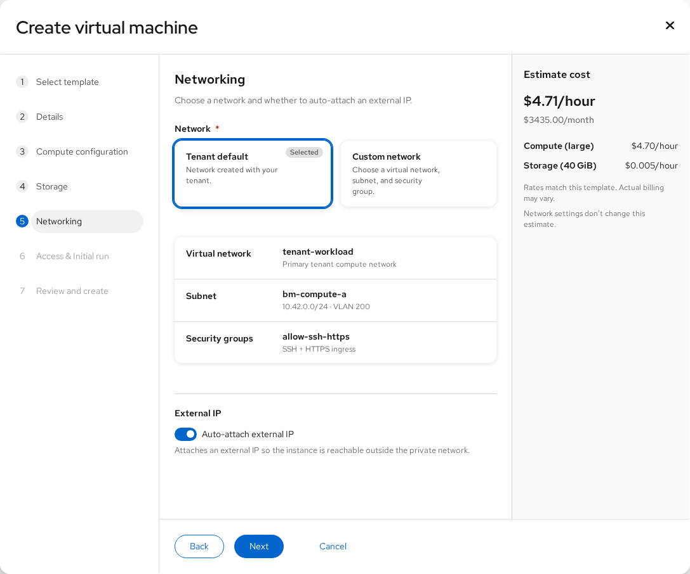
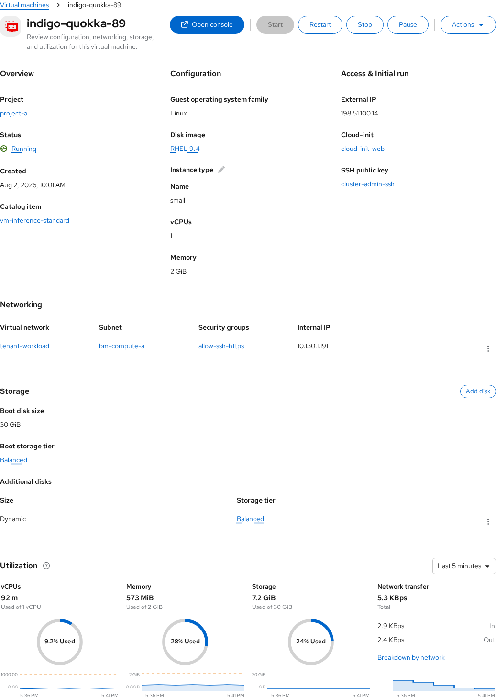

# VMaaS Networking — UX Design

---

## 1. Create VM — Networking

The Networking step offers **Tenant default** and **Custom network**. Tenant
default summarizes virtual network, subnet, and security groups.

The **Auto-attach external IP** toggle default and the network choice come
from the catalog item the VM is launched from. When the catalog item locks
`auto_external_ip_attachment` or `network_attachments`, the control is
disabled and the field is left out of the request.

Custom network lets the user choose a virtual network, subnet, and security
groups. A VM has exactly one network attachment and it cannot change after create.

The Subnet picker shows each Subnet's name and IPv4 CIDR.

---

## 2. VM details page

The details page shows two entries — the External IP and the Networking
entry, whose three fields are the resolved network resources:

- **External IP** — A plain read-only value.
- **Networking** — the resolved network fields as read-only entries:
  VirtualNetwork, Subnet, and Security Groups.

