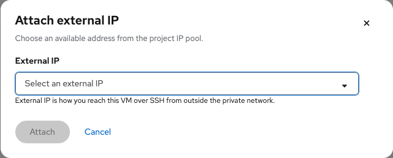
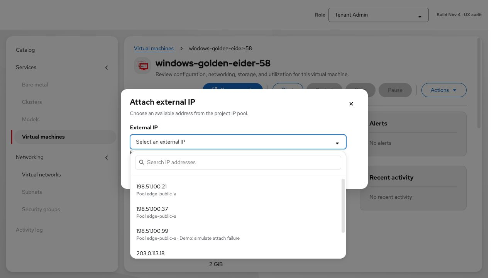
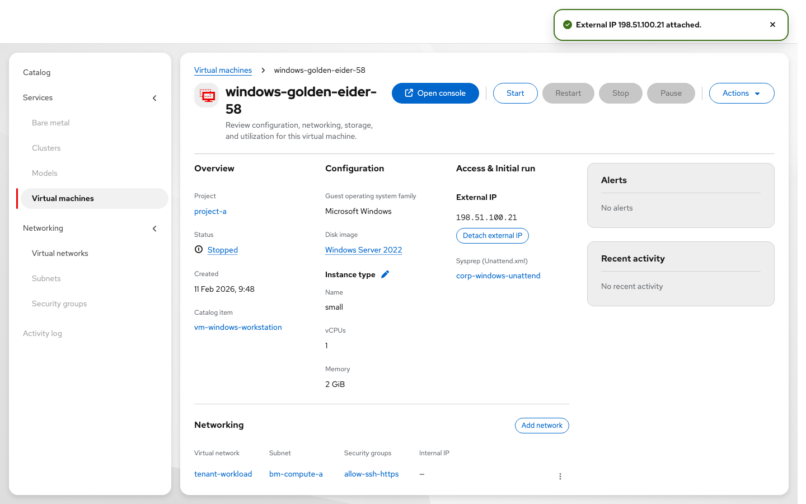

# VMaaS Networking — UX Design

Tenant Networking UX handoff, version 0.6 (18 November 2026), by Yifat Friman
Menchik (UXD). Captured from the Tenant Networking Google Doc.

Tracking: [OSAC-2621](https://redhat.atlassian.net/browse/OSAC-2621), parent
epic [OSAC-5652](https://redhat.atlassian.net/browse/OSAC-5652), feature
[OSAC-1435](https://redhat.atlassian.net/browse/OSAC-1435).

Roles: Tenant Admin; Tenant User where allowed.

This handoff covers how a VM attaches to shared virtual networks during create
and how its External IP appears and is managed on VM Overview. Virtual network
management and the External IP inventory have separate handoffs.

> The screenshots below predate the v0.6 backend-alignment corrections (single
> network attachment, attach gating on a Running VM, address-picker wording,
> IPv4-only mock data). They are retained as layout references and will be
> re-captured; where a screenshot and the text disagree, the text governs.

---

## 1. Create VM — Networking

The Networking step offers **Tenant default** and **Custom network**. Tenant
default summarizes virtual network, subnet, and security groups.

The **Auto-attach external IP** toggle default and the network choice come
from the catalog item the VM is launched from. When the catalog item locks
`auto_external_ip_attachment` or `network_attachments`, the control is
disabled and the field is left out of the request.

Custom network lets the user choose a virtual network, subnet, and security
groups; the auto-attach external IP control remains visible. A VM has exactly
one network attachment and it cannot change after create, so there is no
"Additional networks" option.

The Subnet picker shows each Subnet's name and IPv4 CIDR — there is no
tenant-facing VLAN. Subnets that do not support VMs
(`compute_instance_supported == false`) are disabled with their
`compute_instance_unsupported_reason`. Tenant defaults are tenant-wide, not
per-project, and the default SecurityGroup belongs only to the default
VirtualNetwork, so nothing is preselected for another VirtualNetwork; an
option is preselected only when exactly one option is listed.

---

## 2. External IP on VM Overview

External IP is the first item in **Access & Initial run**, above Cloud-init
and SSH public key. It uses a heading aligned with other Overview subsection
headings; no SSH command appears. An auto-attached address has a neutral,
outlined PF6 felt glass **Auto attached** status label beside the External IP
heading and an explanation below. It cannot be edited or detached separately:
it is released only when the VM is deleted. External IP fields carry the
standard help text *Reachable where your provider routes it.* — an ExternalIP
is external to the VirtualNetwork, not necessarily Internet-routable, and SSH
access depends on the VM's SecurityGroups.

When no address is attached, **Attach external IP** is a secondary button,
aligned with the manual **Detach** action. The button is enabled only when
the VM is Running, READY, and has its internal IP; on a Stopped VM it is
disabled with the reason "Start the VM to attach an external IP". The attach
modal lets the user choose an allocated external IP that isn't in use — an
existing ExternalIP of the tenant that is allocated, has no consumer, is not
automatic, and is not the tenant default. Each option shows the ExternalIP's
name and address, with its pool as secondary text. When the tenant has no
free ExternalIP, the empty state links to **Create external IP**. Do not add
a Host label or empty placeholder below the External IP heading.

Attachment progress and failure are shown as inline status text directly
below the External IP heading, matching the UI design. Tenants never see
retry or job information: an in-progress attachment shows the fixed message
"Resource provisioning in progress." and a failed one shows "Resource
provisioning did not complete." The inline text may name the address, from
`ExternalIPAttachment.status.external_ip_address`. Do not present a failed
address as an attached IP, and do not offer Retry or Choose another. A failed
manual attachment offers **Detach** (remove the failed attachment) as its
only action — the failed attachment stays until deleted, blocks VM deletion,
and keeps the ExternalIP in use, so without Detach the tenant would be stuck.
Detach of a confirmed attached IP remains available. The auto-attached state
has no manual controls.

### No external IP attached

### Available address picker

### Manually attached External IP

### Attaching external IP

### External IP attachment failed

---

## 3. Out of scope

This handoff does not own Virtual networks list/create/detail (including its
pagination), External IP inventory, or subnet/security-group administration.
