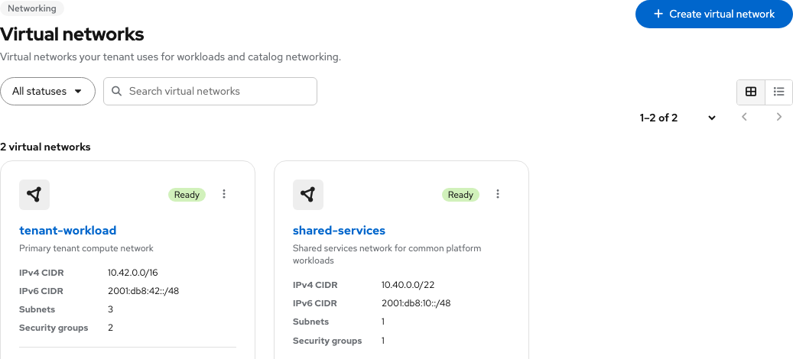
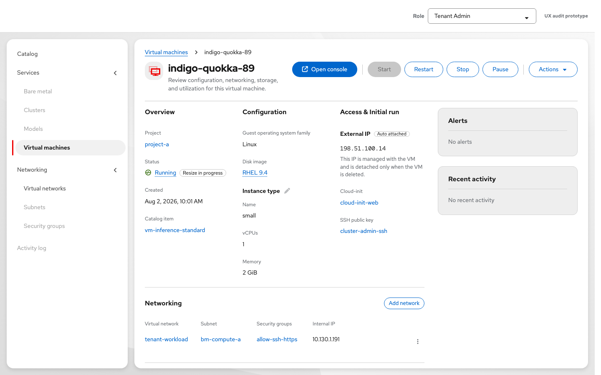
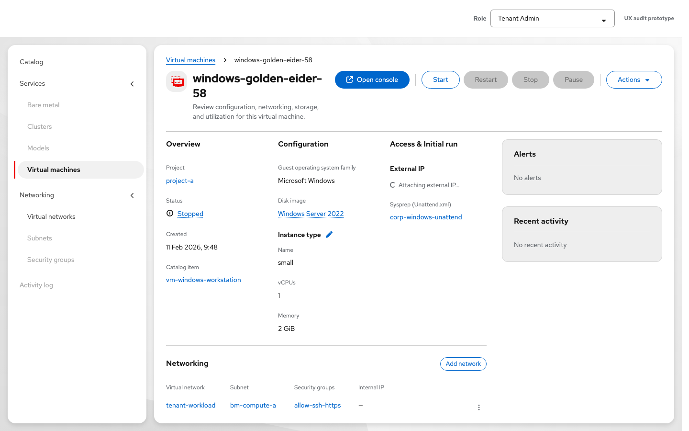
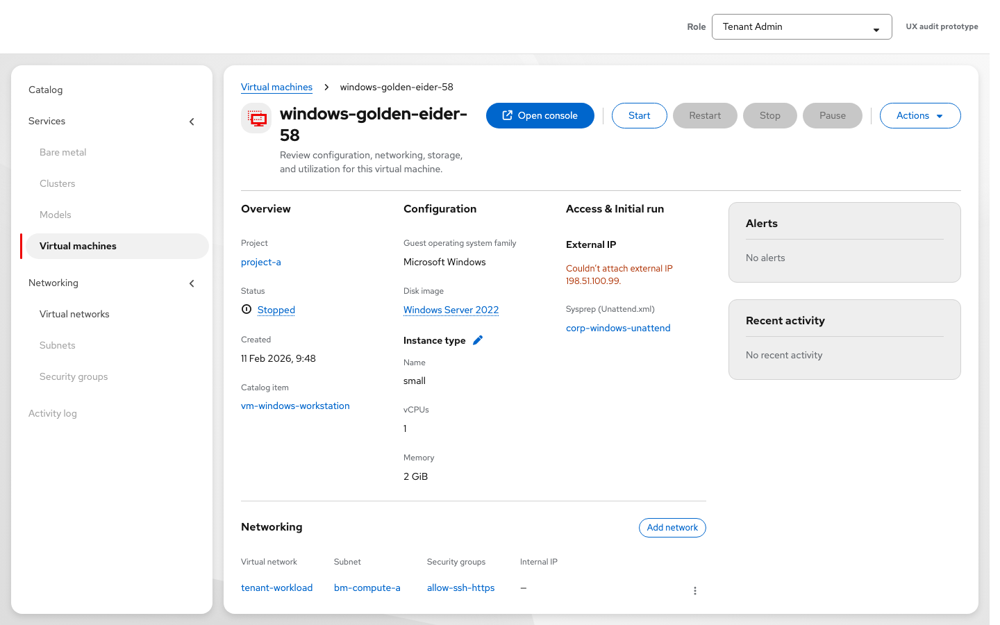

# VMaaS Networking — UX Design

Tenant Networking UX handoff, version 0.5 (18 November 2026), by Yifat Friman
Menchik (UXD). Captured from the Tenant Networking Google Doc; the interactive
mockup remains the source of truth for the v0.5 top-of-page alerts.

Tracking: [OSAC-2621](https://redhat.atlassian.net/browse/OSAC-2621), parent
epic [OSAC-5652](https://redhat.atlassian.net/browse/OSAC-5652), feature
[OSAC-1435](https://redhat.atlassian.net/browse/OSAC-1435).

Roles: Tenant Admin; Tenant User where allowed.

This handoff covers how a VM attaches to shared virtual networks during create
and how its External IP appears and is managed on VM Overview. Virtual network
management and the External IP inventory have separate handoffs.

---

## 1. Create VM — Networking

The Networking step offers **Tenant default** and **Custom network**. Tenant
default summarizes virtual network, subnet, and security groups. Auto-attach
external IP is on by default in the shown template.

Custom network lets the user choose a virtual network, subnet, and security
groups. Additional networks are available only on this path; the auto-attach
external IP control remains visible.

---

## 2. External IP on VM Overview

External IP is the first item in **Access & Initial run**, above Cloud-init and
SSH public key. It uses a heading aligned with other Overview subsection
headings; no SSH command appears. An auto-attached address has a neutral,
outlined PF6 felt glass **Auto attached** status label beside the External IP
heading and an explanation below. It cannot be edited or detached separately:
it is released only when the VM is deleted.

When no address is attached, **Attach external IP** is a secondary button,
aligned with the manual **Detach** action. The attach modal selects an
available address from the project IP pool. Do not add a Host label or empty
placeholder below the External IP heading.

In version 0.5, show attachment progress or failure in a top-of-page alert
above Overview, naming the selected IP and any known retry information. Show
the address directly below the heading only after success. On failure, show
"Couldn't attach external IP 198.51.100.99." in the alert. Do not present that
address as an attached IP. Do not show Retry, Choose another, or Detach for a
failed attachment; Detach applies only to a confirmed attached IP. The
auto-attached state has no manual controls.

> The attachment progress and failure screenshots below show the earlier 0.4
> inline layout; use the 0.5 interactive mockup for the top-of-page alerts.

### No external IP attached

### Available address picker

### Manually attached External IP

### Attaching external IP

### External IP attachment failed

---

## 3. Out of scope

This handoff does not own Virtual networks list/create/detail, External IP
inventory, or subnet/security-group administration.

---

## 4. List pagination

The Virtual networks list uses compact PatternFly pagination above and below
the results: an item-range dropdown with Previous and Next controls. The
dropdown changes items per page (10, 20, 50, or 100), and filtering resets to
the first page.
