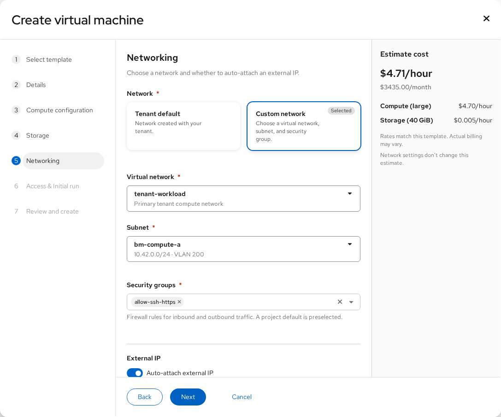

# VMaaS Networking — UX Design

---

## 1. Create VM — Networking

The Networking step offers **Tenant default** and **Custom network**. Tenant
default summarizes virtual network, subnet, and security groups.

The **Auto-attach external IP** toggle default and the network choice come
from the catalog item the VM is launched from. When the catalog item locks
`auto_external_ip_attachment` or `network_attachments`, the control is
disabled and the field is left out of the request.

Custom network lets the user choose a virtual network, subnet, and security
groups; the auto-attach external IP control remains visible. A VM has exactly
one network attachment and it cannot change after create, so there is no
"Additional networks" option.

The Subnet picker shows each Subnet's name and IPv4 CIDR — there is no
tenant-facing VLAN. Subnets that do not support VMs
(`compute_instance_supported == false`) are disabled with their
`compute_instance_unsupported_reason`. Tenant defaults are tenant-wide, not
per-project, and the default SecurityGroup belongs only to the default
VirtualNetwork, so nothing is preselected for another VirtualNetwork; an
option is preselected only when exactly one option is listed.

---

## 2. VM details page

The details page shows two entries — the External IP and the Networking
entry, whose three fields are the resolved network resources:

- **External IP** — just text: the address as a plain read-only value,
  configured at create time (via the Auto-attach toggle) and released when
  the VM is deleted. It carries the standard help text *Reachable where
  your provider routes it.* — an ExternalIP is external to the
  VirtualNetwork, not necessarily Internet-routable, and SSH access depends
  on the VM's SecurityGroups. The address appears once the attachment is
  READY; a failure shows inline status text below the value.
- **Networking** — the resolved network fields as read-only entries:
  VirtualNetwork, Subnet, and Security Groups.

---

## 3. Out of scope

This handoff does not own Virtual networks list/create/detail (including its
pagination), External IP inventory, or subnet/security-group administration.
