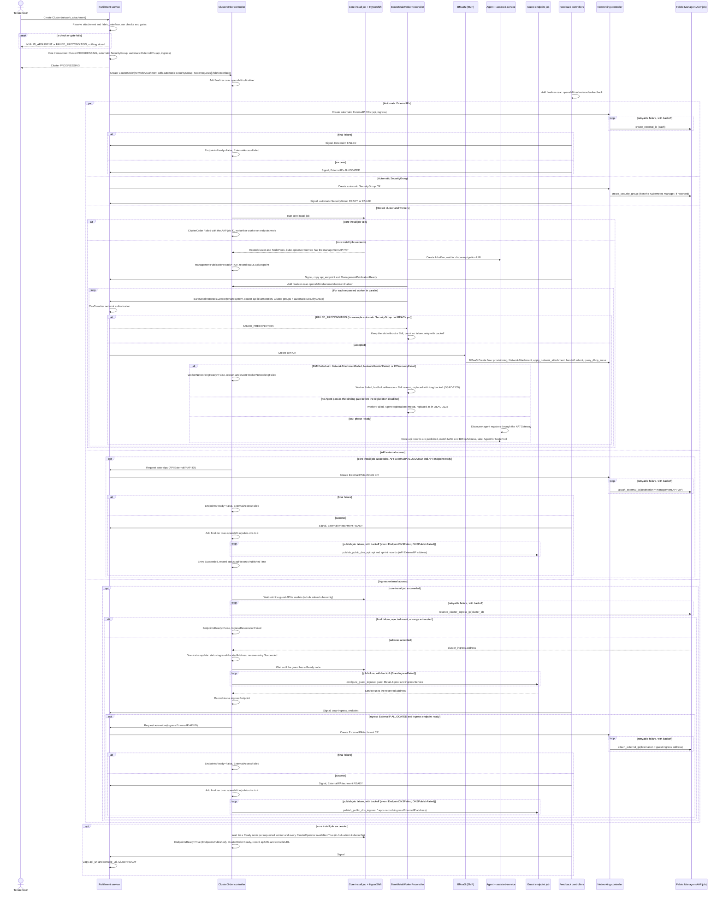
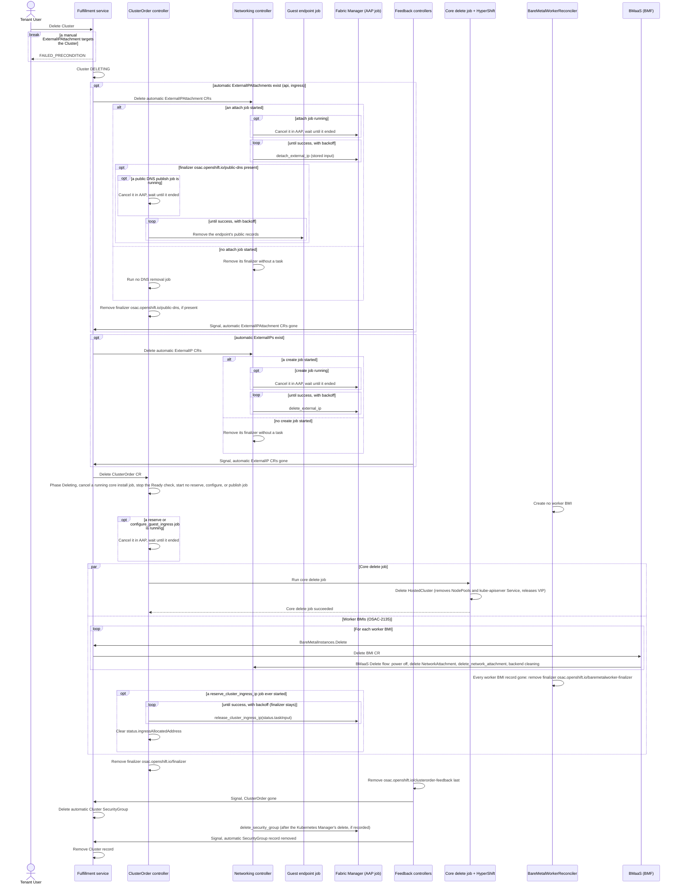

# CaaS Networking

## Contents

- [Summary](#summary)
- [Motivation](#motivation)
  - [Goals](#goals)
  - [Non-Goals](#non-goals)
- [Proposal](#proposal)
  - [Workflow Description](#workflow-description)
    - [Create](#create)
    - [Delete](#delete)
    - [External access](#external-access)
    - [Scale-out and scale-in](#scale-out-and-scale-in)
  - [API Extensions](#api-extensions)
  - [UX Alignment](#ux-alignment)
  - [Implementation Details/Notes/Constraints](#implementation-detailsnotesconstraints)
    - [Terms](#terms)
    - [Network attachment and validation](#network-attachment-and-validation)
    - [BareMetalInstanceType and interface selection](#baremetalinstancetype-and-interface-selection)
    - [Automatic Cluster SecurityGroup](#automatic-cluster-securitygroup)
    - [Worker BMIs](#worker-bmis)
    - [CaaS worker network authorization](#caas-worker-network-authorization)
    - [Management publication](#management-publication)
    - [Guest ingress reservation (follow-up)](#guest-ingress-reservation-follow-up)
    - [Endpoint feedback and DNS](#endpoint-feedback-and-dns)
    - [Kubernetes Manager and address ranges](#kubernetes-manager-and-address-ranges)
    - [ExternalIPAttachment target `cluster`](#externalipattachment-target-cluster)
    - [Automatic external access](#automatic-external-access)
    - [Provider networking disabled](#provider-networking-disabled)
    - [Component responsibilities](#component-responsibilities)
    - [Workload service design checklist](#workload-service-design-checklist)
  - [Security Considerations](#security-considerations)
  - [Failure Handling and Recovery](#failure-handling-and-recovery)
  - [RBAC / Tenancy](#rbac--tenancy)
  - [Observability and Monitoring](#observability-and-monitoring)
  - [Risks and Mitigations](#risks-and-mitigations)
  - [Drawbacks](#drawbacks)
- [Edge cases that need handling](#edge-cases-that-need-handling)
  - [Restarts and job tracking](#restarts-and-job-tracking)
  - [Workers and authorization](#workers-and-authorization)
  - [Readiness and publication](#readiness-and-publication)
- [Alternatives (Not Implemented)](#alternatives-not-implemented)
- [Test Plan](#test-plan)
  - [Unit Tests](#unit-tests)
  - [Integration Tests](#integration-tests)
  - [E2E Tests](#e2e-tests)
  - [Edge-case tests (later)](#edge-case-tests-later)
- [Graduation Criteria](#graduation-criteria)
- [Upgrade and Downgrade Strategy](#upgrade-and-downgrade-strategy)
- [Version Skew Strategy](#version-skew-strategy)
- [Support Procedures](#support-procedures)
- [Infrastructure Needed](#infrastructure-needed)

## Summary

CaaS Clusters use the shared OSAC networking resources. A Cluster has one network attachment (one Subnet and its SecurityGroups) and one automatic SecurityGroup for the traffic every Cluster needs. Its bare-metal workers are BareMetalInstances (BMIs) that join the Subnet through the BMaaS flow. The hosted control plane is published on the provider management network; workers reach it through the NATGateway of the Cluster's VirtualNetwork ([worker path](#network-attachment-and-validation)). Guest ingress uses an address the Fabric Manager reserves on the Subnet. Every Cluster gets an ExternalIP and public DNS names for each of its API and ingress endpoints. Requirements: [PRD](prd.md).

This design states only CaaS specifics. [Unified Networking](/enhancements/OSAC-1433-unified-networking/design.md) owns the resources, status, error codes, gates, and guards, and its [deployment](/enhancements/OSAC-1433-unified-networking/design.md#deployment-support-boundary) and [hub](/enhancements/OSAC-1433-unified-networking/design.md#networking-hub-support-boundary) boundaries apply. The [Network Manager Integration Contract](/enhancements/OSAC-1433-network-manager-integration-contract-networking/design.md) ("the contract") owns manager tasks and retries, [Default Networking](/enhancements/OSAC-1433-default-networking/design.md) tenant defaults, the [BMaaS design](/enhancements/OSAC-1437-bmaas-networking/design.md) how a BMI joins a Subnet, and [OSAC-2135](/enhancements/OSAC-2135-caas-bare-metal-worker-provisioning/design.md) the worker lifecycle.

## Motivation

A Cluster needs a tenant network for its workers, a path from them to the hosted control plane in the hub, a tenant address for guest ingress, and inbound access and names from outside the VirtualNetwork. Tenants select, share, and isolate these networks with the same resources as for VMs and bare-metal servers.

### Goals

- Use only shared networking resources and contract tasks: no provider-specific code, and no CaaS-only manager task except the guest ingress reservation.
- Reuse the BMaaS BMI flow for every worker; CaaS never runs a NetworkAttachment task itself.
- Check every networking precondition synchronously at Cluster create.
- Keep the bootstrap path (workers to the hosted control plane) independent of the tenant's SecurityGroup rules.

### Non-Goals

- VMaaS and BMaaS networking, and VM-based node sets.
- More than one network attachment per Cluster, or per-node-set Subnets.
- A tenant DNS API; CaaS publishes only its own endpoint records.
- How OSAC runs manager tasks and retries them (the contract).
- Enabling CaaS on a deployment that already has networking resources ([Unified — Subnet address plan](/enhancements/OSAC-1433-unified-networking/design.md#subnet-address-plan)).

## Proposal

The fulfillment service owns the API side; in the hub, the ClusterOrder controller owns the hosted cluster, endpoints, and DNS, the `BareMetalWorkerReconciler` creates worker BMIs through the BMaaS private API ([OSAC-2135](/enhancements/OSAC-2135-caas-bare-metal-worker-provisioning/design.md)), and BMaaS attaches them to the Subnet ([Component responsibilities](#component-responsibilities)).

### Workflow Description

Actors: the Tenant User creates and deletes Clusters; the Tenant Admin owns the networking resources; the Cloud Provider Admin owns the hub, the management publication, and DNS. Starting state: the tenant has a READY Subnet and SecurityGroup (for example its [defaults](/enhancements/OSAC-1433-default-networking/design.md)), the VirtualNetwork has a READY NATGateway, and provider networking is enabled ([disabled](#provider-networking-disabled)).

#### Create

1. The Tenant User creates the Cluster:
   ```bash
   # Explicit network attachment: one Subnet and two SecurityGroups
   osac create cluster --catalog-item hosted_cluster_offering --name my-cluster \
     --node-set name=workers,size=3,baremetal-instance-type=bm-standard \
     --network-attachment subnet=my-subnet,security-groups=sg-a,sg-b

   # Tenant defaults
   osac create cluster --catalog-item hosted_cluster_offering --name my-cluster \
     --node-set name=workers,size=3,baremetal-instance-type=bm-standard
   ```
   `--network-attachment subnet=<name or ID>,security-groups=<name or ID>,<name or ID>` gives the one attachment; `security-groups=` comes last and takes a comma-separated list. There is no `interface` ([interface selection](#baremetalinstancetype-and-interface-selection)) and no `--external-ip-attachment` flag ([automatic external access](#automatic-external-access)).
2. The **fulfillment service** resolves the attachment and each node set's `fabric_interface` and runs the [checks and gates](#network-attachment-and-validation); a failure stores nothing. One transaction stores the Cluster (PROGRESSING, empty `api_endpoint` and `ingress_endpoint`), the [automatic Cluster SecurityGroup](#automatic-cluster-securitygroup) and, with provider networking enabled, the API and ingress [automatic ExternalIPs](#automatic-external-access). It creates the ClusterOrder with `spec.networkAttachment` (automatic SecurityGroup last) and `spec.nodeRequests[].fabricInterface`.
3. The **ClusterOrder controller** runs the core install job, which creates the HostedCluster and NodePools; management MetalLB gives the hosted `kube-apiserver` Service the management API VIP. The **BareMetalWorkerReconciler** creates the InfraEnv ([OSAC-2135](/enhancements/OSAC-2135-caas-bare-metal-worker-provisioning/design.md#infraenv-creation)). The controller then sets `ManagementPublicationReady` ([gate](#publication-gate)) and, the first time it turns True, records `status.apiEndpoint`; both are [copied](#endpoint-feedback-and-dns) to the Cluster, and [`EndpointsReady`](#endpoint-feedback-and-dns) shows endpoint progress and failures.
4. **API access.** Once the [API endpoint is ready](#externalipattachment-target-cluster), the controller requests the API automatic ExternalIPAttachment; once it is READY, the `api` and `api-int` records are published ([DNS](#endpoint-feedback-and-dns)).
5. **Workers**, once the HostedCluster exists and `ManagementPublicationReady=True`, in parallel with steps 4 and 6: one BMI per requested node ([Worker BMIs](#worker-bmis), [authorization](#caas-worker-network-authorization)); BMaaS runs its [Create flow](/enhancements/OSAC-1437-bmaas-networking/design.md#create); the agent registers through the NATGateway and binds after the [binding gate](#worker-bmis).
6. **Ingress access**, in parallel with steps 4 and 5. Once the [guest API is usable](#terms), the controller reserves the [guest ingress address](#guest-ingress-reservation-follow-up); once the guest has a Ready node, it configures guest MetalLB with it and records `status.ingressEndpoint`. The ingress ExternalIPAttachment and `*.apps` record follow as in step 4.
7. The controller sets the ClusterOrder Ready by the [Cluster Ready rule](#endpoint-feedback-and-dns), with `status.apiURL` and `status.consoleURL`; the Cluster becomes READY.



#### Delete

1. The [deletion guard](/enhancements/OSAC-1433-unified-networking/design.md#deletion-dependency-guards) rejects the delete with `FAILED_PRECONDITION` while a manual ExternalIPAttachment targets the Cluster. A Delete of a DELETING Cluster returns OK ([Unified](/enhancements/OSAC-1433-unified-networking/design.md#status)).
2. The fulfillment service sets the Cluster DELETING ([until the record is removed](/enhancements/OSAC-1433-unified-networking/design.md#status)) and deletes the automatic ExternalIPAttachments, then the automatic ExternalIPs, then the ClusterOrder CR, each once the previous is gone ([Unified order](/enhancements/OSAC-1433-unified-networking/design.md#automatic-external-access)). Jobs and retries follow [contract §4.7](/enhancements/OSAC-1433-network-manager-integration-contract-networking/design.md#47-ordering-concurrency-retries-and-ownership). Each ExternalIPAttachment's public records go before its `osac.openshift.io/public-dns` finalizer ([DNS](#endpoint-feedback-and-dns)).
3. From the ClusterOrder deletionTimestamp on, its phase stays `Deleting`. The ClusterOrder controller cancels a running core install, reserve, or `configure_guest_ingress` job in AAP, starts no reserve, guest configure, or publish job, requests no automatic ExternalIPAttachment, and stops the [Cluster Ready](#endpoint-feedback-and-dns) check. The BareMetalWorkerReconciler creates no worker BMI.
4. Once no automatic ExternalIPAttachment or ExternalIP CR remains and AAP reports that every cancelled job ended, the core delete job (deletes the HostedCluster, which releases the VIP) and the worker BMI deletion start together ([OSAC-2135](/enhancements/OSAC-2135-caas-bare-metal-worker-provisioning/design.md#cluster-deletion)); each BMI runs the BMaaS [Delete flow](/enhancements/OSAC-1437-bmaas-networking/design.md#delete). Once every worker BMI record is gone, the controller runs the guest ingress address [release](#guest-ingress-reservation-follow-up); with provider networking disabled, it runs [no release](#provider-networking-disabled).
5. `osac.openshift.io/finalizer` goes when the release has succeeded (or no reserve job ever started) and the core delete job succeeds, `osac.openshift.io/baremetalworker-finalizer` when every worker BMI record is gone, and `osac.openshift.io/clusterorder-feedback` last, as [Unified](/enhancements/OSAC-1433-unified-networking/design.md#hub-crs) defines. With the ClusterOrder gone, the fulfillment service deletes the [automatic Cluster SecurityGroup](#automatic-cluster-securitygroup), whose CR runs `delete_security_group` on each recorded manager; once its record is gone, it removes the Cluster record.



#### External access

```bash
osac create externalipattachment --externalip my-ip --cluster my-cluster --target-endpoint api --name api-att
```

`--externalip` and `--cluster` take an ID or a name; `--target-endpoint` (`api` or `ingress`) sets `target_endpoint`. The create succeeds only once the Cluster is READY and the endpoint is ready ([target `cluster`](#externalipattachment-target-cluster)); the networking controller then runs Fabric `attach_external_ip`.

#### Scale-out and scale-in

Scale-out creates worker BMIs as in [Create](#create) step 5, with each node set's stored `fabric_interface`. Scale-in follows [OSAC-2135](/enhancements/OSAC-2135-caas-bare-metal-worker-provisioning/design.md#scale-down); each removed BMI runs the BMaaS Delete flow.

### API Extensions

- **fulfillment-service:** Cluster has `spec.network_attachment` (`ClusterNetworkAttachment`), `spec.auto_external_ip_attachment` (omitted or `true`), private `spec.node_sets[].fabric_interface`, `status.api_endpoint`, `status.ingress_endpoint`, `status.api_url` and `status.console_url`. The copied `ManagementPublicationReady` is also recorded with the Cluster. All live in the Cluster's `data` JSONB column; no table column is added.
- **osac-operator:** ClusterOrder gains `spec.networkAttachment`, `spec.nodeRequests[].fabricInterface`, `status.apiURL`, `status.consoleURL`, `status.apiRecordsPublishedTime` (time of the first `publish_public_dns_api` success), `status.jobs`, `status.taskInput`, `status.ingressAllocatedAddress` (the accepted guest ingress address), and the [conditions](#observability-and-monitoring). Finalizers: the ClusterOrder controller adds `osac.openshift.io/finalizer` on its first reconcile and holds `osac.openshift.io/public-dns` on the Cluster's automatic ExternalIPAttachment CRs; the BareMetalWorkerReconciler holds `osac.openshift.io/baremetalworker-finalizer` on the ClusterOrder ([OSAC-2135](/enhancements/OSAC-2135-caas-bare-metal-worker-provisioning/design.md)); the ClusterOrder feedback controller adds `osac.openshift.io/clusterorder-feedback` on its first reconcile, removes it when no other finalizer remains, and signals the fulfillment service. The fulfillment service finds a ClusterOrder by label `osac.openshift.io/clusterorder-uuid: <Cluster API ID>`.
- **Controllers down:** without the ClusterOrder controller, no reservation, DNS record, or automatic ExternalIPAttachment request happens, and deletes wait.

```protobuf
// osac.private.v1; the public ClusterNodeSet has the same fields except fabric_interface.
message ClusterNodeSet {
  reserved 1;
  reserved "host_type";
  optional int32 size = 2;
  string fabric_interface = 3 [(cleanapi.field).private = true]; // server-derived, immutable
  BareMetalInstanceTypeReference baremetal_instance_type = 4;   // immutable
  ClusterVersionReference version = 5;
  string observed_version = 6;                                  // output only
}
message ClusterNetworkAttachment {
  SubnetLocalReference subnet = 1;
  repeated SecurityGroupLocalReference security_groups = 2;     // the Cluster's own groups, never the automatic one
}
message ClusterSpec {
  // ... other fields ...
  ClusterNetworkAttachment network_attachment = 9;              // singular, immutable
  optional bool auto_external_ip_attachment = 10;               // immutable; omitted or true
}
message ClusterStatus {
  // ... other fields ...
  string api_endpoint = 6;                                      // management API VIP
  string ingress_endpoint = 7;                                  // guest ingress address
}
```

```go
type ClusterOrderSpec struct {
    // ... other fields ...
    NetworkAttachment *ClusterNetworkAttachment `json:"networkAttachment,omitempty"`
    NodeRequests      []NodeRequest             `json:"nodeRequests,omitempty"`
}
type NodeRequest struct {
    NodeSet         string `json:"nodeSet"`                   // node set key (OSAC-2135)
    // ... other OSAC-2135 fields ...
    FabricInterface string `json:"fabricInterface,omitempty"` // immutable, from fulfillment
}
type ClusterNetworkAttachment struct {
    SubnetRef         string   `json:"subnetRef"`                   // Subnet API ID
    SecurityGroupRefs []string `json:"securityGroupRefs,omitempty"` // SecurityGroup API IDs; the automatic Cluster SecurityGroup last
}
type ClusterOrderStatus struct {
    // ... other fields: Conditions, Workers (OSAC-2135) ...
    ApiEndpoint     string                `json:"apiEndpoint,omitempty"`     // management API VIP
    IngressEndpoint string                `json:"ingressEndpoint,omitempty"` // guest ingress address
    APIURL          string                `json:"apiURL,omitempty"`          // https://api.<cluster>.<domain>:<API frontend port>
    ConsoleURL      string                `json:"consoleURL,omitempty"`      // https://console-openshift-console.apps.<cluster>.<domain>
    APIRecordsPublishedTime *metav1.Time  `json:"apiRecordsPublishedTime,omitempty"` // first publish_public_dns_api success
    Jobs            []NetworkJobStatus    `json:"jobs,omitempty"`            // {task, manager, attempt, state, jobID, message}
    TaskInput       *runtime.RawExtension `json:"taskInput,omitempty"`       // stored input of the Fabric tasks
    IngressAllocatedAddress string        `json:"ingressAllocatedAddress,omitempty"` // accepted reserve_cluster_ingress_ip address
}
```

`NetworkJobStatus` has the fields and states of a `status.jobs` entry ([contract §4.7](/enhancements/OSAC-1433-network-manager-integration-contract-networking/design.md#47-ordering-concurrency-retries-and-ownership), Job tracking); `status.provisioningJobs` (`JobStatus`) holds the core install and delete jobs. `status.jobs` keeps the latest entry per task:

- `reserve_cluster_ingress_ip` and `release_cluster_ingress_ip` use `manager: fabric`; `status.taskInput` keeps their input for the release task.
- The guest endpoint job tasks `configure_guest_ingress`, `publish_public_dns_api`, `remove_public_dns_api`, `publish_public_dns_ingress`, and `remove_public_dns_ingress` use `manager: none`.
- Every job, guest endpoint jobs included, is tracked as [contract §4.7](/enhancements/OSAC-1433-network-manager-integration-contract-networking/design.md#47-ordering-concurrency-retries-and-ownership) defines, with the Cluster API ID as resource API ID and the AAP job timeout; a timed-out guest endpoint job is retried like a failed one. On delete, the ClusterOrder controller cancels a running guest endpoint job and a running core install job ([Delete](#delete) step 3, [contract §4.7](/enhancements/OSAC-1433-network-manager-integration-contract-networking/design.md#47-ordering-concurrency-retries-and-ownership)).

Endpoints are plain addresses, without port fields.

### UX Alignment

The UI uses the same Create, Get, and Delete calls and gates. Screens: [UI design addendum](ui-design.md).

### Implementation Details/Notes/Constraints

#### Terms

- **Management API VIP:** the IPv4 address that provider management MetalLB assigns to the Cluster's hosted `kube-apiserver` Service in the hub; in the provider management network, never in the tenant Subnet. Reported as the API endpoint.
- **Guest ingress address:** the address the Fabric Manager reserves for the Cluster from the Subnet's LB VIP range; guest MetalLB advertises it for the guest ingress Service. Reported as the ingress endpoint.
- **Management publication:** the hosted control plane endpoints (API, ignition, Konnectivity, OAuth, assisted-service) the provider publishes on the provider management network.
- **Handoff:** only the BMI's one reboot after its port moves to the Subnet (BMaaS).
- **Guest API usable:** HostedCluster condition `Available=True`, and a request with the [in-hub admin kubeconfig](#publication-field-sources) succeeds within 10 seconds. The ClusterOrder controller checks this on every reconcile and every 30 seconds until it holds.
- **Guest endpoint job:** the CaaS AAP job (template `osac-cluster-endpoints`, [inputs](#infrastructure-needed)) that configures guest MetalLB and publishes and removes the public DNS records; tracked in `ClusterOrder.status.jobs`, apart from the core job.

#### Network attachment and validation

`network_attachment` follows the [Unified defaulting rules](/enhancements/OSAC-1433-unified-networking/design.md#network-attachment-field-presence-and-defaulting). It has no interface field (the fulfillment service resolves one per node set). Every Cluster create path (template and catalog item, public and private API) runs the [Unified creation gates](/enhancements/OSAC-1433-unified-networking/design.md#creation-readiness-gates), including the Cluster NATGateway gate, and these checks before storing the Cluster. An update that adds a node set runs the `fabric` port check.

| Check | Error |
|---|---|
| The Cluster's pod and service CIDRs (`spec.network.pod_cidr` and `spec.network.service_cidr`, or their defaults `10.128.0.0/14` and `172.30.0.0/16`) overlap the VirtualNetwork CIDR, any range in `global.networking.excludedIpv4Cidrs`, or any ExternalIPPool CIDR (the error names no pool CIDR). | `INVALID_ARGUMENT` |
| Each node set's BareMetalInstanceType has a `fabric` port. | `INVALID_ARGUMENT` |
| `auto_external_ip_attachment` is omitted or `true` (checked also with provider networking disabled). | `INVALID_ARGUMENT` |
| Update of `network_attachment` or `auto_external_ip_attachment` | `INVALID_ARGUMENT` |

**Worker path to the management endpoints.** Workers reach the management publication, for install and ongoing traffic, through the NATGateway of the Cluster's VirtualNetwork; hence its create gate (provider networking enabled) and [deletion guard](/enhancements/OSAC-1433-unified-networking/design.md#deletion-dependency-guards). They reach the hosted API by its public name, so API traffic also hairpins through the one-to-one API automatic ExternalIP ([DNS](#endpoint-feedback-and-dns)). The provider supplies DNS for the management hostnames and the route from the NATGateway's ExternalIP to the management endpoints; the Fabric Manager carries the hairpin to the Cluster's automatic ExternalIPs ([`attach_external_ip`](/enhancements/OSAC-1433-network-manager-integration-contract-networking/design.md#fabric-attach_external_ip--detach_external_ip)). The [automatic Cluster SecurityGroup](#automatic-cluster-securitygroup) allows this traffic.

#### BareMetalInstanceType and interface selection

The [BMaaS design](/enhancements/OSAC-1437-bmaas-networking/design.md) defines `network_ports`, port roles, and order. For each node set, the fulfillment service picks the first `fabric` port of its `baremetal_instance_type`, never a `lifecycle` port; `[data-0 fabric, data-1 fabric, mgmt-0 management]` gives `data-0`.

The fulfillment service stores it as the private, immutable `Cluster.spec.node_sets[<node set>].fabric_interface` when the node set is first stored (at create, or when an update adds it); no caller can set or override it. Only this value selects a port: worker creation and scale-out reuse it even if the BareMetalInstanceType changes later. It is copied to `ClusterOrder.spec.nodeRequests[].fabricInterface`, keyed by `nodeSet`. Node sets share the one Subnet and differ only in interface.

#### Automatic Cluster SecurityGroup

A Cluster needs node-to-node traffic, egress to the management endpoints, DNS, and image sources, and inbound web traffic to guest ingress, which tenant SecurityGroups (for example [defaults](/enhancements/OSAC-1433-default-networking/design.md) allowing only SSH and HTTPS) may block. So the Cluster's create transaction also creates one automatic SecurityGroup in the VirtualNetwork of its Subnet. CaaS owns its rules and lifecycle; [Unified](/enhancements/OSAC-1433-unified-networking/design.md#automatic-external-access) owns the shared automatic-resource rules, including tenant access.

- **Identity:** name `auto-sg-<Cluster API ID>` (prefix `auto-sg-` reserved for creator `system`); creator `system`, the Cluster's tenant, annotation `osac.openshift.io/owner-reference: <Cluster API ID>`, and labels `osac.openshift.io/auto-created: "true"`, `osac.openshift.io/auto-created-for: <Cluster API ID>` and `osac.openshift.io/auto-created-kind: cluster` (no `auto-created-endpoint`).
- **Rules** (fixed for its life; a tenant [rule update](/enhancements/OSAC-1433-unified-networking/design.md#api-operation-constraint) of an automatic SecurityGroup is rejected):

  | Direction | Protocol | Ports | `ipv4_cidr` |
  |---|---|---|---|
  | ingress | `PROTOCOL_ALL` | none | the Cluster Subnet CIDR |
  | ingress | `PROTOCOL_TCP` | 80, and 443 (two rules) | `0.0.0.0/0` |
  | egress | `PROTOCOL_ALL` | none | `0.0.0.0/0` |

- **Use:** the fulfillment service finds it by name in the Cluster's tenant (for `securityGroupRefs`, [worker authorization](#caas-worker-network-authorization) and delete). Its API ID goes last in `securityGroupRefs`, so every worker BMI selects it; Cluster `spec.network_attachment.security_groups` shows only the Cluster's own groups.
- **Delete:** [Delete](#delete) step 5.
- **Tasks:** as for any [SecurityGroup](/enhancements/OSAC-1433-unified-networking/design.md#securitygroup), it records the Fabric Manager and, when its VirtualNetwork has one, the Kubernetes Manager; the networking controller runs `create_security_group` on both (Fabric first), and `delete_security_group` at delete (Kubernetes first). Worker BMI creates fail their [gate](/enhancements/OSAC-1433-unified-networking/design.md#creation-readiness-gates) with `FAILED_PRECONDITION` until it is READY and are retried ([authorization](#caas-worker-network-authorization)). If it becomes FAILED, no worker can be created: `WorkerNetworkingReady=False`, reason `WorkerNetworkingFailed`, names it with its message, and the tenant deletes the Cluster.
- **Provider networking disabled:** created the same way; no task runs, as for every networking resource ([Unified](/enhancements/OSAC-1433-unified-networking/design.md#provider-networking-control)).

#### Worker BMIs

The `BareMetalWorkerReconciler` creates each worker through `BareMetalInstances.Create` on the BMaaS private API, as in [OSAC-2135](/enhancements/OSAC-2135-caas-bare-metal-worker-provisioning/design.md#bmi-creation-via-private-api) (name, labels, list-before-create, other fields). CaaS adds:

- tenant `system` and annotation `osac.openshift.io/cluster-api-id: <Cluster API ID>`, used for [authorization](#caas-worker-network-authorization);
- one `BareMetalNetworkAttachment`: `subnet` and `security_groups` = the API IDs in `ClusterOrder.spec.networkAttachment` (never names, which would resolve in tenant `system`), `interface` = the node set's `fabric_interface`, and `primary: true` as OSAC-2135 sends it.

New workers are created only while the HostedCluster exists, `ManagementPublicationReady=True` and the ClusterOrder is not Failed; while it is False, creates and Agent binding wait and cleanup continues. The BareMetalWorkerReconciler adds `osac.openshift.io/baremetalworker-finalizer` to the ClusterOrder before it creates the first worker BMI.

**Network-ready time.** The `lastTransitionTime` of the BMI's `NetworkHandoffComplete=True` (with [provider networking disabled](#provider-networking-disabled): `ProvisionTemplateComplete=True`) on the hub BMI CR (label `osac.openshift.io/baremetalinstance-uuid: <status.workers[].resourceID>`).

**Binding gate.** The reconciler approves, binds, and labels an Agent for a NodePool only when the BMI is in phase `Ready`, `ManagementPublicationReady=True`, and the Agent proves the worker network:

- provider networking enabled: the `api` and `api-int` records are published (`publish_public_dns_api` entry `Succeeded`), because workers reach the hosted API by that name; and the Agent's `status.inventory.interfaces[]` entry whose `macAddress` equals the selected port's MAC (NetworkAttachment `spec.interface.macAddress`) has an `ipV4Addresses` CIDR (for example `10.0.1.130/24`) whose address equals the BMI's `status.networkAttachmentStatuses[0].ipAddress`;
- provider networking disabled: the [OSAC-2135 MAC match](/enhancements/OSAC-2135-caas-bare-metal-worker-provisioning/design.md#mac-address-correlation) only.

An Agent registered on the provisioning network waits; the gate is rechecked on every Agent and ClusterOrder update.

**Registration timeout.** The [OSAC-2135](/enhancements/OSAC-2135-caas-bare-metal-worker-provisioning/design.md#failure-handling-and-recovery) timeout (`AgentRegistrationTimeout`, default 30 minutes) fails a worker when no Agent passes the binding gate by the deadline. The deadline is the timeout added to the latest of: the network-ready time, the last `ManagementPublicationReady=True` transition, and (provider networking enabled) `status.apiRecordsPublishedTime`. No worker times out while that condition is False or, with provider networking enabled, while the `api` records are unpublished. With provider networking enabled it also catches a lease that never appears.

**Before the handoff.** CaaS sets no timeout (any provisioning timeout belongs to OSAC-2135). A BMI that stays `Progressing` (apply retrying, handoff waiting) shows in `WorkersProgressing` and exits only by repair of the cause or Cluster delete.

**Worker networking state.** On every reconcile, the ClusterOrder controller computes `WorkerNetworkingReady` ([reasons](#observability-and-monitoring)) from the hub BMI CRs of `ClusterOrder.status.workers[]`. When a worker BMI ends in phase `Failed` with reason `NetworkAttachmentFailed`, `NetworkHandoffFailed`, or `IPDiscoveryFailed` ([BMaaS conditions](/enhancements/OSAC-1437-bmaas-networking/design.md#network-status-and-phase)):
- the controller sets `WorkerNetworkingReady=False`, reason `WorkerNetworkingFailed` (the message names the BMI and reason), and emits the Warning event `WorkerNetworkingFailed`;
- the BareMetalWorkerReconciler sets the worker's `lastFailureReason` to the BMI reason and replaces the worker with the OSAC-2135 long backoff, as for `AgentRegistrationTimeout`.

The condition stays False, reason `WorkerNetworkingFailed`, while any `status.workers[]` entry has one of these three `lastFailureReason` values and no `Ready` BMI. It is also False, reason `WorkerNetworkingFailed`, while the [automatic Cluster SecurityGroup](#automatic-cluster-securitygroup) or a SecurityGroup of the Cluster's network attachment is FAILED; the message names it. The fulfillment service then uses the message "worker network attachment failed" in the [OSAC-2135 worker failure condition](/enhancements/OSAC-2135-caas-bare-metal-worker-provisioning/design.md#api-extensions). The tenant fixes a tenant group with a [rule update](/enhancements/OSAC-1433-unified-networking/design.md#securitygroup), and worker creates then resume. An entry whose BMI CR does not exist yet counts as `WorkersProgressing`. Other BMI failures (no free host, provisioning job) follow OSAC-2135.

#### CaaS worker network authorization

Worker BMIs are in the builtin tenant `system`, as are their NetworkAttachments (`osac.openshift.io/tenant: system`) and tasks ([contract §4.12](/enhancements/OSAC-1433-network-manager-integration-contract-networking/design.md#412-security-rbac-and-tenancy)). Networking does not check a worker's OSAC tenant; the fulfillment service checks every `system`-tenant BMI create instead:

| Request | Result |
|---|---|
| No `osac.openshift.io/cluster-api-id` annotation | `INVALID_ARGUMENT` |
| The named Cluster does not exist | `INVALID_ARGUMENT` |
| The Subnet differs from the Cluster's stored Subnet, or the SecurityGroups are not exactly the Cluster's stored groups plus its automatic Cluster SecurityGroup | `INVALID_ARGUMENT` |
| `interface` is not the stored `fabric_interface` of a node set of that Cluster whose `baremetal_instance_type` is the BMI's `instance_type` | `INVALID_ARGUMENT` |
| A [Unified creation gate](/enhancements/OSAC-1433-unified-networking/design.md#creation-readiness-gates) fails, including the Cluster NATGateway gate | As in Unified |
| Otherwise | Accepted |

Because this pins the interface, the fulfillment service skips the BareMetalInstanceType port check for these BMIs ([BMaaS](/enhancements/OSAC-1437-bmaas-networking/design.md#baremetalinstancetype-and-interface-selection)). Only the BareMetalWorkerReconciler creates `system`-tenant BMIs. A worker's network attachment is immutable. On a `FAILED_PRECONDITION` rejection (for example while the automatic Cluster SecurityGroup is not READY yet), the reconciler keeps the worker slot without a BMI, counts no failure, and retries with transient backoff. More rejection cases: [Edge cases](#workers-and-authorization).

#### Management publication

##### Publication gate

The ClusterOrder controller sets the private condition `ClusterOrder.status.conditions[type=ManagementPublicationReady]`, recomputed from current resources on every reconcile and every 30 seconds. Each DNS lookup, TCP connection, and TLS handshake below has a 10-second timeout. True requires all of:

- one management API VIP, outside the Cluster's VirtualNetwork CIDR and its pod and service CIDRs;
- `HostedCluster.status.controlPlaneEndpoint.port` equal to the API frontend port of the `kube-apiserver` Service;
- the required Routes admitted;
- the InfraEnv discovery ignition URL exists;
- API, from the hub: a TCP connection to the VIP and frontend port succeeds, and the TLS certificate is valid for `api.<cluster>.<domain>`, without resolving that name (its [public record](#endpoint-feedback-and-dns) comes only after the gate passes);
- ignition, Konnectivity, OAuth, and assisted-service, from the hub: the host name resolves in the provider DNS, a TCP connection to host and port succeeds, and the TLS certificate is valid for the host name.

Otherwise it is False, with a message naming the endpoint or check: reason `ManagementPublicationPending` while a required object (VIP, Route, InfraEnv URL) does not exist yet, and `ManagementPublicationFailed` when an existing object fails a check. The Cluster then shows `CLUSTER_CONDITION_TYPE_WORKER_PROVISIONING_BLOCKED` with a generic message. A Ready ClusterOrder stays Ready, and a later False shows only as that condition. The gate does not wait for workers, nodes, cluster operators, ingress, or a guest kubeconfig, so it can turn True with zero workers. It runs no provider task and is not a public API. Its hub checks do not prove the worker path through the NATGateway: there is no tenant probe, and the registration timeout catches a broken path.

The controller sets the condition True for the first time and records `status.apiEndpoint` in one status update; from then on the VIP is fixed for the Cluster's life.

Not supported: changing the management API VIP after `status.apiEndpoint` is recorded. The gate then turns False, reason `ManagementPublicationFailed`, message "management API VIP changed from <old> to <new>; restore it"; existing API ExternalIPAttachments keep the old destination.

##### Publication field sources

| Producer | Fields | Use |
|---|---|---|
| CaaS `hosted_cluster` Ansible role | `HostedCluster.spec.services[service=APIServer].servicePublishingStrategy.loadBalancer.hostname`; OAuthServer, OIDC, Konnectivity, and Ignition use `Route` publication | HyperShift creates the management Services and Routes. |
| HyperShift | `HostedCluster.status.controlPlaneEndpoint.host` and `.port`; `HostedCluster.status.ignitionEndpoint` | The real bootstrap host and port. CaaS never assumes port 6443. |
| Management MetalLB | `Service.status.loadBalancer.ingress[].ip` and `Service.spec.ports[].port` of Service `kube-apiserver` in namespace `<HostedCluster namespace>-<HostedCluster name>`, owned by HostedControlPlane `<HostedCluster name>` | The VIP and API frontend port (not the pod `targetPort`). Ambiguous ownership, VIPs, or ports keep the gate False. |
| HyperShift Routes, provider DNS, and TLS | `Route.spec.host`, `Route.status.ingress[].conditions[type=Admitted]` | Checked from the hub. The assisted-service endpoint is the one in `InfraEnv.status.bootArtifacts.discoveryIgnitionURL`. |
| HyperShift | `HostedCluster.status.kubeconfig.name` (Secret with `clusters[].cluster.server`) | Must match `HostedCluster.status.controlPlaneEndpoint` before use. Its server is the public name `api.<cluster>.<domain>`, so hub-side clients do not use it (below). CaaS never replaces it with an ExternalIP. |


**Hub access to the guest API.** Every hub-side guest API client (core job, guest endpoint job, ClusterOrder controller) uses the in-hub admin kubeconfig: the credentials of Secret `service-network-admin-kubeconfig` in the hosted control plane namespace, with server `https://kube-apiserver.<hosted control plane namespace>.svc:<kube-apiserver Service port>`, never the public `api` record, so it works before that record exists and after delete removes it.

#### Guest ingress reservation (follow-up)

This section is this design's rule for the guest ingress address. A follow-up design may refine it.

**LB VIP range.** The guest ingress address comes from the Subnet's LB VIP range ([contract §4.8](/enhancements/OSAC-1433-network-manager-integration-contract-networking/design.md#48-addressing)). The [address plan](/enhancements/OSAC-1433-unified-networking/design.md#subnet-address-plan) gives every Subnet an LB VIP range while CaaS is enabled, so `reserve_cluster_ingress_ip` never runs on an empty range. Hub MetalLB serves only the management API VIP, from the provider's management pool.

**Reservation.** Once the [guest API is usable](#terms) and the ClusterOrder is not Failed, OSAC runs Fabric `reserve_cluster_ingress_ip` ([contract task](/enhancements/OSAC-1433-network-manager-integration-contract-networking/design.md#fabric-reserve_cluster_ingress_ip--release_cluster_ingress_ip): inputs, result acceptance, one address per `cluster_id`) on the Fabric Manager in the Subnet's `status.networkManagers.fabric`, with `resource` = ClusterOrder and `cluster_id` = Cluster API ID. A final failure, a rejected result, or an exhausted range fails the reservation ([`IngressReservationFailed`](#endpoint-feedback-and-dns)); no guest MetalLB pool or ingress endpoint is created without a reservation.

**Allocated address.** OSAC writes the accepted address (for example `"192.0.2.20"`) to `ClusterOrder.status.ingressAllocatedAddress` in the same status update that marks the reserve entry `Succeeded`; guest configuration uses it.

- `status.ingressEndpoint` stays empty until the guest Service confirms the same address.
- Fabric returns `cluster_ingress.address` and never patches the ClusterOrder.
- ClusterOrder status keeps the Cluster API ID, Subnet API ID, provider binding, and accepted address for cleanup; there is no other reservation registry (no table or CRD).

**Guest MetalLB.** Once the reservation is accepted and the guest has a Ready node, the controller launches the guest endpoint job (`configure_guest_ingress`). With the admin kubeconfig, the job:
- installs the MetalLB operator in the guest if absent and waits for its CRDs;
- creates the `MetalLB` resource;
- creates the guest ingress Service: a `LoadBalancer` Service for the default router pods, pinned to the reserved address, with a single-address IPAddressPool that holds only that address, allocation limited to that Service, and the advertisement on the tenant network.

Guest MetalLB allocates no other tenant address. Once the Service uses the address, OSAC publishes it as `status.ingressEndpoint`. Until the MetalLB operator is installed and the Service uses the address, the job fails and is retried with the [contract §4.7](/enhancements/OSAC-1433-network-manager-integration-contract-networking/design.md#47-ordering-concurrency-retries-and-ownership) backoff, and `EndpointsReady` stays False. Tenants may use overlapping CIDRs, because their guest allocators and routing domains are separate.

**Cleanup.** On deletion:

- A running `reserve_cluster_ingress_ip` or `configure_guest_ingress` job is cancelled; cleanup starts once AAP reports it ended.
- Once every worker BMI record of the Cluster is gone (no worker port is left on the Subnet to announce the address), if a reserve job ever started, OSAC runs `release_cluster_ingress_ip` with `status.taskInput` ([contract §4.5](/enhancements/OSAC-1433-network-manager-integration-contract-networking/design.md#45-task-input)) and clears `status.ingressAllocatedAddress`; guest objects go with the HostedCluster. On failure the finalizer stays and the release is retried with the §4.7 backoff.

#### Endpoint feedback and DNS

**Feedback.** When the ClusterOrder status changes (endpoints, URLs, phase, `status.jobs`, or the conditions `ManagementPublicationReady`, `EndpointsReady`, `WorkerNetworkingReady`, and `ClusterHealthy`), the feedback controller signals the fulfillment service, which copies them from the ClusterOrder status to the Cluster (the phase as the Cluster state; URLs to `api_url` and `console_url`). The controller sets the URLs (formats in [API Extensions](#api-extensions)) when it sets Ready.

**Endpoint status.** The ClusterOrder controller sets the condition `EndpointsReady` on every reconcile from the endpoint steps below. While it is False, the fulfillment service puts its reason and message in the message of the Cluster's `CLUSTER_CONDITION_TYPE_PROGRESSING` condition; the Cluster state stays PROGRESSING. While the Cluster is DELETING, its `CLUSTER_CONDITION_TYPE_PROGRESSING` condition is True, and the fulfillment service puts the blocking cleanup step in its message: the failing remove or release job's message and next retry time, or the first worker BMI still DELETING with its `NETWORK_READY` message. The first matching row applies:

| Status | Reason | When |
|---|---|---|
| False | `ExternalAccessFailed` | An automatic ExternalIP or ExternalIPAttachment of the Cluster is FAILED; the message names it. |
| False | `IngressReservationFailed` | `reserve_cluster_ingress_ip` failed finally (including a [full LB VIP range](/enhancements/OSAC-1433-network-manager-integration-contract-networking/design.md#fabric-reserve_cluster_ingress_ip--release_cluster_ingress_ip)), or its result was rejected. |
| False | `GuestIngressFailed` | The latest `configure_guest_ingress` job failed and its retry waits; the message is the job message and the next retry time. |
| False | `DNSPublishFailed` | The latest publish job failed and its retry waits; the message names the record and the AAP job ID. |
| False | `GuestIngressProgressing` | Guest ingress is not configured yet (waiting for the guest API, the reservation, a Ready guest node, or a running `configure_guest_ingress` job); after a retryable reserve failure, the message is the job message and the next retry time. |
| False | `EndpointsProgressing` | Another endpoint step has not finished (ExternalIP allocation, ExternalIPAttachment, or a running publish job); the message names the first one. |
| True | `EndpointsPublished` | The API and ingress endpoints are recorded, both automatic ExternalIPAttachments are READY, and the three records below are published. |
| True | `ProvisioningDisabled` | [Provider networking is disabled](#provider-networking-disabled). |

After a `Failed` reason that no retry clears (`ExternalAccessFailed`, `IngressReservationFailed`), the tenant deletes the Cluster.

**Cluster Ready (provider networking enabled).** The ClusterOrder is Ready when all of these hold:
- the core install job has succeeded (HostedCluster and NodePools created);
- `EndpointsReady=True`;
- through the [in-hub admin kubeconfig](#publication-field-sources), the ClusterOrder controller sees a Ready node for every requested worker and every ClusterOperator `Available=True` (checked on every reconcile and every 30 seconds).

The automatic ExternalIPAttachments never wait for Cluster READY ([target table](#externalipattachment-target-cluster)), so there is no circular wait. Ready is stable: after the first Ready, only a delete changes the phase (to `Deleting`). After the first Ready, the controller sets the ClusterOrder condition `ClusterHealthy=False` while a requested worker has no Ready node or a ClusterOperator is not `Available=True` (the message names the first one), and True otherwise. The fulfillment service maps `ClusterHealthy=False` to `CLUSTER_CONDITION_TYPE_DEGRADED=True` with that message, as one more DEGRADED source ([OSAC-4090](/enhancements/OSAC-4090-caas-addon-operator-support/design.md)). The loss also shows in worker status per [OSAC-2135](/enhancements/OSAC-2135-caas-bare-metal-worker-provisioning/design.md#api-extensions).

**Names.** `<cluster>` is the ClusterOrder `metadata.name` (also the HostedCluster name), unique in the hub because the fulfillment service uses `generateName`. `<domain>` is the installation setting `EXTERNAL_ACCESS_BASE_DOMAIN` (Helm values `aap.instanceGroups.clusterFulfillment.config`); the installer rejects it unless it equals `HOSTED_CLUSTER_BASE_DOMAIN` (the HostedCluster `baseDomain`), so names match the cluster's certificates. Records go in the public zone `DNS_ZONE` (default `EXTERNAL_ACCESS_BASE_DOMAIN`) through the DNS implementation that `DNS_CLASS` selects. There is one record set: the guest cluster resolves its own names through it too, hairpinning through the one-to-one ExternalIP. `EXTERNAL_ACCESS_BASE_DOMAIN`, `DNS_ZONE`, and `DNS_CLASS` cannot change while any Cluster exists: the installer fails the rollout with "<setting> cannot change while Clusters exist; delete every Cluster first". The installer's CaaS step compares them with the running cluster-fulfillment configuration and lists Clusters through the private API.

| Record | Points to | Published | Removed |
|---|---|---|---|
| `api.<cluster>.<domain>` and `api-int.<cluster>.<domain>` | API automatic ExternalIP address | `publish_public_dns_api`, when that ExternalIPAttachment is READY | `remove_public_dns_api`, while that ExternalIPAttachment CR is deleted |
| `*.apps.<cluster>.<domain>` | ingress automatic ExternalIP address | `publish_public_dns_ingress`, likewise | `remove_public_dns_ingress`, likewise |

Manual ExternalIPAttachments get no record. So that a record never outlives its ExternalIP, the controller adds finalizer `osac.openshift.io/public-dns` to the automatic ExternalIPAttachment CR before the publish job, and starts no publish job once the CR has a deletionTimestamp. On CR deletion it cancels a running publish job in AAP, waits until it ended, runs the remove job, and on success removes the finalizer. Publish and remove jobs are idempotent; removing an absent record succeeds.

**Job failures.** A failed publish job emits Warning event `EndpointDNSFailed` (naming the record and AAP job ID), sets `EndpointsReady=False`, reason `DNSPublishFailed`, and is retried with the [contract backoff](/enhancements/OSAC-1433-network-manager-integration-contract-networking/design.md#47-ordering-concurrency-retries-and-ownership). A failed remove job is retried the same way until it succeeds.

#### Kubernetes Manager and address ranges

CaaS networking needs BMaaS enabled ([OSAC-3046](/enhancements/OSAC-3046-per-service-enablement/design.md)), because every worker is a BMI. Apart from the [automatic Cluster SecurityGroup](#automatic-cluster-securitygroup)'s tasks, CaaS runs no Kubernetes Manager task; a deployment without VMaaS need not select one ([contract §4.2](/enhancements/OSAC-1433-network-manager-integration-contract-networking/design.md#42-registration-and-capabilities)). If the NetworkClass selects OSAC's Kubernetes Manager for VMs, it still serves every Subnet (`create_virtual_network`, `create_subnet`). Workers take addresses from the Subnet's fabric range (`physical_ipv4_cidrs`) and the guest ingress address from its LB VIP range; their sizes follow the provider's address plan ([Unified](/enhancements/OSAC-1433-unified-networking/design.md#subnet-address-layout), [contract §4.8](/enhancements/OSAC-1433-network-manager-integration-contract-networking/design.md#48-addressing)). The [address plan](/enhancements/OSAC-1433-unified-networking/design.md#subnet-address-plan) gives every Subnet both ranges while CaaS is enabled, so worker DHCP and the ingress reservation always have a range; size Subnets for the workers ([BMaaS risks](/enhancements/OSAC-1437-bmaas-networking/design.md#risks-and-mitigations)). CaaS reads neither `network_type` nor `network_segment`, so a Cluster works on any Subnet, also one where `cudn_evpn` serves no VMs ([VMaaS risks](/enhancements/OSAC-1435-vmaas-networking/design.md#risks-and-mitigations)).

#### ExternalIPAttachment target `cluster`

`target_endpoint` selects one of the Cluster's two endpoints (`UNSPECIFIED`: `INVALID_ARGUMENT`). Until the endpoint is ready, the fulfillment service rejects the create with `FAILED_PRECONDITION`; nothing waits or retries on the server. An automatic ExternalIPAttachment needs only the endpoint's address; a manual one also needs Cluster READY. An endpoint is never ready with provider networking disabled ([Unified](/enhancements/OSAC-1433-unified-networking/design.md#provider-networking-control)).

| Item | API | INGRESS |
|---|---|---|
| Endpoints | `target_endpoint: API` | `target_endpoint: INGRESS` |
| Endpoint ready (fulfillment service) | Cluster not being deleted, `status.api_endpoint` set, and the copied `ManagementPublicationReady` True | Cluster not being deleted, `status.ingress_endpoint` set |
| Endpoint ready (ClusterOrder controller, before it requests the automatic ExternalIPAttachment) | No deletionTimestamp, `status.apiEndpoint` set, `ManagementPublicationReady=True` | No deletionTimestamp, `status.ingressEndpoint` set |
| `destination.address` | The management API VIP (`ClusterOrder.status.apiEndpoint`) | The guest ingress address (`ClusterOrder.status.ingressEndpoint`) |
| `destination.routing_domain` | `{type: provider_management}`; the Fabric Manager finds the provider management network in its settings | `{type: tenant_virtual_network, virtual_network_id: <VirtualNetwork API ID>, subnet_id: <Subnet API ID>}` of the Cluster's attachment |
| Automatic access | ExternalIP label `osac.openshift.io/auto-created-endpoint: api` | ExternalIP label `osac.openshift.io/auto-created-endpoint: ingress` |

The DNAT is one-to-one: clients use the API frontend port on the API ExternalIP, and 80 and 443 on the ingress ExternalIP. The networking controller finds the ClusterOrder by label `osac.openshift.io/clusterorder-uuid`, builds `destination`, and stores it as task input ([contract §4.5](/enhancements/OSAC-1433-network-manager-integration-contract-networking/design.md#45-task-input)).

#### Automatic external access

[Unified — Automatic external access](/enhancements/OSAC-1433-unified-networking/design.md#automatic-external-access) owns the shared rules (pool choice and capacity, identity, trigger checks and 30-second recheck, delete order, tenant visibility). CaaS specifics:

- **Mandatory** for every Cluster created with provider networking enabled ([check](#network-attachment-and-validation)).
- **Endpoints:** `API` and `INGRESS`, one ExternalIP each in the create transaction, with the `auto-created-endpoint` label of the [target table](#externalipattachment-target-cluster).
- **Trigger:** the ClusterOrder controller requests the ExternalIPAttachment once the ExternalIP is ALLOCATED and its endpoint passes the controller's test in the target table; the ExternalIPAttachment carries the Cluster target and the matching `target_endpoint`. A `FAILED_PRECONDITION` reply (endpoint not copied to the Cluster yet) is retried at the 30-second recheck; a FAILED ExternalIP shows as `ExternalAccessFailed` in `EndpointsReady`.
- **Readiness and DNS:** [Endpoint feedback and DNS](#endpoint-feedback-and-dns). **Delete:** [Delete](#delete) steps 2–3.

#### Provider networking disabled

Shared rules: [Unified](/enhancements/OSAC-1433-unified-networking/design.md#provider-networking-control). With provider networking disabled, OSAC runs no networking job and Clusters still install. The ClusterOrder controller and BareMetalWorkerReconciler read the deployment setting and use this fallback:

- **Fallback:** provisioning and deletion continue on baseline connectivity to assisted-service, the management publication, DNS, and installation dependencies. OSAC configures no guest ingress address; the provider makes `api`/`api-int` reach the management API VIP and `*.apps` reach the guest routers on the workers, outside OSAC (the Cluster's [names](#endpoint-feedback-and-dns); prerequisites in [Infrastructure Needed](#infrastructure-needed)). Without them the Cluster stays not ready until the tenant deletes it. No NATGateway gate.
- **Workers:** BMaaS skips the port move, handoff reboot, and lease query and sets those conditions True, reason `ProvisioningDisabled` ([BMaaS](/enhancements/OSAC-1437-bmaas-networking/design.md#provider-networking-disabled)), so a `Ready` BMI passes the MAC-only binding gate. `WorkerNetworkingReady` is True, reason `ProvisioningDisabled`.
- **Gate:** `ManagementPublicationReady` still runs, against the baseline publication.
- **External access and ingress:** OSAC creates no automatic ExternalIP, ExternalIPAttachment, DNS record, reservation, guest address pool or release task. `status.apiEndpoint` is the management API VIP; `status.ingressEndpoint` stays empty. `EndpointsReady` is True, reason `ProvisioningDisabled`. Cluster Ready requires only the node and cluster operator checks of [Cluster Ready](#endpoint-feedback-and-dns) and claims no tenant routing.
- **Delete:** no provider task or DNS removal runs.

#### Component responsibilities

| Component | Responsibility |
|---|---|
| fulfillment-service | Attachment, `fabric_interface`, gates; automatic SecurityGroup (create, delete) and ExternalIPs (create); checks on `system`-tenant BMI and ExternalIPAttachment creates; status copy after a feedback signal; delete of automatic external access before the ClusterOrder CR. |
| ClusterOrder controller | Core install and delete jobs; `ManagementPublicationReady`, `WorkerNetworkingReady`, `EndpointsReady`, `ClusterHealthy`; node and cluster operator readiness; `apiURL`, `consoleURL`; `reserve_cluster_ingress_ip`, `release_cluster_ingress_ip`, and `status.ingressAllocatedAddress`; guest endpoint jobs; automatic ExternalIPAttachment requests; its finalizers ([API Extensions](#api-extensions)). |
| BareMetalWorkerReconciler | Worker lifecycle (OSAC-2135) and its finalizer; binding gate and registration clock; BMI failure reason; during a delete, worker BMI deletion at [Delete](#delete) step 4. |
| Feedback controllers | Signal the fulfillment service when the ClusterOrder or a networking CR changes. |
| Networking controller | Every other manager task, including ExternalIP and ExternalIPAttachment tasks; the `cluster` target's `destination`. |
| Core install job (`osac.templates.ocp_small/install.yaml`) | HostedCluster and NodePools with Agent selectors; no guest MetalLB. It does not wait for nodes or cluster operators. |
| Core delete job (`osac.templates.ocp_small/delete.yaml`) | Delete the HostedCluster (and so the `kube-apiserver` Service). |
| Guest endpoint job | Guest MetalLB (and its operator when absent) and ingress Service; public DNS records. |
| BMaaS (BMF and networking controller) | BMI create and delete flows, including the worker's NetworkAttachment and port move. |
| Fabric Manager | Subnet, worker attachment, and lease, SecurityGroup policy objects and their binding, ingress reservation, NATGateway SNAT, ExternalIP DNAT. |

#### Workload service design checklist

| [Checklist](/enhancements/OSAC-1433-unified-networking/design.md#workload-service-design-checklist) item | CaaS |
|---|---|
| Network attachment field and target identity | [Network attachment and validation](#network-attachment-and-validation): `network_attachment`; the NetworkAttachment CR target is each worker BMI. |
| Interface-selection field and default | [BareMetalInstanceType and interface selection](#baremetalinstancetype-and-interface-selection): no tenant field; first `fabric` port. |
| NetworkAttachment owner and timing | BMaaS, per worker BMI ([Worker BMIs](#worker-bmis)). |
| Waiting and address reporting | Installation waits for BMI phase `Ready` and the binding gate. Worker addresses stay hidden on the `system`-tenant BMIs; the Cluster reports its [endpoints](#endpoint-feedback-and-dns). |
| ExternalIPAttachment target: readiness, `destination.address`, `destination.routing_domain` | [ExternalIPAttachment target `cluster`](#externalipattachment-target-cluster). |
| Automatic external access field and endpoints | [Automatic external access](#automatic-external-access). |
| Provider networking disabled fallback | [Provider networking disabled](#provider-networking-disabled). |
| Subnet LB VIP range | [Guest ingress reservation (follow-up)](#guest-ingress-reservation-follow-up). |

### Security Considerations

- Tenant isolation: [Unified](/enhancements/OSAC-1433-unified-networking/design.md#rbac--tenancy) (OPA on `metadata.tenant`).
- Worker BMIs, in tenant `system`, are invisible to tenants and allowed only on their Cluster's network ([authorization](#caas-worker-network-authorization)); private API credentials alone do not authorize another network.
- The Fabric Manager binds each worker interface to the policy objects of its SecurityGroups, including the automatic one, before the port carries tenant traffic.
- Every Cluster's hosted API is exposed on its API ExternalIP, with no tenant opt-out. The DNAT ends in the management routing domain, not the worker Subnet, so no SecurityGroup filters it. A manual API ExternalIPAttachment adds another such path.

### Failure Handling and Recovery

Retries follow [contract §4.6](/enhancements/OSAC-1433-network-manager-integration-contract-networking/design.md#46-task-result-and-errors) and [§4.7](/enhancements/OSAC-1433-network-manager-integration-contract-networking/design.md#47-ordering-concurrency-retries-and-ownership). Shared resource failures: [Unified](/enhancements/OSAC-1433-unified-networking/design.md#failure-handling-and-recovery). Other worker failures: [OSAC-2135](/enhancements/OSAC-2135-caas-bare-metal-worker-provisioning/design.md#failure-handling-and-recovery). Restart, race, and partial-failure cases: [Edge cases](#edge-cases-that-need-handling).

| Failure | What the user sees | Recovery |
|---|---|---|
| Check or gate fails at Cluster create | Nothing stored; the gRPC error names the field or blocking resource. | Fix the request or dependency. |
| `ManagementPublicationReady=False` | No BMI create, Agent binding, or worker timeout; API endpoint not ready ([gate](#publication-gate)). | [Support](#support-procedures). |
| Worker BMI `Failed` with a networking reason | [Worker networking state](#worker-bmis). | Fix the cause; the worker is replaced with long backoff. |
| No Agent passes the binding gate in time | Worker `Failed`, `AgentRegistrationTimeout`; message names the worker and the assisted-service path. | Retried as in OSAC-2135; [Support](#support-procedures). |
| An endpoint step fails (automatic ExternalIP or ExternalIPAttachment FAILED, reservation final failure including a full LB VIP range, `configure_guest_ingress` or DNS publish job failure) | `EndpointsReady=False` with its [Endpoint status](#endpoint-feedback-and-dns) reason; the Cluster stays PROGRESSING with the message. | [Support](#support-procedures). |
| Core install job fails (HostedCluster or NodePool creation) | ClusterOrder Failed with the AAP job ID; no further worker BMI, reserve, configure, or publish job, or automatic ExternalIPAttachment request. | Investigate the job; delete the Cluster. |
| Automatic Cluster SecurityGroup FAILED | No worker BMI is accepted; `WorkerNetworkingReady=False`, reason `WorkerNetworkingFailed`, names it with its message. | Delete the Cluster. |
| A SecurityGroup of the Cluster's attachment FAILED | No worker BMI is accepted; `WorkerNetworkingReady=False`, reason `WorkerNetworkingFailed`, names it. | The tenant fixes its rules with an Update. |
| Cleanup task fails (detach, DNS removal, ExternalIP delete, release, BMI delete, automatic SecurityGroup delete including `delete_security_group`) | Cluster stays DELETING with finalizers; retried until success. | The provider repairs the backend ([Support](#support-procedures)). |
| ClusterOrder CR deleted or lost outside OSAC | The OSAC admission policy rejects a delete; a loss is unsupported ([Unified — Non-Goals](/enhancements/OSAC-1433-unified-networking/design.md#non-goals)). | None by OSAC. |

### RBAC / Tenancy

Tenant RBAC does not change; automatic resources follow [Unified](/enhancements/OSAC-1433-unified-networking/design.md#automatic-external-access). Worker BMIs are in tenant `system`, listed per Cluster by the private API only. Hub permissions change:

- **ClusterOrder controller and BareMetalWorkerReconciler (osac-operator service account):** get, list, watch on `externalipattachments`, `externalips`, `networkattachments` (binding gate), `securitygroups` (the automatic Cluster SecurityGroup's state), and `subnets` and `virtualnetworks` (reserve input) in the hub networking namespace and on `baremetalinstances`; patch on `externalipattachments` (`osac.openshift.io/public-dns` finalizer); the fulfillment private API for automatic ExternalIPAttachment requests.
- **Networking controller:** get, list, watch on `clusterorders`, for the `cluster` target's `destination`.

### Observability and Monitoring

ClusterOrder conditions:

| Condition | Reasons | Meaning | Provider networking disabled |
|---|---|---|---|
| `ManagementPublicationReady` | `ManagementPublicationPending`, `ManagementPublicationFailed` | The management publication passes the gate. | Set (baseline publication). |
| `WorkerNetworkingReady` | `WorkersProgressing` (False: a worker BMI is not yet `Ready` and none failed with a networking reason; the message copies a waiting BMI's reason and message), `WorkersReady` (True: every `status.workers[]` entry has a `Ready` BMI, also with zero workers), `WorkerNetworkingFailed` (False: a worker BMI failed with a networking reason, or the automatic Cluster SecurityGroup or a SecurityGroup of the Cluster's attachment is FAILED) | Worker networking state. | True, reason `ProvisioningDisabled`. |
| `EndpointsReady` | [Endpoint status](#endpoint-feedback-and-dns) | Endpoint, external access, and DNS state. | True, reason `ProvisioningDisabled`. |
| `ClusterHealthy` | None | After the first Ready: every requested worker has a Ready node and every ClusterOperator is `Available=True`. | Set. |

ClusterOrder events (with provider networking disabled, `WorkerNetworkingFailed` and `EndpointDNSFailed` cannot fire, and `EndpointsDiscovered` fires only for `apiEndpoint`):

| Event | Type | When |
|---|---|---|
| `WorkerNetworkingFailed` | Warning | A worker BMI failed with a [networking reason](#worker-bmis). |
| `AgentRegistrationTimeout` | Warning | No Agent passed the binding gate before the deadline; also the worker failure reason. |
| `EndpointDNSFailed` | Warning | A public DNS publish job failed. |
| `AgentsSelected` | Normal | Agents were labelled for a NodePool. |
| `AgentSelectionFailed` | Warning | Agent labelling for a NodePool failed. |
| `EndpointsDiscovered` | Normal | `apiEndpoint` or `ingressEndpoint` written. |

Structured log events: ClusterOrder controller `AgentSelectionCompleted`, `AgentSelectionFailed`, `WorkerNetworkingReady`, `EndpointsDiscovered`; fulfillment-service `EndpointFeedbackProcessed`. No new metrics or alerts. Automatic external access logs and shared status: [Unified](/enhancements/OSAC-1433-unified-networking/design.md#observability-and-monitoring); BMI conditions: BMaaS.

### Risks and Mitigations

| Risk | Mitigation |
|---|---|
| The provider route or DNS from the NATGateway to the management endpoints, or the hairpin to the API ExternalIP, is missing; workers cannot install. | [Conformance tests](/enhancements/OSAC-1433-network-manager-integration-contract-networking/design.md#411-conformance-tests) cover the route and hairpin; `AgentRegistrationTimeout` names the assisted-service path. |
| The BMaaS private API is unavailable; workers stall. | As in [OSAC-2135](/enhancements/OSAC-2135-caas-bare-metal-worker-provisioning/design.md#risks-and-mitigations); running workers continue. |
| The Subnet's fabric range, sized by the address plan ([Unified](/enhancements/OSAC-1433-unified-networking/design.md#subnet-address-layout)), is too small for the workers; when it is full, a worker's apply fails finally. | Size Subnets for workers; the worker shows [`WorkerNetworkingFailed`](#worker-bmis) with the BMI's `NetworkAttachmentFailed` message. |
| ExternalIPPool exhaustion rejects every Cluster create, because external access is mandatory. | Pool capacity is visible ([Default Networking](/enhancements/OSAC-1433-default-networking/design.md#risk-externalippool-exhaustion)); the Cloud Infrastructure Admin adds pools. |
| Guest ingress reservation unavailable or mismatched. | [Guest ingress reservation (follow-up)](#guest-ingress-reservation-follow-up). |

### Drawbacks

- Endpoint feedback crosses four components (ClusterOrder controller, feedback controller, fulfillment service, networking controller); any failure delays Cluster READY.
- Every Cluster uses two ExternalIPs, and its names resolve only through them, so a failed automatic ExternalIPAttachment keeps the Cluster from READY.
- The hosted API is always exposed, unfiltered ([Security](#security-considerations)).
- Every CaaS VirtualNetwork needs a NATGateway, and so an ExternalIP, even without wanted Internet egress.
- SecurityGroup rules take CIDRs only, so the automatic Cluster SecurityGroup also admits other workloads on the same Subnet to the workers.

## Edge cases that need handling

These cases are not normative yet: the body describes the normal flow and does not depend on them. Each entry gives the case, why it matters, and the handling we propose. Job-tracking cases shared by every service (AAP label lookup, failed launch calls, not-started jobs, leader election): [contract](/enhancements/OSAC-1433-network-manager-integration-contract-networking/design.md#edge-cases-that-need-handling). Fulfillment service concurrency, feedback-signal loss, and status cases: [Unified](/enhancements/OSAC-1433-unified-networking/design.md#edge-cases-that-need-handling). Worker host repair marks: [BMaaS](/enhancements/OSAC-1437-bmaas-networking/design.md#repair-mark).

### Restarts and job tracking

| Case | Why it matters | Proposed handling |
|---|---|---|
| Restart after the first `publish_public_dns_api` success. | The registration clock loses its start. | Set `status.apiRecordsPublishedTime` in the same status update that marks the entry `Succeeded`. |
| Restart after an automatic ExternalIPAttachment CR is created, before the `public-dns` finalizer is added. | A record could outlive its ExternalIP. | Add the finalizer to every automatic ExternalIPAttachment CR without a deletionTimestamp that lacks it. |
| Stale `ManagementPublicationReady=True` after a restart. | Work starts on a publication that no longer holds. | Recompute the condition from current resources on every reconcile, also after a restart; never trust the stored value. |

### Workers and authorization

| Case | Why it matters | Proposed handling |
|---|---|---|
| A worker BMI create reaches the fulfillment service after the Cluster delete is accepted. | A worker could join a Cluster that is going away. | Reject it with `FAILED_PRECONDITION`; the reconciler keeps the slot without a BMI and counts no failure. |
| A worker whose BMI record is FAILED. | The worker would count as progressing forever. | Treat it as failed: the BareMetalWorkerReconciler reads that state through the private API and replaces the worker. |

### Readiness and publication

| Case | Why it matters | Proposed handling |
|---|---|---|
| A readiness check that keeps failing, for example a DNS publish outage longer than an hour before Ready. | A deadline would fail a Cluster that repair can save. | No deadline: the Cluster stays PROGRESSING with the message and becomes READY after repair. |

## Alternatives (Not Implemented)

| Alternative | Why rejected |
|---|---|
| Keep Cluster networking in deployment-wide step collections. | Not tenant-scoped; tenants cannot share or isolate VirtualNetworks. |
| Manual external access only. | Tenants must poll for endpoints and create two resources by hand. |
| Optional external access, with internal records in a second DNS zone or view. | One DNS setting (`DNS_CLASS`, `DNS_ZONE`) cannot select a view, and a different domain does not match the cluster's certificates. |
| A provider-supplied tenant-to-management route without a NATGateway. | OSAC cannot check it at create; failures surface only as registration timeouts. |

## Test Plan

Shared cases: [contract test plan](/enhancements/OSAC-1433-network-manager-integration-contract-networking/testplan.md#tc-workload-01-exercise-bare-metal-and-cluster-workload-flows) and [Unified](/enhancements/OSAC-1433-unified-networking/design.md#test-plan).

### Unit Tests

- Fulfillment service: every [CaaS check](#network-attachment-and-validation) (each CIDR overlap, including an ExternalIPPool CIDR not shown in the error, `auto_external_ip_attachment: false`, port-less node set added by update) and Unified gate on every create path (NATGateway gate only with provider networking enabled).
- Fulfillment service: `fabric_interface` resolution picks the first `fabric` port (never `lifecycle`); two node sets on one Subnet get their own ports; a node set added by update; no caller can set or override it.
- Fulfillment service: automatic Cluster SecurityGroup identity, rules, provider networking enabled and disabled, `securityGroupRefs` placement, lookup by name, tenant delete or selection rejected; Cluster record removed only after the SecurityGroup record.
- Fulfillment service: every [authorization](#caas-worker-network-authorization) row (missing or different extra group, wrong `interface`); port check skipped.
- Fulfillment service: `cluster` target readiness: automatic vs manual, missing `target_endpoint`, provider networking disabled.
- Fulfillment service: "worker network attachment failed" (also mixed with other failures); `CLUSTER_CONDITION_TYPE_WORKER_PROVISIONING_BLOCKED`.
- osac-operator: `osac.openshift.io/finalizer` on first reconcile.
- osac-operator: `ManagementPublicationReady` before the ignition URL, with Service port 7443 vs `controlPlaneEndpoint.port` 6443 and both 7443 (`targetPort` ignored), with a VIP in the pod or service CIDR, and without DNS lookup for the API.
- osac-operator: BMI create request (API IDs incl. automatic SecurityGroup, `fabric_interface`, annotation, `primary: true`).
- osac-operator: binding gate: with provider networking enabled, waits until the `api` records are published and `10.0.1.130/24` matches `10.0.1.130`; with provider networking disabled, binds on MAC.
- osac-operator: registration clock start (provider networking enabled and disabled), pause while `ManagementPublicationReady` is False, restart of the clock when the `api` records are published.
- osac-operator: networking BMI failure sets `lastFailureReason` and long backoff.
- osac-operator: `destination` for API and INGRESS; retries and detach reuse the stored input.
- osac-operator: ClusterOrder job `manager` values and §4.7 labels.
- osac-operator: controller endpoint test; `FAILED_PRECONDITION` retried at the recheck.
- osac-operator: on Ready, `status.apiURL` is `https://api.<cluster>.<domain>:<API frontend port>` and `status.consoleURL` is `https://console-openshift-console.apps.<cluster>.<domain>`; the fulfillment service copies them to `api_url` and `console_url`.
- Installer: domain mismatch rejected.
- Installer: a changed `EXTERNAL_ACCESS_BASE_DOMAIN`, `DNS_ZONE`, or `DNS_CLASS` fails the rollout with that message while a Cluster exists, and succeeds with none.

### Integration Tests

- Publication gate: delayed DNS, TLS, or Route admission blocks BMI creation and binding; zero workers still turns it True.
- Automatic Cluster SecurityGroup: `create_security_group` runs on the Fabric Manager and, when recorded, the Kubernetes Manager; worker BMI creates are retried until it is READY; a FAILED one, or a FAILED SecurityGroup of the Cluster's attachment, sets `WorkerNetworkingFailed` naming it, and worker creates resume once the tenant group is fixed; delete runs `delete_security_group` before the Cluster record goes.
- A networking BMI failure sets the condition, event and the Cluster's worker failure condition message, which stay until the replacement BMI is `Ready`; `WorkersProgressing` copies the BMI message; `WorkersReady` with zero workers.
- A `ManagementPublicationReady` False after Ready keeps the Cluster READY with `CLUSTER_CONDITION_TYPE_WORKER_PROVISIONING_BLOCKED`.
- A lease that never appears ends in `AgentRegistrationTimeout` and a retry.
- `reserve_cluster_ingress_ip` results that are malformed, outside `ipam.lb_vip_ipv4_cidrs`, or differ from the accepted address are rejected.
- `status.ingressAllocatedAddress` is written in the same status update that marks the reserve entry `Succeeded`; a reserve rerun after a lost result returns the same address.
- Full [Delete](#delete) order, including the release only after every worker BMI record is gone.
- Delete while the core install job runs: the job is cancelled and ends before the core delete job starts; the phase stays `Deleting`; no Ready, worker BMI, or automatic ExternalIPAttachment request follows.
- A node or ClusterOperator lost after Ready, and a scale-out, keep the Cluster READY; the Cluster's DEGRADED condition shows the loss.
- Release: none without a reserve job; with one, it runs after the worker BMIs are gone, also when `configure_guest_ingress` never ran.
- Automatic ExternalIPAttachments and records: request timing, ClusterOrder Ready, `public-dns` finalizer, publish cancel on delete, no publish after deletionTimestamp, no record for manual ExternalIPAttachments.
- Failing publish: `EndpointDNSFailed`, retry, Cluster not READY.
- Provider networking disabled: no reservation, release, DNS job, or automatic ExternalIP; BMI conditions with reason `ProvisioningDisabled` pass the binding gate; `WorkerNetworkingReady` and `EndpointsReady` are True, reason `ProvisioningDisabled`.

### E2E Tests

- Explicit attachment and SSH-and-HTTPS-only defaults: workers get Subnet addresses, install through the NATGateway, reach each other and DNS; ingress answers on 80 and 443.
- Delayed automatic ExternalIP allocation: Cluster stays PROGRESSING, then reaches READY once both automatic ExternalIPAttachments are READY and the records resolve.
- Broken NATGateway route with healthy hub checks: `AgentRegistrationTimeout`, then install after repair.
- Cluster create without a READY NATGateway is rejected.
- API ExternalIP reaches the hosted API on its frontend port in the management domain; ingress ExternalIP reaches the guest router on 80 and 443; `api`, `api-int`, and `*.apps` resolve to the ExternalIP addresses from outside and inside the guest and match the certificates.
- Identical Subnet CIDRs across tenants, and two Clusters on one Subnet: distinct ingress addresses and DNS names.
- A deployment with CaaS and BMaaS, without VMaaS and without a Kubernetes Manager.
- With `cudn_evpn`: worker addresses in the Subnet's `status.ipam.physical_ipv4_cidrs`; a Cluster on a Subnet where `cudn_evpn` serves no VMs installs; a VM on the Cluster's Subnet reaches the workers; a VM on another Subnet of the VirtualNetwork reaches the guest ingress address on 80 and 443.
- Delete removes every automatic resource, the automatic SecurityGroup and every record.
- Provider networking disabled, with provider DNS and routes to the management API VIP and the guest routers on the workers: install and delete work; OSAC publishes no record and fabricates no address or route.

### Edge-case tests (later)

For the [edge cases](#edge-cases-that-need-handling), once their handling is accepted:
- `ManagementPublicationReady` after a restart and on a VIP change; registration clock after a restart; empty `jobID` of a ClusterOrder job resolved after a restart.
- Missed feedback Signal healed by reconcile; missing `public-dns` finalizer re-added.
- A DNS publish outage longer than an hour before Ready ends in READY after repair.

## Graduation Criteria

Tech Preview:
- API fields, ClusterOrder fields, and conditions implemented.
- Worker BMIs through the BMaaS private API with authorization and the NATGateway gate.
- The automatic Cluster SecurityGroup.
- Agent-to-BMI MAC correlation and NodePool labelling.
- Management publication gate, binding gate, and registration timeout.
- Endpoint feedback, DNS records, and automatic external access for both endpoints.
- With provider networking disabled, Cluster install and delete stay available.
- Unit and integration tests pass; API reference and user guide.

GA:
- The selected Fabric Manager has a conformant report whose `cluster` profile passed ([contract §4.11](/enhancements/OSAC-1433-network-manager-integration-contract-networking/design.md#411-conformance-tests)), which covers the NATGateway route to the management endpoints.
- BareMetalInstanceType `network_ports` implemented and tested.
- Production deployment verified; user feedback incorporated.

## Upgrade and Downgrade Strategy

Not supported: delete everything and reinstall ([Unified](/enhancements/OSAC-1433-unified-networking/design.md#upgrade-and-downgrade-strategy)).

## Version Skew Strategy

Shared rules: [Unified](/enhancements/OSAC-1433-unified-networking/design.md#version-skew-strategy). The fulfillment service, the osac-operator controllers, and the AAP content come from one release and must agree on worker authorization, the binding gate and cleanup order.

Client skew:
- osac-cli (n-1) with the fulfillment service (n): the CLI omits `network_attachment` and `auto_external_ip_attachment`; the server applies tenant defaults and automatic external access.
- osac-cli (n) with the fulfillment service (n-1): the server applies its own validation and defaults and ignores unknown fields, so the Cluster is created without them; check the returned `spec`. Keep CLI and server within one minor version.

## Support Procedures

**Create rejected with `FAILED_PRECONDITION`.** The message names the unmet gate. NATGateway gate: the Tenant Admin creates a NATGateway on the Subnet's VirtualNetwork and waits for READY.

**`ManagementPublicationReady=False`.** `kubectl describe clusterorder <name> -n <namespace>` names the endpoint or check. The Cloud Provider Admin repairs management MetalLB, Routes, DNS, or TLS, or restores a changed VIP.

**`WorkerNetworkingReady=False`.** Inspect the named BMI's `NetworkAttachmentsReady`, `NetworkHandoffComplete`, or `IPDiscoveryComplete` message and NetworkAttachment jobs ([BMaaS](/enhancements/OSAC-1437-bmaas-networking/design.md#support-procedures)); fix the Subnet, SecurityGroup, Fabric, or management backend.

**`AgentRegistrationTimeout`.** Check the [worker path](#network-attachment-and-validation): NATGateway READY, provider route and DNS from its ExternalIP to the management endpoints, hairpin to the API ExternalIP, and the worker's NetworkAttachment selecting the automatic Cluster SecurityGroup.

**`EndpointsReady=False`.** The reason and message name the step. `ExternalAccessFailed` or `IngressReservationFailed`: read the failed resource or the reserve entry in ClusterOrder `status.jobs`; the tenant deletes the Cluster, and the provider repairs the backend before a new create. `GuestIngressFailed`: read the `configure_guest_ingress` entry and repair the guest API, its operator catalog, or the management path; retries continue. `DNSPublishFailed` (event `EndpointDNSFailed`): read the failed job in `status.jobs`; the Cloud Provider Admin repairs `DNS_ZONE` or the `DNS_CLASS` backend.

**Deletion waits.** An automatic ExternalIPAttachment or ExternalIP in DELETING names the failed task; one holding `osac.openshift.io/public-dns` waits for its DNS removal job (`status.jobs`). The provider repairs the cause; retries continue. Admission rejects removing finalizers by hand ([Unified — Non-Goals](/enhancements/OSAC-1433-unified-networking/design.md#non-goals)).

**Endpoints not on the Cluster.** If `ClusterOrder.status.apiEndpoint` is set but Cluster `status.api_endpoint` is empty, check the feedback controller and fulfillment service logs, then force a reconcile: `kubectl annotate --overwrite clusterorder <name> osac.openshift.io/reconcile-trigger="$(date +%s)"`.

## Infrastructure Needed

- AAP execution environment with the `osac.templates.ocp_small` core role and the selected Fabric Manager's Ansible role, including `reserve_cluster_ingress_ip`, `release_cluster_ingress_ip`, and the BMaaS attachment and lease tasks.
- The OSAC job template `osac-cluster-endpoints` for the guest endpoint job, with `ask_labels_on_launch: true` ([contract §4.3](/enhancements/OSAC-1433-network-manager-integration-contract-networking/design.md#43-invocation-settings-and-secrets)); it runs in the cluster fulfillment instance group, and the DNS role reads its credentials from that instance group's Secret. Inputs: task name, ClusterOrder, Cluster API ID. Guest tasks also get the reserved address (`status.ingressAllocatedAddress`) and use the [in-hub admin kubeconfig](#publication-field-sources). DNS tasks also get `<cluster>`, `<domain>`, `DNS_ZONE`, and the address from the automatic ExternalIP CR `status.address`; their DNS role comes from `DNS_CLASS`.
- Deployment prerequisites: management MetalLB and publication; the BMaaS provisioning network; provider route and DNS from NATGateway ExternalIPs to the management endpoints; public DNS zone `DNS_ZONE` served by the `DNS_CLASS` backend; the hosted cluster's OAuth `Route` host resolvable and reachable from wherever ExternalIPs are reachable (console and `oc login` redirect there); guest access to its operator catalog for the MetalLB operator (connected deployment, through the NATGateway).
- Prerequisites with provider networking disabled ([Provider networking disabled](#provider-networking-disabled)), which OSAC does not check:
  - provider DNS and routes, for every Cluster, for `api` and `api-int` (to the management API VIP) and `*.apps` (to the guest routers on the workers);
  - a provisioning network that carries each Cluster's own traffic (between its workers, from the workers to the management endpoints, and inbound to its routers and API) despite the [BMaaS host-isolation filters](/enhancements/OSAC-1437-bmaas-networking/design.md#security-considerations).
- OSAC's Kubernetes Manager only when the deployment also runs VMs; the Fabric Manager then declares its network type (`evpn`).
- Test environment with the selected Fabric Manager and BareMetalInstanceType data with `network_ports`.
