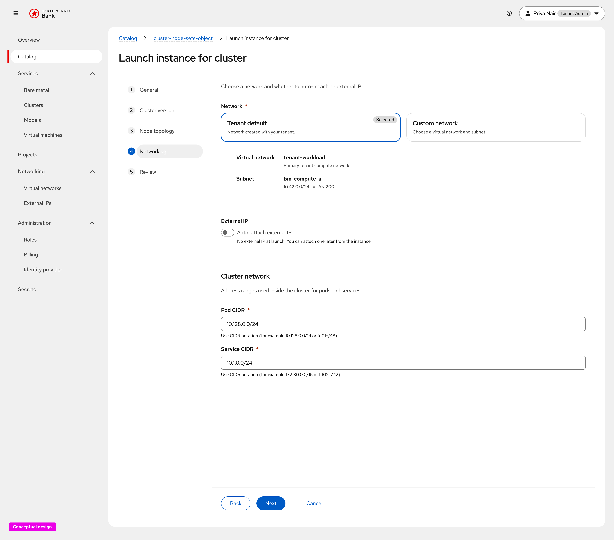
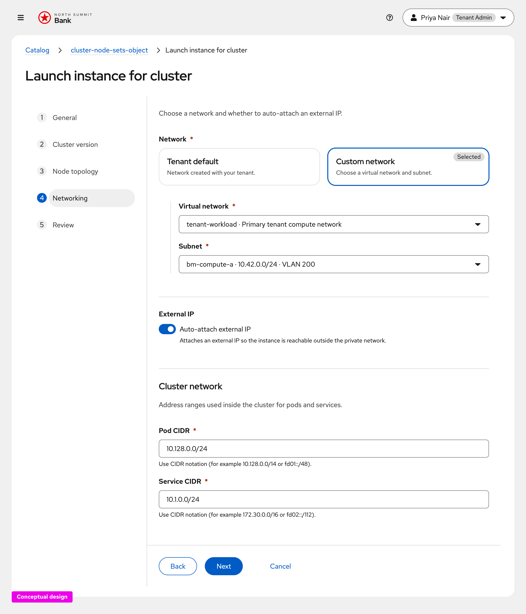
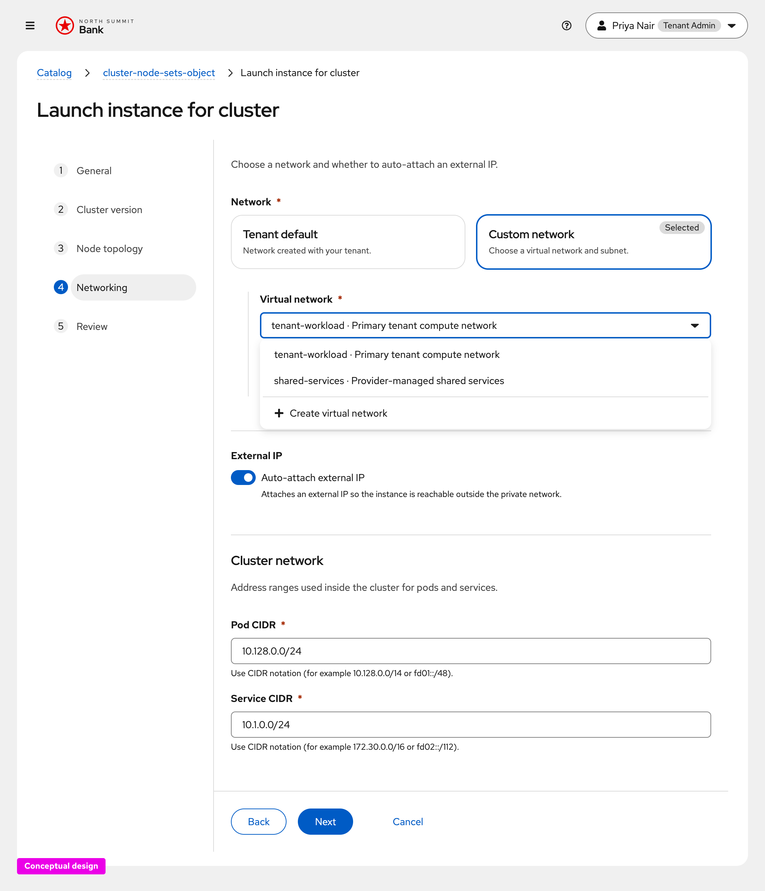
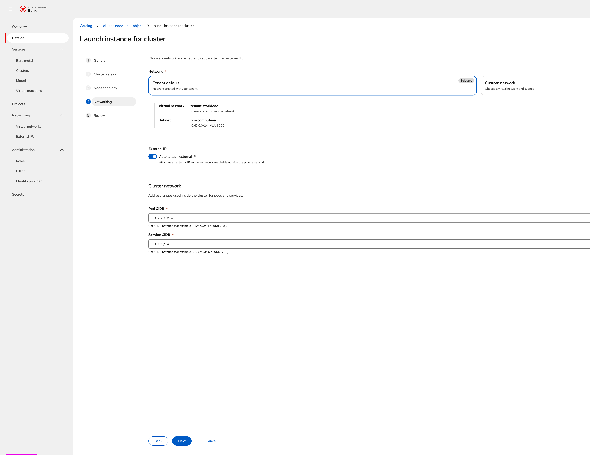

# CaaS Networking — UX Design

Conceptual UX for the **cluster launch → Networking** step
([OSAC-1436](https://redhat.atlassian.net/browse/OSAC-1436)), captured from the
[prototype](https://heyethankim.github.io/osac-bmaas/tenant-admin/northsummit/workspace?nav=catalog&action=launch-instance&item=cluster-node-sets-object&step=networking).

Requirements: [prd.md](prd.md). Implementation addendum: [ui-design.md](ui-design.md).

Security Groups are intentionally omitted from this UX; server defaults apply.
Follow-up will remove Security Group picker guidance from [ui-design.md](ui-design.md).

Per [prd.md](prd.md) FR-3, **Auto-attach external IP defaults to off** (opt-in).

---

## 1. Tenant default

Default path: place the cluster on the tenant default network without picking
resources ([prd.md](prd.md) FR-2). The card shows the resolved virtual network
and subnet as a read-only summary. **Auto-attach external IP is off.**

---

## 2. Custom network

Explicit placement: Virtual network → Subnet cascading pickers for a singular
cluster `network_attachment` ([prd.md](prd.md) FR-1). Supports co-locating or
isolating clusters across virtual networks (Tenant Admin stories in the PRD).

---

## 3. Virtual network picker

Lists tenant virtual networks (`name · description`) and offers
**+ Create virtual network** without leaving the wizard.

---

## 4. Auto-attach external IP (on)

Optional create-time request to auto-provision ExternalIPs for the cluster API
and ingress endpoints ([prd.md](prd.md) FR-3). When the tenant turns it **on**,
the platform attaches an external IP so the cluster is reachable outside the
private network.

Helper copy: *“Attaches an external IP so the instance is reachable outside
the private network.”*

