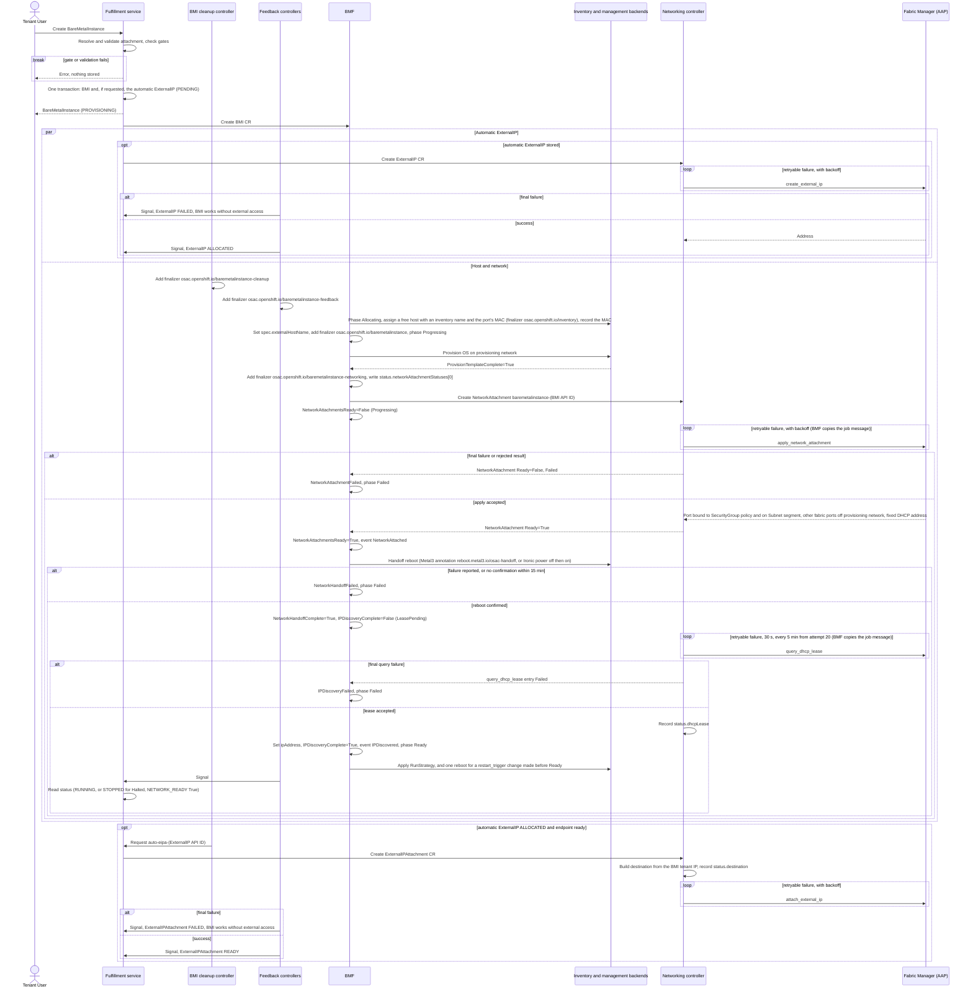
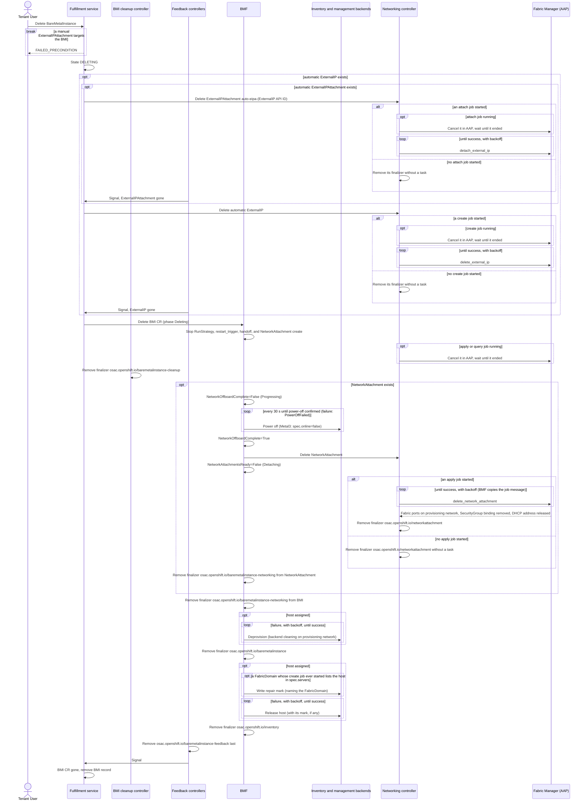

# BMaaS Networking

## Contents

- [Summary](#summary)
- [Motivation](#motivation)
  - [Goals](#goals)
  - [Non-Goals](#non-goals)
- [Proposal](#proposal)
  - [Workflow Description](#workflow-description)
    - [Create](#create)
    - [Delete](#delete)
    - [External access](#external-access)
  - [API Extensions](#api-extensions)
  - [UX Alignment](#ux-alignment)
  - [Implementation Details/Notes/Constraints](#implementation-detailsnotesconstraints)
    - [Network attachment and validation](#network-attachment-and-validation)
    - [Network planes](#network-planes)
    - [BareMetalInstanceType and interface selection](#baremetalinstancetype-and-interface-selection)
    - [Provisioning network and port moves](#provisioning-network-and-port-moves)
    - [NetworkAttachment and address discovery](#networkattachment-and-address-discovery)
    - [CaaS workers](#caas-workers)
    - [Repair mark](#repair-mark)
    - [Network status and phase](#network-status-and-phase)
    - [ExternalIPAttachment target `baremetal_instance`](#externalipattachment-target-baremetal_instance)
    - [Automatic external access](#automatic-external-access)
    - [Provider networking disabled](#provider-networking-disabled)
    - [Component responsibilities](#component-responsibilities)
    - [Workload service design checklist](#workload-service-design-checklist)
  - [Security Considerations](#security-considerations)
  - [Failure Handling and Recovery](#failure-handling-and-recovery)
  - [RBAC / Tenancy](#rbac--tenancy)
  - [Observability and Monitoring](#observability-and-monitoring)
  - [Risks and Mitigations](#risks-and-mitigations)
  - [Drawbacks](#drawbacks)
- [Edge cases that need handling](#edge-cases-that-need-handling)
  - [Restarts and job tracking](#restarts-and-job-tracking)
  - [Delete races](#delete-races)
  - [Handoff](#handoff)
- [Alternatives (Not Implemented)](#alternatives-not-implemented)
- [Test Plan](#test-plan)
  - [Coverage by tier and owner](#coverage-by-tier-and-owner)
  - [Unit Tests](#unit-tests)
  - [Integration Tests](#integration-tests)
  - [E2E Tests](#e2e-tests)
  - [Coverage gaps and edge-case tests](#coverage-gaps-and-edge-case-tests)
- [Graduation Criteria](#graduation-criteria)
- [Upgrade and Downgrade Strategy](#upgrade-and-downgrade-strategy)
- [Version Skew Strategy](#version-skew-strategy)
- [Support Procedures](#support-procedures)
- [Infrastructure Needed](#infrastructure-needed)

## Summary

This design connects a BareMetalInstance (BMI) to its tenant Subnet. The host is provisioned on a provider-managed provisioning network; then the Fabric Manager moves the selected port to the Subnet segment, the host reboots once, and OSAC reads its DHCP lease. [Unified Networking](/enhancements/OSAC-1433-unified-networking/design.md) owns shared resources, gates, guards, and support boundaries; the [Network Manager Integration Contract](/enhancements/OSAC-1433-network-manager-integration-contract-networking/design.md) ("the contract") owns tasks, retries, and cleanup. Requirements: [PRD](prd.md).

## Motivation

A VM gets its interface from hub Kubernetes networking. A bare-metal NIC plugs into a physical switch port, so that port must join the Subnet's segment, after the host is imaged on another network (G2, G4).

### Goals

- **G1 OS-agnostic addressing.** Every address comes from DHCP; no per-OS network configuration; exactly one default route at any time.
- **G2 Provisioning connectivity.** During inspection, provisioning, and cleaning, the host reaches its image source and the Ironic conductor.
- **G3 Minimal final state.** After provisioning, the host is on exactly one tenant Subnet segment and off the provisioning network.
- **G4 Isolated until ready.** The tenant reaches the host only when it is provisioned and on its final network; provisioning traffic never crosses the tenant network.
- **G5 Stock Metal3 and any conforming Fabric Manager.** The bare-metal-fulfillment-operator (BMF) never calls a switch or DHCP API; the networking controller runs every provider task.

### Non-Goals

- VMaaS networking; CaaS networking beyond worker BMIs ([CaaS workers](#caas-workers)).
- More than one network attachment per BMI, NIC bonding, or failover.
- Creating the provisioning network and each host's initial attach (deployment prerequisites).
- Re-provisioning a Ready BMI in place: provisioning inputs are immutable; recreate the BMI to change the OS.
- Ironic standalone networking or a dedicated provisioning NIC.
- Enabling BMaaS on a deployment that already has networking resources ([Unified — Subnet address plan](/enhancements/OSAC-1433-unified-networking/design.md#subnet-address-plan)).
- Keeping the tenant OS off the provisioning network: Metal3 boots the new OS once at the end of provisioning, before the port move (a follow-up feature reduces provisioning to one boot).

## Proposal

The fulfillment service validates and stores the network attachment. BMF provisions the host and creates one NetworkAttachment CR; the networking controller runs the Fabric tasks on it. BMF then reboots the host once onto the tenant network and reports the discovered address.

### Workflow Description

Actors: the Tenant User and the [components](#component-responsibilities). The inventory backend (Metal3, Ironic, NVIDIA Base Command Manager (BCM), or NetBox) holds each host's port-name-to-MAC map and repair mark. The management backend powers the host: Metal3 (also for BCM and NetBox hosts, [OSAC-1339](/enhancements/OSAC-1339-bcm-backend/design.md), [OSAC-1610](/enhancements/OSAC-1610-netbox-inventory/design.md)) or Ironic. AAP templates install the OS. RunStrategy (`run_strategy`: `Always`, the default, or `Halted`) is the requested power state; each change of the counter `restart_trigger` requests one reboot.

Starting state: provider networking enabled; READY tenant default networking ([Default Networking](/enhancements/OSAC-1433-default-networking/design.md)); a NetworkClass selecting a conformant Fabric Manager; every free host's fabric ports on the provisioning network.

#### Create

1. The Tenant User creates the BMI:
   ```bash
   osac create baremetalinstance --catalog-item bcm-h100 --name my-server \
     --network-attachment subnet=my-subnet,interface=data-0,security-groups=web-sg,db-sg
   osac create baremetalinstance --catalog-item bcm-h100 --name my-server2 --external-ip-attachment
   ```
   Form 1 picks a Subnet, port `data-0`, and two SecurityGroups (syntax: `--network-attachment [subnet=<name or ID>][,interface=<port>][,security-groups=<name or ID>,...]`, each part optional, `security-groups=` last). Form 2 uses the tenant defaults and requests automatic external access (`auto_external_ip_attachment`). The CLI rejects a second `--network-attachment`.
2. The fulfillment service validates the attachment ([Network attachment and validation](#network-attachment-and-validation)); a failure stores nothing. In one transaction it stores the BMI and, if requested with provider networking enabled, one automatic ExternalIP ([Automatic external access](#automatic-external-access)), then creates their CRs; the BMI CR carries `spec.networkAttachments`.
3. The BareMetalInstance cleanup and feedback controllers add `osac.openshift.io/baremetalinstance-cleanup` and `osac.openshift.io/baremetalinstance-feedback`. BMF sets phase `Allocating`, assigns a free host (finalizer `osac.openshift.io/inventory`) that has an inventory name and a valid MAC for the selected port ([interface selection](#baremetalinstancetype-and-interface-selection)), records that MAC in `status.networkAttachmentStatuses[0].macAddress`, sets `spec.externalHostName` to the host's inventory name, and adds its management finalizer `osac.openshift.io/baremetalinstance`. In phase `Progressing`, AAP provisions the OS on the provisioning network (DHCP, no static address); then `ProvisionTemplateComplete=True`.
4. BMF adds `osac.openshift.io/baremetalinstance-networking`, writes the rest of `status.networkAttachmentStatuses[0]`, creates the NetworkAttachment with the recorded MAC ([NetworkAttachment and address discovery](#networkattachment-and-address-discovery)), and sets `NetworkAttachmentsReady=False`, reason `Progressing`.
5. The networking controller runs Fabric `apply_network_attachment`, again after each retryable failure; BMF copies the job message. The Fabric Manager binds the port to the policy objects of its SecurityGroups, moves the port to the Subnet segment, takes the other fabric ports off the provisioning network, and keeps one fixed DHCP address for the port's MAC. When OSAC accepts the result, the NetworkAttachment is Ready; BMF sets `NetworkAttachmentsReady=True` (event `NetworkAttached`). A final failure sets `NetworkAttachmentFailed` and phase `Failed`.
6. BMF requests one handoff reboot through the management backend (`NetworkHandoffComplete=False`), ignoring RunStrategy and `restart_trigger`; a host that is off is powered on.
   - **Metal3 (also BCM and NetBox hosts).** One update sets `spec.online=true` and the BareMetalHost annotation `reboot.metal3.io/osac-handoff` with value `{"mode":"hard"}` (the tenant has not used the host yet); BMF writes reason `Progressing`. Metal3 powers the host off and keeps it off while the annotation exists. When `status.poweredOn=false`, BMF removes the annotation and Metal3 powers the host on. The reboot is confirmed when the annotation is gone and `status.poweredOn=true`.
   - **Ironic.** BMF writes `PoweringOff` and requests power off; once off is reported, it writes `PoweringOn` and requests power on; the reboot is confirmed when on is reported. Every 30 seconds BMF repeats the (idempotent) call until the state matches; a busy reply (node locked or in transition) is not a failure.

   On confirmation: `NetworkHandoffComplete=True`, `IPDiscoveryComplete=False` (`LeasePending`), and the OS requests its tenant address over DHCP. The handoff fails (`NetworkHandoffFailed`, phase `Failed`) when the backend reports a failure ([Network status and phase](#network-status-and-phase)), or when there is no confirmation within 15 minutes of `NetworkAttachmentsReady=True`.
7. The networking controller watches BMIs and checks each one's NetworkAttachment on each BMI event and every 30 seconds. Once it observes `NetworkHandoffComplete=True` (a provisioning-network lease or a successful apply is not discovery), it runs Fabric `query_dhcp_lease`, retrying per [contract §4.7](/enhancements/OSAC-1433-network-manager-integration-contract-networking/design.md#47-ordering-concurrency-retries-and-ownership) (after 30 seconds, and every 5 minutes from the 20th attempt), and records the accepted lease in NetworkAttachment `status.dhcpLease`. BMF copies each job message into `LeasePending`. With no lease 10 minutes after the handoff, BMF emits the Warning event `LeaseNotFound`; queries continue.
8. BMF copies the address into `status.networkAttachmentStatuses[0].ipAddress`, sets `IPDiscoveryComplete=True` (event `IPDiscovered`) and phase `Ready`, and only then applies RunStrategy and any `restart_trigger` change made before Ready (one reboot). On the feedback controller's signal, the fulfillment service reads the status: state RUNNING (STOPPED for `Halted`), `NETWORK_READY` `True`, reason `IPDiscovered`.
9. With an automatic ExternalIP, the cleanup controller requests the automatic ExternalIPAttachment (Fabric `attach_external_ip`; [Automatic external access](#automatic-external-access)).

Final failures stop the flow ([Network status and phase](#network-status-and-phase)).



#### Delete

1. The [deletion guard](/enhancements/OSAC-1433-unified-networking/design.md#deletion-dependency-guards) rejects the delete with `FAILED_PRECONDITION` while a manually created ExternalIPAttachment targets the BMI; otherwise the state becomes DELETING. A Delete of a DELETING BMI returns OK ([Unified](/enhancements/OSAC-1433-unified-networking/design.md#status)).
2. The fulfillment service deletes the automatic ExternalIPAttachment, then the automatic ExternalIP, then the BMI CR, in the [Unified order](/enhancements/OSAC-1433-unified-networking/design.md#automatic-external-access). Jobs and retries follow [contract §4.7](/enhancements/OSAC-1433-network-manager-integration-contract-networking/design.md#47-ordering-concurrency-retries-and-ownership). The phase becomes `Deleting`.
3. From the deletionTimestamp on, BMF applies no RunStrategy or `restart_trigger`, requests no handoff and creates no NetworkAttachment; the networking controller starts no apply or query job and cancels a running one ([contract §4.7](/enhancements/OSAC-1433-network-manager-integration-contract-networking/design.md#47-ordering-concurrency-retries-and-ownership)). BMF waits for the cleanup controller to remove its finalizer. With no host assigned (`spec.externalHostName` empty), BMF skips deprovisioning and the release (steps 7 and 8).
4. If the NetworkAttachment exists, BMF sets `NetworkOffboardComplete=False` (`Progressing`) and powers the host off while it is still on the tenant network (Metal3: `spec.online=false`). When the power-off is confirmed (at once if already off), it sets `NetworkOffboardComplete=True`. With no NetworkAttachment (always with [provider networking disabled](#provider-networking-disabled)), no tenant network is attached: BMF goes to step 7 without power-off or condition.
5. BMF deletes the NetworkAttachment and sets `NetworkAttachmentsReady=False`, reason `Detaching`. The networking controller runs Fabric `delete_network_attachment` until it succeeds, unless no apply job ever started; BMF copies the job message. The task returns all the host's fabric ports to the provisioning network, removes the policy and releases the DHCP address. Then the networking controller removes its finalizer.
6. With only BMF's finalizer left, BMF removes it.
7. With no NetworkAttachment left, BMF removes `osac.openshift.io/baremetalinstance-networking` from the BMI. The AAP deprovisioning job cleans the host on the provisioning network, never booting the tenant OS. Then BMF removes `osac.openshift.io/baremetalinstance`.
8. If a FabricDomain whose `create_fabric_domain` ever started lists the host in `spec.servers`, BMF writes the [repair mark](#repair-mark), naming the FabricDomain, before release. BMF releases the host (with any mark) and removes `osac.openshift.io/inventory`. Selection skips a marked host until the [repair procedure](#support-procedures) deletes the mark. The feedback controller removes its finalizer last, as [Unified](/enhancements/OSAC-1433-unified-networking/design.md#hub-crs) defines, and the fulfillment service removes the record.

Each step waits for the previous one. A failed step keeps its finalizer, and the host stays owned. Deprovisioning and release are the BMaaS host lifecycle ([OSAC-1118](/enhancements/OSAC-1118-baremetal-instance-api/README.md)). A host provisioning job still running at the deletionTimestamp is cancelled, and deprovisioning starts after AAP reports it ended; BMF retries a failed deprovisioning job or release with the [contract §4.7](/enhancements/OSAC-1433-network-manager-integration-contract-networking/design.md#47-ordering-concurrency-retries-and-ownership) backoff until it succeeds. Tenant default networking resources stay.



#### External access

A Tenant User exposes a ready BMI through an ExternalIP:

```bash
osac create externalip --pool external-pool-1 --name my-ip
osac create externalipattachment --externalip my-ip --baremetal-instance my-server --name bm-att
```

Rules: [ExternalIPAttachment target](#externalipattachment-target-baremetal_instance). Once stored, the networking controller runs Fabric `attach_external_ip`. `--external-ip-attachment` automates this ([Automatic external access](#automatic-external-access)).

### API Extensions

- **fulfillment-service, BareMetalInstance:** `spec.network_attachments` (repeated `BareMetalNetworkAttachment`, at most one), `spec.auto_external_ip_attachment`, `status.network_attachment_statuses` (protos below; [validation](#network-attachment-and-validation)); condition type `BARE_METAL_INSTANCE_CONDITION_TYPE_NETWORK_READY = 7` in the public and private `BareMetalInstanceConditionType` ([Network status and phase](#network-status-and-phase)).
- **fulfillment-service, BareMetalInstanceType:** `hardware_spec.network_ports` ([OSAC-1201](/enhancements/OSAC-1201-baremetal-instance-types/design.md)).
- **fulfillment-service, ExternalIPAttachment:** target `baremetal_instance` (Unified; endpoint [here](#externalipattachment-target-baremetal_instance)).
- **BMF BareMetalInstance CRD:** `spec.networkAttachments`, `status.networkAttachmentStatuses`, the [conditions](#network-status-and-phase), and the finalizer `osac.openshift.io/baremetalinstance-networking` (on the BMI and its NetworkAttachment). Networking jobs are recorded only in the NetworkAttachment `status.jobs`.
- **Inventory:** the per-host port-name-to-MAC map ([BareMetalInstanceType and interface selection](#baremetalinstancetype-and-interface-selection)) and the [repair mark](#repair-mark).
- **osac-operator:** the networking controller reconciles physical NetworkAttachments, ExternalIPs, and ExternalIPAttachments and watches BareMetalInstances; BareMetalInstance cleanup and feedback controllers ([Component responsibilities](#component-responsibilities)).
- **Controllers down.** No BMF: no host provisioning and no NetworkAttachment. No networking controller: BMIs stay `Progressing`; deletes wait for the NetworkAttachment. No cleanup controller: no automatic ExternalIPAttachment; deletes wait for its finalizer. No feedback controller: API status freezes and deleted BMI records stay.

```protobuf
message BareMetalNetworkAttachment {
  SubnetLocalReference subnet = 1;                          // optional on input; immutable
  repeated SecurityGroupLocalReference security_groups = 2; // optional on input; immutable
  optional string interface = 3;                            // port name; default: first fabric port
  optional bool primary = 4;                                // omitted or true; false is rejected
}
message BareMetalInstanceSpec {
  // ... other fields ...
  repeated BareMetalNetworkAttachment network_attachments = 8; // immutable; at most one
  optional bool auto_external_ip_attachment = 9;               // immutable
}
message BareMetalNetworkAttachmentStatus {
  string interface = 1;
  string subnet_ref = 2;  // Subnet API ID
  string ip_address = 3;  // tenant address from the accepted lease
  bool primary = 4;       // always true
}
```

The single attachment is the host's default route, so `primary` carries no choice. The BMF CRD mirrors these fields as `spec.networkAttachments[]` (`subnetRef`, `securityGroupRefs`, `interface`, `primary`; refs hold API IDs, never names) and `status.networkAttachmentStatuses[]`. CEL rules make the list and every field immutable and cap the list at one entry. To change the network, delete and recreate the BMI.

### UX Alignment

The UI uses these fields. The bare-metal create wizard uses the [bare-metal adapter of the shared network attachment pickers](/enhancements/OSAC-1433-unified-networking/ui-design.md#workload-network-attachment-pickers): READY Subnets and SecurityGroups of one VirtualNetwork, and the type's `fabric` ports as interfaces (first is default). The UI shows the network conditions and the tenant IP.

### Implementation Details/Notes/Constraints

#### Network attachment and validation

Fields: [API Extensions](#api-extensions).

The fulfillment service applies the [Unified defaulting table](/enhancements/OSAC-1433-unified-networking/design.md#network-attachment-field-presence-and-defaulting), [creation readiness gates](/enhancements/OSAC-1433-unified-networking/design.md#creation-readiness-gates), and [error codes](/enhancements/OSAC-1433-unified-networking/design.md#error-codes), plus these checks:

| Check | Error |
|---|---|
| `primary: false` | `INVALID_ARGUMENT` |
| `interface` fails [BareMetalInstanceType and interface selection](#baremetalinstancetype-and-interface-selection) (against `instance_type` or the type from the catalog item or template), or no type resolves | `INVALID_ARGUMENT` |
| Update of `network_attachments` or `auto_external_ip_attachment` | `INVALID_ARGUMENT` |

A `system`-tenant BMI (CaaS worker) passes the [CaaS worker check](#caas-workers) instead of the interface check. When the fulfillment service builds the BMI CR, it copies the resolved attachment into it.

#### Network planes

The BMC network (Redfish or IPMI: power, virtual media) is a deployment prerequisite outside the fabric attachment. The provisioning network carries host DHCP, image download, and the Ironic Python Agent (IPA) callback, in-band on the fabric ports. The tenant network is the Subnet segment. The Fabric Manager moves fabric ports between the last two and never touches the BMC network. Which host ports are fabric ports: [contract §4.10](/enhancements/OSAC-1433-network-manager-integration-contract-networking/design.md#fabric-apply_network_attachment--delete_network_attachment).

#### BareMetalInstanceType and interface selection

The BareMetalInstanceType ([OSAC-1201](/enhancements/OSAC-1201-baremetal-instance-types/design.md)) lists the host's ports in order:

```protobuf
message BareMetalNetworkPortSpec {
  string name = 1;  // unique within the type, e.g. "data-0"
  string role = 2;  // port role, e.g. fabric, management, storage, lifecycle
  string type = 3;  // informational, e.g. "Ethernet"
  string speed = 4; // informational, e.g. "100Gbps"
}
```

- OSAC-1201 owns the role field. Example roles: `fabric` (tenant traffic), `management` (in-band control), `storage`, `lifecycle` (BMC/PXE port).
- A type with no `fabric` port, or a selected port that is not a `fabric` port in `network_ports`: `INVALID_ARGUMENT`. Default: the first `fabric` port.
- CaaS workers skip both checks ([CaaS workers](#caas-workers)).

The port name is the key in `BareMetalNetworkAttachment.interface`, the NetworkAttachment CR, task input `network_attachment.interface.name`, and each host's inventory map, a JSON object `{"<port name>": "<mac>"}`:

- Metal3: the BareMetalHost annotation `osac.openshift.io/interface-macs`;
- Ironic: node `extra["osac_interface_macs"]`;
- BCM: device `extra_values["osac_interface_macs"]`, a JSON object, or a JSON string holding one;
- NetBox: device `custom_fields.osac_interface_macs` ([OSAC-1610](/enhancements/OSAC-1610-netbox-inventory/design.md)).

BMF accepts `:` or `-` separators in any case and writes MACs lowercase with `:`. An invalid MAC entry is malformed; invalid JSON makes every entry malformed.

Not supported in this release: hosts without an inventory name, or without a valid MAC for the selected fabric port in the inventory map. With provider networking enabled, BMF host selection skips such a host and logs "host <name> skipped: no inventory name" or "host <name> skipped: no valid MAC for port <port>".

#### Provisioning network and port moves

A provider-managed provisioning network (DHCP, gateway, SNAT) holds every host's fabric ports while the host is idle and during provisioning and cleaning; deployment bootstrap puts each host there. It is not an OSAC Subnet and not task input: it exists only in the Fabric Manager's backend and configuration, under the same name used at bootstrap. Without it, an unassigned host has no default gateway and IPA cannot download its image.

The port moves ([Create](#create), step 5; [Delete](#delete), step 5) follow OS provisioning, so the tenant cannot reach the host during imaging or first boot (G4); first-boot egress uses the isolated provisioning network ([Security Considerations](#security-considerations)). BMF does not depend on which network carries the IPA callback (Metal3 `Provisioning` CR configuration).

#### NetworkAttachment and address discovery

BMF creates one NetworkAttachment per BMI in the hub networking namespace ([Unified — NetworkAttachment](/enhancements/OSAC-1433-unified-networking/design.md#networkattachment)):

- name `baremetalinstance-<BMI API ID>`; BMF and the networking controller find the BMI for an API ID by its label `osac.openshift.io/baremetalinstance-uuid`;
- annotation `osac.openshift.io/tenant` from the BMI (`system` for CaaS workers);
- finalizers: BMF's `osac.openshift.io/baremetalinstance-networking` and the networking controller's `osac.openshift.io/networkattachment` ([Delete](#delete), steps 5 and 6);
- `target` = `{kind: BareMetalInstance, id: <BMI API ID>}`;
- `subnet` and `securityGroups` = the API IDs in `spec.networkAttachments[0]`;
- `interface` = `{type: physical, name: <spec.networkAttachments[0].interface>, macAddress: <recorded MAC>}`.

BMF resolves the MAC once, at host assignment ([BareMetalInstanceType and interface selection](#baremetalinstancetype-and-interface-selection)), and records it as `macAddress` (CRD only) in `status.networkAttachmentStatuses[0]`. It writes `interface`, `subnetRef`, and `primary: true` there before it creates the NetworkAttachment, and `ipAddress` at discovery. No host-name or interface-name fallback exists, also for CaaS workers.

The networking controller runs the three Fabric tasks on the manager in `status.networkManagers.fabric` ([contract §4.10](/enhancements/OSAC-1433-network-manager-integration-contract-networking/design.md#410-task-reference)), with `target` `{kind: BareMetalInstance, id, host_name}`. `host_name` is `spec.externalHostName` ([contract](/enhancements/OSAC-1433-network-manager-integration-contract-networking/design.md#fabric-apply_network_attachment--delete_network_attachment)), as the Fabric Manager's switch-port map uses it ([Infrastructure Needed](#infrastructure-needed)). BMF never launches a port-move or lease job; it copies the latest job message from `status.jobs` into its conditions.

Address discovery ([Create](#create), step 7):

- Lease acceptance and final failure: [contract — `query_dhcp_lease`](/enhancements/OSAC-1433-network-manager-integration-contract-networking/design.md#fabric-query_dhcp_lease). Queries never change NetworkAttachment `Ready`, so `NetworkAttachmentsReady` stays `True`.
- The Fabric DHCP keeps the MAC's address while the NetworkAttachment exists, so discovery runs once.
- Physical address range: [contract §4.8](/enhancements/OSAC-1433-network-manager-integration-contract-networking/design.md#48-addressing); sizing: [Risks](#risks-and-mitigations).

#### CaaS workers

CaaS worker BMIs use the same flow, in tenant `system`, with the annotation `osac.openshift.io/cluster-api-id: <Cluster API ID>` and the node set's stored `fabric_interface` as `interface`. Instead of the port check, the fulfillment service checks the worker's Subnet, SecurityGroups, and interface against what the Cluster authorizes ([CaaS worker network authorization](/enhancements/OSAC-1436-caas-networking/design.md#caas-worker-network-authorization)). The SecurityGroups include the Cluster's [automatic SecurityGroup](/enhancements/OSAC-1436-caas-networking/design.md#automatic-cluster-securitygroup); attachment tasks carry tenant `system`. The [CaaS design](/enhancements/OSAC-1436-caas-networking/design.md) defines the rest.

#### Repair mark

A repair mark keeps a released host out of selection until the Cloud Provider Admin repairs it ([Support Procedures](#support-procedures)). BMF writes it when a FabricDomain lists the host ([Delete](#delete), step 8). BMF's inventory client writes the mark and its details:

| Backend | Mark | Details |
|---|---|---|
| Metal3 | BareMetalHost label `osac.openshift.io/network-repair-required: "true"` | BareMetalHost annotation `osac.openshift.io/network-repair-details` |
| Ironic | Node `extra["osac_network_repair_required"]` | Node `extra["osac_network_repair_details"]` |
| BCM | Device `extra_values["osac_network_repair_required"]` | Device `extra_values["osac_network_repair_details"]` |
| NetBox | Device custom field `osac_network_repair_required` | Device custom field `osac_network_repair_details` |

The details are JSON `{baremetalInstance, subnet, interface, fabricDomains}` with API IDs; `subnet` and `interface` come from `spec.networkAttachments[0]` (empty without one).

#### Network status and phase

"Phase" means only the BMI `status.phase`: `Allocating`, `Progressing`, `Ready`, `Failed`, or `Deleting`. BMF sets these network conditions on the BMI:

| Condition | True when | `False` reasons |
|---|---|---|
| `NetworkAttachmentsReady` | The NetworkAttachment is Ready. | `Progressing`: apply running or retrying; latest apply job message. `NetworkAttachmentFailed`: final apply failure; the NetworkAttachment `Ready` message (the manager's message, or why OSAC failed the apply); phase `Failed`. `Detaching`: NetworkAttachment deleting; latest `delete_network_attachment` job message. |
| `NetworkHandoffComplete` | Handoff reboot confirmed; never reset. | `Progressing`: reboot requested. `PoweringOff` / `PoweringOn`: Ironic step requested. `NetworkHandoffFailed`: reported failed or not confirmed in time; phase `Failed`. |
| `IPDiscoveryComplete` | The accepted lease is mirrored into `ipAddress`. | `LeasePending`: from `NetworkHandoffComplete=True` on; phase stays `Progressing`; message and AAP job ID of the latest `query_dhcp_lease` entry in `status.jobs`, once one exists. `IPDiscoveryFailed`: that entry is `Failed`; phase `Failed`. |
| `NetworkOffboardComplete` | During delete, power-off is confirmed while still on the tenant network. | `Progressing`: powering off. `PowerOffFailed`: reported failed, with the backend's message; retried every 30 seconds. |

Backend failure signal for a reboot or power-off: Metal3 (also BCM and NetBox hosts), BareMetalHost `status.operationalStatus=error`, `status.errorType=power management error` and `status.errorMessage`; Ironic, the node's `last_error` from the power action.

The phase is `Ready` only when the first three conditions are `True`. BMF never reports a tenant IP before that, nor ever the provisioning-network address. During a delete, the phase is `Deleting`.

The fulfillment service maps these conditions to the API condition `NETWORK_READY` when it reads the BMI status. It checks `NetworkOffboardComplete` (only once set), `NetworkAttachmentsReady`, `NetworkHandoffComplete`, and `IPDiscoveryComplete` in order and copies the status, reason, and message of the first that is not `True`; an unset condition gives `False`, `Progressing`. If all are `True`: reason `ProvisioningDisabled` with the first such message when any condition has it ([Provider networking disabled](#provider-networking-disabled)), else `IPDiscovered`. A BMI that fails before any network condition (host assignment or OS provisioning) has no `NETWORK_READY`.

Once the delete is accepted, the API state is DELETING, whatever the phase ([Unified](/enhancements/OSAC-1433-unified-networking/design.md#status)). Before that, and before phase `Ready`, it is PROVISIONING (FAILED for phase `Failed`). The handoff power calls do not update BMF's power-state condition `PowerSynced`, so the tenant never sees STOPPING, STARTING, or RUNNING during the handoff.

#### ExternalIPAttachment target `baremetal_instance`

| Item | BMaaS definition |
|---|---|
| Endpoints | One per BMI. `target_endpoint` other than `UNSPECIFIED`: `INVALID_ARGUMENT`. |
| Endpoint ready | Fulfillment service: API state RUNNING, `ip_address` set, not being deleted; else `FAILED_PRECONDITION`. The cleanup controller tests the hub CR: phase `Ready`, `status.networkAttachmentStatuses[0].ipAddress` set, no deletionTimestamp, `status.runStrategy=Always` (BMF's observed power state). A stopped (`Halted`) BMI is not ready. |
| `destination.address` | The BMI tenant IP (`ipAddress`). While empty, the ExternalIPAttachment stays PENDING and no job starts. |
| `destination.routing_domain` | `{type: tenant_virtual_network, virtual_network_id: <VirtualNetwork API ID of the BMI's Subnet>, subnet_id: <BMI's Subnet API ID>}`. |
| Automatic access | One endpoint, the BMI ([Automatic external access](#automatic-external-access)). |

#### Automatic external access

`auto_external_ip_attachment: true` requests one endpoint, the BMI. Shared rules, including labels and when the recheck stops: [Unified](/enhancements/OSAC-1433-unified-networking/design.md#automatic-external-access).

The cleanup controller requests the ExternalIPAttachment `auto-eipa-<ExternalIP API ID>` through the fulfillment private API once the automatic ExternalIP is ALLOCATED and the [endpoint is ready](#externalipattachment-target-baremetal_instance), and retries a `FAILED_PRECONDITION` reply (status not copied yet) at the 30-second recheck. BMI readiness never waits for it; if automatic access fails, the BMI works without it.

#### Provider networking disabled

Shared rules: [Unified — Provider networking control](/enhancements/OSAC-1433-unified-networking/design.md#provider-networking-control). With provider networking disabled, OSAC runs no networking job and hosts still provision. BMF reads the deployment setting and uses this fallback:

- Inventory, power, OS provisioning, and deprovisioning run as usual, with the host on the provisioning network throughout. RunStrategy `Always` still powers it on.
- No MAC recording, NetworkAttachment, handoff, or lease query. After `ProvisionTemplateComplete=True`, BMF sets `NetworkAttachmentsReady`, `NetworkHandoffComplete`, and `IPDiscoveryComplete` to `True`, reason `ProvisioningDisabled`, with a message naming the skipped operation; phase `Ready` then attests only OS provisioning, and BMF applies RunStrategy and any `restart_trigger` change made before Ready (one reboot). `status.networkAttachmentStatuses` stays empty, so no provisioning address is shown as a tenant IP.
- Delete finds no NetworkAttachment and skips the power-off ([Delete](#delete), step 4).
- No repair mark: no FabricDomain task ever ran.

#### Component responsibilities

BMaaS uses the NetworkClass's Fabric Manager and runs no Kubernetes Manager task for its NetworkAttachment, also when the deployment selects one, because the Kubernetes Manager has no enforcement point on a physical port ([Unified](/enhancements/OSAC-1433-unified-networking/design.md#deployment-support-boundary), [contract §4.10](/enhancements/OSAC-1433-network-manager-integration-contract-networking/design.md#410-task-reference)). A provider may implement the Fabric tasks with its own switch, router, and DHCP APIs; BMF uses the same gates either way.

| Component | Responsibility |
|---|---|
| fulfillment-service | Validation, gates, and guards; the BMI CR and automatic resources. |
| BMF | Inventory, OS provisioning, power, MAC resolution, NetworkAttachment create and delete, handoff, offboard power-off, repair mark, status mirroring, the disabled fallback. Never calls a manager. |
| Networking controller | Runs every BMaaS manager task; builds `destination`; reports status. |
| Fabric Manager | Binds ports to SecurityGroup policy objects, moves ports, serves DHCP, and returns the selected MAC's lease; restores the ports on delete. Never reboots the host. |
| osac-operator BareMetalInstance cleanup controller | Adds its finalizer on first reconcile of every BMI with the API ID label; requests the automatic ExternalIPAttachment; on delete, removes its finalizer once no automatic CR for the BMI remains, deleting none ([Unified](/enhancements/OSAC-1433-unified-networking/design.md#automatic-external-access)). |
| osac-operator BareMetalInstance feedback controller | Adds its finalizer on first reconcile; signals the fulfillment service on status changes and after it removes its finalizer; removes its finalizer last ([Unified](/enhancements/OSAC-1433-unified-networking/design.md#hub-crs)). |

BMF and osac-operator act on the same BMI CR and coordinate only through conditions, NetworkAttachment status, finalizers, and the repair mark.

#### Workload service design checklist

| [Checklist](/enhancements/OSAC-1433-unified-networking/design.md#workload-service-design-checklist) item | BMaaS |
|---|---|
| Network attachment field and target identity | [Network attachment and validation](#network-attachment-and-validation); [NetworkAttachment](#networkattachment-and-address-discovery) `target` |
| Interface-selection field and default | [BareMetalInstanceType](#baremetalinstancetype-and-interface-selection) |
| NetworkAttachment owner and timing | BMF ([Workflow](#workflow-description)) |
| Waiting and address reporting | [NetworkAttachment and address discovery](#networkattachment-and-address-discovery), [Network status and phase](#network-status-and-phase) |
| ExternalIPAttachment target: readiness, `destination.address`, `destination.routing_domain` | [ExternalIPAttachment target](#externalipattachment-target-baremetal_instance) |
| Automatic external access field and endpoints | [Automatic external access](#automatic-external-access) |
| Provider networking disabled fallback | [Provider networking disabled](#provider-networking-disabled) |
| Subnet LB VIP range | Not used |

### Security Considerations

- Shared tenancy model: [Unified — RBAC / Tenancy](/enhancements/OSAC-1433-unified-networking/design.md#rbac--tenancy). A `system`-tenant worker is admitted only through the CaaS worker check; private API credentials alone do not authorize a foreign network.
- The port is bound to its SecurityGroups' policy objects before it joins the Subnet segment.
- The tenant OS, with its `user_data`, first boots on the provisioning network and stays there while a port move waits, or for good with provider networking disabled. The provider must isolate hosts there: port isolation or a private VLAN, DHCP snooping so only the provider's DHCP answers, and filters allowing only DHCP, the image source, Ironic, and outbound SNAT, except the traffic a Cluster needs with provider networking disabled ([CaaS](/enhancements/OSAC-1436-caas-networking/design.md#infrastructure-needed)).

### Failure Handling and Recovery

Retries follow [contract §4.6](/enhancements/OSAC-1433-network-manager-integration-contract-networking/design.md#46-task-result-and-errors) and [§4.7](/enhancements/OSAC-1433-network-manager-integration-contract-networking/design.md#47-ordering-concurrency-retries-and-ownership). Restart, race, and partial-failure cases: [Edge cases](#edge-cases-that-need-handling).

| Failure | What the user sees | Recovery |
|---|---|---|
| Apply, handoff, or lease failure | Retryable: phase `Progressing`; final: phase `Failed` ([Network status and phase](#network-status-and-phase)). | Automatic retry; after a final failure BMF does not retry and the tenant deletes the BMI. |
| Automatic ExternalIP or ExternalIPAttachment fails | Shown on that resource only. | Per Unified. |
| A cleanup step fails | Phase `Deleting`; finalizer and host ownership stay; message in `NetworkOffboardComplete` (`PowerOffFailed`) or `NetworkAttachmentsReady` (`Detaching`); deprovisioning and release failures in the BMF log and AAP job. | Retry until success; the provider repairs the backend. Admission rejects removing finalizers by hand ([Unified — Non-Goals](/enhancements/OSAC-1433-unified-networking/design.md#non-goals)). |
| BMI CR or NetworkAttachment deleted or lost outside OSAC | The OSAC admission policy rejects a delete; a loss is unsupported ([Unified — Non-Goals](/enhancements/OSAC-1433-unified-networking/design.md#non-goals)). | None by OSAC. |

### RBAC / Tenancy

- BMF: create, get, list, watch, and delete NetworkAttachments, and update their finalizers, and get, list, and watch FabricDomains, in the hub networking namespace.
- Networking controller: get, list, and watch BareMetalInstances, including status; read VirtualNetworks, Subnets, SecurityGroups, and the NetworkClass; update NetworkAttachment status and finalizers.
- BareMetalInstance cleanup controller: get, list, and watch BareMetalInstances, and update their finalizers; get, list, and watch `externalipattachments` and `externalips` in the hub networking namespace; call the fulfillment private API.
- The fulfillment service checks the network's tenant when it admits the BMI. The networking controller does not check tenants, because worker BMIs are in tenant `system`.
- Manager-job access follows [contract §4.12](/enhancements/OSAC-1433-network-manager-integration-contract-networking/design.md#412-security-rbac-and-tenancy).

### Observability and Monitoring

Kubernetes events on the BMI; each name has one meaning, and an event for a condition reason uses that reason's name. `LeaseNotFound` is an event only.

| Event | Type | When |
|---|---|---|
| `NetworkAttached` | Normal | The NetworkAttachment became Ready. |
| `NetworkAttachmentFailed` | Warning | Final apply failure. |
| `NetworkHandoffFailed` | Warning | The handoff reboot failed or was not confirmed in time. |
| `LeaseNotFound` | Warning | No lease 10 minutes after the handoff; queries continue. |
| `IPDiscoveryFailed` | Warning | Final `query_dhcp_lease` failure. |
| `IPDiscovered` | Normal | The tenant IP was mirrored into status. |

No networking metrics or alerts; the BMaaS provisioning duration and failure metrics apply. Task diagnostics: [contract §7](/enhancements/OSAC-1433-network-manager-integration-contract-networking/design.md#7-observability-and-monitoring). Automatic external access logs: [Unified](/enhancements/OSAC-1433-unified-networking/design.md#observability-and-monitoring).

### Risks and Mitigations

| Risk | Mitigation |
|---|---|
| The Fabric Manager or provisioning network is missing or late. | Enable BMaaS only after the Fabric Manager has a conformant report whose `baremetal` profile passed ([contract §4.11](/enhancements/OSAC-1433-network-manager-integration-contract-networking/design.md#411-conformance-tests)); the follow-up network-behavior tests measure physical policy. |
| Bare-metal ports have only stateless switch ACLs, which the [contract SecurityGroup task](/enhancements/OSAC-1433-network-manager-integration-contract-networking/design.md#fabric-create_security_group--delete_security_group) does not accept. | Put a stateful enforcement point (for example a distributed firewall or a DPU) in each physical interface's path. |
| The physical range is the plan's `fabric` share of the Subnet ([Unified](/enhancements/OSAC-1433-unified-networking/design.md#subnet-address-layout)) and also serves the provider's fabric devices, so it can be small (64 addresses on a /24 with a 0.25 share), also on a Subnet where `cudn_evpn` serves no VMs and the overlay range stays unused ([VMaaS risks](/enhancements/OSAC-1435-vmaas-networking/design.md#risks-and-mitigations)). When it is full, the apply fails finally ([contract](/enhancements/OSAC-1433-network-manager-integration-contract-networking/design.md#fabric-apply_network_attachment--delete_network_attachment)) with `NetworkAttachmentFailed`. | Size such Subnets for bare metal (a /22 with a 0.25 share gives 256 physical addresses). |
| Inventory and BareMetalInstanceType port names differ, so the wrong NIC is moved or queried. | Same names in inventory tooling and type registration; a host without a valid MAC for the port is never assigned. |

### Drawbacks

- The BMF/osac-operator split needs ordered finalizers and status mirroring.
- The handoff adds one reboot to every provisioning.
- Discovery depends on a Fabric DHCP lease API.

## Edge cases that need handling

These cases are not normative yet: the body describes the normal flow and does not depend on them. Each entry gives the case, why it matters, and the handling we propose. Job-tracking cases shared by every service (AAP label lookup, failed launch calls, not-started jobs, leader election): [contract](/enhancements/OSAC-1433-network-manager-integration-contract-networking/design.md#edge-cases-that-need-handling). Fulfillment service concurrency and status cases: [Unified](/enhancements/OSAC-1433-unified-networking/design.md#edge-cases-that-need-handling).

### Restarts and job tracking

| Case | Why it matters | Proposed handling |
|---|---|---|
| BMF restarts during the handoff. | The reboot is lost or happens twice. | Derive each step from the current state, never from memory. Metal3: annotation present and no `Progressing` yet: write `Progressing`, no new request; annotation present, `Progressing`, `status.poweredOn=false`: remove the annotation; annotation gone, `Progressing`, `poweredOn=false`: wait; annotation present, `Progressing`, `poweredOn=true`: wait; annotation gone, `Progressing`, `poweredOn=true`: confirmed. Ironic: the reason (`PoweringOff`, `PoweringOn`) names the call to repeat. |
| A cached BareMetalHost is stale during a handoff or offboard decision. | A stale `poweredOn=true` without BMF's annotation looks like a confirmation. | Read the BareMetalHost from the API server, not a cache, for every such decision; a BareMetalHost without BMF's own annotation never confirms. |
| BMF restarts after the NetworkAttachment create, before its status write. | A second create, or a BMI stuck without a condition. | Fixed name `baremetalinstance-<BMI API ID>`; create only if missing, and an `AlreadyExists` reply counts as created. |
| BMF stops between the `networkAttachmentStatuses[0]` write and the NetworkAttachment create. | A live BMI waits forever, or a delete expects a NetworkAttachment. | A live BMI gets the NetworkAttachment created after the restart and runs the handoff; a delete finds none and skips the power-off. |
| BMF restarts during host assignment. | A host is assigned twice or leaked. | Follow the [OSAC-1118](/enhancements/OSAC-1118-baremetal-instance-api/README.md) host lifecycle. |
| BMF loses the job ID of a host provisioning job before a delete. | The running job is not cancelled before deprovisioning. | Find it by its AAP label, as the contract does for manager jobs, cancel it, and deprovision after AAP reports it ended. |
| `LeaseNotFound` after a BMF restart. | The warning may repeat once. | Accepted. |

### Delete races

| Case | Why it matters | Proposed handling |
|---|---|---|
| The create flow continues after the delete is accepted but before the BMI CR is deleted. | Status could look like progress. | The API state stays DELETING whatever BMF does; BMF stops at the deletionTimestamp. |
| Delete during a pending handoff. | The host could reboot onto the tenant network during cleanup. | The power-off request also removes the pending handoff (Metal3: one update sets `spec.online=false` and removes `reboot.metal3.io/osac-handoff`); no new reboot. |
| Delete during an apply or query job. | A late result could fail or advance the BMI. | Cancel the job; it ends `Cancelled`, which is never a failure reason, and the phase stays `Deleting`. |

### Handoff

| Case | Why it matters | Proposed handling |
|---|---|---|
| The handoff confirmation arrives near the 15-minute deadline, or Ironic moves from `PoweringOff` to `PoweringOn`. | A good reboot is failed, or the clock restarts. | Check for confirmation before the deadline on each reconcile, so a confirmation present when the deadline check runs still succeeds; the `PoweringOn` write does not move the deadline. |

## Alternatives (Not Implemented)

| Alternative | Why rejected |
|---|---|
| Merge BMF into osac-operator. | BMF owns the inventory and management backends; separate operators keep host lifecycle and networking apart. |
| OSAC allocates static per-host addresses. | Needs per-OS templates (cloud-init, NMState, kickstart), per-host allocation and cross-operator locking. Fabric DHCP works for every OS. |
| Attach the tenant network before OS provisioning. | The tenant could reach a half-built host, and provisioning traffic would cross the tenant network. |
| Default gateway on the BMC NIC instead of a provisioning network. | Two default routes once the tenant Subnet is attached. |

## Test Plan

Shared task and result checks: [contract test plan](/enhancements/OSAC-1433-network-manager-integration-contract-networking/testplan.md) and [Unified test plan](/enhancements/OSAC-1433-unified-networking/design.md#test-plan). Do not duplicate CaaS worker coverage owned by [OSAC-5688](https://redhat.atlassian.net/browse/OSAC-5688); worker BMIs on a shared Subnet appear only where this design's BMI path is the subject under test.

**Ownership.** Unit, Envtest, and Kind component-integration coverage is DEV ([OSAC-6818](https://redhat.atlassian.net/browse/OSAC-6818)). Deployed BMaaS lifecycle coverage is QE ([OSAC-6820](https://redhat.atlassian.net/browse/OSAC-6820)). The Fabric Manager owns every Fabric task; BMF orchestrates the BMI lifecycle and never calls a manager ([Component responsibilities](#component-responsibilities)). Tests must assert that boundary: apply, delete, and `query_dhcp_lease` run through the networking controller / NetworkAttachment `status.jobs`, not through a BMF→manager client.

Closed baseline under [OSAC-1448](https://redhat.atlassian.net/browse/OSAC-1448) / [OSAC-1510](https://redhat.atlassian.net/browse/OSAC-1510) remains the attachment and Netris e2e foundation; the cases below classify the remaining PR #357 delta.

### Coverage by tier and owner

| Case | Tier and boundary | Owner | Suite / command | Real vs simulated |
|---|---|---|---|---|
| BM-DEV-01 | Unit: interface selection, selected MAC/port identity, handoff state, lease-result validation (BMF mirrors NetworkAttachment jobs; does not launch Fabric tasks) | DEV (OSAC-6818) | Extend `bare-metal-fulfillment-operator/internal/controller/baremetalinstance_networking_test.go` and `baremetalinstance_ip_discovery_test.go`; run `make test` from `bare-metal-fulfillment-operator/` | Controller logic real; inventory/provider transitions use fixtures |
| BM-DEV-02 | Envtest: retry/status/finalizer/repair-mark and Metal3 handoff persistence | DEV (OSAC-6818) | Extend co-located controller tests, including `baremetalinstance_metal3_envtest_test.go` where Metal3 state is involved; run `make test` from `bare-metal-fulfillment-operator/` | Envtest API server/etcd real; BMC, Metal3 hardware, and Fabric provider test-controlled |
| BM-DEV-03 | Unit/Envtest: shared operator handoff contract, cleanup ownership, networking controller lease query after `NetworkHandoffComplete` | DEV (OSAC-6818) | Extend `osac-operator/internal/controller/baremetalinstance_cleanup_controller_test.go` and `networking_contract_test.go` (and networking-controller coverage for `query_dhcp_lease`); run `make test` from `osac-operator/` | Envtest/Kubernetes objects real; AAP/provider transitions controlled |
| BM-DEV-04 | Kind component integration: BM cleanup ownership and deployed CRD/controller wiring | DEV (OSAC-6818) | Extend `bare-metal-fulfillment-operator/test/integration/networking_cleanup_test.go`; run `make integration-tests` from `bare-metal-fulfillment-operator/` against a pre-existing Kind cluster. Add a named handoff wiring test there if this delta changes deployed wiring | Kind API/operator real; external provider transitions simulated |
| BM-DEV-05 | Provider contract / real AAP or hardware semantics | DEV gap → [OSAC-4843](https://redhat.atlassian.net/browse/OSAC-4843) | Not claimed from Envtest/Kind fixtures | Real AAP/provider or hardware when required |
| BM-QE-01 | E2E: BMI tenant networking lifecycle and address discovery (port move, handoff reboot, DHCP by MAC, tenant address, retry/delete) | QE (OSAC-6820) | From repo root: `uv run pytest -n 0 -m 'requires_netris and requires_netris_bmaas' tests/e2e/networking/bmaas` | Real BMaaS/Netris services and deployed OSAC; requires BMH SSH endpoints and `OSAC_BMI_NETWORK_INTERFACE` |
| BM-QE-02 | E2E: cross-tenant networking isolation | QE (OSAC-6820) | `tests/e2e/networking/bmaas/test_cross_tenant_bmaas_networking.py` with the suite command above; PR job may exclude the slower class — run the focused/manual suite explicitly | Real provider-backed BMaaS; do not infer from tenant-labelled fixtures |
| BM-QE-03 | E2E: shared BMI/ComputeInstance Subnet behavior | QE (OSAC-6820) | From repo root: `uv run pytest -n 0 -m requires_stretched_networking tests/e2e/networking/stretched` | Deployed full-ci profile, BMaaS SSH, `OSAC_BMI_NETWORK_INTERFACE`, VM template, CUDN EVPN VTEP/underlay |
| BM-QE-04 | Deployed repair-mark lifecycle | QE gap (OSAC-6820) | Extend the supported BMaaS lab suite when the environment exposes the repair workflow; exact runnable path not yet recorded | Do not claim real hardware repair semantics from virtual BMHs or Kind |

### Unit Tests

DEV ownership (BM-DEV-01, BM-DEV-03). Behaviors under test:

- Fulfillment service:
  - Each [validation](#network-attachment-and-validation) rule and code: no `fabric` port, type from catalog item or template, no resolvable type, Update of an immutable field.
  - A worker with the authorized `fabric_interface` skips the port check; stored defaults `primary: true`, `run_strategy: Always`.
  - ExternalIPAttachment endpoint-ready (also a stopped BMI) and `target_endpoint` checks.
  - Subnet delete rejected while a BMI references it.
  - Each `NETWORK_READY` case, also during a delete with provider networking disabled; PROVISIONING before `Ready` whatever the power state; DELETING once the delete is accepted, whatever the phase.
- BMF:
  - MAC resolution per backend (BCM: object and string), normalization, malformed entry, unparsable map.
  - `spec.externalHostName`; exact NetworkAttachment spec, annotation, and finalizer; host assignment skips a host without an inventory name or a valid MAC for the selected port, and records the MAC.
  - Handoff per backend (Metal3, also on BCM and NetBox hosts; Ironic); `NetworkHandoffFailed` per backend signal and at 15 minutes.
  - Each row of [Network status and phase](#network-status-and-phase), including messages and job IDs **copied from** NetworkAttachment `status.jobs` (BMF never launches apply/query jobs).
  - After the deletionTimestamp: no NetworkAttachment, handoff, RunStrategy, or `restart_trigger`.
  - Repair mark per backend: written before release, kept at release, honored by selection; deprovisioning still runs.
  - Provider networking disabled: `ProvisioningDisabled` only after `ProvisionTemplateComplete=True`; no MAC resolution.
- Networking controller:
  - `target.host_name` from `spec.externalHostName`; `tenant` from the annotation.
  - Query only after `NetworkHandoffComplete=True`; retry after 30 seconds, every 5 minutes from attempt 20.
  - Wrong-MAC or out-of-range lease rejected; discovery uses the selected MAC and recorded tenant network context only (no host-name or interface-name fallback, no recomputed address plan).
- BareMetalInstance cleanup controller: finalizer lifecycle ([Component responsibilities](#component-responsibilities)); hub endpoint test; `FAILED_PRECONDITION` retried at the 30-second recheck.
- Feedback controller: finalizer added on first reconcile, removed last.

### Integration Tests

DEV ownership (BM-DEV-02, BM-DEV-04). Envtest or Kind with BMF, osac-operator, and the mock Fabric Manager:

- Create follows [Create](#create) order; RunStrategy, and one reboot for a `restart_trigger` change made earlier, only after discovery.
- Final apply failure (`NetworkAttachmentFailed`) and a failed query entry (`IPDiscoveryFailed`) give phase `Failed`; retryable query failures keep `LeasePending` and `NetworkAttachmentsReady=True`.
- Delete runs in [Delete](#delete) order, feedback finalizer last; every cleanup failure keeps its finalizer; delete/retry paths release only owned resources.
- Automatic access: requested only when the endpoint is ready and the ExternalIP ALLOCATED; none after delete starts; a failed allocation does not block readiness.
- Provider networking disabled: host jobs run, no networking task, `ProvisioningDisabled` conditions, empty statuses; delete deprovisions without power-off or NetworkAttachment.
- Port move and the handoff reboot are idempotent, retryable, and observable, and finish before tenant DHCP discovery.

### E2E Tests

QE ownership (BM-QE-01 through BM-QE-03). With a real Fabric Manager and Metal3 or Ironic (reconcile closed [OSAC-1510](https://redhat.atlassian.net/browse/OSAC-1510) baseline; do not duplicate CaaS worker journeys owned elsewhere):

- Provision, discover, and delete a BMI on one Subnet; ports move provisioning → tenant → provisioning; a freed host can inspect again (BM-QE-01).
- Isolation until ready: tenant reachability only after the move and reboot; host then off the provisioning network (BM-QE-01 / BM-QE-02).
- `RunStrategy=Halted`: the handoff powers the host on; discovery completes before RunStrategy applies (BM-QE-01).
- `--external-ip-attachment`: both automatic resources appear, inbound traffic to the ExternalIP reaches the host, and both are removed on delete (BM-QE-01).
- A SecurityGroup binding failure prevents readiness and tenant traffic (BM-QE-01).
- Cross-tenant isolation and shared BMI/ComputeInstance Subnet behavior (BM-QE-02, BM-QE-03).

### Coverage gaps and edge-case tests

Explicit gaps (do not describe as covered):

- **BM-DEV-05 / OSAC-4843** — real AAP or hardware provider-pair semantics beyond Envtest/Kind.
- **BM-QE-04** — deployed repair-mark lifecycle until QE records a runnable lab path; Kind/virtual BMHs are not evidence of physical repair.

For the [edge cases](#edge-cases-that-need-handling), once their handling is accepted (still later; not claimed as current suite coverage):

- A BMF restart at each handoff point (Metal3: after the annotation, after `Progressing`, after its removal; Ironic: after `PoweringOff`, after the power-off call, after `PoweringOn`) gives exactly one reboot and reaches `Ready`; a cached BareMetalHost without BMF's annotation is never a confirmation.
- Handoff deadline: measured from `NetworkAttachmentsReady=True` and unchanged by the `PoweringOn` write; a confirmation seen after 15 minutes still succeeds; no deadline check after the confirmation.
- Delete during an apply or query cancels it (`Cancelled`, phase `Deleting`); during the handoff, the pending handoff is removed and no new reboot follows.
- BMF stops between the `networkAttachmentStatuses[0]` write and the NetworkAttachment create: after the restart, a live BMI gets it created and runs the handoff; a delete finds none and skips the power-off.
- A BMI delete while a FabricDomain whose create started lists its host in `spec.servers`: deprovisioning runs, the mark is written, the host is released and skipped until the mark is deleted; with no such FabricDomain, no mark.
- A restart during offboarding boots only the cleaning ramdisk after the ports return, never the tenant OS.

## Graduation Criteria

Tech Preview:
- API and CRD fields, validation, and CEL rules; BareMetalInstanceType `network_ports`.
- BMF NetworkAttachment lifecycle, handoff, and status mirroring; the networking controller's three Fabric tasks.
- Test environments with the provisioning network and each host's initial attach.
- Unit and integration tests pass; E2E covers one-attachment validation, automatic access, discovery, and isolation until ready.
- User documentation for BMI networking and external access.

GA:
- The selected Fabric Manager has a conformant report whose `baremetal` profile passed, and passes the follow-up network-behavior tests that measure stateful policy on physical ports ([contract §4.11](/enhancements/OSAC-1433-network-manager-integration-contract-networking/design.md#411-conformance-tests)).
- Stable contract registration, task execution and result handling, and NATGateway stack (OSAC-1443).
- A verified production deployment; user feedback incorporated.

## Upgrade and Downgrade Strategy

Not supported: delete everything and reinstall ([Unified](/enhancements/OSAC-1433-unified-networking/design.md#upgrade-and-downgrade-strategy)).

## Version Skew Strategy

Shared rules: [Unified](/enhancements/OSAC-1433-unified-networking/design.md#version-skew-strategy). BMF shares the handoff and cleanup protocol with the components that Unified lists, so it comes from the same release; an incompatible component must not start new work. The CLI keeps the single `--network-attachment` flag across one minor version both ways; both sides reject a second attachment.

## Support Procedures

Tenants see every network reason and message in `NETWORK_READY` ([Network status and phase](#network-status-and-phase)).

**BMI `Failed` or stuck `Progressing` with `NetworkAttachmentsReady=False`.** `NetworkAttachmentFailed` or `Progressing`: read the NetworkAttachment status (task, `osac_error` message, AAP job ID), then the Fabric Manager role's job log; for a full physical range, see [Risks](#risks-and-mitigations).

**Handoff failed (`NetworkHandoffComplete=False`, reason `NetworkHandoffFailed`).** Check the power state and the backend failure signal ([Network status and phase](#network-status-and-phase); Metal3: also the handoff annotation). The tenant deletes and recreates the BMI.

**No tenant IP (`IPDiscoveryComplete=False`).** For `LeasePending` or `LeaseNotFound`, check that the host booted after the handoff and requested DHCP, and that the Fabric DHCP has a lease for the MAC. `IPDiscoveryFailed`: read the failed `query_dhcp_lease` entry in `status.jobs`; the tenant deletes and recreates the BMI.

**ExternalIPAttachment create rejected with `FAILED_PRECONDITION`.** The [endpoint is not ready](#externalipattachment-target-baremetal_instance) (not `Ready` with an IP, stopped, or deleting). Wait for `Ready` and retry.

**Delete waits.** The remaining finalizer names the blocked [Delete](#delete) step; `osac.openshift.io/baremetalinstance-networking` carries `PowerOffFailed` or `Detaching`. For `osac.openshift.io/baremetalinstance` (deprovisioning) or `osac.openshift.io/inventory` (release), read the BMF log and the AAP deprovisioning job. For `osac.openshift.io/baremetalinstance-cleanup`, see [Default Networking — Support Procedures](/enhancements/OSAC-1433-default-networking/design.md#support-procedures). Repair the cause; retries continue.

**Host with the [repair mark](#repair-mark).** The Cloud Provider Admin deletes the mark and its details once no FabricDomain lists the host in `spec.servers` (the tenant deletes such a FabricDomain to free the host), or once the admin confirms in the backend that no east-west domain contains the host; assignment then uses the host again.

**Stop automatic ExternalIP requests.** See [Default Networking — Support Procedures](/enhancements/OSAC-1433-default-networking/design.md#support-procedures).

## Infrastructure Needed

- A Fabric Manager Ansible role in the AAP execution environment with `apply_network_attachment`, `delete_network_attachment`, and `query_dhcp_lease`.
- Deployment prerequisites: the provisioning network with host isolation ([Security Considerations](#security-considerations)), each host's initial attach, BMC reachability on a tenant-isolated management network, the inventory's port-name-to-MAC maps (for NetBox, the `dcim.device` custom fields `osac_interface_macs`, `osac_network_repair_required`, and `osac_network_repair_details`), and the Fabric Manager's map from host name and port name to switch port (its settings or inventory), keyed by the inventory host names ([NetworkAttachment and address discovery](#networkattachment-and-address-discovery)).
- An integration environment with a Fabric Manager and a Metal3 or Ironic backend.

---

## Provenance

Authored: commit @ design 0.11.5 - 1c6e8de, workspace docs/unified-networking-docs-structure @ e478efa (dirty)
Final: revise @ design 0.11.5 - a58bdf7, workspace docs/unified-networking-docs-structure @ 64da781

> Context changed between commit and revise.

> This document's phase history does not include an initial /draft — structure was not verified against the template from origin.

<!-- ai-workflow-provenance:{"schema_version":1,"provenance_kind":"session","workflow":"design","workflow_version":"0.11.5","ai_workflows":"a58bdf7","source_repo":"64da781","source_repo_branch":"docs/unified-networking-docs-structure","commits_behind_main":0,"commits_ahead_main":60,"main_ref":"main","phases":["commit","revise"],"authoring_modes":["skill"],"context_changed":true,"origin_untracked":true} -->
