# BMaaS Networking — UX Design

This is the UX of bare-metal networking in the OSAC console
([OSAC-1437](https://redhat.atlassian.net/browse/OSAC-1437)). A tenant puts a
bare-metal server on a network, chooses the physical port that joins it, asks
for an external IP, sees the server's address once the network is set up,
and deletes the server. The provider admin says which ports of each instance
type can carry tenant networks.

The screenshots come from a mock-data prototype of this design. Names and
addresses in them are examples.

Requirements: [prd.md](prd.md). Backend design: [design.md](design.md). For
components, fields and tests, see [ui-design.md](ui-design.md). The shared
networking pages follow the [Unified Networking UX](/enhancements/OSAC-1433-unified-networking/ux-design.md).

## Product decisions (this release)

- **Same network step as virtual machines.** The bare-metal wizard uses the
  VM wizard's **Networking** step: **Tenant default** or **Custom network**,
  and the **Auto-attach external IP** switch
  ([VMaaS UX](/enhancements/OSAC-1435-vmaas-networking/ux-design.md)). It adds
  one field, **Interface**.
- **One network per server.** A bare-metal server has exactly one network
  attachment; the console offers no second network or NIC.
- **Interface always shown, default chosen.** A server joins its subnet
  through one physical port, and the type may have several that can. **Interface** lists only the instance type's
  ports that carry tenant networks (role `fabric`), in order, with the first
  one selected. It is shown for both network choices, because the port does
  not depend on the subnet. A type with one such port shows it as text.
- **Ports are visible before choosing.** The instance type's description in
  the wizard lists its network ports and says which ones carry tenant
  networks (PRD FR-2).
- **Fixed after create.** The network, security groups and interface cannot
  change; to change them, the tenant deletes the server and creates a new
  one.
- **External IPs are read-only on the server page.** The page lists every
  external IP attached to the server, with the **Auto** badge on the one OSAC
  created. Attaching is done through the API and CLI; the **External IPs**
  page lists the attachments, and deleting one there detaches it.
- **The address tells the network state.** The server page has no extra
  network status. **Internal IP** shows **Pending** and the network message
  until the address is known, then the address. The provisioning progress
  ([OSAC-3459](/enhancements/OSAC-3459-bmaas-provisioning-progress/ui-design.md))
  shows the **Network setup** stage and its failure.
- **Disable delete with a reason.** When an external IP attachment the
  tenant created still points at the server, **Delete** stays in the menu but
  is disabled, and its tooltip says what to detach first
  ([Unified decision](/enhancements/OSAC-1433-unified-networking/ux-design.md#product-decisions-this-release)).
- **Only BMaaS-specific screens here.** Virtual networks, subnets, security
  groups, external IPs and their lists are the Unified pages.

---

## 1. Instance type: network ports

**What this screen is for.** Seeing which ports of a server type can join a
tenant network before choosing the type.

**Explanation.** In the wizard's **Configuration** step, under the selected
instance type, a **Network ports** card lists every port in order: its name,
its use, type and speed. A port with role `fabric` shows **Tenant network**;
the first one also says **(default)**. Other ports show **System** and their
role, for example **System (management)**.

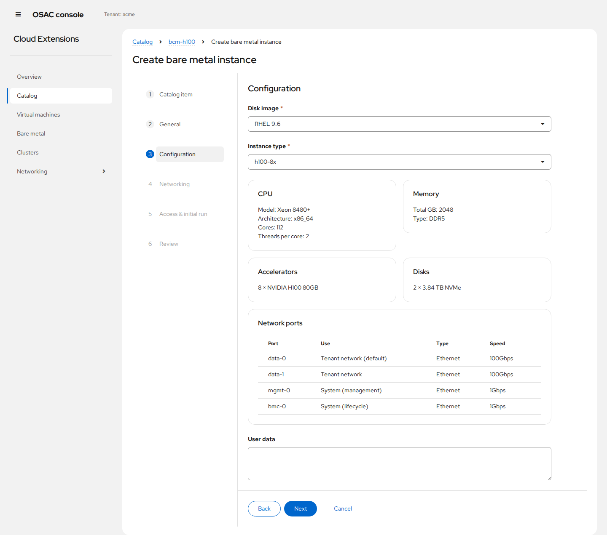

---

## 2. Networking step

**What this screen is for.** Choosing the server's network, the port that
joins it, and external access.

**Explanation.** **Tenant default** shows the tenant's default virtual
network, subnet and security group. **Interface** shows the first tenant
port of the type, already selected. **Auto-attach external IP** follows the
catalog item's default and keeps its current help text.

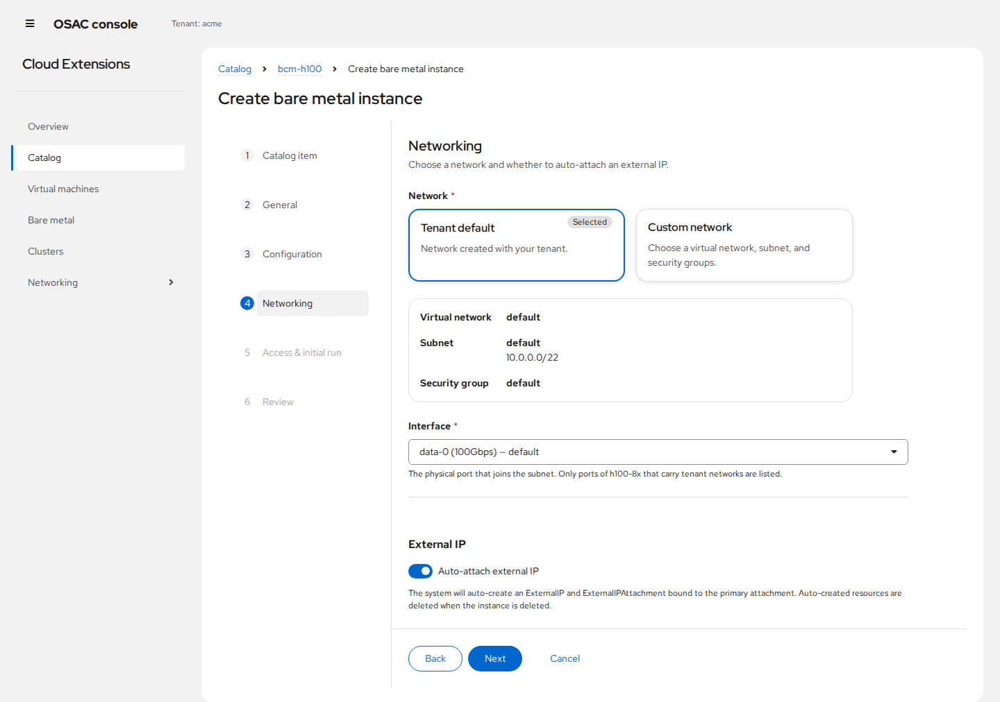

**Custom network** shows the virtual network, subnet and security group
pickers of the VM wizard: only READY resources, the subnet and security
groups of the chosen virtual network. Unlike the VM wizard, the subnet list
is not narrowed to subnets that support virtual machines; that eligibility
is about VMs only. **Interface** lists the type's tenant ports; the
first is marked **default**.

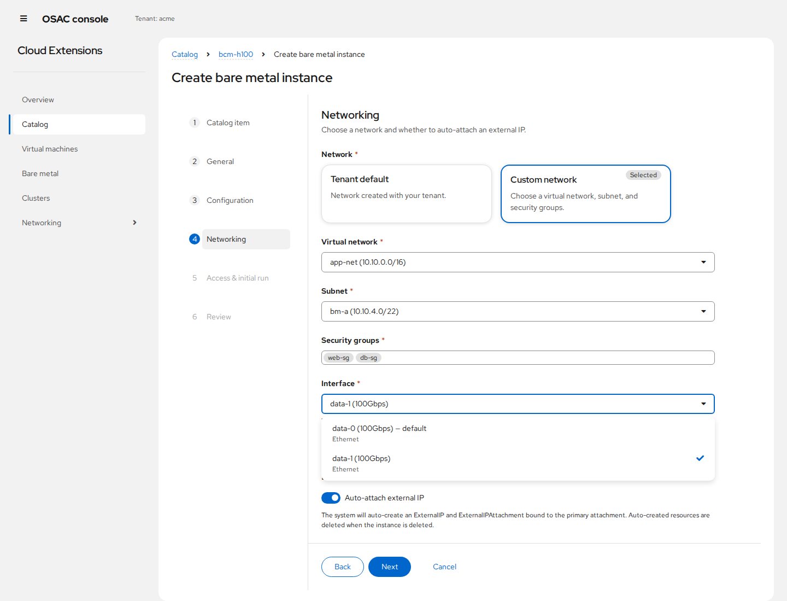

When the type has one tenant port, **Interface** is that port as text. A
type without one cannot exist (the API rejects it); if one is shown anyway,
**Interface** says "This instance type has no port for tenant networks." and
**Next** is blocked.

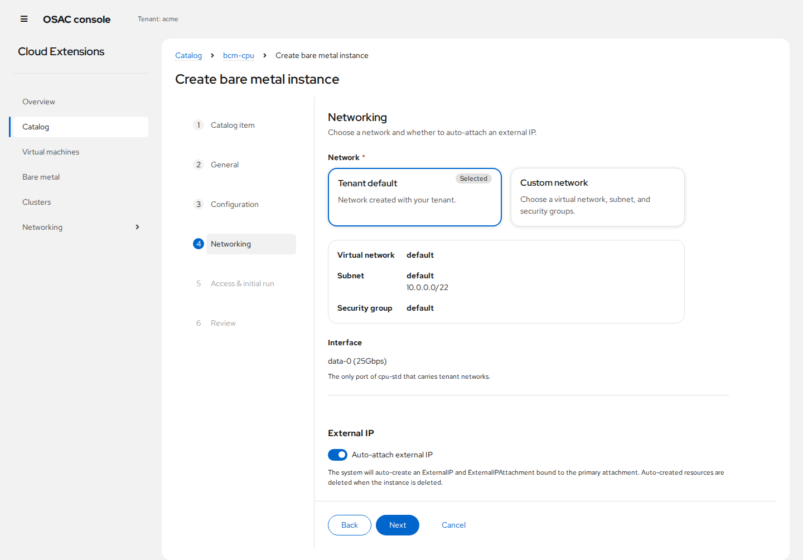

When the catalog item sets the network, the cards, **Interface** and the
switch are disabled and say "Set by the catalog item." Changing the instance
type in **Configuration** selects the first tenant port of the new type.

---

## 3. Review

**What this screen is for.** Checking the network before creating the server.

**Explanation.** Review shows **Network** (Tenant default or Custom), the
virtual network, subnet and security groups for a custom network,
**Interface**, and **External access**. If the server rejects the request,
for example a subnet that is not ready, the message appears on this step.

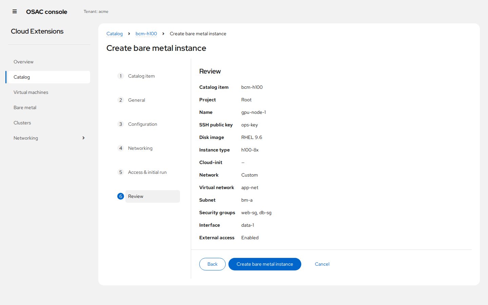

---

## 4. Server details: Networking

**What this screen is for.** Seeing where the server is connected and how to
reach it.

**Explanation.** The **Networking** card shows the virtual network and
security groups (linked to their pages), the subnet, the
**Interface** with its speed, the **Internal IP** and the **External IPs**,
one per line as `name (address)`. Names link only to resources that have a
page.

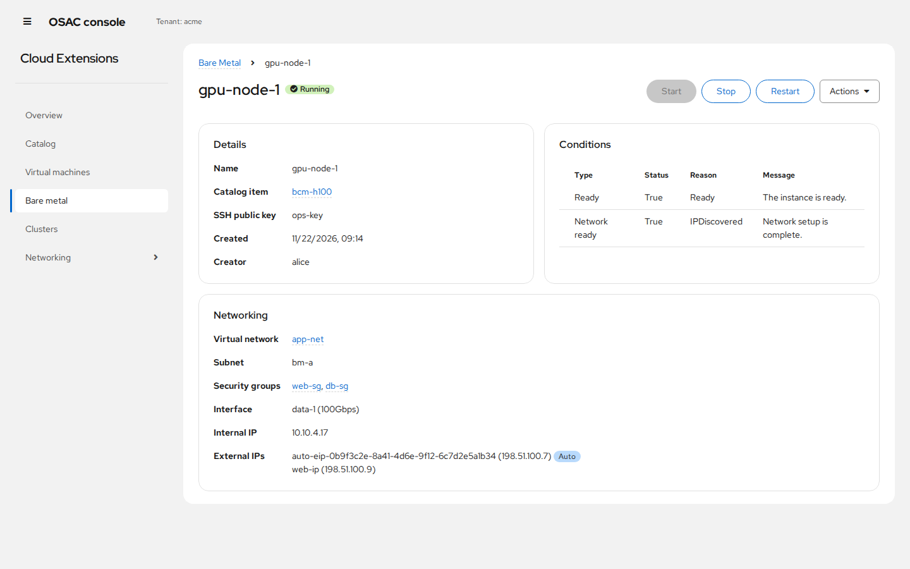

While OSAC moves the port to the subnet and finds its address, the server is
**Provisioning**, **Internal IP** shows **Pending** with the network message
(for example "IP address discovery is in progress."), and an automatic
external IP says "Attaches when the server is running with its internal IP." OSAC never
shows the address the server had during installation.

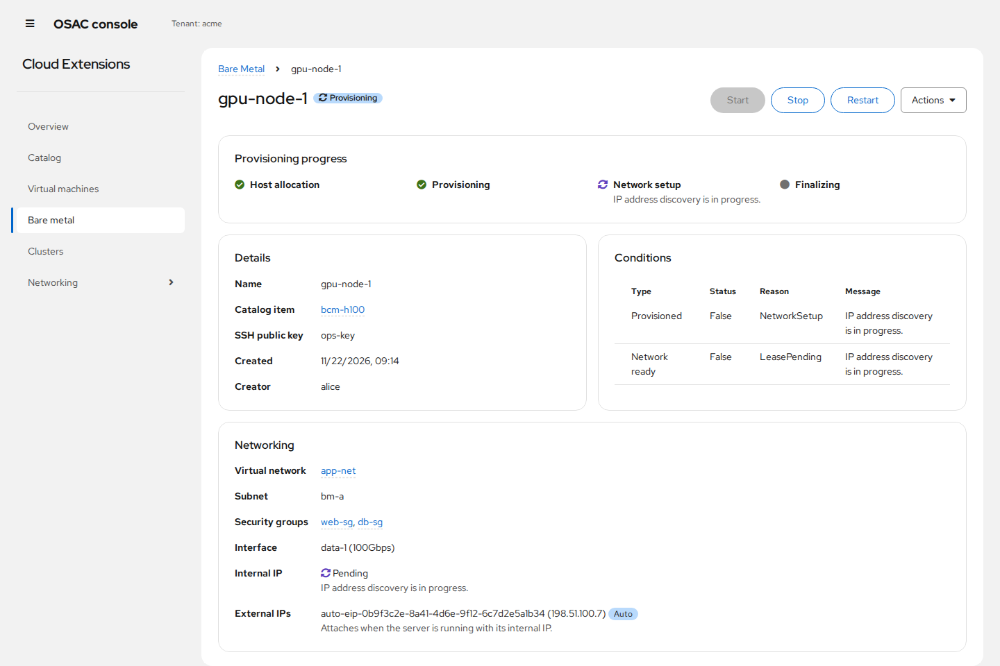

If network setup fails, the progress card shows the failed stage and its
message, **Internal IP** shows a dash, and the automatic external IP says
"Not attached." The tenant deletes the server and creates it again.

When the provider runs OSAC without provider networking, **Internal IP**
says "Not set up by OSAC" with the message "Provider networking is disabled;
this operation was skipped." No address is shown.

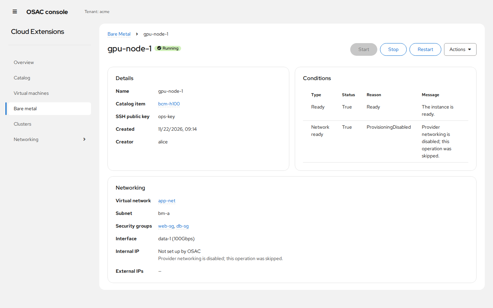

---

## 5. Delete

**What this screen is for.** Knowing why a server cannot be deleted yet, and
following its cleanup.

**Explanation.** The confirmation is unchanged. While an external IP
attachment that the tenant created still targets the server, **Delete** is
disabled. Its tooltip names the external IP and where to
delete its attachment: "Delete the attachment of external IP web-ip first
(Networking > External IPs > Attachments)." Labels a tenant adds do not make
an attachment automatic. A server in a fabric domain cannot be deleted either
([design](design.md#delete)); the console cannot see that link, so the
confirmation shows the server's rejection message.

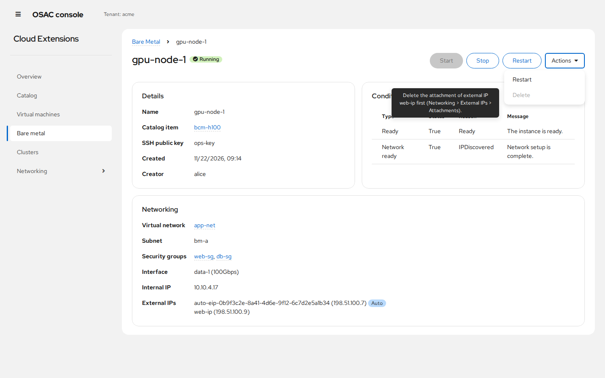

While deleting, **Internal IP** carries the cleanup message ("Network cleanup
is in progress.", or "Network cleanup did not complete." while OSAC retries)
and the automatic external IP shows **Detaching**.

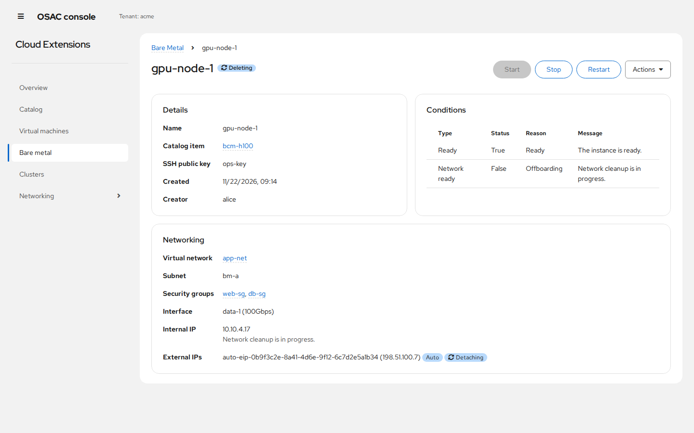

---

## 6. Instance type ports (provider admin)

**What this screen is for.** Saying which ports of a server type tenants can
use.

**Explanation.** In **Create bare metal instance type** (the provider
admin console, used by the Cloud Infrastructure Admin), each network port has
a **Role** select: **Fabric** (carries tenant networks), **Management**,
**Storage** and **Lifecycle (BMC)**. For fabric ports, the console checks
that the name is lowercase letters, digits and hyphens, because OSAC uses it
in the attachment's name and rejects a server that selects any other name.
Other ports keep any name the API accepts.

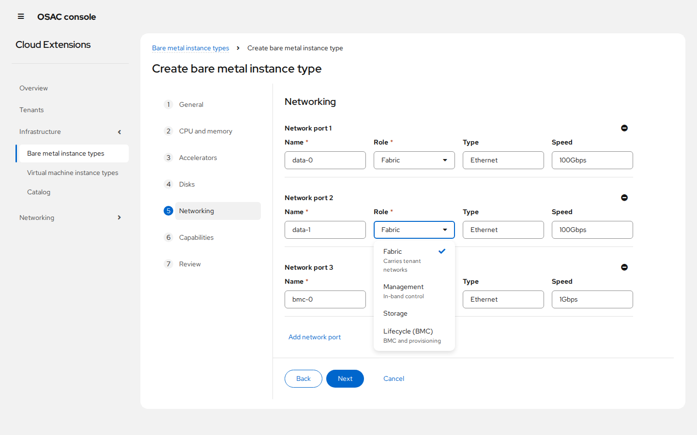

A type needs at least one fabric port; the API rejects a type without one
and the wizard shows its message on submit.

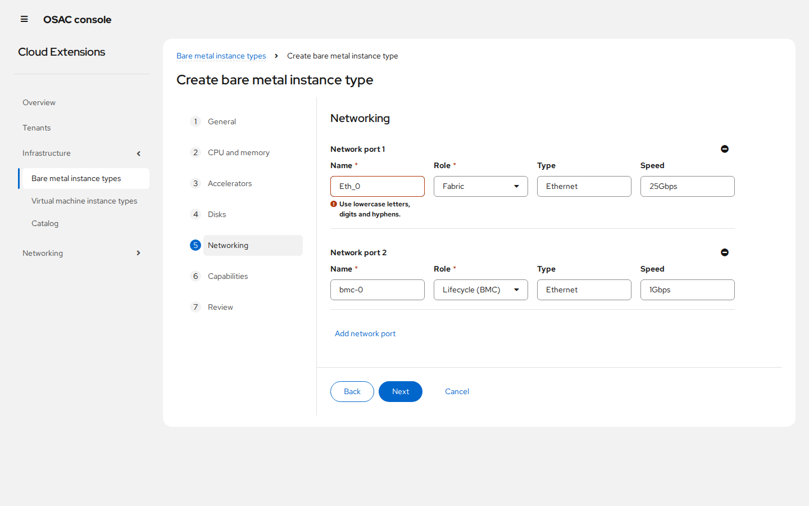

---

## Out of scope

- Attaching or detaching external IPs from the server page (API and CLI;
  see the decision above).
- A separate warning when the address is still unknown 10 minutes after the
  network handoff: PRD NFR-2 makes it an administrator warning, so the tenant
  keeps seeing "IP address discovery is in progress."
- A provider admin page for server addresses: the provider admin's console
  has no tenant resources ([Unified decision](/enhancements/OSAC-1433-unified-networking/ux-design.md#product-decisions-this-release));
  the per-interface addresses of the PRD story are in the API and CLI.
- Cluster workers: they appear in the tenant's **Bare metal** list with the
  same **Networking** card; their network comes from the cluster.
- Evaluation: three AI heuristic reviews of the prototype; no user testing.
