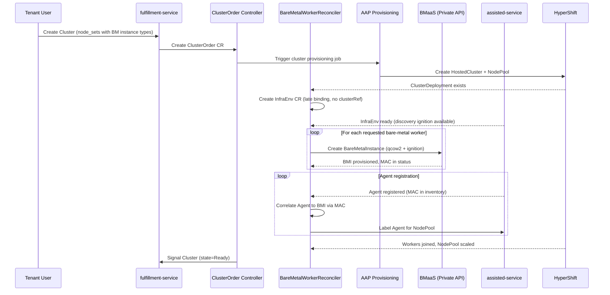
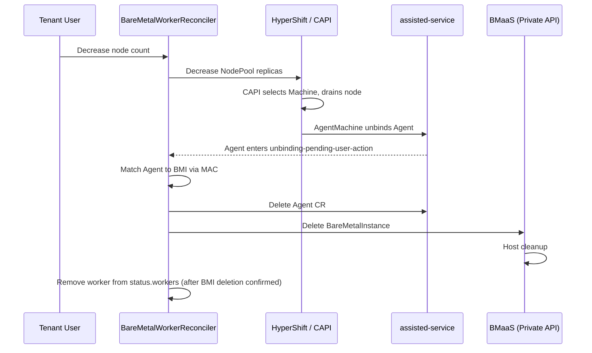

# CaaS Bare-Metal Worker Node Provisioning

## Summary

This design adds on-demand bare-metal worker node provisioning to CaaS via a dedicated `BareMetalWorkerReconciler` in osac-operator that creates BareMetalInstances via the fulfillment-service private gRPC API. Each instance references a pre-registered RHCOS DiskImage and carries discovery ignition inline from a cluster-specific InfraEnv, causing the host to register as an assisted-service Agent and join the HyperShift-managed cluster as a worker node. The existing BareMetalPool-based static pre-boot pool is removed. See [PRD](prd.md) for detailed requirements.

## Motivation

CaaS currently provisions bare-metal worker nodes through a static pre-boot pool: a cron job maintains hosts running the Assisted Installer ISO via BareMetalPool resources. This wastes capacity on idle hosts, is difficult to right-size, and couples cluster provisioning to a fragile pool management process. When the pool is exhausted, cluster scale-up fails silently until an administrator intervenes.

The new approach eliminates the pool by provisioning workers on-demand. When a ClusterOrder specifies bare-metal node sets, the controller creates individual BareMetalInstances through the BMaaS private API, each configured with discovery ignition and a version-matched RHCOS DiskImage. This gives CaaS per-instance control over image and boot configuration while keeping cluster lifecycle (templates, catalogs, ordering) free of infrastructure details. The PoC (OSAC-2817) validated this flow end-to-end: BMI provisioning took approximately 6 minutes, the agent registered successfully, and the worker joined the HyperShift cluster.

### Goals

- Implement bare-metal worker management as a dedicated controller (`BareMetalWorkerReconciler`) within osac-operator, keeping the ClusterOrder controller generic and extensible for future VM worker support.
- Keep all CaaS-managed bare-metal infrastructure (BMIs, InfraEnvs, Agents) invisible to tenant-facing APIs and UIs.
- Support both initial provisioning and manual scale-up/scale-down through the same controller logic.
- Ensure host cleanup on scale-down and cluster deletion flows through BMaaS's existing deprovision pipeline via `BareMetalInstances.Delete`.
- Remove the BareMetalPool-based static pre-boot pool workflow entirely — no coexistence period.
- Require no changes to the tenant-facing Cluster API or CLI experience.

### Non-Goals

- Autoscaling based on workload utilization (deferred to a future CaaS autoscaling feature).
- VM-based worker nodes (deferred to VMaaS integration).
- Static IP or NMStateConfig support for worker nodes (deferred; not validated by the PoC).
- Network boot acceleration or caching strategies `[Jira: OSAC-2134]`.

## Proposal

A new `BareMetalWorkerReconciler` in osac-operator watches `ClusterOrder` CRs for bare-metal worker management. When a ClusterOrder's `nodeRequests` reference bare-metal node sets, the controller:

> **Terminology note:** `node_sets` (proto, on `ClusterSpec`) maps to `nodeRequests` (CRD, on `ClusterOrderSpec`) via the fulfillment-service Cluster controller. The proto map key becomes `NodeRequest.nodeSet`. The `BareMetalWorkerReconciler` reads `nodeRequests` from the ClusterOrder CRD.

1. Creates a cluster-specific `InfraEnv` CR on the hub cluster to generate discovery ignition.
2. Fetches discovery ignition from the InfraEnv and creates `BareMetalInstance` objects with the ignition passed inline as `user_data`, referencing the RHCOS DiskImage.
3. Correlates registered Agents to BMIs via MAC address and labels them for NodePool selection.

No new CRDs are introduced. The design extends the ClusterOrder CRD status with a `workers` field to track CaaS-managed worker resources. BareMetalInstances created by CaaS belong to the cluster's tenant (see Worker Tenancy and Ownership) — the controller resolves the authoritative tenant from the fulfillment-service Cluster on every reconciliation and fails closed on any mismatch.

**Dependencies:**

| Dependency | Jira | Provides |
|-----------|------|----------|
| MAC addresses in BareMetalInstance status | [OSAC-4203](https://redhat.atlassian.net/browse/OSAC-4203) | `status.hardware.nics[].mac` — host NIC MACs (multiple per host) for Agent correlation |
| DiskImage resource + BMI DiskImage integration | [OSAC-2540](https://redhat.atlassian.net/browse/OSAC-2540), [OSAC-1270](https://redhat.atlassian.net/browse/OSAC-1270) | The DiskImage resource and the `DiskImageReference disk_image` field on `BareMetalInstanceSpec` |
| Type-safe resource references | [OSAC-1330](https://redhat.atlassian.net/browse/OSAC-1330) | `DiskImageReference` typed references on `ClusterVersionSpec` (field 7) and on `BareMetalInstanceSpec` |
| BMaaS networking for subnet attachment | [OSAC-1437](https://redhat.atlassian.net/browse/OSAC-1437) | BMI `network_attachments` accepting at most one entry |

The existing BareMetalPool-based static pre-boot pool is removed as part of this work. The `cluster_infra` AAP step that creates BareMetalPool CRs and the scheduled `osac-import-agents` AAP job that discovers and imports hosts are no longer used by CaaS. Any remaining BareMetalPool resources are drained and cleaned up during rollout. The BareMetalPool CRD itself is retained (it serves BMaaS standalone use cases) but CaaS no longer creates or references BareMetalPool resources.

### Workflow Description

#### Changes Overview

This design replaces `HostType` with `BareMetalInstanceType` and the static agent pool with on-demand BMI provisioning. The key changes per component:

| Component | Before | After |
|---|---|---|
| **ClusterNodeSet (proto)** | `host_type: HostTypeReference` | `baremetal_instance_type: BareMetalInstanceTypeReference` (field 4, immutable); system-populated `fabric_interface` (field 3, private) |
| **NodeRequest (CRD)** | `ResourceClass string` (opaque) | `nodeSet` (logical group key) + `numberOfNodes` + `bareMetal.instanceType` (+ system-populated `fabricInterface`) |
| **ClusterCatalogItem** | `host_type: "acme_1tb"` in template YAML | `fields.node_sets` policy: locked map or editable map with defaults, entries carry `size` + `baremetal_instance_type` |
| **ClusterVersionSpec (proto)** | No DiskImage reference | `disk_image: DiskImageReference` (owned by this design) |
| **BMI Create call** | No `instance_type` field | `spec.template` = shared `osac.templates.bm_host_provisioning`; `spec.instance_type` = `BareMetalInstanceTypeReference`; `spec.disk_image` = `DiskImageReference` |
| **Interface resolution** | HostType.interfaces[].role=fabric | BareMetalInstanceType network_ports[].role=fabric |
| **Network attachment source** | Cluster proto via private API callback | ClusterOrder CRD singular `networkAttachment` (ClusterNetworkAttachment) |
| **Host selection** | HostType → Template → CatalogItem reverse lookup | BareMetalInstanceType host label selector (direct, OSAC-1201) |
| **Worker provisioning** | Static pre-boot pool + cron job + parking network | On-demand BMI creation via private API |
| **Boot image** | Assisted image service ISO | RHCOS DiskImage (OCI artifact) linked to ClusterVersion |
| **HostType resource** | Shared BM/VM concept, no hardware specs | Deprecated and decommissioned |

#### Setup Flow (by persona)

**Cloud Infrastructure Admin** — one-time platform setup:

1. **Register RHCOS DiskImages** for each supported OCP version. CaaS boots bare-metal hosts with a RHCOS qcow2 image containing discovery ignition — unlike the old pool model which used ISOs from the assisted image service. Each DiskImage is an OCI artifact registered in the fulfillment-service (dependency: OSAC-2540, OSAC-1270).

   ```bash
   osac create diskimage rhcos-4.18 \
     --source-ref quay.io/osac/rhcos:4.18.0 \
     --guest-os-family linux --architecture x86_64
   ```

2. **Link each DiskImage to its ClusterVersion** via the `disk_image` reference (this design adds `DiskImageReference` to `ClusterVersionSpec`). This is how the controller resolves which boot image to use — it reads the Cluster's ClusterVersion, follows the reference, and passes the DiskImage reference to the BMI Create call. Without this link, the controller sets `RHCOSImageNotFound` and does not create BMIs.

   ```bash
   osac create clusterversion 4.18.0 --image <release-image> --disk-image rhcos-4.18
   ```

   The private `ClusterVersions.Update` RPC accepts `spec.disk_image` (the CLI exposes it at create time via `--disk-image`; later changes go through `osac edit clusterversion` or the API).

3. **Register BareMetalInstanceTypes** defining available hardware profiles. This replaces `HostType`, which was opaque (no CPU/memory specs, no inventory matching). `BareMetalInstanceType` (OSAC-1201) carries full hardware specs AND `host_label` selectors for direct inventory matching — no reverse lookup needed. The `network-port` fields are critical for CaaS: the controller reads them to resolve the fabric interface for each BMI's network attachment. CaaS resolves BareMetalInstanceType references in the **shared** tenant (see [CAAS.md](https://github.com/osac-project/osac/blob/main/fulfillment-service/docs/CAAS.md)); tenant-scoped CaaS type selection is not yet defined.

   ```bash
   # BEFORE — HostType (opaque, no hardware specs, no inventory matching)
   osac create hosttype acme_1tb \
     --title "Acme 1TB Server" \
     --interface name=data-0,role=fabric \
     --interface name=mgmt-0,role=management

   # AFTER — BareMetalInstanceType (rich hardware specs + inventory matching)
   osac create baremetalinstancetype bm-standard \
     --cpu-cores 64 --cpu-architecture x86_64 \
     --memory-total-gb 512 \
     --network-port name=data-0,role=fabric,type=Ethernet,speed=100Gbps \
     --network-port name=mgmt-0,role=management,type=Ethernet,speed=1Gbps \
     --host-label profile=bm-standard \
     --description "Standard bare-metal node: 64-core x86_64, 512 GiB RAM, 100GbE fabric"
   ```

   Cloud Infrastructure Admins must also label inventory hosts to match — via whatever host-labeling mechanism the BMaaS backend exposes. This is a BMaaS/backend concern; CaaS does not assume a specific backend and OSAC does not validate label consistency at type-creation time.

4. **Ensure the assisted image service is disabled** (deployment prerequisite — see Assisted Image Service section).

**Cloud Provider Admin** — catalog and template configuration:

1. Creates `ClusterVersion` entries (OCP version + release image pullspec), or they are seeded during installation.

2. Creates a `ClusterCatalogItem` (cluster offering) whose `fields.node_sets` policy supplies the worker map. Cluster templates describe provisioning behavior and parameters; they no longer carry node sets or hardware (the template `node_sets` field is reserved). A policy is either **locked** (fixed map) or **editable** (defaults the tenant may override):

   ```yaml
   # ClusterCatalogItem policy (private API / CLI)
   fields:
     node_sets:
       editable:
         default_value:
           items:
             workers:
               size: 2
               baremetal_instance_type:
                 name: bm-standard
   ```

   Tenants can override an editable policy at cluster creation:

   ```bash
   osac create cluster --catalog-item hosted_cluster_offering \
     --node-set name=workers,size=2,baremetal-instance-type=bm-standard
   ```

   This flows through to the proto as `ClusterNodeSet.baremetal_instance_type` (replacing `ClusterNodeSet.host_type`) and to the CRD as `NodeRequest.bareMetal.instanceType` (replacing `NodeRequest.ResourceClass`). The fulfillment-service resolves the effective BareMetalInstanceType references in the shared tenant and writes each selected type and size to `ClusterOrder.spec.nodeRequests[].bareMetal.instanceType` and `numberOfNodes`.

3. No per-offering BMI catalog item or template is needed: worker BMIs are created through the fixed shared `osac.templates.bm_host_provisioning` BareMetalInstanceTemplate (see BMI Creation via Private API). The Cloud Provider Admin does not create or configure it — it ships with the OSAC AAP template collection.

4. Publishes catalog items to make them available to tenants.

**Tenant User** — cluster lifecycle (unchanged before and after):

```bash
# Same CLI, same UX — before and after
osac create cluster my-cluster --template ocp-small
```

The tenant never directly manages BareMetalInstanceTypes, DiskImages, InfraEnvs, or Agents. The catalog item's node-set policy (or the `--node-set` flag) populates `node_sets` with the `BareMetalInstanceType` reference and size. Tenant-visible infrastructure (worker BMIs, the backing DiskImage) is created in the tenant's own scope; see Worker Tenancy and Ownership for the visibility consequences.

#### Provisioning Flow

Starting state: a Tenant User creates a Cluster from a catalog item (e.g., `hosted_cluster_offering`). The catalog item's node-set policy populates `node_sets` with `baremetal_instance_type` references. The fulfillment-service Cluster controller creates a ClusterOrder CR on the hub cluster.



The diagram shows the end-to-end provisioning flow. The controller waits for each phase to complete before proceeding: AAP provisions the HostedCluster, the InfraEnv generates ignition, BMIs provision hosts, and agents register and join the cluster. The controller updates ClusterOrder status conditions at each phase transition.

**Step-by-step:**

1. The `BareMetalWorkerReconciler` identifies bare-metal node sets from the ClusterOrder's `nodeRequests` — any node request whose `bareMetal` block carries an `instanceType` reference (see ClusterNodeSet Redesign).
2. After AAP creates the HostedCluster and the ClusterDeployment CR exists, the controller creates a cluster-specific `InfraEnv` CR (see InfraEnv Creation). The InfraEnv uses late binding (no `clusterRef`) — agents register as unbound and the controller explicitly binds them in step 8.
3. The controller polls the InfraEnv status until `status.bootArtifacts.discoveryIgnitionURL` is populated, then fetches the discovery ignition content. The ignition is architecture-neutral (the `assisted-installer-agent` image is a multi-arch manifest).
4. For each bare-metal worker requested, the controller assembles a `BareMetalInstances.Create` call on the private API from multiple sources:

   | Field | Source | Purpose |
   |---|---|---|
   | `instance_type` | `nodeRequests[i].bareMetal.instanceType` (shared scope) | Hardware profile → host labels → inventory match |
   | `template` | Fixed shared `osac.templates.bm_host_provisioning` | Required by private API; ships with the OSAC AAP template collection |
   | `disk_image` | `ClusterVersion.disk_image` → resolved `DiskImageReference` (id + name) | RHCOS boot image for discovery agent |
   | `user_data` | InfraEnv ignition (inline, ~15KB, max 64KB) | Discovery ignition to register with assisted-service |
   | `ssh_public_key` | `ClusterOrder.spec.sshPublicKey` (or template parameter fallback) | SSH access to worker hosts |
   | `network_attachments` | `networkAttachment` + stored node-request `fabricInterface` | The sole attachment from `ClusterNetworkAttachment`; the stored interface was selected from the first `fabric` port during cluster creation, with `primary: true` (see Network Attachment Enrichment); BMaaS rejects additional entries |
   | `tenant` | The cluster's tenant, resolved authoritatively from the fulfillment-service Cluster | Ownership and audit; the controller fails closed on any ClusterOrder/Cluster tenant mismatch (see Worker Tenancy and Ownership) |

   BMaaS handles the physical networking — moving the host to the tenant subnet VLAN and assigning an IP via fabric DHCP — as part of BMI provisioning (dependency: OSAC-1437). If the host fails to join the tenant network, the agent will not register on the expected subnet, and the existing `AgentRegistrationTimeout` handles this failure mode. API and ingress VIPs are provisioned by the existing AAP template (MetalLB LoadBalancer Services) and are not managed by this controller.
5. The controller updates ClusterOrder status with the BMI references in `workers[]`. Each worker slot is first **reserved** in `status.workers[]` with an opaque generated name (see ClusterOrder CRD Status Extensions), and the BMI identity is persisted as part of the slot's record — the status journal is the durable source of truth for worker identity, so a crash or lost response can never produce an untracked BMI.
6. BMaaS allocates a host, provisions it with the DiskImage and discovery ignition, and boots it. The host registers as an Agent with assisted-service.
7. The controller watches Agent CRs in the cluster namespace. When a new Agent appears, the controller matches its inventory MAC addresses against the BMI's host NIC MACs (`status.hardware.nics[].mac`, OSAC-4203).
8. Once correlated (a unique unbound Agent matching exactly one waiting worker, in both directions), the controller sets the Agent's `clusterDeploymentName`, marks it `approved: true`, and applies the `agentBareMetal` role label plus `osac.openshift.io/worker-name`, `osac.openshift.io/node-set`, `osac.openshift.io/instance-type`, and cluster-order labels so the NodePool's `agentLabelSelector` selects it. Late binding (explicit `clusterDeploymentName` setting) gives the controller full control over the Agent lifecycle — on scale-down, CAPA clears `clusterDeploymentName`, triggering the unbind flow that CaaS reacts to. A binding already rewritten by HyperShift's CAP-Agent handoff for the same worker is left untouched. The osac-operator's RBAC must include `get`, `list`, `watch`, `patch`, and `delete` on `agents` in the `agent-install.openshift.io` API group (see RBAC / Tenancy).
9. HyperShift installs the Agent as a worker node. The controller converges NodePool `.spec.replicas` to the requested per-node-set capacity so provisioning Agents are not orphaned by premature scale-down.

#### Scale-Up

A Tenant User increases `node_sets[].size` for a bare-metal node set. The fulfillment-service updates the Cluster object, the Cluster controller updates the ClusterOrder's `nodeRequests`, and the controller detects the delta between desired and current worker count.

**Step-by-step:**

1. The controller computes `desired - current` where `current` is `status.currentWorkers` (workers in active phases: `Provisioning`, `WaitingForAgent`, `Binding`, `Ready`). Workers in `Failed` phase do not count toward capacity — new workers are created to fill the gap once their retry backoff expires.
2. The controller re-reads the InfraEnv's `status.bootArtifacts.discoveryIgnitionURL` to fetch fresh ignition. The InfraEnv persists from initial provisioning; if it was deleted (e.g., manual cleanup), the InfraEnv observation stage recreates it on authoritative absence. The controller records the InfraEnv's UID on the ClusterOrder; if the InfraEnv is deleted and recreated while hosts are in `WaitingForAgent` phase (already booted with old ignition), the UID change marks those hosts `Failed` with `AgentRegistrationTimeout` so they enter the retry pipeline and are reprovisioned with fresh ignition.
3. The controller resolves the RHCOS DiskImage from the cluster's current ClusterVersion's `disk_image` reference (see RHCOS DiskImage Resolution).
4. For each new worker, the controller follows provisioning steps 4-9 from the initial flow (the ignition content is re-fetched in step 2 above).
5. Partial success is reported: if 3 of 5 new workers succeed and 2 fail, the ClusterOrder status shows 3 additional `Ready` workers and 2 `Failed`. The tenant sees the cluster with the successfully added workers; the failed slots are visible via ClusterOrder conditions and events.

#### Scale-Down



This diagram shows the scale-down flow. CAPI handles node drain and agent unbinding automatically. The controller reacts to the agent reaching an unbound state and then cleans up the BMI.

**Step-by-step:**

1. The controller computes the excess worker count per node set (current retained slots minus requested `numberOfNodes`), independent of request order and hardware profiles.
2. Excess workers are selected by CAPI-aligned deletion priority: `Failed` first, then not-yet-bound workers (`Provisioning`, `WaitingForAgent`, `Binding`), then the newest `Ready` workers — retention prefers healthy, older workers. Retirement intent is persisted first: each selected worker is demoted to `Unbinding` in `status.workers[]` before any shared cleanup may touch infrastructure, so a crash mid-scale-down cannot lose the removal intent.
3. CAPI's MachineDeployment controller manages MachineSets, which select Machines for deletion (node drain is CAPI/AgentMachine behavior). CaaS selects which worker *slots* to retire (step 2) but does not control CAPI's Machine selection within a slot.
4. CAPI drains each selected node, then the AgentMachine controller unbinds the Agent (clears `ClusterDeploymentName`). With the assisted image service disabled (see Assisted Image Service), reclaim is not attempted and the Agent transitions directly to `unbinding-pending-user-action`. CAPA removes its hook/finalizer at this point.
5. The controller watches for Agents entering `unbinding-pending-user-action` (or already `known-unbound`) and matches them back to their worker via the `osac.openshift.io/worker-name` label, falling back to a scoped MAC match against the recorded BMI's NICs for unlabelled Agents.
6. The controller deletes the Agent CR with UID/resourceVersion preconditions. CAPA does not delete the Agent — it only clears `ClusterDeploymentName` and removes its own hook/finalizer. CaaS owns the Agent CR cleanup because the host will be deprovisioned by BMaaS. The controller waits for the Agent to be gone before requesting BMI deletion.
7. The controller calls `BareMetalInstances.Delete` on the private API. BMaaS handles full host cleanup before returning the host to inventory. CaaS does not independently verify cleanup completion — this is a trust boundary between CaaS and BMaaS. If BMaaS cleanup fails, the host must not be reallocated; this guarantee is BMaaS's responsibility. A deleting BMI (deletion timestamp or `Deleting` state) means wait: only an authoritative `Get` returning `NotFound` releases the recorded identity.
8. The controller retains the worker entry in `status.workers` in `Deleting` phase until the BMI deletion is confirmed. This prevents orphaned hosts — if `Delete` succeeds but cleanup stalls, the controller still has the reference to retry or alert. NodePool replicas converge to the reduced requested capacity.

#### Cluster Deletion

On ClusterOrder deletion, deleting the HostedCluster cascades through HyperShift (deletes all NodePools) → CAPI (drains nodes, deletes Machines) → CAPA (unbinds Agents), which cleans up the Kubernetes-side objects and the Agent CRs. The cascade does **not** delete the BMIs — the fulfillment-service BareMetalInstances are unknown to HyperShift. The `BareMetalWorkerReconciler`'s finalizer (`osac.openshift.io/baremetalworker-finalizer`) therefore actively deletes every BMI listed in `status.workers[]` via `BareMetalInstances.Delete`, rather than reacting to per-Agent unbind events as the scale-down flow does. The finalizer holds until all `status.workers[]` entries are confirmed deleted (authoritative `Get` → `NotFound`), including recovery of ID-less reservations by owned name. The InfraEnv CR and pull-secret Secret are garbage collected via their ownerReferences to the ClusterOrder.

### API Extensions

**Modified CRDs:**

- `ClusterOrder` (osac-operator): new `workers` status field and aggregate counts (`desiredWorkers`, `currentWorkers`, `readyWorkers`) for tracking CaaS-managed worker resources. The `nodeRequests` element type (`NodeRequest`) is redesigned to carry the `BareMetalInstanceType` reference (see ClusterNodeSet Redesign). The singular `networkAttachment` field (defined by OSAC-1436) carries the tenant subnet reference — the `BareMetalWorkerReconciler` reads it from the ClusterOrder spec and builds one-entry per-BMI `BareMetalNetworkAttachment` lists (see Network Attachment Enrichment below).

**New CRs created at runtime (not new CRD definitions):**

- `InfraEnv` (agent-install.openshift.io/v1beta1): one per cluster, created by the controller in the cluster's namespace. Owned by the ClusterOrder via an owner reference for garbage collection.

**Modified behavior of existing resources:**

- `BareMetalInstance` (fulfillment-service): CaaS-created BMIs belong to the cluster's tenant (see Worker Tenancy and Ownership). No changes to the public API are required for creation — the worker controller uses the private API and validates ownership on every read-back (tenant, name, `osac.openshift.io/owner-reference` annotation, and `osac.openshift.io/cluster-order` label must all match the ClusterOrder).

**Tenant-visible status:** The PRD requires tenant-visible failure conditions. ClusterOrder conditions (`WorkersFailed`, `InfraEnvReady`, `RHCOSImageNotFound`) live on the hub cluster, which tenants cannot access. The existing feedback controller syncs ClusterOrder status to the public Cluster API via the `Signal` RPC. This design extends the feedback controller to translate worker conditions into the tenant-visible Cluster status:

- `WorkersFailed=True` on ClusterOrder → `WORKER_PROVISIONING_FAILED` condition on the public Cluster, with a tenant-safe message (e.g., "2 of 5 worker nodes failed to provision") that omits infrastructure details (no BMI names, MACs, or backend errors)
- Workers in `Failed` with high attempt count → Cluster condition message includes the attempt count and next retry time, so tenants know retries are ongoing
- All other conditions (`InfraEnvReady=False`, `RHCOSImageNotFound`) → mapped to a generic `WORKER_PROVISIONING_BLOCKED` condition on the Cluster, indicating the cluster cannot provision workers due to an infrastructure issue requiring Cloud Infrastructure Admin intervention

This ensures tenants see provisioning progress and actionable failure messages without exposure to CaaS internals. The condition names and feedback controller extension must align with [OSAC-1604](https://redhat.atlassian.net/browse/OSAC-1604) (status reporting improvements) to avoid overlap — this design defines CaaS-specific worker conditions, while OSAC-1604 defines the general status reporting framework. Coordination tracked via Jira link.

**Operational impact:** If the osac-operator is down, no new bare-metal workers are provisioned and scale-up/scale-down operations stall. Existing workers continue running — HyperShift manages the cluster independently. On restart, the controller reconciles current state and resumes any pending operations.

## UX Alignment

CaaS-managed workers require no tenant UI workflow changes. However, the BareMetalPool removal and assisted image service disablement affect the **Cloud Infrastructure Admin** installation and configuration flow, which surfaces through Enclave.

### Installer / Enclave Impact

The following `osac-installer`/AAP config-as-code values are affected:

| Value | Current purpose | Status |
|---|---|---|
| `aap.configAsCode.importAgentsEnabled` (`OSAC_IMPORT_AGENTS_ENABLED`) | Previously enabled the `osac-import-agents` scheduled AAP job for the pre-boot pool | **Inert** — the import-agents job template is no longer part of the AAP configuration; the variable remains defined in `config_as_code/playbooks/vars/config.yml` but is not consumed. Safe to remove from the chart. |
| `aap.configAsCode.importBcmAgentsEnabled` (`OSAC_IMPORT_BCM_AGENTS_ENABLED`) | Enabled the BCM inventory backend for agent import | Same as above — orphaned variable. |
| `aap.importAgents` | Server inventory list for BareMetalHost CR provisioning (BMC addresses, credentials) | **Retained for BMaaS** — bare-metal host inventory registration is still needed for standalone BareMetalInstance provisioning. |
| `aap.configAsCode.env.IMPORT_AGENTS_NAMESPACE` | Namespace for inventory CRs (default: `hardware-inventory`) | **Still needed** — the `hardware-inventory` namespace hosts inventory resources. CaaS creates per-cluster InfraEnvs in cluster namespaces, not here. |
| `aap.configAsCode.env.IMPORT_AGENTS_INFRAENV_NAME` | Shared InfraEnv CR name for agent discovery | **No longer consumed by CaaS** — CaaS creates per-cluster InfraEnvs. BMaaS standalone may still use a shared InfraEnv for its own inventory. |

**Enclave Wizard changes:**
- The Wizard's CaaS configuration panel (if it exposes `importAgentsEnabled` or pool-related settings) must drop pool configuration for CaaS deployments.
- New prerequisite: the assisted image service must be disabled. If Enclave controls this setting, it must default to disabled for CaaS deployments.
- New prerequisite: DiskImage registration and ClusterVersion linking. The Wizard should guide the Cloud Infrastructure Admin through registering RHCOS DiskImages and linking them to ClusterVersions (see Setup Flow, Cloud Infrastructure Admin steps 1-2).

**AAP template changes:**
- `playbook_osac_create_bare_metal_pool.yml` and `playbook_osac_delete_bare_metal_pool.yml` are no longer invoked by CaaS. They may be retained for BMaaS standalone use or removed if BareMetalPool is fully deprecated.
- The `cluster_infra` step collections (`agentless_net.steps`, `ci.steps`, `nico.steps`) no longer provision BareMetalPool CRs for CaaS — the BareMetalWorkerReconciler replaces that functionality.

### Implementation Details/Notes/Constraints

#### ClusterOrder CRD Status Extensions

```go
type ClusterOrderStatus struct {
    // ... existing fields ...

    // Aggregate worker counts (aligned with the CAPI MachineDeployment convention).
    // Populated by and owned by the BareMetalWorkerReconciler.
    // +kubebuilder:validation:Optional
    DesiredWorkers *int32 `json:"desiredWorkers,omitempty"`
    // +kubebuilder:validation:Optional
    CurrentWorkers *int32 `json:"currentWorkers,omitempty"`
    // +kubebuilder:validation:Optional
    ReadyWorkers *int32 `json:"readyWorkers,omitempty"`

    // Per-worker lifecycle state.
    // +kubebuilder:validation:Optional
    // +listType=map
    // +listMapKey=name
    Workers []WorkerStatus `json:"workers,omitempty"`
}

// BareMetalInstanceReference identifies the fulfillment resource backing a worker.
// Name is reserved before creation; ID is populated after creation succeeds.
type BareMetalInstanceReference struct {
    // +kubebuilder:validation:Optional
    // +kubebuilder:validation:MinLength=1
    Name string `json:"name,omitempty"`
    // +kubebuilder:validation:Optional
    ID string `json:"id,omitempty"`
}

const (
    WorkerBMICreateStateReserved  = "Reserved"
    WorkerBMICreateStateAttempted = "Attempted"
)

type WorkerStatus struct {
    // NodeSet is the Fulfillment spec.node_sets map key identifying this worker's
    // logical group (e.g., "compute", "gpu"), not its hardware-profile name.
    // +kubebuilder:validation:Required
    NodeSet string `json:"nodeSet"`
    // InstanceType is the BareMetalInstanceType this worker was provisioned from.
    // Exposed as the instance_type metric label; sourced from
    // spec.nodeRequests[].bareMetal.instanceType.
    // +kubebuilder:validation:Optional
    InstanceType string `json:"instanceType,omitempty"`
    // Name is the stable worker slot identity, unique within the cluster.
    // New slots use opaque generated names, independent of the ClusterOrder name.
    // +kubebuilder:validation:Required
    Name string `json:"name"`
    // Kind of the backing resource (BareMetalInstance).
    // +kubebuilder:validation:Required
    Kind string `json:"kind"`
    // BareMetalInstance records the reserved name and fulfillment ID of the backing BMI.
    // +kubebuilder:validation:Optional
    BareMetalInstance BareMetalInstanceReference `json:"bareMetalInstance,omitempty"`
    // BMICreateState distinguishes a never-attempted reservation (Reserved) from a
    // BMI Create that may have reached fulfillment (Attempted, persisted with
    // optimistic locking before calling Create and retained on unknown outcomes).
    // +kubebuilder:validation:Optional
    // +kubebuilder:validation:Enum=Reserved;Attempted
    BMICreateState string `json:"bmiCreateState,omitempty"`
    // Phase of the worker lifecycle.
    // +kubebuilder:validation:Required
    // +kubebuilder:validation:Enum=Provisioning;WaitingForAgent;Binding;Ready;Failed;Unbinding;Deleting
    Phase string `json:"phase"`
    // CreationTimestamp is when this worker entry was first created.
    // +kubebuilder:validation:Required
    CreationTimestamp metav1.Time `json:"creationTimestamp"`
    // AttemptCount tracks how many times this worker slot has been provisioned.
    AttemptCount int32 `json:"attemptCount"`
    // AttemptStartedAt is the durable start of the current provisioning attempt;
    // the agent registration timeout is measured from it, not from the parent
    // ClusterOrder or an unrelated failure timestamp.
    // +kubebuilder:validation:Optional
    AttemptStartedAt *metav1.Time `json:"attemptStartedAt,omitempty"`
    // LastFailureReason is a machine-readable reason for the last failure
    // (e.g., AgentRegistrationTimeout).
    // +kubebuilder:validation:Optional
    LastFailureReason string `json:"lastFailureReason,omitempty"`
    // LastFailureMessage is a human-readable description of the last failure.
    // +kubebuilder:validation:Optional
    LastFailureMessage string `json:"lastFailureMessage,omitempty"`
    // LastFailureTime is when the last failure occurred.
    // +kubebuilder:validation:Optional
    LastFailureTime *metav1.Time `json:"lastFailureTime,omitempty"`
    // NextRetryTime is when the controller will attempt the next retry.
    // +kubebuilder:validation:Optional
    NextRetryTime *metav1.Time `json:"nextRetryTime,omitempty"`
    // ReadySince is when the worker first transitioned to Ready after the most
    // recent retry; used to reset attemptCount after MinHealthyDuration.
    // +kubebuilder:validation:Optional
    ReadySince *metav1.Time `json:"readySince,omitempty"`
}
```

**Aggregate counts** align with the CAPI MachineDeployment convention: `desiredWorkers` (sum of positive bare-metal `nodeRequests` counts — visible before any reservation exists), `currentWorkers` (retained slots holding a verified BMI identity in an active phase: Provisioning + WaitingForAgent + Binding + Ready), `readyWorkers` (Ready subset, partitioned per node set). Identity-less reservations, `Failed`, retiring, surplus, and non-bare-metal entries never count. The three fields are written only by the `BareMetalWorkerReconciler`, together with the worker list and the `WorkersFailed` condition, so they never lag a reconcile behind the journal.

**Per-worker state** is persisted in `workers[]` (a map keyed by slot name), not tracked in-memory. Each `WorkerStatus` entry carries the lifecycle phase, retry state, and failure details. On restart, the controller rebuilds phases from live BMI and Agent state but preserves `attemptCount` and failure history from the persisted status — no dependency on Kubernetes events for retry tracking.

Example: a 5-worker cluster where 3 workers are ready and 2 are retrying:

```yaml
status:
  phase: Progressing
  desiredWorkers: 5
  currentWorkers: 3
  readyWorkers: 3
  conditions:
    - type: WorkersFailed
      status: "True"
      reason: WorkersRetrying
      message: "retry 1: attempt 2, next retry 2026-08-10T15:00:00Z; retry 2: attempt 3, next retry 2026-08-10T14:55:00Z"
    - type: InfraEnvReady
      status: "True"
  workers:
    - nodeSet: compute
      instanceType: bm-standard
      name: 4f9d2b1e-3c7a-4a55-9d0e-8b1f2a3c4d5e
      kind: BareMetalInstance
      bareMetalInstance:
        name: 4f9d2b1e-3c7a-4a55-9d0e-8b1f2a3c4d5e
        id: "uuid-0"
      bmiCreateState: Attempted
      phase: Ready
      creationTimestamp: "2026-08-10T13:00:00Z"
      attemptCount: 1
      readySince: "2026-08-10T13:40:00Z"
    - nodeSet: compute
      instanceType: bm-standard
      name: 7c2e9f4a-1b3d-4e88-9a6f-0d5c7b8e2a1f
      kind: BareMetalInstance
      bareMetalInstance:
        name: 7c2e9f4a-1b3d-4e88-9a6f-0d5c7b8e2a1f
        id: "uuid-1"
      bmiCreateState: Attempted
      phase: Ready
      creationTimestamp: "2026-08-10T13:00:00Z"
      attemptCount: 1
      readySince: "2026-08-10T13:42:00Z"
    - nodeSet: compute
      instanceType: bm-standard
      name: a1b2c3d4-e5f6-4789-9a0b-1c2d3e4f5a6b
      kind: BareMetalInstance
      bareMetalInstance:
        name: a1b2c3d4-e5f6-4789-9a0b-1c2d3e4f5a6b
      bmiCreateState: Reserved
      phase: Failed
      creationTimestamp: "2026-08-10T13:00:00Z"
      attemptCount: 2
      attemptStartedAt: "2026-08-10T14:00:00Z"
      lastFailureReason: AgentRegistrationTimeout
      lastFailureMessage: "no agent registered within 30m0s"
      lastFailureTime: "2026-08-10T14:30:00Z"
      nextRetryTime: "2026-08-10T15:00:00Z"
    - nodeSet: gpu
      instanceType: bm-gpu
      name: d4e5f6a7-b8c9-4d0e-8f1a-2b3c4d5e6f7a
      kind: BareMetalInstance
      bareMetalInstance:
        name: d4e5f6a7-b8c9-4d0e-8f1a-2b3c4d5e6f7a
        id: "uuid-3"
      bmiCreateState: Attempted
      phase: Ready
      creationTimestamp: "2026-08-10T13:05:00Z"
      attemptCount: 1
      readySince: "2026-08-10T13:50:00Z"
    - nodeSet: gpu
      instanceType: bm-gpu
      name: f7a8b9c0-1d2e-4f3a-9b4c-5d6e7f8a9b0c
      kind: BareMetalInstance
      bareMetalInstance:
        name: f7a8b9c0-1d2e-4f3a-9b4c-5d6e7f8a9b0c
      bmiCreateState: Reserved
      phase: Failed
      creationTimestamp: "2026-08-10T13:05:00Z"
      attemptCount: 3
      attemptStartedAt: "2026-08-10T13:55:00Z"
      lastFailureReason: ResourceExhausted
      lastFailureMessage: "Host allocation failed: no available hosts"
      lastFailureTime: "2026-08-10T14:25:00Z"
      nextRetryTime: "2026-08-10T14:55:00Z"
```

The `workers[]` list always contains all worker references regardless of their individual state. The `WorkersFailed` condition provides the aggregate summary. The ClusterOrder remains in `Progressing` phase (not `Failed`) because 3 workers are operational. Per-worker detail (which slot failed, why, when the next retry is) is visible directly in the status.

The controller tracks worker lifecycle through phases: `Provisioning` → `WaitingForAgent` → `Binding` → `Ready` (and `Unbinding` → `Deleting` for scale-down). `Provisioning` is the reservation period before the BMI exists; the phase moves to `WaitingForAgent` once the BMI identity is recorded. `Failed` is reachable only from provisioning phases (`Provisioning`, `WaitingForAgent`, `Binding`) and triggers automatic retry. Teardown issues (e.g., agent unbinding timeout, BMI deletion failure) keep the worker in `Unbinding` or `Deleting` with error details in `lastFailureReason` — they do not transition to `Failed` and do not trigger replacement, since the intent is removal, not reprovisioning.

**Retry behavior:** The API is declarative — the controller retries indefinitely until the desired state is reached. There is no `PermanentlyFailed` state. When a worker enters `Failed`, the controller first cleans the failed incarnation (the old Agent must be gone and the BMI must be authoritatively absent — a successful `Delete` alone is pending, not completion), then initializes a single retry checkpoint (`nextRetryTime`, `bmiCreateState: Reserved`, cleared `attemptStartedAt`) and creates a replacement when the retry is due, with escalating backoff classified by `lastFailureReason`:

| Failure type | Examples (`lastFailureReason`) | Backoff | Rationale |
|---|---|---|---|
| Transient infrastructure | BMaaS API timeout, backend provisioning error (default category) | Short exponential: 30s, 60s, 120s, capped at 5m | Likely to resolve quickly; fresh host allocation may succeed immediately |
| Resource availability | `NoHostAvailable`, `ResourceExhausted` | Long exponential: 5m, 15m, 30m, capped at 30m | Inventory needs time to free up; aggressive retry wastes API calls |
| Agent registration timeout | `AgentRegistrationTimeout` | Long exponential: 5m, 15m, 30m, capped at 30m | Root cause (bad image URL, broken InfraEnv, network) is unlikely to self-resolve; gives operator time to investigate before next attempt burns another host |

The `attemptCount` is persisted in `WorkerStatus` and survives controller restarts. After the initial escalation period (first 3 attempts), the backoff caps at the maximum for that failure type and the controller continues retrying at that interval. If a replacement succeeds and stays `Ready` for 1 hour (`MinHealthyDuration`), the `attemptCount` resets to 0 — distinguishing a resolved transient issue from a recurring problem.

The `WorkersFailed` condition reports which slots are retrying (with attempt number and next retry time), so operators are alerted and can investigate. For persistent misconfigurations (wrong DiskImage, broken network), the capped backoff ensures the controller does not burn hosts aggressively while still converging once the root cause is fixed.

**Scale-down priority:** When the tenant scales down, the controller removes workers by CAPI-aligned deletion priority — `Failed` first (no running node, no bound agent, only a dead BMI to clean up), then not-yet-bound workers, then the newest `Ready` workers. Retention therefore prefers healthy, older workers.

This satisfies the PRD requirement: "CaaS automatically handles provisioning retries and release of failed bare-metal resources, so that transient BMaaS failures do not leave orphaned infrastructure."

#### InfraEnv Creation

The controller creates one InfraEnv per ClusterOrder, named `<cluster-order-name>-infraenv` in the cluster's namespace and controller-owned by the ClusterOrder (garbage-collected with it). Before creating the InfraEnv the controller ensures a pull-secret Secret named `<cluster-order-name>-pull-secret`, taking the credential from `spec.pullSecret` or falling back to the `pull_secret` template parameter; the Secret is likewise controller-owned. The InfraEnv spec:

```yaml
apiVersion: agent-install.openshift.io/v1beta1
kind: InfraEnv
metadata:
  name: <cluster-order-name>-infraenv
  namespace: <cluster-namespace>
  ownerReferences:
    - apiVersion: osac.openshift.io/v1alpha1
      kind: ClusterOrder
      name: <cluster-order-name>
spec:
  pullSecretRef:
    name: <cluster-order-name>-pull-secret
  sshAuthorizedKey: <from spec.sshPublicKey, falling back to the ssh_public_key template parameter>
```

The InfraEnv uses **late binding** — no `clusterRef`. Agents register as unbound and the controller explicitly binds them by setting `clusterDeploymentName` after MAC correlation. This gives the controller full control over the Agent binding lifecycle: on scale-down, CAPA clears `clusterDeploymentName`, the Agent enters `unbinding-pending-user-action`, and the controller reacts by deleting the Agent CR and then the BMI. CAPI handles node drain and Node object deletion independently — the pre-terminate hook clears as soon as the Agent reaches `unbinding-pending-user-action`, so node removal does not depend on the host rebooting into discovery.

The controller records the InfraEnv's UID as an annotation on the ClusterOrder (`osac.openshift.io/infraenv-uid`). If the InfraEnv is deleted and recreated, workers still in `WaitingForAgent` are marked `Failed` (stale ignition) and enter the retry pipeline rather than waiting forever for an agent that will never register with the old discovery data.

One InfraEnv per cluster provides pull secret isolation (each cluster's InfraEnv carries the cluster-specific pull secret) and supports future static networking (per-host NMStateConfig is InfraEnv-scoped). Agent-to-cluster isolation is enforced by the MAC correlation algorithm (see MAC Address Correlation), which scopes matching to BMIs owned by the current ClusterOrder.

The discovery ignition is architecture-neutral (the `assisted-installer-agent` image is a multi-arch manifest) — the `cpuArchitecture` field on InfraEnv only affects ISO/kernel/rootfs URLs in `status.bootArtifacts`, not the ignition content, and this design uses the ignition-only flow. The controller uses unstructured objects with the agent-install GVKs rather than importing the `openshift/assisted-service` Go types, and registers Agent/NodePool watches only when their CRDs exist on the hub (see RBAC / Tenancy).

**Future optimization — shared InfraEnv for agent pooling:** A single platform-level InfraEnv could enable pre-booting hosts ahead of cluster requests, reducing provisioning latency. This design uses per-cluster InfraEnvs to keep the flow simple and maintain pull secret isolation. Agent pooling can be revisited as a future CaaS optimization.

#### RHCOS DiskImage Resolution

The controller resolves the RHCOS boot image via a `DiskImageReference` on the `ClusterVersion` resource. **This design owns the `disk_image` field on `ClusterVersionSpec`** — it is not covered by OSAC-2540 (which adds DiskImage to ComputeInstance only) or OSAC-1270 (which adds DiskImage to BareMetalInstance).

The private `ClusterVersionSpec` gains a new field:

```protobuf
message ClusterVersionSpec {
    // ... existing fields (image, version, enabled, is_default, state, deprecation) ...
    DiskImageReference disk_image = 7;
}
```

The controller reads the cluster's current ClusterVersion, follows the `disk_image` reference (preferring the id, falling back to the name), validates it with a `GetDiskImage`, and passes the resolved reference (id + name) as `spec.disk_image` on the BMI. No label-based lookup, no ambiguity — each ClusterVersion references exactly one DiskImage. The typed reference (per OSAC-1330) provides reference validation at ClusterVersion creation time and deletion protection (the DiskImage cannot be deleted while referenced by an active ClusterVersion).

**Cross-component changes introduced by this field:**
- `ClusterVersionSpec` proto: `DiskImageReference disk_image = 7` (private API only — tenants don't set this)
- `ClusterVersionsServer`: `Update` accepts `spec.disk_image` via the update mask
- CLI: `osac create clusterversion --disk-image <id>`; later changes go through `osac edit clusterversion` or the API
- DiskImage deletion protection: a DB trigger checks `cluster_versions` in addition to catalog references — a DiskImage referenced by an active ClusterVersion is not deletable (migration 120)

The controller re-resolves the disk image on every reconcile (not only at creation), so a ClusterVersion change takes effect without a controller restart. It reads the cluster's **current** ClusterVersion reference, not the creation-time version. Note: until cluster upgrades are implemented, this is always the creation-time version. Once upgrades land, the Cluster's ClusterVersion reference will be updated by the upgrade flow — this is the most reasonable assumption but should be treated as a dependency since cluster upgrades are still at the PRD stage.

The boot image is ephemeral — it exists only to run the discovery agent. The assisted-installer writes the correct RHCOS version (pinned to the release image) to disk during installation. Any Z stream within the same minor version is acceptable for the boot image.

If the `disk_image` reference is not set on the ClusterVersion, the controller sets the ClusterOrder condition `RHCOSImageNotFound` and does not proceed with BMI creation. If the underlying image is unreachable or the download fails during provisioning, the BMI enters `Failed` phase. The failure is reported via ClusterOrder conditions.

**Current limitation — manual DiskImage registration and linking:** In this version, the Cloud Infrastructure Admin must manually register RHCOS images and link them to ClusterVersions. For each supported OCP version:

1. Download the RHCOS qcow2 image for the target OCP version and architecture
2. Repackage the qcow2 as an OCI artifact
3. Push the OCI artifact to a container registry accessible to BMaaS
4. Register a DiskImage via the fulfillment-service API with `source_ref` pointing to the pushed OCI artifact
5. Set the ClusterVersion's `disk_image` reference to the registered DiskImage (e.g., `osac create clusterversion 4.22.0 --image <release-image> --disk-image <disk-image-id>`)

**Future automation path:** The OCP release image (`ClusterVersion.spec.image`) contains the RHCOS image reference as a component (`rhel-coreos`). A future utility could introspect registered ClusterVersions, extract the RHCOS image reference from each release payload, and automatically create the DiskImage and set the `disk_image` reference on the ClusterVersion. This removes the manual coupling — adding a new ClusterVersion would automatically produce and link the matching DiskImage. Note: directly using the RHCOS OCI image from the release payload as the DiskImage `source_ref` is not possible today because OCP BMO does not support this image format (planned for OCP 5.1). Until then, the qcow2 repackaging step remains necessary.

**Cluster upgrade path:** The `ClusterVersion → DiskImage` link is designed with upgrades in mind. When the cluster upgrade flow lands, the upgrade updates the Cluster's ClusterVersion reference (e.g., `4.18.0` → `4.19.0`). The controller detects the change, resolves the new ClusterVersion's `disk_image` reference (e.g., `rhcos-4.19`), and new workers provisioned during or after the upgrade boot with the updated image. Existing workers upgrade through the normal OCP upgrade path — they are not reprovisioned. This is why `disk_image` lives on `ClusterVersion` rather than on the Cluster or ClusterOrder: it naturally follows the version, so upgrading automatically selects the matching boot image.

#### BMI Creation via Private API

For each worker, the controller calls `BareMetalInstances.Create` on the private API. A BMI requires either `spec.catalog_item` or `spec.template`; CaaS uses the fixed **shared `BareMetalInstanceTemplate` `osac.templates.bm_host_provisioning`** (referenced with shared scope). It ships with the OSAC AAP template collection (`osac.templates.bm_host_provisioning`, the `bm_host_provisioning` role) and is not created or configured by any admin. The `BareMetalInstanceType` from the node request — not the template — determines which host hardware profile BMaaS allocates. The fields consumed by CaaS on `BareMetalInstanceSpec`:

```protobuf
// Fields in osac.private.v1.BareMetalInstanceSpec used by CaaS
// (see baremetal_instance_type.proto for canonical numbering):
message BareMetalInstanceSpec {
  BareMetalInstanceTemplateReference template = 10;   // shared osac.templates.bm_host_provisioning
  optional string user_data = 3;                      // inline discovery ignition content (max 64KB)
  repeated BareMetalNetworkAttachment network_attachments = 8; // max 1; plural for API compatibility
  BareMetalInstanceTypeReference instance_type = 11;  // from NodeRequest.bareMetal.instanceType (OSAC-1201)
  DiskImageReference disk_image = 12;                 // RHCOS DiskImage reference (see RHCOS DiskImage Resolution)
  optional string ssh_public_key = 2;                 // from ClusterOrder spec / template parameter
  // ... other existing fields (run_strategy, template_parameters, user_data_secret, ...) not set by CaaS
}
```

The fixed shared template satisfies the private API's catalog-or-template requirement without any deployment-time seeding: nothing to create or order at install time, and all CaaS-specific configuration (`instance_type`, `disk_image`, `user_data`, the network attachment) is carried by the BMI spec itself rather than by the template.

**gRPC call behavior:** This controller is the first in osac-operator to call `Create` and `Delete` on the fulfillment-service private API (existing controllers only call `Signal`). All gRPC calls use a context deadline of 30 seconds. Transport unavailability is classified per call (`codes.Unavailable`, and `codes.DeadlineExceeded` while the caller's context is still active, are transport outages; semantic codes keep their own meaning, and there is deliberately no shared failure counter — one order's or operation's outcome never changes another's). A transport outage is reported as an order-scoped `FulfillmentServiceUnavailable` condition on the ClusterOrder with a bounded 5-minute requeue, and the condition clears on the next successful reconcile. The controller-runtime requeue provides the retry loop; the deadline prevents a hung fulfillment-service from blocking the controller goroutine.

The controller sets the following metadata fields on the created BMI:

- `name`: the worker slot's opaque reserved name (see ClusterOrder CRD Status Extensions — names are generated UUIDs, independent of the ClusterOrder name)
- `tenant`: the cluster's tenant (see Worker Tenancy and Ownership)
- `labels["osac.openshift.io/cluster-order"]`: `"<cluster-order-name>"` — links BMI to parent ClusterOrder
- `annotations["osac.openshift.io/owner-reference"]`: `"ClusterOrder/<cluster-order-name>"`

**Idempotency on lost responses:** If `BareMetalInstances.Create` succeeds but the response or status update is lost, the controller must not create a duplicate BMI on the next reconciliation. The design guarantees this through the durable status journal plus database constraints; the exact reconciliation choreography is an implementation concern:

1. **Reservation before creation (status journal):** a worker slot and its BMI name exist in `status.workers[]` before any external Create, and `bmiCreateState` distinguishes a never-attempted reservation (`Reserved`) from a Create that may have reached fulfillment (`Attempted`). An unconfirmed Create outcome is therefore always an *unknown outcome*, never treated as absence — only an authoritative `Get` returning `NotFound` (or a confirmed cleanup) releases a recorded identity.

2. **Identity recovery, not re-creation:** an unconfirmed Create is recovered by owned name — a scoped List filtered by the `osac.openshift.io/cluster-order` label, with an `AlreadyExists` Create response as an additional recovery hint. A recovered BMI must pass the full ownership checks (tenant, name, owner-reference, cluster-order label) before its identity is adopted; a deleting or ambiguous candidate is rejected, and List omission alone is never proof of absence.

3. **Database uniqueness constraint (safety net):** [OSAC-3266](https://redhat.atlassian.net/browse/OSAC-3266) adds a `UNIQUE(tenant, project, name)` constraint on all resource tables including `bare_metal_instances`. If a race results in a duplicate `Create` call, the fulfillment-service returns `AlreadyExists`, which the controller handles through the same identity-recovery path.

#### ClusterNodeSet Redesign

The `ClusterNodeSet` proto currently references a `HostType`, which does not map directly to a provisioning resource for BMI creation. This design replaces `host_type` with a direct `BareMetalInstanceTypeReference` field (the old field 1 is reserved):

```protobuf
// Defines a set of cluster nodes sharing the same bare metal instance type.
message ClusterNodeSet {
  reserved 1;
  reserved "host_type";

  // Number of nodes of the set.
  optional int32 size = 2 [(buf.validate.field).int32.gt = 0];

  // Name of the network port on the BareMetalInstanceType used for tenant fabric traffic.
  // System-populated during cluster creation by selecting the first network port with
  // role "fabric" from the BareMetalInstanceType's network ports. Not user-settable.
  // Empty when the cluster has no network_attachment.
  string fabric_interface = 3 [(cleanapi.field).private = true];

  // BareMetalInstanceType (hardware profile) for the nodes in this set.
  // Immutable after creation.
  BareMetalInstanceTypeReference baremetal_instance_type = 4 [(google.api.field_behavior) = IMMUTABLE];
}
```

`node_sets` is a map on `ClusterSpec` keyed by node-set name (e.g., `compute`, `gpu`). The `BareMetalInstanceType` is an admin-managed resource defining hardware specifications (CPU architecture, cores, memory, network ports, host labels). The Cloud Infrastructure Admin creates `BareMetalInstanceType` entries for each available hardware profile. Hardware details (specific host, MAC address, network configuration) are not known until runtime — the `BareMetalInstanceType` defines *what kind* of host is needed, and BMaaS resolves *which specific host* at provisioning time via the host labels. The `ClusterCatalogItem` restricts or defaults the node-set map through its `fields.node_sets` policy (locked map or editable map with defaults; entries carry `size` + `baremetal_instance_type`). Cluster templates no longer carry node sets at all — the `ClusterTemplate.node_sets` field is reserved and templates only describe provisioning behavior and parameters.

This change:
- Eliminates the ambiguous HostType → Template → CatalogItem reverse lookup — the controller reads the instance type reference directly from the node request and passes it to the private API.
- The `BareMetalInstanceType` carries hardware metadata (CPU architecture, network ports) needed for DiskImage architecture resolution and fabric interface selection.
- The private `BareMetalInstances.Create` API is unchanged — CaaS references the shared `osac.templates.bm_host_provisioning` template, while `spec.instance_type` determines the hardware profile.
- VM worker node sets (OSAC-1589) use a separate provisioning path (AAP template hooks, not a controller) and are out of scope for this `ClusterNodeSet` redesign.

On the ClusterOrder CRD, the fulfillment-service writes each node set as a `NodeRequest` (`nodeSet` = the map key, `numberOfNodes`, `bareMetal.instanceType`, plus the stored `fabricInterface`). A node request without a `bareMetal` block is not bare-metal, which is how the reconciler filters node sets without a separate kind field.

This is a cross-component change affecting the fulfillment-service proto (ClusterNodeSet + BareMetalInstanceSpec), ClusterCatalogItem policies, and the osac-operator's `NodeRequest` type. It replaces the existing `host_type`-based model.

#### Worker Tenancy and Ownership

CaaS-managed BMIs are created under the **cluster's tenant**, resolved authoritatively by the controller. The controller never trusts the ClusterOrder's own annotations as an ownership source: it reads the fulfillment-service Cluster UUID from the `osac.openshift.io/clusterorder-uuid` label, fetches the authoritative Cluster via the private API, and requires that the Cluster's tenant matches the ClusterOrder's `osac.openshift.io/tenant` annotation. Any mismatch, missing label, or missing Cluster fails closed with a `WorkerOwnershipMismatch` event and no BMI mutation. The same checks are applied on every BMI read-back: tenant, reserved name, `osac.openshift.io/owner-reference` annotation, `osac.openshift.io/cluster-order` label, and — where recorded — the BMI ID must all match.

This is semantically correct: the tenant ordered a cluster with N workers backed by bare metal, and the worker BMIs are the physical realization of that order in the tenant's scope. The BMI's Kubernetes CR receives the actual tenant and owner-reference annotations, and ownership stays traceable via the `osac.openshift.io/owner-reference` annotation linking each BMI to its parent ClusterOrder.

**Visibility (requirement, revised 2026-10-14):** worker BMIs live in the tenant's scope, so a tenant listing their bare-metal instances sees the CaaS worker BMIs alongside any tenant-created ones, with the `osac.openshift.io/cluster-order` label and `osac.openshift.io/owner-reference` annotation providing the provenance link to the parent cluster. This is intentional per the revised PRD: worker instances are visible for transparency and accounting, while cluster lifecycle operations remain the management path. The controller itself never relies on visibility for safety — its ownership checks are authoritative, not cosmetic — and a tenant mutating or deleting a cluster-managed worker BMI is recovered or rejected by those same checks (the worker is re-observed, re-bound or replaced per the retry pipeline, never silently adopted).

**Metering:** CaaS resource attribution is at the Cluster level, not at the BMI level. Worker count is derived from the ClusterOrder status, not from querying BMIs by tenant.

**Cloud Provider Admin access:** Admins debug CaaS-managed workers via the private API. Per-cluster lookups use the `osac.openshift.io/cluster-order` label; per-worker lookups use the `status.workers[].bareMetalInstance.id` references recorded on the ClusterOrder.

#### MAC Address Correlation

Agent-to-BMI matching uses MAC addresses scoped to the cluster's namespace and ClusterOrder. When a BMI is allocated, its status reports the allocated host's NIC MAC addresses at `status.hardware.nics[].mac` (OSAC-4203; a host may report multiple NICs, and correlation matches any). When an Agent registers, its inventory includes NIC MAC addresses at `status.inventory.interfaces[].macAddress`.

The correlation algorithm requires a unique match in **both directions** before binding:
1. **Namespace:** the Agent must be in the same namespace as the ClusterOrder's cluster
2. **Ownership:** the candidate worker must belong to the current ClusterOrder; an already-labelled or already-bound Agent is never a MAC fallback candidate
3. **MAC match:** at least one of the Agent's inventory MACs must match one of the BMI's host NIC MACs (case-insensitive)
4. **Uniqueness:** exactly one unbound Agent may match a waiting worker, and that Agent may be the unique candidate for exactly one worker — one Agent matching several workers and several Agents matching one worker are both ambiguous and bind nothing

If zero candidates match, the controller continues watching. If multiple candidates match, the controller logs the ambiguity and does not bind. If no match is found within the registration timeout (30 minutes, measured from the durable per-attempt `attemptStartedAt` origin), the controller sets the worker phase to `Failed` with reason `AgentRegistrationTimeout`. Incompatible candidates (an Agent already claimed by another cluster or worker) are surfaced as observable errors, not silently skipped.

After the first successful MAC match, the controller labels the Agent with `osac.openshift.io/worker-name` pointing to the worker slot's opaque name. Subsequent reconciliations, readiness decisions and scale-down lookups use only this established label — MAC correlation is never re-run for an established association — the same pattern CAPA uses with the `agentMachineRef` label. Agent identity is the Kubernetes UID (a recreated same-name Agent is a different incarnation), and a binding already rewritten by HyperShift's CAP-Agent handoff for the same worker is recognized and left untouched.

#### Network Attachment Enrichment

The BM controller reads the singular cluster-level network attachment from
`ClusterOrder.spec.networkAttachment` (a `ClusterNetworkAttachment` carrying
typed subnet and security-group references, defined by OSAC-1436). CaaS
fulfillment resolves omitted, empty, and partial attachment input before the
ClusterOrder is created; the worker controller does not apply a second set of
defaults. It enriches the resolved attachment into a one-entry per-BMI
`network_attachments` list for the private API call. The per-BMI list is an
internal compatibility shape; CaaS does not provide multi-NIC worker
networking:

| ClusterNetworkAttachment (input) | BareMetalNetworkAttachment (output) | Source |
|---|---|---|
| `subnetRef` | `subnet` | Pass-through |
| `securityGroupRefs[]` | `security_groups[]` | Pass-through |
| — | `interface` | The node set's stored `fabric_interface`, resolved from `BareMetalInstanceType.network_ports[]` during cluster creation (first port with role `fabric`) |
| — | `primary: true` | Always set — CaaS BM workers have a single network attachment |

This enrichment is a read-only consumer of the ClusterOrder's singular
`networkAttachment` field — the BM controller does not define or modify the
field shape. The field uses the cluster-specific `ClusterNetworkAttachment`
type, not ComputeInstance's `ComputeNetworkAttachment`. This design requires
the field to be present on the ClusterOrder CRD before the BM controller can
read it.

The `interface` field is resolved once during cluster fulfillment from `BareMetalInstanceType.network_ports[]`, stored as the node set's immutable `fabric_interface` — on the proto `ClusterNodeSet` and mirrored to the ClusterOrder's `nodeRequests[].fabricInterface` — and consumed by the worker controller when building the BMI request. Different node sets may therefore carry different stored interface values, and later profile changes do not alter an in-flight ClusterOrder. The stored `fabricInterface` has a second consumer: IP-discovery feedback filters the Agent's inventory interfaces by that NIC name, so the provisioning interface's address is not reported as the worker's tenant-network address.

#### Minimum MCE Version

The MGMT-24903 fix (persistent-boot day-2 installs) is merged to assisted-service master ([PR #10717](https://github.com/openshift/assisted-service/pull/10717), 2026-07-29) and assisted-installer-agent master ([PR #1568](https://github.com/openshift/assisted-installer-agent/pull/1568), 2026-07-30). The fix ships in MCE 5.0. Without it, workers fail to install because `osImageURL` is stripped from the ignition config. The controller does not implement a workaround — MCE >= 5.0 is a deployment prerequisite.

#### Assisted Image Service

The assisted image service must be **disabled** for CaaS deployments. CaaS does not use ISO-based discovery — hosts boot from a RHCOS DiskImage with inline ignition, not from an assisted-service ISO. If the image service is deployed, assisted-service will attempt to reclaim Agents during scale-down (rebooting the host back into the discovery ISO), which conflicts with CaaS's flow where BMaaS owns host lifecycle and the controller deletes the BMI directly. Disabling the image service ensures Agents transition directly to `unbinding-pending-user-action` on unbind, allowing CaaS to clean up the Agent CR and the BMI without interference.

#### Controller Reconciliation Structure

The bare-metal worker management is implemented as a **separate controller** (`BareMetalWorkerReconciler`, the `baremetalworker` package in osac-operator), not folded into the ClusterOrder controller. Both controllers watch the same `ClusterOrder` CR (the worker reconciler additionally watches Agent CRs — mapped via the worker-name and InfraEnv labels — and NodePools, both watches gated on CRD presence so startup does not depend on the agent-install CRDs being installed):

- **ClusterOrder controller** — orchestrates the generic cluster lifecycle: AAP provisioning, NodePool creation (via AAP), and tenant-visible condition translation.
- **BareMetalWorkerReconciler** — handles all BM-specific phases, and **owns** the worker status: `status.workers[]`, the aggregate counts (`desiredWorkers`, `currentWorkers`, `readyWorkers`), and the `WorkersFailed` / `FulfillmentServiceUnavailable` worker conditions are all populated by and owned by the worker reconciler. A reconcile pass runs, in order:

1. **observe** — a single observation snapshot of scoped BMIs and Agents; project identity and phases once; persist repairs (e.g., stale ignition classification).
2. **InfraEnv evidence** — one observation of the cluster InfraEnv (owned object or authoritative absence, its UID and current artifact evidence); creation only on authoritative absence.
3. **existing-worker lifecycle** — retirement intent for scale-down and failed-incarnation cleanup; needs no creation inputs, so a missing pull secret, ignition or disk image cannot starve it.
4. **creation** — reservation of missing slots and creation/retry of BMIs for due slots, with image, ignition and instance type resolved only when a create is actually due (a stable order never fetches discovery ignition or resolves disk images on an unrelated event).
5. **convergence** — teardown, Agent binding, NodePool replica convergence and the worker summary; a prerequisite wait or error from the create stage is merged into the final scheduling decision instead of gating these.

NodePool replicas converge to the requested per-node-set capacity (preserving capacity while Agents are still provisioning), not to the number of correlated agents.

This separation keeps the ClusterOrder controller generic — it does not contain BM-specific logic (InfraEnv, ignition, MAC correlation, Agent handling). VM worker support (OSAC-1589) uses AAP template hooks rather than a controller, so no `VMWorkerReconciler` is planned.

**Status writes:** the worker reconciler owns its worker status writes (the `BareMetalWorkerReconciler` populates `status.workers[]`, the aggregate counts and the worker conditions; the ClusterOrder controller never writes them). Each status patch is built from an authoritative read, and a `resourceVersion` conflict aborts the reconcile so a fresh one re-observes, rather than merging stale evidence into newer worker state. If the worker and ClusterOrder controllers update status in the same cycle, one wins and the other retries on its next requeue — standard controller-runtime behavior, no data loss.

Each stage is idempotent. The controller re-enters from the top on each reconciliation cycle and progresses through completed stages without repeating side effects; durable status writes precede the external actions they authorize (see Idempotency on lost responses).

The reconciler adds its own finalizer (`osac.openshift.io/baremetalworker-finalizer`) and, on ClusterOrder deletion, actively deletes every recorded worker BMI via `BareMetalInstances.Delete` before releasing it (see Cluster Deletion).

**State rebuild on restart:** Worker lifecycle state (`phase`, `attemptCount`, failure details) is persisted in `ClusterOrder.status.workers[]` and survives controller restarts. On restart, the controller re-derives each worker's phase from live BMI and Agent state to detect changes that occurred while the controller was down — e.g., a BMI that transitioned to `Running` or an Agent that registered. For each entry in `status.workers[]` with `kind: BareMetalInstance`, the controller: (1) looks up the BMI via the private API using the recorded ID (or recovers it by owned name for ID-less reservations), (2) reads the BMI's NIC MACs from status, (3) lists Agents in the cluster namespace and matches by the established worker-name label or MAC, (4) updates the phase if live state has progressed — e.g., BMI with identity and no matching Agent → `WaitingForAgent`; BMI with bound Agent in NodePool → `Ready`; BMI authoritatively gone → stale entry, remove. The `attemptCount` and failure history are preserved from the persisted status, not re-derived.

### Security Considerations

CaaS-managed BMIs are created under the cluster's tenant via the private API, and the controller verifies ownership authoritatively on every reconciliation (see Worker Tenancy and Ownership): the fulfillment-service Cluster must exist, its tenant must match the ClusterOrder's tenant annotation, and every BMI read-back must match the recorded tenant, name, owner-reference and cluster-order label. The private API bypasses tenant-scoped OPA policies because it operates with system-level credentials. Ownership is traceable via the `osac.openshift.io/owner-reference` annotation linking each BMI to its parent ClusterOrder.

The discovery ignition contains the InfraEnv's pull secret and the assisted-service endpoint URL. It is passed inline as `user_data` on each BMI (max 64KB; PoC measured 15KB). The `user_data` field is immutable (enforced by the proto `IMMUTABLE` field behavior annotation). The InfraEnv uses late binding (no `clusterRef`) — agents register as unbound and are explicitly bound by the controller after MAC correlation. Agent-to-cluster isolation is enforced by the MAC correlation scoping, not by the ignition content.

No changes to authentication or authorization flows are required. The existing OPA policies enforce tenant isolation for all public API access. The osac-operator authenticates to the private API using a token file mounted from a Kubernetes Secret (`OSAC_FULFILLMENT_TOKEN_FILE`), following the same pattern used by the existing feedback controllers for Signal RPCs.

Tenants interact only through the fulfillment-service API. They do not have K8s API access to the hub cluster — ClusterOrder, InfraEnv, and Agent CRs are not tenant-readable. The `Workers` references in ClusterOrder status are visible only to platform operators with hub cluster access.

The private API token (`OSAC_FULFILLMENT_TOKEN_FILE`) authenticates as `service-account-osac-controller`, an admin service account with unrestricted access to all API methods across all tenants. This is an existing platform-wide credential used by all osac-operator controllers (feedback, compute instance, networking). This design does not widen its scope — it adds BMI Create/Delete to a token that already has full admin access.

**Tenant visibility (requirement):** worker BMIs live in the tenant's scope and are deliberately visible to the tenant through the public BareMetalInstances API, per the revised PRD — see Worker Tenancy and Ownership for the provenance contract and the tamper-recovery guarantees.

### Failure Handling and Recovery

| Failure Mode | What Happens | Recovery | Tenant Observes |
|---|---|---|---|
| InfraEnv creation fails | Controller retries on next reconciliation cycle (controller-runtime requeue) | Automatic retry with exponential backoff | Cluster stuck in `PROGRESSING` with `WORKER_PROVISIONING_BLOCKED` condition |
| InfraEnv ignition not generated | Controller polls InfraEnv status with 30s requeue | Automatic; investigate assisted-service if persistent | Same as above |
| BMI creation fails (private API error) | Worker phase set to `Failed`, `attemptCount` incremented | Controller deletes the failed BMI and retries with escalating backoff (capped at 5m). Retries indefinitely | Cluster shows `WORKER_PROVISIONING_FAILED` with attempt count |
| BMI provisioning fails (host allocation or backend error) | BMI enters `Failed` phase, worker phase set to `Failed` | Controller deletes the failed BMI and retries with escalating backoff. Each attempt allocates a fresh host | Cluster shows degraded worker count during retries |
| Agent does not register within timeout | Worker phase set to `Failed`, reason `AgentRegistrationTimeout` | Controller deletes the timed-out BMI and retries with escalating backoff (capped at 30m) | Cluster shows `WORKER_PROVISIONING_FAILED` |
| MAC correlation finds no match | Agent remains uncorrelated | Controller logs a warning and continues watching. If all BMIs are correlated and extra agents exist, they are ignored | No direct tenant impact |
| Agent binding to NodePool fails | Agent not installed as worker | assisted-service reports failure in Agent conditions; controller reflects in worker phase | Cluster shows degraded worker count |
| Scale-down: Agent unbinding times out | Agent stuck in unbound state longer than 30 minutes | Worker remains in `Unbinding` phase with `lastFailureReason: AgentUnbindingTimeout`. Controller retries periodically. Manual intervention required. No replacement is triggered | Node count mismatch visible in Cluster status |
| BMI deletion fails | BMI stuck in `Deleting` (e.g., AAP deprovision job fails with `blockDeletionOnFailure: true`) | Controller retries delete periodically. Alerting notifies operators | Scale-down appears incomplete in Cluster status |
| Controller restart mid-reconciliation | Controller resumes from current state on restart | Idempotent reconciliation logic rebuilds in-memory state from CRD status and re-queries BMI/Agent state | Temporary stall, no data loss |

### RBAC / Tenancy

The controller intentionally does **not** depend on the `openshift/assisted-service` Go module: InfraEnv, Agent, and NodePool objects are handled as unstructured types with their GVKs, and the Agent and NodePool watches are registered only when their CRDs exist on the hub (checked via the REST mapper at startup). This avoids a hard module/startup dependency on the agent-install CRDs.

The osac-operator's ClusterRole is extended with:
- `get`, `list`, `watch`, `create`, `update`, `patch`, `delete` on `infraenvs` in the `agent-install.openshift.io` API group (InfraEnv creation, UID tracking, ignition readiness polling, and deletion)
- `get`, `list`, `watch`, `patch`, `delete` on `agents` in the `agent-install.openshift.io` API group (MAC correlation, cluster binding via `clusterDeploymentName` patch, NodePool label application, Agent CR cleanup on scale-down)
- `get`, `list`, `watch`, `patch`, `update` on `nodepools` in the `hypershift.openshift.io` API group (replica convergence)
- `get`, `create` on `secrets` (the per-cluster pull-secret Secret)
- `get`, `list`, `watch` on `clusterorders` and `get`, `update`, `patch` on `clusterorders/status`

The existing service account permissions for creating CRs in cluster namespaces and calling the private API are unchanged.

CaaS-managed BMIs carry the cluster's tenant and the `osac.openshift.io/cluster-order` label linking them to their parent ClusterOrder, enabling Cloud Provider Admin queries via the private API (see Worker Tenancy and Ownership for the tenant-visibility consequence).

Tenant-owned BMaaS workflows are unaffected. A tenant creating their own BareMetalInstance through the public API sees only their own instances, as before.

### Observability and Monitoring

| Metric | Type | Labels | Description |
|---|---|---|---|
| `osac_caas_worker_desired` | Gauge | `tenant`, `worker_type`, `instance_type` | Desired workers, derived from the requested bare-metal NodeSets (visible before any reservation exists) |
| `osac_caas_worker_ready` | Gauge | `tenant`, `worker_type`, `instance_type` | Ready workers, from the same retained identity-backed eligibility the status summary uses |
| `osac_caas_worker_provisioning_failures_total` | Counter | `tenant`, `worker_type`, `instance_type` | Worker provisioning failures (each transition into `Failed` counts once; retries that fail again count again) — the rate-alertable failure signal |
| `osac_caas_worker_provisioning_duration_seconds` | Histogram | `tenant`, `worker_type`, `instance_type` | Time from worker creation to Ready, including retries (anchored on `creationTimestamp`, which survives retries) |
| `osac_caas_worker_correlation_duration_seconds` | Histogram | `tenant`, `worker_type`, `instance_type` | Time from worker creation to Agent correlation (Binding) |

`worker_type` label values: `bare_metal` (BareMetalInstance workers). The metric names are shared with future compute (VM) worker flows; `worker_type` disambiguates them. Per-ClusterOrder metrics would create unbounded label cardinality at scale. Metrics are aggregated by `tenant` and `instance_type` (bounded), recomputed from the full ClusterOrder set on each reconcile (gauge Reset + Set, so series for deleted clusters drop). Per-ClusterOrder detail is available via the ClusterOrder status fields and Kubernetes events, which are the appropriate layer for per-instance diagnostics.

**Kubernetes Events:**

| Event | Type | Reason | When |
|---|---|---|---|
| Worker created | Normal | `WorkerCreated` | Controller creates a worker resource via private API |
| Agent correlated | Normal | `AgentCorrelated` | MAC match found between Agent and worker resource |
| Worker joined | Normal | `WorkerReady` | Worker installed as cluster node |
| Agent registration timeout | Warning | `AgentRegistrationTimeout` | No Agent registered within the timeout window |
| Worker provisioning failed | Warning | `WorkerFailed` | Worker resource entered `Failed` phase (with attempt number and retry interval) |
| Worker retry | Normal | `WorkerRetry` | Replacement BMI created for a failed worker |
| Worker deleted / scale-down | Normal | `WorkerDeleted` | Worker slot marked for unbinding during scale-down |
| Stale ignition | Warning | `StaleIgnition` | InfraEnv was recreated; waiting workers marked failed |
| Ignition size warning | Warning | `DiscoveryIgnitionSizeWarning` | Fetched ignition exceeds 48KB (75% of 64KB limit) |
| Ownership mismatch | Warning | `WorkerOwnershipMismatch` | Authoritative tenant/ownership check failed |
| Cleanup blocked | Normal | `WorkerCleanupBlocked` | Worker teardown waits for owner-driven Agent detach |

### Risks and Mitigations

| Risk | Impact | Mitigation |
|---|---|---|
| RHCOS DiskImage not linked to ClusterVersion | Controller cannot resolve boot image; BMI creation blocked with `RHCOSImageNotFound` condition | Cloud Infrastructure Admin must register DiskImages and link them to ClusterVersions via `--disk-image` before enabling CaaS provisioning. Reference validation catches this at ClusterVersion creation time. |
| Tenant mutation/deletion of cluster-managed worker BMIs (visible in the tenant's scope per the revised PRD) | Tenants can see and modify worker BMIs in `osac get/list baremetalinstances` | Controller ownership checks fail closed on tampering: mismatched identities are rejected or recovered (re-bound, or replaced via the retry pipeline), never silently adopted. Cluster lifecycle remains the supported management path. |
| BMaaS deprovision failure leaves hosts in limbo during scale-down | Hosts are not cleaned up; potential data leakage if reassigned | Worker remains in `Unbinding`/`Deleting` phase with error details in `lastFailureReason`. Operators alerted via the `osac_caas_worker_provisioning_failures_total` rate and desired-ready gap. Manual intervention documented in support procedures. |
| Discovery ignition exceeds `user_data` limit (64KB) | BMI creation rejected | PoC measured 15KB. The controller emits a `DiscoveryIgnitionSizeWarning` event when the fetched ignition exceeds 48KB (75% of the 64KB limit), giving operators advance notice before BMI creation starts failing. |
| Concurrent scale operations on multiple clusters exhaust host inventory | Multiple ClusterOrders compete for limited hosts; some fail | BMI creation fails, worker enters `Failed` phase with `ResourceExhausted`-class backoff. ClusterOrder status reflects partial provisioning. Inventory sizing is the admin's responsibility. |

### Drawbacks

This design tightly couples the osac-operator to the fulfillment-service private API for BMI lifecycle management. The controller becomes a gRPC client of the fulfillment-service, adding a synchronous dependency in the reconciliation path. If the fulfillment-service is unavailable, worker provisioning and deprovisioning stall. The alternative — creating BMI CRs directly on the hub cluster — would avoid this dependency but lose the audit trail and tenant-scoped ownership records that the fulfillment-service provides. The coupling is justified because the private API is the canonical path for all BMI operations, and the fulfillment-service is a core dependency that the osac-operator already communicates with for Signal RPCs and other operations.

The per-cluster InfraEnv provides pull secret isolation. Late binding (no `clusterRef`) means agents register as unbound and the controller explicitly binds them after MAC correlation. MAC-based correlation is needed both for Agent-to-BMI mapping (scale-down cleanup, failure tracking) and for cluster binding (`clusterDeploymentName` setting).

## Alternatives (Not Implemented)

### BareMetalPool-Based Provisioning (Current Approach)

Create a BareMetalPool per ClusterOrder and let the bare-metal-fulfillment-operator manage BMI creation. **Rejected** because BareMetalPool groups BMIs with a shared profile — CaaS needs per-instance configuration (different DiskImage, network attachments, user_data per cluster). The Pool abstraction does not support per-BMI `image` and `user_data` configuration. The PoC validated direct BMI creation; adding a pooling abstraction that does not fit the use case adds complexity without benefit.

### Direct CR Creation on Hub Cluster

Have the controller (or AAP role) create BareMetalInstance CRs directly on the hub cluster, bypassing the fulfillment-service. This is what the current `cluster_infra` AAP step does with BareMetalPool CRs. **Rejected** because: (a) BMIs would not appear in the fulfillment-service database, breaking audit and observability; (b) tenant-scoped ownership requires BMIs to be fulfillment-service records; (c) the private API is the canonical path for BMI lifecycle, and the PRD explicitly requires it.

### AAP-Orchestrated BMI Creation

Replace the controller-based flow with a new AAP role that calls the private API and manages the agent correlation loop. **Rejected** because AAP jobs are one-shot — they do not naturally handle the asynchronous agent registration and correlation flow. The controller's watch-based reconciliation model is the correct abstraction for reacting to Agent CR state changes over time. Scale-up and scale-down events also need reactive handling that controllers provide.


## Test Plan

> Coverage note: unit and envtest coverage lives in `osac-operator/internal/controller/baremetalworker/` (unit suites per behavior area, plus real-API-server acceptance suites: `baremetalworker_convergence_test.go`, `baremetalworker_lifecycle_test.go`, `baremetalworker_tenant_safety_test.go`, etc.). Deployed cross-component journeys are owned by the [QE] follow-up (OSAC-4843) and the `tests/e2e/caas/` suites.

### Unit Tests

- BareMetalWorkerReconciler: worker capacity planning reserves the correct number of slots when desired count exceeds current count, and re-reconciles after a lost Create acknowledgement without creating duplicates (recovery by owned name / `AlreadyExists`).
- BareMetalWorkerReconciler: scale-down marks excess slots `Unbinding` by deletion priority (Failed → not-yet-bound → newest Ready) and teardown calls `BareMetalInstances.Delete` for the recorded IDs.
- BareMetalWorkerReconciler: MAC correlation matches an unbound Agent to a waiting worker only on a unique bidirectional match; Agents from a different namespace, already-labelled Agents, and ambiguous matches never bind.
- BareMetalWorkerReconciler: InfraEnv creation uses late binding (no `clusterRef`), correct owner reference, and a controller-owned pull-secret Secret; stale-UID classification marks waiting workers `Failed` after InfraEnv recreation.
- BareMetalWorkerReconciler: worker phase transitions correctly through `Provisioning` → `WaitingForAgent` → `Binding` → `Ready`.
- BareMetalWorkerReconciler: worker phase transitions to `Failed` after the agent registration timeout measured from the durable per-attempt `attemptStartedAt` origin.
- BareMetalWorkerReconciler: reconciliation is idempotent — re-running with the same state produces no new API calls; a lost Create acknowledgement keeps the reservation and recovers by owned name / `AlreadyExists`.
- Tenant safety: the controller fails closed when the authoritative Cluster tenant does not match the ClusterOrder tenant annotation, and when a BMI read-back violates the ownership contract (tenant, name, owner-reference, cluster-order label, recorded ID).
- RBAC: osac-operator's ClusterRole includes `get`, `list`, `watch`, `patch`, and `delete` on `agents` in the `agent-install.openshift.io` API group (kubebuilder markers).

### Integration Tests (envtest)

- Create a ClusterOrder with bare-metal node requests against a real API server. Verify InfraEnv CR is created with correct spec. Verify BMI creation calls reach the (faked) private API. Verify ClusterOrder status reflects `workers` entries, aggregates and conditions.
- Simulate Agent registration by creating Agent CRs with matching MAC addresses. Verify correlation, `clusterDeploymentName` binding, `approved: true`, and labeling.
- Simulate scale-down by decreasing `nodeRequests`. Verify retirement intent persists before cleanup, Agent CRs are deleted with UID preconditions, and BMI delete is called for the excess workers.
- Verify ClusterOrder deletion cleans up all BMIs and the InfraEnv before removing the `baremetalworker` finalizer, including recovery of ID-less reservations.

### E2E Tests

- Full provisioning flow: create a Cluster with a bare-metal node set via the fulfillment-service public API. Verify workers join and ClusterOrder reaches `Ready`. (Requires a test environment with BMaaS hosts and assisted-service.)
- Scale-up: increase node count on an existing cluster. Verify new workers are provisioned and join.
- Scale-down: decrease node count. Verify workers are drained, Agent CRs deleted, BMIs deleted.
- Cluster deletion: delete a cluster with bare-metal workers. Verify all BMIs are cleaned up.
- Tenancy: verify worker BMIs are created in the cluster's tenant and remain correlated to the ClusterOrder; verify tenants can list their cluster's worker BMIs with the cluster-order provenance labels, and that tenant mutation/deletion of a worker BMI is recovered or rejected rather than silently adopted.
- Pool removal: verify no BareMetalPool CRs are created during CaaS cluster provisioning. Verify the `cluster_infra` AAP step no longer references BareMetalPool.

Note: full E2E tests require a BMaaS-capable test environment with physical or simulated bare-metal hosts. Initial E2E coverage may be limited to API-level verification with mocked BMaaS responses.

## Graduation Criteria

N/A. OSAC is in active development and has not been released to customers.

## Upgrade / Downgrade Strategy

The BareMetalPool-based pre-boot pool is removed immediately — there is no coexistence period. On upgrade:

1. The `cluster_infra` AAP step that creates BareMetalPool CRs is removed from the CaaS provisioning workflow.
2. The scheduled `osac-import-agents` AAP job is no longer needed for CaaS (it may be retained for standalone BMaaS use cases).
3. Existing BareMetalPool resources created by CaaS are drained: idle hosts are released back to inventory, and the BareMetalPool CRs are deleted.
4. Existing clusters with workers provisioned via the old pool flow continue running — their workers are already installed and do not depend on the pool. However, scale-up on these clusters uses the new on-demand BMI flow going forward.
5. Clusters mid-provisioning during the upgrade (AAP job in progress using the old `cluster_infra` step) must complete or fail before the upgrade. The upgrade procedure must drain the AAP job queue — no new CaaS provisioning jobs are accepted while the old step is being removed. Any in-flight job that references the deleted `cluster_infra` step will fail; the operator must re-trigger provisioning using the new flow after the upgrade completes.

Downgrade requires:
1. Scale down all bare-metal workers on affected clusters (the controller manages cleanup).
2. Delete any InfraEnv CRs created by the controller.
3. Re-deploy the `cluster_infra` AAP step and scheduled `osac-import-agents` job for BareMetalPool management.
4. Revert the osac-operator to the previous version.

The ClusterOrder CRD gains a new status field (`workers`). On downgrade, the older controller ignores this field. No data migration is needed because the field is status-only (the controller rebuilds it from live state on startup).

## Version Skew Strategy

The osac-operator (controller) and fulfillment-service (private API) must be upgraded together or the operator first. The controller calls `BareMetalInstances.Create` with fields introduced by the DiskImage integration (OSAC-1270 — `spec.disk_image`) and the instance type reference (OSAC-1201 — `spec.instance_type`), both listed dependencies — the fulfillment-service must have them implemented before CaaS bare-metal provisioning is enabled, so there is no version skew scenario for these fields. The optional `WorkerStatus` fields (`attemptStartedAt`, `bmiCreateState`, `readySince`) are unknown to older CRDs; the controller verifies that a write survived (an older CRD may prune the field) before treating it as authorization for an external Create.

CaaS-managed BMIs belong to the cluster's tenant, so no fulfillment-service tenancy change is involved. Worker CRs use the configured Hub namespace, not a per-tenant namespace; enforcing same-Hub placement across multiple Hubs remains a separate rollout gate.

## Support Procedures

**Detecting failures:**
- ClusterOrder stuck in `Progressing` with condition `WorkersFailed`: check `status.workers[]` for the referenced BMI IDs, then inspect each via the private API (`osac get baremetalinstances <id> --private`) for provisioning job errors and state.
- Alert: `rate(osac_caas_worker_provisioning_failures_total[15m]) > 0`, or `osac_caas_worker_desired - osac_caas_worker_ready > 0` sustained for 15 minutes.
- Agent registration timeout: check InfraEnv status for ignition generation errors. Verify DiskImage is reachable. Check BMI status for host allocation failures.
- Scale-down stall: Agent stuck in `unbinding-pending-user-action` — verify osac-operator has `delete` permission on `agents` in `agent-install.openshift.io`. Check BMI status via the private API for deprovision errors. Investigate the BMaaS backend if the BMI remains in `Deleting`.

**Disabling the feature:**
- Remove bare-metal node sets from the cluster catalog items. Existing clusters with bare-metal workers continue running — the controller does not deprovision workers unless instructed (scale-down or delete).
- To force-remove CaaS BMIs: delete them via the private API. The controller removes `status.workers[]` entries automatically once the BMI is authoritatively gone (a `Get` returning `NotFound`; a successful Delete alone is still pending). If entries are stuck, patch the ClusterOrder status to remove them manually. Hosts must be manually cleaned if BMaaS deprovision failed.

**Recovery:**
- The controller is designed for idempotent reconciliation. Restarting the osac-operator pod causes the controller to rebuild state from the ClusterOrder status, re-query BMI and Agent CRs, and resume any pending operations. No manual consistency repair is needed.

## Infrastructure Needed

No new infrastructure. The feature uses existing components: osac-operator deployment, fulfillment-service private API, assisted-service, HyperShift, and BMaaS hosts.

Documentation updates required:
- Cloud Infrastructure Admin guide: DiskImage registration procedure and ClusterVersion linking.
- Installation prerequisites: minimum MCE version requirement (assisted-service 5.0.0+ for MGMT-24903 fix), assisted image service must be disabled.
- Migration guide: BareMetalPool removal procedure, AAP job queue drain during upgrade, post-upgrade re-trigger of mid-provisioning clusters.

---

## Provenance

Committed: commit @ design 0.8.0 - a605aa5, workspace design/OSAC-2135 @ 9fd309d (dirty)

> Authoring phases not recorded this session (commit-time snapshot only).

<!-- ai-workflow-provenance:{"schema_version":1,"provenance_kind":"commit_only","workflow":"design","workflow_version":"0.8.0","ai_workflows":"a605aa5","source_repo":"9fd309d (dirty)","source_repo_branch":"design/OSAC-2135","commits_behind_main":0,"commits_ahead_main":641,"main_ref":"main","phases":["commit","commit","commit"],"authoring_modes":["skill"],"context_changed":true,"origin_untracked":false} -->
