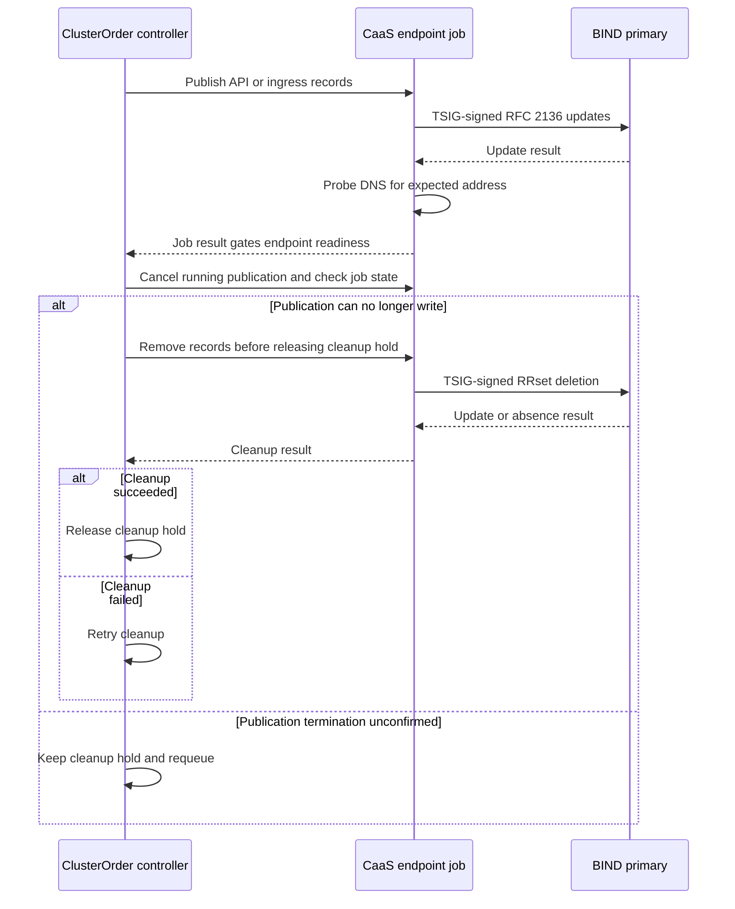

# Local DNS Backend Support — BIND Integration

## Summary

Add `dns.rfc2136.dns` to the existing CaaS DNS backend model. AAP sends
TSIG-authenticated DNS updates to a provider-operated BIND primary, while
the existing endpoint jobs continue to gate cluster readiness and deletion.
See [PRD](prd.md) for detailed requirements.

## Motivation

[OSAC-1050](../OSAC-1050-dns-api/README.md) separated endpoint DNS from
cluster provisioning, but Route 53 is the only existing backend that writes
records. A datacenter deployment can select noop and manage records manually,
but OSAC assigns cluster names during creation, so records cannot be staged in
advance. An RFC 2136 driver lets OSAC keep the same cluster lifecycle and
operate against a local authoritative server without cloud DNS access.

### Goals

- Reuse the existing DNS driver contract, endpoint job ordering, and cleanup
  guards; keep record ownership with CaaS. [Locked: D1, D7]
- Use a single deployment-wide backend and target zone, with authenticated
  updates from AAP and no external DNS provider dependency. [Locked: D2, D4, D10]
- Keep DNS backend configuration and credentials out of tenant interfaces.
  [Locked: D5, D6, D12]

### Non-Goals

- VM hostname DNS ([OSAC-6156](https://redhat.atlassian.net/browse/OSAC-6156)),
  tenant DNS resources or publication status, and per-region backend selection.
- Zone creation, delegation, forwarding, or changing the backend or migrating
  records while clusters exist.
- Validation against DNS servers other than BIND, automated BIND E2E in this
  milestone, and backend-specific Enclave Wizard behavior.
- Changes to IP allocation, Fabric Manager tasks, or CaaS address-family support.

## Proposal

`osac-aap` adds an RFC 2136 driver using the vendored
`community.general.nsupdate` module and its `dnspython` dependency. The
driver implements the same `create` and `delete` entry points as Route 53
and noop. `osac-installer` adds the backend choice and schema validation,
then passes settings through the existing AAP cluster fulfillment instance
group. It also documents BIND setup and recovery. The ClusterOrder
controller and Fulfillment continue to own the lifecycle defined in
[CaaS networking](../OSAC-1436-caas-networking/design.md#endpoint-feedback-and-dns).
The controller's deletion sequencing must not start record removal while a
publication job may still write; this changes behavior but no public contract.
See [Failure Handling and Recovery](#failure-handling-and-recovery).

### Workflow Description

1. **Cloud Infrastructure Admin:** Prepare a writable BIND primary and an
   authoritative zone containing the hosted cluster base domain. Create a
   dedicated TSIG key, grant it update permission for the managed records
   in that zone, and arrange resolution for the hub, nodes, and tenant
   clients. Allow the AAP job pods to reach the primary.
2. **Cloud Infrastructure Admin:** Select `dns.rfc2136.dns` in installation
   values, configure the zone and server, and supply the key through the
   protected installer Secret values. Ensure each DNS-managed cluster base
   domain is listed in `EXTERNAL_ACCESS_SUPPORTED_BASE_DOMAINS`.
3. **Tenant User or Tenant Admin:** Create a cluster through the existing
   UI, CLI, or API. After the applicable ExternalIPAttachment is ready,
   the ClusterOrder controller launches the API or ingress endpoint job.
   AAP writes the records and runs the existing DNS readiness checks before
   reporting job success. The tenant consumes the same API and console URLs.
4. **Tenant User or Tenant Admin:** Delete the cluster through the same
   interface. The controller starts no new publication and requests
   cancellation of any running publish jobs for the deleting endpoints.
   It must confirm that those jobs can no longer write before starting DNS
   removal for endpoints whose publication was attempted. Until then,
   the existing DNS finalizer stays in place and the controller requeues
   to check AAP job state. Once removal succeeds, the controller releases
   the finalizer. On removal failure, the Cloud Infrastructure Admin
   corrects the configuration or server and OSAC retries without a new
   tenant request.

The driver owns the interaction with the DNS primary. The job owns the
readiness probe, and the controller decides when the lifecycle can
advance based on the job result.

### API Extensions

None. No gRPC, REST, CRD, webhook, finalizer, or database changes. The existing
`osac.openshift.io/public-dns` finalizer on automatic ExternalIPAttachments
still guards cleanup. No tenant UI or CLI changes are required. The
installation values and internal driver are the only new interfaces.

### Implementation Details/Notes/Constraints

#### Endpoint jobs and record ownership

`playbook_osac_cluster_endpoints.yml` invokes `osac.service.cluster_endpoints`.
Its publish and remove tasks include the selected `dns_class` directly.
The older `osac` and `nico` `external_access` roles reach the same driver
through `dns.api.dns`. No caller embeds BIND-specific logic. The current
endpoint jobs derive these A records from the HostedCluster name and DNS
base domain:

| Owner name | Value | Publish / remove tasks |
|---|---|---|
| `api.<cluster>.<base>` | API ExternalIP address | `publish_public_dns_api` / `remove_public_dns_api` |
| `api-int.<cluster>.<base>` | API ExternalIP address | `publish_public_dns_api` / `remove_public_dns_api` |
| `*.apps.<cluster>.<base>` | Ingress ExternalIP address | `publish_public_dns_ingress` / `remove_public_dns_ingress` |

The DNS driver consumes the caller's zone, exact owner name, and record
type. Create also receives the address, TTL (1800 seconds by default), and
overwrite flag. DNS updates operate on one record set (RRset) at a time:
an identical rerun is a no-op; a changed address or TTL replaces that
RRset when overwrite is enabled. CaaS enables overwrite. Delete targets
only the named RRset and type, and succeeds when the server confirms the
RRset is already absent. An error is not evidence of absence. The driver
contract can carry AAAA records, but this design does not change the CaaS
callers from A records.

Normalize DNS names to lowercase absolute names, validate labels and
allow a wildcard only as the leftmost record label. Check zone membership
at a label boundary before sending a request. This rejects names such as
`api.c1.notclusters.example.com` for `clusters.example.com` and avoids the
module interpreting an FQDN as relative to the zone.

The publish jobs keep the existing unsigned DNS probes. They check both API
names and an application name beneath the wildcard against the expected
addresses. The probe uses `DNS_SERVER`, an authoritative nameserver lookup
when enabled, or the job's resolver. This probe is separate from dynamic
updates: `DNS_SERVER` is not `DNS_RFC2136_SERVER`, and pointing both at the
same server requires allowing the unsigned probe on UDP port 53. The
provider still owns resolution for tenant clients and cluster nodes.

#### Installer and driver interfaces

**IC-1 — Installation values.** Under
`aap.instanceGroups.clusterFulfillment`, `config` becomes the
`cluster-fulfillment-ig` ConfigMap and `secret` becomes the same-named
Kubernetes Secret. The existing AAP pod template reads both into the job
environment. The schema requires the server, key name, and secret when
RFC 2136 is selected. It does not require RFC 2136 settings for Route 53
or noop. [Locked: D2, D4, D6, D12]

| Key | Location | Behavior |
|---|---|---|
| `DNS_CLASS` | `config` | `dns.rfc2136.dns` opts in; default remains `dns.route53.dns`. |
| `DNS_ZONE` | `config` | Existing setting. Set to the BIND primary zone; if omitted, uses the caller's base domain. |
| `DNS_RFC2136_SERVER` | `config` | Required literal IPv4 or IPv6 address of the primary accepting updates. No hostname lookup is needed for record management. |
| `DNS_RFC2136_PORT` | `config` | String representing port 1–65535; defaults to `"53"`. |
| `DNS_RFC2136_PROTOCOL` | `config` | `tcp` (default) or `udp`. |
| `DNS_RFC2136_KEY_NAME` | `config` | Required TSIG key name in DNS name form. |
| `DNS_RFC2136_KEY_ALGORITHM` | `config` | Defaults to `hmac-sha256`; also accepts `hmac-sha224`, `hmac-sha384`, or `hmac-sha512`. |
| `DNS_RFC2136_KEY_SECRET` | `secret` | Required base64 TSIG key material as supplied by BIND. Helm applies the Kubernetes Secret encoding; do not add an extra encoding layer to the value. |
| `DNS_SERVER` | `config` | Existing optional readiness query target, an IP or hostname; not used to send updates. |

**IC-2 — DNS driver.** The new role at
`osac-aap/collections/ansible_collections/dns/rfc2136/roles/dns/` validates
inputs and invokes the module with explicit server, zone, transport, and TSIG
parameters. All update and prerequisite messages target that server. The
module can make a signed direct query to compare TTL on a rerun. No packages
are installed at runtime, and the driver never falls back to another
server or provider. The module and dependency must be present in the
deployed automation content and execution environment. See
[RFC 2136](https://www.rfc-editor.org/rfc/rfc2136) and
[RFC 8945](https://www.rfc-editor.org/rfc/rfc8945).
[Locked: D1–D3, D7, D10]

**IC-3 — Operator diagnostics.** Backend failures use fixed message text
and known response codes to name the setting or permission to check. The
operator's existing lifecycle events and AAP job references provide context;
no new event schema is introduced. [Locked: D7, D12]

The chart schema will be available to the Enclave plugin through the normal
schema pipeline. Wizard-specific field selection and handling are not
part of this EP. An IPv6 update server address is a transport option and
does not imply IPv6 or dual-stack CaaS support.

### Security Considerations

All record changes are TSIG-signed, with no unauthenticated fallback. Use a
dedicated provider key and a BIND `update-policy` limited to the intended
zone, names, and record types. TSIG authenticates messages but does not
encrypt traffic; restrict access to the management path and limit which
networks may query the zone according to deployment policy.

Inject the secret only from the cluster fulfillment Secret into the
existing job environment; do not include it in launch variables or a
ConfigMap. Keep values containing the secret in the deployment's protected
input path. Helm values and rendered Secret manifests are sensitive too:
base64 is not encryption. Restrict access to those artifacts and the job
environment.

Apply `no_log` to tasks handling credentials and record data, including
the relevant caller loops and module invocations. Do not print raw module
results, exceptions, record names, or addresses from the driver. Existing
administrator-facing CaaS diagnostics may identify the affected record
and job; no output or event may expose the secret. [Locked: D12]

### Failure Handling and Recovery

| Failure | Behavior | Cloud Infrastructure Admin action |
|---|---|---|
| Missing or malformed settings, invalid name, or record outside the zone | Chart rejects invalid values it can check; driver rejects invalid runtime inputs before updating. | Check the named setting, `DNS_ZONE`, and the hosted cluster base domain. |
| TSIG rejection | Job fails with a sanitized key diagnostic. | Check `DNS_RFC2136_KEY_NAME`, `DNS_RFC2136_KEY_ALGORITHM`, and the protected secret against BIND. |
| `REFUSED`, `NOTAUTH`, `NOTZONE`, or other unsuccessful server result | Job fails; a denial during the module's existence check must not count as a successful no-op. | Check update/query policy, authority for `DNS_ZONE`, and zone membership. |
| Server does not answer | Job fails and identifies the server, port, and transport settings to check. | Restore reachability from the actual AAP job pods. |
| Updates succeed but the readiness probe cannot resolve the names | Publication job still fails the readiness gate. | Check `DNS_SERVER`, unsigned query permissions, delegation or forwarding, and cached negative answers. |

The role checks both the module failure flag and the DNS response code.
The vendored module can otherwise return without a write and with a
non-failed module result when its delete prerequisite was refused. A
successful write returns `NOERROR`; `NXRRSET` from the signed existence
prerequisite means the requested RRset did not exist. Do not accept a
missing or unexpected response as proof of deletion. The current candidate
defaults a missing `dns_rc_str` to `NOERROR`; for delete, require an
explicit accepted result and cover an incomplete module response in
regression testing.

There is no transaction across all three records. If a job stops after
publishing or deleting some records, rerunning converges without duplicate
records. The existing controller retains job state and retries with its
normal backoff, including after controller restarts. Failed publication
does not make the cluster Ready; failed or uncertain removal does not
release DNS cleanup or complete cluster deletion. Do not clear the cleanup
finalizer to recover a DNS failure. [Locked: D7]

The cancellation request alone does not prove publication has stopped.
The existing controller polls AAP for recorded running jobs and retries
lookup errors. When no job is visible by label, its lost-launch timeout
marks the entry cancelled and cleanup can start, even though AAP may launch
that job later. Elapsed time is not proof that publication cannot write.
The implementation must close that window: removal starts only after AAP
reports every started publication job ended, or after a later reconcile
cancels a late launch and observes its end. If that cannot be confirmed,
the finalizer stays and the controller requeues. Confirm the resulting
behavior with the CaaS/AAP maintainers before declaring BIND supported;
see `TC-FAIL-02` in the [test plan](testplan.md).

### RBAC / Tenancy

No RBAC or tenancy changes required. Existing CaaS authorization controls
cluster create, read and delete. Only the provider's installation and
automation components have access to DNS settings and credentials. Names
and addresses come from the existing hosted cluster and endpoint workflow;
tenants cannot supply update targets or override the driver. The provider
zone is not a tenant-private registry: DNS visibility follows the provider's
resolver and BIND query policy, not OSAC API RBAC.

### Observability and Monitoring

No new metrics, event types, or alert rules. Use the existing ClusterOrder
endpoint diagnostics (including `DNSPublishFailed`), cleanup job state,
and linked AAP job output. The new driver messages identify the
configuration or authorization category without exposing credentials or
record data.

### Risks and Mitigations

| Risk | Mitigation |
|---|---|
| A BIND outage can delay cluster creation and keep clusters in deletion. | Fail closed, retain cleanup state, and retry after the admin restores BIND. |
| A broad or shared update key can affect unrelated records. | Use a dedicated zone or delegated subtree and a dedicated TSIG key with scoped permissions. |
| A successful write is mistaken for client reachability, or a cached answer for failed cleanup. | Keep the existing readiness probe, verify from a tenant network, and query the primary directly for cleanup evidence. |
| Domain configuration skips endpoint publication before the driver runs. | Document the base-domain allowlist and zone alignment as installation prerequisites; verify each supported template in the BIND lab. |

CaaS/AAP and installer reviewers should check the cleanup boundary and
Secret-to-job wiring; DNS infrastructure reviewers should check BIND
authorization and the lab procedure.

### Drawbacks

BIND becomes a runtime dependency for CaaS endpoint publication and
cleanup in deployments that select this backend. The provider must operate
the primary, manage its key, and keep client resolution working. The driver
also depends on the vendored module's response semantics, which must be
regression-tested when updating the collection.

## Alternatives (Not Implemented)

- **Invoke the `nsupdate` CLI directly.** It exposes the wire operation
  closely, but would require custom change detection and error mapping
  plus explicit key-file or process-input handling. The vendored module
  already provides update and check behavior within Ansible; the driver
  adds a narrow result check and redaction layer.
- **Call a BIND-specific management interface.** This could manage the
  server or zone as well as its records, but would require broader
  privileges and couple OSAC to BIND administration. RFC 2136 keeps the
  integration limited to records in an existing zone.
- **Keep using noop and manage records manually.** This requires no new
  driver, but cannot provide self-service cluster creation or reliable
  automated cleanup.

## Open Questions

### 1. Should RFC 2136 reject a base domain missing from the publication allowlist?

**Owner:** CaaS/AAP maintainers. **Impact:** The existing publish jobs skip
unlisted domains before the driver runs, whereas removal rejects
unsupported domains. This design requires the admin to list every managed
domain. Decide whether RFC 2136 also needs an explicit guard so a
misconfigured installation cannot bypass the publication gate.

## Test Plan

See the companion [test plan](testplan.md) for cases, owners, and evidence.

### Unit Tests

- Check chart schema defaults, conditional requirements, invalid inputs,
  and separation of ConfigMap settings from Secret material.
- Test local validation and diagnostics for missing credentials, malformed
  names, and records outside the zone.

### Integration Tests

- Run the role with the vendored module against a protocol double. Cover
  TSIG, changed and unchanged reruns, exact wildcard deletion, refusal during
  the existence check, and output redaction.
- Reuse the ClusterOrder Envtest cases with an AAP double to check the job
  lifecycle and cleanup hold. Cover deletion while publication is still
  running or its launch outcome is unknown. These checks do not establish
  live BIND behavior or credential injection.

### E2E Tests

- In a real BIND lab, create a cluster and check API, internal API, and
  wildcard records, plus tenant API and console resolution. Remove update
  permission during deletion, verify that the records remain and deletion
  does not complete, then restore permission and verify retry and cleanup.
  Query the exact wildcard owner and both API owners directly on the
  primary. Automated BIND E2E is a follow-up. [Locked: D8]

## Graduation Criteria

Before declaring BIND supported, land the driver, installer configuration,
and operator guide, pass the applicable component checks, and record the
manual BIND lifecycle and recovery results. No release or API maturity
stage is assigned by this EP.

## Upgrade / Downgrade Strategy

Upgrading without selecting RFC 2136 preserves the configured backend,
including the existing Route 53 default. To opt in, use a new deployment
or remove all existing clusters through their current backend first. Do
not change the backend or zone while live clusters depend on it. Before
downgrading to a version without RFC 2136, delete managed clusters with
the working backend and verify authoritative cleanup. There is no record
migration or automatic fallback. [Locked: D9]

## Version Skew Strategy

Upgrade the installer chart and AAP automation content before enabling
`dns.rfc2136.dns`; the chart must accept the settings, the AAP project must
contain the role, and the execution environment must have the module
dependencies. Do not enable RFC 2136 while jobs can still run with an
older revision that lacks the role. No API or operator contract changes
are required. Keep the previous backend selected until the compatible
components are in place.

## Support Procedures

The installer DNS backend guide documents both sides of setup: zone and
TSIG configuration, scoped update policy, job-pod connectivity, resolver
configuration, credential handling, and troubleshooting by message. For
a stalled cluster, correlate the endpoint event or cleanup job with the
sanitized AAP error. Fix configuration, access, or zone policy without
switching the backend, then watch the normal retry.

Verify cleanup directly on the primary using the expected record type
and exact owner names, including the quoted `*.apps` owner.
`NXDOMAIN` or authoritative `NOERROR` with no requested RRset is evidence
of absence; `REFUSED`, `SERVFAIL`, or a timeout is not. Recursive
resolvers may still answer until the positive TTL expires. For readiness
failures also query the resolver used by clients; success on the primary
alone does not establish that clients can resolve the names.

## Infrastructure Needed

A lab with deployed CaaS, real AAP jobs, and a reachable BIND primary
serving a disposable zone, plus a client on a tenant network. The lab
must be able to change the key's policy and isolate DNS record management
from external DNS providers. No new CI infrastructure is required for
the manual milestone.

---

## Provenance

Authored: draft @ design 0.15.0 - 7653641, workspace dns-rfc2136 @ 4bd3695d1 (19 behind origin/main)

<!-- ai-workflow-provenance:{"schema_version":1,"provenance_kind":"session","workflow":"design","workflow_version":"0.15.0","ai_workflows":"7653641","source_repo":"4bd3695d1","source_repo_branch":"dns-rfc2136","commits_behind_main":19,"commits_ahead_main":7,"main_ref":"main","phases":["draft"],"authoring_modes":["skill"],"context_changed":false,"origin_untracked":false} -->
