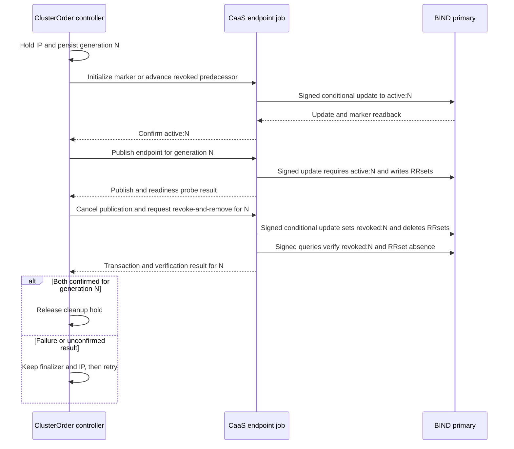

# Local DNS Backend Support — BIND Integration

## Summary

Add `dns.rfc2136.dns` to the existing CaaS DNS backend model. AAP sends
TSIG-authenticated DNS updates to a provider-operated BIND primary, while
the existing endpoint jobs continue to gate cluster readiness and deletion.
See [PRD](prd.md) for detailed requirements.

## Motivation

[OSAC-1050](../OSAC-1050-dns-api/README.md) separated endpoint DNS from
cluster provisioning, but Route 53 is the only existing backend that writes
records. A datacenter deployment can select noop and manage records manually,
but OSAC assigns cluster names during creation, so records cannot be staged in
advance. An RFC 2136 driver lets OSAC keep the same cluster lifecycle and
operate against a local authoritative server without cloud DNS access.

### Goals

- Reuse the DNS backend model and endpoint jobs, with a BIND-specific
  generation check on writes. Keep record ownership with CaaS. [Locked: D1, D7]
- Use a single deployment-wide backend and target zone, with authenticated
  updates from AAP and no external DNS provider dependency. [Locked: D2, D4, D10]
- Keep DNS backend configuration and credentials out of tenant interfaces.
  [Locked: D5, D6, D12]

### Non-Goals

- VM hostname DNS ([OSAC-6156](https://redhat.atlassian.net/browse/OSAC-6156)),
  tenant DNS resources or publication status, and per-region backend selection.
- Zone creation, delegation, forwarding, or changing the backend or migrating
  records while clusters exist.
- Validation against DNS servers other than BIND, automated BIND E2E in this
  milestone, and backend-specific Enclave Wizard behavior.
- Changes to IP allocation, Fabric Manager tasks, or CaaS address-family support.

## Proposal

`osac-aap` adds an RFC 2136 driver using `dnspython` to sign updates with
generation prerequisites. `osac-installer` adds backend selection and
validation, then passes settings through the existing AAP cluster
fulfillment instance group. It also documents BIND setup and recovery.
The ClusterOrder controller and Fulfillment continue to own the lifecycle defined in
[CaaS networking](../OSAC-1436-caas-networking/design.md#endpoint-feedback-and-dns).
The controller holds the endpoint IP until AAP confirms generation
revocation and record removal. BIND checks the generation in the same
transaction as the endpoint write, so a delayed job cannot recreate
records after revocation.

### Workflow Description

1. **Cloud Infrastructure Admin:** Prepare a writable BIND primary and an
   authoritative zone containing the hosted cluster base domain. Create a
   dedicated TSIG key, grant it update permission for the endpoint A
   records and marker TXT records in that zone, and arrange resolution for
   the hub, nodes, and tenant clients. Allow the AAP job pods to reach the
   primary.
2. **Cloud Infrastructure Admin:** Select `dns.rfc2136.dns` in installation
   values, configure the zone and server, and supply the key through the
   protected installer Secret values. Ensure each DNS-managed cluster base
   domain is listed in `EXTERNAL_ACCESS_SUPPORTED_BASE_DOMAINS`.
3. **Tenant User or Tenant Admin:** Create a cluster through the existing
   UI, CLI, or API. After the applicable ExternalIPAttachment is ready,
   the ClusterOrder controller holds the IP, persists the generation, and
   waits for AAP to confirm its active marker before launching publication.
   AAP writes the records only if the same update matches that marker, then
   runs the existing readiness checks. The tenant uses the same URLs.
4. **Tenant User or Tenant Admin:** Delete the cluster through the same
   interface. The controller stops launching publish jobs and requests
   cancellation of running jobs. AAP atomically revokes the generation
   and removes its records, then verifies the revoked marker and record
   absence on the primary. The controller keeps the finalizer and IP until
   AAP confirms both the transaction and verification, unless the
   allowlist guard proves no DNS write was possible as described below.
   If cleanup is unconfirmed, OSAC retries without a new tenant request.

The driver owns the interaction with the DNS primary. The job owns the
readiness probe, and the controller decides when the lifecycle can
advance based on the job result.

### API Extensions

No public gRPC, REST, webhook, or database changes. The internal ClusterOrder
CRD status gains per-endpoint DNS generation state. The existing
`osac.openshift.io/public-dns` finalizer on automatic ExternalIPAttachments
still guards cleanup. No tenant UI or CLI changes are required. The
installation values and internal job and driver changes are described below.

### Implementation Details/Notes/Constraints

#### Endpoint jobs and record ownership

`playbook_osac_cluster_endpoints.yml` invokes `osac.service.cluster_endpoints`.
Its publish and remove tasks include the selected `dns_class` directly.
`cluster_endpoints/tasks/main.yaml` rejects a missing, empty, or unlisted
HostedCluster base domain before dispatching either publish task. The
remove tasks also check the allowlist. Apply the same guard to new marker
write entry points. If it rejects the first marker initialization, return
the existing explicit pre-write rejection result before calling the driver.

In the current tree, `osac.templates.ocp_4_20_small_nico` overrides the
`ocp_small` external-access step and calls `nico.steps.external_access`.
That role dispatches through `dns.api.dns` for listed domains and skips
DNS publication for unlisted domains. This is the only in-tree template
wired to the NICo DNS role. The default `ocp_small` external-access step
is a noop. Separately, `osac.templates.ocp_ci_small` calls
`ci.steps.external_access`, which reaches `dns_class` through
`osac.service.external_access`. Neither legacy path is validated or
supported with BIND. Reject BIND writes from callers that do not implement
the marker lifecycle contract.

The endpoint jobs derive these A records from the HostedCluster name
and DNS base domain:

| Owner name | Value | Publish / remove tasks | Stable TXT marker |
|---|---|---|---|
| `api.<cluster>.<base>` | API ExternalIP address | `publish_public_dns_api` / `remove_public_dns_api` | `_osac-publish-api.<cluster>.<base>` |
| `api-int.<cluster>.<base>` | API ExternalIP address | `publish_public_dns_api` / `remove_public_dns_api` | `_osac-publish-api.<cluster>.<base>` |
| `*.apps.<cluster>.<base>` | Ingress ExternalIP address | `publish_public_dns_ingress` / `remove_public_dns_ingress` | `_osac-publish-ingress.<cluster>.<base>` |

#### Publish marker lifecycle

Each marker is a TXT RRset with exactly one string, `active:<generation>`
or `revoked:<generation>`. The generation is a positive decimal integer,
starting at `1` and increasing without reuse for that marker name.
The controller persists the endpoint identity, generation, any expected
predecessor, and lifecycle progress in ClusterOrder status before
dispatching jobs. It owns sequencing and the IP hold. The AAP driver
owns the TSIG key and sends
all transactions to the same writable authoritative primary. Each
endpoint's marker and A RRsets must be in the same authoritative zone.

| Operation | Prerequisite and changes in one signed update |
|---|---|
| Initialize `N` | Require marker owner name absence, then create `active:N`. Never overwrite a marker. An exact `active:N` readback can confirm an earlier initialization, not authorize a new write. |
| Publish `N` | Require the marker TXT RRset to contain `active:N`, then replace the endpoint A RRsets with the intended address and TTL (1800 seconds by default). Never create or restore a marker. |
| Revoke and remove `N` | Require the marker to contain `active:N`, replace it with `revoked:N`, and delete the endpoint's A RRsets. On retry, require the marker to contain `revoked:N` and repeat removal. |
| Activate replacement `N+1` | After `N` cleanup is confirmed and its IP hold is released, require the marker to contain `revoked:N` before changing it to `active:N+1`. This is an explicit controller-authorized transition, not initialization. |

Once the first generation `N` is persisted, revoke-and-remove can require
marker name absence and write `revoked:N`, whether or not initialization
has been dispatched. If deletion races with replacement activation, cleanup
can require the exact persisted `revoked:N-1` predecessor and advance
directly to `revoked:N`. In either case, the request deletes the endpoint
RRsets in that same transaction.
If activation wins, retry against `active:N`. A read can select a
prerequisite but cannot replace it.

Retain revoked markers indefinitely. Do not delete one to make a name
reusable. A replacement advances the marker in place and only when the
controller knows the predecessor belongs to the same endpoint lifecycle.
If that ownership cannot be established, fail closed and use a different
name for a new lifecycle. Once `N+1` is current, cleanup for `N` cannot
match its prerequisite and cannot delete the replacement's RRsets. The
retained marker also prevents stale initialization from matching marker
name absence. API and ingress transactions are independent.

Normalize DNS names to lowercase absolute names, validate labels and
allow a wildcard only as the leftmost record label. Allow underscores only
in the fixed marker prefix. Check zone membership
at a label boundary before sending a request. This rejects names such as
`api.c1.notclusters.example.com` for `clusters.example.com` and avoids the
driver interpreting an FQDN as relative to the zone.

The publish jobs keep the existing unsigned DNS probes. They check both API
names and an application name beneath the wildcard against the expected
addresses. The probe uses `DNS_SERVER`, an authoritative nameserver lookup
when enabled, or the job's resolver. This probe is separate from dynamic
updates: `DNS_SERVER` is not `DNS_RFC2136_SERVER`, and pointing both at the
same server requires allowing the unsigned probe on UDP port 53. The
provider still owns resolution for tenant clients and cluster nodes.

#### Installer and driver interfaces

**IC-1 — Installation values.** Under
`aap.instanceGroups.clusterFulfillment`, `config` becomes the
`cluster-fulfillment-ig` ConfigMap and `secret` becomes the same-named
Kubernetes Secret. The existing AAP pod template reads both into the job
environment. The schema requires the server, key name, and secret when
RFC 2136 is selected. It does not require RFC 2136 settings for Route 53
or noop. [Locked: D2, D4, D6, D12]

| Key | Location | Behavior |
|---|---|---|
| `DNS_CLASS` | `config` | `dns.rfc2136.dns` opts in. The default remains `dns.route53.dns`. |
| `DNS_ZONE` | `config` | Existing setting. Set to the BIND primary zone; if omitted, uses the caller's base domain. |
| `DNS_RFC2136_SERVER` | `config` | Required literal IPv4 or IPv6 address of the primary accepting updates. No hostname lookup is needed for record management. |
| `DNS_RFC2136_PORT` | `config` | String representing port 1–65535; defaults to `"53"`. |
| `DNS_RFC2136_PROTOCOL` | `config` | `tcp` (default) or `udp`. |
| `DNS_RFC2136_KEY_NAME` | `config` | Required TSIG key name in DNS name form. |
| `DNS_RFC2136_KEY_ALGORITHM` | `config` | Defaults to `hmac-sha256`; also accepts `hmac-sha224`, `hmac-sha384`, or `hmac-sha512`. |
| `DNS_RFC2136_KEY_SECRET` | `secret` | Required base64 TSIG key material as supplied by BIND. Helm applies the Kubernetes Secret encoding; do not add an extra encoding layer to the value. |
| `DNS_SERVER` | `config` | Existing optional readiness query target, an IP or hostname; not used to send updates. |

**IC-2 — DNS driver and internal job contract.** The role at
`osac-aap/collections/ansible_collections/dns/rfc2136/roles/dns/` accepts
the operation, endpoint kind, HostedCluster name and base domain,
generation, and predecessor generation when applicable. Publication
also takes the address and TTL. The driver derives the marker and RRset
names and rejects missing or inconsistent inputs before sending an update.
Jobs use the generation supplied at launch, never the current marker
value as a substitute. The operator correlates each result with the
endpoint, operation, and persisted generation. A stale result cannot
advance the lifecycle.

The driver builds name-absence and value-dependent TXT prerequisites
directly with `dnspython`. The existing per-record `nsupdate` calls do not expose
this contract and must not be used as a fallback. Updates and signed
verification target the configured primary only. The dependency must
already be in the execution environment. See [RFC 2136 §2.4 and §3.7](https://www.rfc-editor.org/rfc/rfc2136)
for prerequisites and update atomicity, and
[RFC 8945](https://www.rfc-editor.org/rfc/rfc8945) for TSIG.
[Locked: D1–D3, D7, D10]

**IC-3 — Operator diagnostics.** Backend failures use fixed message text
and known response codes to name the setting or permission to check. The
operator's existing lifecycle events and AAP job references provide context;
no new event schema is introduced. [Locked: D7, D12]

The chart schema will be available to the Enclave plugin through the normal
schema pipeline. Wizard-specific field selection and handling are not
part of this EP. An IPv6 update server address is a transport option and
does not imply IPv6 or dual-stack CaaS support.

### Security Considerations

All record changes are TSIG-signed, with no unauthenticated fallback. Use a
dedicated provider key and a BIND `update-policy` limited to the intended
endpoint A and marker TXT owner names in the zone. TSIG authenticates
messages but does not encrypt traffic. Restrict access to the management
path and limit which networks may query the zone according to deployment
policy. If CaaS and the
[OSAC-6156](https://redhat.atlassian.net/browse/OSAC-6156) /
[OSAC-6158](https://redhat.atlassian.net/browse/OSAC-6158) VM DNS effort
share a DNS server, use separate credentials scoped to non-overlapping
writable names. CaaS replaces and deletes whole endpoint RRsets. Leave
backend reuse to the VM DNS effort.

Inject the secret only from the cluster fulfillment Secret into the
existing job environment; do not include it in launch variables or a
ConfigMap. Keep values containing the secret in the deployment's protected
input path. Helm values and rendered Secret manifests are sensitive too:
base64 is not encryption. Restrict access to those artifacts and the job
environment.

Apply `no_log` to tasks handling credentials and record data, including
the relevant caller loops and module invocations. Do not print raw module
results, exceptions, record names, or addresses from the driver. Existing
administrator-facing CaaS diagnostics may identify the affected record
and job; no output or event may expose the secret. [Locked: D12]

### Failure Handling and Recovery

| Failure | Behavior | Cloud Infrastructure Admin action |
|---|---|---|
| Missing or malformed settings, invalid name, or record outside the zone | Chart rejects invalid values it can check; driver rejects invalid runtime inputs before updating. | Check the named setting, `DNS_ZONE`, and the hosted cluster base domain. |
| TSIG rejection | Job fails with a sanitized key diagnostic. | Check `DNS_RFC2136_KEY_NAME`, `DNS_RFC2136_KEY_ALGORITHM`, and the protected secret against BIND. |
| `REFUSED`, `NOTAUTH`, `NOTZONE`, or other unsuccessful server result | Job fails and does not confirm a write or record absence. | Check update and query policy, authority for `DNS_ZONE`, and zone membership. |
| Marker prerequisite fails | BIND applies none of the changes. A stale publish cannot recreate records and stale cleanup cannot modify the current generation. | Check the marker and persisted endpoint generation if the current operation keeps failing. |
| Server does not answer or verification disagrees | Job fails. The controller keeps the finalizer and IP and retries the conditional transaction and verification. | Check reachability from the job pods, `DNS_RFC2136_SERVER`, and the exact marker and RRsets on the primary. |
| Updates succeed but the readiness probe cannot resolve the names | Publication job still fails the readiness gate. | Check `DNS_SERVER`, unsigned query permissions, delegation or forwarding, and cached negative answers. |

The existing AAP lost-launch timeout can mark a job cancelled when its
launch cannot be found by label, even though AAP may start it later.
Cancellation is still useful, but neither job tracking nor a terminal
state protects the IP. A publish that wins before the revocation
transaction is removed by it. A publish that runs afterward fails its
`active:N` prerequisite, even if the job started before deletion.

If the allowlist guard explicitly rejects the first initialization attempt
before any DNS write, the controller may release the finalizer and IP
during deletion without a DNS cleanup job. Use the existing pre-write rejection result
only when it matches that endpoint and attempt and persisted state rules
out any other attempt that could have written or could still write a marker
or record. A later publish rejection, timeout, or unknown launch does not
establish this.

Otherwise, release the finalizer and IP only after a definitive AAP
success for the current generation's revoke-and-remove operation. AAP
must receive an authenticated `NOERROR` for the conditional transaction
and then use signed authoritative queries to the primary to verify the
exact `revoked:N` marker and absence of every endpoint A RRset. A timeout,
missing result, failed prerequisite, or a clean query alone is not success.
If the response was lost after commit, retry using the exact `revoked:N`
prerequisite to obtain a definitive result. Persist cleanup confirmation
before releasing the hold so a replacement cannot advance the marker
while that cleanup is unconfirmed. Keep the finalizer and IP and retry
if any check fails. Do not manually clear the finalizer. [Locked: D7]

### RBAC / Tenancy

No RBAC or tenancy changes required. Existing CaaS authorization controls
cluster create, read and delete. Only the provider's installation and
automation components have access to DNS settings and credentials. Names
and addresses come from the existing hosted cluster and endpoint workflow;
tenants cannot supply update targets or override the driver. The provider
zone is not a tenant-private registry: DNS visibility follows the provider's
resolver and BIND query policy, not OSAC API RBAC.

### Observability and Monitoring

No new metrics, event types, or alert rules. Use the existing ClusterOrder
endpoint diagnostics (including `DNSPublishFailed`), cleanup job state,
and linked AAP job output. The new driver messages identify the
configuration or authorization category without exposing credentials or
record data.

### Risks and Mitigations

| Risk | Mitigation |
|---|---|
| A BIND outage can delay cluster creation and keep clusters in deletion. | Fail closed, retain cleanup state, and retry after the admin restores BIND. |
| A broad or shared update key can affect unrelated records. | Use a dedicated zone or delegated subtree and a dedicated TSIG key with scoped permissions. |
| A successful write is mistaken for client reachability, or a cached answer for failed cleanup. | Keep the existing readiness probe, verify from a tenant network, and query the primary directly for cleanup evidence. |
| An unlisted base domain or a legacy caller cannot publish through BIND. | Reject before DNS writes and document the allowlist and supported ClusterOrder path. |
| Removing or rolling back markers could let a stale update match. | Preserve marker state across primary recovery and never delete revoked markers to reuse a name. Do not resume writes or release holds against a primary with unverified marker state. |

CaaS/AAP and installer reviewers should check the cleanup boundary and
Secret-to-job wiring; DNS infrastructure reviewers should check BIND
authorization and the lab procedure.

### Drawbacks

BIND becomes a runtime dependency for CaaS endpoint publication and
cleanup in deployments that select this backend. The provider must operate
the primary, manage its key, and keep client resolution working. The driver
also adds one durable marker per endpoint name and requires preserving
marker state alongside the managed zone.

## Alternatives (Not Implemented)

- **Invoke the `nsupdate` CLI directly.** It can express prerequisites and
  updates, but would require extra process and credential handling.
  Build signed messages in the driver instead.
- **Call a BIND-specific management interface.** This could manage the
  server or zone as well as its records, but would require broader
  privileges and couple OSAC to BIND administration. RFC 2136 keeps the
  integration limited to records in an existing zone.
- **Keep using noop and manage records manually.** This requires no new
  driver, but cannot provide self-service cluster creation or reliable
  automated cleanup.

## Test Plan

See the companion [test plan](testplan.md) for cases, owners, and evidence.

### Unit Tests

- Check chart schema defaults, conditional requirements, invalid inputs,
  and separation of ConfigMap settings from Secret material.
- Test local validation and diagnostics for missing credentials, malformed
  names, and records outside the zone.

### Integration Tests

- Run the driver against a protocol double. Cover signed marker transitions,
  same-update prerequisites, rejection of stale writes, the base-domain
  guard, and output redaction.
- Use ClusterOrder Envtest with an AAP double to check generation persistence,
  activation before publication, and finalizer and IP retention until
  revocation and removal are confirmed, including across restart.

### E2E Tests

- In a real BIND lab, create a cluster and check API, internal API, and
  wildcard records, plus tenant API and console resolution. Remove update
  permission during deletion, verify that the records remain and deletion
  does not complete, then restore permission and verify retry and cleanup.
  Query the exact wildcard owner and both API owners directly on the
  primary. Delay publication until after the first clean DNS check and
  separately delay initialization until after revocation. Confirm BIND
  rejects both late writes. Automated BIND E2E is a follow-up. [Locked: D8]

## Graduation Criteria

Before enabling the backend, enforce the generation prerequisite in every
supported BIND write path and reject markerless legacy writes. Land the
operator, driver, installer configuration, and operator guide. Pass the
component checks and record manual results for the supported BIND versions
and transports. No release or API maturity stage is assigned by this EP.

## Upgrade / Downgrade Strategy

Upgrading without selecting RFC 2136 preserves the configured backend,
including the existing Route 53 default. To opt in, use a new deployment
or remove all existing clusters through their current backend first. Do
not change the backend or zone while live clusters depend on it. Before
downgrading to a version without RFC 2136, delete managed clusters with
the working backend and verify authoritative cleanup. Preserve revoked
markers across downgrade and primary restore. There is no record migration
or automatic fallback. [Locked: D9]

## Version Skew Strategy

Upgrade the installer chart, ClusterOrder CRD and controller, and AAP
automation content before enabling `dns.rfc2136.dns`. The execution
environment must have `dnspython`. Keep the previous backend selected
until the components agree on the generation contract and no job can
use an older BIND writer that bypasses it.

## Support Procedures

The installer DNS backend guide documents both sides of setup: zone and
TSIG configuration, scoped update policy, job-pod connectivity, resolver
configuration, credential handling, and troubleshooting by message. For
a stalled cluster, correlate the endpoint event or cleanup job with the
sanitized AAP error. Fix configuration, access, or zone policy without
switching the backend, then watch the normal retry.

Check the exact `revoked:N` TXT marker and endpoint A RRsets directly on
the primary, including the literal `*.apps` owner. Authoritative
`NXDOMAIN` or `NOERROR` without the requested RRset is absence evidence.
`REFUSED`, `SERVFAIL`, or a timeout is not. A manual query does not
substitute for the confirmed AAP cleanup result. Never remove a revoked
marker to clear a failed job. Recursive resolvers can still answer until
the TTL expires. For readiness failures also check the client resolver.

## Infrastructure Needed

A lab with deployed CaaS, real AAP jobs, and a reachable BIND primary
serving a disposable zone, plus a client on a tenant network. The lab
must be able to change the key's policy, pause publication and initialization
before sending updates, and isolate DNS record management from external
DNS providers. No new CI infrastructure is required for
the manual milestone.

---

## Provenance

Authored: draft @ design 0.15.0 - 7653641, workspace dns-rfc2136 @ 4bd3695d1 (19 behind origin/main)

<!-- ai-workflow-provenance:{"schema_version":1,"provenance_kind":"session","workflow":"design","workflow_version":"0.15.0","ai_workflows":"7653641","source_repo":"4bd3695d1","source_repo_branch":"dns-rfc2136","commits_behind_main":19,"commits_ahead_main":7,"main_ref":"main","phases":["draft"],"authoring_modes":["skill"],"context_changed":false,"origin_untracked":false} -->
