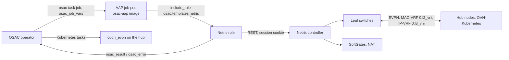

# Netris Fabric Manager

## Summary

The Netris Fabric Manager is the Fabric Manager OSAC ships for fabrics run by a
Netris controller. It is the Ansible role `osac.templates.netris`, which
implements every Fabric task of the [network manager integration
contract](/enhancements/OSAC-1433-network-manager-integration-contract-networking/design.md)
by calling the Netris controller API: a VirtualNetwork is a Netris VPC, a
Subnet a V-Net, external addresses are Netris IPAM reservations and NAT rules.
This is the manager design the contract asks for (§4.1): settings, network
types, documented no-ops, limits, prerequisites and hub permissions. See the
[PRD](prd.md) for the requirements.

It describes the desired state against the shared contract and CaaS flow. This
proposal aligns with the contract updates for OSAC-owned guest-ingress
allocation and serialized physical attachment tasks. The contract requires
capacity accounting for attached hosts waiting for DHCP; the Netris role does
not implement that check yet. NetworkClass status reports Netris's documented physical policy limit.
The FabricDomain template input from BareMetalInstanceType remains a separate
follow-up; CaaS does not create FabricDomains.

## Motivation

The contract defines what a Fabric Manager does, and the [CUDN EVPN Kubernetes
Manager](/enhancements/OSAC-4291-cudn-evpn-k8s-manager-phase-1-networking/design.md)
and the [Agentless VLAN Fabric
Manager](/enhancements/OSAC-3664-agentless-vlan-fabric-manager/design.md) each
have a manager design. Netris has none, although the contract names it as the
manager OSAC ships (§4.1, §4.2), as the manager of OSAC's EVPN lab (§4.11), and
lists its deviations in its lab results (§4.9) and risks (§4.13). Those notes
are scattered across the contract and the installation guide.

This design collects them and states the behavior the Netris manager must
have for every workload service: VMs with `cudn_evpn`, bare-metal servers,
CaaS clusters and Ethernet east-west domains. Most of it is
implemented on osac `main`; [Implementation status](#implementation-status)
lists what is not, so each gap has one place to be tracked.

## Goals

- Implement every Fabric task of the contract against the Netris controller
  API, with no Netris-specific code in the operator or fulfillment service.
- Key every Netris object by the OSAC API ID in its name, and refuse to read
  for use, change or delete an object whose Netris tenant, site or VPC does
  not prove it is OSAC's.
- Let Netris allocate the VNIs and addresses it owns (VPC VNI, V-Net VXLAN
  ID, IPAM reservations), so OSAC keeps no range of its own for them.
- Ship in OSAC's `osac-aap` image with an installer-rendered registration, so
  a provider supplies only settings and credentials.

## Non-Goals

- SecurityGroup enforcement on the fabric: the SecurityGroup tasks and the
  SecurityGroup bind of every attachment are documented no-ops.
- Per-VirtualNetwork DNS (contract §4.8).
- Network types other than `evpn`, and IPv6.
- Managing the Netris controller, switches, SoftGates, or the EVPN peering
  between the fabric and the hub nodes.

## Proposal

The Netris manager is one Ansible role run by OSAC's generic network-task
playbook (contract §4.3). Each task reads `osac_job_vars`, talks to the Netris
controller with the vendored `netris.controller` collection, and publishes only
`osac_result` or `osac_error`. It creates no hub (Kubernetes) objects.

The diagram shows that OSAC never talks to Netris outside a job, and that the
Netris role and `cudn_evpn` never talk to each other: OSAC passes the VNIs
Netris returns to `cudn_evpn`, and the two sides meet only in the EVPN control
plane between the leaves and the hub nodes.

### Workflow Description

#### Installation

1. The Cloud Infrastructure Admin sets `global.networking.fabricManager:
   netris` and, for VMs, `k8sManager: cudn_evpn`.
2. The installer renders the immutable registration ConfigMap
   `osac-network-fabric-manager-netris` with the `netris` name, Netris role,
   and `evpn` network type [Codebase:
   osac-installer/charts/osac/templates/networking/netris-registration.yaml].
3. The admin puts the [settings](#settings) into
   `aap.instanceGroups.networkFulfillment.config` and `.secret`.
4. The admin completes the [installation prerequisites](#installation-prerequisites).
5. The NetworkClass resolves and becomes READY. No provider image is built:
   the role ships in `osac-aap`.

#### Tenant network lifecycle

1. A VirtualNetwork create runs `create_virtual_network`: the role creates the
   VPC `osac-vn-<id>` and, inside it, the IPAM allocation `osac-vn-<id>` over
   `spec.ipv4Cidr`, then returns `backend_id` (the VPC ID) and, with
   `network_type: evpn`, the VPC's VNI as `l3_vni`.
2. A Subnet create runs `create_subnet`: with `network_type: evpn`, the role
   checks that the VPC still has the recorded `l3Vni`. It creates the IPAM
   subnet and the V-Net `osac-sn-<id>` in the VPC, with the gateway on
   `gateway_ipv4`. With `network_type: evpn`, it returns the V-Net's VXLAN ID
   as `network_segment.l2_vni`; without a network type it returns no
   segment. For the VirtualNetwork's first Subnet, `cudn_evpn` builds the
   hub network with both VNIs, and that Subnet owns it. In its phase 1 it
   builds none for the other Subnets, so VMs run only on the owner Subnet
   and a VM attachment on another Subnet fails ([contract — `cudn_evpn`
   limit](/enhancements/OSAC-1433-network-manager-integration-contract-networking/design.md#410-task-reference)).
   Bare-metal servers work on every Subnet, and routing between Subnets
   works for them. VMs on several Subnets wait until `cudn_evpn` lifts the
   limit.
3. Deletes run in reverse: the V-Net, then the IPAM subnet; the IPAM
   allocation, then the VPC. Netris frees each VNI when its object is deleted.

#### VMs (overlay attachments)

The Fabric overlay `apply_network_attachment` and its delete are documented
no-ops: `cudn_evpn` attaches the VM and enforces its SecurityGroups on the hub.
The fabric learns the VM's MAC and IP from the hub nodes' EVPN routes.

#### Bare-metal servers (physical attachments)

1. BMaaS creates the NetworkAttachment after the host is provisioned on the
   provisioning V-Net (`NETRIS_BM_PROVISIONING_VNET`).
2. `apply_network_attachment` checks everything that can fail before its first
   write: the Subnet's V-Net is OSAC's, `physical_ipv4_cidrs` is not empty,
   the host is a Netris server, `interface.name` is one of its ports, and the
   range still has an address for the MAC (contract §4.10): the MAC already
   has an IPAM host on the V-Net, the host already has a port on the V-Net (a
   retry after the move), or the DHCP range ([Gateway and
   DHCP](#gateway-and-dhcp)) has a free address: its size minus every IPAM
   host on the V-Net and minus one for each server with a port on the V-Net
   that has no IPAM host yet. A full range is a final error with no write.
   The count assumes one address per attached host ([Gateway and
   DHCP](#gateway-and-dhcp) says why it holds; [Risks](#risks-and-mitigations)
   covers a host that takes more).
3. It makes sure V-Net DHCP is on over the physical range (`create_subnet`
   already turned it on), takes every port of the host off the provisioning
   V-Net, waits `NETRIS_PORT_SETTLE_SECONDS`, and
   adds `interface.name` to the Subnet's V-Net.
4. `query_dhcp_lease` reads the IPAM hosts of `osac-sn-<id>` and returns the
   one whose MAC matches; none or several is retryable.
5. `delete_network_attachment` returns every fabric port of the host (every
   port not in a Server Cluster) to the provisioning V-Net and deletes the IPAM host of `interface.mac_address`
   on `osac-sn-<id>`, which releases its address (contract §4.10).

#### External addresses

| Task | Netris object | Behavior |
|---|---|---|
| `create_external_ip_pool` | IPAM allocation `osac-pool-<id>` and common subnet `osac-pool-<id>-common` over the pool CIDR | The common subnet is required: Netris blackholes the return traffic of a `/32` nat address that no common subnet covers. |
| `create_external_ip` | IPAM subnet `osac-eip-<id>`, purpose `nat`, `/32` | First free eligible address; a rerun returns the same address. Netris rejects an overlapping `/32`, so two parallel allocations in one pool cannot take one address; the loser retries inside the task. Full pool is final. |
| `attach_external_ip` | DNAT rule `osac-eipa-<id>`, protocol all, `<external>/32` → `<destination>/32` | In the VPC of the destination VirtualNetwork, or in `NETRIS_MGMT_VPC_ID` for `provider_management`. It must also serve hairpin traffic that reaches the ExternalIP through a VirtualNetwork's NATGateway (contract §4.10); [Risks](#risks-and-mitigations). |
| `create_nat_gateway` | SNAT rule `osac-natgw-<id>`, VirtualNetwork CIDR → `<external>/32` | In the VirtualNetwork's VPC. |

The IPAM objects are outside the VPC and the NAT rules inside it; the SoftGates
run the rules. Deletes find the object by its name and refuse a mismatch with
the stored input ([Ownership](#ownership)): a NAT rule whose addresses differ, a pool object whose CIDR
differs, or an ExternalIP `/32` that is outside the pool CIDR, not purpose
`nat`, or of another tenant or site. The ExternalIP input has no address, so
its delete never compares one; a create that stopped before its result is
released the same way, by name.

#### Cluster ingress addresses

The Subnet's LB VIP range (`ipam.lb_vip_ipv4_cidrs`) is not Netris's.
OSAC assigns each Cluster its ingress address from that range, and guest
MetalLB in L2 mode announces it from whichever worker runs the ingress. The
V-Net carries the address's ARP and traffic like any other host on the
segment, and Netris DHCP never hands it out, because it lies outside
`physical_ipv4_cidrs`. The Netris manager creates nothing for it.

The manager's only duty is the contract §4.9 one: carry the address to
whichever worker port answers ARP for it, and never drop it as a spoofed
source.

#### Ethernet east-west domains

`create_fabric_domain` creates or updates the Netris Server Cluster
`osac-fd-<id>` in the VirtualNetwork's VPC with exactly `spec.servers`, and
returns its ID as `backend_id`. The delete removes it.

The Server Cluster template follows the [FabricDomain admin guide](https://github.com/osac-project/osac/blob/main/docs/guides/admin/fabric-domains.md#configure-hardware-bindings):
the operator maps each server's Netris host name to its BareMetalInstanceType
(`fabricDomainInventory`), and the type's `fabric_bindings.ethernet_ew.netris`
is the template ID. Every server of the domain must resolve to the same
template, because one Server Cluster has one template; otherwise the operator
blocks the domain before any task runs. The operator passes that template to
`create_fabric_domain`, and the role uses it as is. Today the task input has
only `spec.type` and `spec.servers` (contract §4.10), so the role still takes
the one distinct template of `NETRIS_RESOURCE_CLASS_MAP` (Implementation
status).

### API Extensions

No OSAC API, CRD or proto changes. The manager uses the contract's inputs and
typed results only. Its interfaces are:

- The registration ConfigMap above (contract §4.2).
- The [settings](#settings) in `network-fulfillment-ig` (contract §4.3).
- The Netris objects it creates, named by [object naming](#object-naming),
  which a Cloud Infrastructure Admin sees in the Netris console.

## UX Alignment

No UI change. Tenants use the shared networking pages and wizards; the only
Netris-specific behavior a tenant observes is that SecurityGroups filter VMs
and not bare-metal servers, which the installation guide states.

### Implementation Details/Notes/Constraints

#### Object naming

Every name is built in one place from API IDs, so a delete finds its objects
by name with no lookup table [Codebase: osac-aap/.../plugins/filter/netris_contract.py].

| OSAC resource | Netris object | Name |
|---|---|---|
| VirtualNetwork | VPC; IPAM allocation (purpose `common`) | `osac-vn-<id>` |
| Subnet | V-Net; IPAM subnet (purpose `common`) | `osac-sn-<id>` |
| ExternalIPPool | IPAM allocation; IPAM subnet (purpose `common`) | `osac-pool-<id>`, `osac-pool-<id>-common` |
| ExternalIP | IPAM subnet `/32` (purpose `nat`) | `osac-eip-<id>` |
| ExternalIPAttachment | NAT rule (DNAT) | `osac-eipa-<id>` |
| NATGateway | NAT rule (SNAT) | `osac-natgw-<id>` |
| FabricDomain | Server Cluster | `osac-fd-<id>` |

#### Ownership

All objects live in one Netris tenant (`NETRIS_TENANT_ID`) and site
(`NETRIS_SITE_ID`); tenant isolation comes from VPCs, not Netris tenants. The
Netris tenant is OSAC's alone ([prerequisite](#installation-prerequisites)), so
an object in it with an OSAC name was created by OSAC, also after a lost
response or a rerun. Before it writes, a task proves an object with its name is OSAC's: same Netris tenant,
same site, and, for a V-Net or Server Cluster, the VPC of the VirtualNetwork.
An object with the name that fails the proof, or whose owner Netris does not
report, is a final error and is never changed or deleted. A delete also
refuses an object whose immutable fields (CIDR, NAT addresses, purpose)
differ from the stored input.

#### Network type and VNIs

- The manager declares only `evpn`; any other `network_type` fails as final.
- Netris allocates both VNIs: the VPC's VNI is the `l3_vni`, the V-Net's
  VXLAN ID the `l2_vni`. There is no OSAC VNI range (contract §4.9). A VNI
  that is missing or 0 right after create is retryable (Netris has not
  assigned it yet); one outside 1–16777215 is final.
- With `network_type: evpn`, `create_subnet` fails as final when the VPC's
  VNI differs from the recorded `virtual_network.status.l3Vni`: the VPC was
  replaced outside OSAC.
- Route targets `0:<l2_vni>` and `0:<l3_vni>`, and the other §4.9 fabric
  duties Netris exposes no field for, are
  [installation prerequisites](#installation-prerequisites); no task sets
  them.

#### Gateway and DHCP

- Without a network type, the V-Net gateway is `gateway_ipv4/<prefix>`.
- V-Net DHCP serves only `physical_ipv4_cidrs`: from the first physical
  address (or the address after the gateway, if the gateway is in the range)
  to the last physical address (or the address before broadcast, if the range
  ends the Subnet). It never reaches the overlay or LB VIP ranges.
- With `evpn`, the V-Net also serves `gateway_ipv4`, so bare-metal servers
  have a local gateway. It uses Netris's own MAC address, while
  OVN-Kubernetes serves the same address to VMs with `0a:58` followed by the
  four bytes of `gateway_ipv4`. Routed traffic can therefore see two gateway
  MAC addresses for one address, which contract §4.9 accepts when the
  manager design states it, as here. Same-Subnet traffic does not depend on
  it, and the lab suites pass with it.
- V-Net DHCP is always on, with or without `evpn`: `create_subnet` turns it
  on over `physical_ipv4_cidrs` and it stays on until the Subnet is deleted.
  A rerun of `create_subnet` turns it back on if it drifted off. With empty
  `physical_ipv4_cidrs` the V-Net has no DHCP, and a physical attachment
  fails as final ("no fabric address range for bare-metal DHCP").
- VMs never reach Netris DHCP: OVN-Kubernetes answers a VM's DHCP request
  inside the logical switch, so the request never leaves the node. Netris
  DHCP therefore answers only hosts on fabric ports, and every DHCP client on
  the V-Net is a host OSAC attached: only physical attachment tasks add ports
  to the V-Net, and provider devices use static addresses
  ([prerequisites](#installation-prerequisites)). It serves
  `physical_ipv4_cidrs` to any such MAC, because the vendored Netris
  collection has no per-MAC host reservation; this is a documented deviation
  from contract §4.8 ("answers only MACs of physical attachments"). The
  address plan keeps the two servers apart: Netris hands out only the
  physical range and OVN-Kubernetes only the overlay range.
- DNS: Netris DHCP hands out the resolver of the Netris default DHCP option
  set, which the provider configures at installation (default `8.8.8.8`).
  OSAC passes no DNS setting.

#### Bare-metal port moves

- Fabric ports are the host's ports that are not in a Server Cluster; the
  apply takes all of them off the provisioning V-Net and puts only
  `interface.name` on the Subnet, and the delete returns all of them.
- Changing a V-Net's ports rewrites its whole port list. Every attachment
  changes the shared provisioning V-Net, so the operator runs at most one
  physical attachment task at a time per Fabric Manager (contract §4.7), not
  just per Subnet; the Lease releases when AAP reports the job terminal.
- A host that Netris does not know yet is retryable; a port name the host
  does not have is final.

#### Error classification

Every task runs in `block`/`rescue`. Final (`retryable: false`): invalid input,
an object that is not OSAC's, a refused CIDR (HTTP 400, 409, 422 on an IPAM
create, usually an overlap) except an ExternalIP `/32` overlap with a parallel
allocation, which the task retries and then reports as retryable, a full
pool or range, a replaced VPC, an
unsupported network type. Retryable: a missing or malformed setting, a
missing parent object, a VNI not yet assigned, a host not yet registered, no
lease yet, and every other failure (transport, HTTP 5xx). Messages carry the
step name and a sanitized provider detail, never the response body, the
session cookie or the module arguments.

#### Settings

Read from the job pod environment (ConfigMap and Secret
`network-fulfillment-ig`, contract §4.3). A missing or malformed required
setting is retryable with a message naming it.

| Setting | Where | Needed by |
|---|---|---|
| `NETRIS_CONTROLLER_URL` | config | Every task; an `http(s)` URL (`https` in production) |
| `NETRIS_USERNAME` | config | Every task |
| `NETRIS_PASSWORD` | secret | Every task |
| `NETRIS_SITE_ID`, `NETRIS_TENANT_ID` | config | Every task; positive integers |
| `NETRIS_MGMT_VPC_ID` | config | DNAT to `provider_management` destinations |
| `NETRIS_BM_PROVISIONING_VNET` | config | Physical attachments |
| `NETRIS_RESOURCE_CLASS_MAP` | config | FabricDomains, until the task input carries the template: JSON object, resource class → `{server_cluster_template_id}` |
| `NETRIS_VALIDATE_CERTS` | config | Optional, `"true"` (default) or `"false"` |
| `NETRIS_CA_BUNDLE` | config | Optional, PEM CA bundle of the controller; the task writes it to a file inside the job (contract §4.3) |
| `NETRIS_PORT_SETTLE_SECONDS` | config | Optional, default `15` |

#### Documented no-ops

- `create_security_group` and `delete_security_group`, also on rule updates.
- The SecurityGroup bind and unbind of every attachment, physical included.
- The overlay `apply_network_attachment` and `delete_network_attachment`.

The manager declares `security_group_icmp`, because every SecurityGroup rule
is a no-op for it. Its physical SecurityGroup tasks and binds succeed without
applying policy, so bare-metal servers and CaaS workers are unfiltered. The
contract records the physical no-op in NetworkClass status and derives the
blocked-port conformance skip from that status; every other check still runs.
With `cudn_evpn`, which does not declare `security_group_icmp`, the NetworkClass
still rejects ICMP rules.

#### Installation prerequisites

The provider prepares, before the first install:

- The Netris tenant and site OSAC uses, and a controller user for it. The
  tenant is OSAC's alone: the provider creates no objects in it, so an
  object there with an OSAC name is OSAC's ([Ownership](#ownership)).
- EVPN peering between the leaves and every hub node, with the hub AS and the
  VTEP CIDR agreed with the Cloud Infrastructure Admin (contract §4.12). The
  hub side is the `evpn` values of the OSAC installation; the fabric side is
  manual provider work.
- Route targets `0:<l2_vni>` and `0:<l3_vni>` imported and exported on the
  leaves and SoftGates for every VNI Netris assigns (contract §4.9). Netris
  exposes no route-target field, so this is fabric configuration outside the
  objects OSAC creates.
- The other contract §4.9 duties, confirmed on the fabric: VXLAN on UDP 4789
  with ingress replication; MAC/IP advertisement of hosts behind physical
  ports, withdrawn when a port leaves; an underlay that carries frames of at
  least 1550 bytes, with MTU 1500 (or none) in Netris DHCP; and VPC VNIs and
  V-Net VXLAN IDs from pools that do not overlap (OSAC fails a duplicate VNI
  as final).
- The provisioning V-Net with every bare-metal host's ports on it, and every
  host registered as a Netris server with the port names its
  BareMetalInstanceType uses.
- The management VPC for `provider_management` DNAT, and SoftGates that run
  NAT for tenant VPCs.
- Upstream routing of every ExternalIPPool CIDR to the SoftGates, from
  wherever the provider exposes external addresses (contract §4.10).
- The Netris default DHCP option set with the installation's DNS resolver.
- Static addresses, each with a Netris IPAM host, for every provider device
  on a Subnet (router ports beyond the gateway, appliances); they never use
  DHCP on a Subnet's V-Net.
- The private range Netris reserves (default `10.0.0.0/8`) in
  `global.networking.excludedIpv4Cidrs`, with tenant defaults outside it.
- Server Cluster templates for east-west domains, set as
  `fabric_bindings.ethernet_ew.netris` on the BareMetalInstanceTypes and
  mapped to hosts in `fabricDomainInventory` ([FabricDomain admin guide](https://github.com/osac-project/osac/blob/main/docs/guides/admin/fabric-domains.md#configure-hardware-bindings)).

#### Hub permissions

None. The role creates no Kubernetes objects; it uses only the Netris API.

#### Implementation status

Checked against osac `main` at `dbcde0d75` (2026-11-10). Everything above is implemented
except:

| Gap | Desired behavior (section) | Today |
|---|---|---|
| Cluster ingress tasks | No `reserve_cluster_ingress_ip` or `release_cluster_ingress_ip` task file; the Fabric task set has 19 tasks ([Cluster ingress addresses](#cluster-ingress-addresses)) | The role reserves and releases `osac-ci-<id>` IPAM reservations, and the ClusterOrder controller calls both tasks ([osac#2151](https://github.com/osac-project/osac/pull/2151)). [osac#2286](https://github.com/osac-project/osac/pull/2286) removes the task files; the controller's calls and the reservation naming also have to go. |
| EVPN V-Net DHCP | On from `create_subnet` over `physical_ipv4_cidrs`; a rerun turns it back on ([Gateway and DHCP](#gateway-and-dhcp)) | Off on a Subnet with `evpn` until the first physical attachment turns it on; a rerun of `create_subnet` leaves it as it is. Changed by [osac#2286](https://github.com/osac-project/osac/pull/2286). |
| Physical no-op capability registration | The Netris registration declares `security_group_physical_noop`, allowing NetworkClass status and conformance to represent unfiltered physical ports. | The current installer ConfigMap has only `eastWestEthernet,security_group_icmp`; add the capability before claiming capability-derived skips or `baremetal`/`cluster` conformance under the revised contract. |
| Port-move serialization | The operator runs at most one physical attachment AAP job per Fabric Manager and starts the next after the prior job is terminal ([contract §4.7](/enhancements/OSAC-1433-network-manager-integration-contract-networking/design.md#47-ordering-concurrency-retries-and-ownership)). | Current operator does not yet serialize physical jobs; Netris rewrites the whole V-Net port list. |
| DHCP capacity check | The Fabric Manager counts every attached host without a confirmed lease as consuming a physical address; a full range fails apply before any write ([contract §4.10](/enhancements/OSAC-1433-network-manager-integration-contract-networking/design.md#410-task-reference)). | Not implemented in the Netris role on osac `main`; it does not count IPAM hosts, ports, or pending leases before writing. |
| Attachment delete | Returns every fabric port of the host and deletes the MAC's IPAM host ([Bare-metal servers](#bare-metal-servers-physical-attachments)) | Returns only `interface.name` and keeps the IPAM host, which keeps counting against the range. |
| Settings | A missing or malformed setting is retryable ([Settings](#settings)); a PEM CA bundle comes from `NETRIS_CA_BUNDLE` | A malformed or ambiguous `NETRIS_RESOURCE_CLASS_MAP` is final; the CA comes only from a file inside the job image (`NETRIS_CA_PATH`), so a private CA needs a custom image. |
| Ownership proof | Same Netris tenant, site and VPC ([Ownership](#ownership)) | The proof compares the VPC and tenant only, not the site. |
| Pool delete | Refuses a pool object whose CIDR differs from the stored input ([External addresses](#external-addresses)) | Deletes by name without comparing the CIDR. |
| BMaaS end to end | BMaaS runs the contract's attachment tasks | The bare-metal fulfillment operator still calls a removed job template, so bare metal on Netris fails before the attachment. |
| FabricDomain template | The template from the servers' BareMetalInstanceType binding, passed in the task input ([Ethernet east-west domains](#ethernet-east-west-domains)) | The BareMetalInstanceType API has `fabric_bindings`, but the operator does not read `fabricDomainInventory` or resolve the template yet; the contract input has only `spec.type` and `spec.servers`, and the role takes the one distinct template of `NETRIS_RESOURCE_CLASS_MAP` (more than one is final). Follow-up: the contract input field and the operator change, with the east-west work ([OSAC-1382](https://redhat.atlassian.net/browse/OSAC-1382)), whose design still puts `template_id` on NetworkClass. |

### Security Considerations

- Credentials come only from the Secret `network-fulfillment-ig`; they never
  appear in `osac_job_vars`, results, errors or logs. Netris reads that return
  the session use `no_log`.
- TLS verification is on unless `NETRIS_VALIDATE_CERTS` is exactly `"false"`.
- The ownership proof keeps a task from adopting or deleting a Netris object
  of the provider or of another VirtualNetwork that happens to have the name.
- One Netris user can change every OSAC object in the Netris tenant; the
  instance group is the trust boundary (contract §4.3).

### Failure Handling and Recovery

- Every task is idempotent by API ID: a rerun finds its objects by name and
  creates only what is missing; a V-Net whose gateway or DHCP differs from the
  plan is updated with its full body.
- A task stopped midway leaves named objects that its rerun or delete finds.
- Deletes treat a missing object as deleted, and delete children before
  parents (V-Net before IPAM subnet, allocation before VPC).
- A delete starts only after AAP reports a cancelled create of the resource
  ended (contract §4.7), so no write of that create lands after the delete.
- Netris refuses to delete an allocation that still holds reservations; OSAC
  deletes the children first and retries the delete.

### RBAC / Tenancy

- No OSAC RBAC change.
- OSAC tenants map to no Netris tenant; every object is in `NETRIS_TENANT_ID`.
  Isolation between VirtualNetworks, also of one OSAC tenant, comes from one
  VPC per VirtualNetwork, so overlapping CIDRs are allowed.
- `osac_job_vars.tenant` is not used for authorization.
- Bare-metal servers and cluster workers have no SecurityGroup filtering on
  Netris; VMs are filtered by `cudn_evpn`.

### Observability and Monitoring

- Task outcomes and messages appear in the resource's `status.jobs` and
  `Ready` condition, with the AAP job ID (contract §4.7).
- `backend_id` puts the Netris VPC and Server Cluster IDs in
  `status.backendNetworkId` and `status.backendId`.
- A NAT task is Ready when Netris accepted the configuration, not
  when traffic flows; traffic is checked by the E2E suites.

### Risks and Mitigations

| Risk | Mitigation |
|---|---|
| The leaves do not import `0:<VNI>`, so routed traffic between Subnets fails while every task succeeds. The lab automation configures the hub side only, and no suite yet routes a VM to bare metal on another Subnet. | Installation prerequisite; the inter-Subnet E2E case (TC-R4-02). |
| Netris builds a V-Net on a switch only where it has a member port, so a VPC can lack a path on some leaves. | Routed cases in the E2E suites; prerequisite peering on every leaf with hub nodes. |
| A Netris controller upgrade changes VNIs or API fields. | VNI check on every `create_subnet`; the vendored collection pins the API it uses. |
| The Netris role does not currently count physical DHCP capacity, and attached hosts may take more than one address (bridged guests, extra MACs). | Implement and test the contract's pre-write capacity check; until then, a late host may wait for a lease (`query_dhcp_lease` retryable) after earlier hosts consume the range. Netris has no per-MAC reservation to prevent multiple addresses. |
| Netris NAT does not serve hairpin traffic (from a VirtualNetwork through its NATGateway to an ExternalIP); CaaS workers reach their hosted API this way. | Not yet verified in the lab; the `cluster` conformance profile checks it. |
| A manager-wide physical-attachment Lease serializes N worker moves while the Netris provisioning V-Net is shared. | At the default `NETRIS_PORT_SETTLE_SECONDS=15`, N attachments require at least N × 15 seconds of settle time, plus AAP job overhead, retries, and capacity checks. CaaS `clusterReady` (90 minutes) and BMaaS `bareMetalReady` (60 minutes) remain configured timeouts, not validated large-Cluster guarantees. The lab budgets the Cluster template's worker count plus one probe host; that is a test-fixture requirement, not evidence of large-cluster capacity. Measure the full queue before claiming large-cluster performance. |
| A physical task is cancelled after Netris has accepted a whole-V-Net port-list update. | The request may complete after the next serialized task and overwrite its port list. | Known late-write limitation; no backend fence is claimed. Revision/ETag fencing may be considered as later hardening. |
| Return traffic of NAT addresses blackholes without the pool's common subnet. | The pool create makes it; the pool is not Ready until both objects exist. |

### Drawbacks

- One Netris tenant holds every OSAC object, so the Netris console shows all
  tenants' networks together; names carry API IDs, not tenant names.
- Without fabric SecurityGroups, a bare-metal server's only filter is the
  host itself.

## Alternatives (Not Implemented)

| Alternative | Why not |
|---|---|
| One Netris tenant per OSAC tenant. | Netris tenants are permission scopes, not isolation; VPCs isolate. It would need a Netris admin user and tenant lifecycle in OSAC. |
| An OSAC VNI range with the VNI passed to Netris. | Netris allocates VNIs itself; a second allocator would have to match Netris's. |
| Enforce SecurityGroups with Netris ACLs on bare-metal ports. | Decided against. |
| Look up objects by stored Netris IDs instead of names. | Needs a store; the contract keys state by API ID, and names carry it. |
| Netris L4 load balancer for the cluster ingress address. | Guest MetalLB in L2 mode serves it; the V-Net only carries it. |
| Netris keeps the cluster ingress reservations (as IPAM entries or a hub ConfigMap). | Pure bookkeeping on the Fabric side: the fabric needs nothing for the address, and OSAC already owns the range and every Cluster on the Subnet. |

## Test Plan

[testplan.md](testplan.md) lists the cases. Summary:

### Unit Tests

`osac-aap/tests/unit/test_netris_*.py` (pytest): input and settings checks,
names, gateway and DHCP plans, VNI checks, ownership picks, NAT and pool
plans, the ExternalIP allocator (first free address, overlap retry, full pool,
foreign object), result shaping.

### Integration Tests

`osac-aap/tests/integration/targets/netris_fabric` runs the real role through
the generic playbook against a fake Netris controller: the lifecycle of all
Fabric tasks, reruns, deletes with faults (404, 400, 500), ownership refusals,
attachment port moves and DHCP, ExternalIP, NAT and FabricDomain.

### E2E Tests

On the osac-test-infra Netris lab: `tests/e2e/networking/vmaas/` (`/test
vmaas-netris`), `tests/e2e/networking/bmaas/` (`/test bmaas-netris`),
`tests/e2e/networking/stretched/` (VM and bare metal on one Subnet), and the
contract's conformance task tests and profiles (§4.11) with Netris as the lab
Fabric Manager.

## Graduation Criteria

The Netris manager is supported for a workload service when the conformance
suite reports it `conformant` with that service's profile (`vm`, `baremetal`,
`cluster`), contract §4.11.

## Upgrade / Downgrade Strategy

Fresh installations only, as for all networking (Unified — Upgrade and
Downgrade Strategy). Objects are found by name, so a newer role manages
objects an older one created with the same names. The registration is
immutable; changing it means deleting and recreating it.

## Version Skew Strategy

The role ships in the `osac-aap` image of the release, so it always matches
the operator's contract version. The vendored `netris.controller` collection
fixes the Netris API calls; a Netris controller version is supported when the
conformance suite passes against it.

## Support Procedures

- Detect: a networking resource stays `Ready=False` with the task's message in
  `status.jobs`; the AAP job log has the failed step.
- A setting message ("Missing or malformed setting in
  network-fulfillment-ig") is fixed in the Helm values and a rollout; OSAC
  retries.
- An ownership refusal means a Netris object with an OSAC name exists outside
  OSAC; remove or rename it in Netris, then delete and recreate the resource.
- A delete stuck on a mismatch means the Netris object was changed by hand;
  restore its fields in Netris, and OSAC's retry completes the delete.

## Infrastructure Needed

The osac-test-infra Netris lab (`infra/netris`) with bare-metal hosts, used by
the `vmaas-netris` and `bmaas-netris` suites.

---

## Provenance

Authored: respond @ design 0.15.0 - 87d14ea, workspace main @ 74c7c4fb3
Phases: revise, revise, revise, revise, revise, revise, revise, respond, respond, respond, respond, respond, respond

> This document's phase history does not include an initial /draft — structure was not verified against the template from origin.

<!-- ai-workflow-provenance:{"schema_version":1,"provenance_kind":"session","workflow":"design","workflow_version":"0.15.0","ai_workflows":"87d14ea","source_repo":"74c7c4fb3","source_repo_branch":"main","commits_behind_main":0,"commits_ahead_main":0,"main_ref":"main","phases":["revise","revise","revise","revise","revise","revise","revise","respond","respond","respond","respond","respond","respond"],"authoring_modes":["skill"],"context_changed":false,"origin_untracked":true} -->
