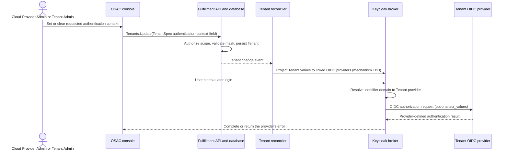

# Request MFA Usage from Brokered OIDC Server

## Summary

Add an optional TenantSpec field for the Tenant's requested authentication
context and expose it in the OSAC console to Cloud Provider Admins and Tenant
Admins. Fulfillment sends a configured value in the upstream OIDC
`acr_values` parameter; an absent or empty value sends no request. See
[PRD](prd.md) for requirements.

## Motivation

Fulfillment persists Tenant domains and synchronizes them to Keycloak
Organizations. It does not persist a per-Tenant authentication preference, and
its Keycloak broker setup does not currently add an upstream MFA request.
Keycloak creates the upstream OIDC authorization request after the user has
entered an email-like identifier and Keycloak has selected the Tenant's
brokered provider. The browser login does not call Fulfillment to retrieve the
Tenant setting. [Codebase: `fulfillment-service/internal/controllers/tenant/tenant_reconciler_function.go`;
`fulfillment-service/internal/controllers/identityprovider/identity_provider_reconciler_function.go`]

Keycloak 26.6.4's `forwardParameters` option is an allow-list; it does not
derive a value from the Tenant object. The mechanism that transfers TenantSpec
values to the selected provider's upstream request is not defined. Source
inspection suggests a query in the provider's configured authorization URL
may work, but Keycloak does not document this as an ACR configuration contract.
The first [DEV] task is a research/spike in the deployed Keycloak 26.6.4 flow
to determine a reliable mechanism. Production reconciliation work is gated on
that result. [Research: §Keycloak 26.6.4 OIDC identity broker; §Follow-up:
Tenant selection occurs inside Keycloak] [User]

## Goals

- Add an additive, per-Tenant field containing the requested authentication
  context. An absent or empty value preserves the disabled default. [User]
  [Locked: D9, D12]
- Let Cloud Provider Admins set or clear a Tenant's value and Tenant Admins
  set or clear only their own Tenant's value in the OSAC console. [Locked: D12,
  D13] [User]
- Reconcile the configured value to every OIDC broker provider belonging to
  that Tenant, and omit the request when the field is absent or empty. [User]
  [Locked: D9, D12]
- Preserve the boundary that the external identity provider decides whether to
  apply MFA; OSAC neither enforces nor reports that MFA occurred. [Locked: D2,
  D3, D5]
- Keep the update tenant-scoped and limited to the authentication-context
  field. [Codebase: `fulfillment-service/internal/auth/policies/authz.rego`;
  `fulfillment-service/internal/servers/generic_server.go`]

## Non-Goals

- Enforce MFA in OSAC or block sign-in because an upstream provider ignores the
  request. [Locked: D3]
- Configure or change the tenant-managed identity provider's MFA policy.
- Add per-sign-in evidence, MFA success reporting, or a new authentication
  audit surface. [Locked: D5]
- Add a deployment-wide setting or Enclave Wizard control. Tenant values are
  configured in the OSAC console, not by a CLI command or flag. [Locked: D12,
  D13]
- Add an `osac login` flag or client-supplied `acr_values` override. A CLI-
  initiated login that Keycloak brokers uses the selected Tenant provider's
  configuration; the CLI itself does not set the ACR. [Codebase:
  `fulfillment-service/internal/cmd/cli/login/login_cmd.go`]
- Change the separate, empty-spec Kubernetes Tenant CRD; this preference is
  stored on the Fulfillment API Tenant. [Codebase: `osac-operator/api/v1alpha1/tenant_types.go`]

## Proposal

Add an optional repeated string field to the Fulfillment `TenantSpec` for the
Tenant's requested authentication context. Each list element contains one ACR
identifier; the field name and nesting are left to implementation, and the API
name should describe the concept rather than use an OIDC acronym. [User]

Cloud Provider Admins and Tenant Admins set or clear the list within their
Tenant scope in the OSAC console. Each value is agreed between that Tenant and
its identity provider; OSAC forwards the values without selecting a
platform-wide ACR or interpreting it as proof that MFA occurred. [User]
[Locked: D2, D3, D5, D12, D13]

To preserve the PRD scope and D2, the configured value is intended to request
generic MFA according to the Tenant/provider agreement; it is not a general
authentication-policy selector or an OSAC assurance guarantee. Store each
opaque ACR identifier as a separate element in a repeated field. Reject empty
elements and elements containing whitespace, but do not require URI syntax or
validate identifier meaning with the external IdP. An empty list means no
request; there is no hard-coded REFEDS default. [User]

The Tenant object remains the source of truth. Fulfillment must make the
configured values available to the selected provider's upstream authorization
request as one `acr_values` parameter containing the ordered values joined by
spaces; an empty TenantSpec list adds no parameter of its own, and an
out-of-band `acr_values` in the provider URL can remain for a Tenant that
never configured the field. Other request parameters must be preserved. The
propagation mechanism is intentionally not selected in this design. The first
[DEV] task is a research/spike to determine and verify the mechanism before
production implementation begins. [Research:
§Follow-up: Tenant selection occurs inside Keycloak] [User]

### Workflow Description

Starting state: the Tenant exists, its domains are synchronized to a Keycloak
Organization, and any external OIDC providers are registered as tenant-scoped
Fulfillment IdentityProvider objects and linked to that Organization.

1. A Cloud Provider Admin opens a Tenant's authentication settings from the
   Tenants page. A Tenant Admin opens the authentication settings for the
   Tenant identified by the authenticated session.
2. The administrator sets or clears the Tenant's requested authentication
   context. The console sends a public `Tenants.Update` targeting only that
   TenantSpec field, with optimistic locking enabled.
3. Fulfillment authorizes the caller, validates the update mask and value, and
   persists the merged Tenant object. A Tenant Admin may update only the Tenant
   in their organization and only this field; the server does not trust the
   Tenant ID or role shown by the UI.
4. The Tenant reconciler updates the Keycloak Organization and reconciles its
   linked OIDC providers. The IdentityProvider reconciler also reads the owning
   Tenant when it creates or updates an OIDC provider, so later provider edits
   do not remove the Tenant's setting.
5. On a later login, the user enters an email-like identifier such as
   `user@tenant.example` directly at Keycloak. Keycloak resolves the matching
   organization/provider and redirects the browser to that provider's
   authorization endpoint. The URL contains the configured Tenant value in
   `acr_values` only when the field is non-empty.
6. The upstream provider applies its own policy. It may honor or ignore the
   request. OSAC does not inspect the result to enforce MFA or assert that MFA
   occurred. [Locked: D2, D3, D5]

The sequence below shows the control-plane update separately from a later sign-in.
The Tenant reconciler writes per-provider configuration before Keycloak builds
the upstream request; the user login itself does not call Fulfillment.

### API Extensions

| ID | Surface | Change | Requirement |
|---|---|---|---|
| IC-1 | Fulfillment Tenant protobuf | Add an optional repeated string field for tenant-specific authentication-context identifiers to `TenantSpec`; publish it through CleanAPI and generated Go. The API field name is finalized during implementation and should not expose an OIDC acronym. | Per-Tenant request value and disabled default |
| IC-2 | Public Fulfillment `Tenants.Update` | Implement the already-declared public RPC and permit only the new TenantSpec authentication-context field for this feature; enforce Tenant Admin scope and field mask. | Cloud Provider Admin and Tenant Admin management |
| IC-3 | Keycloak broker integration | Determine and implement a Tenant-specific mechanism to put the configured values into the selected OIDC provider's upstream request; omit the request for an empty list. The mechanism is not selected until the initial spike. | Tenant-specific request and disabled behavior |
| IC-4 | OSAC console | Let Cloud Provider Admins and Tenant Admins set or clear the Tenant's requested authentication context within their respective scopes; render explanatory guidance. | Console support and admin guidance |
| IC-5 | Tenant identity/access guide | Explain the setting, request timing, best-effort behavior, and how an administrator can inspect an upstream authorization request. | Admin guidance and verification |

### Implementation Details/Notes/Constraints

#### Fulfillment Tenant schema

Add a repeated string field to `TenantSpec` for the Tenant's requested
authentication context. Each element contains one opaque ACR identifier. An
absent or empty list means no request, preserving existing Tenant behavior
without backfill. Reject empty elements and elements containing whitespace,
but do not require URI syntax or attempt to validate provider-specific
semantics. Preserve element order. The precise field name and nesting are
intentionally left to implementation; the API name should use a descriptive
authentication-context concept rather than an OIDC acronym. [User]
[Codebase: `proto/private/osac/private/v1/tenant_type.proto`; `proto/AGENTS.md`]

The generic DAO stores the Tenant payload as protobuf JSON in the existing
`data` column. This field adds no SQL column or migration. The API update must
use a field mask and the generic server's stored-object merge/validation path;
partial updates must not clear domains or the break-glass reference.
[Codebase: `fulfillment-service/internal/database/dao/generic_dao.go`; `fulfillment-service/internal/servers/generic_server.go`]

#### Tenant API and authorization

The public proto already declares `Tenants.Update`; `TenantsServer` currently
implements only `List` and `Get`. Implement its update mapping to the private
Tenant server and retain the public/private server boundary. The public update
handler requires an explicit update mask containing only the new TenantSpec
authentication-context field; it rejects omitted or unrelated masks. A Tenant
Admin may update only the Tenant matching the authenticated organization;
existing generic tenancy checks remain the resource-level enforcement. Cloud
Provider Admins retain their existing administrator authorization. [Codebase:
`proto/public/osac/public/v1/tenants_service.proto`;
`fulfillment-service/internal/servers/tenants_server.go`;
`fulfillment-service/internal/servers/private_tenants_server.go`]

Add `/osac.public.v1.Tenants/Update` to the Tenant Admin OPA method set. The
UI's Tenant Admin page uses the authenticated session's `tenantId` to select
the Tenant, but the server independently enforces ownership and the field mask.
Tenant Admin reads can use the existing `Tenants.List` client permission and
tenant-scoped generic DAO filtering; do not grant broad Tenant `Get` or
cross-Tenant visibility for this feature. [Codebase: `fulfillment-service/internal/auth/policies/authz.rego`; `osac-ui/libs/ui-components/src/hooks/use-session.tsx`]

The update request uses `lock=true` with the Tenant version and an explicit
mask for the authentication-context field. A version conflict is returned
rather than overwriting a concurrent Tenant change. The server validates the
merged object after applying the mask, as required by the Fulfillment update
contract.

#### Keycloak reconciliation

Use the Tenant object as source of truth. Extend the existing Tenant-to-Keycloak
sync so each Tenant reconciliation:

1. Updates Organization domains as it does today.
2. Lists the Tenant's linked brokered providers through the organization-scoped
   Keycloak client.
3. For each OIDC provider, projects the TenantSpec values through the
   Keycloak-side mechanism selected by the initial research/spike. Non-OIDC
   providers are unchanged.

Regardless of the selected mechanism, preserve unrelated authorization-request
parameters and send exactly one `acr_values` parameter for a non-empty list,
joining the Tenant's ACR elements in order with single ASCII spaces. An empty
list adds no `acr_values` parameter of its own. The setting is not written
back into the API IdentityProvider object; the Tenant remains the source of
truth. The exact Keycloak property or extension and its update semantics are
not yet decided.

`acr_values` ownership is explicit. While a Tenant's field is absent or empty
and the Tenant has never saved a non-empty value, reconciliation must
preserve an `acr_values` parameter that exists only in the Keycloak-held
authorization URL — one never configured through the Fulfillment object —
so legacy authentication requests survive upgrades and the disabled default
holds. An `acr_values` configured in the Fulfillment object's authorization
URL is provider-managed instead: it wins over a direct Keycloak edit of the
same parameter, matching the pre-feature behavior in which provider
reconciliation always applied the object URL. A Tenant claims
ownership of the `acr_values` parameter when a non-empty value is first
saved, and the claim is persisted with the Tenant — for example as an
internal marker in the stored payload, not part of the public API — so the
outcome does not depend on reconciliation timing: a value that is saved and
later cleared before any reconciliation has run still counts as claimed.
Once ownership is claimed, the Tenant field owns the `acr_values` parameter
for that Tenant's linked OIDC providers: reconciliation replaces any existing
`acr_values` with the configured list and removes the parameter entirely when
the list is cleared. The selected mechanism must expose this distinction to
reconciliation, and the spike must verify both the preservation and the
removal behavior. [Locked: D9, D12]

`TenantManager.UpdateTenant` currently returns early when Organization domains
already match. The selected mechanism must ensure unchanged domains do not skip
authentication-context reconciliation. The implementation should update only
Tenant-linked OIDC providers whose effective configuration differs.
[Codebase: `fulfillment-service/internal/idp/tenant_manager.go`]

The per-Tenant provider alias is tenant-prefixed and linked to the Keycloak
Organization. Keycloak 26.6.4 organization-scoped endpoints list, read, and
link an organization's IdPs, but an IdP's configuration can only be updated
through the realm-scoped instance endpoint, which replaces the full
representation. A realm-scoped update is therefore allowed only after
ownership is verified through the organization-scoped endpoints: the alias
must resolve through the Tenant's Organization, and a 404 means the IdP is
not linked to that Organization and must never be updated. This is the
existing `GetIdentityProvider` ownership-check pattern, and
`UpdateIdentityProvider` must re-link the IdP to its Organization afterwards
because a realm-scoped update can remove the organization link. [Codebase: `fulfillment-service/internal/controllers/identityprovider/identity_provider_reconciler_function.go`; `fulfillment-service/internal/idp/client.go`]

Tenant reconciliation and the IdentityProvider reconciler can both write the
same Keycloak IdP configuration, and the realm-scoped update replaces the
full representation with no conditional-update support in Keycloak 26.6.4,
so overlapping writes cannot be prevented at the API level. Both writers must
therefore compose the desired representation from the same authoritative
sources — the Fulfillment IdentityProvider object for provider fields and
the owning Tenant for the authentication-context value — rather than writing
back a representation previously read from Keycloak, so overlapping updates
carry the same desired state and converge instead of silently reverting each
other. The IdentityProvider reconciler already reads the owning Tenant (step
4 of the workflow). The authorization URL is merged rather than replaced:
query parameters present in the Fulfillment object's authorization URL are
managed and win over Keycloak-held values of the same name, and unrelated
parameters that exist only in the Keycloak URL are unmanaged and carried
forward, so a provider update does not remove a Keycloak-only out-of-band
value for a never-configured Tenant. Removing a managed parameter must still
take effect: the writer records the managed parameter names it applied — for
example in a Keycloak IdP configuration attribute — and a Keycloak-held
parameter absent from the current object URL is carried forward only if it
was never managed; a parameter that was managed and is no longer in the
object URL was removed by an administrator and is deleted. `acr_values` is
the exception: once the Tenant claims ownership, the Tenant's value — or
its absence when the list is cleared — overrides the object URL's
`acr_values`; before ownership is claimed, it is treated like any other
parameter. No Keycloak-held provider field outside the authorization URL is
carried forward.

A direct Keycloak edit made after a writer reads the authorization URL but
before it writes cannot be detected through the Fulfillment source
versions, and Keycloak 26.6.4 has no conditional update. A writer must
therefore verify before writing: immediately before applying the provider
update, it re-reads the Keycloak authorization URL and compares the
unmanaged parameters with the ones used to compose the update. If they
changed, the Keycloak-held edit wins — the writer discards the composed
representation and recomposes from the fresh read. The preservation
guarantee covers unmanaged values as of that verification read; a direct
Keycloak edit landing between the verification read and the write may be
lost. This residual race is accepted: the interval is irreducible without
conditional updates, and writers skip updates whose effective configuration
already matches, so the window opens only when a write is genuinely needed.
The spike must record how a direct Keycloak edit landing in that interval
behaves.

Both reconcilers stay level-based, and a writer must not trust the snapshot
it composed from: after writing, it re-reads its source objects and requeues
when their versions changed during the update or when the desired state
freshly derived from them still differs from the effective Keycloak
configuration. A write composed from a stale snapshot is therefore corrected
by the next reconciliation rather than left in place. The test plan covers
overlapping Tenant and provider edits, this write order, and the
carried-forward value, and requires both changes to be applied.

The initial [DEV] research/spike is the first implementation task. In a
deployed Keycloak 26.6.4 flow, it must verify whether configuring the
tenant-specific provider's authorization URL carries one or more ACR values to
the external provider, preserves other query parameters, preserves the
provider's organization link and configured broker flows (an update that
submits a partial representation can clear them), and removes the request when
the list is cleared. A candidate is selected only after a fresh brokered login
completes through the updated provider with those checks passing. If this
candidate fails, the spike must identify and compare a supported alternative,
such as a custom provider extension, and return the design for a decision
before production implementation. No mechanism is assumed to be supported
until this gate passes.
The OSAC clients do not send `acr_values` to Keycloak; the Tenant value becomes
available only after Keycloak selects the tenant-specific provider. This avoids
asking Keycloak itself to satisfy the upstream ACR as a local ACR-to-LoA
requirement. [Research: §Follow-up: Tenant selection occurs inside Keycloak]

Clearing a previously configured field removes the parameter the feature
projected; an absent or empty field that was never configured changes nothing.
The configured value is an optional request and may be ignored by an upstream
OP. Do not send an essential `claims` request, set `prompt=login`/`max_age`,
or reject a login because the returned authentication does not claim MFA.
[Locked: D2, D3, D9; Research: §OIDC authentication-context request; §REFEDS
MFA Profile 2.0]

The current OSAC UI and `osac login` do not supply an `acr_values` value. The
CLI supports OAuth flows (device by default) but has no Tenant-value or ACR
flag. When Keycloak brokers a CLI-initiated login after selecting a Tenant's
provider, the same Tenant configuration applies; the CLI does not construct the
upstream request. Preserve this client behavior. If a future client supplies
inbound ACR values, define precedence before enabling it. [Codebase:
`osac-ui/proxy/auth/oidc.go`;
`fulfillment-service/internal/cmd/cli/login/login_cmd.go`; Research:
§Keycloak 26.6.4 OIDC identity broker]

#### UI and documentation

Reuse one authentication-settings component for Cloud Provider Admin and Tenant
Admin. Add an Authentication action to the existing Tenant list and route it to
the selected Tenant's settings. Add a Tenant Admin navigation entry at
`/tenant/settings/authentication`; its page reads the Tenant ID from session
context. Both pages display and allow editing or clearing the configured ACR
list as separate entries, and submit only the new repeated TenantSpec field
with the current version.

Help text states that the configured value is sent as a request, the
tenant-managed IdP decides whether and how to honor it, and OSAC does not
guarantee MFA. It explains that admins enter each identifier separately, that
the upstream request encodes the list as space-delimited `acr_values`, and that
the values must be agreed with their IdP to request generic MFA. Clearing the
list disables the request. Update
`docs/guides/tenant-identity-and-access-guide.md` with the behavior and a
verification procedure using the upstream provider's authorization-request
logs or a browser network trace during a fresh brokered login. Do not add
per-sign-in OSAC logging or an MFA-success indicator. [Locked: D3, D5]

The OSAC UI types are pinned to API baseline `v0.0.131`; the UI release must
advance to a baseline containing the public Tenant field and Update RPC before
the new pages can compile against the generated API types. Do not hand-edit
generated TypeScript. [Codebase: `osac-ui/libs/types/.buf-api-version`; `osac-ui/AGENTS.md`]

### Security Considerations

- The public API is the only Tenant Admin write path. The API checks the
  authenticated Tenant and rejects masks other than the authentication-context
  field; the UI's `tenantId` is a selector, not an authorization control.
- The OPA method grant is limited to `Tenants/Update` for Tenant Admins. The
  generic server retains tenant-scoped object access and metadata checks.
- The controller uses the Tenant-scoped Keycloak Organization and its linked
  IdPs when applying the configured authentication context. Tenant-prefixed
  aliases and organization-scoped Keycloak operations prevent one Tenant's
  value from changing another Tenant's provider. [Codebase:
  `fulfillment-service/internal/controllers/identityprovider/identity_provider_reconciler_function.go`]
- The ACR is not a secret. Do not log full live authorization URLs, which can
  contain state and other authentication-session parameters.
- OSAC neither verifies nor claims that MFA was performed. The external IdP
  remains authoritative for its own policy. [Locked: D2, D3, D5]

### Failure Handling and Recovery

| Failure | System behavior | Recovery and user-visible result |
|---|---|---|
| Empty or whitespace-containing ACR element, or invalid update-mask path | Proto validation rejects empty elements and elements containing whitespace; the public Tenant handler rejects an omitted, unrelated, or unauthorized mask. No Tenant value is persisted. | Submit one identifier per repeated element and update only the authentication-context field on an authorized Tenant. |
| Tenant Admin updates another Tenant or a non-auth field | Authorization/field-mask check rejects the update; no other Tenant fields change. | The Tenant Admin can update only their own authentication setting. |
| Database update or optimistic-lock conflict | Update fails without replacing the stored Tenant object. | UI reports the error; it refreshes the current Tenant version before retrying. |
| Keycloak Organization or linked OIDC provider update fails | Tenant reconciliation returns the error and retries; already-updated provider URLs are safe to apply again. The stored Tenant value remains desired state. | Subsequent reconciliation reapplies the configured value. The controller error is visible in existing logs; no per-sign-in success is reported. |
| Upstream IdP ignores the optional ACR | Keycloak completes according to the provider's response and policy. | Sign-in continues if the IdP allows it; OSAC does not treat the request as proof of MFA. [Locked: D3, D5] |
| Upstream IdP rejects an unrecognized ACR parameter | Keycloak returns the provider's normal broker-login error; OSAC does not retry without the request. [User] | The provider configuration/ACR compatibility must be corrected. The user may be unable to sign in until the provider accepts or ignores the parameter. |

### RBAC / Tenancy

Cloud Provider Admins can update the setting for Tenants they administer.
Tenant Admins can update only the Tenant matching their authenticated
organization and only the authentication-context field. Tenant Admins continue
to use the existing tenant-scoped `Tenants.List` behavior to retrieve their own
Tenant; no cross-Tenant read grant is added. [Locked: D12, D13]

No Kubernetes resources or tenant-isolation annotations are added; this is a
Fulfillment Tenant field and Keycloak configuration change. The operator's
separate Tenant CRD does not receive this field.

### Observability and Monitoring

No new metrics, Kubernetes events, or per-sign-in telemetry are introduced.
Existing Tenant and IdentityProvider reconciliation error logs report failed
Keycloak updates. A configured `acr_values` request is not an MFA-success
signal. [Locked: D5]

### Risks and Mitigations

- **No Keycloak propagation mechanism is confirmed.** The first [DEV] spike
  tests the authorization-URL query candidate against deployed Keycloak 26.6.4
  before production implementation. If it fails, research and select a
  supported alternative; no fallback is preselected. [Research: §Follow-up:
  Tenant selection occurs inside Keycloak]
- **An IdP may ignore or reject the ACR.** Explain the best-effort boundary in
  the console and guide; do not claim MFA or fail open by retrying without the
  ACR after an upstream error. [Locked: D2, D3, D5]
- **A change may apply after reconciliation, not at the exact API response.**
  Keep the Tenant as desired state and make per-provider URL composition
  idempotent. Active sessions are not revoked; later broker requests use the
  reconciled provider configuration.
- **The UI's API baseline is separately versioned.** Release the public API
  before the UI that consumes it, and keep the baseline advance explicit.
- **A downgrade to an older Fulfillment schema can lose the field on a later
  Tenant write.** The generic DAO discards unknown protobuf JSON fields when
  parsing; downgrade procedures must account for enabled values and the
  Keycloak URL state. [Codebase: `fulfillment-service/internal/database/dao/generic_dao.go`]

### Drawbacks

The feature adds a new public Tenant field, a currently unimplemented public
Update handler, narrow Tenant Admin authorization, and a reconciliation path
from Tenant state to multiple Keycloak IdPs. The ACR does not guarantee MFA,
and Keycloak's propagation mechanism is not yet defined; the first [DEV] task
must prove a viable path before production implementation. These costs are
acceptable only if the per-Tenant console setting and request meet the PRD's
user value.

### Alternatives (Not Implemented)

1. **Send `acr_values` from the OSAC client and forward it.** Keycloak 26.6.4
   forwards an inbound `acr_values` by default, but the UI/CLI starts login
   directly at Keycloak and does not know which Tenant's setting applies. A
   single client value cannot implement independent Tenant preferences.
   [Research: §Keycloak 26.6.4 OIDC identity broker; §Follow-up: Tenant selection occurs inside Keycloak]
2. **Configure only `forwardParameters` on each brokered IdP.** This setting is
   an allow-list and does not produce a value when the incoming request lacks
   `acr_values`. It is not sufficient on its own. [Research: §Keycloak 26.6.4 OIDC identity broker]
3. **Add a custom Keycloak OIDC provider/SPI that reads a per-IdP ACR value.**
   This is a possible option for the initial spike to research if the
   configured-URL query candidate cannot be verified. Its supportability,
   deployment wiring, and version-upgrade maintenance are not yet evaluated;
   it is not a selected fallback. [Research: §Comparison Matrix]
4. **Use the OIDC `claims` parameter with an essential ACR claim.** This is
   REFEDS' interoperable OIDC signaling path, but an unmet essential claim can
   fail the authentication and therefore conflicts with the PRD's
   non-enforcement behavior. Keycloak also consumes inbound essential ACR
   claims for its own LoA flow, and the default broker allow-list does not
   include `claims`. [Locked: D3; Research: §REFEDS MFA Profile 2.0]
5. **Do nothing.** Existing brokered sign-in remains unchanged, but the feature
   and per-Tenant console control are not delivered.

## Open Questions

### 1. Determine the Keycloak-side propagation mechanism

- **Question:** Which Keycloak-side mechanism reliably carries the Tenant's
  repeated values into the selected provider's upstream request? The configured
  `authorizationUrl` query is a candidate to test, not a selected mechanism.
- **Owner:** Fulfillment identity-provider maintainers.
- **Impact:** The first [DEV] spike and the Keycloak reconciliation in
  §Implementation Details; production implementation must wait for the result.

### 2. Set release maturity criteria

- **Question:** Which maturity stage and success signals apply to the 0.5
  target milestone?
- **Owner:** OSAC release owners.
- **Impact:** §Graduation Criteria.

## Test Plan

### Unit Tests

- Fulfillment API tests verify absent/empty values omit the request, one or
  multiple values are persisted and encoded into `acr_values`, malformed
  space-delimited lists are rejected, and unknown provider semantics are not
  validated by OSAC.
- Tenant update tests verify the authentication-context field mask preserves
  domains and break-glass references, while unsupported masks and Tenant Admin
  cross-Tenant updates are rejected.
- TenantManager and IdentityProvider URL-composition tests verify configured,
  empty, idempotent update, existing unrelated query parameters, the
  authorization-URL merge retaining Keycloak-only parameters and applying
  removals of previously managed parameters, the object URL's `acr_values`
  winning over a direct Keycloak edit for an unclaimed Tenant, preservation
  of an out-of-band `acr_values` for a Tenant that never configured the field,
  the ownership claim surviving a value saved and cleared before
  reconciliation, the organization-scoped 404 ownership guard suppressing
  realm-scoped updates, the verify-before-write check detecting a
  Keycloak-held value changed after composition, the post-write source
  re-read detecting a stale snapshot, and tenant-specific provider scoping.
- OPA tests allow Tenant Admin `Tenants/Update` but do not grant Tenant Admin
  access to another Tenant or unrelated Tenant methods.
- No UI/browser tests are specified in this API-only plan. The console setting
  and explanatory copy remain untested; see the coverage gaps below.
- Owner/tier: [DEV] Fulfillment Service Unit.

### Integration Tests

- The first [DEV] task is the Keycloak mechanism spike in TC-IS1-02. Use the
  existing `fulfillment-service/it/it_identity_providers_login_test.go` fixture
  to configure the candidate `authorizationUrl` query on a tenant-linked
  provider, then capture the external OIDC authorization request. Verify one
  and multiple values, unrelated query preservation, organization-link and
  broker-flow preservation, a completed login, and removal. If the
  candidate fails, stop before production reconciliation work and return to
  design to select a supported mechanism.
- After the spike passes, extend the same fixture for production reconciliation:
  create two Tenants and external OIDC realms, configure a value for only one
  Tenant, and capture the requests. Assert the configured Tenant receives
  exactly one `acr_values` parameter containing its ordered values; after
  clearing the list, the next broker request omits `acr_values`. Overlapping
  Tenant and IdentityProvider updates must converge with both changes
  applied, and a provider edit for a never-configured Tenant must preserve a
  Keycloak-only out-of-band `acr_values` and unrelated parameter.
- Add a deployed `fulfillment-service/it/` test for public `Tenants.Update`:
  verify Cloud Provider Admin updates, Tenant Admin own-Tenant update, foreign
  Tenant denial, and rejection of non-auth update masks with PostgreSQL reads
  proving rejected requests did not change the object.
- Have the test external provider ignore the optional parameter and return its
  normal response; assert the broker login completes and OSAC makes no claim
  that MFA occurred.
- Extend the temporary external-realm fixture to reject an ACR request with an
  OIDC error; assert Keycloak surfaces the error and does not retry without the
  ACR. [User]
- Owner/tier: [DEV] Fulfillment Service Component Integration.

### E2E Tests

No E2E tests are included in this API-only plan. The console/browser journey is
not covered by the API or component-integration tests. The console workflow and
Tenant Admin guidance remain untested; see the testplan's Coverage Gaps.

## Graduation Criteria

This proposal targets milestone 0.5. The required API maturity stage and
graduation success signals are not specified; see Open Question 2. The
behavioral acceptance criteria remain the PRD requirements and the integration
coverage in this document.

## Upgrade / Downgrade Strategy

The Tenant field is additive and has no SQL migration. Existing Tenant JSON
objects have no authentication-context value and therefore send no request,
preserving existing sign-in behavior, including an `acr_values` that exists
only in the Keycloak-held authorization URL, which reconciliation must not
remove for a Tenant that never configured the field. The API server must
be deployed before the UI release that depends on the new public field and
Update behavior.

OSAC does not currently guarantee in-place upgrades. Before rolling back to a
Fulfillment version that predates the authentication-context field, clear the
value for all Tenants and allow the Tenant reconciler to remove the ACR from
their linked Keycloak providers. An older binary discards unknown JSON fields
when it reads a Tenant; a later write by that binary can remove the stored
setting. Before a
rollback, preserve the desired values outside the old service if they must be
restored after re-upgrade. [Codebase: `fulfillment-service/internal/database/dao/generic_dao.go`; `docs/agent-context/osac-dimensions.md`]

## Version Skew Strategy

The Fulfillment protobuf change is additive; older callers omit the new field
and continue to receive the disabled behavior. During rollout, deploy the
Fulfillment version that implements `Tenants.Update` before the OSAC UI version
that exposes the setting. The UI's generated API baseline must be advanced to
the release containing the new public Tenant field. Keycloak remains at the
existing 26.6.4 image. Whether a custom provider artifact is required depends
on the initial spike; update this strategy once a mechanism is selected. Older
Fulfillment binaries may discard the new JSON field on Tenant writes, as
described in the downgrade strategy.

## Support Procedures

- To inspect desired state, read the Tenant's authentication-context field
  through the Tenant settings page or authorized API. An absent or empty value
  means no request.
- To verify the request in a test sign-in, inspect the upstream provider's
  authorization-request log or the browser's redirect to that provider. Use a
  fresh brokered login so a Keycloak SSO session does not bypass the upstream
  redirect. Do not infer MFA success from the presence of `acr_values`.
- To disable the request, clear the value. The Tenant reconciler removes the
  query parameter from linked OIDC provider configurations; the change affects
  subsequent broker requests after reconciliation and does not revoke active
  sessions.
- If the setting and Keycloak configuration differ, check Fulfillment Tenant
  reconciliation errors and the linked Keycloak provider configuration, then
  signal the Tenant through the existing private `Tenants.Signal` operation to
  retry reconciliation. The upstream provider remains responsible for its own
  MFA policy.

## Infrastructure Needed

No new production infrastructure. Component-integration coverage uses the
existing Kind Fulfillment/Keycloak environment and temporary external OIDC
realms. The API-only test plan does not require browser test infrastructure.

---

## Provenance

Authored: manual-edit [manual] @ design 0.12.0 - 7b2b8de, workspace main @ 6f3f72851
Phases: draft, revise, revise, revise, revise, revise, revise, revise, revise, manual-edit, manual-edit, manual-edit, manual-edit, manual-edit, manual-edit, manual-edit

<!-- ai-workflow-provenance:{"schema_version":1,"provenance_kind":"session","workflow":"design","workflow_version":"0.12.0","ai_workflows":"7b2b8de","source_repo":"6f3f72851","source_repo_branch":"main","commits_behind_main":0,"commits_ahead_main":0,"main_ref":"main","phases":["draft","revise","revise","revise","revise","revise","revise","revise","revise","manual-edit","manual-edit","manual-edit","manual-edit","manual-edit","manual-edit","manual-edit"],"authoring_modes":["manual","skill"],"context_changed":false,"origin_untracked":false} -->
