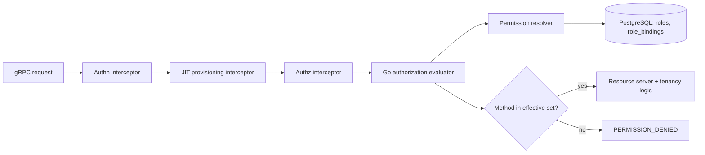

# Configurable Named Roles — Authorization Model

| Field       | Value |
|-------------|-------|
| Author(s)   | Dakota Crowder |
| Jira        | [OSAC-3058](https://redhat.atlassian.net/browse/OSAC-3058) |
| PRD         | [prd.md](prd.md) |
| Date        | 2026-10-30 |

# 1. Overview

This design replaces the fulfillment service's embedded Rego/OPA authorization
policy with a Go implementation of the existing `AuthorizationEvaluator`
interface, and makes named roles — flat sets of grantable permissions,
today full gRPC method references — the single source of authorization
grants. Roles and role assignments live in
the fulfillment service's PostgreSQL database and take effect without
re-login, token refresh, or redeployment. Keycloak remains the authentication
provider and the source of tenant membership; it stops being an authorization
source, and the RoleBinding-to-Keycloak realm-role sync is removed. A
registry-derived permission catalog, seeded system roles and bindings for every
identity that today is hardcoded in the policy, a default-role assignment
at just-in-time user provisioning, and a one-rule binding model — each
RoleBinding grants its role's methods within the tenant it is placed in,
with no implicit grants and no universal tenant sets — complete the model.
Permission-set entries may
also be wildcard references — `*`, `osac.public.v1/*`,
`osac.public.v1.Clusters/*` — expanded against the running build's
registry-derived catalog, so seeded admin roles track the platform's growth
instead of eroding behind it (see §4.2, IC-12). See the
[PRD](prd.md) for product requirements.

The PRD has no FR/NFR identifiers. This design assigns the following
traceability-only anchors without changing the requirement text:

| ID | PRD requirement anchor |
|----|------------------------|
| FR-1 | A catalog of the public API's full gRPC methods — complete service-qualified references — where each full method is the grantable unit. |
| FR-2 | Named roles composed as sets of catalog methods, authored platform-scoped by Cloud Provider Admins and tenant-scoped by Tenant Admins. |
| FR-3 | Role management at runtime through the API, the `osac` CLI, and the web console. |
| FR-4 | Cloud Provider Admin role composition is unrestricted, including administrator-level methods. |
| FR-5 | Role assignment is bounded by the assigner's permissions; tenant-level administration cannot grant access across tenants or into platform administration. |
| FR-6 | Grants, revocations, and role edits propagate without re-login, token refresh, or redeployment; eventual consistency is acceptable. |
| FR-7 | Deletion of a role with active assignments is guarded until the assignments are removed. |
| FR-8 | Users may hold multiple roles; access is the union of held roles' methods; no mutual-exclusion constraints. |
| FR-9 | Tenant Admins can easily select from predefined capability roles (such as Cluster Creator or VM Viewer). |
| FR-10 | Newly onboarded users receive a seeded default role automatically; Tenant Admins may replace it per tenant; a tenant without an override falls back to the platform default; deny-all applies only to a user with no assignment. |
| FR-11 | Tenant Users can see which roles they hold and what they permit. |
| FR-12 | Existing service accounts keep the access they hold today (OSAC-6554, in flight). |
| FR-13 | Break-glass role management continues to work during a tenant IdP outage. |

# 2. Goals and Non-Goals

## 2.1 Goals

- Keep the `AuthorizationEvaluator` interface as the authorization boundary and
  replace its OPA-backed production implementation with a Go implementation;
  remove the Rego policy and the OPA dependency from the authorization path.
- Make every authorization grant a database row: roles as permission sets,
  grants as role bindings placed in the tenant they reach, effective on
  commit — no implicit grants, no universal tenant sets.
- Preserve today's observable authorization semantics for existing
  identities — default-deny, tenant and project checks, service-account and
  emergency access — by seeding equivalent roles and bindings rather than
  keeping hardcoded policy exceptions: admin reach becomes explicit
  per-tenant rows instead of a policy constant.
- Reuse existing machinery unchanged where it already fits: the tenancy layer,
  the generic resource servers, the CLI's reflection-based verbs, and the
  console's RoleBinding pages.
- Give every client surface (API, CLI, console, `SelfSubjectAccessReviews`)
  one consistent answer derived from the same evaluator.

## 2.2 Non-Goals

- Audit-trail role context and audit coverage of role or assignment changes —
  owned by OSAC-63 (Activity and Audit Log API).
- Mutual-exclusion or separation-of-duties conflict rules — roles combine
  freely.
- Role inheritance or nesting — roles are flat permission sets.
- Per-request role context and impersonation ("acting as").
- Cross-tenant resource access for any subject — including Cloud Provider
  Admins, who can staff any tenant (§4.7) but hold no standing visibility
  into tenant resources — deferred to an explicit, auditable
  tenant-impersonation mechanism (§4.8).

# 3. Motivation / Background

Authorization decisions today come from `internal/auth/policies/authz.rego`,
compiled in-process at startup by `OPAAuthorizationEvaluator`
[Codebase: fulfillment-service/internal/auth/authorization_evaluator.go]. The
policy hardcodes the admin service accounts, the `admins` group, the
`tenant-admin` and `tenant-idp-manager` realm roles, the CSI driver identity,
and three method allowlists (client, tenant-admin, IdP manager). Adding or
changing a role means editing Rego and redeploying the platform.

The `Role` and `RoleBinding` resources already exist in the API and database,
but they are descriptive: `RoleSpec` carries only a title and description, and
the RoleBinding reconciler syncs assignments to Keycloak realm roles
one-to-one by name
[Codebase: fulfillment-service/internal/controllers/rolebinding/role_binding_reconciler_function.go].
The Rego policy never reads them, so creating a role or binding a user has no
effect on authorization. Grants synced to Keycloak also surface only when the
user's token refreshes, which conflicts with the propagation requirement.

A second gap appears once roles become the source of grants: seeded admin
roles written as enumerated method lists are frozen at migration time.
Migrations are immutable, and although new API methods enter the
registry-derived catalog automatically, an enumerated seeded set does not
grow — every method added after the seeding release would be missing from
the seeded admin roles. Platform admins would silently lack new
capabilities as the platform grows, and an eroded `system-emergency-admin`
would undermine break-glass. Kubernetes RBAC solves this class of problem
with `*` wildcards; this design adopts the same idea, bounded to the
hierarchical levels of the method reference (§4.2, IC-12).

The database becomes the only authorization source, the evaluator resolves grants 
server-side on every request, and Keycloak owns authentication and tenant membership.

# 4. Design

## 4.1 Architecture

The gRPC interceptor chain is reordered so user provisioning precedes
authorization, and the evaluator resolves grants from the database on each
request:



The diagram shows the request path. The authentication interceptor is
unchanged. The JIT provisioning interceptor moves from after authorization to
between authentication and authorization so it can assign the default role
before the first authorization decision (FR-10; see IC-6). The authorization
interceptor keeps its current responsibilities — building context extensions
(including the database-authoritative tenant/name fetches for project
authorization) and constructing the `Subject` — but delegates the decision to
the new Go evaluator behind the unchanged `AuthorizationEvaluator` interface.

Every decision answers one question: is the requested method's permission a
member of the subject's effective permission set? For each request, the
evaluator builds that set by loading the subject's role bindings — matched
by user reference or service-account reference, each placed in the tenant
its grant reaches — resolving each binding's `RoleReference` to a role (by
id when set, else by name within the binding's tenant, falling back to the
`shared` tenant), and unioning the resolved roles' permission sets. The
requested method, normalized from the gRPC
`FullMethod` (leading slash trimmed), names its permission — 1:1 today —
and the check is exact membership in the set. A method that is not a member
is denied: the current policy's default-deny behavior is preserved.

Alongside the decision, the evaluator constructs the `Subject` consumed by
the tenancy layer: `Subject.User` comes from the token as today, and
`Subject.Tenants` is the union of the tenants where the subject holds
bindings. The evaluator never constructs a universal tenant set. The
`organization` claim drives identity and just-in-time provisioning
placement (IC-6) — where the default-role binding is seeded — not
authorization reach.

`SelfSubjectAccessReviews` and `osac can-i` keep using the same evaluator
instance, so hypothetical checks and actual requests cannot diverge
[Codebase: fulfillment-service/internal/servers/self_subject_access_reviews_server.go].

The edge cases around this flow are each given their own section below.

### Emergency service accounts

Emergency service accounts — Kubernetes service account names supplied via
the existing emergency flag, renamed
`--grpc-authz-emergency-service-accounts` (IC-11) — receive no implicit
grant: the flag is authentication trust only. Their authorization is a
seeded RoleBinding row (migration 135 seeds the chart's default name;
custom names are added through the documented support procedure), placed in
the `system` tenant and bound to `system-emergency-admin`. During a tenant
IdP outage the account authenticates with its Kubernetes token and manages
roles and bindings in any tenant through platform staffing (§4.7) — role
management depends only on the fulfillment database (FR-13). Break-glass
reach into tenant resources is deliberately absent; if ever needed, it
arrives with the explicit impersonation mechanism (§4.8).

### Wildcard permission references

A role's permission entries may be exact catalog references or one of the
three wildcard forms — `*`, `<package>/*`, `<service>/*` (§4.2, IC-12).
Wildcards expand against the registry-derived catalog (§4.3) when the
effective set is computed, once per resolution, and never persist — roles
store what their author wrote. The permission check is always exact
membership in the expanded set: no pattern matching happens at check time.

### Project authorization

Project and project-membership authorization keeps today's semantics:
organization-group membership (`/<project>/system:viewers`,
`/<project>/system:managers`) checked against JWT claims with the
interceptor's existing database-authoritative metadata fetchers. This logic
moves from Rego to Go unchanged.

### Always-allowed surfaces

Three surfaces stay outside role composition and remain always-allowed in
the evaluator: the gRPC infrastructure methods (`/metadata.*`,
`/grpc.reflection.*`, `/grpc.health.*`), `Capabilities/Get` (needed before
login for issuer discovery, and anonymous today), and the new
`Permissions/List`/`Permissions/Get` and `SelfSubjectRulesReviews/Create` surfaces
(needed to compose roles and to answer "what can I do" before any role is
held).

## 4.2 Data Model / Schema Changes

### Role

`RoleSpec` gains the permission set and the `is_default` and `system`
flags; `RoleStatus` and its
sync-state enum are removed (there is no external system to synchronize with,
so there is no observed state to report). `Role` carries
`// buf:lint:ignore OSAC_OBJECT_SHAPE` with that rationale — the intentional
exception mechanism the lint rule provides.

```protobuf
message RoleSpec {
  string title = 1;
  string description = 2;
  // Grantable permissions — today full service-qualified gRPC methods, e.g.
  // "osac.public.v1.Clusters/Create" — or wildcard references: "*",
  // "osac.public.v1/*", "osac.public.v1.Clusters/*".
  repeated string permissions = 3;
  // Marks this role as the default role assigned at onboarding for the
  // role's tenant. At most one such role per tenant.
  bool is_default = 4;
  // Present only on roles seeded by the database migration. System roles
  // cannot be deleted through the API. Rejected on create and update.
  bool system = 5;
}
```

A role in the `shared` tenant flagged `is_default` is the platform default;
a role in a tenant flagged `is_default` is that tenant's override (FR-10).

### RoleBinding

`RoleBindingStatus`, its sync-state enum, and the private `status.users`
diffing field are removed for the same reason as `RoleStatus`.
`RoleBindingSpec` is otherwise unchanged — the service-account subject list
is added by OSAC-6554 (in flight) and assumed here. `[User]`

A binding matches a human subject when the subject's username equals the
referenced user's username (resolved through the user row when `id` is set)
or the reference's `name`.

### Storage and migration

Both resources keep the existing generic tables — no new tables, no column
changes; the JSONB `data` column absorbs the new spec fields. Existing
migrations are immutable, so migration `135_configure_named_roles.up.sql`
(next in sequence after 134):

- Rewrites the five seeded roles
  [Codebase: fulfillment-service/internal/database/migrations/33_create_roles_tables.up.sql]
  with permission sets mirroring today's Rego allowlists
  [Codebase: fulfillment-service/internal/auth/policies/authz.rego]:
  - `cloud-provider-admin` (`shared`, `system`):
    `permissions: ["*"]` — every catalog permission in both layers, and
    every permission added in later releases: the wildcard expands against
    the running build's catalog, so the platform-admin grant tracks the
    platform rather than a migration-time snapshot.
  - `cloud-provider-reader` (`shared`): every `Get`/`List`
    method in the public layer — explicit by design: a read-only grant must
    not silently widen when new write methods ship (see Alternatives for the
    deferred verb-suffix wildcard).
  - `tenant-admin` (`shared`, `is_default` false): `permissions:
    ["osac.public.v1/*"]` — every public-layer method within the holder's
    binding tenants: the tenant super-admin. This is a deliberate widening
    beyond today's tenant-admin surface (the client allowlist plus Users,
    IdentityProviders, catalog-item, project, project-membership, Roles, and
    RoleBindings methods): new public capabilities reach Tenant Admins
    automatically, and the authoring ceiling (§4.3) lets them delegate any
    public method within their tenant. Private-layer methods stay excluded
    by construction — the wildcard is layer-qualified, not scope-dependent.
  - `tenant-idp-manager` (`shared`): today's tenant-IdP-manager surface —
    the client allowlist plus IdentityProviders, Users read, Roles read, and
    RoleBindings methods — kept explicit: the break-glass grant is a narrow,
    predictable, enumerated surface, deliberately not auto-growing.
  - `tenant-user` (`shared`, `is_default`): today's client allowlist — the
    platform default role, kept explicit: the onboarding baseline must stay
    minimal by design; auto-growing every new user's default grant with each
    release would be wrong.
- Adds seeded capability roles for the predefined-role picker (FR-9):
  `cluster-creator` (`osac.public.v1.Clusters/*` and
  `osac.public.v1.ClusterTemplates/*` — future cluster-surface methods reach
  cluster creators automatically) and `vm-viewer` (ComputeInstances
  `Get`/`List`, explicit — a service wildcard here would grant create and
  delete), both in `shared`.
- Adds system roles: `system-emergency-admin` (`shared`, `system`:
  `permissions: ["*"]` — break-glass access must not erode as the platform
  grows; its seeded binding is placed in `system`, §4.1) and
  `osac-csi-driver` (`shared`, `system`: the private-layer Volume methods,
  explicit — least privilege for a service identity — bound per-tenant at
  tenant provisioning: the explicit form of the per-tenant client end-state
  (OSAC-4197), replacing today's temporary universal tenant scope).
- Seeds RoleBindings in the `system` tenant: the `osac-admin` and
  `osac-controller` service accounts bound to `cloud-provider-admin`, and
  the emergency service account (the chart's default name) bound to
  `system-emergency-admin` — platform-level reach plus platform staffing
  (§4.7). Tenant provisioning seeds three bindings in every new tenant:
  the break-glass `tenant-idp-manager` binding for the tenant's
  break-glass account (FR-13, subject per §9.1), `osac-controller` →
  `cloud-provider-admin` (the reconciler's resource reach, explicit per
  tenant), and the CSI driver service account → `osac-csi-driver`.

The role and rolebinding reconcilers
[Codebase: fulfillment-service/internal/controllers/role/, internal/controllers/rolebinding/]
are deleted: with the Keycloak sync removed there is no asynchronous work
left — no finalizers, no reconciliation, no status to maintain. Bindings are
effective on commit.

## 4.3 API Changes

### Permission catalog — `Permissions` service

A new read-only `osac.public.v1.Permissions` service exposes the catalog:

```protobuf
service Permissions {
  rpc List(PermissionsListRequest) returns (PermissionsListResponse);
  rpc Get(PermissionsGetRequest) returns (PermissionsGetResponse);
}

message PermissionCatalogEntry {
  // Full service-qualified permission reference — the exact string accepted
  // by RoleSpec.permissions, e.g. "osac.public.v1.Clusters/Create".
  string name = 1;
}
```

The service is named for the grantable unit — a permission — rather than
the gRPC method it references: every permission is 1:1 with a full
service-qualified method today, and the name leaves room for permissions
that later diverge from that mapping. `[User]` Roles are sets of permissions
(`spec.permissions`, §4.2), so the catalog, the role spec, and the resolver
share one vocabulary: the entry's single `name` field is a valid
`spec.permissions` entry verbatim, and a client composes roles from catalog
strings by copying them. The entry deliberately carries no decomposition of
the reference (service, method, layer) — a decomposition presumes the 1:1
method mapping, which broadened permissions may not have, so the contract
returns only the string every consumer can pass through unchanged.

The catalog is derived at startup by scanning the proto registry for services
in `osac.public.v1` and `osac.private.v1` — the same mechanism
`internal/reflection` uses for object-type discovery — so it always matches
the running build and new API methods appear as new permissions without
migration (FR-1, R2).
`List` uses the standard CEL `filter` over `name` (fulfillment-service
`docs/FILTER.md`): service- and layer-scoped listing are prefix filters,
for example `this.name.startsWith("osac.public.v1.Clusters/")`.
Infrastructure methods (metadata, reflection, health) and `Capabilities`
are not catalog entries. Both layers are included — the layer is the
reference's package prefix (`osac.public.v1` vs `osac.private.v1`): seeded
admin and system roles
require private-layer methods to preserve today's admin semantics, and
OSAC-4386 will compose per-method service-account roles that include them.
The console's role composer shows public-layer entries by default. The
catalog itself lists concrete permissions only; wildcards are a role-authoring
syntax validated against the catalog's package and service list, not catalog
entries. The composer derives service and package groupings from the
references' syntax and offers "entire service" and "all permissions"
affordances that write the corresponding wildcard reference.

### Self-inspection — `SelfSubjectRulesReviews` service

A new `osac.public.v1.SelfSubjectRulesReviews` service follows the existing
`SelfSubjectAccessReviews` pattern (public server wrapping a private server,
sharing the evaluator). `Create` takes no spec and returns the caller's held
roles — name and permission set each, verbatim as authored (wildcards shown
as written) — the tenants where the caller holds bindings, plus the
effective permission union,
wildcard-expanded against the current catalog (FR-11). This one surface
serves `osac whoami`, the console's "my roles" view, and capability-based
navigation gating.

### Roles and RoleBindings — write-time validation

The generic CRUD services stay; the public servers add validation on Create
and Update:

- **Catalog validation:** every `spec.permissions` entry must exactly match a
  catalog entry or be a well-formed wildcard: the bare `*`, or a `<prefix>/*`
  whose prefix is a catalog package (`osac.public.v1`, `osac.private.v1`) or
  a catalog service (for example `osac.public.v1.Clusters`). Malformed
  entries, unknown prefixes, and verb-suffix forms (`*/Get`) fail with
  `INVALID_ARGUMENT` naming the offending entries.
- **Authoring ceiling (FR-5):** the written role's permission set must be a
  subset of the author's effective permissions, with both sides
  wildcard-expanded against the current catalog; the role's placement
  follows the tenancy layer's rules for where the writer may write. A role
  containing `*` is therefore authorable only by a subject who effectively
  holds every permission — in practice, `cloud-provider-admin` holders. A
  Tenant Admin holding the seeded `tenant-admin` role — whose effective set
  is every public-layer method — can author roles over public methods
  within their tenant, but not private-layer methods or `*`; a Cloud
  Provider Admin can author anywhere through platform staffing (§4.7)
  (FR-4). The check is the same subset rule applied to assignments, so
  there is one privilege rule to implement, test, and audit.
- **Assignment ceiling (FR-5):** writing a RoleBinding requires the same
  subset check (over expanded sets) between the binding's resolved role and
  the assigner's effective permissions, and a placement the assigner can
  write: within their reach, or any tenant when their Roles/RoleBindings
  write methods come from a `system`-placed binding (platform staffing,
  §4.7). Provider-defined roles with private-layer methods or wildcard
  breadth beyond the assigner's set are therefore assignable only by
  holders of a superset — in practice, Cloud Provider Admins.
- **Default-role uniqueness:** at most one `is_default` role per tenant.
- **System protection:** `spec.system = true` is rejected on Create and
  Update; it exists only on migration-seeded roles.

Update operates on the stored object after applying the update mask, per the
component invariants. Deleting a RoleBinding revokes the grant on the next
request.

### Guarded deletion (FR-7)

`Roles/Delete` is rejected with `FAILED_PRECONDITION` while any RoleBinding
references the role; the error message names the referencing bindings.
`Roles/Delete` on a `system` role is rejected with `FAILED_PRECONDITION`
regardless of bindings. Editing a system role's permission set remains allowed —
the platform default is an ordinary named role with live-edit semantics, and a
Cloud Provider Admin who narrows a system role exercises explicit, reviewable
authority (see Open Questions for the lockout consideration).

## 4.4 Scalability and Performance

Authorization adds one permission resolution per request: an indexed lookup
on `role_bindings` by tenant and subject plus the referenced roles, in the
low milliseconds against PostgreSQL. The scale basis is control-plane
request volume — clusters, VMs, and operators issuing API calls, not
data-plane traffic — so per-request resolution stays well within budget.
Grant, role, and binding changes are effective on the next request, for
every replica (FR-6). Wildcard expansion bounds an effective set by the
catalog size (hundreds of entries today, shared interned strings) and runs
once per resolution.

Removing OPA also removes per-request policy evaluation and the embedded
query compilation from startup. If control-plane volume ever justifies one,
an in-process permission cache can be added entirely inside the permission
resolver (see Alternatives).

## 4.5 Security Considerations

- **No escalation through assignment.** Both authoring and assignment enforce
  the same subset rule against the actor's effective permissions (FR-5),
  evaluated over wildcard-expanded sets — breadth cannot be smuggled past
  the ceiling via wildcard syntax. Binding placement is bounded by the
  tenancy layer, or by platform staffing for holders of a `system`-placed
  Roles/RoleBindings grant — itself an explicit row. There is no code path
  that grants a role the actor does not effectively hold a superset of, and
  no path that constructs a universal tenant set.
- **Tenant isolation is structural.** Roles grant methods; reach is the
  placement of the bindings that granted them. A subject acts only within
  tenants where they hold bindings, because the tenancy layer — unchanged —
  filters by the subject's tenants. Writing into the `shared` or `system`
  tenants requires reach there, which only platform-level bindings
  provide and Tenant Admins hold none. Platform staffing crosses the
  tenant boundary for exactly one resource type — Roles and RoleBindings —
  bounded by the subset ceiling: a Cloud Provider Admin can staff a tenant
  without reading its resources.
- **Bounded wildcard grammar, exact request-time matching.** Permission-set
  entries are either exact catalog references or one of three fixed wildcard
  forms, validated at write time against the catalog's package and service
  list. Wildcards expand at grant resolution against the build's catalog;
  the request-time check remains exact membership in the expanded set. No
  arbitrary pattern, regular expression, or user-controlled grammar is
  evaluated, and no entry can widen beyond its validated prefix — a
  wildcard names a set of existing catalog atoms, never new semantics.
- **Wildcards grant future methods.** A wildcard holder's access grows with
  the catalog by design — new methods ship enabled for `*` holders. That is
  the feature's intent (admin access tracks the platform); whether any
  future method needs an opt-out from wildcard grants is raised as an open
  question (§9.5).
- **Fail closed.** If the permission resolver cannot reach the database, the
  evaluator returns an error and the interceptor fails the request with
  `Internal` — never a fallback allow.
- **Emergency access.** The emergency flag grants authentication trust only
  to the named Kubernetes service accounts; what they may do is defined by
  the seeded `system`-placed binding to `system-emergency-admin`, which is
  subject to the same live-edit semantics and deletion protection as other
  system bindings and is manageable through platform staffing. The flag
  cannot mint a new identity or an implicit grant — it can only trust a
  service account that already authenticates to the cluster.
- **Self-inspection only.** `SelfSubjectRulesReviews` returns the caller's
  own grants; `Permissions` exposes only the API surface, which gRPC reflection
  already exposes to authenticated clients.

## 4.6 Failure Handling and Recovery

- **Database unavailable:** permission resolution fails closed (see §4.5);
  requests receive `Internal`. Authentication still succeeds; only
  authorization decisions are unavailable, matching today's behavior when
  the policy store cannot load.
- **Restart:** there is no startup ordering dependency on the database
  beyond the first authorized request — resolution is per-request, so a
  restarted process holds no authorization state to rebuild.
- **Version skew:** a role whose `permissions` reference an entry removed from a
  newer build simply stops matching at evaluation; a `<prefix>/*` whose
  package or service no longer exists expands to nothing, while the role's
  other entries still apply. Conversely, methods added in a newer build flow
  automatically to wildcard holders on the next resolution — the seeded
  admin and emergency roles need no per-release migration. Write-time
  validation applies only to new writes, so stored roles survive API
  evolution without manual repair.
- **Onboarding failure:** if the JIT provisioner cannot create the User row
  or the default-role binding, the request fails with `Internal` and the
  next request retries provisioning — both writes are idempotent by natural
  key (username + tenant; subject + role + tenant).

## 4.7 RBAC / Tenancy

- **Role placement (R3):** platform-scoped roles live in the `shared` tenant
  and are visible to every tenant (existing tenancy visibility), which is
  what makes them selectable in Tenant Admins' pickers (FR-9). Tenant-scoped
  roles live in their tenant and are visible only within it.
- **Binding placement is reach.** A RoleBinding grants its role's methods
  within the tenant it is placed in, and `Subject.Tenants` is the union of
  the tenants where the subject holds bindings — nothing else. The
  evaluator never constructs a universal tenant set; the `organization`
  claim drives just-in-time provisioning placement (IC-6), not
  authorization reach.
- **The shared contract.** `shared` keeps its existing always-visible
  semantics and holds only platform-published definitions — catalog items,
  templates, roles. A method grant therefore lets its holder read shared
  definitions of that type: that is shared's purpose. Writing into
  `shared` requires a binding placed there, which only platform-level
  bindings provide.
- **The system tenant.** `system` holds platform-internal objects (the
  seeded service bindings). Reach into `system` comes only from bindings
  placed there; it is no longer tied to any universal-visibility concept.
- **Platform staffing (the one cross-tenant authority).** The Roles and
  RoleBindings methods, when granted by a binding placed in `system`,
  carry any-tenant placement: their holder can create, update, and inspect
  roles and bindings in any tenant, bounded by the method-subset ceiling —
  they can grant only what they hold. The same methods granted by a
  tenant-placed binding remain tenant-scoped. This is how a Cloud Provider
  Admin staffs a tenant — adds its first Tenant Admin, helps onboard —
  without holding resource reach into it, and how tenant provisioning (run
  under the controller's `system`-placed grant) seeds each new tenant's
  bindings. Resource access stays reach-scoped for everyone.
- **No change to tenant metadata:** resources continue to carry tenant
  attribution through the existing generic server path; no new annotations
  are introduced by this design.
- **Project authorization** continues to use Keycloak organization groups
  read from JWT claims — a deliberate boundary: this design replaces
  role-based authorization, not group-based project membership.

## 4.8 Extensibility / Future-Proofing

- **OSAC-4386 (service-account privilege scoping)** composes a narrow role
  containing exactly the permissions a service account needs (for example,
  template publishing without full admin) and binds it via
  `service_accounts` — the model already expresses it; no schema change is
  required.
- **OSAC-6554 (service-account identity)** delivers the RoleBinding
  service-account subject list this design assumes (§4.2); grant
  resolution (§4.1) matches service-account subjects through it.
- **OSAC-63 (audit)** consumes the existing Events surface, which already
  carries role and role-binding resource events; role-context attribution
  slots into the evaluator's decision point where the full permission set and
  held roles are in hand.
- **Cross-tenant resource access (explicit tenant impersonation, future).**
  v1 deliberately has no mechanism for one subject to read or act on
  another tenant's resources — platform staffing covers grant
  administration only (§4.7). When needed, the mechanism is an explicit,
  auditable per-request tenant context ("act in tenant X"), following the
  precedent the CSI driver already sets by carrying the target tenant per
  request; Kubernetes impersonation headers are the same shape. It should
  land together with OSAC-63 audit so every use is attributable.
- **New API methods** enter the catalog automatically through the
  registry scan; roles reference them by string with no migration, and
  wildcard-holding roles — including the seeded admin and emergency roles —
  gain them without any role edit.
- **Multi-replica scaling** needs no new mechanism — per-request resolution
  is correct for any replica count — and a future permission cache, if
  control-plane volume ever requires one, remains contained inside the
  permission resolver (§4.4); no other component changes.

# 5. Interface Changes

## IC-1: Role resource schema

**Requirements:** FR-1, FR-2, FR-4, FR-7, FR-10

`RoleSpec` gains `permissions` (repeated string, catalog permission
references or wildcard forms), `is_default` (bool), and `system` (bool,
migration-only). `RoleStatus` and `RoleState` are removed. Create/Update
validate permissions against the catalog and the wildcard grammar
(`INVALID_ARGUMENT` on unknown or malformed entries), enforce the authoring
subset ceiling, default-role uniqueness, and reject caller-set `system`.
Delete is guarded while bindings reference the role and for system roles
(`FAILED_PRECONDITION`).

## IC-2: RoleBinding resource schema

**Requirements:** FR-5, FR-12

`RoleBindingStatus`, `RoleBindingState`, and private `status.users` are
removed; `RoleBindingSpec` is otherwise unchanged — the service-account
subject list arrives with OSAC-6554 (in flight) and is assumed. Bindings
match human subjects by username (via user row or reference name).
Create/Update enforce the assignment subset ceiling and placement rule
(§4.7). Delete revokes the grant immediately.

## IC-3: Permissions catalog service

**Requirements:** FR-1, FR-9

New `osac.public.v1.Permissions` service (`List`, `Get`) returning
registry-derived `PermissionCatalogEntry` values — a single `name` field,
the exact string accepted by `spec.permissions` — with the standard CEL
`filter` over `name` for service- and layer-scoped listing. Always
allowed for authenticated subjects. Serves the CLI (`osac get permissions`
via the generic reflection verbs) and the console's role composer.

## IC-4: Go authorization evaluator

**Requirements:** FR-6, FR-8, FR-12, FR-13

`OPAAuthorizationEvaluator`, `authz.rego`, and the OPA dependency are
removed. A Go `AuthorizationEvaluator` implementation resolves grants from
`roles`/`role_bindings` on each request, expands wildcard entries against
the registry catalog at resolution time,
applies exact matching over the expanded set, preserves project
context-dependent checks and default-deny, and constructs
`Subject.Tenants` as the union of binding tenants — never a universal
set. Multiple held roles
union (FR-8). `SelfSubjectAccessReviews` and `osac can-i` use the same
evaluator. Grants propagate without re-login or redeployment (FR-6).

## IC-5: Privilege ceilings on authoring and assignment

**Requirements:** FR-4, FR-5

Both role authoring and role-binding writes enforce one rule: the written
role's permission set must be a subset of the acting subject's effective
permissions — both sides wildcard-expanded against the current catalog —
computed by the same resolver that serves requests. Binding placement must
be within the writer's reach, or any tenant when the writer's
Roles/RoleBindings write methods come from a `system`-placed binding
(platform staffing, §4.7). Violations return `PERMISSION_DENIED`. This
bounds every grant by real authority and makes provider-defined
wildcard-bearing roles broader than the actor's set
Cloud-Provider-Admin assignable only.

## IC-6: Default-role onboarding

**Requirements:** FR-10

The JIT provisioning interceptor moves between the authentication and
authorization interceptors and, when it provisions a new User row, also
creates a RoleBinding to the tenant's `is_default` role — falling back to the
`shared` tenant's `is_default` role (the platform default) when the tenant
has no override. A tenant without an override, or one that removes it, falls
back to the platform default; a user whose assignments are all revoked has no
assignment and is denied everything (deny-all fallback). Removing the
default flag from the platform default role is rejected while it is the only
default (`FAILED_PRECONDITION`).

## IC-7: SelfSubjectRulesReviews service

**Requirements:** FR-11

New `osac.public.v1.SelfSubjectRulesReviews` service (`Create`, no spec)
returning the caller's held roles (name, permission set), the tenants where
the caller holds bindings, and the effective permission union. Always
allowed for authenticated subjects. Follows the SelfSubjectAccessReviews
public/private server pattern.

## IC-8: `osac` CLI

**Requirements:** FR-3, FR-11

Roles and RoleBindings CRUD flows through the existing generic verbs
(`osac get role`, `osac create rolebinding`, ...) via reflection — no new
resource-specific commands are required. `osac whoami` is reworked to render
held roles from `SelfSubjectRulesReviews` instead of parsing
`realm_access.roles` from the token. `osac can-i` semantics are unchanged and
become accurate immediately after grant changes.

## IC-9: Web console

**Requirements:** FR-3, FR-9, FR-11

The existing RoleBinding pages gain a role picker fed by `Permissions` and role
listings, with seeded and shared roles presented as the predefined set.
Role authoring (create/edit with a permission composer grouped by service,
public layer by default) is added for Cloud Provider Admin (platform and all
tenants) and Tenant Admin (own tenant) surfaces. A "my roles" view renders
`SelfSubjectRulesReviews`. Navigation gating moves from the IdP realm-role
`UserRole` union to capability checks derived from the rules review (which
permissions the user holds gate which console sections).

## IC-10: Seeded system roles and bindings; Keycloak sync removal

**Requirements:** FR-12, FR-13

Migration 135 seeds the permission sets described in §4.2 — including the
wildcard sets (`cloud-provider-admin` and `system-emergency-admin` as
`["*"]`, `tenant-admin` as `["osac.public.v1/*"]`) — the capability roles,
and the `system`-tenant bindings for the admin/controller and emergency
service accounts; tenant provisioning seeds the per-tenant bindings
described in §4.2. The RoleBinding-to-Keycloak realm-role sync
(`mapRoleToKeycloak`, `Assign/RemoveTenantRolesFromUser`, `status.users`
diffing), the role and rolebinding reconcilers, and the Keycloak realm roles
`tenant-admin` and `tenant-idp-manager` are removed. The `admins` group
bridge is removed; administrator humans hold explicit
`cloud-provider-admin` bindings, created through platform staffing with any
seeded admin credential. Tenant provisioning seeds a
`tenant-idp-manager` binding for the tenant's break-glass account (FR-13) —
role management then depends only on the fulfillment database, which remains
available during a tenant IdP outage.

## IC-11: Server configuration

**Requirements:** FR-12, FR-13

`--grpc-authz-opa-emergency-service-accounts` is renamed
`--grpc-authz-emergency-service-accounts` with unchanged authentication
semantics (authentication trust only — the authorization grant is the
seeded, `system`-placed binding of IC-10).
The Rego policy file and OPA libraries are removed from the build.

## IC-12: Wildcard permission references

**Requirements:** FR-2, FR-4, FR-5, FR-12, FR-13

`spec.permissions` entries may be wildcards: `*` (every catalog permission,
both layers), `<package>/*` (every permission of a layer, for example
`osac.public.v1/*`), or `<service>/*` (every permission of one service, for
example `osac.public.v1.Clusters/*`) — Kubernetes-RBAC-style set
expressions over full-method atoms. D4 holds: every permission is one full
gRPC method — the grantable unit is unchanged; a wildcard only names a set
of catalog atoms.
Wildcards are stored verbatim, validated at write time against the
catalog's package and service list (`INVALID_ARGUMENT` otherwise, including
verb-suffix forms), and expanded at grant resolution against the running
build's registry catalog — never at request time, never persisted. The
authoring and assignment ceilings (IC-5) are evaluated over expanded sets.
Seeded `cloud-provider-admin`, `system-emergency-admin` (`["*"]`), and
`tenant-admin` (`["osac.public.v1/*"]`) use wildcards so admin access
tracks the platform's growth; the default, reader, viewer, break-glass,
and CSI roles stay explicit by design. Wildcards are method breadth only;
tenant reach is binding placement (§4.7), never wildcard syntax.

# 6. Alternatives Considered

### Keep Rego and feed it role data

Load roles/bindings into the OPA store or input on each evaluation. Rejected:
it keeps a second policy language in the authorization path, the logic that
must stay in Go anyway (binding resolution, ceilings, tenancy) would be split
across two implementations, and the Jira comment's maintainability argument —
one language, explicit boundaries — applies. The PRD deliberately scopes the
outcome, not the engine, leaving this a design decision.

### Hybrid: Go evaluator with Rego retained for project rules

Rejected: a partial replacement leaves two decision paths to test and keep
consistent, and the project rules are small enough to move wholesale.

### Keep the Keycloak sync as the assignment mechanism

Rejected: assignments would surface only on token refresh, which cannot
satisfy FR-6, and it keeps authorization data split between two systems.
Keycloak remains the authentication and tenant-membership source.

### In-process permission cache (deferred)

Cache each subject's resolved permission set in-process — invalidated on
Roles/RoleBindings writes, TTL-bounded — with a cross-replica invalidation
mechanism (Postgres `LISTEN/NOTIFY` broadcast or Kafka) once grpc-server
scales beyond one replica. Deferred: per-request resolution is within budget
at control-plane scale (§4.4), and the cache — when needed — sits entirely
inside the permission resolver.

### Default role via evaluator fallback instead of JIT reordering

Treat an unassigned single-tenant subject as holding the default role during
evaluation. Rejected: it cannot distinguish "never provisioned" from
"assignments revoked", so it would resurrect default access for users whose
grants were deliberately removed. Moving provisioning before authorization
assigns the default exactly once, at User-row creation.

### Persisted permission-catalog table

Rejected: the catalog would duplicate the proto surface and drift from the
running build; the registry scan is always correct and needs no migration.

### Retain the `admins` group bridge

Rejected: it would keep an authorization grant living in Keycloak group
membership after everything else moved to explicit, reviewable bindings —
the opposite of the PRD's assignment model.

### Refresh enumerated admin roles per release

Keep seeded admin roles as explicit method lists and add a migration each
release rewriting them. Rejected: migrations are immutable, every release
would need a new one, and any missed release silently leaves platform
admins — and the emergency role — without the new capabilities. Wildcards
make the seeded sets release-independent.

### Evaluator-level admin bypass

Hardcode "admin subjects may call anything" in the evaluator instead of a
wildcard role. Rejected: it reintroduces exactly the hardcoded policy
exception R5 removed — the admin grant would live in code, invisible to
role listings, uneditable at runtime, and indistinguishable from a named
role in reviews.

### Match-time wildcard evaluation

Keep wildcard entries in the resolved effective set and pattern-match each
request against them. Rejected in favor of expansion-at-resolution:
request-time matching stays exact (the evaluator core and its
no-pattern-at-request-time invariant survive unchanged), the ceilings
become plain set containment over expanded sets, and
`SelfSubjectRulesReviews` can return both the verbatim entries and a
machine-usable expanded union. The catalog is build-static, so expansion
is deterministic and cheap.

### Scope-dependent wildcard behavior

Make the bare `*` expand to the public layer only, instead of
layer-qualified wildcard strings. Rejected: hidden, context-dependent
semantics; a role row would no longer say what it grants without knowing
an expansion rule. Layer-qualified strings (`osac.public.v1/*`) are
self-describing, mirroring how Kubernetes keeps namespace scoping
orthogonal to `verbs`/`resources` wildcards — and, here, orthogonal to
binding placement (§4.7).

### System-placed bindings granting universal reach

Have bindings in the `system` tenant upgrade their subjects to an
all-tenants set. Rejected: that is blanket impersonation by another name —
one row silently reaching every tenant, exactly the implicit superadmin
this design removes. `system`-placed bindings grant reach into `system`,
plus any-tenant placement for the Roles/RoleBindings methods only —
staffing, not access (§4.7).

### Claim-derived reach

Keep `Subject.Tenants` sourced from the `organization` claim, with
bindings granting only methods. Rejected: access without a row —
membership alone would grant reach, Keycloak would remain an authorization
source, and "read in my tenant" would keep its implicit extension to every
visible object of that type. Claims drive provisioning placement instead
(§4.7).

### Explicit tenant impersonation (deferred)

A per-request "act in tenant X" context for cross-tenant resource access,
auditable per use. Deferred: no v1 requirement consumes it — platform
staffing covers grant administration (§4.7) — and it should land with
OSAC-63 audit so every use is attributable.

### Verb-suffix wildcards (deferred)

`osac.public.v1/*/Get` would let reader-style roles auto-grow. Deferred:
the only current customer is `cloud-provider-reader`; verb-first
expressions strain the D4 lock ("full methods, not bare verbs"); and
prefix wildcards already cover the admin-growth requirement. Revisit if
reader-role drift becomes a maintenance burden.

# 7. Observability and Monitoring

- **Metrics** (Prometheus, on the evaluator): `osac_authz_evaluations_total`
  (counter, labels `result` in `allowed|denied|error`),
  `osac_authz_evaluation_duration_seconds` (histogram). A rising `error`
  count or a p99 evaluation latency above the database query budget (§4.4)
  indicates a problem.
- **Events:** role and role-binding create/update/delete already flow on the
  existing Events surface (the resource event variants exist); audit
  enrichment of these events is OSAC-63's work.
- **Logs:** the interceptor keeps its current denied-decision debug logging
  (method + subject user). No new alerts are introduced by this design.

# 8. Impact and Compatibility

- **Breaking proto changes** (removed status messages and enums, added spec
  fields, new services) are acceptable: there are no production deployments
  and no grant migration is required.
- **Database:** one new migration (135); no table changes; existing rows for
  seeded roles are rewritten in place.
- **Dependencies:** OPA libraries leave `go.mod`; no new dependencies are
  added.
- **osac-operator:** no impact — there are no Role/RoleBinding CRDs; the
  ClusterOrder reconciler's native Kubernetes RBAC objects are unrelated.
- **osac-installer:** deployments that override the default admin/controller
  service-account names, or customize `auth.emergencyServiceAccounts`, must
  create equivalent bindings after install (documented support procedure,
  one API call with any seeded admin credential); the default names work
  out of the box.
- **Console and CLI:** regenerated protobuf types (`pnpm gen-types`); CLI
  gains coverage through reflection with no code changes; `whoami` and
  navigation gating behavior change as described in IC-8/IC-9.
- **E2E and integration suites** that assert today's realm-role behavior
  (tenant-admin/tenant-idp-manager grants, `whoami` output) require updates
  to bind and assert through roles instead.

# 9. Open Questions

## 9.1 Break-glass binding subject

- **Owner:** tenant onboarding / identity owners
- **Impact:** IC-10 — which exact identity tenant provisioning seeds the
  `tenant-idp-manager` binding against (the per-tenant break-glass account)
  needs confirmation from the tenant-creation flow.

## 9.2 Console capability-to-navigation mapping

- **Owner:** console team
- **Impact:** IC-9 — which held permissions gate which console sections replaces
  the `UserRole` union; the mapping table is a UI design decision.

## 9.3 System-role editability and lockout

- **Owner:** reviewers (security)
- **Impact:** §4.3, IC-10 — editing system roles' permission sets is allowed
  (live-edit semantics, explicit CPA authority); confirm this balance against
  the lockout risk of narrowing `system-emergency-admin`, and whether the
  recovery procedure (database re-insert of seeded rows) is acceptable.

## 9.4 Seeded tenant-admin breadth

- **Owner:** reviewers (product + security)
- **Impact:** §4.2, IC-10, IC-12 — the seeded `tenant-admin` widens to
  `osac.public.v1/*` (tenant super-admin) by author decision, so new public
  capabilities reach Tenant Admins automatically and are delegable within
  the tenant. Confirm the widening beyond today's tenant-admin surface is
  the intended product direction, and that private-layer exclusion by
  construction (the layer-qualified wildcard) is sufficient.

## 9.5 Wildcard auto-grant of future methods

- **Owner:** reviewers (security)
- **Impact:** §4.5, IC-12 — new methods ship enabled-by-default for
  wildcard holders (that is the feature). Confirm no opt-out mechanism is
  needed for a method to be excluded from wildcard grants, or define one
  (for example a catalog marker) before sensitive capabilities land.

## 9.6 Verb-suffix wildcards for reader-style roles

- **Owner:** reviewers
- **Impact:** §6 (deferred alternative), IC-12 — `osac.public.v1/*/Get`
  would auto-grow `cloud-provider-reader`; deferred as out of scope.
  Revisit when reader-role drift becomes a maintenance burden.

## 9.7 CPA cross-tenant resource access

- **Owner:** reviewers (product + security)
- **Impact:** §4.7, §4.8 — v1 gives Cloud Provider Admins no standing
  visibility into tenant resources (platform staffing covers grant
  administration only). Confirm this is acceptable operationally and that
  the deferred explicit-impersonation mechanism is the right landing spot.

## 9.8 Emergency breadth

- **Owner:** reviewers (security)
- **Impact:** §4.1, IC-10 — break-glass covers role management (FR-13)
  through a `system`-placed binding and platform staffing, not
  tenant-resource access. Confirm the narrowing.

---

## Provenance

Authored: revise @ design 0.11.5 - e2b0d87, workspace main @ 3e4bfdb7b
Phases: draft, manual-edit, revise, manual-edit, revise, revise, revise, revise, revise, manual-edit, revise, revise, revise, revise

<!-- ai-workflow-provenance:{"schema_version":1,"provenance_kind":"session","workflow":"design","workflow_version":"0.11.5","ai_workflows":"e2b0d87","source_repo":"3e4bfdb7b","source_repo_branch":"main","commits_behind_main":0,"commits_ahead_main":0,"main_ref":"main","phases":["draft","manual-edit","revise","manual-edit","revise","revise","revise","revise","revise","manual-edit","revise","revise","revise","revise"],"authoring_modes":["manual","skill"],"context_changed":false,"origin_untracked":false} -->
