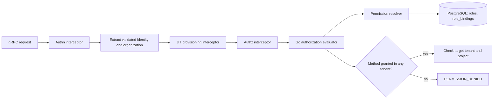

# Configurable Named Roles — Authorization Model

# 1. Overview

This design replaces the fulfillment service's embedded Rego/OPA authorization
policy with a Go implementation of the existing `AuthorizationEvaluator`
interface, and makes named roles — flat sets of service-and-method rules
that resolve to full gRPC methods — the single source of authorization
grants. Roles and role assignments live in
the fulfillment service's PostgreSQL database and take effect without
re-login, token refresh, or redeployment. Keycloak remains the authentication
provider and the source of tenant membership; it stops being an authorization
source, and the RoleBinding-to-Keycloak realm-role sync is removed. A
registry-derived internal permission catalog, seeded roles and bindings for every
identity that today is hardcoded in the policy, a default-role assignment
at just-in-time user provisioning, and a one-rule binding model — each
RoleBinding grants its role's methods within the tenant it is placed in,
with no implicit grants and no universal tenant sets — complete the model.
Rules can use wildcards in either field, such as `service: "osac.public.*"`
or `methods: ["*"]`. They expand against the running build's
registry-derived catalog, so seeded admin roles track the platform's growth
instead of eroding behind it (see §4.2, IC-12). See the
[PRD](prd.md) for product requirements.

The PRD has no FR/NFR identifiers. This design assigns the following
traceability-only anchors without changing the requirement text:

| ID | PRD requirement anchor |
|----|------------------------|
| FR-1 | A catalog of the public API's full gRPC methods — complete service-qualified references — where each full method is the grantable unit. |
| FR-2 | Named roles composed as sets of catalog methods, authored platform-scoped by Cloud Provider Admins and tenant-scoped by Tenant Admins. |
| FR-3 | Role management at runtime through the API, the `osac` CLI, and the web console. |
| FR-4 | Cloud Provider Admin role composition is unrestricted, including administrator-level methods. |
| FR-5 | Role assignment is bounded by the assigner's permissions; tenant-level administration cannot grant access across tenants or into platform administration. |
| FR-6 | Grants, revocations, and role edits propagate without re-login, token refresh, or redeployment; eventual consistency is acceptable. |
| FR-7 | Deletion of a role with active assignments is guarded until the assignments are removed. |
| FR-8 | Users may hold multiple roles; access is the union of held roles' methods; no mutual-exclusion constraints. |
| FR-9 | Tenant Admins can easily select from predefined capability roles (such as Cluster Creator or VM Viewer). |
| FR-10 | Newly onboarded users receive a seeded default role automatically; Tenant Admins may replace it per tenant; a tenant without an override falls back to the platform default; deny-all applies only to a user with no assignment. |
| FR-11 | Tenant Users can see which roles they hold and what they permit. |
| FR-12 | Existing service accounts keep the access they hold today (OSAC-6554, in flight). |
| FR-13 | Break-glass role management continues to work during a tenant IdP outage. |

# 2. Goals and Non-Goals

## 2.1 Goals

- Keep the `AuthorizationEvaluator` interface as the authorization boundary and
  replace its OPA-backed production implementation with a Go implementation;
  remove the Rego policy and the OPA dependency from the authorization path.
- Make every authorization grant a database row: roles as permission sets,
  grants as role bindings placed in the tenant they reach, effective on
  commit — no implicit grants, no universal tenant sets.
- Preserve today's observable authorization semantics for existing
  identities — default-deny, tenant and project checks, service-account and
  emergency access — by seeding equivalent roles and bindings rather than
  keeping hardcoded policy exceptions: admin reach becomes explicit
  per-tenant rows instead of a policy constant.
- Reuse the generic resource servers, CLI reflection verbs, and console
  RoleBinding pages; adapt tenancy filtering and mutation checks to consume
  the caller's permissions in each tenant.
- Give every client surface (API, CLI, console, `SelfSubjectAccessReviews`)
  one consistent answer derived from the same evaluator.

## 2.2 Non-Goals

- Audit-trail role context and audit coverage of role or assignment changes —
  owned by OSAC-63 (Activity and Audit Log API).
- Mutual-exclusion or separation-of-duties conflict rules — roles combine
  freely.
- Role inheritance or nesting — roles are flat permission sets.
- Per-request role context and impersonation ("acting as").
- Standing cross-tenant resource grants for Cloud Provider Admins. They can
  create tenant bindings, including for themselves, through platform
  staffing (§4.7). Per-request impersonation remains deferred (§4.8).

# 3. Motivation / Background

Authorization decisions today come from `internal/auth/policies/authz.rego`,
compiled in-process at startup by `OPAAuthorizationEvaluator`
[Codebase: fulfillment-service/internal/auth/authorization_evaluator.go]. The
policy hardcodes the admin service accounts, the `admins` group, the
`tenant-admin` and `tenant-idp-manager` realm roles, the CSI driver identity,
and three method allowlists (client, tenant-admin, IdP manager). Adding or
changing a role means editing Rego and redeploying the platform.

The `Role` and `RoleBinding` resources already exist in the API and database,
but they are descriptive: `RoleSpec` carries only a title and description, and
the RoleBinding reconciler syncs assignments to Keycloak realm roles
one-to-one by name
[Codebase: fulfillment-service/internal/controllers/rolebinding/role_binding_reconciler_function.go].
The Rego policy never reads them, so creating a role or binding a user has no
effect on authorization. Grants synced to Keycloak also surface only when the
user's token refreshes, which conflicts with the propagation requirement.

A second gap appears once roles become the source of grants: seeded admin
roles written as enumerated method lists are frozen at migration time.
Migrations are immutable, and although new API methods enter the
registry-derived catalog automatically, an enumerated seeded set does not
grow — every method added after the seeding release would be missing from
the seeded admin roles. Platform admins would silently lack new
capabilities as the platform grows, and an eroded `system-emergency-admin`
would undermine break-glass. Kubernetes RBAC solves this class of problem
with `*` wildcards; this design uses them in service and method rules
(§4.2, IC-12).

The database becomes the only authorization source, the evaluator resolves grants
server-side on every request, and Keycloak owns authentication and tenant membership.

# 4. Design

## 4.1 Architecture

The gRPC interceptor chain is reordered so user provisioning precedes
authorization, and the evaluator resolves grants from the database on each
request:



Authentication still validates the token. A shared extraction step reads its
username and organization claim. JIT uses those values, not
`SubjectFromContext`, to provision a user with exactly one ordinary tenant
before authorization (FR-10; IC-6). Authorization builds the permission-scoped
`Subject` afterward and retains its context-extension and evaluator duties.

### Computing permissions per tenant

Permissions are computed separately for each tenant. Within a tenant, the
caller receives the combined permissions of all roles bound to them there.
A permission granted in one tenant never authorizes an action in another.
For example, a caller who can read clusters in A and delete clusters in B
cannot delete clusters in A.

For each request, the evaluator:

1. Loads the authenticated user's or service account's RoleBindings.
2. Resolves each binding's role by ID, or by name in the binding's tenant
   with a fallback to `shared`. Expands wildcards against the permission
   catalog and combines the permissions separately for each binding tenant.
   A missing role grants nothing; a database error fails the request.
3. Checks the requested method and sets `Subject.Tenants` to only the
   tenants where the caller has that permission. `Subject.User` keeps the
   authenticated username. The organization claim controls onboarding
   placement, not access.
4. Passes these results to the resource handler, which checks the target
   tenant and existing project restrictions before allowing the operation.

The evaluator keeps the permissions and bindings for each tenant in the
request context so handlers and role-assignment checks use the same results.
The `AuthorizationEvaluator.Evaluate` signature stays unchanged; its decision
and request context carry this additional information.

### Applying tenant checks

- **Reading or changing an object:** check its stored tenant. Updates also
  check the final payload and reject tenant changes (`INVALID_ARGUMENT`).
  Operations on multiple objects must check every target before writing.
- **Listing objects:** return only objects from tenants where the caller
  has that specific List permission. Apply this restriction before
  pagination, counts, and client filters.
- **Creating objects:** check the tenant where the object will be created.
  If omitted, use the only eligible ordinary tenant; otherwise require an
  explicit tenant (`INVALID_ARGUMENT`). Never default into `shared` or
  `system`.

Shared-definition reads and platform role administration follow §4.7.
Project membership does not grant access to additional tenants. Every
role-controlled operation needs a tenant check, even when it has no obvious
resource target.

A public handler calling its private implementation keeps the public
request's permissions. A direct private RPC checks its own method permission.
A separate operation within a handler needs its own permission check.

`SelfSubjectAccessReviews` and `osac can-i` use the same evaluator and check
the requested tenant (`metadata.tenant`). With no tenant specified, they
report whether the method is permitted anywhere. These reviews check method
permissions; the actual request still checks its object, project, and payload.

### Emergency service accounts

Emergency service accounts — Kubernetes service account names supplied via
the existing emergency flag, renamed
`--grpc-authz-emergency-service-accounts` (IC-11) — receive no implicit
grant: the flag is authentication trust only. Their authorization is a
seeded RoleBinding row (migration 135 seeds the chart's default name;
custom names are added through the documented support procedure), placed in
the `system` tenant and bound to `system-emergency-admin`. During a tenant
IdP outage the account authenticates with its Kubernetes token and manages
roles and bindings in any tenant through platform staffing (§4.7) — role
management depends only on the fulfillment database (FR-13). This binding
provides no standing tenant-resource grant. Resource access requires a binding
in the target tenant, which staffing can create (§4.7).

### Permission rules and wildcards

A role stores service-and-method rules (§4.2, IC-12). Wildcards in either
field expand against the registry-derived catalog (§4.3) when the
scoped permission sets are computed, once per distinct role per resolution.
Expanded sets never persist — roles store what their author wrote. The
permission check is always exact membership in the expanded set: no pattern
matching happens at check time.

### Project authorization

Project and project-membership checks keep organization-group claims
(`/<project>/system:viewers` and `/<project>/system:managers`) and
database-authoritative metadata. In Go, an effective binding to the seeded
`tenant-admin` role grants visibility and project management in that binding's
tenant; other project access still follows existing groups and membership
metadata. The controller retains project visibility in tenants where it is
authorized for the requested resource method. Every operation also needs its
method grant. Configurable project-wide visibility is deferred.

### Always-allowed surfaces

Three surfaces stay outside role composition and remain always-allowed in
the evaluator: the gRPC infrastructure methods (`/metadata.*`,
`/grpc.reflection.*`, `/grpc.health.*`), `Capabilities/Get` (needed before
login for issuer discovery, and anonymous today), and the new
`SelfSubjectRulesReviews/Create` surface (needed to answer "what can I do"
before any role is held).

## 4.2 Data Model / Schema Changes

### Role

`RoleSpec` gains the permission set;
`RoleStatus` and its
sync-state enum are removed (there is no external system to synchronize with,
so there is no observed state to report). `Role` carries
`// buf:lint:ignore OSAC_OBJECT_SHAPE` with that rationale — the intentional
exception mechanism the lint rule provides.

```protobuf
message RoleSpec {
  string title = 1;
  string description = 2;
  repeated PermissionRule permissions = 3;
}

message PermissionRule {
  // Version-neutral service name, e.g. "osac.public.clusters".
  // "osac.public.*" and "*" select multiple services.
  string service = 1;
  // gRPC method names, e.g. "Create"; "*" selects all methods.
  repeated string methods = 2;
}
```

### Tenant default role

`TenantSpec` gains a singular `RoleReference default_role` field, exposed as
`Tenant.spec.default_role` in both public and private APIs. It reuses the
role reference type used by RoleBindings. A tenant selects an existing role
from its own tenant or from `shared`; a reference to any other tenant's role
is rejected. References resolve by ID, or by name in the tenant with a
fallback to `shared`.

The `shared` Tenant object's `spec.default_role` selects the platform
default and must reference a role defined in `shared`. An ordinary tenant's
`spec.default_role` overrides that selection for its onboarding (FR-10).
An unset field means inherit the platform default; it does not disable
onboarding grants. Because each Tenant stores one reference, no default-role
uniqueness index is needed. Several tenants may select the same shared role.
Changing the selection affects only subsequently provisioned users; existing
RoleBindings remain unchanged.

### RoleBinding

`RoleBindingStatus`, its sync-state enum, and the private `status.users`
diffing field are removed for the same reason as `RoleStatus`.
`RoleBindingSpec` is otherwise unchanged — the service-account subject list
is added by OSAC-6554 (in flight) and assumed here. `[User]`

A binding matches a human subject when the subject's username equals the
referenced user's username (resolved through the user row when `id` is set)
or the reference's `name`.

### Storage and migration

Roles, RoleBindings, and Tenants keep their existing generic tables — no new
tables or column changes; the JSONB `data` columns absorb the new spec fields.
Existing migrations are immutable, so migration `135_configure_named_roles.up.sql`
(next in sequence after 134):

- Sets the `shared` Tenant's `spec.default_role` to the seeded
  `tenant-user` role. Ordinary tenants leave the field unset to inherit it.
- Rewrites the five seeded roles
  [Codebase: fulfillment-service/internal/database/migrations/33_create_roles_tables.up.sql]
  with permission sets mirroring today's Rego allowlists
  [Codebase: fulfillment-service/internal/auth/policies/authz.rego]:
  - `cloud-provider-admin` (`system`):
    `permissions: [{service: "*", methods: ["*"]}]` — every catalog
    method in both layers, including later additions: the rule expands against
    the running build's catalog, so the platform-admin grant tracks the
    platform rather than a migration-time snapshot.
  - `cloud-provider-reader` (`system`):
    `permissions: [{service: "osac.public.*", methods: ["Get", "List"]}]`.
    This includes public read methods on future services.
  - `tenant-admin` (`shared`):
    `permissions: [{service: "osac.public.*", methods: ["*"]}]` — every
    public-layer method within the holder's
    binding tenants: the tenant super-admin. This is a deliberate widening
    beyond today's tenant-admin surface (the client allowlist plus Users,
    IdentityProviders, catalog-item, project, project-membership, Roles, and
    RoleBindings methods): new public capabilities reach Tenant Admins
    automatically, and the authoring ceiling (§4.3) lets them delegate any
    public method within their tenant. Private-layer methods stay excluded
    by construction — the wildcard is layer-qualified, not scope-dependent.
  - `tenant-idp-manager` (`shared`): today's tenant-IdP-manager surface —
    the client allowlist plus IdentityProviders, Users read, Roles read, and
    RoleBindings methods — kept explicit: the break-glass grant is a narrow,
    predictable, enumerated surface, deliberately not auto-growing.
  - `tenant-user` (`shared`): today's client allowlist — the
    platform default role, kept explicit: the onboarding baseline must stay
    minimal by design; auto-growing every new user's default grant with each
    release would be wrong.
- Adds seeded capability roles for the predefined-role picker (FR-9):
  A creator/viewer pair for surfaces such as clusters and storage should
  be seeded. Creator roles will encapsulate all methods on a surface
  such as `{service: "osac.public.clusters", methods: ["*"]}`; viewer roles
  use `methods: ["Get", "List"]` for supported services.
- Adds the service-identity roles: `system-emergency-admin` (`shared`:
  `permissions: [{service: "*", methods: ["*"]}]` — break-glass access
  must not erode as the platform grows; its seeded binding is placed in
  `system`, §4.1) and
  `osac-csi-driver` (`shared`: the private-layer Volume methods,
  explicit — least privilege for a service identity — bound per-tenant at
  tenant provisioning: the explicit form of the per-tenant client end-state
  (OSAC-4197), replacing today's temporary universal tenant scope).
- Seeds RoleBindings in the `system` tenant: the `osac-admin` and
  `osac-controller` service accounts bound to `cloud-provider-admin`, and
  the emergency service account (the chart's default name) bound to
  `system-emergency-admin` — platform-level reach plus platform staffing
  (§4.7). Tenant provisioning seeds three bindings in every new tenant:
  the break-glass `tenant-idp-manager` binding for the tenant's
  break-glass account (FR-13, subject per §9.1), `osac-controller` →
  `cloud-provider-admin` (the reconciler's resource reach, explicit per
  tenant), and the CSI driver service account → `osac-csi-driver`.

Role definitions and the bindings that grant them are placed
independently: a role definition lives where it is authored and visible
(`shared` for platform-published roles, per R3), while each binding lives
where its grant reaches — `system` for platform staffing, the tenant for
resource reach (§4.7). `osac-controller` therefore holds
`cloud-provider-admin` through both a `system`-placed binding (any-tenant
role administration) and a per-tenant binding in every tenant (resource
reach).

The role and rolebinding reconcilers
[Codebase: fulfillment-service/internal/controllers/role/, internal/controllers/rolebinding/]
are deleted: with the Keycloak sync removed there is no asynchronous work
left — no finalizers, no reconciliation, no status to maintain. Bindings are
effective on commit.

## 4.3 API Changes

### Internal permission catalog and documented discovery

The internal catalog is derived at startup by scanning the proto registry
for services in `osac.public.v1` and `osac.private.v1` — the same mechanism
`internal/reflection` uses for object-type discovery. It matches the running
build and supplies role validation and wildcard expansion; new API methods
become grantable without migration (FR-1, R2). Infrastructure methods
(metadata, reflection, health) and `Capabilities` are excluded. Both public
and private layers are included to support seeded admin and service-identity
roles and future service-account privilege scoping (OSAC-4386).

The catalog maps each v1 gRPC service to a version-neutral name: drop the
package version and lowercase the first letter of the service name
(`osac.public.v1.RoleBindings` becomes `osac.public.roleBindings`). Method
names retain proto spelling. A future API version joins an existing name
only after its methods are reviewed for
equivalent authorization semantics; changed operations get distinct names.
Administrators enter rules through the API, CLI, or console; the server
validates them against the catalog. The first release documents the names. [User]

### Self-inspection — `SelfSubjectRulesReviews` service

A new `osac.public.v1.SelfSubjectRulesReviews` service follows the existing
`SelfSubjectAccessReviews` pattern, with a public server wrapping a private
server and sharing the resolver. `Create` takes no spec and returns:

- `bindings`: binding ID and tenant, role ID, name and defining tenant,
  and permission rules as authored, including wildcards.
- `tenant_rules`: the combined permissions for each tenant, with wildcards
  expanded into individual methods.
- `staffing_permissions` and `shared_read_permissions`: platform role
  administration and shared-definition reads, listed separately (§4.7).

This lets `osac whoami` and the console show what the caller can do in each
tenant (FR-11). Project restrictions still apply to individual objects.

### Roles and RoleBindings — write-time validation

The generic CRUD services stay. Public and private APIs use a common mutation
path that enforces the same validation and deletion guards. A private-method
grant does not bypass these checks. Create and Update enforce:

- **Catalog validation:** each rule needs a cataloged service or `*` /
  `osac.public.*` / `osac.private.*`, plus at least one cataloged method
  name or `*`. Unknown names, empty method lists, and other wildcard
  patterns fail with `INVALID_ARGUMENT` naming the offending rule.
- **Authoring ceiling (FR-5):** a role may contain only permissions the
  author holds in that tenant. Editing a role also checks every tenant
  where it is already assigned, so the edit cannot grant permissions the
  author lacks there. Tenant default-role references also count as
  assignments for these checks so role edits cannot bypass the onboarding assignment ceiling.
- **Assignment ceiling (FR-5):** the caller must have permission to write
  RoleBindings in the target tenant and hold every permission in the role
  being assigned there. Permissions held only in other tenants do not count.
  Assigning the seeded `tenant-admin` role also requires its project-wide
  authority in that tenant, or platform staffing authority.
- **Platform staffing (FR-4):** a caller authorized through a `system`
  binding may also use permissions held in `system` when authoring or
  assigning roles elsewhere (§4.7). This preserves CPA administration
  without pooling permissions from unrelated tenants.
- **Wildcard delegation:** each wildcard rule must be covered by held
  rules with the same or broader service and method scope in the applicable
  tenant, including `system` for platform staffing and every tenant affected
  by an edit. Explicit current methods cannot authorize a future-facing
  wildcard grant.

These checks expand wildcards and use the final role or binding after the
update mask is applied. Ceiling checks use the permissions, roles, and
assignments observed during validation. Mutations retain the existing
resource concurrency controls, subject to the guarded-deletion transaction
requirement below. Ceiling violations return `PERMISSION_DENIED`. `[User]`
Deleting a RoleBinding revokes the grant on the next request.

### Tenant default-role validation

Tenant Create/Update validate the final `spec.default_role` after applying the
update mask. A malformed reference or a role outside the tenant and `shared`
returns `INVALID_ARGUMENT`; a missing role returns `FAILED_PRECONDITION`.
Selecting a default, including clearing an override to expose an inherited
platform default, requires permission to manage that Tenant and the same
RoleBinding write permission, permission-subset ceiling, and wildcard
delegation checks as assigning the effective role in that tenant (§4.3).
If the effective role is the seeded `tenant-admin`, the caller also needs
project-wide authority in that tenant or platform staffing authority.
Tenant Admins may change only their own tenant's selection; only Cloud
Provider Admins may change the platform default on the `shared` Tenant.
Public and private mutation paths enforce these rules equally.

### Guarded deletion (FR-7)

`Roles/Delete` is rejected with `FAILED_PRECONDITION` while any RoleBinding
or Tenant's `spec.default_role` references the role; the error message names
the referencing bindings and Tenants. A default-role reference must be
replaced or, for a tenant override, cleared before deletion.

`Roles/Delete` must coordinate transactionally with RoleBinding and Tenant
default-role mutations, including onboarding, across public and private paths.
Role existence and reference checks must remain valid through commit, so
concurrent operations cannot commit a reference to a deleted role. The
implementation chooses the coordination mechanism. `[User]`

Once unreferenced, every role — seeded or custom — is deletable; there is no
deletion-protected class. Seeded roles are guarded in practice by the
bindings that reference them (the emergency, controller, CSI, and
break-glass bindings), so removing one is a deliberate multi-step act, and
recovery does not require database access: any Cloud Provider Admin can
re-create an equivalent role and binding through platform staffing while
the platform IdP is available (§4.7), with the documented database
re-insert as the fallback. Editing a seeded role's permission set remains
allowed — live-edit semantics; a Cloud Provider Admin who narrows or
deletes one exercises explicit, reviewable authority (see Open Questions
for the lockout consideration).

## 4.4 Scalability and Performance

Authorization adds one permission resolution per request: an indexed lookup
on `role_bindings` by tenant and subject plus the referenced roles, in the
low milliseconds against PostgreSQL. The scale basis is control-plane
request volume — clusters, VMs, and operators issuing API calls, not
data-plane traffic — so per-request resolution stays well within budget.
Grant, role, and binding changes are effective on the next request, for
every replica (FR-6). Wildcard expansion runs once per distinct role per
resolution. Each tenant permission set is bounded by the catalog size
(hundreds of entries today, shared interned strings). Memory use grows with
the caller's number of binding tenants and permissions.

Removing OPA also removes per-request policy evaluation and the embedded
query compilation from startup. If control-plane volume ever justifies one,
an in-process permission cache can be added entirely inside the permission
resolver (see Alternatives).

## 4.5 Security Considerations

- **No escalation through assignment.** Role authoring, edits, and
  assignments are limited by the caller's permissions in each affected
  tenant, with the platform-staffing exception described in §4.3.
- **Tenant isolation.** Each request uses permissions computed for its
  target tenant. List results follow the same rule. Shared reads and
  platform role administration have explicit rules (§4.7).

- **Bounded wildcard grammar, exact request-time matching.** Rule fields
  use only exact catalog names or the specified `*` forms, validated at
  write time. Wildcards expand at grant resolution against the build's
  catalog;
  the request-time check remains exact membership in the expanded set. No
  arbitrary pattern, regular expression, or user-controlled grammar is
  evaluated. A wildcard names catalog methods, including future additions.
- **Wildcards grant future methods.** A wildcard holder's access grows with
  the catalog by design — new methods ship enabled for matching wildcard
  holders. That is
  the feature's intent (admin access tracks the platform); whether any
  future method needs an opt-out from wildcard grants is raised as an open
  question (§9.5).
- **Fail closed.** If the permission resolver cannot reach the database, the
  evaluator returns an error and the interceptor fails the request with
  `Internal` — never a fallback allow.
- **Emergency access.** The emergency flag grants authentication trust only
  to the named Kubernetes service accounts; what they may do is defined by
  the seeded `system`-placed binding to `system-emergency-admin`, which is
  editable and revocable like any binding (live-edit semantics; the role
  itself is guarded by §4.3's binding and Tenant reference checks) and is
  manageable through platform staffing. The flag
  cannot mint a new identity or an implicit grant — it can only trust a
  service account that already authenticates to the cluster.
- **Self-inspection only.** `SelfSubjectRulesReviews` returns the caller's
  own grants.

## 4.6 Failure Handling and Recovery

- **Database unavailable:** permission resolution fails closed (see §4.5);
  requests receive `Internal`. Authentication still succeeds; only
  authorization decisions are unavailable, matching today's behavior when
  the policy store cannot load.
- **Restart:** there is no startup ordering dependency on the database
  beyond the first authorized request — resolution is per-request, so a
  restarted process holds no authorization state to rebuild.
- **Version skew:** a rule with no matching catalog methods grants nothing;
  other rules still apply. A new API version maps to an existing service name
  only after confirming its methods have the same authorization semantics.
  Conversely, methods added in a newer build flow automatically to
  wildcard holders on the next resolution — the seeded
  admin and emergency roles need no per-release migration. Write-time
  validation applies only to new writes, so stored roles survive API
  evolution without manual repair.
- **Onboarding failure:** the JIT provisioner creates the User row and any
  default-role binding in one transaction. If either write fails, the
  transaction rolls back, the request fails with `Internal`, and the next
  request retries provisioning — both writes are idempotent by natural
  key (username + tenant; subject + role + tenant). If neither a tenant nor
  platform default exists, provisioning succeeds with a User row and no
  binding, then continues to authorization. A configured reference that
  cannot be resolved is an error, not an absent override: provisioning rolls
  back and fails rather than silently choosing another role. `[User]`

## 4.7 RBAC / Tenancy

- **Role placement (R3):** platform-scoped roles live in the `shared` tenant
  and are visible to every tenant (existing tenancy visibility), which is
  what makes them selectable in Tenant Admins' pickers (FR-9). Tenant-scoped
  roles live in their tenant and are visible only within it.
- **Binding placement controls access.** A RoleBinding grants its role's
  permissions in the tenant containing the binding, even when the role
  itself is defined in `shared`. Requests use those per-tenant permissions
  as described in §4.1.
- **Shared definitions.** A caller with Get/List permission for a definition
  type can also read its platform-published definitions in `shared`.
  Changing them requires the corresponding write permission in `shared`,
  or platform staffing for Roles/RoleBindings.
- **The system tenant.** Platform-internal objects require the corresponding
  permission from a binding in `system`.
- **Platform staffing.** A Roles or RoleBindings permission granted through
  a `system` binding permits that operation in any tenant, including
  `shared`. This applies to both public and private APIs. It lets CPAs staff
  tenants and controllers seed their initial bindings. Authoring and
  assignment remain bounded by §4.3. Other resource services still require
  a binding granting access in the target tenant; staffing can create one,
  including for the caller.
- **No change to tenant metadata:** resources continue to carry tenant
  attribution through the existing generic server path; no new annotations
  are introduced by this design.
- **Project authorization** keeps organization-group membership from JWT
  claims. Tenant Admin project access uses the seeded role's effective binding
  in the target tenant, not a Keycloak realm role (§4.1).

## 4.8 Extensibility / Future-Proofing

- **OSAC-4386 (service-account privilege scoping)** composes a narrow role
  containing exactly the permissions a service account needs (for example,
  template publishing without full admin) and binds it via
  `service_accounts` — the model already expresses it; no schema change is
  required.
- **OSAC-6554 (service-account identity)** delivers the RoleBinding
  service-account subject list this design assumes (§4.2); grant
  resolution (§4.1) matches service-account subjects through it.
- **OSAC-63 (audit)** consumes the existing Events surface, which already
  carries role and role-binding resource events; role-context attribution
  slots into the evaluator's decision point where scoped permissions and
  contributing role bindings are in hand.
- **Cross-tenant resource access (explicit tenant impersonation, future).**
  Resource requests require a binding granting their method in the target
  tenant, which platform staffing can create (§4.7). A future impersonation
  mechanism would provide an explicit, auditable per-request tenant context
  ("act in tenant X"), following the CSI driver's use of a target tenant per
  request; Kubernetes impersonation headers are the same shape. It should
  land together with OSAC-63 audit so every use is attributable.
- **New API methods** enter the catalog automatically through the
  registry scan; roles reference them through service and method rules, and
  wildcard-holding roles — including the seeded admin and emergency roles —
  gain them without any role edit.
- **Multi-replica scaling** needs no new mechanism — per-request resolution
  is correct for any replica count — and a future permission cache, if
  control-plane volume ever requires one, remains contained inside the
  permission resolver (§4.4); no other component changes.

## 4.9 Risks and Mitigations

- A missed tenant check could expose another tenant's resources; test scoped
  method grants and project visibility before removing Keycloak role checks.
- Request-time role lookups add database load; use the subject and role indexes
  and monitor authorization latency (§4.4, §7).
- Incorrect seeded bindings could lock out administrators; test install and
  recovery paths before rollout (§4.6).

## 4.10 Drawbacks

Each authorized request now depends on a database lookup. The permission
catalog and seeded roles also need maintenance when APIs change. This buys
immediate grant changes and roles that administrators can compose.

# 5. Interface Changes

## IC-1: Role resource schema

**Requirements:** FR-1, FR-2, FR-4, FR-7, FR-10

`RoleSpec` gains `permissions` (repeated `PermissionRule`, with a
version-neutral `service` and repeated `methods`). `RoleStatus` and
`RoleState` are removed.
Create/Update validate permissions against the catalog and the wildcard
grammar (`INVALID_ARGUMENT` on unknown or malformed entries) and enforce
the authoring subset ceiling, including default-role use (§4.3).
Delete is guarded while bindings or Tenant default-role references use the role
(`FAILED_PRECONDITION`); once unreferenced, every role — seeded or
custom — is deletable (§4.3).

## IC-2: RoleBinding resource schema

**Requirements:** FR-5, FR-12

`RoleBindingStatus`, `RoleBindingState`, and private `status.users` are
removed; `RoleBindingSpec` is otherwise unchanged — the service-account
subject list arrives with OSAC-6554 (in flight) and is assumed. Bindings
match human subjects by username (via user row or reference name).
Create/Update enforce the assignment subset ceiling and placement rule
(§4.7). Delete revokes the grant immediately.

## IC-3: Documented permission discovery

**Requirements:** FR-1, FR-9

API references and role-management guides list available version-neutral
service names, methods, and wildcard forms for authoring `spec.permissions`.
The internal registry-derived catalog validates entries and expands wildcards;
no permission-discovery service or CLI resource is introduced. Predefined-role
selection uses existing Role listings. [User]

## IC-4: Go authorization evaluator

**Requirements:** FR-6, FR-8, FR-12, FR-13

`OPAAuthorizationEvaluator`, `authz.rego`, and the OPA dependency are
removed. The Go evaluator computes permissions per tenant on each request
and sets `Subject.Tenants` to the tenants allowing the requested method.
Handlers enforce tenant and project checks, including List filtering (§4.1).
Access reviews use the same evaluator. Grants propagate without re-login
or redeployment (FR-6).

## IC-5: Privilege ceilings on authoring and assignment

**Requirements:** FR-4, FR-5

Callers may author or assign only permissions they hold in the target
tenant. Role edits check all tenants where the role is assigned. Platform
staffing also allows delegation of system-held permissions (§4.3).
Wildcard grants additionally require the same or a broader held wildcard.
Assigning or selecting the seeded `tenant-admin` role as a default, including
by clearing an override that exposes the inherited platform default, also
requires project-wide authority in that tenant or platform staffing authority.
The common mutation path enforces these checks for public and private APIs.
Violations return `PERMISSION_DENIED`.

## IC-6: Default-role onboarding

**Requirements:** FR-10

After authentication, a shared extraction step reads the validated token's
username and organization claim. JIT runs before authorization and provisions
only a human user with exactly one ordinary tenant. Missing or multiple
organizations and service accounts skip JIT; authorization handles their
requests normally. JIT creates a User row and a RoleBinding in that tenant to
the role selected by that Tenant's `spec.default_role`, falling back to
the `shared` Tenant's platform default when unset. User
creation and any default-role binding creation occur in one transaction. If
neither default exists, the User is created without a binding and the request
continues to authorization. `[User]`
A tenant without an override, or one that removes it, falls
back to the platform default when present; a user whose assignments are all
revoked has no assignment and is denied everything (deny-all fallback).
`TenantSpec` gains this field as a `RoleReference`; selection, clearing,
reference validation, and privilege checks follow §4.2–§4.3. Changes affect
future onboarding only and do not recreate revoked bindings.

## IC-7: SelfSubjectRulesReviews service

**Requirements:** FR-11

New `osac.public.v1.SelfSubjectRulesReviews` service (`Create`, no spec)
returning held roles and combined permissions grouped by tenant, plus
platform staffing and shared-read permissions (§4.3). Always allowed for
authenticated subjects. Follows the SelfSubjectAccessReviews
public/private server pattern.

## IC-8: `osac` CLI

**Requirements:** FR-3, FR-11

Roles and RoleBindings CRUD flows through the existing generic verbs
(`osac get role`, `osac create rolebinding`, ...) via reflection — no new
resource-specific commands are required. The same generic verbs update
`Tenant.spec.default_role`. `osac whoami` is reworked to render
held roles from `SelfSubjectRulesReviews` instead of parsing
`realm_access.roles` from the token. `osac whoami` groups grants by binding
tenant. `osac can-i` checks the requested tenant; with no tenant specified,
it reports whether the method is permitted anywhere (§4.1). Both reflect
grant changes without token refresh.

## IC-9: Web console

**Requirements:** FR-3, FR-9, FR-11

The existing RoleBinding pages gain a role picker fed by existing Role
listings, with seeded and shared roles presented as the predefined set.
Role authoring is added for Cloud Provider Admin (platform and all tenants)
and Tenant Admin (own tenant) surfaces. Create/edit forms accept service
and method rules directly, with guidance to consult the
permission documentation and server validation errors shown on save. [User]
A "my roles" view renders
`SelfSubjectRulesReviews`. Navigation gating moves from the IdP realm-role
`UserRole` union to permissions from the rules review for the selected
tenant. Shared reads and platform staffing are shown separately.
Tenant settings gain a default-role picker for Tenant Admins, including
shared roles and an inherit-platform-default option. Cloud Provider Admins
can select the platform default through the `shared` Tenant's settings.

## IC-10: Seeded roles and bindings; Keycloak sync removal

**Requirements:** FR-12, FR-13

Migration 135 seeds the permission sets described in §4.2 — including the
wildcard rules (`cloud-provider-admin` and `system-emergency-admin` as
`{service: "*", methods: ["*"]}`, `tenant-admin` as
`{service: "osac.public.*", methods: ["*"]}`) — the capability roles,
and the `system`-tenant bindings for the admin/controller and emergency
service accounts. It also sets the `shared` Tenant's `spec.default_role` to
`tenant-user`; tenant provisioning leaves overrides unset and seeds the per-tenant bindings
described in §4.2. The RoleBinding-to-Keycloak realm-role sync
(`mapRoleToKeycloak`, `Assign/RemoveTenantRolesFromUser`, `status.users`
diffing), the role and rolebinding reconcilers, and the Keycloak realm roles
`tenant-admin` and `tenant-idp-manager` are removed. Project-wide Tenant
Admin visibility checks the shared seeded role's binding (§4.1). The `admins`
group bridge is removed; administrator humans hold explicit
`cloud-provider-admin` bindings, created through platform staffing with any
seeded admin credential. Tenant provisioning seeds a
`tenant-idp-manager` binding for the tenant's break-glass account (FR-13) —
role management then depends only on the fulfillment database, which remains
available during a tenant IdP outage.

## IC-11: Server configuration

**Requirements:** FR-12, FR-13

`--grpc-authz-opa-emergency-service-accounts` is renamed
`--grpc-authz-emergency-service-accounts` with unchanged authentication
semantics (authentication trust only — the authorization grant is the
seeded, `system`-placed binding of IC-10).
The Rego policy file and OPA libraries are removed from the build.

## IC-12: Permission rules and wildcards

**Requirements:** FR-2, FR-4, FR-5, FR-12, FR-13

Each `spec.permissions` rule contains a version-neutral service and method
names. For example, `{service: "osac.public.clusters", methods: ["Create"]}`
selects `osac.public.v1.Clusters/Create`. `service: "osac.public.*"` with
`methods: ["Get", "List"]` selects those methods across public services;
`methods: ["*"]` selects all methods of the named service; and
`{service: "*", methods: ["*"]}` selects the whole catalog. A global
service wildcard can also pair with named methods. Each rule resolves to
full gRPC methods, preserving the grantable unit (D4). Rules are stored as
authored and expanded against the running catalog at grant resolution.
Wildcard delegation follows §4.3; binding placement determines tenant reach.
Seeded admin roles use the broad rules in §4.2; narrow roles list services
and methods explicitly.

# 6. Alternatives Considered

### Keep Rego and feed it role data

Load roles/bindings into the OPA store or input on each evaluation. Rejected:
it keeps a second policy language in the authorization path, the logic that
must stay in Go anyway (binding resolution, ceilings, tenancy) would be split
across two implementations, and the Jira comment's maintainability argument —
one language, explicit boundaries — applies. The PRD deliberately scopes the
outcome, not the engine, leaving this a design decision.

### Keep the Keycloak sync as the assignment mechanism

Rejected: assignments would surface only on token refresh, which cannot
satisfy FR-6, and it keeps authorization data split between two systems.
Keycloak remains the authentication and tenant-membership source.

### In-process permission cache (deferred)

Cache each subject's resolved permission set in-process — invalidated on
Roles/RoleBindings writes, TTL-bounded — with a cross-replica invalidation
mechanism (Postgres `LISTEN/NOTIFY` broadcast or Kafka) once grpc-server
scales beyond one replica. Deferred: per-request resolution is within budget
at control-plane scale (§4.4), and the cache — when needed — sits entirely
inside the permission resolver.

### Default role via evaluator fallback instead of JIT reordering

Treat an unassigned single-tenant subject as holding the default role during
evaluation. Rejected: it cannot distinguish "never provisioned" from
"assignments revoked", so it would resurrect default access for users whose
grants were deliberately removed. Moving provisioning before authorization
assigns the default exactly once, at User-row creation.

### Permission-discovery API and catalog-driven composer (deferred)

Expose the internal catalog through a `Permissions` service and use it
to drive console permission selection. Deferred at user direction:
documented references and direct permission entry suffice for the first
release. [User]

### Persisted permission-catalog table

Rejected: the catalog would duplicate the proto surface and drift from the
running build; the registry scan is always correct and needs no migration.

### Refresh enumerated admin roles per release

Keep seeded admin roles as explicit method lists and add a migration each
release rewriting them. Rejected: migrations are immutable, every release
would need a new one, and any missed release silently leaves platform
admins — and the emergency role — without the new capabilities. Wildcards
make the seeded sets release-independent.

### Evaluator-level admin bypass

Hardcode "admin subjects may call anything" in the evaluator instead of a
wildcard role. Rejected: it reintroduces exactly the hardcoded policy
exception R5 removed — the admin grant would live in code, invisible to
role listings, uneditable at runtime, and indistinguishable from a named
role in reviews.

### System-placed bindings granting universal reach

Have bindings in the `system` tenant upgrade their subjects to an
all-tenants set. Rejected: that is blanket impersonation by another name —
one row silently reaching every tenant, exactly the implicit superadmin
this design removes. `system`-placed bindings grant reach into `system`,
plus any-tenant placement for the Roles/RoleBindings methods only.
Tenant-resource access requires a separate tenant binding, which staffing
can create, including for the caller (§4.7).

### Explicit tenant impersonation (deferred)

A per-request "act in tenant X" context for cross-tenant resource access,
auditable per use. Deferred: v1 permits platform staffing to create explicit
tenant bindings, including for the caller (§4.7).

# 7. Observability and Monitoring

- **Metrics** (Prometheus, on the evaluator): `osac_authz_evaluations_total`
  (counter, labels `result` in `allowed|denied|error`),
  `osac_authz_evaluation_duration_seconds` (histogram). A rising `error`
  count or a p99 evaluation latency above the database query budget (§4.4)
  indicates a problem.
- **Events:** role and role-binding create/update/delete already flow on the
  existing Events surface (the resource event variants exist); audit
  enrichment of these events is OSAC-63's work.
- **Logs:** the interceptor keeps its current denied-decision debug logging
  (method + subject user). No new alerts are introduced by this design.

# 8. Impact and Compatibility

- **Tenancy integration:** handlers use permissions for the requested
  method in each tenant, with shared-read and platform-staffing rules (§4.7).
- **Breaking proto changes** (removed status messages and enums, added spec
  fields, the new rules-review service) are acceptable: there are no
  production deployments and no grant migration is required.
- **Database:** one new migration (135) rewrites seeded role rows and sets
  the `shared` Tenant's default-role reference in JSONB; no table, column,
  or default-role uniqueness index changes are needed.
- **Dependencies:** OPA libraries leave `go.mod`; no new dependencies are
  added.
- **osac-operator:** no impact — there are no Role/RoleBinding CRDs; the
  ClusterOrder reconciler's native Kubernetes RBAC objects are unrelated.
- **osac-installer:** deployments that override the default admin/controller
  service-account names, or customize `auth.emergencyServiceAccounts`, must
  create equivalent bindings after install (documented support procedure,
  one API call with any seeded admin credential); the default names work
  out of the box.
- **Console and CLI:** regenerated protobuf types (`pnpm gen-types`); CLI
  gains coverage through reflection with no code changes; `whoami` and
  navigation gating behavior change as described in IC-8/IC-9.
- **E2E and integration suites** that assert today's realm-role behavior
  (tenant-admin/tenant-idp-manager grants, `whoami` output) require updates
  to bind and assert through roles instead.

# 9. Documentation

Implementation must update API references and user guides for role management
and permission inspection. Documentation supplies the first-release permission
catalog: list version-neutral services and their methods by API layer, keep
the list aligned with the release's API, and explain wildcards in each rule
field. Include examples of custom role definitions and rule entry in the API,
CLI, and console, including validation errors. Explain grant scope,
predefined and shared roles,
and self-inspection through `SelfSubjectRulesReviews` and `osac whoami`. [User]
Document selecting `Tenant.spec.default_role`, inheriting the platform default,
and the effect on future onboarding rather than existing assignments.
Operator documentation must cover custom service account bindings and recovery
from administrative lockout or disaster scenarios.

---

## Provenance

Authored: draft @ design 0.11.5 - e2b0d87, workspace main @ 3e4bfdb7b
Final: revise @ design 0.14.0 - 70405a6, workspace main @ 49b8dcaf9

> Context changed between draft and revise.

<!-- ai-workflow-provenance:{"schema_version":1,"provenance_kind":"session","workflow":"design","workflow_version":"0.14.0","ai_workflows":"70405a6","source_repo":"49b8dcaf9","source_repo_branch":"main","commits_behind_main":0,"commits_ahead_main":0,"main_ref":"main","phases":["draft","manual-edit","revise","manual-edit","revise","revise","revise","revise","revise","manual-edit","revise","revise","revise","revise","revise","revise","revise","manual-edit","revise","revise","manual-edit","revise","manual-edit","revise","revise","revise","revise","revise"],"authoring_modes":["manual","skill"],"context_changed":true,"origin_untracked":false} -->
