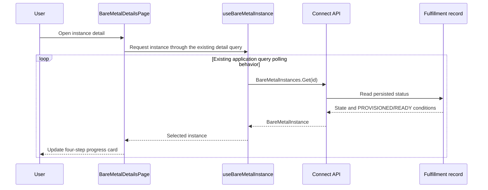

# BMaaS Provisioning Progress UI

| Field | Value |
|-------|-------|
| Author(s) | rawagner@redhat.com |
| Jira | [OSAC-4524](https://redhat.atlassian.net/browse/OSAC-4524) (UI design); [OSAC-3459](https://redhat.atlassian.net/browse/OSAC-3459) (feature) |
| PRD | [BMaaS Provisioning Progress and Step Visibility](https://github.com/osac-project/enhancement-proposals/blob/main/enhancements/OSAC-3459-bmaas-provisioning-progress/prd.md) |
| Date | 2026-10-12 |

# 1. Overview

Add a read-only provisioning-progress card to the bare metal instance detail
view. The card presents exactly four ordered phases—Host Allocation,
Provisioning, Network Setup, and Finalizing—with text and status icons for complete,
current, failed, and not-started states. The card derives its state only from
the existing `PROVISIONED` and `READY` conditions returned by
`BareMetalInstances.Get` and displays the API's curated message for the active
or failed phase. [PRD FR-1, FR-2, FR-4, FR-5; OSAC-5351]

The progress card continues to receive updates through the existing bare metal
detail query and application polling defaults. It introduces no polling
interval, terminal-stop predicate, component timer, or query-hook option; the
current default polling mechanism remains the source of refresh behavior. [User;
codebase query defaults]

This is a UI-only change. It adds no protobuf fields, endpoints, persistence,
operator conditions, actions, or RBAC permissions. The existing raw conditions
table remains available as a diagnostic view below the user-facing progress
card. [PRD Out of Scope; accepted OSAC-3459 design; OSAC-5347]

# 2. Goals and Non-Goals

## 2.1 Goals

- Show the current phase, state, and curated message on the bare metal instance
  detail page.
- Show the four phases in a stable order, with earlier phases complete and
  later phases not started when an active phase is known.
- Treat a phase with no work, including network setup for an instance without a
  network attachment, as complete when the API reports provisioning complete.
- Continue using the existing detail-page polling behavior without adding a
  progress-specific interval or timer.
- Preserve the terminal result for as long as the API continues to return the
  fulfillment record.
- Make state understandable without relying on color and announce meaningful
  refresh-driven changes to assistive technology.
- Keep the view read-only and preserve the existing diagnostic conditions table.

## 2.2 Non-Goals

- Adding a provisioning timeline, per-phase duration, event history, or logs.
- Adding retry, remediation, re-provision, delete, or other actions.
- Showing deprovisioning progress or an aggregate list of active instances.
- Changing VMaaS or CaaS progress behavior.
- Changing the public protobuf, backend reconciliation, operator conditions,
  database schema, or API surface.

# 3. Motivation / Background

The current bare metal detail page combines a coarse status label with a flat
conditions table. That is useful for diagnosis but does not tell a tenant or
cloud-provider administrator which user-facing phase is active. The PRD and
the accepted backend design establish a four-phase presentation based on
existing persisted conditions; the closed fulfillment implementation now stamps
the required stage and curated message values. [PRD; OSAC-3459 design;
OSAC-5347]

The UI consumes this public contract:

| API data | User-facing result |
|---|---|
| `PROVISIONED=False`, reason `HostAllocation` | Host Allocation is in progress. |
| `PROVISIONED=False`, reason `Provisioning` | Provisioning is in progress. |
| `PROVISIONED=False`, reason `NetworkSetup` | Network Setup is in progress. |
| `PROVISIONED=True`, reason `Provisioned`, with `READY=False`, reason `Ready` | Host Allocation, Provisioning, and Network Setup are complete; Finalizing is in progress. |
| `READY=True`, reason `Ready` | All four phases are complete. |
| A curated provisioning failure classification on `PROVISIONED=False` | The mapped provisioning phase is failed; earlier phases are complete and later phases are not started. |
| A curated `ReadyTimeout` failure on `READY=False` while `PROVISIONED=True` | Finalizing is failed; the first three phases remain complete. |

The failure mapping is fixed by the backend vocabulary, not by parsing message
text: `NoMatchingHosts` and `HostAllocationFailed` map to Host Allocation;
`ProvisionJobFailed` maps to Provisioning; `NetworkAttachmentFailed`,
`NetworkHandoffFailed`, and `IPDiscoveryFailed` map to Network Setup; and
`ReadyTimeout` maps to Finalizing. The API continues to use `Ready` as the
condition reason; only the user-facing ordered phase label is `Finalizing`. The
UI renders the accompanying curated
`message` and never reads operator conditions, AAP jobs, Metal3 resources, or
raw internal errors. [OSAC-5346; OSAC-5347]

The data flow remains the existing detail-query path:

Because the status is persisted by fulfillment-service, a later visit or a
remount of the detail page can render the same terminal outcome without a UI
history store. [PRD FR-4; OSAC-5347]

# 4. Design

## 4.1 Architecture

Introduce a pure progress-derivation helper and a presentational card in the
`osac-ui` component library:

- `components/BareMetalInstance/BareMetalProvisioningProgress.tsx` renders the
  PatternFly `Card`, `CardTitle`, `CardBody`, `ProgressStepper`, and four
  `ProgressStep` children. It receives a `BareMetalInstance` and does not fetch
  data or own timers.
- `components/BareMetalInstance/bareMetalProvisioningProgress.ts` contains the
  ordered step definitions, condition lookup, failure-classification mapping,
  and derived view model. Keeping this logic pure makes the condition-order
  independence and fallback behavior directly testable.
- `BareMetalDetails.tsx` places the card immediately below the resource header
  and above the details/conditions grid. It spans the available content width;
  the existing raw conditions table stays in its current diagnostic card.
- `BareMetalDetailsPage.tsx` continues to pass the existing loaded resource to
  the detail composition.
- `api/v1/baremetal-instance.ts` remains unchanged. The progress card uses the
  existing `useBareMetalInstance` query and its application-configured polling
  defaults.

The progress card contains the PatternFly `ProgressStepper` component. It is a
horizontal, centered stepper inside a PatternFly `Card`, matching the supplied
visual direction while remaining non-interactive. Each `ProgressStep` contains
the translated phase label, a status variant, an accessible state label, and a
description containing the API-provided message when the phase is active or
failed. The component supplies `aria-current="step"` for the current row. The
failed row uses the danger variant and an explicit failure label; complete,
current, and not-started rows use success, info, and pending variants. No state
is conveyed by color alone. An unavailable fallback uses the warning variant and
translated unavailable copy. Each step receives a stable `id`, `titleId`, and
`aria-label` containing its phase and state; the component does not use
`popoverRender`, so the stepper remains non-interactive. The card has an
accessible heading and the `ProgressStepper` has an accessible label. A small
polite live region announces only changes to the derived current step, state,
or message. The stepper itself is not a live region, which avoids repeating
unchanged content on each refresh.
[PRD NFR-2; OSAC-5351; User image reference]

The reference image's remaining-time text and boot-log framing are not part of
this design: the PRD excludes durations and timelines, so the card contains
only the provisioning-progress heading, the four steps, and relevant status
messages. [PRD Out of Scope]

The four rows are always present:

1. **Host Allocation**
2. **Provisioning**
3. **Network Setup**
4. **Finalizing**

For a recognized active phase, rows before it are `complete`, the active row is
`in-progress`, and rows after it are `not-started`. For a recognized failure,
rows before the failed phase are `complete`, the failed row is `failed`, and
rows after it are `not-started`. A successful `READY=True` response marks all
rows `complete`. A `PROVISIONED=True` response marks the first three rows
complete even when network setup had no work, as required by the PRD. [PRD
FR-1, FR-2, FR-4]

The failure mapping is implemented once, keyed by backend failure reason. The
UI does not duplicate backend failure-message text or infer a phase from
message wording. If a legacy or future response contains an unknown stage or
failure reason, the card keeps all four rows visible but marks the affected
progress as unavailable and displays translated fallback copy. It does not
claim an arbitrary phase is complete or failed. The existing coarse status and
raw conditions remain visible for diagnosis. Refresh behavior remains owned by
the existing detail query; the progress component does not add a terminal
predicate or a second polling lifecycle.

## 4.2 Data Model / Schema Changes

There are no data model or schema changes. The implementation consumes the
existing `BareMetalInstanceStatus.state` and condition fields:

- `type` identifies `PROVISIONED` or `READY`;
- `status` identifies true, false, or an unavailable condition;
- `reason` identifies the current stage or fixed failure classification;
- `message` supplies the curated human-readable status;
- `lastTransitionTime` remains available in the existing raw conditions table
  but is not presented as a duration or timeline.

Generated protobuf TypeScript files are not edited or regenerated.

## 4.3 API Changes

No endpoint, request, response, protobuf, or generated type changes are
required. The UI continues to call `BareMetalInstances.Get({ id })` through
`useApiQuery` and reads the already-published public resource contract.

There is no client API change for polling. Existing consumers and the detail
page continue to call `useBareMetalInstance` with the current signature and
application query defaults.

## 4.4 Scalability and Performance

An open active detail page continues to use the existing GET and application
query defaults. The progress card adds no database query, status write,
websocket, timer, interval, or list-wide polling. Query caching and request
lifecycle behavior remain unchanged.

The view derives four rows from the in-memory response, so rendering cost is
constant in the number of conditions. The implementation must not add a
per-render timer, interval, or request; the existing detail query owns the
refresh lifecycle.

## 4.5 Security Considerations

The feature uses the existing authenticated, tenant-scoped GET request and
introduces no new permission or data path. The UI must display only the
curated `message` delivered by the public API. It must not expose raw operator,
automation, Metal3, or internal error details through the progress card or new
client logging. Existing backend authorization remains the enforcement point.

## 4.6 Failure Handling and Recovery

- **Initial load failure:** retain the existing detail-page error and retry
  behavior. No progress card is rendered without an instance response.
- **Background refresh failure with cached data:** retain and render the last
  known instance instead of replacing a useful progress result with a full-page
  error. The query's existing retry and polling behavior remains unchanged.
- **Provisioning failure:** derive the failed phase from the fixed reason map,
  render the backend-curated message, and leave earlier/later rows in their
  derived terminal positions.
- **Finalizing failure:** keep the first three completed rows, mark Finalizing
  failed, and render the curated message. The API continues to identify this
  state with the `READY` condition and `ReadyTimeout` classification.
- **Unknown or legacy stage/failure:** render all four rows with a clearly
  translated unavailable state, preserve the coarse status and raw conditions,
  and avoid inventing a stage.
- **Malformed or absent condition:** treat the affected detail as unavailable;
  do not interpret condition array order or an empty message as progress.

The progress card has no user recovery action in this iteration. Recovery is
represented by the backend eventually returning a new status, or by the
existing page retry control after an initial request failure. [PRD NFR-2]

## 4.7 RBAC / Tenancy

No RBAC or tenancy changes are needed. The component renders the same resource
already authorized for the current user and does not aggregate instances across
tenants. The existing `BareMetalInstances.Get` authorization and tenant
filtering apply unchanged.

## 4.8 Extensibility / Future-Proofing

The pure derivation helper is the single client-side boundary for stage mapping.
Adding a new observable phase later requires an API contract change, an update
to the ordered definition and reason map, translated labels, and focused
fixtures; it does not require reworking polling or page composition.

The design intentionally does not create a local history model. A future
timeline can add a separate API-backed interface without making the four-step
current-state card depend on client retention or timestamps.

# 5. Interface Changes

## IC-1 — Read-only provisioning progress card

The bare metal instance detail view gains a full-width card below the resource
header and above the existing details/conditions grid. It contains exactly four
ordered, non-interactive rows and displays current/failure messages from the
API. The raw conditions card remains available below it. [FR-1, FR-2, FR-4,
FR-5, NFR-2, NFR-3]

The API's `READY` condition and `Ready` reason map to the user-facing
`Finalizing` row; the backend identifiers are not renamed. [User; OSAC-5347]

## IC-2 — Accessible progress and compatibility fallback

Each state is expressed through text and an icon/status label, the current row
uses `aria-current`, the card has an accessible heading, and meaningful
refresh-driven changes are announced politely without repeated unchanged
announcements. Unknown or legacy API vocabulary produces an explicit
unavailable fallback rather than misleading progress. [FR-1, FR-5, NFR-2,
NFR-3]

The existing detail query continues to provide refreshes using the application
defaults; the progress card neither changes the cadence nor adds a terminal
stop rule. [FR-3, NFR-1]

# 6. Alternatives Considered

### Keep the raw conditions table as the only progress view

Rejected because the table is unordered diagnostic data and does not expose the
four user-facing phases, their ordering, or a clear current step. It also makes
the refresh-driven experience difficult to understand. [PRD FR-1, FR-2]

### Add a progress-specific polling interval or terminal stop rule

Rejected because the existing detail query already supplies refresh behavior and
the requested UI change does not alter its cadence or lifecycle. Keeping the
default mechanism avoids a second polling contract in the progress component.
[User; codebase query defaults]

### Add a new progress endpoint or persisted timeline

Rejected for this iteration because the existing public conditions and
fulfillment record already provide the required current and terminal state. A
new endpoint or history model would expand the API, storage, and retention
scope that the PRD explicitly defers. [PRD FR-4 and Out of Scope; OSAC-5347]

### Use a custom ordered list instead of the PatternFly stepper

Rejected because PatternFly's `ProgressStepper` already provides the required
ordered-list semantics, current-step `aria-current`, status variants, and
accessible labels. A custom list would duplicate those behaviors and diverge
from the requested visual language. [PRD NFR-2; PatternFly 6.6.1 API;
User image reference]

### Manage progress refresh with a component-owned `setInterval`

Rejected because it duplicates query lifecycle behavior, complicates unmount
and error handling. The existing query already owns the request lifecycle, so
the progress card remains presentational.

# 7. Observability and Monitoring

No new backend metrics, events, logs, or alerts are required. Existing API
request telemetry and query error handling continue to show request failures.
The UI should not log API messages or condition payloads because they may
contain implementation details and are already visible through authorized
diagnostic presentation.

During validation, component tests verify the derived state and accessible
updates with controlled fixtures. Manual review should confirm that the
browser's existing detail-page refresh behavior still updates the card and
that the new component does not create an additional timer or request loop.

# 8. Impact and Compatibility

Expected implementation changes are limited to the `osac-ui` component library
and its translation extraction/test fixtures:

- add the pure progress derivation module and its unit tests;
- add the progress card and component tests;
- add translated labels, statuses, accessibility copy, and fallback copy via
  the existing i18n extraction workflow.

No generated protobuf files, backend services, database migrations, RBAC
manifests, or other resource pages change. Existing consumers of
`useBareMetalInstance` keep their current behavior. Existing header status,
details, networking, actions, and raw conditions remain compatible; the new
card adds information without changing mutation behavior.

During version skew, an older API that lacks the recognized stage vocabulary
will use the explicit unavailable fallback while the existing coarse status and
conditions remain usable. A newer API that adds a reason not yet understood by
the UI will not produce an incorrect phase claim. The UI must be updated with
the API contract before presenting any new phase or failure classification.

# 9. Open Questions

There are no blocking open questions for the current scope. The design uses
the accepted four-phase condition contract, a semantic ordered-list card, the
existing detail query polling behavior, and a conservative unknown-vocabulary fallback.
An explicit failed-stage field could simplify future API evolution, but it is
not required for this iteration because the current fixed failure vocabulary
already identifies the failed phase. The API's `Ready` reason remains mapped
to the user-facing `Finalizing` label.

---

## Provenance

Authored: revise @ design 0.11.3 - 2bd6607, workspace main @ d30e35d27
Phases: draft, draft, revise, revise

<!-- ai-workflow-provenance:{"schema_version":1,"provenance_kind":"session","workflow":"design","workflow_version":"0.11.3","ai_workflows":"2bd6607","source_repo":"d30e35d27","source_repo_branch":"main","commits_behind_main":0,"commits_ahead_main":346,"main_ref":"main","phases":["draft","draft","revise","revise"],"authoring_modes":["skill"],"context_changed":false,"origin_untracked":false} -->
