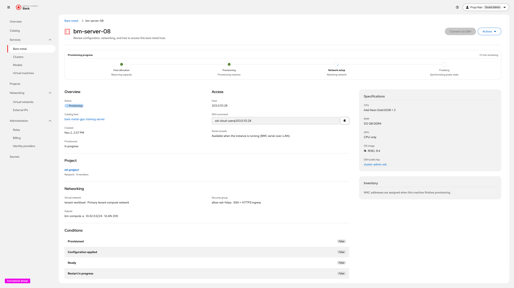

# BMaaS Provisioning Progress — UX Design

Conceptual UX for **bare metal provisioning step visibility** on the instance
detail page ([OSAC-3459](https://redhat.atlassian.net/browse/OSAC-3459);
UI design [OSAC-4524](https://redhat.atlassian.net/browse/OSAC-4524)), captured
from the live click-through prototype. This document covers the **happy path**
only: the four stages advancing on the detail page.

**Prototype (developers):**
[In progress — bm-server-08](https://heyethankim.github.io/osac-bmaas/tenant-admin/northsummit/workspace?nav=services-baremetal&instance=instance-demo-bm-08)

Requirements: [prd.md](prd.md). Backend design: [design.md](design.md).
Implementation-oriented UI contract: [ui-design.md](ui-design.md).

## Product decisions (this release)

- **Four ordered phases on detail.** While a bare metal instance is
  provisioning, the detail page shows a **Provisioning progress** card with
  exactly these stages, in order:

  1. **Host allocation**
  2. **Provisioning**
  3. **Network setup**
  4. **Finalizing**

  Earlier phases are complete, the active phase is current, and later phases
  stay pending.
- **Same progress pattern as CaaS / VMaaS.** Stage state comes from the existing
  `PROVISIONED` / `READY` conditions (furthest-advanced `reason` + curated
  `message`), not a BMaaS-only timeline. The API `Ready` reason maps to the
  user-facing **Finalizing** label ([ui-design.md](ui-design.md)).
- **Detail-page card, not a wizard.** Progress lives under the resource header
  and above Overview / conditions so the tenant can leave the launch flow and
  keep watching under Services → Bare metal.
- **Read-only.** The card surfaces phase, state, and curated status copy. It
  does not add retry, re-provision, or other mutating controls
  ([prd.md](prd.md) Out of Scope).
- **No duration / timeline in MVP.** The prototype may show remaining-time copy
  for storytelling. [ui-design.md](ui-design.md) and the PRD exclude per-phase
  durations and a durable history; ship the four steps plus status messages
  only.
- **Conditions stay for diagnosis.** The raw conditions table remains below the
  progress card; the card is the user-facing summary.

---

## Journey overview

```text
Tenant launches bare metal from Catalog
        │
        ▼
Instance appears under Services → Bare metal (status Provisioning)
        │
        ▼
Detail: Provisioning progress card
  1. Host allocation
  2. Provisioning
  3. Network setup
  4. Finalizing
        │
        ▼
Stages advance; instance becomes Running
```

---

## 1. Host allocation

**What this screen is for.** Show that the platform is reserving matching bare
metal capacity for the order ([prd.md](prd.md) Host Allocation phase).

**Explanation.** **Host allocation** is current (**Reserving capacity**).
**Provisioning**, **Network setup**, and **Finalizing** remain pending. The
detail header keeps the coarse **Provisioning** badge; Overview, Access,
Specifications, and Conditions stay visible under the card.


---

## 2. Provisioning

**What this screen is for.** Show that the opaque imaging / configuration job
is running after capacity was reserved ([prd.md](prd.md) Provisioning phase).

**Explanation.** **Host allocation** is complete. **Provisioning** is current
(**Provisioning instance**). **Network setup** and **Finalizing** stay pending.
Hardware prep, OS install, and configuration remain folded into this single
observable stage.


---

## 3. Network setup

**What this screen is for.** Show that networking attach / configure / address
discovery is underway ([prd.md](prd.md) Network Setup phase).

**Explanation.** **Host allocation** and **Provisioning** are complete.
**Network setup** is current (**Attaching network**). **Finalizing** stays
pending. Leaf subtext under this stage advances through attaching, configuring,
and discovering IP as work proceeds.



---

## 4. Finalizing

**What this screen is for.** Show the last stretch before the instance is ready
— power / ready synchronization ([prd.md](prd.md) Ready phase; user-facing label
**Finalizing** per [ui-design.md](ui-design.md)).

**Explanation.** The first three stages are complete. **Finalizing** is current
(**Synchronizing power state**). When this stage finishes, the instance moves
to **Running** and the progress card leaves the provisioning presentation.


---

## Notes vs ui-design.md

| Topic | This UX design (prototype) | [ui-design.md](ui-design.md) |
| --- | --- | --- |
| Phases | Host allocation, Provisioning, Network setup, Finalizing | Same four ordered phases |
| Scope of this doc | Happy path — one screenshot per stage | Also covers failure mapping and unavailable fallback |
| Remaining time | Shown in prototype (`~N min remaining`) | Out of scope — heading + steps + messages only |
| Message source | Demo leaf labels under the active stage | API curated `message` for the active phase |
| Refresh | Demo clock (frozen per capture) | Existing detail query polling defaults |

Align implementation with [ui-design.md](ui-design.md) for remaining-time
omission and read-only behavior; keep the four-step ProgressStepper placement
and phase labels from this prototype.
