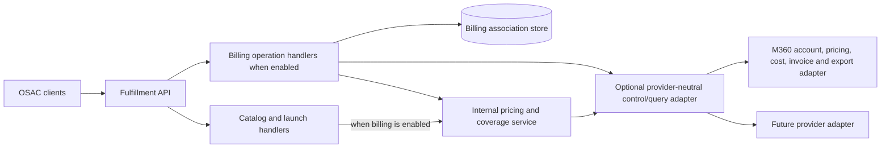

# OSAC Billing Integration and Catalog Pricing

| Field       | Value |
|-------------|-------|
| Author(s)   | Amit Oren |
| Jira        | [OSAC-3784](https://redhat.atlassian.net/browse/OSAC-3784), [OSAC-3793](https://redhat.atlassian.net/browse/OSAC-3793) |
| PRD         | [OSAC-3784 PRD](https://github.com/osac-project/enhancement-proposals/blob/main/enhancements/OSAC-3784-billing-integration-mvp/prd.md); [OSAC-3793 PRD](https://github.com/osac-project/enhancement-proposals/tree/main/enhancements/OSAC-3793-billing-catalog-pricing-integration/prd.md) |
| Date        | 2026-10-07 |

# 1. Overview

OSAC gets catalog prices and rate cards from its configured billing provider and does not store pricing details. The fulfillment service exposes one provider-neutral billing API, starting with Monetize360 (M360), so other providers can be added later. This API supports catalog pricing for VMaaS, CaaS, and BMaaS.

# 2. Goals and Non-Goals

## 2.1 Goals

- Keep tenant-facing OSAC APIs and response models independent of M360 and other provider-native schemas.
- Allow a deployment to run without a billing provider while preserving normal catalog and resource fulfillment.
- Define a time-versioned 1:1 tenant-to-account association for the proposed design and retain an extension path to 1:N.
- Resolve current account status and pricing/coverage in the backend, with tenant authorization enforced before provider calls.
- Provide Cloud Provider Admins a consolidated inventory of billable catalog dimensions and values, with references to the catalog items that use or offer each value, so provider rate-card completeness can be checked.
- Provide Cloud Provider Admins provider-neutral, currency-aware rate-card rows that the Rates UI can display by service, resource match, rate, and related catalog item.
- Enrich visible VMaaS, CaaS, and BMaaS catalog list/get responses with read-time prices for default configurations, component details, account currency, freshness, and a price-may-vary indication. BMaaS is an added design scope; its PRD does not require catalog pricing.
- Keep catalog browsing available with or without billing. When a provider is configured, block a billing-gated action when a live coverage check for the account in scope cannot complete or finds unresolved coverage. A global catalog item does not require coverage checks for every tenant who may see it; each tenant's launch is checked against that tenant's linked account.
- Preserve the existing metering delivery path and event schema. M360 attributes events using the current `externalId` mapping for the event's `tenant_id`, so this design does not promise event-time account attribution after reassignment.
- Return an estimate in the account currency and provider rate unit, with hourly and monthly recurring amounts normalized using a fixed 730-hour month where the rate is time-based.

## 2.2 Non-Goals

- Create billing accounts, author rate cards, edit provider catalog data, process payments, or issue invoices. Invoice reads are in scope; the provider remains the invoice source of truth.
- Show account balances or rated transactions in the first billing UI slice.
- Persist provider catalog prices as OSAC catalog records or create a second M360 pricing client in the catalog server.
- Run several billing providers concurrently in one deployment; a deployment may have billing disabled or configure one provider.
- Estimate one-time charges or claim that prospective estimates are provider-rated actual charges.
- Convert provider prices between currencies or reconcile a provider-returned pricing currency that differs from the linked account's agreed currency.
- Apply an additional billing-rounding rule to provider amounts. Preserve decimal values; UI formatting to 2–3 fractional digits is sufficient, and configurable display precision is a nice-to-have.

## 2.3 Assumptions

- The configured billing provider returns pricing in the agreed currency for the linked account. OSAC uses that currency as the account currency; currency conversion and provider-currency mismatch handling are out of scope.
- Provider price values are preserved as decimal amounts without an additional OSAC rounding step. The UI may display 2–3 digits after the decimal point; making that display precision configurable is a nice-to-have.
- Billing may be unconfigured. This is a supported deployment mode, distinct from a configured provider that is temporarily unavailable.

# 3. Motivation / Background

The billing UI currently reads M360-shaped data directly and calculates launch estimates locally. That couples OSAC clients to M360 account identifiers and rate-card details, and it cannot enforce the same policy for API, CLI, catalog publication, and launch.

The backend already has an M360 usage adapter in `osac-metering`, but no account association model or billing query API. Fulfillment-service is the public API, persistence, and authorization boundary; the metering adapters own downstream provider usage submission. The design adds control/query operations to fulfillment-service while keeping usage delivery in osac-metering.

The reviewed M360 documentation describes account status, service rates, and contract exceptions, but no prospective quote endpoint. OSAC therefore matches documented provider rate rules to billable components and presents a clearly labeled estimate; M360 remains the source of truth for actual rating and charges. OSAC does not interpret arbitrary provider formula text. Any 730-hour projection is labeled as an OSAC estimate, separate from provider-supplied rates.

# 4. Design

## 4.1 Architecture



OSAC clients use the fulfillment-service API. Fulfillment-service enforces authorization and tenant scope. When billing is disabled, catalog and resource operations continue without pricing or billing gates.

Fulfillment-service calls the configured provider through a provider-neutral adapter. Usage continues through `osac-metering` and its existing event format. M360 maps each event's `tenant_id` through the account's current `externalId`; late events after reassignment use that current mapping.

When billing is configured, catalog reads use the shared pricing resolver and include its result. OSAC does not store the resolved prices. When billing is disabled, catalog responses omit pricing.

### Pricing resolution

1. Check the linked account for a contract effective on the requested date.
2. If a contract exists, resolve its pricing. For M360, a contract may inherit the service catalog price when no exception rate is defined.
3. If the provider confirms that no contract applies, use the service's default rate card.
4. If the contract lookup fails or returns an unexpected ambiguous result, return an error. Do not fall back to the default rate card.
5. Resolve rates in the account's currency. Missing component rates block billing-enabled publication or launch. OSAC matches provider-supplied rate rules and may calculate a clearly labeled prospective estimate; the provider rates actual usage.

## 4.2 Data Model / Schema Changes

The following tables describe the logical fulfillment-service data model, not protobuf field layouts or database types.

### `billing_account`

Stores the OSAC-side record for an account discovered from the configured billing provider.

This record is created only when a provider is configured and an account is discovered. No billing-account or tenant-assignment rows are required when billing is disabled.

| Field | Description |
|---|---|
| `id` | OSAC-generated opaque identifier used by APIs and assignments; it is not the provider's account ID. |
| `provider_key` | Identifies the configured billing adapter, such as M360. Provider configuration stays server-side. |
| `provider_account_reference` | Provider-native account ID used for backend calls; it is not returned to ordinary clients. |
| `display_name` | Provider-supplied account label shown in authorized OSAC account views. |
| `base_currency` | Immutable ISO-4217 currency code used to interpret prices and costs. |
| `status` | Last observed normalized state: `ACTIVE`, `INACTIVE`, or `UNKNOWN`. |
| `status_observed_at` | Time the provider status was last checked, so its freshness is visible. |

Provider credentials are not fields in this table; they remain in the configured Secret mechanism. Account metadata is refreshed from the provider. Rate-card values, estimates, actual costs, and rated transactions are not persisted as OSAC-owned prices.

### `tenant_billing_assignment`

Stores each time-bounded association between an OSAC tenant and a billing account. A new row is created when an association starts; reassignment closes the old row and creates a new one so the history remains auditable.

| Field (proposed name) | Description |
|---|---|
| `assignment_id` | Unique OSAC identifier for this particular assignment record. It distinguishes this link interval from later links for the same tenant and account, and lets audit/reconciliation records refer to the exact assignment. |
| `tenant_id` | OSAC tenant whose usage and billing profile use this assignment. |
| `billing_account_id` | Reference to `billing_account.id` for the account assigned to the tenant during this interval. |
| `effective_from` | Timestamp at which this tenant/account assignment became active. |
| `effective_to` | Timestamp at which this assignment stopped being active. `NULL` means it is the current assignment. |
| `connection_state` | OSAC's normalized state for synchronizing the association with the provider, such as `PENDING` or `CONNECTED`. `PENDING` means the provider mapping has not yet been verified. |
| `created_by` | Authenticated OSAC principal that created the assignment. |
| `audit_correlation_id` | Provisional placeholder. Whether this assignment needs a direct audit correlation field depends on the audit model and is unresolved. |

For the current design, enforce at most one active assignment per tenant and at most one active tenant per billing account. Close the old assignment and create its replacement in one database transaction. The time-versioned model allows a future 1:N policy to relax the account-side uniqueness constraint without replacing the history model.

Do not treat `audit_correlation_id` as an approved schema field. Decide whether assignment records need a correlation field when the audit model and lookup needs are defined in §9.3.

### API schema boundary

Fulfillment-service protos define the API contract; REST is generated through CleanAPI. This design names services and methods without listing every proto field or field number. Tenant assignments follow OSAC `Metadata`/`Spec`/`Status` conventions and reconcile provider state; account, catalog, rate-card, cost, and invoice read models may be flat. Proto and JSON field names use `snake_case`; enums use a type-prefixed `*_UNSPECIFIED = 0` value. Use `buf.validate` for required identifiers, currencies, and time ranges. The methods listed in §4.3 are the intended CleanAPI surface; reconciliation signals and provider-native references remain private. Audit schema remains deferred under §9.3; price freshness timestamp semantics remain open under §9.2.

### Candidate: `billing_audit_event` (not designed)

The PRD requires OSAC-side audit records for billing actions, but this design has not defined the audit model. `billing_audit_event` is only a placeholder name; no table, fields, storage mechanism, event taxonomy, retention policy, authorization model, or read interface is selected here. The implementation may use an existing audit facility rather than a new billing-specific table. Resolve §9.3 before treating audit persistence as a schema change.

Use a durable reconciliation record for provider-link updates. Before setting M360's `externalId`, read the account: an existing value equal to this tenant is idempotent success; any other non-empty value fails with `ACCOUNT_ALREADY_BOUND` and is never overwritten. Use conditional update if supported. Otherwise, leave the assignment `PENDING` until a read-back verifies the value, and reconcile races or lost updates. Mark it `CONNECTED` only after verification. Only Cloud Provider Admins may create or replace links; `tenant_id` is not an authorization credential. Account reassignment closes the old effective interval and creates the new one at the operation's effective time. Tenant deletion revokes normal tenant access immediately and retains the association as a read-only tombstone until provider retention permits cleanup. Suspension does not change the account association or provider account status. Historical OSAC assignments support audit only; M360 uses the current `externalId` mapping for usage events and the current event format cannot target the historical account.

Rate-card snapshots, actual costs, balances, invoices, and rated transactions are not stored in this schema. Cost, invoice, and charge data are returned from the provider, subject to its retention and supported read capabilities.

## 4.3 API Changes

Fulfillment-service protos define the API contract. CleanAPI generates REST endpoints from the proto annotations; clients use the fulfillment API rather than provider routes. These proposed services use standard methods and provider-neutral responses. Tenant assignments are OSAC objects with desired and observed state; provider, catalog, rate-card, cost, and invoice reads are flat read models. Assignment reconciliation has a private `Signal` method. Public exposure is controlled through CleanAPI; provider-native identifiers and credentials remain private.

| Service and method | Caller | Contract |
|---|---|---|
| `BillingProviderStatuses.Get` | Cloud Provider Admin; Cloud Infrastructure Admin | Report `NOT_CONFIGURED` or normalized provider health and supported capabilities. This read remains available when billing is disabled. |
| `BillingAccounts.List` | Cloud Provider Admin | List existing accounts with opaque OSAC IDs, display name, normalized status, and base currency. Do not expose provider-native account references. |
| `TenantBillingAssignments.List`, `Get`, `Create`, `Update` | Cloud Provider Admin | Read or change a tenant's time-versioned account assignment. Enforce the current 1:1 rule. Linking follows the read-before-write and verified-read-back protocol in §4.2. |
| `CatalogPricingInputs.List` | Cloud Provider Admin | List billable dimensions and all default or selectable values in draft and published catalog items, with the items that use or offer each value. This OSAC-only inventory remains available when billing is disabled. |
| `ProviderRateCardItems.List` | Cloud Provider Admin | Return provider rules as currency-specific, provider-neutral rows that can be shown one at a time in the Rates UI. Preserve the provider's match conditions and rate unit; do not return raw provider payloads. With a tenant context, use its contract when present and the default service rate card only when the provider confirms no contract applies. |
| `PricingQueries.Create` | Authorized tenant caller or Cloud Provider Admin preview | Evaluate a declarative resource configuration and return component-level price and coverage results. Coverage means the provider has a rate for each required billable component. The request is evaluated synchronously and is not stored as billing state. A configured provider is required. |
| `PriceEstimates.Create` | Authorized tenant caller or Cloud Provider Admin preview | Return a prospective recurring estimate for the requested configuration in the account currency and provider rate unit. The estimate is not a charge or invoice. Preserve the provider amount and unit; label any 730-hour monthly projection as OSAC-derived. A configured provider is required. |
| Existing VMaaS, CaaS, and BMaaS catalog `List` / `Get` methods | Callers already authorized to view the catalog item | Add optional default-configuration pricing when a provider is configured. Use the existing catalog methods; do not create a parallel catalog API. BMaaS pricing is included in this design but is not required by its PRD. |
| `BillingCosts.List` | Tenant Admin; Tenant User for visible resources/projects; Cloud Provider Admin for assigned tenants | Return provider-calculated costs filtered to the caller's tenant and project access. No account-balance API is defined. |
| `DraftCharges.List` | Cloud Provider Admin | Return a read-only, tenant-scoped draft-charge view when the provider supports it. Unsupported capability returns `UNIMPLEMENTED/PROVIDER_CAPABILITY_UNSUPPORTED`, not an empty result. |
| `BillingInvoices.List`, `Get` | Tenant Admin; Cloud Provider Admin for assigned tenants | Read past invoices and itemized charge breakdowns from the provider, filtered to the authorized tenant. OSAC does not issue, modify, or persist invoices. If unsupported, report that capability and return `UNIMPLEMENTED/PROVIDER_CAPABILITY_UNSUPPORTED`. |
| `BillingExports.Create`, `Get` | Cloud Provider Admin | Start and inspect an export for an authorized tenant and billing period when supported. Return operation status; do not report unsupported exports as successful. |

`CatalogPricingInputs.List` is an OSAC projection, not a second catalog source of truth. For example, it can show that the value `fedora-16` is used by a VM catalog item. The provider rate-card response then represents each matching provider rule as a singular display row:

```json
{
  "currency_code": "USD",
  "items": [
    {
      "service": "compute_instance",
      "resource": {
        "boot_disk_size": { "operator": "ANY" },
        "storage_tier": { "operator": "ANY" },
        "vm_image_ref": { "operator": "EQUALS", "value": "fedora-16" }
      },
      "rate": { "amount": "4.50", "unit": "hour" },
      "catalog_item_matches": ["vm-fedora-small"]
    }
  ]
}
```

The provider adapter translates each provider's serialized rate-card format into these rows. It does not evaluate arbitrary provider formula text; an unsupported rate-rule shape returns a safe unavailable result. A contract lookup failure or unexpected ambiguous result is an error; only a confirmed absence of an account contract selects the default service rate card.

Billing is optional per deployment. `BillingProviderStatuses.Get` reports `NOT_CONFIGURED`; provider-dependent methods return `FAILED_PRECONDITION/BILLING_NOT_CONFIGURED`. The OSAC-only catalog inventory remains available. Existing catalog methods return catalog data without pricing, and billing-specific publish/launch gates are skipped. Core authorization, catalog validation, and resource checks still apply.

Catalog pricing distinguishes current, stale, and unavailable results. A stale result may include its last known amount for browsing, but it is never treated as current and cannot satisfy a billing gate:

```json
{
  "pricing": {
    "status": "STALE",
    "currency_code": "USD",
    "components": [
      { "amount": "4.50", "unit": "hour", "description": "Compute instance" }
    ],
    "price_may_vary": false
  }
}
```

An `UNAVAILABLE` result has no amount. Only a successful current read may include `as_of`; stale cached amounts have no current-read timestamp. The meaning of `as_of` remains open under §9.2.

Provider capabilities for pricing, costs, invoices, draft charges, and exports are reported explicitly. The reviewed M360 documents do not define draft-charge selection or charge export; treat these capabilities as unsupported unless the applicable M360 contract confirms them. Never imply that an unsupported operation returned an empty successful result. Audit reads are deferred with the audit design in §9.3.

## 4.4 Scalability and Performance

When billing is disabled, make no provider calls. Account, status, pricing, and cost reads use provider timeouts and retries; an open circuit returns promptly. For catalog lists, use bounded parallel price lookups and a list-level timeout. Each lookup inherits the remaining time. If the timeout expires, return the catalog items: unfinished current prices are `UNAVAILABLE` without an amount, or use a retained amount only with `STALE` status. A billing-gated single-item publish or launch has its own timeout and requires a fresh provider check.

Cache successful catalog prices for five minutes. If refresh fails after the cache expires, show the retained amount as `STALE`; it remains useful for browsing but cannot pass a publish/launch gate. Keep the agreed provider retry policy (up to three retries) and a per-provider OPEN-state circuit breaker for pricing. Suggested initial breaker thresholds remain advisory: five failed pricing requests within 30 seconds, open for 30 seconds, then allow one probe. Tune concurrency and provider rate limits during implementation.

Provider usage submission remains on the existing Kafka path and event schema. M360 maps the event's `tenant_id` through the account's current `externalId`; the current event format cannot route delayed usage to a historical assignment. Do not add tenant or account IDs as metric labels. Paginate cost, invoice, and draft-charge reads.

## 4.5 Security Considerations

Provider calls stay server-side. Store credentials in the existing Secret mechanism; never return credentials, provider-native account references, contract identifiers, or rate-card identifiers to tenant-facing clients. Redact provider response bodies, invoice and charge lines, bearer tokens, and native account IDs from logs, metrics, traces, and API errors unconditionally. Use stable reason codes and correlation IDs for diagnostics; the shared client must never log raw bodies.

Every billing method has an explicit OPA allow-list. Application code also filters every read and write to the caller's authorized tenant and project set. Check catalog visibility before resolving a price. Validate identifiers, currencies, dates, and configuration values at the API boundary. Preserve provider amounts as decimal values and do not execute arbitrary provider formula text.

## 4.6 Failure Handling and Recovery

- **Billing is not configured:** status returns `NOT_CONFIGURED`; provider-dependent operations return `FAILED_PRECONDITION/BILLING_NOT_CONFIGURED`. Catalog reads omit pricing, and billing-specific publish/launch checks are skipped. Normal OSAC checks remain in force.
- **Provider is unavailable or a catalog timeout expires:** return catalog data. A cached amount may be shown with `status=STALE`; otherwise return `status=UNAVAILABLE` with no amount. A live publish/launch check fails closed on timeout or provider failure.
- **Rate coverage is missing:** return `COVERAGE_GAP`; never turn a missing rate into zero. Contract lookup failure or an unexpected ambiguous result is an error, never a fallback to the default card.
- **Account is inactive or unknown:** reject a new assignment. For an existing assignment, show the state and block new billing-gated publication/launch. Do not suspend or stop existing resources.
- **M360 account link conflicts:** if `externalId` is already this tenant, treat the link as idempotent success. If it contains another value, fail with `ACCOUNT_ALREADY_BOUND`; never overwrite it. Keep the assignment `PENDING` until a provider read-back verifies this tenant. Reconcile conditional-update races without marking the link connected prematurely.
- **Provider operation is unsupported:** report the capability in provider status and return `UNIMPLEMENTED/PROVIDER_CAPABILITY_UNSUPPORTED`, not empty data or simulated success.
- **Unauthorized tenant preview or hidden catalog item:** reject before calling the provider and disclose neither the item nor its price.
- **Usage submission fails:** preserve the existing Runner retry, deduplication, DLQ, flush, and offset semantics. Do not change the usage event schema or submit usage from fulfillment-service.
- **Usage arrives after reassignment:** M360 applies the current `externalId` mapping. The design does not guarantee event-time account attribution for delayed events; retain OSAC assignment history for audit.
- **Provider switch:** apply configuration at the billing-period boundary. Do not replay earlier usage to the new provider.
- **Export retries:** use a stable idempotency key so a retry does not create a duplicate export.

## 4.7 RBAC / Tenancy

| Service and methods | OSAC persona | Scope enforced by application |
|---|---|---|
| `BillingProviderStatuses.Get` | Cloud Provider Admin; Cloud Infrastructure Admin | Deployment-wide status only. |
| `BillingAccounts.List`; `TenantBillingAssignments.List`, `Get`, `Create`, `Update` | Cloud Provider Admin | Provider-global account list; assignments limited to tenants the admin may manage. |
| `CatalogPricingInputs.List`; `ProviderRateCardItems.List` | Cloud Provider Admin | Deployment catalog/provider data. |
| `PricingQueries.Create`; `PriceEstimates.Create`; catalog `List` / `Get` | Tenant Admin; Tenant User; Cloud Provider Admin preview | Tenant callers see only visible catalog items and their own account pricing. Tenant Users can estimate only resources they may provision. Admin previews require an authorized target tenant. |
| `BillingCosts.List`; `BillingInvoices.List` / `Get` | Tenant Admin | The caller's tenant and authorized projects. |
| `BillingCosts.List` | Tenant User | Only resources and projects the caller can access. |
| `BillingCosts.List`; `BillingInvoices.List` / `Get` | Cloud Provider Admin | Only an explicitly authorized target tenant. |
| `DraftCharges.List`; `BillingExports.Create` / `Get` | Cloud Provider Admin | Only an explicitly authorized target tenant and its data. |

Cloud Infrastructure Admin installs or switches provider credentials through installer configuration; this is not a separate billing persona or API. OPA allow-lists every method, and application code enforces the tenant/project filters even when OPA permits the role.

`billing_account` is provider-global and has no tenant-isolation annotation. Tenant assignments are keyed by `tenant_id`; tenant and owner-reference annotations apply only to tenant-owned assignment objects. Enforce at most one active account per tenant and one active tenant per account for this version. Historical assignments are visible only to Cloud Provider Admins. Deletion revokes tenant access immediately while retaining the assignment tombstone; suspension does not deactivate the provider account.

## 4.8 Extensibility / Future-Proofing

OSAC-facing services use opaque IDs, normalized status, currency and rate units, and provider-neutral price rows. Provider-specific account and rate-card formats stay behind adapters. Each provider adapter maps OSAC billable components to that provider's query shape and preserves provider-supplied amounts.

Fulfillment and metering share one M360 HTTP transport and configuration, including credentials, timeouts, redaction, and reachability checks. The implementation may extract a small shared client module; fulfillment must not import the metering adapters package. Fulfillment owns billing APIs, authorization, assignments, and provider response mapping. Metering owns Kafka, usage-event translation, retries, and submission. Both consume the same Secret reference and provider URL/version configuration.

The time-versioned assignment model starts with a 1:1 constraint and can support 1:N after product and authorization rules are defined. No provider change should expose native account or rate-card formats to OSAC clients.

# 5. Interface Changes

New billing methods are defined in fulfillment-service protos; CleanAPI generates their REST surface. Catalog pricing extends the existing catalog `List` and `Get` responses. The design adds account-assignment persistence and optional provider configuration, but does not change the metering event schema or store provider prices, costs, or invoices. The API and method summary is in §4.3.

| Interface change | User-story basis |
|---|---|
| Discover accounts and link a tenant through `BillingAccounts` and `TenantBillingAssignments` | Cloud Provider Admin: “I want each tenant associated with a billing account … so that charges land on the correct invoice.” Cloud Infrastructure Admin: “I want to install the billing provider connection as part of the OSAC installation.” |
| Check OSAC billable values and provider rate coverage with `CatalogPricingInputs` and `ProviderRateCardItems` | Cloud Provider Admin: “I want OSAC to prevent a resource type from being offered for provisioning until every one of its billable components has a rate in the billing system … and to alert me to any component lacking a rate.” The admin inventory and serialized rate rows are the agreed design support for this workflow. |
| Enrich VMaaS and CaaS catalog reads and provide tenant-contextual previews | OSAC-3793 Tenant Admin / Tenant User: “I want to see the price of a VMaaS or CaaS catalog item available to my context before provisioning.” BMaaS catalog pricing is included as an extension requested for this design; OSAC-3793 does not require it. |
| Provide a selected-configuration prospective estimate | OSAC-3784 Tenant User: “I want to view the estimated cost of the resources I have deployed.” The prospective configuration estimate is an additional agreed design capability for an upcoming version; it is distinct from the PRD's latest-calculated-cost view. |
| Read tenant costs and past invoices with `BillingCosts` and `BillingInvoices` | Tenant Admin: “I want to view my organization's accumulated costs for the current and past billing periods.” Tenant Admin: “I want to view past invoices and itemized charge breakdowns for my organization.” |
| Review draft charges and export tenant charges | Cloud Provider Admin: “I want to review a tenant's draft charges for a billing period” and “I want to export a tenant's charges for a billing period to my payment system.” These operations return unsupported when the configured provider lacks the capability. |

The provider-status read remains available when billing is disabled. Provider-dependent billing calls return `BILLING_NOT_CONFIGURED`; core catalog and fulfillment methods continue to work without pricing or billing gates. The catalog inventory is OSAC-only and remains available. Audit API and storage details remain deferred under §9.3.


# Drawbacks

- **Provider abstraction adds maintenance.** Normalized account, price, and charge contracts require adapters for each supported provider.
- **Provider latency affects catalog pricing and billing gates.** A list timeout preserves catalog browsing but may leave some prices unavailable; publishing or launching still requires a current result.
- **A stale amount can be mistaken for a current price.** The API marks it `STALE`, and it cannot pass a billing gate.
- **Prospective estimates can differ from actual charges.** Usage, non-recurring charges, and provider processing affect the final amount; the provider remains authoritative.
- **Reassignment cannot route delayed usage historically.** M360 uses the current `externalId` mapping for each event's `tenant_id`; OSAC assignment history does not change this behavior.

# 6. Alternatives Considered

- **Expose M360 routes and fields directly to OSAC clients.** This would bind the API to M360 and prevent adding Red Hat Cost Management or another provider behind the same facade.
- **Require a provider quote API and omit estimates otherwise.** M360 has no documented quote API. The design instead matches documented provider rate rules and presents a prospective estimate; it does not interpret arbitrary formula text or claim to calculate actual charges.
- **Allow publish or launch with unresolved coverage.** This risks provisioning billable resources without a known rate. New billing-gated operations require current coverage; existing resources remain manageable.
- **Use M360's mutable `externalId` as the only assignment record.** OSAC keeps time-versioned assignments for its own history and synchronizes the current tenant ID to M360.
- **Add a separate pricing endpoint for each catalog item.** Existing catalog `List` and `Get` methods carry optional pricing, using bounded provider requests and a timeout.
- **Persist catalog prices in OSAC.** Prices remain provider-owned. A short-lived cache supports browsing and clearly labels old values as `STALE`.

# 7. Observability and Monitoring

Expose normalized provider status and the last successful health check to Cloud Provider Admins. Treat `NOT_CONFIGURED` as an expected state. Track provider request latency and failures, rate-resolution outcomes, catalog-pricing states, usage-delivery lag/DLQ volume, and assignment-sync failures. Metrics may use provider and operation labels, but not tenant, account, resource, or project identifiers. Logs, traces, and API errors contain stable reason codes and correlation IDs only; redact provider payloads, credentials, financial lines, and native account IDs unconditionally.

# 8. Impact and Compatibility

The change adds fulfillment billing methods, account-assignment persistence, provider configuration, OPA rules, and optional pricing on existing VMaaS, CaaS, and BMaaS catalog methods. BMaaS pricing is included by design decision, though it is not required by the PRD. Deployments without a provider keep existing catalog and fulfillment behavior; no billing credentials or provider calls are needed. OSAC does not store provider prices, costs, charges, or invoices.

M360 continues to map the existing metering event's `tenant_id` through the account's current `externalId`; the event schema and metering flow do not change. Delayed usage after reassignment is not guaranteed to use the historical account. Existing assignments preserve OSAC history, and pre-activation usage is not billed retroactively. Invoice reads follow the Tenant Admin story in the PRD; invoice identity, revisions, and amounts remain provider-owned.

# 9. Open Questions

## 9.1 What does M360 account deactivation do to usage ingestion and rating?

- **Status:** Open for discussion during the design document PR review, per user direction (2026-10-08).
- **Owner:** OSAC billing/provider integration team and Monetize360 integration contact
- **Impact:** §4.6. OSAC leaves existing resources running, but the provider's behavior for new or delayed events and rated records is undocumented.

## 9.2 What timestamp should OSAC expose as `as_of` when M360 has no equivalent?

- **Owner:** OSAC billing/provider integration team
- **Status:** Deferred by user; revisit later.
- **Impact:** §4.3 and §4.4. The reviewed RevOs documentation has rate-card version/effective-period fields (`versionNo`, `isCurrent`, `fromDate`, `toDate`) but no generic observation timestamp. Decide whether `as_of` represents OSAC fetch time or provider effective-period metadata. For stale cached prices, return the explicit `STALE` state without presenting the old amount as current.

## 9.3 How should OSAC audit billing actions?

- **Status:** Deferred by user until the audit approach is better defined.
- **Owner:** OSAC billing feature owners with the platform audit/security owners
- **Impact:** §4.2 and §4.3. The PRD requires OSAC-side audit records, but this design has not selected the event taxonomy, source of truth, storage, immutability, retention, authorization, or read surface. Decide whether a billing-specific table is needed and whether assignment records need a direct audit correlation field.

# Graduation Criteria

Graduation criteria will be defined when targeting a release. Expected stages: Dev Preview -> Tech Preview -> GA based on production deployment feedback.
