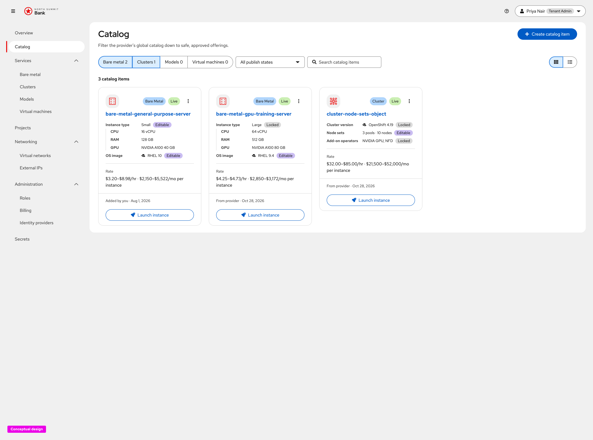
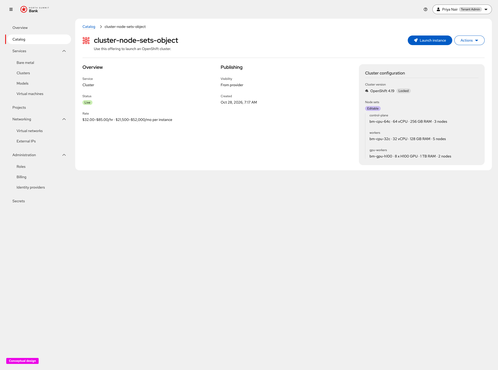
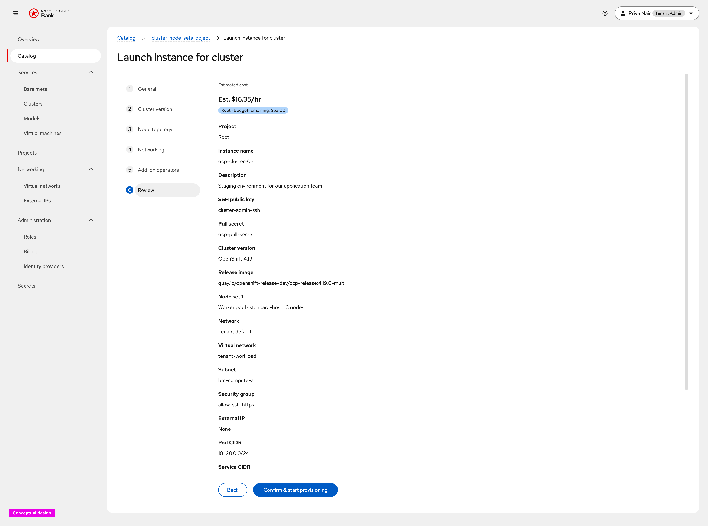

# Billing — Catalog Pricing Integration UX Design

Conceptual UX for **browse-time price enrichment of VMaaS and CaaS catalog
items** ([OSAC-3793](https://redhat.atlassian.net/browse/OSAC-3793)), captured
from the live click-through prototype. Prices come from the billing system
(OSAC-3784); catalog items do not store an independently edited list price.

**Prototype (developers):**

- [Tenant catalog (grid with Rate)](https://heyethankim.github.io/osac-bmaas/tenant-admin/northsummit/workspace?nav=catalog)
- [Cluster catalog item detail](https://heyethankim.github.io/osac-bmaas/tenant-admin/northsummit/workspace?nav=catalog&item=cluster-node-sets-object)
- [Launch cluster → Review (configured estimate)](https://heyethankim.github.io/osac-bmaas/tenant-admin/northsummit/workspace?nav=catalog&action=launch-instance&item=cluster-node-sets-object&step=review)

Requirements: [prd.md](prd.md). Billing source of truth and glossary:
[OSAC-3784 prd](../OSAC-3784-billing-integration-mvp/prd.md). Catalog field
governance (editable billable fields):
[OSAC-3538](https://redhat.atlassian.net/browse/OSAC-3538).

## Product decisions (this release)

- **Rates enrich catalog browse, they are not authored in OSAC.** Catalog cards
  and detail show amounts resolved from the tenant’s effective (or default)
  pricing plan in the billing system ([prd.md](prd.md) In Scope).
- **Metered plus non-metered components.** The Rate line is the composed price
  for the offering’s billable components (resource-type rate and any attached
  non-metered charges such as add-ons or licenses), in the billing account’s
  base currency.
- **Default configuration at browse; signal when price may vary.** Browse-time
  Rate uses the catalog item’s **default** field values. When Catalog Items v2
  leaves a billable field **Editable** (for example node sets or instance type),
  the UI shows a **lowest–highest range** (and optional hint) instead of a
  single point — the PRD’s “price may vary” signal.
- **Graceful degradation.** If the billing system is unreachable or a component
  has no rate yet, omit the Rate (or that component) rather than blocking
  browse or launch. Missing rates remain a provider coverage gap under
  OSAC-3784; this UX does not invent placeholder prices.
- **Tenant-scoped list prices.** Every user in the tenant sees the same catalog
  list price for an item they can browse. Incurred-cost and project-scoped
  charge views stay in OSAC-3784 (**Administration → Billing**).
- **Cloud Provider Admin preview is tenant-contextual.** When a provider
  previews catalog prices, amounts are what that tenant would see under the
  tenant’s plan — not a second provider price list ([prd.md](prd.md)).
- **VMaaS and CaaS only.** Bare-metal catalog pricing is
  [OSAC-3795](https://redhat.atlassian.net/browse/OSAC-3795); MaaS is
  [OSAC-3794](https://redhat.atlassian.net/browse/OSAC-3794). Prototype demo
  data may still show bare-metal cards with Rate for conceptual continuity;
  shipping scope for this EP is ComputeInstance and Cluster catalog items.
- **No side-by-side price comparison grid and no long-horizon spend
  projection** on the catalog ([prd.md](prd.md) Out of Scope). Launch
  **Review** may show an **Estimated cost** for the *configured* launch (point
  rate after editable fields are chosen); that is confirmation of the selected
  configuration, not a multi-period cost forecast.

---

## 1. Catalog list — Rate on approved offerings

**What this screen is for.** Let Tenant Admins and Tenant Users see list prices
while browsing approved VMaaS/CaaS offerings so they can choose before
provisioning ([prd.md](prd.md) tenant stories).

**Explanation.** On **Catalog**, each live card (or list row) includes a
**Rate** line under the specs: hourly and monthly amounts, with a unit such as
*per instance*. When billable fields are **Editable**, Rate is a range (for
example `$32.00–$85.00/hr · $21,500–$52,000/mo`). When the offering is fully
locked to defaults, Rate is a single point. Service filters (Clusters, Virtual
machines, …) do not change the pricing contract — they only narrow which items
appear. Pricing is absent only when enrichment fails or rates are missing;
browse and **Launch instance** still work.

---

## 2. Catalog item detail — Overview Rate

**What this screen is for.** Confirm the list price (or range) in context of
the offering’s default configuration before launch.

**Explanation.** Opening a CaaS item (example: `cluster-node-sets-object`)
shows **Overview** with **Service**, **Status**, and **Rate** using the same
formatted string as the list. Configuration cards on the side show which
fields are **Locked** vs **Editable** (for example Cluster version locked,
Node sets editable) so the tenant can see *why* Rate is a range. Primary
**Launch instance** starts the wizard; Rate on detail still reflects defaults,
not the tenant’s eventual overrides.

---

## 3. Launch Review — configured estimate

**What this screen is for.** After the tenant picks project, topology, and
other launch fields, show the **estimated cost of this configuration** so the
“price may vary” browse range resolves to a point before confirm.

**Explanation.** On **Launch instance → Review**, an **Estimated cost** header
shows a point estimate (for example `Est. $16.35/hr`) derived from the
selected billable components for this launch. That estimate must stay
consistent with billing rates used at browse time (same plan, same currency).
Helper copy may restate that usage still in billing processing is not included
(aligned with OSAC-3784 “as of” semantics for incurred cost — here applied to
list-rate freshness).

**Prototype note.** The demo may also show a project **budget remaining**
chip. Project budgets are outside OSAC-3793; treat that chip as exploratory
unless a separate billing/budget EP accepts it. Shipping this feature should
still deliver the Estimated cost line for the configured launch.

---

## 4. Provider-admin tenant-contextual preview

**What this screen is for.** Let a Cloud Provider Admin verify the list price
a given tenant would see for an approved VMaaS or CaaS catalog item
([prd.md](prd.md) provider story).

**Explanation.** Provider catalog / publish flows reuse the same Rate
formatting as the tenant catalog, resolved against a **selected tenant’s**
effective plan (or the default plan). This is a preview of tenant-facing
display — not a provider cost-basis or margin view ([prd.md](prd.md) Out of
Scope). When rates are missing, the provider surface should prefer the
OSAC-3784 coverage-gap treatment (alert / blocked publish) over a silent fake
price; the tenant catalog simply omits Rate for transient unavailability.

Capture for this section can reuse the tenant catalog and detail screens with
an explicit tenant context control in the provider shell; add a dedicated
screenshot when the provider preview prototype lands a stable URL.

---

## Notes vs related EPs

| Topic | This UX (OSAC-3793) | Related |
| --- | --- | --- |
| Price source | Billing rates at display time | OSAC-3784 owns plans, rate cards, incurred cost |
| Editable billable fields | Range + hint at browse; point estimate at Review | OSAC-3538 field governance |
| Bare metal / MaaS catalog Rate | Out of scope (prototype may still show BM) | OSAC-3795 / OSAC-3794 |
| Side-by-side compare / spend forecast | Out of scope | Future / OSAC-3784 cost views |
| Budget remaining chip | Prototype-only unless separately accepted | Not in OSAC-3793 prd |

Align shipping UI copy with **Rate** (browse) vs **Estimated cost** (launch
Review for a chosen configuration), and keep graceful omission when billing
enrichment is unavailable.
