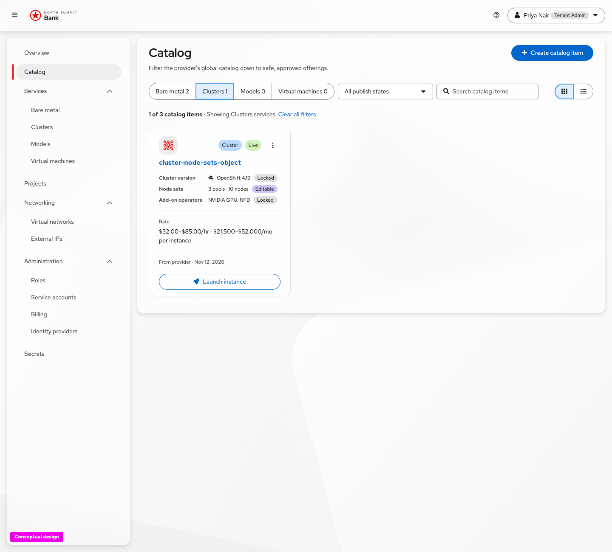
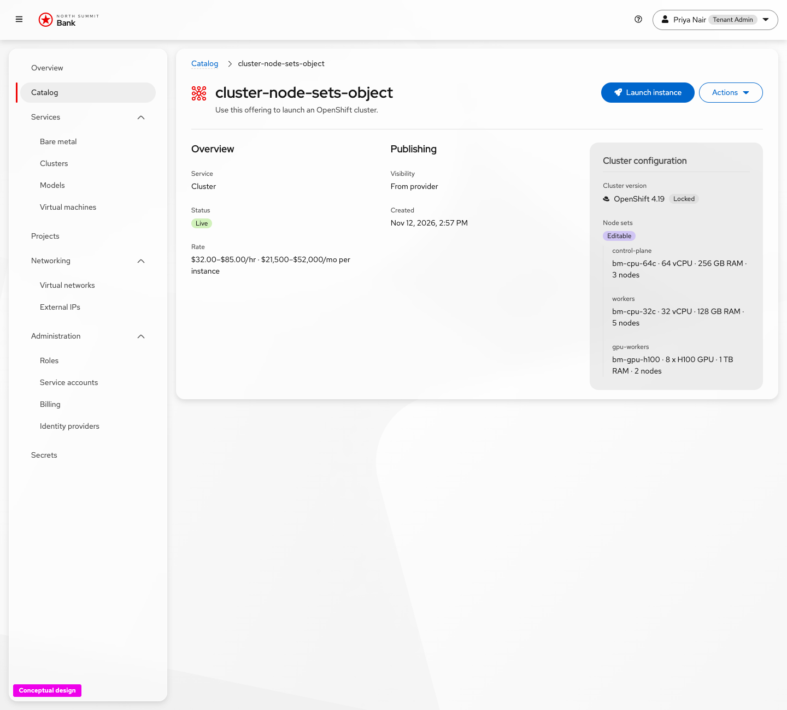
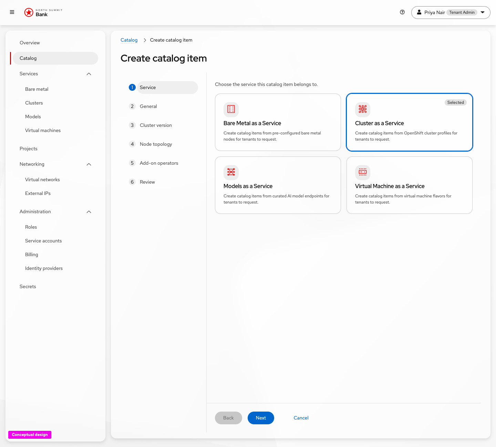
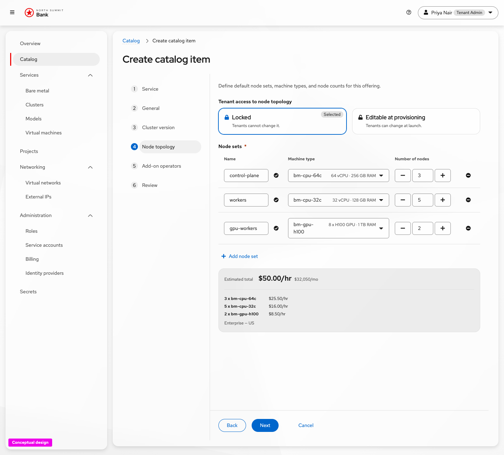
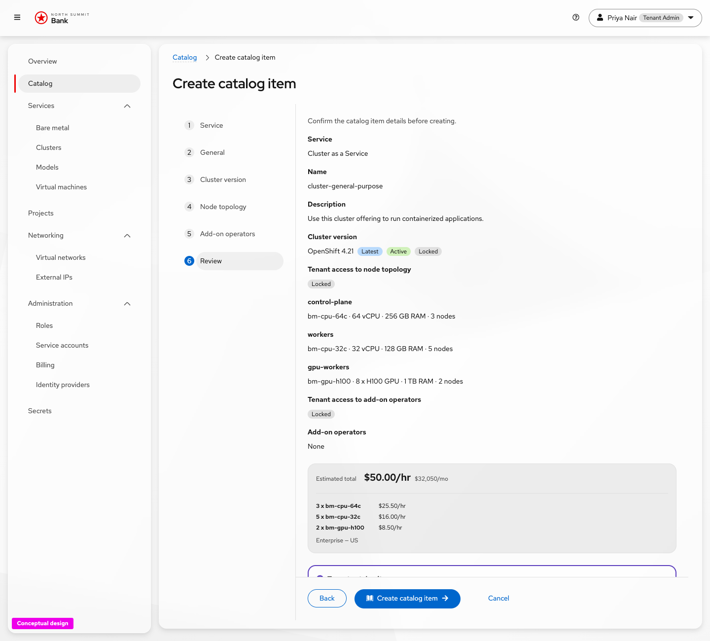
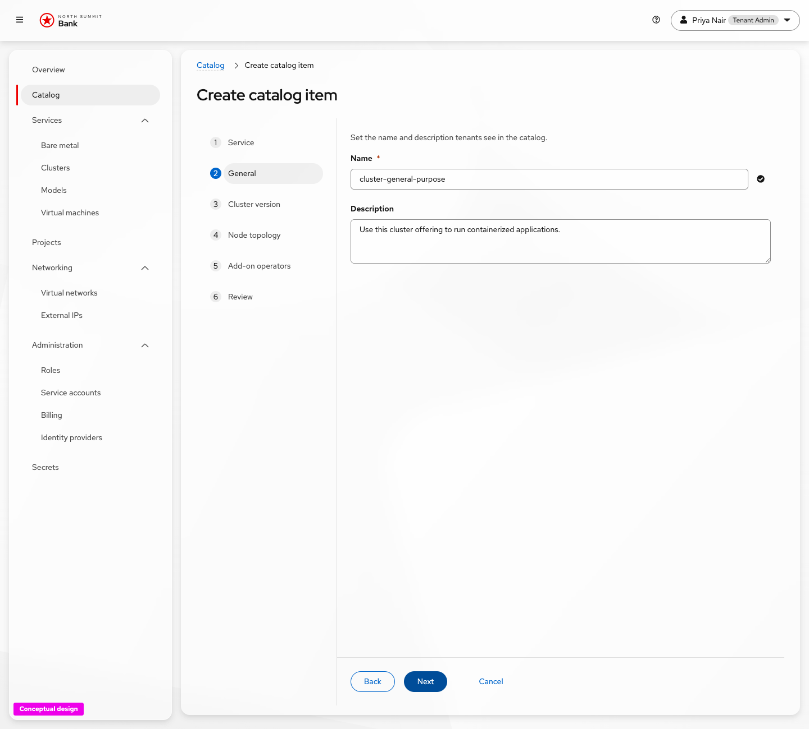
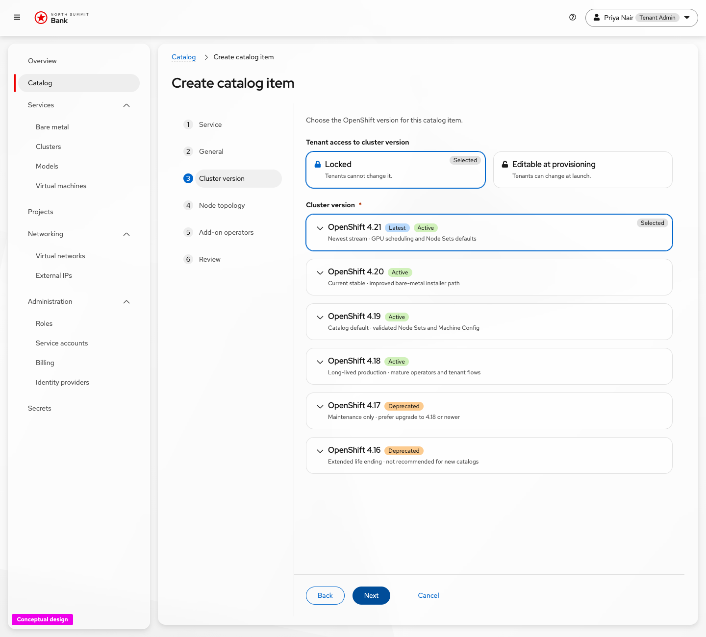
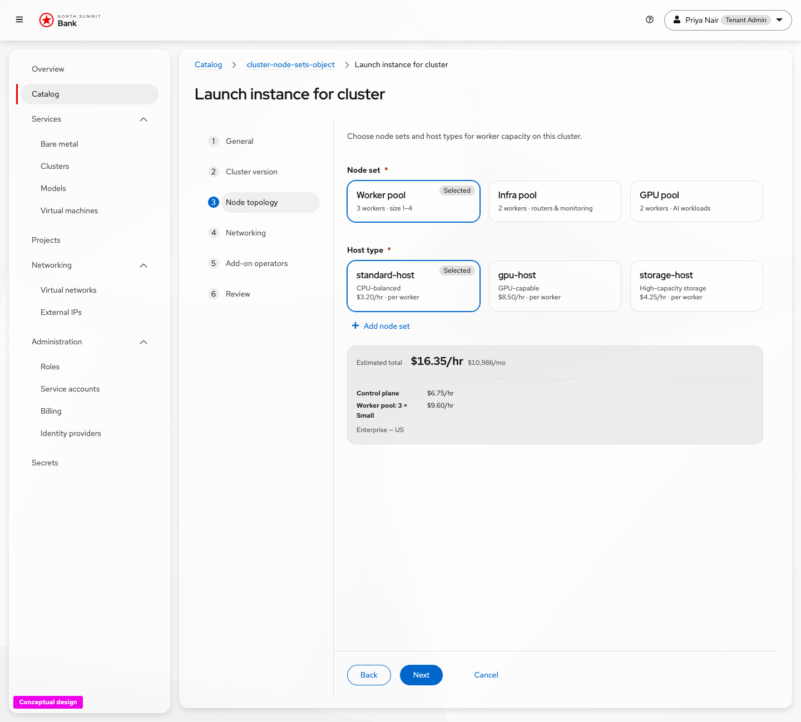
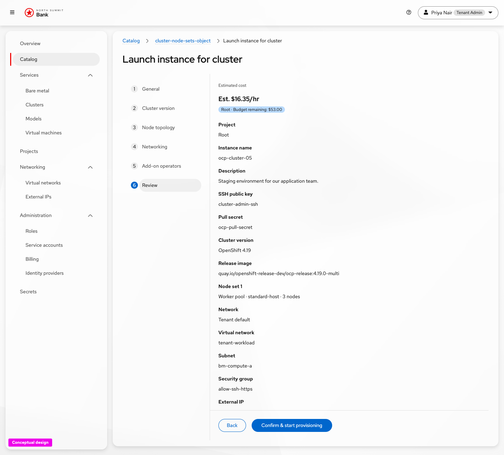

# Billing — Catalog Pricing Integration UX Design

Conceptual UX for **browse-time and configure-time price enrichment of VMaaS
and CaaS catalog items** ([OSAC-3793](https://redhat.atlassian.net/browse/OSAC-3793)),
captured from the live
[osac-bmaas](https://heyethankim.github.io/osac-bmaas/tenant-admin/northsummit/workspace?nav=catalog)
click-through prototype. Screenshots in this document use **Cluster as a
Service** as the canonical example. Prices come from the billing system
(OSAC-3784); catalog items do not store an independently edited list price.

**Prototype (developers):**

- [Tenant catalog (grid with Rate)](https://heyethankim.github.io/osac-bmaas/tenant-admin/northsummit/workspace?nav=catalog)
- [Cluster catalog item detail](https://heyethankim.github.io/osac-bmaas/tenant-admin/northsummit/workspace?nav=catalog&item=cluster-node-sets-object)
- [Create catalog item → Node topology](https://heyethankim.github.io/osac-bmaas/tenant-admin/northsummit/workspace?nav=catalog&action=create-catalog-item&service=cluster&step=node-topology)
- [Create catalog item → Review](https://heyethankim.github.io/osac-bmaas/tenant-admin/northsummit/workspace?nav=catalog&action=create-catalog-item&service=cluster&step=review)
- [Launch cluster → Node topology](https://heyethankim.github.io/osac-bmaas/tenant-admin/northsummit/workspace?nav=catalog&action=launch-instance&item=cluster-node-sets-object&step=node-topology)
- [Launch cluster → Review](https://heyethankim.github.io/osac-bmaas/tenant-admin/northsummit/workspace?nav=catalog&action=launch-instance&item=cluster-node-sets-object&step=review)

Requirements: [prd.md](prd.md). Billing source of truth and glossary:
[OSAC-3784 prd](../OSAC-3784-billing-integration-mvp/prd.md). Catalog field
governance (editable billable fields):
[OSAC-3538](https://redhat.atlassian.net/browse/OSAC-3538).

## Product decisions (this release)

- **Rates enrich catalog browse and configure, they are not authored in OSAC.**
  Catalog cards, detail, create, and launch surfaces show amounts resolved from
  the tenant’s effective (or default) pricing plan in the billing system
  ([prd.md](prd.md) In Scope).
- **Every pricing-relevant component contributes to the composed total.** For a
  CaaS offering that means control-plane fee plus each node set’s machine-type
  (worker) rate, and any attached non-metered charges (add-ons, licenses) in the
  billing account’s base currency. Changing topology changes the composed
  amount.
- **Create catalog item embeds pricing where billable components are chosen.**
  On **Node topology**, an **Estimated total** panel itemizes each selected
  machine type × node count. On **Review**, the same total and line items appear
  with the topology summary. Missing M360 coverage is a coverage gap under
  OSAC-3784 (alert / blocked create), not a placeholder price.
- **Default configuration at browse; signal when price may vary.** Browse-time
  **Rate** uses the catalog item’s **default** field values. When Catalog Items
  v2 leaves a billable field **Editable** (for example node sets), the UI shows
  a **lowest–highest range** instead of a single point — the PRD’s “price may
  vary” signal.
- **Launch Node topology embeds per-component rates.** Host-type cards show
  `$X.XX/hr · per worker`, and an **Estimated total** panel breaks down control
  plane + worker pools. Launch **Review** resolves the browse range to a point
  **Estimated cost** for the configured topology.
- **Graceful degradation.** If the billing system is unreachable or a component
  has no rate yet, omit the Rate (or that component) on tenant browse rather
  than blocking launch. Provider create prefers an explicit coverage-gap alert
  over a silent fake price.
- **Tenant-scoped list prices.** Every user in the tenant sees the same catalog
  list price for an item they can browse. Incurred-cost and project-scoped
  charge views stay in OSAC-3784 (**Administration → Billing**).
- **Cloud Provider Admin preview is tenant-contextual.** When a provider
  previews catalog prices, amounts are what that tenant would see under the
  tenant’s plan — not a second provider price list ([prd.md](prd.md)).
- **VMaaS and CaaS only.** Bare-metal catalog pricing is
  [OSAC-3795](https://redhat.atlassian.net/browse/OSAC-3795); MaaS is
  [OSAC-3794](https://redhat.atlassian.net/browse/OSAC-3794).
- **No side-by-side price comparison grid and no long-horizon spend
  projection** on the catalog ([prd.md](prd.md) Out of Scope). Launch
  **Review** may show an **Estimated cost** for the *configured* launch; that is
  confirmation of the selected configuration, not a multi-period cost forecast.

---

## 1. Catalog list — Rate on approved offerings

**What this screen is for.** Let Tenant Admins and Tenant Users see list prices
while browsing approved VMaaS/CaaS offerings so they can choose before
provisioning ([prd.md](prd.md) tenant stories).

**Explanation.** On **Catalog**, each live card (or list row) includes a
**Rate** line under the specs: hourly and monthly amounts, with a unit such as
*per instance*. When node sets are **Editable**, Rate is a range (for example
`$32.00–$85.00/hr · $21,500–$52,000/mo per instance`). When the offering is
fully locked to defaults, Rate is a single point. Service filters (for example
**Clusters**) only narrow which items appear. Pricing is absent only when
enrichment fails or rates are missing; browse and **Launch instance** still
work.

---

## 2. Catalog item detail — Overview Rate

**What this screen is for.** Confirm the list price (or range) next to the
offering’s default cluster configuration before launch.

**Explanation.** Opening a CaaS item (example: `cluster-node-sets-object`)
shows **Overview** with **Service**, **Status**, and **Rate** using the same
formatted string as the list. **Cluster configuration** shows which fields are
**Locked** vs **Editable** and lists each node set so the tenant can see *which*
billable components feed the Rate. Primary **Launch instance** starts the
wizard; Rate on detail still reflects defaults, not the tenant’s eventual
overrides.

---

## 3. Create catalog item — Cluster service

**What this screen is for.** Let a Cloud Provider Admin start a CaaS catalog
item so later steps can attach billable topology and a composed price.

**Explanation.** **Create catalog item** begins with **Service**. Selecting
**Cluster as a Service** routes the wizard through General → Cluster version →
**Node topology** → Add-on operators → Visibility → **Review** — the path where
pricing-relevant components are defined.

---

## 4. Create catalog item — Node topology (itemized total)

**What this screen is for.** Define the default node sets (the billable
machine-type components) and show an **Estimated total** composed from those
components before the item is created.

**Explanation.** On **Node topology**, the provider sets tenant access
(**Locked** / **Editable at provisioning**) and the default node-set table
(name, machine type, node count). The **Estimated total** panel under the table
itemizes every pricing-relevant line (for example `3× bm-cpu-64c $25.50/hr`,
`5× bm-cpu-32c $16.00/hr`, `2× bm-gpu-h100 $8.50/hr`) and shows the composed
hourly and monthly totals. Changing machine type or node count updates the
total. Missing M360 coverage surfaces as a coverage-gap treatment (OSAC-3784),
not a fabricated price.

---

## 5. Create catalog item — Review (topology + Estimated total)

**What this screen is for.** Confirm every pricing-relevant component and the
composed **Estimated total** before **Create catalog item**.

**Explanation.** **Review** restates Service, name, cluster version, tenant
access to node topology, each node set (machine type · node count), add-ons,
visibility, and the same **Estimated total** breakdown shown on Node topology.
When rates resolve, **Create catalog item** saves an unpublished offering whose
list price is billing-backed, not hand-authored.

Supporting create-flow captures (same Cluster path): General and Cluster
version steps establish the non-price defaults that sit alongside topology.

---

## 6. Launch — Node topology (per-component rates)

**What this screen is for.** When node topology is **Editable**, let the tenant
see **unit rates on each host-type choice** and a live **Estimated total** while
configuring the launch.

**Explanation.** On **Launch instance for cluster → Node topology**, host-type
cards embed `$X.XX/hr · per worker`, and the **Estimated total** panel breaks
down control plane plus selected worker pools (plan label such as
*Enterprise – US*). Changing host type or adding a node set updates the total.
This is the configure-time counterpart to browse-time Rate range enrichment.

---

## 7. Launch — Review (configured estimate)

**What this screen is for.** After the tenant picks project, topology, and
other launch fields, show the **estimated cost of this configuration** so the
“price may vary” browse range resolves to a point before confirm.

**Explanation.** On **Launch instance → Review**, an **Estimated cost** header
shows a point estimate (for example `Est. $16.35/hr`) derived from the selected
billable components for this launch. That estimate must stay consistent with
billing rates used at browse and create time (same plan, same currency).

**Prototype note.** The demo may also show a project **budget remaining** chip.
Project budgets are outside OSAC-3793; treat that chip as exploratory unless a
separate billing/budget EP accepts it. Shipping this feature should still
deliver the Estimated cost line for the configured launch.

---

## 8. Provider-admin tenant-contextual preview

**What this screen is for.** Let a Cloud Provider Admin verify the list price
a given tenant would see for an approved VMaaS or CaaS catalog item
([prd.md](prd.md) provider story).

**Explanation.** Provider catalog / publish flows reuse the same Rate /
Estimated total formatting as the tenant catalog, resolved against a
**selected tenant’s** effective plan (or the default plan). Create **Node
topology** / **Review** already preview the composed total for the offering’s
defaults; tenant-context controls swap which plan’s rates are used. This is a
preview of tenant-facing display — not a provider cost-basis or margin view
([prd.md](prd.md) Out of Scope).

---

## Notes vs related EPs

| Topic | This UX (OSAC-3793) | Related |
| --- | --- | --- |
| Price source | Billing rates at display / configure time | OSAC-3784 owns plans, rate cards, incurred cost |
| Create catalog topology | Node sets itemized in Estimated total; Review repeats total | OSAC-3538 field governance (Locked / Editable) |
| Launch topology | Per-host-type unit rates + Estimated total; Review estimated cost | Same plan as browse Rate |
| Editable billable fields | Range at browse; point estimate at Review | OSAC-3538 |
| Bare metal / MaaS catalog Rate | Out of scope | OSAC-3795 / OSAC-3794 |
| Side-by-side compare / spend forecast | Out of scope | Future / OSAC-3784 cost views |
| Budget remaining chip | Prototype-only unless separately accepted | Not in OSAC-3793 prd |

Align shipping UI copy with **Rate** (browse) vs **Estimated total** (create /
launch topology) vs **Estimated cost** (launch Review for a chosen
configuration), and keep graceful omission on tenant browse when billing
enrichment is unavailable.
