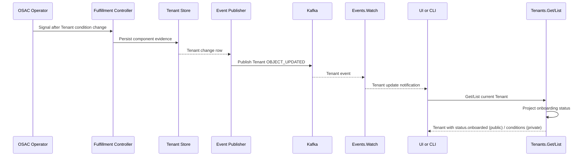

# Tenant On-Boarded Status for Minimal Onboarding Requirements

## Summary

Expose a binary onboarding status on Tenant responses, derived from the four
minimal onboarding requirements and returned through the existing Tenant API
as a single new public output-only `status.onboarded` field. Cloud Provider
Admins receive the three-state aggregate, component states, and failure
reasons through the existing private Tenants API. Use the existing
`Events.Watch` stream to notify connected UI and CLI
clients to immediately re-read the current Tenant status when an update event
arrives. Normal updates do not wait for a polling interval or manual refresh;
the event transport and read request still have their normal processing time.
See [PRD](prd.md) for the user-facing requirements.

The four requirements are Networking, Workload Storage, Secret Storage, and
Breakglass completion. Secret Storage is initial tenant secret-store
provisioning, projected from the existing `VAULT_READY` condition. Breakglass
also requires the identity to exist, its credentials to be persisted, and the
Tenant Secret reference to be saved. Encryption-key provisioning and lifecycle
management are excluded following the user's reprioritization. [PRD: D13, D14;
User scope update, 2026-11-04]

## Motivation

Fulfillment persists private Tenant lifecycle state and conditions, but the
public Tenant API currently omits Tenant status. The provider UI shows the
existing IDP synchronization state, while tenant-facing views have no
consolidated onboarding indicator. `TenantState.SYNCED` does not establish
that networking, workload-storage, and Secret Storage onboarding has completed.
[Codebase: proto/private/osac/private/v1/tenant_type.proto]

The design adds a minimal public status surface while keeping internal
conditions and credential fields private: the public API gains only the
aggregate `status.onboarded` bool. It derives the aggregate and the admin
detail from persisted component evidence; the full component breakdown and
failure reasons are served to Cloud Provider Admins through the private
Tenants API that the provider UI and admin CLI already use. Clients use
Tenant events to trigger fresh reads, so event payloads do not become the
source of status detail. [Research: Automatic Status Delivery]

### Goals

- Derive one aggregate from networking, workload storage, Secret Storage, and
  breakglass using the PRD's precedence. [Locked: D8]
- Return the same role-specific status through API, CLI, and UI: a public
  binary `status.onboarded` field for every caller, and the component
  breakdown with failure reasons for Cloud Provider Admins through the
  private Tenants API. [Locked: D6, D16]
- Keep the existing component conditions as the source of truth and avoid
  storing a second aggregate. [Research: Automatic Status Delivery]
- Preserve tenant isolation and keep credentials and raw conditions out of
  tenant-facing responses. [Codebase: fulfillment-service/internal/servers/]

### Non-Goals

- Workload readiness, monitoring, or health checks beyond the four minimal
  onboarding requirements. [PRD: Out of Scope]
- Multihub status aggregation, automatic remediation, or user-triggered retry
  actions. [PRD: Out of Scope; Locked: D1]
- Encryption-key provisioning, key lifecycle management, or ongoing Vault
  health monitoring; this design reports initial onboarding completion.
  [PRD: D13]

## Proposal

Fulfillment keeps `TenantStatus.conditions`, `TenantState`, and the durable
breakglass Secret reference as the underlying evidence; the four onboarding
conditions live in the existing `status.conditions` list. A shared
`TenantOnboardingStatusProjector` calculates the aggregate and component view
on read. Public Tenant Get/List responses expose only the resulting
`status.onboarded` bool; the three-state aggregate, component states, and
failure reasons are served to authorized Cloud Provider Admin consumers from
those four conditions on private Tenant reads. The private Tenants API remains
the controller
contract for writing internal conditions and additionally serves the admin
status detail. The projection is output-only and computed on
read; the database continues to store the underlying condition evidence rather
than a duplicate aggregate. [Codebase: fulfillment-service/internal/servers/]

Reuse the existing `Tenant.status` message and add one new public output-only
`onboarded` bool field to it; every other `TenantStatus` field remains
private, so the generated public Tenant exposes no other status field. Project
the Secret Storage
component from the existing `VAULT_READY` condition and its reason. Add the
private `BREAK_GLASS_CREDENTIALS_READY` condition to record credential
persistence completion or a sanitized failure reason. This feature reports
the existing provisioning and persistence flow; it does not add a key observer,
change Vault provisioning, or redefine `VAULT_READY`. [PRD: D13, D14;
Research: Follow-up research: Secret Storage as the onboarding requirement]

The overall state is `Failed` if any component failed or is unavailable,
`In Progress` if none failed and at least one is pending, and `On-Boarded` only
when all four succeeded. The public `onboarded` bool is true only for
`On-Boarded`, so Tenant Admins and Tenant Users see only the binary
`Not On-Boarded` / `On-Boarded` result. Cloud Provider Admins receive the
three-state aggregate, full component breakdown, and failure reasons through
the private Tenants API, which serves the four onboarding conditions with
their approved reason/message pairs; the overall state is derived from them
with the same aggregate rule. [Locked: D8, D11, D12, D15, D16]

The aggregate is not latched after success. It is recalculated from the current
reported source conditions on every read, so `On-Boarded` can change back to
`Failed` or `In Progress` and later recover. Tenant Admins/Users see
`Not On-Boarded` for either incomplete outcome. Connected views use the same
event/refetch path for these transitions. Existing latched source milestones
are preserved; unreported backend health changes are not inferred. [User
answer: Q3, 2026-11-04]


For each component, `Failed` describes its latest failed attempt even if
another attempt may run later. `In Progress` resumes only for a confirmed new
active attempt; waiting between failed attempts retains `Failed`. This does
not change retry counts, backoff, or terminal-state handling. [User answer: Q2]

### Workflow Description

Actors are the Fulfillment tenant reconciler, the OSAC Operator's Tenant
feedback controller, the Event Publisher/Kafka path, an authenticated user,
and a UI or CLI client. Fulfillment and the operator continue to produce the
existing network, storage, Vault, and tenant lifecycle evidence. The onboarding
projector reads that evidence when a Tenant is returned. A Tenant update
produces an event; the client uses it to request a fresh status response.
[Codebase:
fulfillment-service/internal/controllers/tenant/;
osac-operator/internal/controller/tenant_feedback_controller.go]



The event payload is only a notification; the Tenant read response is
authoritative. Clients start the fresh read as soon as they receive the event,
without waiting for a polling interval or applying a deliberate debounce. On
reconnect, clients re-read Tenant because `Events.Watch` does not guarantee
delivery of events produced while disconnected.
[Research: Automatic Status Delivery]

Cloud Provider Admins use the private Tenant read path in the provider tenant
list and can open the full component breakdown and failure reasons. Tenant
Admins and Tenant Users use the public read path and see a binary indicator
for the current tenant in the shared tenant workspace. The CLI
`osac get tenants` prints the public `status.onboarded` field and, for a
Cloud Provider Admin, the private component detail;
`osac get tenants --watch` re-reads the Tenant after a matching update
event. No status view offers a retry.
[PRD: User Stories; Locked: D1, D6, D12, D15]

### API Extensions

- Add an output-only `status.onboarded` bool to public Tenant reads; it is the
  only status field in the generated public API. Cloud Provider Admins read
  the three-state aggregate, per-component states, and failure reason/message
  from the four onboarding conditions in `status.conditions`, served through
  the private Tenants API, which the provider UI (via the osac-ui
  proxy) and the admin CLI already use. [PRD: In Scope
  1–2; Locked: D6, D12, D15, D16]
- Reuse `VAULT_READY` for the Secret Storage component. Add only the private
  `BREAK_GLASS_CREDENTIALS_READY` condition for successful account/credential
  completion with the Tenant Secret reference saved, or a sanitized failure
  reason. Existing Vault provisioning already gates credential persistence;
  neither a new secret-store probe nor a new encryption-key condition is
  introduced. [PRD: D13, D14; Codebase:
  fulfillment-service/internal/controllers/tenant/]
- Keep existing public `Tenants.Get/List/Create/Update` RPCs and REST
  transcoding; these return the public `status.onboarded` field. Keep the
  private `Tenants` API for controller status writes and internal conditions,
  and serve the four onboarding conditions with approved reason/message pairs
  on its Get/List responses to authorized Cloud Provider Admin callers.
  The onboarding status is output-only; clients cannot write or retry it.
  `Events.Watch` remains the notification API, and EventPublisher clears any
  computed onboarding projection before publishing a Tenant payload. [Codebase:
  proto/private/osac/private/v1/tenants_service.proto]
- Update the CLI's Tenant output and watch behavior to print
  `status.onboarded` for every role and the private component detail for a
  Cloud Provider Admin, after a matching event.
- Add UI status rendering for Cloud Provider Admin tenant views and
  the current tenant context for Tenant Admins/Users.

### Interface Changes

The revised working PRD has four In Scope bullets and no FR/NFR IDs. `FR-1` through
`FR-4` below are local traceability aliases in the order of those bullets.

#### IC-1: Tenant onboarding status projection

**Requirements:** FR-1, FR-2, FR-4

Reuse `Tenant.status` and add the output-only `onboarded` bool as its only
public field on Tenant Get/List responses. Serve the three-state aggregate,
component states, and failure reason/message to authorized Cloud Provider
Admins through the private Tenants API from the four onboarding conditions in
the existing `status.conditions` list; no new detail message or enums are
added. See §Implementation Details/Notes/Constraints for the proto shape
and CleanAPI constraints.

#### IC-2: Component readiness evidence

**Requirements:** FR-1, FR-4

Store the four component conditions in the existing
`Tenant.status.conditions` list: derive Secret Storage from the existing Vault
provisioning condition, add the private breakglass credential-persistence
condition, and combine these with the existing networking and
workload-storage conditions to derive the four component states. The
user-facing component labels are Networking, Workload Storage,
Secret Storage, and Breakglass. No user-facing retry operation is added.
[PRD: D13, D14]

#### IC-3: Event-driven status refresh

**Requirements:** FR-3

UI and CLI watch Tenant update events, then re-read the current Tenant to
refresh the projected status. On reconnect, clients re-read before
resuming normal display.

#### IC-4: CLI status and watch output

**Requirements:** FR-2, FR-3

`osac get tenants` prints the public `status.onboarded` field for every role
and, for a Cloud Provider Admin, the private component detail;
`osac get tenants --watch` re-reads the Tenant after a matching event.

#### IC-5: Role-specific UI status views

**Requirements:** FR-2, FR-4

The provider tenant list reads the private detail and shows aggregate and
component states to Cloud Provider Admins; the tenant workspace reads the
public field and shows only the binary indicator to Tenant Admins and Users.
Progress and failure labels follow the same projections.

Example public response (every role, own tenant only):

```json
{
  "status": {
    "onboarded": false
  }
}
```

Example private read consumed by the Cloud Provider Admin UI and CLI:

```json
{
  "status": {
    "onboarded": false,
    "conditions": [
      {"type": "DEFAULT_NETWORKING_READY", "status": "True"},
      {"type": "STORAGE_READY", "status": "True"},
      {"type": "VAULT_READY", "status": "True"},
      {
        "type": "BREAK_GLASS_CREDENTIALS_READY",
        "status": "False",
        "reason": "CredentialPersistenceFailed",
        "message": "Failed to store breakglass credentials in the tenant secret store"
      }
    ]
  }
}
```

The private conditions are served only to authorized Cloud Provider Admin
callers; Tenant Admin/User reads return the public Tenant with the binary
`status.onboarded` field only. The Cloud Provider Admin view derives the
overall state (here `Failed`) from the four conditions using the aggregate
rule. [Locked: D12, D15, D16]

## UX Alignment

The read-only `osac-ux` checkout and a matching `@temp-api` Tenant file were
not available in this workspace. The design targets the tracked `osac-ui`
Tenant list and shared tenant workspace. The generated UI API types must be
regenerated from the selected public proto baseline; they must not be
hand-edited. [Codebase: osac-ui/AGENTS.md]

## Implementation Details/Notes/Constraints

### Component evidence and status mapping

| Component | Succeeded | In Progress | Failed or unavailable |
|---|---|---|---|
| Networking | `DEFAULT_NETWORKING_READY=True`; `ReservedTenant` and `ProvisioningDisabled` remain successful reasons. | First-time `ResourcesPending` or confirmed current operation activity, with no other required-child failure. | `ResourceFailed` or a last failed child attempt waiting for retry; no pool capacity or unknown/unavailable observation. |
| Workload Storage | `STORAGE_READY=True`, the operator's initial onboarding milestone. | Initial `StorageReadyPending` or confirmed current required provisioning activity. | A failed attempt remains failed during polling/backoff, including an unchanged failed AAP job; unknown/unavailable evidence is failed. Resource-not-found reasons are interpreted using the reported operation outcome. |
| Secret Storage | Existing `VAULT_READY=True`: initial tenant secret-store provisioning completed. | Initial pending setup without a failure, or a confirmed current setup attempt. | `ProvisionFailed` remains failed until a new attempt starts; retry eligibility, backoff, and polling do not clear it. Unknown/unavailable evidence is failed. |
| Breakglass | `BREAK_GLASS_CREDENTIALS_READY=True`, synchronized identity, and saved Secret reference; persistence retains the existing Vault gate. | Initial pending work without a failed outcome or a confirmed current account/credential attempt. | Dependency, account, or credential-persistence failure; a failed write remains failed while only a future retry is possible or scheduled. |

The aggregate rule is: any failed/unavailable component yields `Failed`; with
no failures, any pending component yields `In Progress`; only four successful
components yield `On-Boarded`. Unknown/unavailable evidence maps to `Failed`
per the PRD. The public `onboarded` bool is false for both `In Progress` and
`Failed`; Tenant Admins/Users see `Not On-Boarded` for either outcome.
[Locked: D8, D11, D12]

### Attempt activity and result projection

Apply the resolved Q2 rule to each required operation within Networking,
Workload Storage, Secret Storage, and Breakglass:

- Work awaiting its first result remains `In Progress` under the existing
  pending rules. A started provisioning call or dispatched nonterminal job is
  an active attempt until its reported outcome.
- A completed failed attempt yields `Failed`. A future retry being allowed,
  scheduled, or delayed by backoff does not make it active. Re-reading or
  polling that failed state is not a new attempt and keeps `Failed` visible.
- A newer confirmed active attempt for the same operation supersedes its old
  failed result for display, returning it to `In Progress`. A new failure
  returns it to `Failed`; success satisfies the corresponding requirement.
- Do not mask a different required child's failure because another child is
  active. Existing failure precedence still applies within a component and
  across the four-component aggregate.
- Unknown/unavailable evidence remains `Failed`. Old running/progress markers
  without confirmed current work must not imply an indefinitely active retry.
  Observe the source job/operation lifecycle and existing deadlines; record
  interruption/unavailability when an old attempt is no longer active. No new
  shared retry cap or duration is introduced by this display rule.

Each required operation has a durable current-attempt record in private
evidence, scoped by Tenant, source resource identity, and operation/target.
Networking reuses its existing task/manager attempt counter
(`NetworkJobStatus.Attempt`) and binds the returned AAP `JobID` to that
attempt. [Codebase: osac-operator/internal/networktask/engine.go] Workload
Storage records the current backend/cluster provisioning `JobID` and
`ConfigVersion` as attempt identity; its fresh-read/merge path
(`patchTenantStorageStatus`) must compare that identity before copying
computed fields onto a freshly-read object rather than merging unconditionally
as it does today. [Codebase:
osac-operator/internal/controller/storage_controller.go] Vault setup,
breakglass identity creation, and breakglass credential persistence each
receive an independent, private, opaque attempt ID generated when that
operation starts, in separate evidence slots, so a credential-write retry
cannot invalidate unrelated Vault evidence.

Only the owning workflow may register or supersede an attempt; polling, retry
eligibility, and backoff do not allocate a new one. Before accepting progress,
failure, success, or a Secret reference, the owning writer compares the
supplied source/attempt identity against the persisted current identity and
rejects the write if they don't match or the attempt is already
completed/interrupted; duplicate terminal results are no-ops. The write uses
Fulfillment's existing object-version precondition (`Lock: true` /
`metadata.version`); a version conflict requires re-reading and rechecking
identity, not retrying with a refreshed version. [Codebase:
fulfillment-service/internal/servers/generic_server.go] The read-time
projector performs no attempt arbitration — it maps already-accepted,
persisted evidence to the public bool and private admin detail. [User answer: Q2; Research: Q2
follow-up research]

**Reporting work required during implementation:** Networking/storage must
propagate source job activity as distinct from failed-attempt backoff. For
example, a `Retrying` entry after a failed job is still failed while it waits;
a queued rerun without a failed result must not be classified as failure just
because of the enum's name. Use the source outcome and activity together.
Writers of the four onboarding conditions must use the centralized reason
codebook and codebook-composed messages described in
§Security Considerations; raw error detail stays in controller logs.

Vault setup and synchronous breakglass operations need observable start and
completion reporting. The existing `VAULT_READY=True` success meaning is
preserved. Add/use private progress reasons for actual setup/persistence calls
and retain failure reasons between attempts. Before calling the external
service, commit the new attempt's ID and active-evidence condition in a
persisted update, not only an in-memory mutation applied after the call
returns; if that commit fails, do not make the external call. Carry the
attempt ID through the synchronous call — Vault/IDP need not echo it back. On
return, apply the guarded write described above: a response is accepted only
if its attempt ID still matches the persisted current attempt and that
attempt is still active.

An attempt ID fences Tenant evidence, not external side effects — it cannot
undo an old Vault/IDP/Secret operation, and a sequential synchronous call does
not inherently return out of order. The case being guarded against is an old
owner/invocation surviving interruption or a takeover by a new reconcile; on
confirmed interruption or ownership takeover, close/invalidate the old attempt
before the replacement becomes authoritative. Preserve idempotent
provisioning/adoption behavior; this does not claim exactly-once execution of
the external call. This adds status evidence, not a new provisioning
sequence, retry engine, health probe, public progress detail, or Retry action.
These producer/feedback changes, the private attempt-ID field(s), and their
boundary tests belong to DEV work; the current implementation is not claimed
to provide them already. [Research: Q2 follow-up research]

Public onboarding/component `FAILED` is a recoverable reported outcome. It
must not itself set the private terminal Tenant lifecycle to `FAILED`, which
would change whether the existing controller can continue. Tenant Admin/User
views remain `Not On-Boarded` throughout active, waiting, and failed outcomes
until all four requirements succeed. [User answers: Q2, Q3]

`DEFAULT_NETWORKING_READY` includes NetworkClass readiness and the configured
default VirtualNetwork, Subnet, SecurityGroup, and, when provider networking
is enabled, ExternalIP/NATGateway. `ReservedTenant` and `ProvisioningDisabled`
are successful reasons once the required core resources are ready.
`STORAGE_READY` represents an initial onboarding milestone and remains
latched; it does not represent current storage-tier health. Do not use
`COMPUTE_INFRASTRUCTURE_READY`, which represents broader workload readiness.
[Codebase: fulfillment-service/internal/controllers/tenant/tenant_reconciler_function.go;
tenant_compute_readiness.go]

### Existing Vault prerequisite for breakglass

The current `syncToIDP` flow creates the tenant and breakglass identity in the
IDP, records that identity, then ensures the tenant Vault setup. When Vault
integration is configured, it skips credential persistence until the existing
`VAULT_READY` condition is `True`. It then creates the breakglass Secret, saves
the Secret reference on the Tenant, and marks the tenant lifecycle `SYNCED`.
`VAULT_READY=True` alone therefore does not establish breakglass completion;
credential persistence must also succeed. [Codebase:
fulfillment-service/internal/controllers/tenant/tenant_reconciler_function.go]

This feature reuses that order and readiness gate. `VAULT_READY` keeps its
existing meaning: the tenant Vault provisioning steps completed successfully.
It now supplies the distinct Secret Storage component. Secret Storage success
establishes initial setup completion, not success of all later credential
operations. A subsequent required credential write can fail while Secret
Storage setup remains successful; Breakglass then remains incomplete or
failed according to its own evidence, preventing overall On-Boarded.

The feature introduces no Vault provisioning changes, narrower Vault readiness
condition, named-key requirement, or additional health probe. The existing
Vault lifecycle currently mounts Transit for non-shared tenants; this status
feature neither removes that step nor treats it as key lifecycle management.
Ongoing Vault availability remains an infrastructure monitoring concern.
[PRD: D13, D14; User scope update, 2026-11-04]

The proposed `BREAK_GLASS_CREDENTIALS_READY` condition fills a reporting gap in
the existing flow: credential persistence failures currently only log the
error and leave the tenant `PENDING`. Record a sanitized reason for that
failure and successful completion so the projector can distinguish failure
from progress. This is status reporting for the existing operation. [Codebase:
fulfillment-service/internal/controllers/tenant/tenant_reconciler_function.go]

### Protobuf and persistence

The derived aggregate is computed for API responses rather than persisted as a
second status source. No SQL table or column change is planned, and no new
message or enum types are introduced. Reuse the existing `Tenant.status=4`
field: remove its field-level private annotation (keeping `OUTPUT_ONLY`),
remove the message-level private option from `TenantStatus`, mark each of its
six existing fields (`break_glass_credentials`, `state`, `message`,
`idp_tenant_name`, `break_glass_user_id`, `conditions`) field-level private,
and add the new public output-only `bool onboarded=7`, declared first so
private fields remain last per the documented convention; preserve all
existing field numbers. Add the private
`TENANT_CONDITION_TYPE_BREAK_GLASS_CREDENTIALS_READY` value to the existing
`TenantConditionType` enum for the breakglass evidence condition. The feature
therefore adds exactly one Tenant field and one condition-type value. The
generated public Tenant exposes only `status.onboarded` — not the internal
TenantStatus fields, breakglass credentials, IDP details, or raw conditions.
Private-only supporting types (`TenantCondition`, `TenantState`,
`TenantConditionType`, `BreakGlassCredentials`) remain private, and the admin
detail is served from the existing `conditions` field on the private API.
CleanAPI generation and review are required. [Codebase:
proto/private/osac/private/v1/tenant_type.proto;
fulfillment-service/docs/CLEANAPI.md; fulfillment-service/docs/API.md]

Illustrative proto types:

```protobuf
message Tenant {
  string id = 1;
  Metadata metadata = 2;
  TenantSpec spec = 3;
  TenantStatus status = 4 [
    (google.api.field_behavior) = OUTPUT_ONLY
  ];
}

message TenantStatus {
  // The only public status field: true once all four minimal onboarding
  // requirements have succeeded.
  bool onboarded = 7 [
    (google.api.field_behavior) = OUTPUT_ONLY
  ];

  BreakGlassCredentials break_glass_credentials = 1 [
    (cleanapi.field).private = true
  ];
  TenantState state = 2 [
    (cleanapi.field).private = true
  ];
  optional string message = 3 [
    (cleanapi.field).private = true
  ];
  string idp_tenant_name = 4 [
    (cleanapi.field).private = true
  ];
  string break_glass_user_id = 5 [
    (cleanapi.field).private = true
  ];
  // Holds the four onboarding conditions that serve the admin detail.
  repeated TenantCondition conditions = 6 [
    (cleanapi.field).private = true
  ];
}

// Existing private enum; one new value is added for breakglass evidence.
enum TenantConditionType {
  option (cleanapi.enum).private = true;
  TENANT_CONDITION_TYPE_UNSPECIFIED = 0;
  TENANT_CONDITION_TYPE_DEFAULT_NETWORKING_READY = 1;
  TENANT_CONDITION_TYPE_VAULT_READY = 2;
  TENANT_CONDITION_TYPE_COMPUTE_INFRASTRUCTURE_READY = 3;
  TENANT_CONDITION_TYPE_STORAGE_READY = 4;
  // New: breakglass account/credential completion evidence.
  TENANT_CONDITION_TYPE_BREAK_GLASS_CREDENTIALS_READY = 5;
}
```

No new onboarding message or enum types are added. The three-state aggregate
and per-component states are projections of the four conditions in
`status.conditions`, computed on read: public responses carry only
`status.onboarded`, and the private Tenants API serves the four onboarding
conditions with approved reason/message pairs to authorized Cloud Provider
Admin callers, who derive the overall `Failed` / `In Progress` / `On-Boarded`
state with the aggregate rule. The public Event stream does not
carry the computed status; it only triggers a read. [PRD: personas; Locked:
D12, D15, D16; Research: Automatic Status Delivery]

Proto changes originate in `proto/private/`; `make -C proto generate` produces
the public proto and shared Go code. The UI types are generated from their
selected API baseline and require the documented API-release workflow; do not
hand-edit generated types. [Codebase: proto/AGENTS.md; osac-ui/AGENTS.md]

### UI and CLI behavior

The public `STORAGE` component is displayed as Workload Storage;
`SECRET_STORAGE` is displayed as Secret Storage, with helper text explaining
initial setup for tenant credentials. [PRD: D14]

The provider tenant list adds a separate Onboarding column, retaining the
existing IDP synchronization state. It reads the private Tenants service it
already consumes through the osac-ui proxy and shows the four onboarding
conditions — component states and failure reasons — to Cloud Provider Admins,
deriving the overall state with the aggregate rule. The tenant workspace
shell reads the public binary field and shows the binary indicator on Tenant
Admin/User pages. No retry control
is added. Use PatternFly 6 and the existing `useTranslation` hook.
[Codebase: osac-ui/AGENTS.md; PRD: User Stories]

The UI subscribes to public `Events.Watch` for Tenant updates and invalidates
the active Tenant queries through `useApiQueryClient` as soon as an event
arrives. This applies to every component status change, including a change
that leaves the overall aggregate unchanged. The fresh response updates the
Tenant Admin/User binary indicator (public read) and the Cloud Provider Admin
breakdown and failure reasons (private read). It fetches the current Tenant
after the notification and
after reconnect. The subscription is scoped to Tenant onboarding events and
queries; application-wide polling defaults and other feature refresh behavior
remain unchanged. The event subscription supplies the trigger for backend
changes; the existing refresh after a UI mutation alone cannot detect those
changes. [User decision: onboarding event/refetch updates]

The CLI updates `osac get tenants --watch` to re-read each changed
Tenant as soon as its event arrives: the public read for the binary field
and, for Cloud Provider Admin callers, the private read for component detail,
using the same private-service access existing admin CLI commands use.
Neither
client waits for a polling interval or requires a manual refresh. The watch
stream is best-effort, so clients must not render event payloads as
authoritative status. [Research: Automatic Status Delivery; Codebase:
fulfillment-service/internal/cmd/cli/get/get_cmd_watch.go]

### Security Considerations

The generated public API contains only `status.onboarded`, so no component
detail or failure text can reach a public caller; the sanitization boundary is
the private onboarding conditions served to Cloud Provider Admins. The private
Tenants API must authorize the caller as `cloud-provider-admin` before
returning the onboarding conditions — the UI may hide fields, but it is not
the security
boundary. Tenant Admins/Users receive only the binary state. Cloud Provider
Admins receive component states and the approved failure reason/message
pairs. Tenant visibility
continues to be enforced by existing tenancy logic. [PRD: In Scope 2; Locked: D6, D12, D15, D16]

Keep `break_glass_credentials`, credential Secret data, and raw private
conditions out of public responses and Events.Watch payloads. "Sanitized"
is enforced at two boundaries. **Write time:** writers of the four
onboarding conditions emit only well-known, machine-readable reason codes
from a centralized, reviewed codebook — following the existing CamelCase
reason convention (`AllResourcesReady`, `ResourcesPending`,
`ResourceFailed`, `ProvisionFailed`) — and compose the stored `message`
from the same codebook's approved fixed text, classifying the outcome from
typed errors or structured results rather than formatting error prose. No
Go error text, Vault path, backend URL, response body, token, or credential
value is ever interpolated into `reason` or `message`; rich diagnostics
stay in controller logs and protected observability channels, not in
condition fields. **Serve time:** the onboarding projector allowlists both
`reason` and `message`, keyed by condition type, status, and recognized
reason/outcome, before returning the private admin read; an unrecognized
reason produces one approved generic failure pair instead of echoing the
underlying text. Classification must not treat every `False` condition as a
failure — OSAC also uses `False` for pending states — so type, status, and
reason are always combined. [Research: Chai consultation, 2026-11-12; User
decision, 2026-11-12]

The serve-time allowlist remains required as defense in depth because not
every stored condition is produced by the new codebook writers, and the
projector must be enforced independently of what any evidence writer
stores. Some existing condition writers already
pass text through that is unsafe to expose verbatim —
`projectStorageOnboardingCondition` copies an operator-reported source
condition's `reason` and `message` verbatim onto the Tenant, so unsafe text
the operator embeds reaches the stored condition unchanged.
(`ensureVaultNamespace` now records only a gRPC status code in its message;
earlier revisions cited it as embedding the raw error.) The projector must
not trust a stored message as already safe,
including legacy or externally produced conditions. [Codebase:
fulfillment-service/internal/controllers/tenant/tenant_storage_onboarding.go;
fulfillment-service/internal/controllers/tenant/tenant_reconciler_function.go;
fulfillment-service/internal/servers/event_publisher.go]

The design requires tests that assert the exact approved reason/message pair
for each case, that the four onboarding-condition writers emit only codebook
reason codes and codebook-composed messages, and negative fixtures
(synthetic tokens, passwords, Vault
paths, URLs, and backend response bodies in both `reason` and `message`) that
must be absent from every public Get/List and event payload, and from the
private admin detail except through the approved mapping — including
when the underlying stored condition already contains unsafe text.

Security review should verify the CleanAPI public projection, server-side role
filtering, and tenant isolation through the enhancement-proposals OWNERS
review process.

### Failure Handling and Recovery

- `DEFAULT_NETWORKING_READY` with `ResourcesPending` maps to `In Progress`;
  `ResourceFailed`, a failed attempt waiting for retry, or an unavailable
  observation maps to `Failed`. A pending label must not hide a recorded
  failure while no new attempt is active.
  `ReservedTenant` and `ProvisioningDisabled` are successful reasons once the
  required core resources are ready.
- `STORAGE_READY` pending maps to `In Progress`; unknown/unavailable maps to
  `Failed`. Use the operation outcome/activity distinction for other false
  reasons; polling an unchanged failed job remains Failed.
- An existing Vault provisioning failure (`VAULT_READY=False`,
  `ProvisionFailed`) is projected as Secret Storage `Failed` with a reason
  for Cloud Provider Admins. The existing gate prevents breakglass credential
  persistence; that dependency also explains why Breakglass cannot succeed.
  Initial pending setup without a failure maps to In Progress. A completed
  failure remains Failed while a retry waits; confirmed start of the next
  attempt returns that operation to In Progress. Existing reconciliation may retry; no
  user-triggered retry is available. [PRD: D13; Codebase:
  fulfillment-service/internal/controllers/tenant/tenant_reconciler_function.go]
- Breakglass persistence failure writes a private failure condition with a
  sanitized reason. Keep the failed outcome visible between attempts. Publish
  actual retry-start evidence before calling the Secret API again, then the
  new result. A successful required write and saved reference complete
  Breakglass; periodic reconciliation alone is not a retry-start signal.
- Missing/unknown required evidence maps to `Failed`/unavailable rather than
  `On-Boarded`. A condition change persists to the Tenant, causes an update
  event, and is read through the public binary field and the private admin
  detail.
- If `Events.Watch` disconnects, the client re-reads current Tenant state on
  reconnect. Lost events do not block recovery; no user action is required.

### RBAC / Tenancy

The public API returns the same binary `status.onboarded` field to every
caller for the tenants they may read. Only `cloud-provider-admin` receives
detailed status, component states, and failure
reasons, through the private Tenants API; `tenant-admin` and `tenant-user`
receive only their tenant's binary
indicator. [PRD: D16]

| Role | Public `status.onboarded` | Private conditions | Failure reason |
|---|---|---|---|
| `tenant-admin` | `false` / `true` | Not served | None |
| `tenant-user` | `false` / `true` | Not served | None |
| `cloud-provider-admin` | `false` / `true` | Four onboarding conditions | Approved reason/message for failures |

Tenant Admins and Users remain limited to their own tenant. Cloud Provider
Admin access continues through existing authorization and visibility checks.
[Locked: D15; Codebase: fulfillment-service/internal/auth/;
osac-ui/apps/app-frontend/src/hooks/oidc-login.tsx]

### Observability and Monitoring

No new metrics are proposed. Reuse the existing Tenant condition reason,
message, and transition timestamp for diagnostics. Tenant updates are already
published through the event system; the UI and CLI use those events to refresh
their current status. Existing Fulfillment controller logs identify Vault
provisioning failures. Do not log breakglass credentials.

### Risks and Mitigations

- **Setup success can be mistaken for credential persistence:** `VAULT_READY`
  reports initial provisioning. Mitigation: project it as Secret Storage
  setup completion and independently require breakglass completion evidence
  and a saved Secret reference before reporting On-Boarded.
- **Condition meanings differ:** networking, storage, and Vault use different
  false/unknown reasons. Mitigation: centralize reason-to-component mapping
  and test each mapping; do not aggregate raw booleans.
- **Role data may leak:** a status projection could expose error
  messages or private status; an admin-visible failure message could also
  leak raw provider/backend text (e.g., a Vault request URL or response body)
  if it isn't mapped through the approved reason/message set — the storage
  onboarding writer (`projectStorageOnboardingCondition`) already copies
  operator-reported reason/message text through verbatim today.
  Mitigation: keep the public API to the single `onboarded` bool, serve detail
  only through the authorized private API, keep Events.Watch as
  notification-only, constrain the four onboarding-condition writers to the
  centralized reason codebook at write time, and have the projector allowlist
  both `reason` and `message` at serve time rather than passing any stored
  condition text through, regardless of which writer produced it.
- **Event delivery may be incomplete:** disconnects can lose events. Mitigation:
  refetch on reconnect and use a recovery reconciliation policy.

### Drawbacks

The Tenant onboarding status adds API projection logic and requires the UI
and CLI to consume generated types. Events.Watch is best-effort and needs
reconnect handling. The design accepts these costs to keep one source of truth
and to update connected clients without a manual refresh or fixed polling as
the primary mechanism.

## Alternatives (Not Implemented)

1. **Expose a role-projected public `onboarding_status` message.** An earlier
   draft added a public `Tenant.onboarding_status` field with public
   onboarding enums and server-side role filtering of the component detail.
   Review feedback preferred a minimal public surface: reuse `TenantStatus`,
   expose only the public `onboarded` bool, and serve the admin detail through
   the private Tenants API that the provider UI (osac-ui proxy) and admin CLI
   already consume. [PR review: enhancement-proposals#480]
2. **Use `TenantState.SYNCED` as the aggregate.** This avoids new mapping logic,
   but it reports IDP and breakglass lifecycle and does not cover networking,
   workload storage, or independently report Secret Storage setup. It cannot
   satisfy FR-1. [Codebase:
   proto/private/osac/private/v1/tenant_type.proto]
3. **Hide Secret Storage inside Breakglass and report three components.**
   This would preserve the dependency but would give admins less direct
   visibility into secret-store provisioning. The user selected four
   components with Secret Storage replacing the deprioritized encryption-key
   requirement. [PRD: D13, D14]
4. **Persist an aggregate status separate from conditions.** Reads become
   simpler, but the aggregate can drift from source conditions. Compute the
   projection on reads instead.
5. **Use periodic polling as the primary UI refresh.** It is simpler to wire
   into React Query but adds interval latency and repeated requests. Use
   Events.Watch for active refresh, with a recovery read after reconnect.
   [Research: Automatic Status Delivery]
6. **Add a Tenant-specific Watch RPC.** It would provide a focused status
   stream, but duplicates the existing Events.Watch path unless proxy or
   authorization constraints prevent reuse. [Research: Automatic Status Delivery]
7. **Do nothing.** This preserves the private-only Tenant status but leaves
   the PRD's user-facing onboarding indicator unavailable. [PRD: Problem
   Statement]
8. **Add a structured private onboarding detail field.** An earlier revision
   added a private `TenantOnboardingStatus` field with dedicated aggregate and
   component enums alongside the public bool. Dropped: the four onboarding
   conditions in the existing `status.conditions` already carry the evidence,
   so serving them keeps one source of truth and the feature adds exactly one
   field. [User revision, 2026-11-12]

## Open Questions

### 1. Resolved — replace Encryption Keys with Secret Storage

- **Owner:** OSAC-Core
- **Decision:** The user removed encryption keys because key management was
  deprioritized and approved initial tenant secret-storage provisioning as the
  replacement. Use the label Secret Storage and the existing `VAULT_READY`
  condition. No named key, new key producer, or continuous health probe is
  required. [PRD: D13, D14]
- **Impact:** §Proposal, IC-2, the public component enum, aggregation, and FR-1
  coverage now use Secret Storage. Historical Jira/meeting references to
  encryption keys are superseded by this explicit scope update.

### 2. Resolved — distinguish an active attempt from a possible future retry

- **Owner:** OSAC-Core
- **Decision:** Show `In Progress` while a current attempt is active and has
  not produced an outcome. Once an attempt fails, show `Failed`, even if
  another retry is permitted or scheduled. Keep `Failed` throughout backoff,
  waiting, and status polling of that failed outcome. Return to `In Progress`
  only when a new attempt actually starts, then show its reported outcome.
  Initial pending work without a failed result remains `In Progress` under
  the existing rules. [User answer: Q2, active attempt versus retry eligibility]
- **Meaning:** Public `Failed` reports the latest failed outcome or unavailable
  evidence; it does not assert that OSAC will never retry. It is distinct from
  the private terminal `TenantState.FAILED`. Neither the projector nor a UI
  display transition changes the underlying provisioning/retry policy.
- **Implementation impact:** Owners must publish reliable activity/outcome
  evidence. Scheduled retry eligibility alone is not activity; stale or
  unconfirmed running markers cannot keep a component in progress forever.
  See §Attempt activity and result projection and TC-FR1-07.

### 3. Resolved — aggregate status follows reported condition changes

- **Owner:** OSAC-Core
- **Decision:** The aggregate can change after `On-Boarded` when a source
  condition changes. A failed/unavailable component produces `Failed`; pending
  work without a failure produces `In Progress`. Tenant Admin/User views then
  show `Not On-Boarded`. Once all four succeed again, show `On-Boarded`.
  [User answer: Q3, 2026-11-04]
- **Constraint:** Recompute the aggregate from current reported evidence;
  do not latch the aggregate. Existing producers that latch onboarding
  milestones retain their existing behavior. This decision does not introduce
  new health checks or infer changes the source conditions do not report.
- **Impact:** §Proposal, aggregate projection, event/refetch views, and
  TC-FR1-06 cover regression and recovery.

### 4. Resolved — public API surface for onboarding status

- **Owner:** OSAC-Core
- **Decision:** Review feedback on the design PR requested reusing
  `TenantStatus` with a single new public `bool onboarded` field instead of a
  new public `TenantOnboardingStatus` projection with role-filtered public
  detail. The public API exposes only the binary aggregate; the three-state
  aggregate, component states, and failure reasons are served to authorized
  Cloud Provider Admins through the private Tenants API (provider UI via the
  osac-ui proxy, admin CLI via existing private-service access). A follow-up
  revision (2026-11-12) removed the private structured `TenantOnboardingStatus`
  field and its enums entirely: the four onboarding conditions in the existing
  `status.conditions` carry the admin detail, the overall state is derived
  from them with the aggregate rule, and `Not On-Boarded` remains the UI label
  for `onboarded=false`. [PR review: enhancement-proposals#480; User revision,
  2026-11-12]
- **Impact:** §Proposal, §API Extensions, IC-1, §Protobuf and persistence,
  §RBAC/Tenancy, and the FR-2 test cases now describe the public bool plus
  the four private onboarding conditions. PRD D16's UI/API/CLI visibility is
  satisfied through the two surfaces; D4/D8's three-state aggregate remains
  the private admin view, derived on read.

### 5. Resolved — reason/message storage and display without sensitive values

- **Owner:** OSAC-Core
- **Decision:** Consultation (Chai, 2026-11-12) compared storing raw producer
  text with serve-time translation, storing only approved machine-readable
  reason codes, and adding a separate diagnostics channel. The user selected
  the write-time codebook approach: writers of the four onboarding conditions
  emit only well-known CamelCase reason codes from a centralized, reviewed
  codebook and compose the stored `message` from the same codebook's approved
  fixed text, classifying outcomes from typed errors or structured results.
  Raw error text, Vault paths, backend URLs, response bodies, tokens, and
  credentials never enter condition fields; rich diagnostics stay in
  controller logs and protected observability channels. The onboarding
  projector still allowlists both `reason` and `message` at serve time as
  defense in depth, because legacy or externally produced conditions — such
  as the operator storage condition passed through verbatim today — are not
  codebook-governed; an unrecognized reason yields one approved generic
  failure pair, and classification always combines type, status, and reason
  rather than treating every `False` condition as a failure.
  [Research: Chai consultation, 2026-11-12; User decision, 2026-11-12]
- **Impact:** §Security Considerations, the reporting requirements in
  §Attempt activity and result projection, §Risks and Mitigations,
  TC-FR1-05, and TC-FR2-04 now cover both the write-time codebook and the
  serve-time allowlist. A separate diagnostics channel was considered and
  deferred as out of scope for this feature.

## Test Plan

The detailed requirement and interface coverage is in
[testplan.md](testplan.md).

During implementation, verify streaming through the deployed UI proxy/ingress,
automatic reconnection, and a fresh Tenant read after reconnect. This is
implementation validation, not an open design question. Existing local
browser/proxy feasibility results remain supporting evidence in
the local research artifacts;
they do not replace deployed validation. [User direction: defer former Q5
verification to implementation, 2026-11-04]


### Unit Tests

- Table-driven cases cover aggregate precedence, component-condition mapping,
  breakglass gating, public bool projection, private admin detail and its
  authorization, and rejection of user writes to the
  output-only status field (see TC-FR2-06). These use fixture conditions and
  do not claim Vault/provider coverage.
- UI Vitest cases cover role-specific labels, component visibility, failure
  message filtering, and no retry controls using mocked Connect responses.

### Integration Tests

- Fulfillment `it/` cases cover public/private Tenant responses, authorization
  (including negative Create/Update rejection of caller writes to the
  output-only status field, TC-FR2-06),
  status persistence, and Events.Watch using deployed Fulfillment,
  PostgreSQL, Keycloak, and Kafka where documented. Source condition changes
  are controlled by fixtures; this does not prove real network or
  workload-storage provisioning. TC-FR1-05 separately extends existing tenant
  lifecycle and Secrets integration coverage through real Vault, Keycloak, and
  PostgreSQL, including required credential-write failures.
- Operator Envtest verifies that hub Tenant status events signal Fulfillment.
  A deployed integration case must verify the status update and event stream
  through the real service boundary.

### E2E Tests

- A `[QE]` journey creates/updates a tenant, observes the resulting aggregate
  through API and CLI, and checks visibility for Cloud Provider Admin, Tenant
  Admin, and Tenant User. It uses the deployed OSAC service stack with test-controlled hub condition
  transitions.
- TC-FR3-05 plans a persisted browser journey under
  `osac-ui/apps/e2e-tests` with its own proposed config and command. It verifies
  event-driven updates, missed-event recovery, and role visibility through the
  deployed UI proxy. Existing tenant-creation specs supply login/navigation
  patterns; mocked UI unit tests and the manual harness do not satisfy this
  deployed boundary. Implementation and execution remain outstanding.

## Graduation Criteria

This design targets milestone 0.5. The feature is ready for that milestone
when all four requirements use the PRD's aggregation precedence, each persona
receives the agreed status visibility in API/CLI/UI (the public binary field
for every caller; the private detail for Cloud Provider Admins), connected
views update
immediately on a delivered Tenant event without a polling interval or manual
refresh, and Cloud Provider Admins can see failure reasons. Event transport
and request processing time are not a deliberate product delay.
Implement and verify the resolved Q2 activity reporting rule, including producer/feedback evidence and interrupted attempts.
Deployed event-stream verification is part of implementation validation.

## Upgrade / Downgrade Strategy

The new public status projection and condition enum values are additive proto
changes. The aggregate is computed from existing Tenant evidence and is not
persisted separately, so no relational schema migration is planned. Existing
Tenants are reconciled to populate any new component conditions. The proto
source changes only in `proto/private/`; generated public protos and Go code
must be regenerated using `make -C proto generate` and reviewed. The UI types
must use the approved API baseline and generated output.

Older clients ignore the new output field. New clients receiving an older
server response with no `status.onboarded` must treat it as absent, never as
success: tenant roles see `Not On-Boarded`; administrators see
`Failed`/unavailable. Downgrade removes
the projection and UI display without deleting tenant resources.

Compatibility covers mixed-version Fulfillment replicas sharing Tenant records
for each supported upgrade pair, and rollback to the documented previous
version — not just same-minor patch rollouts. An older replica that does not
recognize the new condition does not preserve it today, and the condition does
not currently survive a rollback. The implementation must guarantee that this
condition's correct value either survives an older replica's read/write
unchanged, or is reliably re-established within a bounded, verified time
afterward; the current implementation provides neither guarantee, and the
specific mechanism is an implementation-planning decision.

## Version Skew Strategy

Deploy the Fulfillment API/controller before UI and CLI clients. During a
mixed-version rollout, older clients ignore the additive public field; new
clients treat an absent field as unavailable, never as success. No operator
CRD change is required for the aggregate. The operator continues to signal
Tenant status changes; new private conditions are owned by Fulfillment.

Name the specific supported source/target Fulfillment version pairs and the
rollback target for this feature during implementation planning; do not imply
arbitrary historical downgrades are supported. Before enabling the new
condition type for a rolling upgrade, verify the compatibility requirement in
§Upgrade / Downgrade Strategy against the real persistence path, including a
tenant that already completed Breakglass persistence before this condition
type existed, and repeat after a full rollback and re-upgrade.

## Support Procedures

Cloud Provider Admins diagnose a failed component using its visible reason and
the corresponding private Tenant condition. For Vault/breakglass failures,
inspect `VAULT_READY`, the breakglass persistence condition, the Secret
reference, and Fulfillment controller logs. Do not print Secret data or Vault
  tokens. A user cannot retry from the status view; the existing controller
  reconciliation handles retries. No feature flag is added. Rolling back the
  UI hides the view; rolling back the additive API projection removes status
  visibility but does not delete tenants, Secret references, or source
  conditions. Re-deploying the new API recomputes status from current evidence.

## Infrastructure Needed

No new production service is required. The feature uses Fulfillment, the
existing PostgreSQL change publisher/Kafka Events.Watch stream, the configured
Vault/OpenBao backend, and the tracked `osac-ui` application. Component
integration requires the existing compatible Kind profile with Fulfillment,
PostgreSQL, Keycloak, Kafka, and a Vault/OpenBao test backend. TC-FR3-05 specifies the proposed persisted browser E2E for the live UI update
flow; its harness and execution remain implementation work.

## Provenance

Authored: draft @ design 0.12.0 - unknown (shared workflow checkout unavailable), workspace main @ 91e852e8f
Final: publish @ design 0.12.0 - unknown (shared workflow recipes unavailable), workspace main @ 0d54f8b27
Revised: revise @ design 0.12.0 - unknown (shared workflow recipes unavailable), workspace OSAC-7434 @ 8bd307a21, 2026-11-11
Revised: revise @ design 0.12.0 - unknown (shared workflow recipes unavailable), workspace OSAC-2800 @ 2591e36b5, 2026-11-12
Phases: draft, revise, publish

<!-- ai-workflow-provenance:{"schema_version":1,"provenance_kind":"session","workflow":"design","workflow_version":"0.12.0","ai_workflows":"unknown (shared workflow recipes unavailable)","source_repo":"2591e36b5","source_repo_branch":"OSAC-2800","commits_behind_main":null,"commits_ahead_main":null,"main_ref":"main","phases":["draft","revise","publish"],"authoring_modes":["skill"],"context_changed":true,"origin_untracked":false} -->
