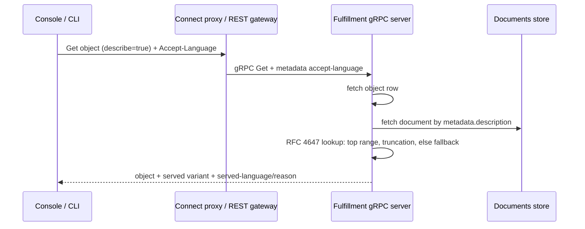

# Internationalized Object Descriptions

## Summary

This design introduces a first-class `Document` object holding
BCP 47-keyed language variants (plain-text title + Markdown content)
with a single fallback language, linked from every object type through a
new `metadata.description` reference. Each document also carries a
typed, immutable owner reference for standalone authorization. Documents
get a standard CRUD
service, per-language partial updates, opt-in retrieval with
RFC 4647 lookup-based variant selection, cascade deletion with their
object, and a data migration that converts existing plain-string
title/description fields into `und`-tagged single-variant documents. The
console renders document content through a sanitized Markdown
component; the CLI renders it through the existing terminal-Markdown
package. See [PRD](prd.md) for detailed requirements.

## Motivation

### Goals

- Reuse the generic server, generic DAO, and migration patterns so
  `Document` gets standard CRUD, tenancy, and authorization with
  service-registration work only.
- Implement language selection as a small, exactly-specified
  RFC 4647 lookup — no dependency on `x/text`'s intelligibility matcher.
- Enforce the PRD's validation rules (BCP 47 tags, variant limits,
  fallback integrity) at the API boundary with protovalidate plus one
  custom candidate validator.
- Make console rendering safe by construction (AST allow-listing, no
  `innerHTML`).

### Non-Goals

- Machine translation, translation of system-generated content, or
  translation of the console UI chrome (PRD non-goals).
- Per-locale SQL queryability (for example, "all documents with a
  French variant") — no PRD requirement needs it; see Alternatives.
- Template-parameter `title`/`description` migration: parameter help
  text stays plain-string in this milestone. No requirement or locked
  decision covers it, and migrating means one document per parameter
  plus a reference mechanism for non-object entries — material scope
  growth. Multilingual parameter help is a separate follow-up feature;
  if it lands later, its own field removal is a second breaking API
  boundary — an accepted consequence of deferring.
- Per-locale filtering on `Documents/List` ("documents having a variant
  for tag X"): not needed by any requirement. A language filter is
  purely additive — a new optional request field on List — and can be
  added when a translation-management workflow justifies it.
- A per-user language selector control in the console; the viewer's
  browser language preference drives selection.

## Proposal

### Workflow Description

**Authoring (Cloud Provider / Cloud Infrastructure / Tenant Admin):**
An admin creates an object — say a ClusterTemplate — and includes an
embedded `DocumentSpec description` in the create request. The server
builds the stored `Document`, auto-populating its id, tenant, project,
name, and typed owner, and links it to the object via
`metadata.description` in one transaction. Later, a translator adds a
Spanish variant by sending an update that touches only
`spec.variants["es-ES"]` of the linked document; the English variant is
untouched. The admin can also create a document directly for an existing
typed object. The server validates that target, stamps the document's
immutable owner reference, and links the object; later standalone
updates and deletes are authorized against that owner.

**Viewing (Tenant User, any persona):** A viewer whose browser prefers
Spanish requests the template with the description flag set. The console
(or CLI) sends `Accept-Language` with the request; the server resolves
the document, selects the Spanish variant, and returns it with the
served language and a match/fallback reason. A viewer preferring French
— for which no variant exists — receives the fallback variant plus an
indication that a fallback was served.

**Lifecycle:** Deleting the template deletes its document. After
migration, existing descriptions appear as single-variant documents
tagged `und`, which matches no language preference and therefore
surfaces via the fallback for every viewer until tagged variants are
added.

The following diagram shows the retrieval flow:



The diagram shows that language preference travels as ordinary request
metadata through the existing transports, and that variant selection
happens in the fulfillment server after the document is resolved — the
console never filters variants itself.

### API Extensions

New private protos `document_type.proto` and `documents_service.proto`
(plus generated public API and Go code):

```protobuf
// Documents define no system-reported status. The typed owner oneof is
// system-managed linkage rather than author-managed content, so this
// remains a documented object-shape exception.
// buf:lint:ignore OSAC_OBJECT_SHAPE
message Document {
  string id = 1;
  Metadata metadata = 2;
  DocumentSpec spec = 3;

  // Object that owns this document. Exactly one branch is set by the
  // server and is immutable after creation.
  oneof owner {
    option (buf.validate.oneof).required = true;

    ClusterLocalReference cluster = 4;
    ComputeInstanceLocalReference compute_instance = 5;
    // One typed reference branch per documentable object type.
  }
}

message DocumentSpec {
  // Language tag of the variant served when the requested language
  // has no variant. May be omitted on Create; the candidate validator
  // applies the English default or requires an explicit value.
  optional string fallback = 1 [(buf.validate.field).string = {max_bytes: 255}];

  // Variants indexed by canonical BCP 47 language tag.
  map<string, DocumentVariant> variants = 2 [(buf.validate.field).map = {min_pairs: 1, max_pairs: 32}];
}

message DocumentVariant {
  // Plain-text title, at most 256 Unicode code points. Enforced by
  // the candidate validator, not an annotation — see Validation.
  string title = 1;
  // CommonMark content, at most 65,536 UTF-8 bytes. Enforced by
  // the candidate validator, not an annotation — see Validation.
  string content = 2;
}
```

`Document` keeps the `spec` envelope — `DocumentSpec` holds the
author-managed content and fallback selection, declaring "user-set
fields" in the same language as every other OSAC object. It declares
**no `status` field**: documents define no system-reported status, and an
empty placeholder would be noise. The owner `oneof` is a system-managed
link, not status; it uses one typed reference branch per documentable
object type, following the event-payload pattern. The branch names make
the owner type explicit without a stringly typed `type` field, and the
required `oneof` guarantees that every persisted document has exactly
one owner. Adding a future object type requires adding its branch and
regenerating the API; that maintenance cost is accepted for type safety.
This is a documented `OSAC_OBJECT_SHAPE` exception (the comment sits
directly above the message, per the lint rule's requirement); the
generic machinery needs only `id` + `metadata`, and its
status-protection helpers no-op when `status` is absent, so nothing else
changes. The `Documents`
service declares the standard methods (`List`, `Get`, `Create`,
`Update`, `Delete`, plus a `Signal` RPC returning `UNIMPLEMENTED`, as
required by the service infra); `Create`/`Update`/`Delete`/`Signal` are
private-marked like other mutating methods. [Codebase:
proto/private/osac/private/v1/storage_tiers_service.proto]

`Metadata` gains the reference field, un-reserving the name
`description` (fields 10/11 stay reserved — protobuf forbids tag reuse;
the new field takes number 13):

```protobuf
message Metadata {
  // ... existing fields 1-9, 12 ...
  reserved 10, 11;
  reserved "display_name";
  // Reference to the Document describing this object, by document id.
  // Populated by the server; never embedded content.
  optional string description = 13;
}
```

Un-reserving the name is an explicit compatibility decision: JSON and
TextProto serialize by name, and the previous field (removed by PR
#1914 / OSAC-6662 as unpersisted, pre-approval surface) meant free
text, while this field means a reference. `display_name` stays reserved
— the per-variant `title` replaces that concept. [Research: Domain 1
history; Codebase: metadata_type.proto]

Three mixed-version hardening rules follow from the tag/name history
[Research: chai — PR #1914 analysis]:

1. **The reference is server-managed.** `metadata.description` is
   written only by the server (atomic create/update, migration) — never
   interpreted from client-supplied prose. Client-supplied update-mask
   paths targeting `metadata.description` are rejected with
   `InvalidArgument` (the same treatment public API views give `status`
   paths), which also neutralizes stale pre-removal CLI binaries that
   send the mask path `metadata.description` with field 11 unknown.
2. **Field 11 stays permanently reserved.** The old CLI was a concrete
   writer of field 11 (`SetDescription` on volume updates, deleted by
   PR #1914); reusing the tag would silently reinterpret free text as a
   document id. Both fields being strings makes the misinterpretation
   undetectable at the wire layer.
3. **Reference validation:** any server-side write of
   `metadata.description` verifies the target document exists in the
   same tenant/project before persisting.

Every object service's `Get`/`List` requests gain an opt-in flag and
responses gain the description payload, following the generic-field
rule in `fulfillment-service/docs/API.md` (added with the next unused
field number in each message):

```protobuf
message ClustersGetRequest {
  string id = 1;
  // Return the object's documentation, selected per Accept-Language.
  optional bool describe = 2;
}

message ClustersGetResponse {
  Cluster object = 1;
  // Present only when describe=true. Contains only the served variant.
  Document description = 2;
  // Language actually served and why: MATCH or FALLBACK.
  // Present only when describe=true.
  ServedLanguage served = 3;
}

message ClustersListResponse {
  // ... existing fields ...
  // Documents for the returned objects, keyed by document id
  // (the value of metadata.description). Present only when
  // describe=true.
  map<string, Document> descriptions = 4;
}
```

`ServedLanguage { string tag; string reason; }` (values `MATCH`,
`FALLBACK`, `NONE`) is the response-only selection metadata required by
FR-7 — the D5 observability rule.

Object `Create` and `Update` requests embed a **content-only**
`DocumentSpec description`, not a full `Document`. This keeps the
required owner `oneof` on the persisted object while avoiding a
pre-handler validation failure on an embedded create whose owner has
not yet been stamped. On Create, the server derives the parent's final
id and scope, builds a fresh `Document`, copies the supplied
`DocumentSpec` into `Document.spec`, stamps the typed owner, validates
the completed object, and writes the document and forward link in one
transaction. On Update, the server patches only the linked document's
`DocumentSpec`; a `description_update_mask` names paths relative to
that spec (for example, `variants["es-ES"]`), so variant deletion stays
explicit and parent update masks never address the document owner.
[PRD: FR-1, FR-9]

## UX Alignment

No matching `osac-ux/libs/ui-components/src/api/v1/document.ts`
reference exists — `Document` is a new resource, so there is no UX
field-mapping table to complete. The console work reuses the existing
osac-ui patterns: typed hooks from a bumped `@osac/types` baseline,
Connect transport through the Go proxy, and PatternFly `Content` styling
around rendered output. [Codebase: osac-ui/libs/types/.buf-api-version]

## Implementation Details/Notes/Constraints

### Language tag handling

All variant keys and `fallback` values are validated by a single
strict wrapper around `golang.org/x/text/language` (already an indirect
dependency, pinned v0.42.0):

1. Reject input containing `_`, input longer than 255 bytes, and `*`
   before parsing (x/text silently accepts underscores, has no total
   length cap, and `ParseAcceptLanguage` maps `*` to `mul`).
2. Accept/reject on `err != nil` from `language.Parse` — this covers
   both malformed syntax (`english`) and well-formed-but-unregistered
   subtags (`xx`), the latter available as `language.ValueError` with
   `.Subtag()` for error messages.
3. Store and compare the canonical form `tag.String()` — case
   collisions (`en-US`/`en-us`) and deprecated-alias collisions
   (`in`≡`id`) collapse to one key, which the wrapper rejects as a
   duplicate rather than silently merging.

Known, accepted divergence: x/text region data is a CLDR superset of
the IANA registry (for example `en-UK` canonicalizes to `en-GB`);
"registered" means x/text-registered, not IANA-LSR-strict. [Research:
Domain 1]

### Variant selection (RFC 4647 lookup, simplified per D5)

Selection applies to the **consumption path** — object Get/List with
the `describe` flag. The standalone `Documents` service is the
management surface and returns complete documents with all variants,
unfiltered by language: authors must see every variant to edit them.

Selection is a hand-rolled implementation of RFC 4647 §3.4 lookup with
the preference-list iteration limited to the top range, honoring D5's
no-cascading rule.

Request entries are RFC 9110/4647 basic language ranges, not stored
tags. Validate their range syntax, ASCII-lowercase every positive and
excluded range for comparison only, and skip malformed entries
individually; valid ranges need not be registered tags, and `*` is a
valid range. Stored variant keys and `fallback` remain canonical, and
responses return the stored canonical tag.

1. Parse the `Accept-Language` metadata value manually (not
   `x/text.ParseAcceptLanguage`, which has silent fallbacks for
   `english`/`deutsch`/`*` and fails the whole header on one bad
   entry): split entries, parse `;q=` weights (default 1.0), keep
   `q=0` entries separately as the **exclusion list**, and sort the
   positive entries by weight descending; ties keep header order.
2. Take the highest-weight positive range only. Progressively
   truncate it from the end (`fr-CA` → `fr`) and compare the
   normalized range to the normalized stored tag by full equality at
   each step; range truncation is RFC 4647 lookup semantics and keeps
   a stored `fr` reachable from a request of `fr-CA` without
   cascading across the viewer's list. [Research: Domain 3] A positive
   `en` therefore does not match a stored `en-US`, and a positive `*`
   selects no variant by itself: it goes directly to the fallback
   path. A served match carries `reason=MATCH`.
3. Apply exclusions with RFC 4647 basic-filtering prefix semantics:
   a candidate is excluded when it equals a normalized `q=0` range or
   starts with that range followed by `-`. Check every actual lookup
   candidate and the fallback; do not truncate the exclusion range
   itself. Any matching `q=0` range wins, so `EN-US;q=0` excludes a
   stored `en-US`, `EN;q=0` also excludes `en-US`, and `*;q=0`
   excludes every language. An excluded lookup candidate is not a
   match: truncation continues — for example `fr-CA, fR;q=0` against
   a document with only `fr` skips the excluded `fr` and falls through
   to the fallback path.
4. If no truncation matches — or no positive entry exists at all —
   the `fallback` variant is the candidate. Before serving it, apply
   the same exclusion check: if the fallback was excluded (for example
   `fr, EN-US;q=0` or `fr, EN;q=0` with fallback `en-US`), serve **no**
   description and `reason=NONE` — an excluded language is never
   served (FR-7). Otherwise serve it with `reason=FALLBACK`.
5. In every no-description case the object itself is still returned
   (NFR-1).
6. `und` needs no special case: a stored `und` variant is matched only
   by a request range of exactly `und`, so migrated content surfaces
   through the fallback path for every normal preference. [Research:
   Domain 3]

The x/text `Matcher` is explicitly not used: it cascades through the
preference list and mutates the served tag (adds `-u-rg`/`-u-va`
extensions), both violating D5. [Research: Domain 1]

### Transport: one canonical metadata key

Handlers read a single metadata key, `accept-language`:

- The Connect proxy path already delivers it under exactly that key
  (browsers attach the header automatically; the vanguard transcoder
  and `httputil.ReverseProxy` preserve non-hop-by-hop headers).
  [Research: Domain 4]
- The REST gateway adds one explicit matcher entry mapping
  `Accept-Language` → `accept-language` (the `x-dry-run` pattern;
  `Accept-Language` otherwise arrives as
  `grpcgateway-accept-language`). [Codebase:
  start_rest_gateway_cmd.go:167-177]

### Storage

`Document` is a standard DAO object: a `documents` table with the fixed
column set (id, name, tenant, project, labels, annotations, version,
finalizers, creator, timestamps) plus `data jsonb` holding the whole
proto object — including the typed owner `oneof`, `variants` map, and
`fallback`. The
migration follows the canonical pattern (main + archived + active
tables, triggers, unique `(tenant, project, name)`). [Codebase:
migrations/113_create_add_on_operators_tables.up.sql]

The forward reference (`metadata.description`) is persisted as a
nullable `description` column on every object table, added by the
same migration wave that creates the `documents` tables: the generic
DAO excludes all of `metadata` from `data` and rebuilds it from
dedicated columns, so a new metadata field needs its own column to
survive save/load. The metadata reconstruction learns the one new
column; no exception is punched into the metadata-never-in-`data`
rule. [Codebase: generic_dao.go — `id`/`metadata` excluded from
`data`; generic_dao_request.go — metadata reconstructed from columns]

Variants are embedded in `data` rather than a child table: the generic
DAO/server then provides CRUD, tenancy filtering, versioning, and
validation for free; the stored `fallback` is validated atomically with
the variants it names; and no PRD requirement needs per-locale SQL. See
Alternatives for the rejected child-table design. [Research: Domain 5]

### Per-language partial updates (D4)

Update masks currently replace whole map fields. The design extends
`internal/masks` (`PathCompiler`) to parse map-key segments, using the
protobuf field-mask convention `spec.variants["es-ES"]`:

- A mask path addressing one variant applies only that variant — the
  document's other variants are untouched (FR-2).
- Omitting a variant from the payload without a mask path naming it
  never deletes it.
- Deleting a variant requires an explicit mask path naming it with the
  variant absent from the payload. The CLI editor derives exactly these
  paths from its full-view diff, so deleting a block in `osac edit`
  deletes the variant — consistent with generic map editing — while a
  partial API payload omitting the variant never does. Deleting the
  variant named by
  `fallback` is rejected unless the same update sets `fallback` to
  another existing variant (FR-8). When the fallback is the **last
  remaining variant**, no replacement can exist, so the deletion is
  rejected — the one-variant floor and fallback integrity have no
  valid end state without it. Removing the final variant means
  deleting the document itself (standalone `Documents/Delete`, or the
  owning object's cascade), after which the object's dangling
  reference reads as no documentation (`reason=NONE`); or replacing it
  in one atomic update (add the new variant, repoint `fallback`,
  delete the old — a single update whose merged result is valid).
- The post-mask merged document is validated in full (standard
  generic-server behavior), except that limit checks apply only to
  content introduced by the update — see Validation.

### Validation (D9)

- Protovalidate annotations carry only the limits migrated data
  cannot violate and that do not conflict with server defaulting:
  map `min_pairs: 1, max_pairs: 32` and `fallback` `max_bytes: 255`.
  The per-variant `content` (65,536 bytes) and `title` (256 code
  points) limits are enforced by the candidate validator alone — as
  annotations they would validate the merged document and reject any
  update to a document holding grandfathered over-limit content,
  contradicting the grandfathering rule below. The proto comments still
  document the nominal limits.
- One custom candidate validator (`PrepareCandidateFunc`) on the
  Documents server enforces what annotations cannot: canonical BCP 47
  keys (the strict wrapper above), the 1,048,576-byte aggregate across
  keys, titles, content, and fallback, and fallback integrity. An
  omitted `fallback` is legal only on Create: the validator selects an
  English-language variant deterministically by canonical tag order,
  or requires the author to name one when no English variant exists.
  A supplied fallback must be non-empty and name an existing variant.
  [Locked: D5]
- Grandfathered migrated content is exempt from limit checks: a
  document written by the migration may exceed the limits, and an
  update is rejected only if the content it introduces is itself
  over-limit. Concretely: per-variant checks apply to new or changed
  variants only, while the aggregate (1,048,576 bytes across keys,
  titles, content, and fallback) is checked over all non-grandfathered
  content in the merged result — for a never-migrated document that is
  the whole document, so the cap cannot be crossed by successive small
  additions; for a migrated document, only the original `und`
  variant's bytes are exempt — the exemption is recorded on that
  variant when the migration writes it and is cleared when the
  variant is replaced or deleted, so newly written `und` content is
  checked against the aggregate. [User — binding round-2 refinement]
- Validation failures return `InvalidArgument` with a field-specific
  message naming the offending variant key or subtag (for example
  `language tag "english" is not registered`).

### Migration

Two numbered migrations (next available numbers, 149+):

1. **Create `documents` tables** — standard pattern per migration 113
   — and add the nullable `description` column to every object table
   (the forward reference's persistence slot; the DAO rebuilds
   metadata from columns, so the new metadata field needs one).
2. **Backfill** — for each of the 15 object types carrying object-level
   `title`/`description` fields (inventory in the research/context):
   for every row with either field non-empty, insert a `documents` row
   (same tenant/project, derived name, `fallback: "und"`, one variant
   `"und": {title, content}`), set the object's `metadata.description`
   to the document id, stamp the document's typed owner reference for
   that source object, and rewrite the object's `data` blob without the
   removed fields. Fields documented as Markdown in the source protos
   (templates, catalog items, AddOnOperator, NetworkClass, Role,
   InstanceType) migrate verbatim; plain-text fields
   (BareMetalInstanceType, StorageTier, StorageBackend, Project,
   IdentityProvider) are CommonMark-escaped at migration time so
   rendered output equals the original plain text — literal `# Warning`
   stays literal text, not a heading. [User — binding round-2
   refinement]

The plain-string fields are removed from the private protos in this
change; the public API regenerates without them. This removal is the
breaking change that defines the next major API-version boundary — the
compatibility contract for clients still reading the old fields.
[PRD: FR-5]

Migration rows bypass API validation by construction (written by SQL,
not through the service), which is what grandfathers over-limit legacy
content.

### Cascade deletion (FR-10)

When an object row is finally deleted (moved to its `archived_*`
table), the referenced document row is deleted in the same database
transaction. Soft-deleted objects (deletion_timestamp set, finalizers
pending) keep their documents — the documentation restorable with the
object until deletion is final. A dangling `metadata.description`
(possible only if the document was deleted through the standalone
service) is treated as "no documentation": retrieval returns no
description and `reason=NONE`, never an error. [PRD: NFR-1]

### Console rendering (NFR-2)

One shared component, `SanitizedMarkdown`, renders document content:
`react-markdown` + `rehype-sanitize` (no `rehype-raw`), output styled by
PatternFly `Content`. This is the only candidate stack with no
`innerHTML` anywhere; OSAC has a tested prototype (closed PR
osac-ui#106) with XSS coverage for script tags and `javascript:`
URLs. Both framework layers block dangerous schemes:
`defaultUrlTransform` (http/https/irc/ircs/mailto/xmpp + relative) and
rehype-sanitize's per-attribute protocol allow-lists. The same
component instance renders editor previews and saved descriptions —
preview and saved policy are identical by construction. [Research:
Domain 2]

List views render a plain-text summary (Markdown syntax stripped,
truncated — the OpenShift console pattern of truncating raw content
before parsing) to bound per-row cost; full rendering appears on detail
pages. Titles render as plain text everywhere. [Research: Domain 2]

### CLI (FR-11)

`Document` becomes a standard CLI resource: `osac get documents`,
`osac describe document`, `osac edit document`, `osac delete document`
via the generic per-resource command pattern (the reflection-based
`edit` flow works once the type is registered).

The get/describe split follows the established kubectl-style contract
[Research: chai — describe analysis; Codebase: CLI_UX.md,
describe_cmd.go]: `get` stays compact and structured — no documentation
by default; `get --descriptions` opts in, and with `-o json`/`-o yaml`
preserves the Markdown source and served-language data **as structured
data** (never rendered), while table output gains a compact summary
column. `describe` stays the human-readable view — **invoking
`describe` is itself the opt-in** (it sends `describe=true`), renders
the served variant through the existing shared glamour renderer
(`internal/cmd/cli/markdown`, reusing its color/non-terminal handling —
catalog-item describe already does this), and shows the served
language and match/fallback reason alongside the existing operational
sections. An object without documentation keeps a useful `describe`
view. One implementation note: the generic `get` serializes objects,
not response envelopes, so the descriptions map and served data must
be carried explicitly into the structured-output path; when the flag
is absent, the only output delta is the additive reference field.

The viewer's language preference is expressed once and applies to every
command: the CLI derives `Accept-Language` from the user's locale
environment (`LC_ALL`, then `LANG`), and a global `--language <tag>`
flag overrides it (for example `osac describe cluster my-cluster
--language es-ES`).

Editing documentation uses the **same full-view diff semantics as every
other resource**: the CLI fetches the complete document, and a variant
block the user removes from the YAML is an explicit deletion — the CLI
derives per-language deletion mask paths from the before/after diff,
matching how the generic edit flow treats removed map entries today
(`UpdateWithMask` includes fields present in the original but absent
from the edit; removal of the final map entry is tested behavior).
[Research: chai — edit-flow analysis; Codebase: edit_cmd.go,
reflection_helper.go] A `--remove-variant <tag>` flag remains as a
non-interactive convenience, not a requirement. Document edits send
`lock=true` with the pre-edit `metadata.version`, so a stale editor
session fails with `Aborted` instead of overwriting concurrent changes
— required because the generic edit path does not yet set `lock`
(open PR #2416 / OSAC-6413 proposes it platform-wide). API-level
omission stays non-destructive (D4): a partial payload that omits a
variant never deletes it; deletion comes only from the editor's
full-view diff or an explicit mask path.

### Authorization

Documents methods join the existing rego grant sets: public `Get`/
`List` in `client_permission_methods`. No new role or permission
concept is introduced. Method-level grants alone cannot express "can
update the *linked* object," so standalone mutating methods enforce
D8 with an object-level check. At atomic create and migration, the
server stamps
the document's required typed owner `oneof` from the object being
created or migrated. For direct `Documents/Create`, the request's
owner branch is a target selector. Inside the request transaction,
the server locks the target object row first (the existing DAO
`Get(...).SetLock(true)` / `SELECT ... FOR UPDATE` pattern), then
validates that the caller can update it and that its
`metadata.description` link is unset. Only after holding that lock
does it create the Document, stamp the canonical owner reference,
and write the object link. A concurrent loser waits on the target
lock, sees the existing link, and returns `AlreadyExists`; its
document insert rolls back. In every later mutation, the server
resolves the set owner branch and requires update permission on that
object before proceeding (the existing `MetadataFetcher` pattern for
object context).

The owner is server-managed and immutable after creation. Field masks
name the real `oneof` branch fields, not the group name: the server
rejects `cluster`, `cluster.id`, `compute_instance`,
`compute_instance.id`, and every other owner branch or nested path
with `InvalidArgument` — the same treatment as the server-managed
`metadata.description` field. A full-replacement Update (no mask)
does not require the client to resend the owner: candidate preparation
overwrites the request owner with the stored owner before validation
and persistence. A client may therefore omit the owner, but cannot
change or clear it. A caller therefore cannot re-parent a document or
strip its link to reach a weaker tenant/project-scope path.
Ownership is exclusive: one document
belongs to exactly one object — sharing and re-parenting are not
supported; the binding is created once and never moved. There are no
unlinked persisted documents. Editing through the embedded path
(object Update with `description`) needs no extra check — updating
the object is the check. Deletion has two paths: direct
`Documents/Delete` follows the same parent-update rule; the cascade
from object archival uses the internal transactional cleanup with no
additional permission check — the right to delete the object carries
the right to clean up its documentation. Every standalone mutation
resolves the stored link and evaluates update permission on the
linked object through the existing `AuthorizationEvaluator` (the
Documents service keeps no role lists of its own; rego method grants
remain the outer gate and never bypass the parent check) before
writing, using the standard document-row locking and transaction
behavior. This does not synchronize with concurrent permission
revocation: an already-authorized in-flight mutation may complete —
the same in-flight semantics as every other mutating API in the
platform. Stronger revocation ordering is a platform-wide question,
to be settled before GA rather than per-feature. [Locked: D8;
Codebase: internal/auth/policies/authz.rego]

Read visibility follows the owner's normal read path, not merely
the Document's copied tenant/project columns. `Documents/Get` resolves
the typed owner and applies the same visibility check used by that
owner's own Get; a hidden owner returns `NotFound`. `Documents/List`
resolves owners and omits documents whose owners are hidden. List
groups candidate documents by owner branch and resolves each group with
one batched/set-based owner lookup (or an equivalent join); it must not
issue one owner query per document row. The copied tenant/project
columns remain a storage prefilter and consistency rule, but they are
not the authorization contract. This delegates owner-specific rules —
project visibility, shared/platform scope, and any future publication
rule — to the existing owner read implementation instead of duplicating
them. [PRD: FR-3]

### Interface Changes

IC numbers are stable identifiers referenced by the test plan.

#### IC-1: Documents gRPC service (private + public)

**Requirements:** FR-3, FR-4

Standard CRUD service for `Document` following the storage-tiers
template, registered in `register_servers.go`; mutating methods
private-marked; `Signal` returns `UNIMPLEMENTED`. See §API Extensions.

#### IC-2: `metadata.description` reference field

**Requirements:** FR-1, FR-5

Field 13 on `Metadata`, holding the linked document id; name
`description` un-reserved. See §API Extensions.

#### IC-3: Embedded `description` on Create/Update requests

**Requirements:** FR-1, FR-2

All object Create requests accept an optional content-only
`DocumentSpec description`. Object Update requests accept the same
field plus a `google.protobuf.FieldMask description_update_mask` whose
paths are relative to `DocumentSpec` (for example,
`variants["es-ES"]`). The server creates/updates the linked document
atomically, auto-populates tenant/project/name, stamps the owner, and
maintains the reference.

#### IC-4: Opt-in description retrieval on Get/List

**Requirements:** FR-6, FR-7, FR-9, NFR-4

`describe` flag on all object Get/List requests; `description` +
`served` on Get responses; `descriptions` map (keyed by document id) +
per-document `served` on List responses. Absent flag → no description
payload and no document queries; the only delta from today's
responses is the additive `metadata.description` reference on
documented objects (a backward-compatible field addition).

#### IC-5: `accept-language` canonical metadata key

**Requirements:** FR-6, NFR-3

Gateway matcher entry `Accept-Language` → `accept-language`; Connect
path already delivers this key. See §Transport.

#### IC-6: Per-language update-mask semantics

**Requirements:** FR-2, FR-8

Map-key mask paths `spec.variants["<tag>"]`; explicit variant deletion;
fallback-variant deletion requires same-update replacement. See
§Per-language partial updates.

#### IC-7: Validation errors

**Requirements:** FR-14, NFR-1

`InvalidArgument` with field-specific messages for invalid/unregistered
tags, over-limit content, dangling fallback, empty documents;
grandfathering per §Validation.

#### IC-8: Cascade document deletion

**Requirements:** FR-10

Document row deleted in the object's archival transaction; dangling
reference reads as no documentation.

#### IC-9: Plain-string field removal

**Requirements:** FR-5

Object-level `title`/`description` fields removed from private protos;
public API regenerates without them; defines the major-version
compatibility boundary.

#### IC-10: Data migration to `und` documents

**Requirements:** FR-5

Two numbered migrations: tables + backfill with Markdown-escaping for
plain-text sources. See §Migration.

#### IC-11: CLI document support

**Requirements:** FR-11, FR-6

`osac get/describe/edit/delete document[s]`; `--descriptions` flag on
object get/list (structured output preserves source + served data);
`describe` invocation is the human-view opt-in with rendered Markdown
and served-language display; global `--language <tag>` flag
(locale-derived `Accept-Language` by default); editor block-deletion
via full-view diff (with `--remove-variant` as a non-interactive
convenience) and `lock=true` stale-edit protection. See §CLI.

#### IC-12: Console description surfaces

**Requirements:** FR-12, NFR-2

`SanitizedMarkdown` shared component (react-markdown +
rehype-sanitize, PatternFly Content styling); description rendering on
the existing title/description surfaces; variant management in
create/edit flows; fallback indication; plain-text summaries in list
views; `@osac/types` baseline bump.

#### IC-13: Authorization grants for Documents

**Requirements:** FR-3, FR-4, FR-8 (permission model)

Documents methods in the rego grant sets; read visibility via the
owner's normal read path; direct Create serializes on the target row;
standalone mutations check update permission on the linked object via
the server-managed typed owner `oneof`. See §Authorization.

## Security Considerations

Input validation is the primary new attack surface and is covered by
the strict tag wrapper, protovalidate limits, and fallback-integrity
checks — all enforced before persistence. Console rendering of
user-authored Markdown is the stored-XSS surface and is mitigated by
construction: AST allow-listing with no `innerHTML`, both framework
layers blocking non-allow-listed URL schemes, identical policy for
previews and saved content, and no `rehype-raw` (raw HTML stays
escaped text). [Research: Domain 2] Authentication and session
handling are unchanged — documents ride the existing gRPC/REST/Connect
paths with their existing interceptors. Tenant isolation is enforced by
the standard tenancy logic on the document's own tenant/project
columns; a document cannot be linked across tenants because atomic
create and migration copy the object's scope.

## Failure Handling and Recovery

- **Malformed `Accept-Language` header** (bad weights, junk entries):
  the parser skips unreadable entries; an empty result serves the
  fallback with `reason=FALLBACK`. Retrieval never fails on header
  problems. [PRD: NFR-1]
- **Dangling `metadata.description`**: treated as no documentation
  (`reason=NONE`); the object is returned normally.
- **Atomic create failure** (document validation fails after the
  object row is written): both writes share one database transaction;
  neither persists. The client sees the validation error.
- **Partial-update conflict** (concurrent updates to different
  variants of one document): standard optimistic concurrency — the
  second update with a stale `metadata.version` fails with `Aborted`
  and the client retries. Per-variant merges are not attempted.
- **Migration failure mid-backfill**: migrations run inside
  transactions per the existing framework; a failed migration rolls
  back and the upgrade aborts, leaving pre-migration data intact.
- **Console rendering failure** (malformed Markdown): the renderer
  degrades to escaped plain text; a render error never breaks the page.

## RBAC / Tenancy

No new roles or permissions. Mutating document methods are granted to
the same rego sets that mutate the linked object types; `Get`/`List`
join `client_permission_methods`. Documents carry the standard
tenant/project columns as a storage prefilter, but reads resolve the
typed owner and apply that owner's existing read-visibility path.
Documents whose owners are hidden are omitted from List and return
`NotFound` from Get. Mutations retain the owner-update rule and direct
Create serializes on the target row. [Locked: D8; Codebase: authz.rego]

## Observability and Monitoring

No new metrics or alerts. Documents participate in the standard
object-change event publication (the generic server's event publisher)
like every other object type. Validation failures surface as ordinary
`InvalidArgument` errors with structured messages.

## Risks and Mitigations

- **Risk: un-reserving the `description` name breaks JSON/TextProto
  consumers that stored old-field payloads.** Mitigation: the old field
  was never persisted (OSAC-6662), so no stored data carries it;
  the removal PR verified the fields never round-tripped. The
  name reuse is documented here as the compatibility decision.
- **Risk: mask map-key semantics is a new convention other services
  may adopt incorrectly.** Mitigation: implemented once in
  `internal/masks` with path round-trip tests; the wire format follows
  the protobuf field-mask map convention rather than inventing syntax.
- **Risk: migration breadth (15 object types, Markdown escaping,
  blob rewrites).** Mitigation: the backfill is one transactional
  migration with per-type verification in the acceptance criteria;
  plain-text escaping is deterministic and unit-tested against the
  CommonMark spec cases (literal `#`, `*`, `_`, backticks).
- **Risk: react-markdown's slow release cadence (last npm publish
  2025-03).** Mitigation: the repos are stable with zero open security
  issues; the dependency is confined to one component behind a narrow
  prop contract, swappable without touching call sites.

## Drawbacks

- Embedded variants forfeit per-locale SQL queryability; if a future
  requirement needs "documents with a French variant", it requires a
  migration to a child table or a GIN index over `data`.
- Adding `describe`/`descriptions` to every object service touches
  ~all request/response protos mechanically — a wide, shallow diff
  that must be regenerated once and reviewed for field-number
  correctness.
- The typed owner `oneof` must gain a branch whenever OSAC adds a
  documentable object type, causing another generated-API update.
  This maintenance cost is accepted in exchange for compile-time owner
  typing and a required single-owner invariant.
- The single-fallback model (D5) means a viewer whose language is
  missing never sees a "next best" language, only the fallback —
  accepted by product decision, but a visible UX limitation.
- Storing Markdown in `data jsonb` inflates row sizes for documents up
  to the 1 MiB aggregate cap (TOAST-compressed in PostgreSQL).

## Alternatives (Not Implemented)

### `document_variants` child table

The original Jira sketch stored variants in a separate table keyed by
(document id, language tag). Pros: per-locale SQL queryability; per-row
variant lifecycle; natural partial updates. Cons: the generic DAO knows
only the fixed column set, so documents need bespoke data-access code
(CRUD, tenancy, versioning, listing joins all hand-written); fallback
integrity and aggregate limits span two tables; no PRD requirement
needs per-locale queries. Rejected for DAO conformance; revisitable via
migration if a queryability requirement emerges. [Research: Domain 5]

### `x/text` Matcher for selection

Pros: zero new matching code. Cons: empirically cascades through the
preference list and mutates the served tag — both violate D5; it is an
intelligibility scorer, not RFC 4647. Rejected. [Research: Domain 1]

### IANA registry embedding for tag validation

Pros: exact LSR semantics (rejects `en-UK`). Cons: a 732 KB data
artifact to keep current plus a custom validator, duplicating what
x/text's ValueError already provides. Rejected; the single known
divergence is accepted. [Research: Domain 1]

### `marked` + DOMPurify for console rendering

Pros: most active maintenance, strongest sanitizer pedigree, smallest
bundle. Cons: manual `dangerouslySetInnerHTML` wiring (no maintained
React wrapper), bypasses React reconciliation, DOMPurify's MPL-2.0/
Apache-2.0 license needs policy confirmation. Rejected in favor of the
zero-innerHTML stack with OSAC prior art. [Research: Domain 2]

### Per-object finalizer for cascade deletion

Pros: documents observable during soft-delete. Cons: adds a finalizer
and reconciliation dependency for a bookkeeping delete; the archival
transaction achieves the same guarantee without controller involvement.
Rejected.

### Generic owner reference or reserved annotation

Pros: a generic `{ type, id }` reference or annotation does not change
when OSAC adds an object type. Cons: `type` remains a string, and a
reserved system annotation conflicts with the API guidance against
system-dependent annotations. Both weaken compile-time checks and make
invalid owner types a runtime validation problem. Rejected in favor of
the typed owner `oneof`, with the accepted cost of adding one branch
per new documentable object type.

## Test Plan

### Unit Tests

- Tag wrapper: table-driven cases for `en_US`, `english`, `xx`,
  `en-us`/`EN-US` collisions, `en-UK` canonicalization, 256-byte
  rejection, `*` rejection; alias-collision rejection (`in` vs `id`).
- RFC 4647 lookup: RFC's own examples (progressive truncation
  `zh-Hant-CN-x-private1-private2` → default), q=0 exclusion, `*`
  handling, empty header → fallback, `und` reachability only via
  fallback path.
- Accept-Language parser: bad weights skipped, multiple entries sorted,
  whitespace tolerance.
- Mask map-key paths: apply/round-trip `spec.variants["es-ES"]`;
  other-variant isolation; explicit deletion; fallback-variant deletion
  rejected without same-update replacement.
- Aggregate and grandfather validation: over-limit new content
  rejected; over-limit migrated content accepted; editing a
  grandfathered variant with within-limit content accepted.
- Migration escaping: plain-text fields escaped (`#`, `*`, `_`,
  backticks render literally); Markdown-documented fields copied
  verbatim.

### Integration Tests

- Component tier (`it/`, Kind): describe-flag retrieval through REST
  and Connect with `Accept-Language`; served-language/reason contract;
  atomic create (validation failure persists neither object nor
  document); cascade deletion at archival; dangling reference →
  `reason=NONE`; per-language update through the CLI.
- Implementation must create the migration suite under
  `fulfillment-service/internal/database/migrations`; this is a
  required `[DEV]` deliverable, not an optional location.
- Mixed-version compatibility (per the Metadata name-reuse analysis):
  a client sending JSON `metadata.description` prose gets
  `InvalidArgument` (reference validation), not silent interpretation;
  a client sending an update mask naming `metadata.description` gets
  `InvalidArgument` (server-managed field); a binary writing legacy
  field 11 is ignored as an unknown field.
- Migration: post-backfill verification per object type — every
  pre-existing description appears as an `und` single-variant document
  and the object's `metadata.description` resolves to it.

### E2E Tests

- Implementation must create the `[QE]` suite file
  `tests/e2e/core/test_internationalized_descriptions.py`; this is a
  required deliverable, not an optional location.
- Author journey: create object with English documentation, add
  Spanish variant, Spanish-preferring viewer sees Spanish,
  French-preferring viewer sees the fallback with indication (the PRD
  acceptance scenarios, driven through the console and CLI).

## Graduation Criteria

**Dev Preview:** all 59 planned cases pass in their owning suites; the
migration is verified for all 15 inventoried object types; existing
object CRUD, CLI, and console regression suites pass; the safe-rendering
tests block scripts, raw HTML, and dangerous URL schemes; and API, CLI,
and user documentation updates ship with the implementation.

**Tech Preview:** repeated runs pass without flakes in the concurrent
direct-create and partial-update cases; migration is exercised on a
representative populated database; and support procedures are validated
against the documented failure symptoms.

**GA:** production feedback confirms the language-selection contract,
safe-rendering policy, migration recovery path, and documentation
workflows. No unresolved critical or important security findings
remain.

## Upgrade / Downgrade Strategy

OSAC does not support in-place upgrades today; the migration runs at
deployment. Downgrade requires deleting all `documents` rows and
reverting the schema migration; plain-string fields removed by IC-9
cannot be restored from documents automatically (the migration is
one-way). This limitation is accepted per the PRD's major-version
compatibility boundary.

## Version Skew Strategy

The fulfillment-service, console, and CLI must agree on the new
request/response fields. The console's `@osac/types` baseline bump is
gated separately from the server rollout; the `describe` flag is
optional, so an older console against a newer server continues to work
(no descriptions requested), and a newer console against an older
server fails only if it sets the flag — the console feature-gates on
the server capabilities endpoint. [Assumption: the capabilities
endpoint exposes the Documents service; verify during implementation]

## Support Procedures

Failure symptoms: objects return `reason=NONE` despite existing
descriptions (check `metadata.description` links and the documents
table); validation rejects legitimate-looking tags (check the canonical
form the wrapper emits). Disabling the feature is not applicable —
documents are data, not a toggle; recovery is database-level via the
archived tables. Rendering problems in the console are scoped to the
`SanitizedMarkdown` component and degrade to plain text.

## Documentation

Documentation is in scope for implementation and must land with the API,
CLI, and console work:

- Update `fulfillment-service/docs/API.md` for `Document`,
  `DocumentSpec`, `metadata.description`, describe flags, request
  metadata, and update-mask semantics.
- Update CLI help and structured-output documentation for document
  commands, `--descriptions`, `--language`, and editor deletion
  semantics.
- Update console documentation for rendered descriptions, fallback
  indication, and variant management.
- Add release notes covering the major-version field removal, migration
  to `und` documents, grandfathered limits, and downgrade limitations.

## Infrastructure Needed

None.

---

## Provenance

Authored: draft @ design - unknown (shared workflow recipes unavailable), workspace OSAC-2800 @ 9b2ee397ab
Final: respond @ design - unknown (shared workflow recipes unavailable), workspace main @ 9f2a1d2a3b
Revised: revise @ design - unknown (shared workflow recipes unavailable), workspace main @ uncommitted
Phases: draft, respond, revise

<!-- ai-workflow-provenance:{"schema_version":1,"provenance_kind":"session","workflow":"ai+skill","ai_workflows":"unknown (shared workflow recipes unavailable)","source_repo":"9f2a1d2a3b","source_repo_branch":"main","phases":["draft","respond","revise"],"authoring_modes":["skill"],"context_changed":true,"origin_untracked":false} -->
