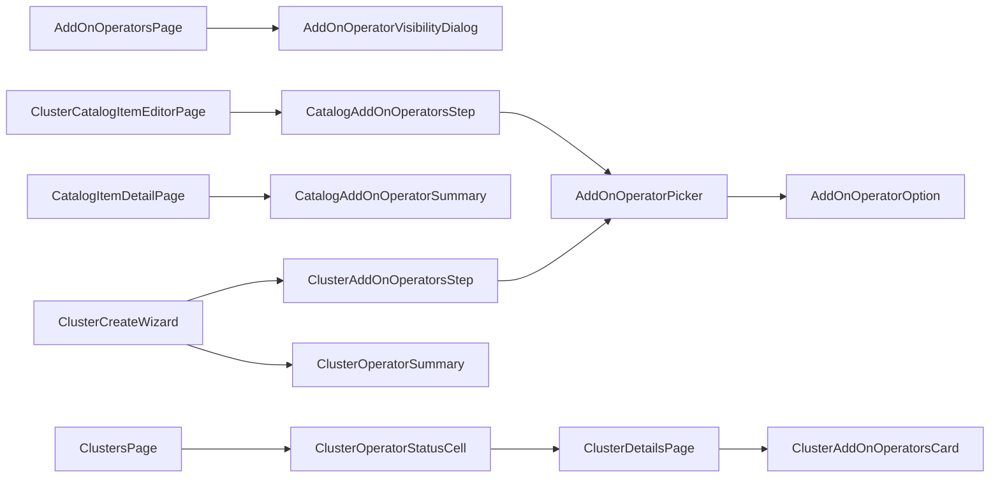

# UI design — CaaS add-on operators (OSAC-4095)

- **Feature:** OSAC-4090, Operator Support for CaaS Catalog Items
- **UX input:** [PR #434](https://github.com/osac-project/enhancement-proposals/pull/434), revision `8c787b1b5b2c2c3d6582d855ed6330e211d913be`
- **Review status:** Draft. The UX PR has changes requested, and backend gaps block the full UI scope.

## Purpose

The console needs four connected flows: a Cloud Provider Admin publishes operators; a Cloud Provider Admin or Tenant Admin attaches them to CaaS catalog items; a Tenant Admin or Tenant User chooses them when ordering a cluster; and authorized users see installation results. This design reuses the existing PatternFly 6 catalog, Formik cluster wizard, and cluster list and detail pages. It covers initial installation only; upgrade, removal, and ongoing health management are outside this feature. [PRD: In Scope and User Stories] [Design: Proposal and lifecycle]

Backend enforcement remains authoritative wherever a contract is missing. [Codebase: `fulfillment-service/internal/servers/cluster_catalog_item_policies.go`] [User: full-scope design]

## Experience and decisions

| Persona | Console behavior |
| --- | --- |
| Cloud Provider Admin | Manage published and unpublished operators and their visibility; create or edit shared and tenant-scoped CaaS catalog items; read operator outcomes across authorized clusters. The cluster view is read-only. |
| Tenant Admin | Create or edit catalog items in their own tenant, including project-scoped items; read shared items; order clusters; inspect outcomes across their tenant. |
| Tenant User | See offered operators on catalog detail, choose permitted operators during catalog or direct-template orders, and inspect status and failure messages for their clusters. |

A tenant IDP manager receives no operator-management controls from that role alone. UI guards hide unavailable actions, but Fulfillment must enforce tenant scope and permissions. [PRD: Cloud Provider Admin, Tenant Admin, Tenant User] [User: both-admin catalog ownership and provider status]

The selection rules are:

1. **Locked catalog policy:** show included operators as read-only cards. The launch form sends no override.
2. **Editable catalog policy:** mandatory entries stay selected; optional defaults start selected but can be removed; users may add published compatible operators. Required dependencies stay selected while needed, and the catalog editor marks bundled dependencies mandatory. The server must enforce the final set after the policy gap closes.
3. **Direct-template order:** use the same cluster wizard, starting with a catalog-or-template choice. A template order has no catalog policy and uses the operator picker. It still supplies required version, parameters, and node-set choices.
4. **Version or selection conflict:** keep the user's choices, explain incompatibility or exclusion, and block submission until corrected. Never silently drop a choice or assume missing metadata means compatibility.
5. **After creation:** show Pending, Installing, Installed, or Failed for each operator, with the failure message when present. Show the cluster's aggregate Degraded condition separately. There are no install, upgrade, or remove actions on this screen.

Operator cards use fields currently available from `AddOnOperator`: title, description, OpenShift version range, dependencies, and exclusions. Category, logo, and exact resolved version are absent from the current API and are omitted here; the provisional UX PR needs to match. [UX PR: §§1–5] [Design: Ordering a cluster with operators] [User: mandatory/optional and current-field choices]

## Frontend composition

| Surface | New components and existing host | Responsibility |
| --- | --- | --- |
| Provider inventory | `AddOnOperatorsPage`, `AddOnOperatorVisibilityDialog` in `AppShell` | Page published and unpublished inventory; edit publication and tenant scope; show server errors. |
| Catalog | `ClusterCatalogItemEditorPage`, `CatalogAddOnOperatorsStep`, `CatalogAddOnOperatorSummary` in catalog pages | Create or edit scoped items and their locked/editable policy; summarize included operators before launch. |
| Cluster order | `ClusterAddOnOperatorsStep`, `ClusterOperatorSummary` in `ClusterCreateWizard` | Present the policy or direct selection and summarize it in General and Review. |
| Shared choice | `AddOnOperatorPicker`, `AddOnOperatorOption` | Search, select, explain disabled choices and required dependencies. The catalog and order forms own separate state. |
| Outcomes | `ClusterOperatorStatusCell`, `ClusterAddOnOperatorsCard` in cluster list/detail | Show counts, failed names, drilldown, per-operator state, and messages. |

Paths are relative to `osac-ui/libs/ui-components/src/`. Add the provider page under `pages/admin/`, the catalog editor and step under `components/catalog/cluster/`, and shared operator controls under `components/AddOnOperator/`. Extend the existing catalog detail, cluster wizard, list, and detail components rather than adding wrappers. Reuse `ProvisioningField`, `CatalogStep`, `ResourceDetailsPageLoading/Error`, and `OSACWizardFooter`. The editor uses General, Cluster version, Node topology, Add-on operators, Visibility, and Review steps. [Codebase: `osac-ui/libs/ui-components/src/pages/tenant/CatalogPage.tsx`, `components/Cluster/CreateWizard/`, `components/Cluster/Details/`] [UX PR: §§1–5]

The shared picker accepts `operators`, `selectedIds`, `mandatoryIds`, `disabledReasons`, optional `readOnly`, and `onToggle(id)`. The visibility dialog accepts `operator` and `onClose`. The catalog step receives `selectedOcpVersion?` and uses editor Formik state; the order step uses wizard Formik state. `ClusterOperatorSummary` receives names, optional mandatory names, and compact mode. The status cell receives a cluster; the detail card also receives operator metadata keyed by canonical ID. A pure `operatorSelection.ts` function derives dependency closure and disabled reasons; it is guidance, not a second source of truth. [Codebase: `add_on_operator_type.proto`, existing Formik and PatternFly patterns]

## Routes and permissions

| Route | View and guard |
| --- | --- |
| `/admin/infrastructure/add-on-operators` | New provider-only `AddOnOperatorsPage`, with CaaS enabled. |
| `/catalog/cluster/new`, `/catalog/cluster/:id/edit` | New shared editor for Provider and Tenant Admins; server decides target and item scope. Put static `/new` before the dynamic catalog route. |
| `/catalog`, `/catalog/:kind/:id` | Existing browse/detail; add CaaS operator summary and role-aware create/edit actions. Tenant-user browse requests published items. |
| `/clusters/create/:catalogItemId?` | Existing tenant order wizard; without an ID, choose catalog or template first. Provider Admins cannot enter create by direct URL. |
| `/clusters`, `/clusters/:clusterId` | Existing list/detail; provider access is read-only and hides lifecycle and secret actions. Scope every query on the server. |

Keep the current eager import, `ShellRoute` error boundary, and CaaS `ServiceRoute` patterns in `AppShell.tsx` and `ClusterRoutes.tsx`. Use `GET /api/login/info` for session roles, `Capabilities.Get` for the service gate, and public SelfSubjectAccessReviews for method hints. Those checks control presentation only; they cannot prove private-RPC or existing-item ownership. [Codebase: `AppShell.tsx`, `ClusterRoutes.tsx`, `shellNav.ts`, `proxy/auth/handler.go`] [User: provider read-only status]

## Data and state

| State | Owner | Why |
| --- | --- | --- |
| Catalog target, operator policy, visibility | Editor Formik draft | All editor steps and Review use one draft; save only changed fields. |
| Order source, version, selected operators | Cluster wizard Formik draft | General, operator step, and Review agree; changing source resets incompatible source-specific values. |
| Operator, catalog, template, cluster records | TanStack Query via existing wrappers | Parameterized keys and mutation invalidation keep pages current. |
| Search, page, filters, dialog | Local page state; URL params where catalog already uses them | No new global state store is needed. |

`OperatorPage = { items: AddOnOperator[]; total: number }` and `TemplatePage = { items: ClusterTemplate[]; total: number }`. `CatalogItemDraft` is the generated `MessageInitShape<typeof ClusterCatalogItemSchema>` once the UI API baseline includes this policy. `VisibilityPatch` contains only `published` today; tenant scope awaits a backend field. New hooks follow the existing `useApiFetch` / `useApiQuery` / `useMutation` conventions; query errors remain `unknown`, and `ListParams` is the existing list-parameter type. [Codebase: `api/use-api-query.ts`, `api/v1/cluster-catalog-item.ts`]

| Hook and return type | RPC, cache, and effect |
| --- | --- |
| `useAddOnOperators(params?, enabled?): UseQueryResult<OperatorPage, unknown>` | Public `AddOnOperators.List`; key `v1/add_on_operators` plus params. Published inventory for cards and picker. |
| `useAdminAddOnOperators(params?): UseQueryResult<OperatorPage, unknown>` | Private List; separate key `v1/private/add_on_operators`, including unpublished items. |
| `useUpdateAddOnOperatorVisibility(): UseMutationResult<AddOnOperator, unknown, VisibilityPatch>` | Private Update with field mask, `lock: true`, and `metadata.version`; invalidate both operator lists and affected catalog queries. Tenant scope awaits the backend field. |
| `useCreateClusterCatalogItem(): UseMutationResult<ClusterCatalogItem, unknown, CatalogItemDraft>` | Public Create; invalidate catalog list/detail on success and retain form values on error. |
| `useUpdateClusterCatalogItem(): UseMutationResult<ClusterCatalogItem, unknown, { object: CatalogItemDraft; updateMaskPaths: string[] }>` | Public Update with mask, `lock: true`, and `metadata.version`; avoid replacing unrelated policies. |
| `useClusterTemplates(params?, enabled?): UseQueryResult<TemplatePage, unknown>` | Public `ClusterTemplates.List`; existing `v1/cluster_templates` key plus params. |

Reuse `useClusterCatalogItem(s)`, `useClusterTemplate`, `useClusterVersions`, `useClusters`, `useCluster`, `useProvisionCluster`, `useAllProjects`, `useSession`, and `useTranslation`. Page or search visible tenant/project choices rather than assuming the first 100 are complete. Extend `useClusters` with paging and server filters while retaining tenant project scope and `total`. The UI protobuf baseline (`v0.0.131`) must be advanced deliberately to include catalog operator policy, followed by generation and manual export/query-key updates; generated files must not be edited by hand. [Codebase: `api/v1/cluster.ts`, `libs/types/.buf-api-version`, `api/types.ts`]

The request flow is:

1. **Publish:** private `AddOnOperators.List/Update` supplies inventory and saves `published` plus the eventual global or tenant-targeted scope. The dialog shows authorization and validation failures without closing.
2. **Author catalog:** public `ClusterCatalogItems.List/Get/Create/Update` supplies `template`, `fields.add_on_operators`, `published`, and metadata. Updates use a field mask and optimistic lock. `Tenants.List` and `Projects.List` supply only server-visible targets.
3. **Order:** public operator, template, version, and hardware lists populate the wizard. `Clusters.Create` receives exactly one of `spec.catalog_item` or `spec.template` and the applicable `spec.add_on_operators[]`. Locked policy sends no override. Show `BadRequest.FieldViolation` beside a field when present, otherwise a general submit error; keep the draft after failure.
4. **Inspect:** `Clusters.List/Get` supplies selected canonical names, `status.add_on_operators[].state/message`, and conditions. Before feedback arrives, show selected names as Pending. Join display metadata only for an unambiguous name match; otherwise show the stored name. Poll with the existing 10-second query interval.

Server filtering must precede paging and counting; filtering only a visible page misses matching clusters. [Codebase: `cluster_catalog_item_policies.go`, `api/v1/cluster.ts`, `feedback_controller.go`]

## States and accessibility

| Surface | Required behavior |
| --- | --- |
| Inventory and picker | Loading, empty, query error with Retry, no search results, and disabled choices with visible reasons. Search and checkboxes have labels; reasons are linked with `aria-describedby`; Space toggles enabled choices. |
| Catalog and order wizard | Keep drafts after save/order errors. Show locked content without inactive checkboxes. Keep incompatible selections after a version change, focus the error summary, and link it to fields. Announce auto-selected dependencies once. |
| Visibility dialog | Title and labeled scope controls; opening focuses the first control, Escape/Cancel closes, and focus returns to the invoking action. |
| List and detail status | Text accompanies icons and color; failure messages have labels. A polite announcement fires on state transitions, not every poll. Keyboard users can open detail without hover-only content. |

Use PatternFly controls, `useTranslation`, and WCAG 2.1 AA as the baseline; the UX PR does not provide a separate keyboard or ARIA handoff. [Codebase: `osac-ui/AGENTS.md`] [UX PR: selection and status screens]

## Test plan and observable outcomes

OSAC-4095 has no numbered Jira acceptance criteria. The following outcomes come from the PRD and the user decisions; they are not new Jira ACs. [PRD: User Stories] [User: role, catalog, and status decisions]

| ID | What a user can verify |
| --- | --- |
| UI-1 | Provider publishes an operator with allowed visibility; unauthorized tenants never see it. |
| UI-2 | Provider and Tenant Admins edit only permitted catalog items, with policy preserved on save. |
| UI-3 | A tenant sees included and optional operators on catalog detail before launch. |
| UI-4 | Locked orders are read-only; editable orders retain mandatory entries and permit optional changes. |
| UI-5 | A direct-template order can select operators without a catalog item. |
| UI-6 | Unavailable or incompatible selections fail with a clear error and create no cluster. |
| UI-7 | Detail shows operator progress/failure and the separate cluster Degraded condition. |
| UI-8 | Provider and Tenant Admins find outcomes across authorized clusters and drill down safely. |
| UI-9 | Picker, wizard, dialog, and status work with keyboard and screen reader in all UI states. |

Each coverage row below names its owner and tier and inherits the command, prerequisites, and real or simulated boundary from its harness. UI test paths are relative to `osac-ui/libs/ui-components/src/`; Fulfillment test paths are relative to `fulfillment-service/`:

| Harness | Working directory and command | Boundary and prerequisites |
| --- | --- | --- |
| `UI` | `osac-ui/`: `pnpm test` | React/PatternFly plus mock Connect transport; Fulfillment, proxy, database, and provider are absent. |
| `FS` | `fulfillment-service/`: `go test ./internal/servers -timeout 20m` | Real server logic and PostgreSQL test container; no browser proxy, Kubernetes, or AAP. |
| `IT` | `fulfillment-service/`: `make -C ../osac-installer test PLATFORM=kind PROFILE=dev NS=osac SUITE=fulfillment` | Deployed Fulfillment, PostgreSQL, and authentication on compatible Kind; browser, AAP, and provider installation are absent. |
| `QE` | `tests/e2e/caas/regression/`: command unresolved | Proposed deployed journey with Fulfillment, PostgreSQL, Kubernetes/OSAC operators, AAP, CaaS provider, and compatible add-on role. Owner ticket and command are unresolved; no coverage is claimed yet. |

| Case / outcomes | Owner and tier / harness | Assertion and suite location |
| --- | --- | --- |
| `TC-UI-01` / UI-1 | UI `[DEV]`, Unit / `UI` | Proposed `AddOnOperatorsPage.test.tsx` and `AddOnOperatorVisibilityDialog.test.tsx`: inventory states, paging, scope action, role gate, and focus. |
| `TC-FS-01` / UI-1 | Fulfillment `[DEV]`, Component integration / `FS` | Extend `internal/servers/add_on_operators_server_test.go`: publication and tenant visibility rules. |
| `TC-FS-02` / UI-1 | Fulfillment `[DEV]`, Component integration / `IT` | Proposed `it/it_add_on_operator_visibility_test.go`: group-only and role-only provider identities, plus allowed/denied tenants. |
| `TC-UI-02` / UI-2–3 | UI `[DEV]`, Unit / `UI` | Proposed `components/catalog/cluster/{ClusterCatalogItemEditorPage,CatalogAddOnOperatorsStep}.test.tsx` and `components/catalog/details/CatalogAddOnOperatorSummary.test.tsx`: scope, policy, save errors, and stored-name fallback. |
| `TC-FS-03` / UI-2,4 | Fulfillment `[DEV]`, Component integration / `FS` | Proposed policy cases in `internal/servers/` plus existing `private_clusters_server_test.go`: mandatory/default, explicit empty, and scope. |
| `TC-FS-04` / UI-2 | Fulfillment `[DEV]`, Component integration / `IT` | Proposed `it/it_catalog_add_on_operator_policy_test.go`: provider/tenant writes and cross-tenant denial. |
| `TC-UI-03` / UI-4–6 | UI `[DEV]`, Unit / `UI` | Extend `ClusterCreateWizard.test.tsx`, `ClusterReviewStep.test.tsx`, and proposed picker tests: payloads, version changes, errors, and focus. |
| `TC-FS-05` / UI-4–6 | Fulfillment `[DEV]`, Component integration / `FS` | Extend `add_on_operator_validation_test.go` and `private_clusters_server_test.go`: reject invalid orders without persistence. |
| `TC-FS-06` / UI-5–6 | Fulfillment `[DEV]`, Component integration / `IT` | Extend `it/it_public_clusters_test.go`: direct order, field violation, and no cluster after rejection. |
| `TC-UI-04` / UI-7–8 | UI `[DEV]`, Unit / `UI` | Proposed `components/Cluster/Details/ClusterAddOnOperatorsCard.test.tsx` and `components/Cluster/ClusterOperatorStatusCell.test.tsx`, plus list/detail tests: all states, failed names, read-only provider view. |
| `TC-FS-07` / UI-8 | Fulfillment `[DEV]`, Component integration / `IT` | Extend `it/it_public_clusters_test.go`: scoped List/Get, cross-tenant denial, then operator filtering and `total` across pages after the gap closes. |
| `TC-QE-01` / UI-4–5,7 | `[QE]`, E2E / `QE` | Proposed CaaS regression case: real catalog/direct order, installation, and Installed feedback. |
| `TC-QE-02` / UI-7–8 | `[QE]`, E2E / `QE` | Proposed CaaS regression case: trigger install failure, observe Failed/Degraded, retry, and clear only operator-caused degradation. Poll interval and pass/fail bound need an owner decision; no SLA is assumed. |
| `TC-UI-05` / UI-9 | UI `[DEV]`, Unit / `UI` | Proposed accessibility assertions in picker, dialog, wizard, and status tests. |

Run `pnpm run typecheck` and `pnpm lint` from `osac-ui/` when code is implemented; these are static checks, not integration evidence. A manual browser pass through the UI proxy should check field errors and focus behavior, but it is not persisted regression coverage. Existing CaaS E2E tests do not yet exercise add-on installation. The new QE command, owner ticket, and retry timing bound remain unresolved. No runtime tests were run for this documentation revision. [Project: `docs/INTEGRATION-TESTING.md` planning evidence]

## Decisions still needed

- Resolve the four critical API gaps, reconcile the PRD’s catalog/direct selection union with backend replacement behavior, and update the provisional UX PR for both-admin ownership, mandatory/optional entries, and current-field cards. The planned flows remain in scope. [PRD: In Scope] [Design: Ordering a cluster with operators] [UX PR: §§1–5] [User: selection rules]
- Decide how CaaS + VMaaS without BMaaS discovers direct-template node-set hardware, or document a product restriction. [Codebase: service flags and gRPC registration]
- Assign the QE owner and execution command, and define an observable retry interval and bound. Until then, the deployed coverage is planned but not execution-ready. [Project: integration testing planning evidence]

## API Findings

Reviewed on 2026-11-01 against local OSAC `91e852e8f`, locally available `upstream/main` `a60651a8f`, and UI protobuf baseline `v0.0.131`. Source and tests confirm 21 of 28 atomic needs through 21 endpoints (20 Fulfillment RPCs and `/api/login/info`); seven gaps remain: four critical, two high, and one medium. The critical gaps block the full UI scope. HTTP paths below come from proto annotations; the browser uses typed Connect RPCs through `/api/fulfillment`. No deployed browser session was verified.

### Verified Endpoint Mappings

| UI element | Data needed | Endpoint | Response/request field | Verified |
| --- | --- | --- | --- | --- |
| Operator picker/cards | Published inventory, display and compatibility fields | `GET /api/fulfillment/v1/add_on_operators` | `items[].id/title/description/min_ocp_version/max_ocp_version/dependencies/exclusions`, `total` | Yes — public handler composes `this.published`. |
| Operator detail/fallback lookup | One published operator | `GET /api/fulfillment/v1/add_on_operators/{id}` | `object` with display and compatibility fields | Yes — unpublished returns NotFound. |
| Provider operator inventory | Published and unpublished records, update version | `GET /api/private/v1/add_on_operators` | `items[].published`, `items[].metadata.version`, `total` | Yes — private generic List. |
| Provider publication action | Update publication flag | `PATCH /api/private/v1/add_on_operators/{object.id}` | Request `object.published`, `update_mask`, `lock`; response `object` | Yes — private Update validates graph and references. |
| Catalog browse | Scoped items, published flag and policy summary | `GET /api/fulfillment/v1/cluster_catalog_items` | `items[].published/template/fields.add_on_operators/metadata`, `total` | Yes — visible unpublished items also appear. |
| Catalog detail/launch | One item's template, policy and scope | `GET /api/fulfillment/v1/cluster_catalog_items/{id}` | `object.template/fields.add_on_operators/metadata` | Yes — whole-list policy populated. |
| Catalog editor create | Save a scoped CaaS catalog item | `POST /api/fulfillment/v1/cluster_catalog_items` | Request/response `object.fields.add_on_operators` | Yes — public mapping and private validation. |
| Catalog editor update | Patch policy without replacing other fields | `PATCH /api/fulfillment/v1/cluster_catalog_items/{object.id}` | Request `object`, `update_mask`, `lock`; response `object` | Yes — optimistic lock requires `lock: true`. |
| Direct-template chooser | Available templates | `GET /api/fulfillment/v1/cluster_templates` | `items[].id/title/metadata`, `total` | Yes — public handler maps private items. |
| Direct-template details | Required parameters and defaults | `GET /api/fulfillment/v1/cluster_templates/{id}` | `object.parameters[]`, `object.spec_defaults` | Yes — node sets remain caller input. |
| Node-set hardware chooser | Supported bare-metal types | `GET /api/fulfillment/v1/bare_metal_instance_types` | `items[].id/metadata.name/spec`, `total` | Yes when BMaaS is enabled; the route is absent in valid CaaS + VMaaS-only profiles. |
| Version chooser | Selectable OCP versions | `GET /api/fulfillment/v1/cluster_versions` | `items[].spec.version/state/enabled`, `total` | Yes — public handler applies lifecycle defaults. |
| Version detail | Referenced version and compatibility | `GET /api/fulfillment/v1/cluster_versions/{id}` | `object.spec.version/state/enabled` | Yes — public handler maps private object. |
| Cluster order | Catalog or template source, requested operators, validation | `POST /api/fulfillment/v1/clusters` | Request `object.spec.catalog_item` or `template` and `add_on_operators[]`; response `object.spec.add_on_operators[]`; add-on resolver error details | Yes — exactly one source; resolver expands dependencies. |
| Cluster detail | Operator status and aggregate condition | `GET /api/fulfillment/v1/clusters/{id}` | `object.spec.add_on_operators[]`, `object.status.add_on_operators[].name/state/message`, `object.status.conditions[]` | Yes — feedback controller populates status after order feedback. |
| Cross-cluster outcomes | Per-row operator status and total count | `GET /api/fulfillment/v1/clusters` | `items[].spec.add_on_operators[]`, `items[].status.add_on_operators[]`, `items[].status.conditions[]`, `total` | Yes — public handler maps scoped private results. |
| Public permission gate | Method-level decision | `POST /api/fulfillment/v1/self_subject_access_reviews` | `object.status.allowed` | Yes — public services only; resource ownership still checked on action. |
| Session persona | Username, role claims, tenant | `GET /api/login/info` | `username`, `roles[]`, `groups[]`, `tenantId` | Yes — proxy reads OIDC session tokens. |
| CaaS route gate | Enabled service tier | `GET /api/fulfillment/v1/capabilities` | `enabled_services[]` | Yes — handler uses deployment service flags. |
| Tenant target chooser | Visible tenant names/IDs | `GET /api/fulfillment/v1/tenants` | `items[].id/metadata.name`, `total` | Yes — public handler maps scoped private results. |
| Project target chooser | Visible tenant/project choices | `GET /api/fulfillment/v1/projects` | `items[].id/metadata.name/metadata.tenant/metadata.project`, `total` | Yes — public handler maps scoped private results. |

Route/type and handler evidence: `proto/public/osac/public/v1/*_service.proto`, `proto/private/osac/private/v1/add_on_operators_service.proto`, `fulfillment-service/internal/servers/{add_on_operators_server.go,private_add_on_operators_server.go,cluster_catalog_items_server.go,cluster_templates_server.go,bare_metal_instance_types_server.go,cluster_versions_server.go,clusters_server.go,private_clusters_server.go}`. Status production is in `osac-operator/internal/controller/feedback_controller.go`. The proxy route and identity response are in `osac-ui/proxy/{main.go,bridge/connectjson.go,auth/handler.go}`; service registration is in `fulfillment-service/internal/cmd/service/start/grpcserver/register_servers.go`.

### Pagination, Filtering, and Sorting

All nine list RPCs use `offset`/`limit` and return `size`/`total`. The generic DAO defaults to 100 items, caps pages at 1,000, and returns only `total` for `limit: 0`. It orders by ID: `GenericServer.List` ignores `order`, while public Cluster and Template handlers drop it.

| List RPC | Server filter | Caveat |
| --- | --- | --- |
| Public `AddOnOperators.List` | CEL title/name/description and scalar metadata; always published | Server search covers all pages. |
| Private `AddOnOperators.List` | CEL fields including `published` | Authorized providers also see unpublished items. |
| `ClusterCatalogItems.List` | CEL `published`/title and tenant/project metadata | Tenant-user browse must request `this.published`. |
| `ClusterTemplates.List` | CEL title/name and metadata | Public handler drops `order`. |
| `BareMetalInstanceTypes.List` | CEL metadata/name and scalar fields | Registered only with BMaaS; search when available. |
| `ClusterVersions.List` | CEL state/enabled/version with lifecycle defaults | UI requests enabled Active/Deprecated versions. |
| `Clusters.List` | CEL scalar/nested fields | No filter for failed operator or operator name across pages. |
| `Tenants.List` | CEL metadata/name | Page or search target choices. |
| `Projects.List` | CEL tenant/project/name metadata | Page or search target choices. |

CEL supports scalar comparisons, `contains`/`startsWith`/`endsWith`, array membership, and array `size()`; it cannot query `status.add_on_operators[].state/name`. [Codebase: `generic_dao.go`, `generic_dao_list.go`, `generic_server.go`, `filter_translator.go`, `fulfillment-service/docs/FILTER.md`]

For authorization, `admins` group members have all-tenant visibility; `tenant-admin` gets its own tenant’s projects and cannot edit shared catalog items. The UI also treats the `cloud-provider-admin` realm role as provider admin, but Fulfillment’s `is_admin` does not. RoleBinding maps `cloud-provider-admin` to a realm role. Public SelfSubjectAccessReviews can check public methods with a tenant hint, not private services or ownership of an existing item. [Codebase: `authz.rego`, `default_tenancy_logic.go`, `private_self_subject_access_reviews_server.go`, `oidc-login.tsx`, `role_binding_reconciler_function.go`]

Operators are shared-scoped with unique immutable names. Cluster specs retain canonical references; feedback emits their names. Match a status name to a spec reference only when unique; otherwise show the stored name without metadata. [Codebase: `113_create_add_on_operators_tables.up.sql`, `add_on_operator_validation.go`, `feedback_controller.go`]

`Events.Watch` exists, but the existing 10-second TanStack Query poll suffices. Each planned write updates one item, so no batch API is required. Advance the UI protobuf baseline for `ClusterCatalogItem.fields.add_on_operators`, regenerate types, and add manual exports/query keys; this is client alignment, not a missing backend endpoint. `useClusters` must retain `total` when adding pagination. Never hand-edit generated files. [Codebase: `osac-ui/AGENTS.md`, `libs/types/.buf-api-version`, `libs/types/src/index.ts`, `api/types.ts`, `api/v1/cluster.ts`]

### API Gaps

| # | Gap ID | Gap / canonical data element | Category | UI impact | Severity |
| --- | --- | --- | --- | --- | --- |
| 1 | `field-38c2d7639b85` | per-entry mandatory and optional-default add-on policy | field | Catalog editor and launch picker cannot enforce the selected UX rules. | critical |
| 2 | `shape-281469e0b39f` | explicit empty add-on selection distinct from omitted override | shape | Tenant cannot remove every optional default. | critical |
| 3 | `field-4b10034f7620` | tenant-targeted add-on operator visibility | field | Provider cannot publish to selected tenants; public availability is global. | critical |
| 4 | `permission-46ba3aec69fe` | cloud-provider-admin role authorization for provider operator management and cross-tenant reads | permission | Role-only provider sees controls but receives denials and limited cluster scope. | critical |
| 5 | `filtering-5a6c733a5cca` | server-side failed operator and operator-name cluster filtering | filtering | Cross-cluster failure search cannot be correct across pages. | high |
| 6 | `sorting-3680a3deac47` | server-side ordering of paged operator and cluster lists | sorting | Inventory and outcome lists have fixed ID order despite requested sort. | medium |
| 7 | `data-ef5b91178d6e` | hardware choices for CaaS when BMaaS is disabled | data | Direct-template node-set chooser has no hardware list in a valid CaaS + VMaaS-only deployment. | high |

Gap IDs were computed with `compute-hash.py gap-id` from the category, the canonical data element above, and the existing endpoint path given below. Preserve these IDs when refining a finding so `/sync` can update its eventual Jira issue.

### Gap Details

#### Gap 1: Mandatory and optional catalog entries

- **Gap ID:** `field-38c2d7639b85`
- **Category:** field
- **UI need:** form-input: per-entry mandatory and optional-default add-on policy
- **Current state:** `ClusterCatalogItem.fields.add_on_operators` is one whole-list `locked.items[]` or `editable.default_value.items[]` policy. An editable nonempty request replaces the default list; the server does not retain a mandatory subset.
- **What's missing:** A persisted per-entry mode and server validation that rejects removal of mandatory operators while allowing optional-default removal and compatible extras.
- **Affected components:** `ClusterCatalogItemEditorPage`, `CatalogAddOnOperatorsStep`, `CatalogAddOnOperatorSummary`, `ClusterAddOnOperatorsStep`, `AddOnOperatorPicker`
- **Severity:** critical
- **Suggested approach:** Extend the catalog policy contract and order validation to express and enforce mandatory versus optional entries; account for required dependencies and existing catalog references.
- **Evidence:** `proto/public/osac/public/v1/field_policy_type.proto`, `fulfillment-service/internal/servers/cluster_catalog_item_policies.go`, `fulfillment-service/internal/database/migrations/140_add_on_operator_catalog_item_deletion_protection.up.sql`.
- **Gap ID endpoint input:** `/api/fulfillment/v1/cluster_catalog_items/{id}`

#### Gap 2: Explicitly empty editable selection

- **Gap ID:** `shape-281469e0b39f`
- **Category:** shape
- **UI need:** form-input: explicit empty add-on selection distinct from omitted override
- **Current state:** `ClusterSpec.add_on_operators` is repeated, and `applyClusterCatalogItemPolicies` checks `len(...) > 0`. An empty submitted list is treated as omitted and receives editable defaults; an existing unit test asserts this behavior.
- **What's missing:** A presence-aware way to express “select none” separately from “use defaults,” with correct validation when mandatory entries exist.
- **Affected components:** `ClusterCreateWizard`, `ClusterAddOnOperatorsStep`, `ClusterOperatorSummary`
- **Severity:** critical
- **Suggested approach:** Define a presence-aware selection contract and apply it consistently during catalog policy resolution and cluster creation.
- **Evidence:** `proto/public/osac/public/v1/cluster_type.proto`, `fulfillment-service/internal/servers/cluster_catalog_item_policies.go`, `fulfillment-service/internal/servers/catalog_item_field_policies_test.go`.
- **Gap ID endpoint input:** `/api/fulfillment/v1/clusters`

#### Gap 3: Tenant-targeted publication

- **Gap ID:** `field-4b10034f7620`
- **Category:** field
- **UI need:** form-input: tenant-targeted add-on operator visibility
- **Current state:** Public and private `AddOnOperator` have only `published`; operators are forced into the shared tenant. Public List/Get expose every published operator to all authorized tenants, and catalog/order validation resolves published shared operators.
- **What's missing:** A tenant visibility field and consistent enforcement for public discovery, catalog attachment, and order-time reference validation; existing references need lifecycle handling when scope narrows.
- **Affected components:** `AddOnOperatorVisibilityDialog`, `AddOnOperatorsPage`, `AddOnOperatorPicker`, `CatalogAddOnOperatorsStep`
- **Severity:** critical
- **Suggested approach:** Add an operator availability scope and enforce it across read and reference-resolution paths, including updates that affect existing catalog references.
- **Evidence:** `proto/public/osac/public/v1/add_on_operator_type.proto`, `proto/private/osac/private/v1/add_on_operator_type.proto`, `fulfillment-service/internal/servers/add_on_operators_server.go`, `fulfillment-service/internal/servers/private_add_on_operators_server.go`.
- **Gap ID endpoint input:** `/api/private/v1/add_on_operators/{id}`

#### Gap 4: Provider identity and server permissions

- **Gap ID:** `permission-46ba3aec69fe`
- **Category:** permission
- **UI need:** permission-gate: cloud-provider-admin role authorization for provider operator management and cross-tenant reads
- **Current state:** The UI treats either `admins` group or `cloud-provider-admin` realm role as `admin`. Fulfillment grants all-method and all-tenant access only to `admins` group or privileged service accounts. Private RPCs cannot be checked through public SelfSubjectAccessReviews.
- **What's missing:** Server authorization and tenant visibility aligned with the provider identity represented by the UI, including private operator List/Update, catalog writes, and cross-tenant Cluster List/Get.
- **Affected components:** `AddOnOperatorsPage`, `AddOnOperatorVisibilityDialog`, `ClusterCatalogItemEditorPage`, `CatalogPage`, `ClustersPage`, `ClusterDetailsPage`
- **Severity:** critical
- **Suggested approach:** Align the provider role's server grants and tenancy with the intended identity, then verify real group-only and role-only tokens through public and private RPCs; keep UI gates advisory.
- **Evidence:** `osac-ui/apps/app-frontend/src/hooks/oidc-login.tsx`, `fulfillment-service/internal/auth/policies/authz.rego`, `fulfillment-service/internal/controllers/rolebinding/role_binding_reconciler_function.go`, `fulfillment-service/internal/servers/private_self_subject_access_reviews_server.go`.
- **Gap ID endpoint input:** `/api/private/v1/add_on_operators`

#### Gap 5: Cross-cluster operator outcome filtering

- **Gap ID:** `filtering-5a6c733a5cca`
- **Category:** filtering
- **UI need:** filtering: server-side failed operator and operator-name cluster filtering
- **Current state:** `Clusters.List` returns each page's `status.add_on_operators[]` and `total`, but the supported CEL translator has no predicate over repeated status messages. Client filtering one page changes the displayed count and misses matches on later pages.
- **What's missing:** A scoped server query for clusters with a selected operator name and/or failed operator state across the full result set.
- **Affected components:** `ClustersPage`, `ClustersTable`, `ClusterOperatorStatusCell`
- **Severity:** high
- **Suggested approach:** Support a server-side operator-outcome filter on Cluster List with tenant visibility applied before counting and paging.
- **Evidence:** `proto/public/osac/public/v1/cluster_type.proto`, `fulfillment-service/internal/servers/clusters_server.go`, `fulfillment-service/internal/database/dao/filter_translator.go`.
- **Gap ID endpoint input:** `/api/fulfillment/v1/clusters`

#### Gap 6: Sort paged inventory and outcomes

- **Gap ID:** `sorting-3680a3deac47`
- **Category:** sorting
- **UI need:** sorting: server-side ordering of paged operator and cluster lists
- **Current state:** List proto requests expose `order`, but `GenericServer.List` ignores it and the DAO orders by ID. Public Clusters and ClusterTemplates handlers also drop the field. Client sorting only a page cannot reorder the full collection.
- **What's missing:** Validated server ordering for the paged operator inventory and cluster outcome list, with the same behavior on other source-choice lists.
- **Affected components:** `AddOnOperatorsPage`, `AddOnOperatorPicker`, `ClustersPage`, `ClustersTable`
- **Severity:** medium
- **Suggested approach:** Honor validated order criteria in the shared list path and forward the request field from public handlers.
- **Evidence:** `fulfillment-service/internal/servers/generic_server.go`, `fulfillment-service/internal/database/dao/generic_dao_list.go`, `fulfillment-service/internal/servers/clusters_server.go`, `fulfillment-service/internal/servers/cluster_templates_server.go`.
- **Gap ID endpoint input:** `/api/fulfillment/v1/add_on_operators`

#### Gap 7: Hardware discovery in a valid CaaS profile

- **Gap ID:** `data-ef5b91178d6e`
- **Category:** data
- **UI need:** data-display: hardware choices for CaaS when BMaaS is disabled
- **Current state:** `ClusterSpec.node_sets` entries require `BareMetalInstanceTypeReference` and the current wizard queries `BareMetalInstanceTypes.List`. CaaS + VMaaS without BMaaS passes service validation and keeps CaaS APIs registered, but the hardware-type RPC is registered only with BMaaS; no compatible alternative was found in the current public proto.
- **What's missing:** Discoverable node-set choices for a CaaS deployment that does not enable BMaaS, or an explicit product scope restriction for direct-template ordering in that profile.
- **Affected components:** `ClusterCreateWizard`, `ClusterCatalogItemEditorPage`
- **Severity:** high
- **Suggested approach:** Resolve the CaaS node-set discovery contract across supported service combinations and expose only types the current deployment can provision.
- **Evidence:** `fulfillment-service/internal/services/flags.go`, `fulfillment-service/internal/cmd/service/start/grpcserver/register_servers.go`, `proto/public/osac/public/v1/cluster_type.proto`, `osac-ui/libs/ui-components/src/components/Cluster/CreateWizard/ClusterNodeSetsArrayField.tsx`.
- **Gap ID endpoint input:** `/api/fulfillment/v1/bare_metal_instance_types`

---

## Provenance

Authored: revise @ ui-design 0.1.0 - b369da0, workspace main @ 91e852e8f
Phases: plan, review-api, revise, revise

<!-- ai-workflow-provenance:{"schema_version":1,"provenance_kind":"session","workflow":"ui-design","workflow_version":"0.1.0","ai_workflows":"b369da0","source_repo":"91e852e8f","source_repo_branch":"main","commits_behind_main":0,"commits_ahead_main":595,"main_ref":"main","phases":["plan","review-api","revise","revise"],"authoring_modes":["skill"],"context_changed":false,"origin_untracked":false} -->
