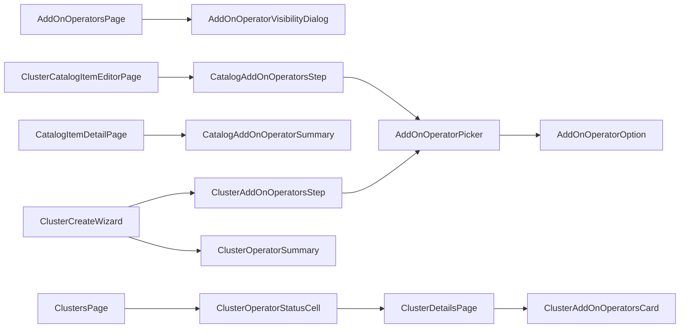

# UI design — CaaS add-on operators (OSAC-4095)

- **Feature:** OSAC-4090, Operator Support for CaaS Catalog Items
- **UX input:** [PR #434](https://github.com/osac-project/enhancement-proposals/pull/434), revision `8c787b1b5b2c2c3d6582d855ed6330e211d913be`
- **Review status:** Draft. The UX PR has changes requested, and backend gaps block the full UI scope.

## Purpose

The console needs four connected flows: a Cloud Provider Admin publishes operators; a Cloud Provider Admin or Tenant Admin attaches them to CaaS catalog items; a Tenant Admin or Tenant User chooses them when ordering a cluster; and authorized users see installation results. This design reuses the existing PatternFly 6 catalog, Formik cluster wizard, and cluster list and detail pages. It covers initial installation only; upgrade, removal, and ongoing health management are outside this feature. [PRD: In Scope and User Stories] [Design: Proposal and lifecycle]

The [API findings](api-findings-OSAC-4095.md) contain the verified endpoint mapping and seven gap records. The UI design below describes the intended experience; backend enforcement remains authoritative wherever a contract is still missing. [Codebase: `fulfillment-service/internal/servers/cluster_catalog_item_policies.go`] [User: full-scope design]

## Experience and decisions

| Persona | Console behavior |
| --- | --- |
| Cloud Provider Admin | Manage published and unpublished operators and their visibility; create or edit shared and tenant-scoped CaaS catalog items; read operator outcomes across authorized clusters. The cluster view is read-only. |
| Tenant Admin | Create or edit catalog items in their own tenant, including project-scoped items; read shared items; order clusters; inspect outcomes across their tenant. |
| Tenant User | See offered operators on catalog detail, choose permitted operators during catalog or direct-template orders, and inspect status and failure messages for their clusters. |

A tenant IDP manager receives no operator-management controls from that role alone. UI guards hide unavailable actions, but Fulfillment must enforce tenant scope and permissions. [PRD: Cloud Provider Admin, Tenant Admin, Tenant User] [User: both-admin catalog ownership and provider status]

The selection rules are:

1. **Locked catalog policy:** show included operators as read-only cards. The launch form sends no override.
2. **Editable catalog policy:** mandatory entries stay selected; optional defaults start selected but can be removed; users may add published compatible operators. Required dependencies stay selected while needed, and the catalog editor marks bundled dependencies mandatory. The server must enforce the final set after the policy gap closes.
3. **Direct-template order:** use the same cluster wizard, starting with a catalog-or-template choice. A template order has no catalog policy and uses the operator picker. It still supplies required version, parameters, and node-set choices.
4. **Version or selection conflict:** keep the user's choices, explain incompatibility or exclusion, and block submission until corrected. Never silently drop a choice or assume missing metadata means compatibility.
5. **After creation:** show Pending, Installing, Installed, or Failed for each operator, with the failure message when present. Show the cluster's aggregate Degraded condition separately. There are no install, upgrade, or remove actions on this screen.

Operator cards use fields currently available from `AddOnOperator`: title, description, OpenShift version range, dependencies, and exclusions. Category, logo, and exact resolved version are absent from the current API and are omitted here; the provisional UX PR needs to match. [UX PR: §§1–5] [Design: Ordering a cluster with operators] [User: mandatory/optional and current-field choices]

## Frontend composition

| Surface | New components and existing host | Responsibility |
| --- | --- | --- |
| Provider inventory | `AddOnOperatorsPage`, `AddOnOperatorVisibilityDialog` in `AppShell` | Page published and unpublished inventory; edit publication and tenant scope; show server errors. |
| Catalog | `ClusterCatalogItemEditorPage`, `CatalogAddOnOperatorsStep`, `CatalogAddOnOperatorSummary` in catalog pages | Create or edit scoped items and their locked/editable policy; summarize included operators before launch. |
| Cluster order | `ClusterAddOnOperatorsStep`, `ClusterOperatorSummary` in `ClusterCreateWizard` | Present the policy or direct selection and summarize it in General and Review. |
| Shared choice | `AddOnOperatorPicker`, `AddOnOperatorOption` | Search, select, explain disabled choices and required dependencies. The catalog and order forms own separate state. |
| Outcomes | `ClusterOperatorStatusCell`, `ClusterAddOnOperatorsCard` in cluster list/detail | Show counts, failed names, drilldown, per-operator state, and messages. |

Paths are relative to `osac-ui/libs/ui-components/src/`. Add the provider page under `pages/admin/`, the catalog editor and step under `components/catalog/cluster/`, and shared operator controls under `components/AddOnOperator/`. Extend the existing catalog detail, cluster wizard, list, and detail components rather than adding wrappers. Reuse `ProvisioningField`, `CatalogStep`, `ResourceDetailsPageLoading/Error`, and `OSACWizardFooter`. The editor uses General, Cluster version, Node topology, Add-on operators, Visibility, and Review steps. [Codebase: `osac-ui/libs/ui-components/src/pages/tenant/CatalogPage.tsx`, `components/Cluster/CreateWizard/`, `components/Cluster/Details/`] [UX PR: §§1–5]

The shared picker accepts `operators`, `selectedIds`, `mandatoryIds`, `disabledReasons`, optional `readOnly`, and `onToggle(id)`. The visibility dialog accepts `operator` and `onClose`. The catalog step receives `selectedOcpVersion?` and uses editor Formik state; the order step uses wizard Formik state. `ClusterOperatorSummary` receives names, optional mandatory names, and compact mode. The status cell receives a cluster; the detail card also receives operator metadata keyed by canonical ID. A pure `operatorSelection.ts` function derives dependency closure and disabled reasons; it is guidance, not a second source of truth. [Codebase: `add_on_operator_type.proto`, existing Formik and PatternFly patterns]

## Routes and permissions

| Route | View and guard |
| --- | --- |
| `/admin/infrastructure/add-on-operators` | New provider-only `AddOnOperatorsPage`, with CaaS enabled. |
| `/catalog/cluster/new`, `/catalog/cluster/:id/edit` | New shared editor for Provider and Tenant Admins; server decides target and item scope. Put static `/new` before the dynamic catalog route. |
| `/catalog`, `/catalog/:kind/:id` | Existing browse/detail; add CaaS operator summary and role-aware create/edit actions. Tenant-user browse requests published items. |
| `/clusters/create/:catalogItemId?` | Existing tenant order wizard; without an ID, choose catalog or template first. Provider Admins cannot enter create by direct URL. |
| `/clusters`, `/clusters/:clusterId` | Existing list/detail; provider access is read-only and hides lifecycle and secret actions. Scope every query on the server. |

Keep the current eager import, `ShellRoute` error boundary, and CaaS `ServiceRoute` patterns in `AppShell.tsx` and `ClusterRoutes.tsx`. Use `GET /api/login/info` for session roles, `Capabilities.Get` for the service gate, and public SelfSubjectAccessReviews for method hints. Those checks control presentation only; they cannot prove private-RPC or existing-item ownership. [Codebase: `AppShell.tsx`, `ClusterRoutes.tsx`, `shellNav.ts`, `proxy/auth/handler.go`] [User: provider read-only status]

## Data and state

| State | Owner | Why |
| --- | --- | --- |
| Catalog target, operator policy, visibility | Editor Formik draft | All editor steps and Review use one draft; save only changed fields. |
| Order source, version, selected operators | Cluster wizard Formik draft | General, operator step, and Review agree; changing source resets incompatible source-specific values. |
| Operator, catalog, template, cluster records | TanStack Query via existing wrappers | Parameterized keys and mutation invalidation keep pages current. |
| Search, page, filters, dialog | Local page state; URL params where catalog already uses them | No new global state store is needed. |

`OperatorPage = { items: AddOnOperator[]; total: number }` and `TemplatePage = { items: ClusterTemplate[]; total: number }`. `CatalogItemDraft` is the generated `MessageInitShape<typeof ClusterCatalogItemSchema>` once the UI API baseline includes this policy. `VisibilityPatch` contains only `published` today; tenant scope awaits a backend field. New hooks follow the existing `useApiFetch` / `useApiQuery` / `useMutation` conventions; query errors remain `unknown`, and `ListParams` is the existing list-parameter type. [Codebase: `api/use-api-query.ts`, `api/v1/cluster-catalog-item.ts`]

| Hook and return type | RPC, cache, and effect |
| --- | --- |
| `useAddOnOperators(params?, enabled?): UseQueryResult<OperatorPage, unknown>` | Public `AddOnOperators.List`; key `v1/add_on_operators` plus params. Published inventory for cards and picker. |
| `useAdminAddOnOperators(params?): UseQueryResult<OperatorPage, unknown>` | Private List; separate key `v1/private/add_on_operators`, including unpublished items. |
| `useUpdateAddOnOperatorVisibility(): UseMutationResult<AddOnOperator, unknown, VisibilityPatch>` | Private Update with field mask, `lock: true`, and `metadata.version`; invalidate both operator lists and affected catalog queries. Tenant scope awaits the backend field. |
| `useCreateClusterCatalogItem(): UseMutationResult<ClusterCatalogItem, unknown, CatalogItemDraft>` | Public Create; invalidate catalog list/detail on success and retain form values on error. |
| `useUpdateClusterCatalogItem(): UseMutationResult<ClusterCatalogItem, unknown, { object: CatalogItemDraft; updateMaskPaths: string[] }>` | Public Update with mask, `lock: true`, and `metadata.version`; avoid replacing unrelated policies. |
| `useClusterTemplates(params?, enabled?): UseQueryResult<TemplatePage, unknown>` | Public `ClusterTemplates.List`; existing `v1/cluster_templates` key plus params. |

Reuse `useClusterCatalogItem(s)`, `useClusterTemplate`, `useClusterVersions`, `useClusters`, `useCluster`, `useProvisionCluster`, `useAllProjects`, `useSession`, and `useTranslation`. Page or search visible tenant/project choices rather than assuming the first 100 are complete. Extend `useClusters` with paging and server filters while retaining tenant project scope and `total`. The UI protobuf baseline (`v0.0.131`) must be advanced deliberately to include catalog operator policy, followed by generation and manual export/query-key updates; generated files must not be edited by hand. [Codebase: `api/v1/cluster.ts`, `libs/types/.buf-api-version`, `api/types.ts`]

The request flow is:

1. **Publish:** private `AddOnOperators.List/Update` supplies inventory and saves `published` plus the eventual global or tenant-targeted scope. The dialog shows authorization and validation failures without closing.
2. **Author catalog:** public `ClusterCatalogItems.List/Get/Create/Update` supplies `template`, `fields.add_on_operators`, `published`, and metadata. Updates use a field mask and optimistic lock. `Tenants.List` and `Projects.List` supply only server-visible targets.
3. **Order:** public operator, template, version, and hardware lists populate the wizard. `Clusters.Create` receives exactly one of `spec.catalog_item` or `spec.template` and the applicable `spec.add_on_operators[]`. Locked policy sends no override. Show `BadRequest.FieldViolation` beside a field when present, otherwise a general submit error; keep the draft after failure.
4. **Inspect:** `Clusters.List/Get` supplies selected canonical names, `status.add_on_operators[].state/message`, and conditions. Before feedback arrives, show selected names as Pending. Join display metadata only for an unambiguous name match; otherwise show the stored name. Poll with the existing 10-second query interval.

The [API findings](api-findings-OSAC-4095.md) identify each field and endpoint. Server filtering must precede paging and counting; filtering only the visible page would miss matching clusters. [Codebase: `cluster_catalog_item_policies.go`, `api/v1/cluster.ts`, `feedback_controller.go`]

## Backend readiness

The source review confirmed 21 of 28 data and operation needs. Four critical gaps block full implementation: per-entry mandatory/optional policy, an explicit empty selection distinct from “use defaults,” tenant-targeted operator visibility, and the provider role's server permissions. Two high gaps affect cross-cluster operator filtering and hardware discovery when CaaS runs without BMaaS; one medium gap affects sorting across paged results. See the seven stable gap IDs and evidence in [API findings](api-findings-OSAC-4095.md). [Codebase: public/private add-on protos and Fulfillment handlers]

The PRD describes a union of catalog and direct selections; the backend design and current editable-policy code replace defaults with a nonempty override. The chosen mandatory/optional behavior must be reconciled in those contracts before the form payload is finalized. The open UX PR also needs to reflect both-admin catalog ownership and API-backed card fields. These are dependencies, not reasons to omit the flows. [PRD: In Scope] [Design: Ordering a cluster with operators] [UX PR: §§1–5] [User: selection rules]

## States and accessibility

| Surface | Required behavior |
| --- | --- |
| Inventory and picker | Loading, empty, query error with Retry, no search results, and disabled choices with visible reasons. Search and checkboxes have labels; reasons are linked with `aria-describedby`; Space toggles enabled choices. |
| Catalog and order wizard | Keep drafts after save/order errors. Show locked content without inactive checkboxes. Keep incompatible selections after a version change, focus the error summary, and link it to fields. Announce auto-selected dependencies once. |
| Visibility dialog | Title and labeled scope controls; opening focuses the first control, Escape/Cancel closes, and focus returns to the invoking action. |
| List and detail status | Text accompanies icons and color; failure messages have labels. A polite announcement fires on state transitions, not every poll. Keyboard users can open detail without hover-only content. |

Use PatternFly controls, `useTranslation`, and WCAG 2.1 AA as the baseline; the UX PR does not provide a separate keyboard or ARIA handoff. [Codebase: `osac-ui/AGENTS.md`] [UX PR: selection and status screens]

## Test plan and observable outcomes

OSAC-4095 has no numbered Jira acceptance criteria. The following outcomes come from the PRD and the user decisions; they are not new Jira ACs. [PRD: User Stories] [User: role, catalog, and status decisions]

| ID | What a user can verify |
| --- | --- |
| UI-1 | Provider publishes an operator with allowed visibility; unauthorized tenants never see it. |
| UI-2 | Provider and Tenant Admins edit only permitted catalog items, with policy preserved on save. |
| UI-3 | A tenant sees included and optional operators on catalog detail before launch. |
| UI-4 | Locked orders are read-only; editable orders retain mandatory entries and permit optional changes. |
| UI-5 | A direct-template order can select operators without a catalog item. |
| UI-6 | Unavailable or incompatible selections fail with a clear error and create no cluster. |
| UI-7 | Detail shows operator progress/failure and the separate cluster Degraded condition. |
| UI-8 | Provider and Tenant Admins find outcomes across authorized clusters and drill down safely. |
| UI-9 | Picker, wizard, dialog, and status work with keyboard and screen reader in all UI states. |

Each coverage row below names its owner and tier and inherits the command, prerequisites, and real or simulated boundary from its harness. UI test paths are relative to `osac-ui/libs/ui-components/src/`; Fulfillment test paths are relative to `fulfillment-service/`:

| Harness | Working directory and command | Boundary and prerequisites |
| --- | --- | --- |
| `UI` | `osac-ui/`: `pnpm test` | React/PatternFly plus mock Connect transport; Fulfillment, proxy, database, and provider are absent. |
| `FS` | `fulfillment-service/`: `go test ./internal/servers -timeout 20m` | Real server logic and PostgreSQL test container; no browser proxy, Kubernetes, or AAP. |
| `IT` | `fulfillment-service/`: `make -C ../osac-installer test PLATFORM=kind PROFILE=dev NS=osac SUITE=fulfillment` | Deployed Fulfillment, PostgreSQL, and authentication on compatible Kind; browser, AAP, and provider installation are absent. |
| `QE` | `tests/e2e/caas/regression/`: command unresolved | Proposed deployed journey with Fulfillment, PostgreSQL, Kubernetes/OSAC operators, AAP, CaaS provider, and compatible add-on role. Owner ticket and command are unresolved; no coverage is claimed yet. |

| Case / outcomes | Owner and tier / harness | Assertion and suite location |
| --- | --- | --- |
| `TC-UI-01` / UI-1 | UI `[DEV]`, Unit / `UI` | Proposed `AddOnOperatorsPage.test.tsx` and `AddOnOperatorVisibilityDialog.test.tsx`: inventory states, paging, scope action, role gate, and focus. |
| `TC-FS-01` / UI-1 | Fulfillment `[DEV]`, Component integration / `FS` | Extend `internal/servers/add_on_operators_server_test.go`: publication and tenant visibility rules. |
| `TC-FS-02` / UI-1 | Fulfillment `[DEV]`, Component integration / `IT` | Proposed `it/it_add_on_operator_visibility_test.go`: group-only and role-only provider identities, plus allowed/denied tenants. |
| `TC-UI-02` / UI-2–3 | UI `[DEV]`, Unit / `UI` | Proposed `components/catalog/cluster/{ClusterCatalogItemEditorPage,CatalogAddOnOperatorsStep}.test.tsx` and `components/catalog/details/CatalogAddOnOperatorSummary.test.tsx`: scope, policy, save errors, and stored-name fallback. |
| `TC-FS-03` / UI-2,4 | Fulfillment `[DEV]`, Component integration / `FS` | Proposed policy cases in `internal/servers/` plus existing `private_clusters_server_test.go`: mandatory/default, explicit empty, and scope. |
| `TC-FS-04` / UI-2 | Fulfillment `[DEV]`, Component integration / `IT` | Proposed `it/it_catalog_add_on_operator_policy_test.go`: provider/tenant writes and cross-tenant denial. |
| `TC-UI-03` / UI-4–6 | UI `[DEV]`, Unit / `UI` | Extend `ClusterCreateWizard.test.tsx`, `ClusterReviewStep.test.tsx`, and proposed picker tests: payloads, version changes, errors, and focus. |
| `TC-FS-05` / UI-4–6 | Fulfillment `[DEV]`, Component integration / `FS` | Extend `add_on_operator_validation_test.go` and `private_clusters_server_test.go`: reject invalid orders without persistence. |
| `TC-FS-06` / UI-5–6 | Fulfillment `[DEV]`, Component integration / `IT` | Extend `it/it_public_clusters_test.go`: direct order, field violation, and no cluster after rejection. |
| `TC-UI-04` / UI-7–8 | UI `[DEV]`, Unit / `UI` | Proposed `components/Cluster/Details/ClusterAddOnOperatorsCard.test.tsx` and `components/Cluster/ClusterOperatorStatusCell.test.tsx`, plus list/detail tests: all states, failed names, read-only provider view. |
| `TC-FS-07` / UI-8 | Fulfillment `[DEV]`, Component integration / `IT` | Extend `it/it_public_clusters_test.go`: scoped List/Get, cross-tenant denial, then operator filtering and `total` across pages after the gap closes. |
| `TC-QE-01` / UI-4–5,7 | `[QE]`, E2E / `QE` | Proposed CaaS regression case: real catalog/direct order, installation, and Installed feedback. |
| `TC-QE-02` / UI-7–8 | `[QE]`, E2E / `QE` | Proposed CaaS regression case: trigger install failure, observe Failed/Degraded, retry, and clear only operator-caused degradation. Poll interval and pass/fail bound need an owner decision; no SLA is assumed. |
| `TC-UI-05` / UI-9 | UI `[DEV]`, Unit / `UI` | Proposed accessibility assertions in picker, dialog, wizard, and status tests. |

Run `pnpm run typecheck` and `pnpm lint` from `osac-ui/` when code is implemented; these are static checks, not integration evidence. A manual browser pass through the UI proxy should check field errors and focus behavior, but it is not persisted regression coverage. Existing CaaS E2E tests do not yet exercise add-on installation. The new QE command, owner ticket, and retry timing bound remain unresolved. No runtime tests were run for this documentation revision. [Project: `docs/INTEGRATION-TESTING.md` planning evidence]

## Decisions still needed

- Resolve the four critical API gaps before finalizing serialization, visibility, and provider gates. The chosen behavior remains in this design. [User: full scope]
- Reconcile the PRD/backend union-versus-replacement wording and update the provisional UX PR for both-admin ownership, mandatory/optional entries, and current-field cards. [PRD: In Scope] [Design: Ordering a cluster with operators] [UX PR: §§1–5]
- Decide how a CaaS + VMaaS deployment without BMaaS discovers hardware for a direct-template node set, or document a product restriction. [Codebase: service flags and gRPC registration]
- Assign the QE owner and execution command, and define an observable retry interval and bound. Until then, the deployed coverage is planned but not execution-ready. [Project: integration testing planning evidence]

---

## Provenance

Authored: revise @ ui-design 0.1.0 - b369da0, workspace main @ 91e852e8f
Phases: plan, review-api, revise

<!-- ai-workflow-provenance:{"schema_version":1,"provenance_kind":"session","workflow":"ui-design","workflow_version":"0.1.0","ai_workflows":"b369da0","source_repo":"91e852e8f","source_repo_branch":"main","commits_behind_main":0,"commits_ahead_main":595,"main_ref":"main","phases":["plan","review-api","revise"],"authoring_modes":["skill"],"context_changed":false,"origin_untracked":false} -->
