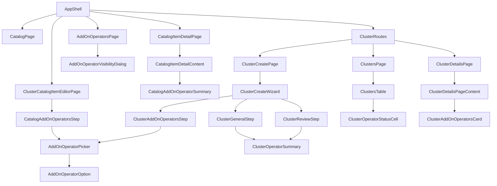

# UI Design — OSAC-4095

**Story:** OSAC-4095 — UI Design
**Date:** 2026-11-01
**Parent:** OSAC-5653; Feature: OSAC-4090
**UX source:** [Open UX PR #434](https://github.com/osac-project/enhancement-proposals/pull/434), revision `8c787b1b5b2c2c3d6582d855ed6330e211d913be`
**Review state:** Draft for review. The UX PR has changes requested and no finalized handoff.

## Summary

Design the CaaS add-on operator UI for Cloud Provider Admins, Tenant Admins, and Tenant Users. Provider admins publish operators and may edit shared and tenant-scoped CaaS catalog items across tenants. Tenant admins may edit catalog items in their own tenant, including project-scoped items, while shared items remain read-only. Tenant users can inspect included operators, choose operators during catalog or direct template orders, and inspect installation outcomes. Admins can review outcomes across clusters. [PRD: In Scope and User Stories] [User: scope and role decisions]

Reuse the existing PatternFly 6 catalog, Formik cluster wizard, cluster list, and cluster detail patterns. The UX PR supplies the catalog/launch/detail layout; this design adapts its operator cards to fields available from `AddOnOperator`: title, description, OpenShift compatibility, dependencies, and exclusions. It omits the PR's category filter, logo, and exact resolved operator version pending a UX revision, as directed by the user. [UX PR: §§1–5] [User: operator-card decision]

The API review uses local source `91e852e8f` and the locally available `upstream/main` at `a60651a8f`. The source proto has a whole-list locked/editable add-on policy, while the UI's generated protobuf baseline (`v0.0.131`) lacks that policy. An editable nonempty request replaces defaults; the server cannot represent mandatory versus optional entries or an explicit empty override. [Codebase: `proto/public/osac/public/v1/field_policy_type.proto`, `fulfillment-service/internal/servers/cluster_catalog_item_policies.go`, `osac-ui/libs/types/.buf-api-version`] [User: editable-selection decision]

## Component Architecture

### Component tree

The catalog editor and launch step share the picker and option card but own separate form state. The provider availability page is separate because it reads unpublished inventory and edits publication scope; tenant selection only reads published operators. [UX PR: §§1–4] [PRD: Cloud Provider Admin and Tenant User]

### New components

| Component and file | Props / state | Purpose and source |
| --- | --- | --- |
| `AddOnOperatorsPage`, `pages/admin/AddOnOperatorsPage.tsx` | No props; list query, page/filter state | Provider inventory of published and unpublished operators, with visibility action. [PRD: Cloud Provider Admin] |
| `AddOnOperatorVisibilityDialog`, `components/AddOnOperator/Admin/AddOnOperatorVisibilityDialog.tsx` | `{ operator: AddOnOperator; onClose: () => void }`; local form/pending state | Set published state and global or tenant visibility, show server validation errors. [Design: Enabling operators for tenants] |
| `ClusterCatalogItemEditorPage`, `components/catalog/cluster/ClusterCatalogItemEditorPage.tsx` | No props; route mode and item ID, Formik values | Create/edit CaaS catalog items for authorized admins; place operator step after Node topology and before Visibility. The existing UI has no CaaS catalog editor. [UX PR: §§1–2] [User: both-admin scope] |
| `CatalogAddOnOperatorsStep`, `components/catalog/cluster/CatalogAddOnOperatorsStep.tsx` | `{ selectedOcpVersion?: string }`; uses editor Formik context | Edit locked or editable policy; selected editable entries have Mandatory/Locked or Optional Default mode. [UX PR: §§1–2] [User: mandatory/optional choice] |
| `AddOnOperatorPicker`, `components/AddOnOperator/AddOnOperatorPicker.tsx` | `{ operators: AddOnOperator[]; selectedIds: readonly string[]; mandatoryIds: ReadonlySet<string>; disabledReasons: ReadonlyMap<string,string>; readOnly?: boolean; onToggle?: (id: string) => void }` | Shared searchable picker with selection, incompatibility, and dependency explanations. No category control. [UX PR: §§1, 2, 4] [User: current-fields choice] |
| `AddOnOperatorOption`, `components/AddOnOperator/AddOnOperatorOption.tsx` | `{ operator: AddOnOperator; checked: boolean; lockedReason?: string; disabledReason?: string; onToggle?: () => void }` | PatternFly checkbox/card row with accessible title, description, compatibility range, and requirement labels. [UX PR: §§1, 2, 4] |
| `CatalogAddOnOperatorSummary`, `components/catalog/details/CatalogAddOnOperatorSummary.tsx` | `{ item: ClusterCatalogItem; operatorsById: ReadonlyMap<string, AddOnOperator> }` | Show included and optional operators before launch; use reference names when metadata lookup fails. [PRD: Tenant User catalog discovery] |
| `ClusterAddOnOperatorsStep`, `components/Cluster/CreateWizard/ClusterAddOnOperatorsStep.tsx` | No props; reads cluster Formik context and catalog query | Locked read-only confirmation or editable selection after Networking and before Review; direct template orders use the editable picker. [UX PR: §§3–4] [PRD: direct order] |
| `ClusterOperatorSummary`, `components/Cluster/CreateWizard/ClusterOperatorSummary.tsx` | `{ names: readonly string[]; compact?: boolean; mandatoryNames?: readonly string[] }` | Compact General summary and full Review summary. [UX PR: §§3–4] |
| `ClusterAddOnOperatorsCard`, `components/Cluster/Details/ClusterAddOnOperatorsCard.tsx` | `{ cluster: Cluster; operatorsById: ReadonlyMap<string, AddOnOperator> }` | Render each operator's name, safely matched description/constraints, state, and failure message; no install/upgrade/remove actions. [UX PR: §5] [PRD: Tenant User status] |
| `ClusterOperatorStatusCell`, `components/Cluster/ClusterOperatorStatusCell.tsx` | `{ cluster: Cluster }` | Show counts and failed operator names in the Clusters table, linking to details. [PRD: admin cross-cluster outcomes] [User: extend Clusters list] |

`ClusterCatalogItemEditorPage` uses a proposed PatternFly wizard with General, Cluster version, Node topology, Add-on operators, Visibility, and Review. The current UI has no CaaS catalog editor or reusable catalog policy controls, so this page builds the existing catalog fields with the project's Formik and PatternFly conventions. The new add-on step owns only add-on policy values. The create form selects a template and target tenant/project according to the actor's permissions. Existing items use field-mask updates so editing add-ons does not replace unrelated policies. [UX PR: §1] [Codebase: `ClusterCatalogItem` and `ClusterCatalogItemFields`]

A pure `operatorSelection.ts` utility computes dependency closure, selected labels, and UI-disabled reasons from public operator metadata and the selected OCP version. It only improves feedback; the fulfillment service remains authoritative for availability, compatibility, exclusions, dependency expansion, and mandatory enforcement. If metadata is incomplete, the UI does not silently mark an operator compatible. [Design: Ordering a cluster with operators] [Codebase: `add_on_operator_type.proto`]

### Reused and extended components

Paths below are relative to `osac-ui/libs/ui-components/src/`. Existing forms, loading states, and wizard footer provide the patterns for the new views; none requires a new wrapper.

| Existing component(s) | Location | Change |
| --- | --- | --- |
| `CatalogPage` | `pages/tenant/CatalogPage.tsx` | Add create entry point for permitted admins. |
| `CatalogItemDetailPage`, `CatalogItemDetailContent` | `components/catalog/details/` | Add CaaS operator summary and role-aware edit action. |
| `ClusterCreateWizard`, `ClusterGeneralStep`, `ClusterReviewStep` | `components/Cluster/CreateWizard/` | Add source choice, operator step, and General/Review summaries. Extend sibling `fields.ts`, `schemas.ts`, and `payload.ts` for selection and `spec.addOnOperators`. |
| `ClustersPage`, `ClustersTable` | `components/Cluster/` | Add role-scoped operator status summary/filter and pagination; provider view is read-only. |
| `ClusterDetailsPageContent` | `components/Cluster/Details/ClusterDetailsPageContent.tsx` | Add the operator card to Overview while preserving the current tab/grid layout and Conditions card. |
| `ClusterDetailsPage`, `ClusterDetailsActionButtons` | `components/Cluster/ClusterDetailsPage.tsx`, `components/Cluster/Details/ClusterDetailsActionButtons.tsx` | Suppress tenant lifecycle and secret actions for the provider read-only route. |
| `ProvisioningField`, `CatalogStep` | `components/ProvisioningWizard/fields/ProvisioningField.tsx`, `components/ProvisioningWizard/CatalogStep.tsx` | Reuse catalog policy and wizard form behavior. |
| `ResourceDetailsPageLoading`, `ResourceDetailsPageError`, `OSACWizardFooter` | `components/Resource/` and `components/Wizard/OSACWizardFooter.tsx` | Reuse loading/error and wizard behavior. |

## Hook and State Design

### New API hooks

All hooks below use `useApiFetch` and the existing `useApiQuery` or `useMutation` pattern. `OperatorPage = { items: AddOnOperator[]; total: number }` and `TemplatePage = { items: ClusterTemplate[]; total: number }` are selected list results. `CatalogItemDraft` denotes `MessageInitShape<typeof ClusterCatalogItemSchema>` once the UI's selected protobuf baseline includes the operator policy. TanStack Query's `error` remains `unknown`, as in `useApiQuery`. [Codebase: `api/use-api-query.ts`, `api/v1/cluster-catalog-item.ts`, `api/v1/private/storage-tiers.ts`]

| Hook / file | Typed signature and RPC | Cache, side effects, and errors |
| --- | --- | --- |
| `useAddOnOperators`, `api/v1/add-on-operator.ts` | `(params: ListParams = {}, enabled = true): UseQueryResult<OperatorPage, unknown>`; public `AddOnOperators.List` | `useApiQuery`, new key `v1/add_on_operators` with params; show loading/empty/error in picker. Published inventory only. |
| `useAdminAddOnOperators`, `api/v1/private/add-on-operator.ts` | `(params: ListParams = {}): UseQueryResult<OperatorPage, unknown>`; private `AddOnOperators.List` | Separate new key `v1/private/add_on_operators`; errors remain visible on the provider page. The proxy exposes the RPC; a role-only `cloud-provider-admin` token has an authorization gap. |
| `useUpdateAddOnOperatorVisibility`, same private file | `(): UseMutationResult<AddOnOperator, unknown, VisibilityPatch>`; private `AddOnOperators.Update` | Send an explicit field mask and `lock: true` with `metadata.version`; invalidate public/private operator lists and affected catalog queries on success, and display validation or authorization errors. |
| `useCreateClusterCatalogItem`, existing `api/v1/cluster-catalog-item.ts` | `(): UseMutationResult<ClusterCatalogItem, unknown, CatalogItemDraft>`; public `ClusterCatalogItems.Create` | Invalidate catalog list/get on success; retain form values and show field-level or authorization errors on failure. |
| `useUpdateClusterCatalogItem`, same file | `(): UseMutationResult<ClusterCatalogItem, unknown, { object: CatalogItemDraft; updateMaskPaths: string[] }>`; public `ClusterCatalogItems.Update` | Send `updateMask.paths`, `lock: true`, and the item's `metadata.version`; invalidate list/get on success. Show stale-version and validation errors. |
| `useClusterTemplates`, existing `api/v1/cluster-templates.ts` | `(params: ListParams = {}, enabled = true): UseQueryResult<TemplatePage, unknown>`; `ClusterTemplates.List` | Add beside existing `useClusterTemplate`; use existing key `v1/cluster_templates` with params, showing loading/empty/error in source choice. |

The `VisibilityPatch` type contains `published` today; tenant visibility is blocked by gap `field-4b10034f7620` until the backend defines a wire field and enforces it. `AddOnOperator` generated types remain untouched until the selected UI API baseline is deliberately advanced. The two catalog mutations are separate because create and field-mask update have different request contracts, matching existing UI mutation patterns. [Codebase: `api/types.ts`, `osac-ui/AGENTS.md`, `api/v1/private/storage-tiers.ts`] [Design: Enabling operators for tenants]

### Reused and extended hooks

| Hook | Location and use |
| --- | --- |
| `useClusters` | `api/v1/cluster.ts`; extend to accept pagination and server-side filters while retaining the current project filter for tenant users. Fulfillment supports provider-wide reads for `admins` group members and tenant-wide reads for `tenant-admin`; role-only `cloud-provider-admin` tokens and filtering by failed operator remain gaps. |
| `useCluster` | `api/v1/cluster.ts`; retain for detailed operator status. |
| `useClusterCatalogItem` and `useClusterCatalogItems` | `api/v1/cluster-catalog-item.ts`; read a deep-linked item and scoped catalog list. |
| `useClusterTemplate` | `api/v1/cluster-templates.ts`; read the selected template after adding the list hook. |
| `useClusterVersions` | `api/v1/cluster-versions.ts`; get permitted OCP versions for compatibility labels and selection. |
| `useAllProjects` and public `Tenants.List` | `api/v1/project.ts` and a paginated public tenant query; populate only server-visible target tenant/project options in the catalog editor and provider visibility dialog. |
| `useProvisionCluster` | `api/v1/cluster.ts`; submit the catalog or direct-template cluster payload and surface server field violations. |
| `useSession` and `useTranslation` | `hooks/use-session.tsx` and `hooks/useTranslation.ts`; reuse role/tenant scope and translated UI labels. |

`ClusterCreateWizard` may use the existing generic resource query for a deep-linked catalog item. All query results remain server scoped; client role checks only control presentation. [Codebase: `api/v1/cluster.ts`, `api/v1/cluster-catalog-item.ts`]

### State ownership

| State | Scope and owner | Reason |
| --- | --- | --- |
| Catalog mode, selected references, mandatory/optional flags, catalog visibility fields | Wizard-shared Formik state in `ClusterCatalogItemEditorPage` | The editor steps and Review must read one draft; serialize the policy only on save. |
| Launch source (`catalog` or `template`), chosen operators, selected version | Wizard-shared Formik state in `ClusterCreateWizard` | Steps and Review derive from one draft; changing source resets incompatible source-specific values. |
| Dependency closure, version and exclusion reasons | Pure derivation in `operatorSelection.ts` | Recompute from current form values and operator metadata, so no second mutable copy or global store exists. |
| Operator, catalog, template, and cluster records | TanStack Query server cache through project wrappers | Resource/parameter query keys and invalidation keep cross-page server data current. |
| Search, pagination, filters, open dialog | Local page state; URL params where the existing Catalog page uses them | Only each page owns these controls; no global state slice is needed. |

For editable catalog items, mandatory entries remain selected and cannot be removed; optional defaults start selected and may be removed; tenants may add published compatible operators. A dependency is selected while any selected operator requires it and cannot be removed independently. The catalog editor marks bundled dependencies mandatory. Locked policies prohibit all launch changes. The server must reject tampered requests that omit mandatory entries. [UX PR: §§1–4] [User: mandatory/optional choice]

The current server treats an empty repeated `spec.add_on_operators` list as omitted and reapplies editable defaults. The API must distinguish an explicit empty selection from omission so a tenant can remove every optional default. This is blocking gap `shape-281469e0b39f`. [Codebase: `cluster_catalog_item_policies.go`] [User: mandatory/optional choice]

## Route Structure

| Route | Component | Eager/lazy | UI guard | Params and behavior |
| --- | --- | --- | --- | --- |
| `/admin/infrastructure/add-on-operators` | `AddOnOperatorsPage` | Eager, new | `role === 'admin'` and CaaS service | None; private inventory and visibility writes. |
| `/catalog/cluster/new` | `ClusterCatalogItemEditorPage` | Eager, new | Provider Admin or Tenant Admin, CaaS service | None; create scope determined by server authorization. |
| `/catalog/cluster/:id/edit` | `ClusterCatalogItemEditorPage` | Eager, new | Provider Admin or Tenant Admin, CaaS service | `id: string`; Provider Admin may edit shared and any tenant item; Tenant Admin only own-tenant items, including project-scoped items. |
| `/catalog`, `/catalog/:kind/:id` | Existing catalog pages | Eager, existing | Current catalog reader guard | `kind: string`, `id: string`; add CaaS operator summary and role-aware create/edit actions. |
| `/clusters`, `/clusters/:clusterId` | Existing cluster list/detail | Eager, existing | CaaS service; Provider Admin read-only | `clusterId: string` on detail; status summaries, scoped records, and drilldown. |
| `/clusters/create/:catalogItemId?` | Existing `ClusterCreateWizard` | Eager, existing | Tenant Admin/User only, CaaS service | `catalogItemId?: string`; without an ID, first step offers catalog or template source. Direct template orders set `spec.template`. |

Add the three new routes in `osac-ui/apps/app-frontend/src/shell/AppShell.tsx`; place the static `/catalog/cluster/new` route before the existing `/catalog/:kind/:id` route for clarity. Extend `osac-ui/libs/ui-components/src/pages/tenant/ClusterRoutes.tsx` to mount list/detail for Provider Admins but guard the create child route explicitly. Keep the current eager import pattern, `ShellRoute` error boundary, and CaaS `ServiceRoute`; new pages use existing loading/error components. Add provider navigation under Infrastructure and catalog editor entry points only for authorized roles. [Codebase: `AppShell.tsx`, `ClusterRoutes.tsx`, `shellNav.ts`]

## Persona-Aware Decomposition

`AddOnOperatorPicker`, `AddOnOperatorOption`, `ClusterOperatorSummary`, and `ClusterAddOnOperatorsCard` are shared across eligible readers. `AddOnOperatorsPage` and its visibility dialog are provider-only. `ClusterCatalogItemEditorPage` is shared by the two admin roles and varies the allowed target scope. `ClusterOperatorStatusCell` uses the same display in provider and tenant lists, while the list query differs by authorized scope. No portal or new global permission store is needed. [UX PR: §§1–5] [User: role and status decisions]

| Persona | Can see / do |
| --- | --- |
| Cloud Provider Admin | List unpublished and published operators; publish/unpublish and set visibility; create/edit shared or any tenant CaaS catalog item; read operator outcomes across authorized clusters. |
| Tenant Admin | Read offered operators; create/edit own-tenant catalog items, including project items; read shared items; launch clusters; review outcomes across authorized clusters in their tenant. |
| Tenant User | Read published catalog operators, launch from a catalog or template with permitted selections, and read status/error details for authorized clusters. |
| Tenant IDP manager | No operator-management controls by role alone. |

| Action/element | Presentation gate | Server requirement |
| --- | --- | --- |
| Provider inventory and visibility action | Provider-only route/action, CaaS enabled | Private List/Update authorization and tenant visibility enforcement. |
| Catalog create/edit action | Provider or Tenant Admin; for Tenant Admin, item tenant must equal session tenant; shared item read-only | Create/Update must enforce tenant/project scope and field policy. |
| Cluster create and secret/lifecycle actions | Hide from Provider Admin, including direct URL to create route | Create/Get/secret RPC authorization remains authoritative. |
| Cluster status list and detail | Show only records returned by scoped queries; provider controls are read-only | List/Get enforce tenant isolation and provider-wide access where intended. |

## Data Flow Mapping

The open UX PR has no per-element data annotation table, so this mapping derives from its five screens, the PRD, the backend design, and the role-aware editor. The browser uses typed Connect RPCs through `/api/fulfillment`; the paths in API Findings are their proto HTTP annotations. Login identity comes from the UI proxy's `/api/login/info`. [UX PR: §§1–5] [Codebase: `api/api-context.tsx`, `proxy/auth/handler.go`]

| UI element / action | Source type | RPC and response/request field | Resolution |
| --- | --- | --- | --- |
| Operator cards and compatibility labels | API | Public `AddOnOperators.List/Get`: `items[]`/`object` title, description, `min_ocp_version`, `max_ocp_version`, dependencies, exclusions | Confirmed for published, current-field cards. The UI must add `v1/add_on_operators` to `ApiRoute` and export generated services/types from the manual package entry points. |
| Provider inventory and publication action | API | Private `AddOnOperators.List/Update`: `items[].published`, `metadata.version`, update mask/lock, returned `object` | Confirmed through the browser proxy for an `admins` group identity. Role-only `cloud-provider-admin` authorization and tenant-targeted visibility are gaps `permission-46ba3aec69fe` and `field-4b10034f7620`. |
| Target tenant and project choices | API | Public `Tenants.List` and `Projects.List`: visible `items[].id/metadata.name/metadata.tenant/metadata.project` | Confirmed, with server-scoped and paginated results. Page or search rather than assuming the first 100 choices are complete; provider role authorization remains gap `permission-46ba3aec69fe`. |
| Catalog browse and source choice | API | `ClusterCatalogItems.List/Get`: `items[]`/`object`, `published`, `template`, `fields`, `metadata` | Confirmed. Tenant-user browse must filter `this.published` because List/Get can return visible unpublished items. |
| Catalog policy, authoring, and inclusion summary | API plus computed | `ClusterCatalogItems.Get/Create/Update`: `object.fields.add_on_operators` with whole-list `locked.items[]` or `editable.default_value.items[]`; count derived from references | Whole-list policy confirmed. Per-entry mandatory/optional semantics are gap `field-38c2d7639b85`. Use public `AddOnOperators.List/Get` for display metadata and stored reference names as fallback. Update uses field mask, `lock: true`, and `metadata.version`. |
| Direct template source and parameters | User input plus API | `ClusterTemplates.List/Get`: `items[]`/`object` with title, `parameters[]`, and `spec_defaults` | Confirmed. Direct orders must supply required parameters and node sets omitted by the template. |
| Direct template hardware and version choices | API | `BareMetalInstanceTypes.List`: `items[].id/metadata.name/spec`; `ClusterVersions.List/Get`: `items[].spec.version/state/enabled` or `object.spec` | Version discovery is confirmed. Hardware discovery works when BMaaS is enabled; valid CaaS + VMaaS deployments without BMaaS lack this endpoint, gap `data-ef5b91178d6e`. Filter versions to enabled Active/Deprecated choices and supply the required node-set hardware reference. |
| Locked/editable and direct operator selection | User input plus API | `Clusters.Create`: `request.object.spec.catalog_item` or `template`, and `add_on_operators[]`; response `object.spec.add_on_operators[]` | Both source modes and add-on validation confirmed. Mandatory preservation and explicit-empty selection are gaps `field-38c2d7639b85` and `shape-281469e0b39f`. Locked mode sends no override. |
| Disabled reason and dependency closure | Computed from API metadata | Public `AddOnOperators.List/Get` compatibility, dependencies, and exclusions | Confirmed as UI guidance; the server revalidates and expands dependencies on create. Missing metadata is shown as unknown, not compatible. |
| Order-time operator error | API | `Clusters.Create` `InvalidArgument`; add-on resolver failures include `google.rpc.BadRequest.FieldViolation` | Confirmed only for resolver validation. Locked-policy and catalog-policy errors can be plain `InvalidArgument` messages, so show a general submit error when no field detail is present. |
| Cluster operator state and failure message | API | `Clusters.Get`: `object.status.add_on_operators[].name/state/message`; `object.spec.add_on_operators[]` has canonical references | Confirmed. Before the first feedback report, infer Pending from spec references if status is empty. Join optional display metadata only for a matching canonical name; otherwise show the status name and message. |
| Cluster degradation | API | `Clusters.Get`: `object.status.conditions[]` with `DEGRADED` | Confirmed; display the aggregate condition independently of per-operator state. |
| Cross-cluster status counts and drilldown | API plus computed | `Clusters.List`: `items[].status.add_on_operators[]` and `items[].spec.add_on_operators[]`; counts derived per row, `total` for pagination | Confirmed for `admins` group across tenants and `tenant-admin` in own tenant. Filtering by operator name/failure is gap `filtering-5a6c733a5cca`; role-only provider access is gap `permission-46ba3aec69fe`. |
| Role, CaaS service, and edit permission gates | API plus session | UI proxy `GET /api/login/info`: `roles/groups/tenantId`; `Capabilities.Get`: `enabled_services`; `SelfSubjectAccessReviews.Create`: `object.status.allowed` for public methods | Confirmed. SSAR cannot check private services or an existing item's full resource scope. Use it for public method gates, compare returned metadata for presentation, and treat server decisions as authoritative; role mismatch is gap `permission-46ba3aec69fe`. |

Category, logo, and exact resolved operator version have no current API source and are omitted by user direction; the open UX proposal needs a matching revision. The user-selected mandatory/optional model also supersedes the PRD's union wording and the current backend design's whole-list replacement behavior, so those source documents need reconciliation before implementation approval. [PRD: In Scope] [Design: Ordering a cluster with operators] [User: selection and card decisions]

## API Findings

**Review date:** 2026-11-01
**Source snapshot:** local OSAC `91e852e8f`, locally available `upstream/main` `a60651a8f`, UI generated API baseline `v0.0.131`
**Endpoints verified:** 21 (20 Fulfillment RPCs and the UI proxy login endpoint)
**Mappings confirmed:** 21 of 28 atomic data, operation, and supporting-capability needs
**Gaps identified:** 7

Each routed operation is counted once even when several components use it. The seven unmet needs are the specific contract, query, permission, and deployment-profile capabilities in the gap table. HTTP paths below come from proto annotations; the browser calls their typed Connect RPCs through `/api/fulfillment`. This review checks source and tests, not a deployed browser session.

### Verified Endpoint Mappings

| UI element | Data needed | Endpoint | Response/request field | Verified |
| --- | --- | --- | --- | --- |
| Operator picker/cards | Published inventory, display and compatibility fields | `GET /api/fulfillment/v1/add_on_operators` | `items[].id/title/description/min_ocp_version/max_ocp_version/dependencies/exclusions`, `total` | Yes — public handler composes `this.published`. |
| Operator detail/fallback lookup | One published operator | `GET /api/fulfillment/v1/add_on_operators/{id}` | `object` with display and compatibility fields | Yes — unpublished returns NotFound. |
| Provider operator inventory | Published and unpublished records, update version | `GET /api/private/v1/add_on_operators` | `items[].published`, `items[].metadata.version`, `total` | Yes — private generic List. |
| Provider publication action | Update publication flag | `PATCH /api/private/v1/add_on_operators/{object.id}` | Request `object.published`, `update_mask`, `lock`; response `object` | Yes — private Update validates graph and references. |
| Catalog browse | Scoped items, published flag and policy summary | `GET /api/fulfillment/v1/cluster_catalog_items` | `items[].published/template/fields.add_on_operators/metadata`, `total` | Yes — visible unpublished items also appear. |
| Catalog detail/launch | One item's template, policy and scope | `GET /api/fulfillment/v1/cluster_catalog_items/{id}` | `object.template/fields.add_on_operators/metadata` | Yes — whole-list policy populated. |
| Catalog editor create | Save a scoped CaaS catalog item | `POST /api/fulfillment/v1/cluster_catalog_items` | Request/response `object.fields.add_on_operators` | Yes — public mapping and private validation. |
| Catalog editor update | Patch policy without replacing other fields | `PATCH /api/fulfillment/v1/cluster_catalog_items/{object.id}` | Request `object`, `update_mask`, `lock`; response `object` | Yes — optimistic lock requires `lock: true`. |
| Direct-template chooser | Available templates | `GET /api/fulfillment/v1/cluster_templates` | `items[].id/title/metadata`, `total` | Yes — public handler maps private items. |
| Direct-template details | Required parameters and defaults | `GET /api/fulfillment/v1/cluster_templates/{id}` | `object.parameters[]`, `object.spec_defaults` | Yes — node sets remain caller input. |
| Node-set hardware chooser | Supported bare-metal types | `GET /api/fulfillment/v1/bare_metal_instance_types` | `items[].id/metadata.name/spec`, `total` | Yes when BMaaS is enabled; the route is absent in valid CaaS + VMaaS-only profiles. |
| Version chooser | Selectable OCP versions | `GET /api/fulfillment/v1/cluster_versions` | `items[].spec.version/state/enabled`, `total` | Yes — public handler applies lifecycle defaults. |
| Version detail | Referenced version and compatibility | `GET /api/fulfillment/v1/cluster_versions/{id}` | `object.spec.version/state/enabled` | Yes — public handler maps private object. |
| Cluster order | Catalog or template source, requested operators, validation | `POST /api/fulfillment/v1/clusters` | Request `object.spec.catalog_item` or `template` and `add_on_operators[]`; response `object.spec.add_on_operators[]`; add-on resolver error details | Yes — exactly one source; resolver expands dependencies. |
| Cluster detail | Operator status and aggregate condition | `GET /api/fulfillment/v1/clusters/{id}` | `object.spec.add_on_operators[]`, `object.status.add_on_operators[].name/state/message`, `object.status.conditions[]` | Yes — feedback controller populates status after order feedback. |
| Cross-cluster outcomes | Per-row operator status and total count | `GET /api/fulfillment/v1/clusters` | `items[].spec.add_on_operators[]`, `items[].status.add_on_operators[]`, `items[].status.conditions[]`, `total` | Yes — public handler maps scoped private results. |
| Public permission gate | Method-level decision | `POST /api/fulfillment/v1/self_subject_access_reviews` | `object.status.allowed` | Yes — public services only; resource ownership still checked on action. |
| Session persona | Username, role claims, tenant | `GET /api/login/info` | `username`, `roles[]`, `groups[]`, `tenantId` | Yes — proxy reads OIDC session tokens. |
| CaaS route gate | Enabled service tier | `GET /api/fulfillment/v1/capabilities` | `enabled_services[]` | Yes — handler uses deployment service flags. |
| Tenant target chooser | Visible tenant names/IDs | `GET /api/fulfillment/v1/tenants` | `items[].id/metadata.name`, `total` | Yes — public handler maps scoped private results. |
| Project target chooser | Visible tenant/project choices | `GET /api/fulfillment/v1/projects` | `items[].id/metadata.name/metadata.tenant/metadata.project`, `total` | Yes — public handler maps scoped private results. |

Route/type and handler evidence: `proto/public/osac/public/v1/*_service.proto`, `proto/private/osac/private/v1/add_on_operators_service.proto`, `fulfillment-service/internal/servers/{add_on_operators_server.go,private_add_on_operators_server.go,cluster_catalog_items_server.go,cluster_templates_server.go,bare_metal_instance_types_server.go,cluster_versions_server.go,clusters_server.go,private_clusters_server.go}`. Status production is in `osac-operator/internal/controller/feedback_controller.go`. The proxy route and identity response are in `osac-ui/proxy/{main.go,bridge/connectjson.go,auth/handler.go}`; service registration is in `fulfillment-service/internal/cmd/service/start/grpcserver/register_servers.go`.

### Pagination, Filtering, and Sorting

| List endpoint | Pagination | Filtering | Sorting | Notes |
| --- | --- | --- | --- | --- |
| Public `AddOnOperators.List` | Offset/limit; `size/total` | CEL title/name/description and scalar metadata; published always required | `order` ignored | Search across pages is supported by server filtering. |
| Private `AddOnOperators.List` | Offset/limit; `size/total` | CEL fields including `published` | `order` ignored | Returns unpublished for authorized provider identities. |
| `ClusterCatalogItems.List` | Offset/limit; `size/total` | CEL `published`/title and metadata tenant/project | `order` ignored | Tenant-user browse must request `this.published`. |
| `ClusterTemplates.List` | Offset/limit; `size/total` | CEL title/name and metadata | `order` dropped | Public handler omits request order. |
| `BareMetalInstanceTypes.List` | Offset/limit; `size/total` | CEL metadata/name and scalar fields | `order` ignored | Registered only with BMaaS; use server search when available. |
| `ClusterVersions.List` | Offset/limit; `size/total` | CEL state/enabled/version; lifecycle defaults | `order` ignored | Existing UI filter requests enabled Active/Deprecated versions. |
| `Clusters.List` | Offset/limit; `size/total` | CEL scalar/nested fields; no predicate over operator-status messages | `order` dropped | Cannot filter all pages by failed operator or operator name. |
| `Tenants.List` | Offset/limit; `size/total` | CEL metadata/name | `order` ignored | Page or search target choices. |
| `Projects.List` | Offset/limit; `size/total` | CEL metadata tenant/project/name | `order` ignored | Page or search target choices. |

The generic DAO defaults to 100 items, caps a page at 1000, and returns only `total` for explicit `limit: 0`. It hard-codes `ORDER BY id`; `GenericServer.List` never reads `order`, and public Cluster/Template handlers also omit it. The supported CEL subset includes scalar comparisons, `contains`/`startsWith`/`endsWith`, array membership, and array `size()`; it has no message-array predicate for `status.add_on_operators[].state/name`. [Codebase: `generic_dao.go`, `generic_dao_list.go`, `generic_server.go`, `filter_translator.go`, `fulfillment-service/docs/FILTER.md`]

For authorization, `admins` group members receive all-tenant visibility; `tenant-admin` gets all projects in its own tenant and cannot edit a shared catalog item. The UI also recognizes the `cloud-provider-admin` realm role as provider admin, but Fulfillment's `is_admin` does not. RoleBinding maps `cloud-provider-admin` to a realm role. Public SelfSubjectAccessReviews can check a public method with a tenant hint, not a private service or the ownership of an existing item. [Codebase: `authz.rego`, `default_tenancy_logic.go`, `private_self_subject_access_reviews_server.go`, `oidc-login.tsx`, `role_binding_reconciler_function.go`]

Installable operators are shared-scoped, have unique immutable names, and are stored as canonical cluster spec references; the feedback controller emits those names in status. The detail view can join a status name to a spec reference only when it matches uniquely and otherwise display the name without metadata. [Codebase: `113_create_add_on_operators_tables.up.sql`, `add_on_operator_validation.go`, `feedback_controller.go`]

Status polling can use the existing 10-second TanStack Query refetch interval; `Events.Watch` also exists but is not required for this design. The planned writes update one catalog item or operator at a time, so no batch API is required. The UI implementation must deliberately advance its protobuf baseline to include `ClusterCatalogItem.fields.add_on_operators`, then regenerate types and add manual exports/query keys; this is client contract alignment, not a missing backend endpoint. `useClusters` must retain `total` when adding pagination. No generated file should be hand-edited. [Codebase: `osac-ui/AGENTS.md`, `libs/types/.buf-api-version`, `libs/types/src/index.ts`, `api/types.ts`, `api/v1/cluster.ts`]

### API Gaps

| # | Gap ID | Gap / canonical data element | Category | UI impact | Severity |
| --- | --- | --- | --- | --- | --- |
| 1 | `field-38c2d7639b85` | per-entry mandatory and optional-default add-on policy | field | Catalog editor and launch picker cannot enforce the selected UX rules. | critical |
| 2 | `shape-281469e0b39f` | explicit empty add-on selection distinct from omitted override | shape | Tenant cannot remove every optional default. | critical |
| 3 | `field-4b10034f7620` | tenant-targeted add-on operator visibility | field | Provider cannot publish to selected tenants; public availability is global. | critical |
| 4 | `permission-46ba3aec69fe` | cloud-provider-admin role authorization for provider operator management and cross-tenant reads | permission | Role-only provider sees controls but receives denials and limited cluster scope. | critical |
| 5 | `filtering-5a6c733a5cca` | server-side failed operator and operator-name cluster filtering | filtering | Cross-cluster failure search cannot be correct across pages. | high |
| 6 | `sorting-3680a3deac47` | server-side ordering of paged operator and cluster lists | sorting | Inventory and outcome lists have fixed ID order despite requested sort. | medium |
| 7 | `data-ef5b91178d6e` | hardware choices for CaaS when BMaaS is disabled | data | Direct-template node-set chooser has no hardware list in a valid CaaS + VMaaS-only deployment. | high |

Gap IDs were computed with `compute-hash.py gap-id` from the category, the canonical data element above, and the existing endpoint path given below. Preserve these IDs when refining a finding so `/sync` can update its eventual Jira issue.

### Gap Details

#### Gap 1: Mandatory and optional catalog entries

- **Gap ID:** `field-38c2d7639b85`
- **Category:** field
- **UI need:** form-input: per-entry mandatory and optional-default add-on policy
- **Current state:** `ClusterCatalogItem.fields.add_on_operators` is one whole-list `locked.items[]` or `editable.default_value.items[]` policy. An editable nonempty request replaces the default list; the server does not retain a mandatory subset.
- **What's missing:** A persisted per-entry mode and server validation that rejects removal of mandatory operators while allowing optional-default removal and compatible extras.
- **Affected components:** `ClusterCatalogItemEditorPage`, `CatalogAddOnOperatorsStep`, `CatalogAddOnOperatorSummary`, `ClusterAddOnOperatorsStep`, `AddOnOperatorPicker`
- **Severity:** critical
- **Suggested approach:** Extend the catalog policy contract and order validation to express and enforce mandatory versus optional entries; account for required dependencies and existing catalog references.
- **Evidence:** `proto/public/osac/public/v1/field_policy_type.proto`, `fulfillment-service/internal/servers/cluster_catalog_item_policies.go`, `fulfillment-service/internal/database/migrations/140_add_on_operator_catalog_item_deletion_protection.up.sql`.
- **Gap ID endpoint input:** `/api/fulfillment/v1/cluster_catalog_items/{id}`

#### Gap 2: Explicitly empty editable selection

- **Gap ID:** `shape-281469e0b39f`
- **Category:** shape
- **UI need:** form-input: explicit empty add-on selection distinct from omitted override
- **Current state:** `ClusterSpec.add_on_operators` is repeated, and `applyClusterCatalogItemPolicies` checks `len(...) > 0`. An empty submitted list is treated as omitted and receives editable defaults; an existing unit test asserts this behavior.
- **What's missing:** A presence-aware way to express “select none” separately from “use defaults,” with correct validation when mandatory entries exist.
- **Affected components:** `ClusterCreateWizard`, `ClusterAddOnOperatorsStep`, `ClusterOperatorSummary`
- **Severity:** critical
- **Suggested approach:** Define a presence-aware selection contract and apply it consistently during catalog policy resolution and cluster creation.
- **Evidence:** `proto/public/osac/public/v1/cluster_type.proto`, `fulfillment-service/internal/servers/cluster_catalog_item_policies.go`, `fulfillment-service/internal/servers/catalog_item_field_policies_test.go`.
- **Gap ID endpoint input:** `/api/fulfillment/v1/clusters`

#### Gap 3: Tenant-targeted publication

- **Gap ID:** `field-4b10034f7620`
- **Category:** field
- **UI need:** form-input: tenant-targeted add-on operator visibility
- **Current state:** Public and private `AddOnOperator` have only `published`; operators are forced into the shared tenant. Public List/Get expose every published operator to all authorized tenants, and catalog/order validation resolves published shared operators.
- **What's missing:** A tenant visibility field and consistent enforcement for public discovery, catalog attachment, and order-time reference validation; existing references need lifecycle handling when scope narrows.
- **Affected components:** `AddOnOperatorVisibilityDialog`, `AddOnOperatorsPage`, `AddOnOperatorPicker`, `CatalogAddOnOperatorsStep`
- **Severity:** critical
- **Suggested approach:** Add an operator availability scope and enforce it across read and reference-resolution paths, including updates that affect existing catalog references.
- **Evidence:** `proto/public/osac/public/v1/add_on_operator_type.proto`, `proto/private/osac/private/v1/add_on_operator_type.proto`, `fulfillment-service/internal/servers/add_on_operators_server.go`, `fulfillment-service/internal/servers/private_add_on_operators_server.go`.
- **Gap ID endpoint input:** `/api/private/v1/add_on_operators/{id}`

#### Gap 4: Provider identity and server permissions

- **Gap ID:** `permission-46ba3aec69fe`
- **Category:** permission
- **UI need:** permission-gate: cloud-provider-admin role authorization for provider operator management and cross-tenant reads
- **Current state:** The UI treats either `admins` group or `cloud-provider-admin` realm role as `admin`. Fulfillment grants all-method and all-tenant access only to `admins` group or privileged service accounts. Private RPCs cannot be checked through public SelfSubjectAccessReviews.
- **What's missing:** Server authorization and tenant visibility aligned with the provider identity represented by the UI, including private operator List/Update, catalog writes, and cross-tenant Cluster List/Get.
- **Affected components:** `AddOnOperatorsPage`, `AddOnOperatorVisibilityDialog`, `ClusterCatalogItemEditorPage`, `CatalogPage`, `ClustersPage`, `ClusterDetailsPage`
- **Severity:** critical
- **Suggested approach:** Align the provider role's server grants and tenancy with the intended identity, then verify real group-only and role-only tokens through public and private RPCs; keep UI gates advisory.
- **Evidence:** `osac-ui/apps/app-frontend/src/hooks/oidc-login.tsx`, `fulfillment-service/internal/auth/policies/authz.rego`, `fulfillment-service/internal/controllers/rolebinding/role_binding_reconciler_function.go`, `fulfillment-service/internal/servers/private_self_subject_access_reviews_server.go`.
- **Gap ID endpoint input:** `/api/private/v1/add_on_operators`

#### Gap 5: Cross-cluster operator outcome filtering

- **Gap ID:** `filtering-5a6c733a5cca`
- **Category:** filtering
- **UI need:** filtering: server-side failed operator and operator-name cluster filtering
- **Current state:** `Clusters.List` returns each page's `status.add_on_operators[]` and `total`, but the supported CEL translator has no predicate over repeated status messages. Client filtering one page changes the displayed count and misses matches on later pages.
- **What's missing:** A scoped server query for clusters with a selected operator name and/or failed operator state across the full result set.
- **Affected components:** `ClustersPage`, `ClustersTable`, `ClusterOperatorStatusCell`
- **Severity:** high
- **Suggested approach:** Support a server-side operator-outcome filter on Cluster List with tenant visibility applied before counting and paging.
- **Evidence:** `proto/public/osac/public/v1/cluster_type.proto`, `fulfillment-service/internal/servers/clusters_server.go`, `fulfillment-service/internal/database/dao/filter_translator.go`.
- **Gap ID endpoint input:** `/api/fulfillment/v1/clusters`

#### Gap 6: Sort paged inventory and outcomes

- **Gap ID:** `sorting-3680a3deac47`
- **Category:** sorting
- **UI need:** sorting: server-side ordering of paged operator and cluster lists
- **Current state:** List proto requests expose `order`, but `GenericServer.List` ignores it and the DAO orders by ID. Public Clusters and ClusterTemplates handlers also drop the field. Client sorting only a page cannot reorder the full collection.
- **What's missing:** Validated server ordering for the paged operator inventory and cluster outcome list, with the same behavior on other source-choice lists.
- **Affected components:** `AddOnOperatorsPage`, `AddOnOperatorPicker`, `ClustersPage`, `ClustersTable`
- **Severity:** medium
- **Suggested approach:** Honor validated order criteria in the shared list path and forward the request field from public handlers.
- **Evidence:** `fulfillment-service/internal/servers/generic_server.go`, `fulfillment-service/internal/database/dao/generic_dao_list.go`, `fulfillment-service/internal/servers/clusters_server.go`, `fulfillment-service/internal/servers/cluster_templates_server.go`.
- **Gap ID endpoint input:** `/api/fulfillment/v1/add_on_operators`

#### Gap 7: Hardware discovery in a valid CaaS profile

- **Gap ID:** `data-ef5b91178d6e`
- **Category:** data
- **UI need:** data-display: hardware choices for CaaS when BMaaS is disabled
- **Current state:** `ClusterSpec.node_sets` entries require `BareMetalInstanceTypeReference` and the current wizard queries `BareMetalInstanceTypes.List`. CaaS + VMaaS without BMaaS passes service validation and keeps CaaS APIs registered, but the hardware-type RPC is registered only with BMaaS; no compatible alternative was found in the current public proto.
- **What's missing:** Discoverable node-set choices for a CaaS deployment that does not enable BMaaS, or an explicit product scope restriction for direct-template ordering in that profile.
- **Affected components:** `ClusterCreateWizard`, `ClusterCatalogItemEditorPage`
- **Severity:** high
- **Suggested approach:** Resolve the CaaS node-set discovery contract across supported service combinations and expose only types the current deployment can provision.
- **Evidence:** `fulfillment-service/internal/services/flags.go`, `fulfillment-service/internal/cmd/service/start/grpcserver/register_servers.go`, `proto/public/osac/public/v1/cluster_type.proto`, `osac-ui/libs/ui-components/src/components/Cluster/CreateWizard/ClusterNodeSetsArrayField.tsx`.
- **Gap ID endpoint input:** `/api/fulfillment/v1/bare_metal_instance_types`

### Summary

- **Total data and operation needs reviewed:** 28
- **Confirmed mappings:** 21
- **Gaps by severity:** 4 critical, 2 high, 1 medium, 0 low
- **Gaps by category:** 1 data, 2 field, 1 shape, 1 permission, 1 filtering, 1 sorting
- **Implementation readiness:** Full-scope implementation is blocked by the four critical contract and permission gaps. The component tree remains usable, but the catalog/launch form serialization, visibility dialog payload, provider permission gates, and cross-cluster filter behavior must follow the resolved backend contracts. Direct-template node-set selection also depends on the supported CaaS service profile.

## UI States and Failure Handling

| Surface | States and behavior |
| --- | --- |
| Operator inventory/picker | Loading skeleton; empty inventory; query error with Retry; populated list; no results for search; disabled incompatible/excluded item with visible reason. |
| Catalog editor | Locked/editable policy; selected mandatory/optional/default; dependency auto-selection; stale or unauthorized save error; show any server precondition failure without discarding the draft. |
| Cluster launch | Locked read-only confirmation; editable selection; direct-template selection; no operators; version change retains choices and marks newly incompatible ones until corrected; order-time field violations retain form values and focus errors. |
| Cluster list/detail | No operators; Pending; Installing; Installed; Failed with message; unknown/unspecified status; public operator metadata unavailable after unpublish/delete uses the stored reference/status name. |

## Accessibility Implementation

Use PatternFly controls and the project's `useTranslation` wrapper. The UX PR has no keyboard, focus, or ARIA handoff, so WCAG 2.1 AA and existing PatternFly conventions are the design baseline. [Codebase: `osac-ui/AGENTS.md`] [UX PR: selection interactions]

| Component | Semantics and labels | Keyboard and focus behavior |
| --- | --- | --- |
| `AddOnOperatorPicker` and `AddOnOperatorOption` | Labeled search input; each checkbox has an accessible operator name. Visible incompatibility/dependency reason is linked by `aria-describedby`; mandatory entries expose required state in text. | Tab reaches search and enabled choices; Space toggles a checkbox. Disabled choices retain visible reasons. When a version change invalidates a choice, focus moves to the step error summary. |
| `CatalogAddOnOperatorsStep` and `ClusterAddOnOperatorsStep` | PatternFly wizard step heading and error summary link to the affected control; a polite live region announces newly auto-selected dependencies once. | Wizard Next/Back remains keyboard operable. Failed submit focuses the step summary while preserving selection. Locked mode presents readable cards with no inactive checkbox. |
| `AddOnOperatorVisibilityDialog` | PatternFly dialog has a title, labeled scope controls, and a validation summary. | Opening focuses the first control; Escape/Cancel closes; focus returns to the invoking action. |
| `ClusterOperatorStatusCell` and `ClusterAddOnOperatorsCard` | Status text accompanies color/icon; failure message has an accessible label. A polite live region announces state transitions only, avoiding repeated polling announcements. | Status link opens detail by keyboard; no hover-only information or action. |

## Testing Strategy

UI tests use adjacent `*.test.tsx` files, Vitest, React Testing Library, and `createMockConnectTransport`. The paths below are proposed unless an existing wizard test is named. Test observable states and actions, rather than component internals. [Codebase: `osac-ui/AGENTS.md`, `ClusterCreateWizard.test.tsx`]

| New component | Proposed or existing test file, relative to `osac-ui/libs/ui-components/src/` | Behavioral coverage |
| --- | --- | --- |
| `AddOnOperatorsPage` | `pages/admin/AddOnOperatorsPage.test.tsx` (proposed) | Provider inventory loading, empty, error/retry, paging, and hidden controls for other roles. |
| `AddOnOperatorVisibilityDialog` | `components/AddOnOperator/Admin/AddOnOperatorVisibilityDialog.test.tsx` (proposed) | Published/scope submit, pending and server error, Cancel/Escape, focus return. |
| `ClusterCatalogItemEditorPage` | `components/catalog/cluster/ClusterCatalogItemEditorPage.test.tsx` (proposed) | Allowed create/edit scopes, shared read-only state, stale save, unrelated fields retained on update. |
| `CatalogAddOnOperatorsStep` | `components/catalog/cluster/CatalogAddOnOperatorsStep.test.tsx` (proposed) | Locked/editable, mandatory/optional defaults, dependency rule and serialized policy. |
| `AddOnOperatorPicker` and `AddOnOperatorOption` | `components/AddOnOperator/AddOnOperatorPicker.test.tsx` (proposed) | Search, disabled reasons, exclusion/dependency behavior, checkbox keyboard interaction. |
| `CatalogAddOnOperatorSummary` | `components/catalog/details/CatalogAddOnOperatorSummary.test.tsx` (proposed) | Included/optional labels and stored-name fallback when metadata lookup fails. |
| `ClusterAddOnOperatorsStep` and `ClusterOperatorSummary` | `components/Cluster/CreateWizard/ClusterCreateWizard.test.tsx` (existing, extend) and `ClusterReviewStep.test.tsx` (existing, extend) | Locked confirmation, editable removal/addition, direct-template source, version change, explicit-empty payload, review totals and field errors. |
| `ClusterAddOnOperatorsCard` | `components/Cluster/Details/ClusterAddOnOperatorsCard.test.tsx` (proposed) | No operators, all states, failure message, unknown status, aggregate condition remains separate. |
| `ClusterOperatorStatusCell` | `components/Cluster/ClusterOperatorStatusCell.test.tsx` (proposed) | Per-row counts, failure names, accessible drilldown, no provider secret action. |

Hook coverage goes in proposed `api/v1/add-on-operator.test.ts`, `api/v1/private/add-on-operator.test.ts`, `api/v1/cluster-catalog-item.test.ts`, `api/v1/cluster-templates.test.ts`, and `api/v1/cluster.test.ts`. Cover list params, loading/error results, create/update mutation failures, and invalidation of the relevant query keys. The mock transport proves UI request/response handling, not backend authorization or persistence.

### Coverage matrix

| Case / outcomes | Owner and required tier | Suite and execution boundary |
| --- | --- | --- |
| `TC-UI-01` / UI-1: provider inventory and visibility interaction | UI `[DEV]`, Unit | Proposed page/dialog tests above; from `osac-ui/`, `pnpm test`. React and mock Connect transport run; Fulfillment, proxy, database, and provider are absent. |
| `TC-FS-01` / UI-1: server publication and tenant visibility rules | Fulfillment `[DEV]`, Component integration | Extend `fulfillment-service/internal/servers/add_on_operators_server_test.go`; from `fulfillment-service/`, `go test ./internal/servers -timeout 20m`. Server logic and PostgreSQL test container run; suite identity fixtures stand in for deployed identity, and no browser proxy runs. |
| `TC-FS-02` / UI-1: provider and tenant authorization through deployed API | Fulfillment `[DEV]`, Component integration | Proposed `fulfillment-service/it/it_add_on_operator_visibility_test.go`; from `fulfillment-service/`, `make -C ../osac-installer test PLATFORM=kind PROFILE=dev NS=osac SUITE=fulfillment`. Exercise group-only and role-only provider identities plus allowed/denied tenants. Requires compatible Kind deployment and test identities; Fulfillment, PostgreSQL, and authentication run. UI Connect proxy is omitted and needs separate browser verification. |
| `TC-UI-02` / UI-2–UI-3: catalog editor, policy, and detail summary | UI `[DEV]`, Unit | Proposed editor/step/summary tests above; `pnpm test` from `osac-ui/`. Mock Connect transport; no persisted catalog item. |
| `TC-FS-03` / UI-2, UI-4: mandatory/optional policy, explicit empty, and catalog scope | Fulfillment `[DEV]`, Component integration | Proposed policy cases in `fulfillment-service/internal/servers/` and existing `private_clusters_server_test.go`; `go test ./internal/servers -timeout 20m` from `fulfillment-service/`. Server logic and PostgreSQL run; no Kubernetes, AAP, or browser proxy. |
| `TC-FS-04` / UI-2: provider/tenant-admin catalog writes and cross-tenant denial | Fulfillment `[DEV]`, Component integration | Proposed `fulfillment-service/it/it_catalog_add_on_operator_policy_test.go`; installer test command above from `fulfillment-service/`. Deployed Fulfillment, PostgreSQL, and authentication run; Kubernetes/AAP operator installation and browser proxy are omitted. |
| `TC-UI-03` / UI-4–UI-6: locked, editable, direct-template order and field errors | UI `[DEV]`, Unit | Extend existing wizard/review tests and proposed picker test above; `pnpm test` from `osac-ui/`. Mock Connect transport verifies payload and focus; no cluster is provisioned. |
| `TC-FS-05` / UI-4–UI-6: order validation and no persistence after rejection | Fulfillment `[DEV]`, Component integration | Extend `fulfillment-service/internal/servers/add_on_operator_validation_test.go` and `private_clusters_server_test.go`; `go test ./internal/servers -timeout 20m` from `fulfillment-service/`. Server logic and PostgreSQL run; operator resolver/test identities are fixtures, AAP absent. |
| `TC-FS-06` / UI-5–UI-6: public direct order and field-violation response | Fulfillment `[DEV]`, Component integration | Extend `fulfillment-service/it/it_public_clusters_test.go`; installer test command above from `fulfillment-service/`. Deployed Fulfillment, PostgreSQL, and authentication run; assert rejected requests leave no cluster. No CaaS provider job is started for the rejection path. |
| `TC-UI-04` / UI-7–UI-8: list/detail state, failure, read-only provider view | UI `[DEV]`, Unit | Proposed status-card/cell tests plus existing list/detail component tests; `pnpm test` from `osac-ui/`. Mock cluster responses; no live installation. |
| `TC-FS-07` / UI-8: scoped List/Get and cross-tenant denial | Fulfillment `[DEV]`, Component integration | Extend existing `fulfillment-service/it/it_public_clusters_test.go`; installer test command above from `fulfillment-service/`. Compare role-only provider, group admin, and tenant-admin scopes; after the query gap is resolved, verify failed-operator filtering and `total` across pages. Deployed Fulfillment, PostgreSQL, and authentication run; provider controllers and UI proxy are omitted. |
| `TC-QE-01` / UI-4–UI-5, UI-7: real catalog/direct order, install and Installed state | `[QE]`, E2E | Proposed CaaS regression case under `tests/e2e/caas/regression/`, building on `test_cluster_create.py` and its deployed harness. Requires deployed Fulfillment, PostgreSQL, Kubernetes/OSAC operators, AAP, CaaS provider, and compatible add-on role. New case command and owner ticket are unresolved; no deployed add-on coverage is claimed. |
| `TC-QE-02` / UI-7–UI-8: failed install, degraded state, retry/recovery, and scoped status | `[QE]`, E2E | Proposed second CaaS regression case in the same suite and environment. Trigger an operator installation failure, observe per-operator Failed and cluster Degraded, then a successful retry and cleared operator-caused degradation without masking another condition. Poll observable API/CR state; interval and pass/fail bound need an owner decision because the source gives no SLA. Command and owner ticket remain unresolved. |
| `TC-UI-05` / UI-9: keyboard, labels, focus, and error announcements | UI `[DEV]`, Unit | Add accessibility assertions in the proposed picker/dialog/wizard/status tests; `pnpm test` from `osac-ui/`. React and PatternFly run with a mock Connect transport; no live browser or screen reader. |

Run `pnpm run typecheck` and `pnpm lint` from `osac-ui/` as separate static checks when UI code is implemented. A live browser pass through `osac-ui/apps/playwright/scratch/` should check the source-verified proxy route, error details, and focus behavior; it is manual verification rather than persisted regression coverage. Existing CaaS E2E command and prerequisites are recorded in `tests/e2e/AGENTS.md`; they do not yet exercise add-on installation. The new QE execution command and owner remain unresolved, with no follow-up Jira issue identified. This API review changes documentation only; no runtime tests were run. [Project: `docs/INTEGRATION-TESTING.md` planning evidence]

## Acceptance Criteria Mapping

OSAC-4095 and the UX PR have no numbered acceptance criteria. These derived design outcomes trace the PRD and user decisions; they are not Jira ACs.

| ID | Observable result | Components and hooks | Test cases |
| --- | --- | --- | --- |
| UI-1 | Provider sees unpublished/published operators and can change allowed visibility; unauthorized tenant never sees an unavailable operator. | `AddOnOperatorsPage`, `AddOnOperatorVisibilityDialog`; `useAdminAddOnOperators`, `useUpdateAddOnOperatorVisibility`, `useAddOnOperators`. | `TC-UI-01`, `TC-FS-01`, `TC-FS-02` |
| UI-2 | Both admin roles attach operators only within their permitted catalog scope; locked and editable mandatory/optional rules persist. | `ClusterCatalogItemEditorPage`, `CatalogAddOnOperatorsStep`; `useCreateClusterCatalogItem`, `useUpdateClusterCatalogItem`. | `TC-UI-02`, `TC-FS-03`, `TC-FS-04` |
| UI-3 | Tenant sees included and optional operators on CaaS catalog detail before launch. | `CatalogAddOnOperatorSummary`; `useClusterCatalogItem`, `useAddOnOperators`. | `TC-UI-02` |
| UI-4 | Locked launch shows included operators without an editable picker; editable launch permits removal of optional defaults and addition of compatible operators while retaining mandatory/dependency entries. | `ClusterAddOnOperatorsStep`, `AddOnOperatorPicker`, `ClusterOperatorSummary`; `useAddOnOperators`. | `TC-UI-03`, `TC-FS-03`, `TC-FS-05`, `TC-QE-01` |
| UI-5 | Direct template order can select operators without a catalog item. | `ClusterCreateWizard`, `ClusterAddOnOperatorsStep`; `useClusterTemplates`, `useClusterTemplate`, `useAddOnOperators`. | `TC-UI-03`, `TC-FS-05`, `TC-FS-06`, `TC-QE-01` |
| UI-6 | Unavailable, version-incompatible, or mutually exclusive requests fail without creating a cluster and show a descriptive field error. | `AddOnOperatorPicker`, `ClusterCreateWizard`, `OSACWizardFooter`; `useAddOnOperators`, `useProvisionCluster`. | `TC-UI-03`, `TC-FS-05`, `TC-FS-06` |
| UI-7 | Cluster detail shows Pending, Installing, Installed, Failed, and failure message; cluster degradation is visible. | `ClusterAddOnOperatorsCard`, `ClusterDetailsPageContent`; `useCluster`. | `TC-UI-04`, `TC-QE-01`, `TC-QE-02` |
| UI-8 | Provider and Tenant Admin find operator outcomes across clusters in their authorized scope and drill into details without secret actions. | `ClustersPage`, `ClusterOperatorStatusCell`; extended `useClusters`, `useCluster`. | `TC-UI-04`, `TC-FS-07`, `TC-QE-02` |
| UI-9 | Picker, wizard, dialogs, and status work by keyboard and screen reader across loading, empty, error, and populated states. | `AddOnOperatorPicker`, `ClusterAddOnOperatorsStep`, `AddOnOperatorVisibilityDialog`, `ClusterAddOnOperatorsCard`. | `TC-UI-05` |

## Open Questions and Defaults

1. **Direct order layout.** Default: use one cluster wizard with a first-step catalog-or-template choice and shared later steps. Impact: a separate custom wizard would change route and component decomposition. Source: PRD permits catalog-free orders; UX PR only depicts catalog launch.
2. **Provider visibility scope.** Default: support global or tenant-scoped publishing as the backend design specifies. Impact: current operator types have only `published`; gap `field-4b10034f7620` covers the missing scope field and server enforcement. Source: design's Enabling operators for tenants workflow.
3. **Mandatory/optional wire contract.** User chose per-entry modes. Default: server enforces mandatory entries, allows optional removal, and distinguishes an explicit empty selection from omission. Impact: gaps `field-38c2d7639b85` and `shape-281469e0b39f` require backend contract and validation work. Source: user decision and current catalog policy.
4. **Provider status authorization.** Default: the Clusters list is read-only for Provider Admins and only exposes fields authorized by the server; no secret or lifecycle actions. Impact: `admins` group members have provider-wide List/Get, while role-only `cloud-provider-admin` identities need gap `permission-46ba3aec69fe` resolved; operator-outcome filtering needs gap `filtering-5a6c733a5cca`. Source: PRD cross-cluster story and user status-view choice.
5. **UX source reconciliation.** The open UX PR must be updated for both-admin catalog ownership, mandatory/optional semantics, and current-field operator cards before publication. Impact: the five screenshots and prototype may differ from the implementation design. Source: user decisions and PR review state.
6. **Version changes after selection.** Default: retain selected operators, show blocking compatibility errors, and let the user resolve them; do not silently drop a choice. Impact: determines wizard validation and focus behavior. Source: UX PR disables incompatible choices but does not describe already-selected entries after a version change.
7. **Direct-template service profile.** Default: keep the direct-template flow in the design. Impact: valid CaaS + VMaaS deployments without BMaaS do not register the current hardware chooser API, gap `data-ef5b91178d6e`; the owning backend work or a documented scope restriction must be decided before implementation. Source: service-flag validation, CaaS node-set proto, and gRPC registration.

---

## Provenance

Authored: review-api @ ui-design 0.1.0 - b369da0, workspace main @ 91e852e8f
Phases: plan, review-api

<!-- ai-workflow-provenance:{"schema_version":1,"provenance_kind":"session","workflow":"ui-design","workflow_version":"0.1.0","ai_workflows":"b369da0","source_repo":"91e852e8f","source_repo_branch":"main","commits_behind_main":0,"commits_ahead_main":595,"main_ref":"main","phases":["plan","review-api"],"authoring_modes":["skill"],"context_changed":false,"origin_untracked":false} -->
