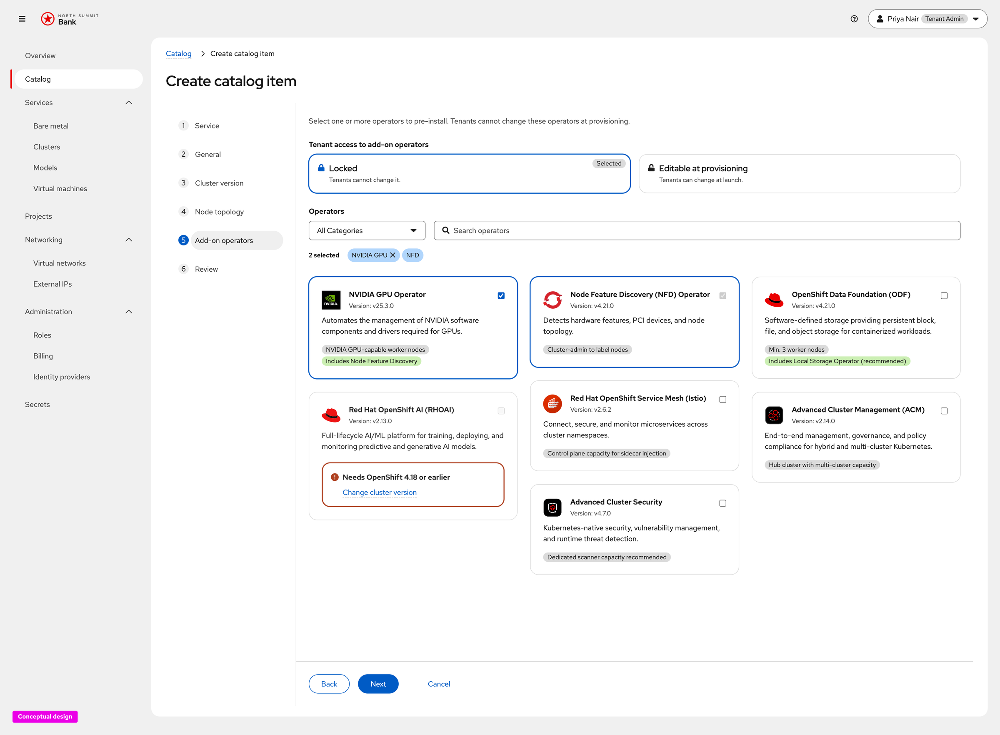
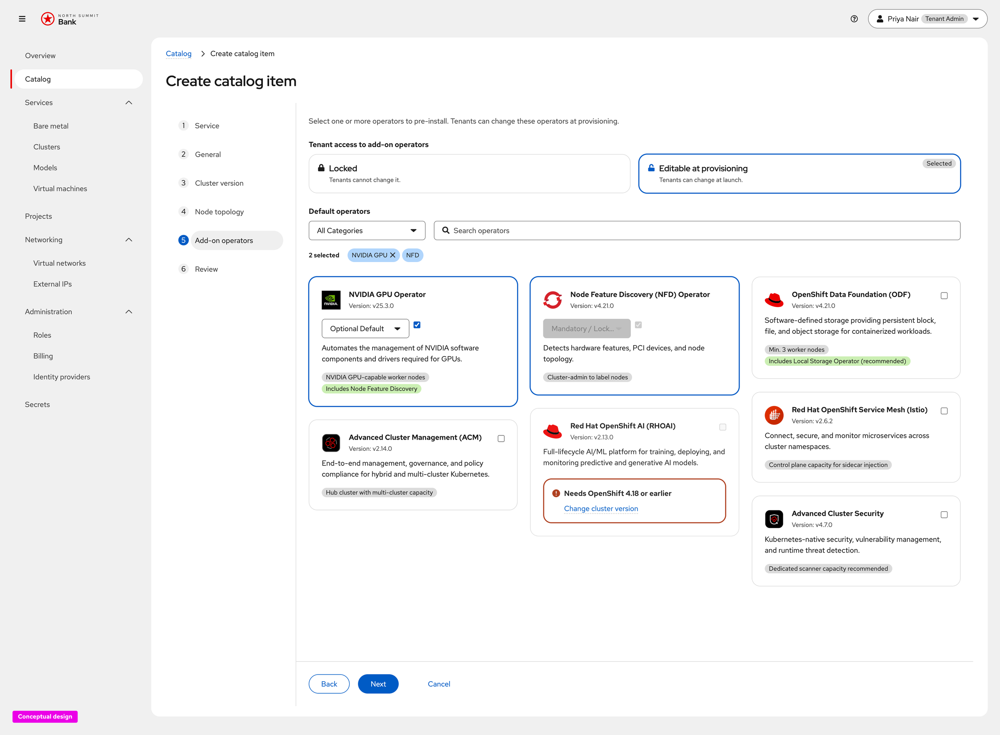
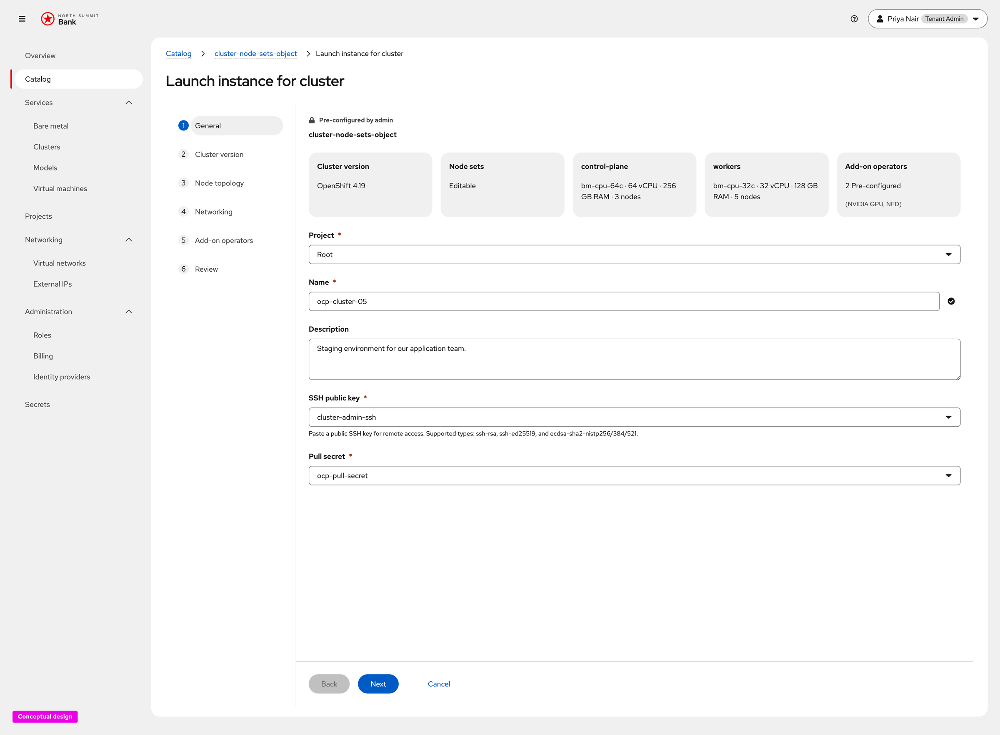
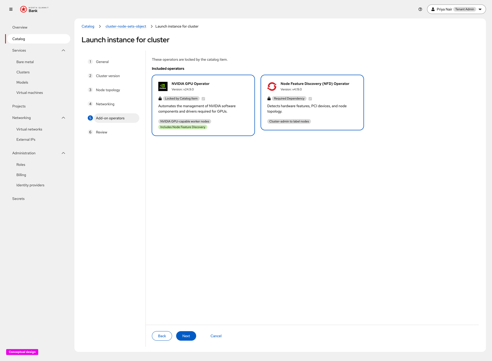
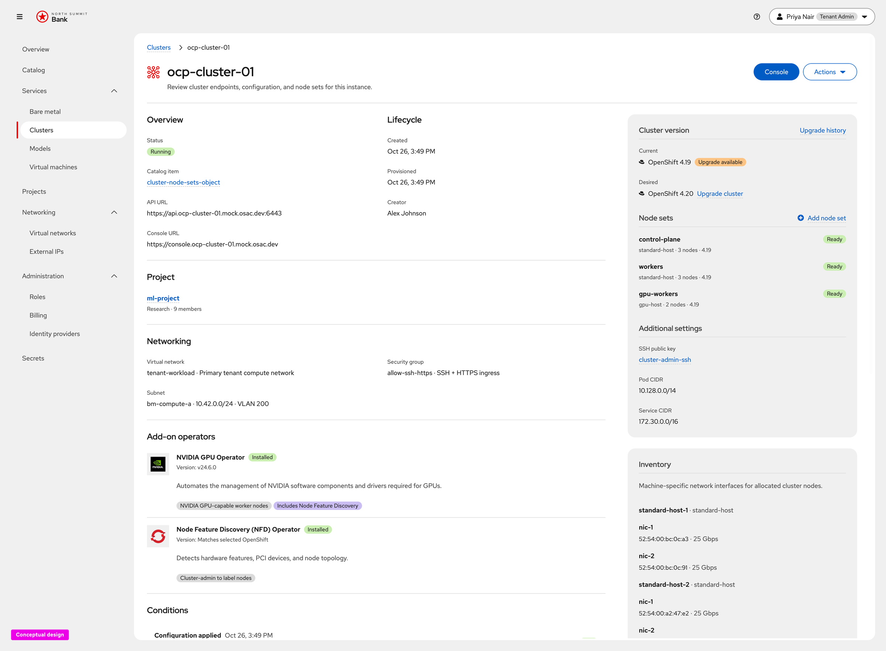

# CaaS Add-On Operator Support — UX Design

Conceptual UX for **add-on operators on CaaS catalog items and clusters**
([OSAC-4090](https://redhat.atlassian.net/browse/OSAC-4090)), captured from the
live click-through prototype.

**Prototype (developers):**

- [Create catalog item → Add-on operators](https://heyethankim.github.io/osac-bmaas/tenant-admin/northsummit/workspace?nav=catalog&action=create-catalog-item&service=cluster&step=addon-operators)
- [Launch cluster → Add-on operators (locked)](https://heyethankim.github.io/osac-bmaas/tenant-admin/northsummit/workspace?nav=catalog&action=launch-instance&item=cluster-node-sets-object&step=addon-operators)
- [Cluster detail → installed operators](https://heyethankim.github.io/osac-bmaas/tenant-admin/northsummit/workspace?nav=services-clusters&instance=ocp-cluster-01)

Requirements: [prd.md](prd.md). Backend design: [design.md](design.md).

## Product decisions (this release)

- **Catalog attachment first.** Provider Admins choose which platform operators
  are pre-installed on a CaaS catalog item. Tenants see those operators before
  and during launch, and again on the provisioned cluster.
- **Locked vs editable access.** The same locked / editable-at-provisioning
  pattern used for other catalog fields applies to add-on operators. **Locked**
  means tenants cannot deselect template operators or add extras. **Editable**
  means tenants can adjust defaults and select additional operators at launch.
- **Dependencies auto-bundled.** Selecting an operator that declares a
  dependency (for example NVIDIA GPU → Node Feature Discovery) auto-selects the
  dependency and labels it as required / auto-included.
- **Order-time constraints in the UI.** Version-incompatible operators are
  disabled with an inline reason and a link to change cluster version. Mutual
  exclusion (when defined on the operator) prevents incompatible pairs from
  being selected together.
- **Install status on the cluster.** After provisioning, the cluster detail
  page shows each requested operator with icon, version, description, and an
  **Installed** (or failure) status between Networking and Conditions.
- **No post-install lifecycle in this UX.** Upgrades, removal, and health
  monitoring of operators after first install remain out of scope
  ([prd.md](prd.md) Out of Scope).

---

## 1. Create catalog item — Add-on operators (locked)

**What this screen is for.** Let the Provider Admin attach pre-installed
operators to a CaaS catalog item and declare that tenants cannot change them at
launch ([prd.md](prd.md) Cloud Provider Admin / Tenant Admin stories).

**Explanation.** Step **Add-on operators** sits after Node topology and before
Visibility. Lede: *Select one or more operators to pre-install. Tenants cannot
change these operators at provisioning.* **Tenant access** uses the shared
Locked / Editable cards; **Locked** is selected. Category filter precedes
search. Operator cards show logo, resolved version for the selected OpenShift
minor, description, requirement chips, and dependency chips (for example
*Includes Node Feature Discovery*). Checking NVIDIA GPU auto-selects NFD.
Operators incompatible with the selected cluster version (RHOAI on 4.19+) stay
disabled with a danger alert and **Change cluster version**.

---

## 2. Create catalog item — Add-on operators (editable)

**What this screen is for.** Same attachment step when tenants may change
operators at provisioning ([prd.md](prd.md) FR: operators on catalog item and
at order time).

**Explanation.** With **Editable at provisioning** selected, the lede states
tenants can change operators at launch, the list label becomes **Default
operators**, and each selected card exposes a **Mandatory / Locked** vs
**Optional Default** mode. Auto-bundled dependencies stay **Mandatory / Locked**
and cannot be demoted. At launch, editable mode shows **Included operators**
plus **Additional Available Operators**; locked mode omits the additional list
entirely.

---

## 3. Launch instance — General header summary

**What this screen is for.** Surface pre-bundled operators early so the tenant
knows what the catalog item installs before reaching the dedicated step
([prd.md](prd.md) Tenant User: see operators before ordering).

**Explanation.** On **General**, the pre-configured summary strip adds an
**Add-on operators** card beside Cluster version and node-set cards: for
example *2 Pre-configured (NVIDIA GPU, NFD)*. The wizard stepper places
**Add-on operators** after Networking and before Review.

---

## 4. Launch instance — Add-on operators (locked)

**What this screen is for.** Confirm the operators the catalog item will
install when the tenant cannot change them ([prd.md](prd.md) locked catalog
attachment).

**Explanation.** Lede: *These operators are locked by the catalog item.*
Section **Included operators** lists each template operator as a read-only
card with checkbox disabled. Primary selections show **Locked by Catalog
Item**; auto-bundled dependencies show **Required Dependency**. No additional
operator picker appears in locked mode. Review summarizes included (and, when
editable, additional) operators before create.

---

## 5. Cluster detail — installed Add-on operators

**What this screen is for.** Show which operators were installed on the
provisioned cluster, with enough identity and status for troubleshooting
([prd.md](prd.md) Tenant User / Admin installation status stories).

**Explanation.** On the cluster details page, **Add-on operators** sits between
**Networking** and **Conditions**. Each operator is a borderless row with logo,
name, green **Installed** label (failure states use a distinct non-green
status), resolved version, description, and constraint chips. Purple chips
carry dependency / capability notes so they do not collide with the green
Installed status. The section does not offer install, upgrade, or remove
actions in this release.

