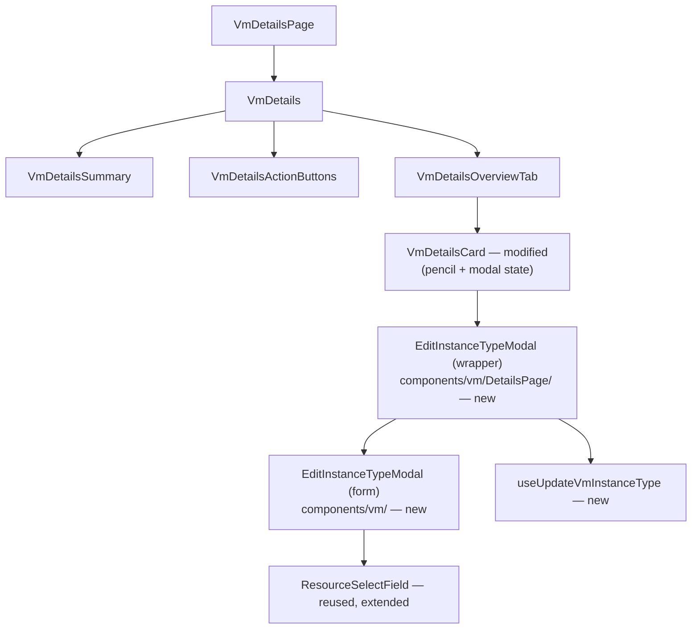

# UI Design — OSAC-4282

**Story:** OSAC-4282 — UI Design - VM Resize via InstanceType Selection
**Date:** 2026-10-20 (revised for handoff v7155; prior 2026-10-15 / 2026-10-14)
**Parent:** OSAC-5635 (UIX - VM Resize Instancetype Selection), feature OSAC-4277

## Summary

This design delivers day-2 instance-type editing (resize) for VMaaS virtual
machines in the VM details Overview: an edit pencil on the Instance type row
of the Details card opens an **Edit instance type** modal where the tenant
selects a new instance type from the same ACTIVE catalog used at create
(client-side GPU-class filter retained so options match the create flow;
the server still enforces full `GpuSpec` equality — see Verified Backend
Behaviors). Both **Tenant Admins and Tenant Users** can resize; other
Overview config (SSH, Network, Storage) stays read-only for Tenant Users.
[Handoff: Entry — Roles]

**Ship UX (revised handoff, OSAC-4281 / mock build 7155):** the UI must
**not** predict pre-submit whether a resize will hot-plug or require a
restart. Boot-disk access mode (RWX/RWO) is **not** used for modal
messaging. Pre-submit “requires a restart” / **Apply Resize** paths are
**out of ship scope**. Modal behaviour:

| Power state | Pre-submit modal | CTA |
|-------------|------------------|-----|
| Running or Paused | No restart/hot-plug warning | **Save** |
| Stopped | Optional inline **info**: *Resize will apply on next start.* | **Save** |

After a successful `ComputeInstances/Update` (explicit `spec.instance_type`
mask — see Hook Design), feedback is:

- Success **toast** after Update returns OK: *Instance type change
  submitted for {label}.* (not “updated” — apply is asynchronous), plus
  response `warnings[]` when present. [Review: PR #388]
- When status later carries **`RESTART_REQUIRED`** (Running or Paused):
  Overview **Restart required** banner (CNV pattern: expandable warning +
  **Detected changes** list; cleared after Restart/Start), in addition to
  the toast. The UI does not invent the condition — it presents the API
  model. Because the condition can appear after the first post-Update
  refetch, Overview keeps watching the VM (TanStack `refetchInterval` on
  the details query, or an equivalent short poll) until the condition
  appears or a bounded watch window elapses. [Handoff: Feedback after
  update] [User: LGTM on OSAC-4281] [Review: PR #388]
- Stopped toast may add that the change applies on next start (power state
  known up front): *Instance type change submitted for {label}. Resize
  will apply on next start.*
- Submit failures: inline **danger** alert in the modal (modal stays open).
  [Handoff / PR #388 UXD sign-off]

Pencil enablement: **Running**, **Paused**, or **Stopped**; disabled during
Starting / Stopping / Deleting. [Handoff: Entry]

OSAC-5335 is hot-plug **environment / testing** follow-up — not “expose
pre-submit restart detection APIs.” Async resize progress / failure UX is a
**follow-up** (PR #388 agreement with Bat-Zion), out of this design’s ship
scope.

The modal follows the AttachExternalIpModal two-layer pattern (generic
Formik form + VM-specific wrapper + `useUpdateVmInstanceType` action hook).
[Codebase: AttachExternalIpModal.tsx] [Codebase: useVmPowerAction.ts]
[Review: PR #388] [Handoff: revised 2026-10-19]

## Component Architecture

### Component Tree



Narrative: `VmDetailsPage` fetches the VM (`useComputeInstance`) and renders
`VmDetails`, which already fetches the current full `InstanceType` for the
summary (today via the per-resource `useInstanceType` hook) — the TanStack
query cache makes that same data available to the new wrapper modal without
a second request. New data access in this feature follows the generic
`use-resource` hooks convention. [Review: PR #388]
`VmDetailsCard` (Overview tab's Details card) gains the pencil affordance on
the Instance type row and owns the modal-open boolean, mirroring how
`VmDetailsActionButtons` owns its modal-open states. [Codebase:
components/vm/DetailsPage/VmDetails.tsx:42-46] [Codebase:
components/vm/DetailsPage/VmDetailsActionButtons.tsx:34-35]

### New Components

#### EditInstanceTypeModal (generic form modal)

- **File:** `osac-ui/libs/ui-components/src/components/vm/EditInstanceTypeModal.tsx`
- **Purpose:** Presentational Formik modal for selecting an instance type.
  Owns form state, validation, the changed-selection and submit-error
  alerts, and submit/cancel wiring. Kept separate from the wrapper so the
  form behavior (alert-on-change rule, validation, submit lifecycle, inline
  error display) is testable with the select's catalog fetch mocked at the
  transport layer, like `AttachExternalIpModal.test.tsx`. [Codebase:
  mirrors components/ExternalIp/
  AttachExternalIpModal.tsx structure]
- **Source:** [Handoff: Modal content] [User: confirmed two-layer pattern]
- **Props:**

```typescript
export interface EditInstanceTypeModalProps {
  title: string;                      // "Edit instance type"
  description: string;                // "Select a new instance type for this
                                      // virtual machine." — no GPU/non-GPU copy
  selectConfig: {                   // drives the extended ResourceSelectField
    filterItems: (it: InstanceType) => boolean; // GPU-class restriction
  };
  initialInstanceType?: { id: string; label: string }; // preselected when known
  currentTypeStatus: 'loading' | 'ready' | 'error'; // current-type lookup
  alert?: {                           // optional; Stopped info only when
    variant: 'info';                  // selection differs from current
    text: string;
  };
  isLoading: boolean;                 // catalog / current-type still loading
  onSave: (instanceTypeId: string) => Promise<unknown>;
  onClose: () => void;
  onRetryCurrentType?: () => void;    // re-fetch current type on error
}
```

- **Children:** `OsacForm` > `ResourceSelectField` (extended — see Reused
  Components); PF `Modal`, `Alert`,
  `Button`.
- **State:** Formik form values `{ instanceTypeId: string }` (initialized to
  `initialInstanceType?.id` when `currentTypeStatus === 'ready'`); plus
  `submitError: string | null`, set when `onSave` rejects and cleared on
  retry/close — drives the inline danger alert. When
  `currentTypeStatus === 'error'`, do **not** invent `id`/`label`; block
  Save and show an inline error with retry (`onRetryCurrentType`) until
  the current type resolves. While `loading`, disable Save.
  [Review: PR #388]
- **Notes:** Follows `ExternalIpAttachModal` structure (Formik + Yup +
  `OsacForm` + PF `Modal variant="small"` + `aria-labelledby`), including
  error surfacing: submit failures render as an inline danger alert inside
  the modal (the External IP modal's pattern) — this is where the server's
  GPU-mismatch and OBSOLETE `FailedPrecondition` backstops surface. On
  rejection the modal stays open; on success it closes with a success toast
  (handoff-specified). The optional Stopped **info** alert renders only when
  `values.instanceTypeId !== initialInstanceType.id`. Running/Paused have
  **no** pre-submit restart alert. [Handoff: Modal behaviour (ship)] [Review:
  PR #388 — inline danger alert for submit errors; UXD signed off on
  OSAC-4281] The primary CTA is always **Save** (label `t('Save')`), enabled
  when a selection exists and `!isLoading && !isSubmitting` — submitting the
  unchanged current type is allowed and is a backend no-op per IC-3.
  [Handoff: Primary] [Design: IC-3] Modal `onClose` is `undefined` while
  submitting (matches External IP pattern).

#### EditInstanceTypeModal (VM-specific wrapper)

- **File:** `osac-ui/libs/ui-components/src/components/vm/DetailsPage/EditInstanceTypeModal.tsx`
- **Purpose:** Owns data and mutation for the resize: derives the GPU-class
  filter from the current type and supplies the select config (the extended
  `ResourceSelectField` fetches the ACTIVE catalog itself), supplies optional
  Stopped-only info alert copy, and invokes the update action hook.
  Same-basename/two-directory split mirrors `AttachExternalIpModal`.
  [Codebase: components/vm/DetailsPage/AttachExternalIpModal.tsx]
- **Source:** [Handoff: Modal behaviour (ship)] [Handoff: Modal content]
- **Props:**

```typescript
interface EditInstanceTypeModalProps {
  vm: ComputeInstance;       // VM being resized
  onClose: () => void;
}
```

- **Children:** generic `EditInstanceTypeModal` (form modal).
- **State:** none of its own — derives everything from queries + props.
- **Notes:** Reads the current type from the TanStack cache (populated by
  `VmDetails`'s existing `useInstanceType` fetch — no new fetch) and passes
  the select config to the generic modal: the extended `ResourceSelectField`
  fetches the catalog itself (`service={InstanceTypes}`, `request` carrying
  `INSTANCE_TYPE_ACTIVE_LIST_FILTER`), renders options with
  `formatInstanceTypeOptionLabel`, and applies the wrapper-supplied
  GPU-class predicate. [Review: PR #388 — select follows the
  ResourceSelectField convention used by `AttachExternalIpModal`, extended
  for this use case]
  DEPRECATED instance types are valid resize targets server-side (accepted
  with a deprecation warning — see Verified Backend Behaviors) but are
  intentionally not offered here: the handoff scopes the picker to the same
  ACTIVE catalog used at create. [Handoff: Modal content]
  GPU-class `filterItems`: while `currentType` is unresolved (`loading` or
  `error`), return `true` for every item (unfiltered fallback — do **not**
  use `hasGpu = Boolean(undefined)` which would keep only non-GPU types).
  Once ready: `Boolean(it.spec?.gpu) === Boolean(currentType.spec?.gpu)`.
  Server `FailedPrecondition` remains the backstop. [Review: PR #388]
  Pre-submit alert: **only** when `STOPPED` and selection differs → info
  "Resize will apply on next start." Running/Paused → no alert. Description
  is always "Select a new instance type for this virtual machine."
  [Handoff: Modal behaviour / Modal content] `onSave` delegates to
  `useUpdateVmInstanceType().updateInstanceType(vm, instanceTypeId, label)`.

### Reused Components

| Component | Location | Usage | Changes Needed |
|-----------|----------|-------|----------------|
| `VmDetailsCard` | `components/vm/DetailsPage/VmDetailsCard.tsx` | Gains pencil button + modal-open state on the Instance type row | Modified (see below) |
| `ResourceSelectField` | `components/Form/ResourceSelectField.tsx` | Instance type select in the modal (self-fetching via `useListResource`) | Extended: typeahead variant (handoff), `formatOptionLabel` (create-flow rich labels), `filterItems` (client-side GPU-class predicate), preselected value with caller-supplied label |
| `OsacForm` | `components/Form/OsacForm.tsx` | Form layout in modal | None |
| PF `Modal`, `Alert`, `Button`, `Tooltip` | `@patternfly/react-core` | Modal chrome, inline alert, footer, disabled-pencil tooltip | None |
| `ToastProvider`/`useToast` | `components/Toast/` | Success toasts (submit errors use the modal's inline alert) | None |

**VmDetailsCard modification:** the Instance type `DescriptionListDescription`
becomes a `Flex` with the existing `displayValue(...)` text plus a plain
`Button` (`variant="plain"`, `PencilAltIcon`, `aria-label={t('Edit instance
type')}`), always rendered — the control is visible to every persona and is
gated by power state only, per the updated handoff.
Gating (mirrors `VmDetailsActionButtons.tsx:49-54`):

```typescript
const state = vm.status?.state;
const canEditInstanceState =
  state === ComputeInstanceState.RUNNING ||
  state === ComputeInstanceState.PAUSED ||
  state === ComputeInstanceState.STOPPED;
```

The button is disabled when `!canEditInstanceState`.
Tooltip copy when disabled:
- STARTING/STOPPING/FAILED/UNSPECIFIED: "The instance type can be changed
  when the virtual machine is running, paused, or stopped." [Handoff: Entry]
- DELETING: "This virtual machine is being deleted." [Handoff: Entry]

PF requires a disabled button to be wrapped (e.g., in a `span` with
`tabIndex={0}`... or PF `Tooltip` around a `Button` with `component="span"`)
for the tooltip to be keyboard-reachable; follow the PatternFly 6
disabled-button tooltip guidance. [Handoff: Entry — Paused enabled]

## Hook Design

### New Hooks

#### Resize mutation — generic `useUpdateResource` (no new API hook)

- **File:** none — the action hook composes the existing generic
  `useUpdateResource(ComputeInstances)` from `api/use-resource.ts`.
- **Purpose:** Submits the resize via `ComputeInstances/Update` and exposes
  the full response (including `warnings`) to the caller.
- **Source:** [Design: IC-1] [Codebase: api/use-resource.ts:105-120]
  [Review: PR #388 — new code uses the generic use-resource hooks, the same
  layer `AttachExternalIpModal` consumes via `useCreateResource`]
- **Pattern:** follows the generic-hook convention; `useUpdateResource`
  invalidates all `[ComputeInstances.typeName]` queries on success, so the
  details page reflects the new type without a dedicated invalidation
  helper.

- **Data source:** `ComputeInstances/Update`
  (`PATCH /api/fulfillment/v1/compute_instances/{id}`) with body
  `{ object: { id, spec: { instanceType: { id: instanceTypeId } } } }`.
  **Mask requirement (resolved):** `useUpdateResource`'s `buildUpdateRequest`
  derives `updateMask` from the submitted object's provided fields
  (`buildUpdateMaskPaths` with the input schema); for this deliberately
  partial spec it emits `spec.instance_type.id`. The implementation extends
  `buildUpdateRequest` to accept an explicit mask override (a small,
  convention-friendly generic-layer enhancement) and the wrapper passes
  `spec.instance_type`. [Design: IC-1] [Review: PR #388 — explicit parent
  mask required] The derived leaf path does **not** bypass resize validation
  — the server prefix-matches mask paths (`field_mask.go:30-42`), so
  `spec.instance_type.id` still triggers `validateInstanceTypeResize` — but
  the explicit parent mask is required regardless: the testplan (TC-FR1-01)
  asserts it, the same-type no-op early return matches it exactly
  (`onlyInstanceTypeMask` requires the exact path), and this design's API
  verification used it.

#### useUpdateVmInstanceType (action hook)

- **File:** `osac-ui/libs/ui-components/src/components/vm/useUpdateVmInstanceType.ts`
- **Purpose:** Wraps the generic update mutation with the handoff's success
  toasts (plus response `warnings`) and propagates rejections to the modal's
  inline danger alert — the same composition role `useVmPowerAction` plays
  for power actions. The wrapper owns only the success-side effects (toast,
  plus the generic hook's cache invalidation); it surfaces no errors itself
  — rejections propagate unchanged to the modal. Post-apply
  `RESTART_REQUIRED` is **not** invented here — Overview watches status
  after Update (invalidation **plus** delayed refresh / `refetchInterval`
  until the condition appears or the watch window ends — see Feedback after
  update). [Review: PR #388]
- **Source:** [Handoff: Feedback after update] [Codebase:
  components/vm/useVmPowerAction.ts]
- **Pattern:** follows `useVmPowerAction` (hook composes mutation + toasts;
  callers await the returned promise).

```typescript
export const useUpdateVmInstanceType = () => {
  // Returns a promise that resolves on success and rejects on error.
  // vmName/label power the toast copy; state is read from vm at call time.
  const updateInstanceType = (
    vm: ComputeInstance,
    instanceTypeId: string,
    instanceTypeLabel: string,
  ): Promise<void>;
  return { updateInstanceType };
};
```

- **Data source:** delegates to `useUpdateResource(ComputeInstances)`.
- **Cache strategy:** n/a (the generic hook owns invalidation).
- **Error handling:** the rejected promise propagates through the wrapper's
  `onSave` to the form modal, which renders the inline danger alert (title
  `t('Failed to update the instance type')`, description
  `getErrorMessage(error)`) — the backstop surface for the server's
  GPU-mismatch `FailedPrecondition` and OBSOLETE `FailedPrecondition`.
  [Design: IC-2] [Review: PR #388 — UXD signed off on OSAC-4281]
- **Dependencies:** `useUpdateResource`, `useToast`, `useTranslation`,
  `getErrorMessage`.
- **Toast copy helper:** `components/vm/instanceTypeUpdateToast.ts` (mirrors
  `powerActionErrorTitle.ts`) exporting:
  - success (generic / Running / Paused): "Instance type change submitted
    for {label}." — do **not** claim the resize is fully applied (async),
    and do **not** invent restart need in the toast; Overview presents
    `RESTART_REQUIRED` when the API sets it. [Review: PR #388]
  - success, Stopped: "Instance type change submitted for {label}. Resize
    will apply on next start." [Review: PR #388]
  - when the response carries `warnings`, join them into the toast
    description. [Design: IC-2] [Codebase:
    compute_instances_service_pb.ts L240-252]

#### Overview Restart required banner (post-apply)

- **Surface:** VM details Overview (CNV-aligned expandable warning).
- **Trigger:** `vm.status.conditions` includes `RESTART_REQUIRED` after
  resize (Running or Paused). Cleared after Restart/Start.
- **Refresh:** After successful Update, invalidate the VM query **and**
  keep observing (details-page `refetchInterval`, or a short bounded poll)
  so a late-arriving condition still lights the banner if the first refetch
  raced ahead of the operator. [Review: PR #388]
- **Content:** Title *Restart required*; body that changes apply after
  restart (Paused copy notes resize while paused); **Detected changes**
  bulleted list that can aggregate multiple pending updates (e.g. Details >
  Instance type). [Handoff: Restart required banner] [Mock: v7155]
- **Source of truth:** API status condition — not client prediction.
  [User: OSAC-4281 LGTM]

### Reused Hooks

| Hook | Location | Usage in This Feature |
|------|----------|-----------------------|
| `useListResource` | `api/use-resource.ts` | ACTIVE catalog for the select options — consumed inside the extended `ResourceSelectField` (`InstanceTypes` + `INSTANCE_TYPE_ACTIVE_LIST_FILTER`) [Review: PR #388] |
| `useUpdateResource` | `api/use-resource.ts` | Resize mutation composed by the action hook [Review: PR #388] |
| `useInstanceType` | `api/v1/instance-types.ts` | Current type: GPU class, display label, initial selection (existing `VmDetails` fetch — cache shared, no new fetch) |
| `useToast` | `components/Toast/useToast` | Success toasts from the action hook (submit errors use the modal's inline danger alert) |
| `useTranslation` | `hooks/useTranslation` | All copy (English-text-as-key) |
| `useComputeInstance` | `api/v1/compute-instance.ts` | Unchanged — `VmDetailsPage` keeps fetching the VM |

## State Management

### State Decisions

| State | Scope | Location | Justification |
|-------|-------|----------|---------------|
| Modal open boolean | Local | `VmDetailsCard` | Only the pencil and the modal consume it; matches `attachExternalIpOpen` in `VmDetailsActionButtons` |
| Form values `{ instanceTypeId }` | Local | generic `EditInstanceTypeModal` (Formik) | Form state is modal-local by convention (`ExternalIpAttachModal`) |
| Instance-type catalog + current type | Server cache | TanStack Query via `ResourceSelectField`'s internal `useListResource(InstanceTypes)`/cached `useInstanceType` | Catalog fetched once for the modal; current type already cached for `VmDetails` |
| VM power state | Prop | `vm` prop | Read-only input to gating and optional Stopped info |
| `RESTART_REQUIRED` | Server cache | `vm.status.conditions` | Drives Overview banner after apply |

### New State Structures

None. No shared or global state is introduced — the feature is fully local
to the VM details page plus server cache.

### State Unchanged

- TanStack Query cache keys (`v1/compute_instances`, `v1/instance_types`) —
  the new mutation only invalidates existing keys.
- Toast state (`ToastProvider`) — consumed via `useToast`.

## Route Structure

### New Routes

None.

### Route Configuration

No route changes. The feature lives entirely inside the existing VM details
route (`/vms/:id` → `VmDetailsPage`). No lazy-loading, guards, or error
boundaries are added. [Codebase: components/vm/DetailsPage/VmDetailsPage.tsx]

### Routes Unchanged

- `/vms`, `/vms/:id` — used as-is by this feature.

## Data Flow Mapping

### Resolved Data Sources

| UI Element | Data Needed | Source Type | API Endpoint | Response Field | Notes |
|------------|-------------|-------------|-------------|----------------|-------|
| Instance type select | ACTIVE instance types in the VM's GPU class | API | `InstanceTypes/List` via the extended `ResourceSelectField`'s internal `useListResource(InstanceTypes, { filter: INSTANCE_TYPE_ACTIVE_LIST_FILTER })` | `items[].{id, metadata.name, spec.vcpus, spec.memoryGib, spec.gpu}` | Client-side GPU filter + `formatInstanceTypeOptionLabel`; "same catalog as create" [Handoff: Modal content] [User: confirmed ACTIVE-only] [Review: PR #388] |
| Initial selection / GPU class / toast label | Current instance type | API | `InstanceTypes/Get` via `VmDetails`'s cached `useInstanceType` fetch | `object.spec.gpu`, `object.metadata.name` | Cache shared with `VmDetails` — no extra request |
| Pencil enablement | VM power state | Prop | — (from `vm.status.state` on the `vm` prop) | — | RUNNING/PAUSED/STOPPED enabled [Handoff: Entry] |
| Modal Stopped info alert | VM power state | Computed | — | — | Only when Stopped + selection differs [Handoff: Modal behaviour] |
| Modal description | Static copy | Constant | — | — | No GPU/non-GPU guidance [Handoff: Modal content] |
| Submit | Target instance type | User input | `ComputeInstances/Update` (`PATCH .../compute_instances/{id}`) via `useUpdateResource(ComputeInstances)` | request `{ object: { id, spec: { instanceType: { id } } }, updateMask: { paths: ['spec.instance_type'] } }` (explicit mask via the `buildUpdateRequest` override — see Hook Design); response `{ object, warnings }` | [Design: IC-1] [Review: PR #388] |
| Success toasts | Label + power state + response warnings | Computed | — | — | “Submitted” copy (not “updated”) + `warnings[]` [Review: PR #388] |
| Restart required Overview banner | `RESTART_REQUIRED` condition | API | `ComputeInstances/Get` (invalidate + delayed refresh) | `status.conditions[]` | Post-apply; may arrive after first refetch [Review: PR #388] |
| Submit-error inline alert | Server error | API | same Update call | rejected error | `getErrorMessage`; GPU-mismatch/OBSOLETE `FailedPrecondition` backstop; modal stays open [Design: IC-2] [Review: PR #388] |

### Unresolved Data Sources / non-goals

Pre-submit hot-plug vs restart detection is **out of ship UX** (revised
handoff). The historical gaps below remain true of the API but no longer
block this design — the UI presents post-apply `RESTART_REQUIRED` instead
of predicting. OSAC-5335 is env/testing, not a pre-submit API epic.
[Handoff: Source of truth] [Review: PR #388]

| UI Element | Data Needed | Expected Source | Notes |
|------------|-------------|-----------------|-------|
| Boot-disk access mode (RWX/RWO) | Access mode | Not on API (`field-gap-b8d4646e90fd`) | Not used for ship modal messaging |
| Pre-submit restart necessity | Predict before Save | Not on API (`data-gap-f9f26da3fe39`) | Ship UX uses post-apply `RESTART_REQUIRED` only |
| Async resize progress / failure UX | Progress + async errors | Product follow-up | Agreed deferred (PR #388 / Bat-Zion) |

## Persona-Aware Decomposition

### Shared Components

All components (pencil, modal, hooks) are rendered identically for every
role; the pencil's enablement depends on power state only, not persona.

### Persona-Specific Components

None — no persona-specific rendering branches.

### Permission Gates

| Action/Element | Permission | Implementation | Source |
|----------------|------------|----------------|--------|
| Instance type pencil | Tenant Admin and Tenant User (power state only) | `isDisabled={!canEditInstanceState}` in `VmDetailsCard` — no persona term | [Handoff: Entry — Roles] |
| Resize submit | Existing `ComputeInstances/Update` permission | No UI permission gate beyond the pencil; backend RBAC unchanged | [Design: §4.7 RBAC — "No RBAC or tenancy changes required"] |

Both Tenant Admins and Tenant Users can resize, per the updated handoff
(2026-10-15) and Yifat's answer on OSAC-4281 — the original handoff line
reflected the generic Overview "read-only config" mock rule, not a
resize-specific product choice, and it conflicted with the OSAC-4277 PRD
user stories (Tenant User as resize actor). Other Overview config (SSH,
Network, Storage) stays read-only for Tenant Users and is untouched by this
feature. [Handoff: Entry — Roles]

Server-side verification (`/review-api`): the authorization policy allows
plain clients — including tenant users — to call `ComputeInstances/Update`
(`authz.rego:198-288`), so the platform already supports the updated
enablement; no backend permission change is needed.

### Portal Targeting

Not applicable — the project does not use portal/slot-based persona
rendering for this surface.

## Accessibility Implementation

### ARIA Roles and Labels

| Component | ARIA Role | Labels | Notes |
|-----------|-----------|--------|-------|
| Generic `EditInstanceTypeModal` | dialog (PF Modal) | `aria-labelledby="edit-instance-type-modal-title"` with `ModalHeader labelId` | Mirrors `attach-external-ip-modal-title` pattern |
| Instance type select | combobox (PF Select, typeahead variant) | `aria-label` from `ResourceSelectField` `toggleProps` (label "Instance type") | Built into the extended field |
| Pencil button | button | `aria-label={t('Edit instance type')}` | Icon-only button requires the label |
| Disabled pencil tooltip | tooltip | text per gating copy | Must stay keyboard-reachable (PF disabled-button tooltip guidance) |
| Toasts | status (PF AlertGroup) | title + description | Existing `ToastProvider` behavior |

### Keyboard Navigation

| Interaction | Keys | Component | Behavior |
|------------|------|-----------|----------|
| Open modal | Enter/Space on pencil | `VmDetailsCard` | Disabled pencil is not activatable |
| Navigate/filter options | arrows, typeahead text | ResourceSelectField (typeahead extension) | Built into PF Select typeahead variant |
| Submit / cancel | Enter (form), Esc (modal) | modal | PF Modal Esc closes (disabled while submitting); Cancel button is first footer control |

### Focus Management

| Trigger | Focus Target | Method |
|---------|-------------|--------|
| Modal opens | Modal title / first focusable | PF Modal default (`variant="small"`) |
| Modal closes | Triggering pencil button | PF Modal default focus-return |

### Screen Reader Considerations

The optional Stopped info alert and the submit-error danger alert both use
PF `Alert isInline`, announced when they appear; toasts land in the
existing `AlertGroup` live region. The Overview Restart required banner
must also be announced when `RESTART_REQUIRED` appears (CNV expandable
warning pattern). [Handoff: Feedback after update]

## Testing Strategy

### Component Tests

#### EditInstanceTypeModal (generic form modal)
- **Test file:** `osac-ui/libs/ui-components/src/components/vm/EditInstanceTypeModal.test.tsx`
- **Test pattern:** Vitest + RTL, `renderWithProviders` — follows
  `components/Cluster/Details/AttachExternalIpModal.test.tsx`.
- **What to test:**
  - Renders title, generic description, preselected current type when
    ready; Save disabled while loading, on current-type error, or no
    selection.
  - Current-type error: inline error + retry; no invented
    `initialInstanceType`; Save blocked until ready.
  - Running/Paused: no pre-submit restart alert when selection changes.
  - Stopped: info alert appears once a different option is selected;
    disappears if the selection reverts.
  - Submit calls `onSave` with the selected id and closes on resolve; stays
    open on rejection (inline danger).
  - Cancel calls `onClose`.
  - ARIA: `aria-labelledby` wiring, icon-only pencil label (in card tests).

#### EditInstanceTypeModal (VM wrapper)
- **Test file:** `osac-ui/libs/ui-components/src/components/vm/DetailsPage/EditInstanceTypeModal.test.tsx`
- **What to test:**
  - Options filtered to the VM's GPU class when current type is ready;
    unfiltered (`true` for all) while current type is loading/error.
  - Alert: STOPPED → info copy; RUNNING/PAUSED → no pre-submit alert.
  - Submit issues `ComputeInstances/Update` with the target id (captured via
    `transportOverrides.onComputeInstanceUpdate`); assert the update mask is
    exactly `spec.instance_type` (the Hook Design mask requirement).
  - Response `warnings` reach the success toast; rejected update surfaces
    the modal's inline danger alert (GPU-mismatch `FailedPrecondition`
    backstop) and the modal stays open.

#### VmDetailsCard / Overview (modified)
- **Test file:** extend `VmDetailsCard.test.tsx` (create if absent); banner
  coverage on Overview/details as appropriate
- **What to test:**
  - Pencil enabled for RUNNING/PAUSED/STOPPED; disabled (with tooltip) for
    STARTING/STOPPING/DELETING/FAILED.
  - Pencil enabled for both `tenant-user` and `tenant-admin` sessions.
  - Pencil click opens the modal.
  - When `vm.status.conditions` includes `RESTART_REQUIRED`, Overview shows
    the Restart required banner (Detected changes); cleared when condition
    clears after Restart/Start.
  - Banner still appears if `RESTART_REQUIRED` arrives after the first
    post-Update refetch (delayed refresh / `refetchInterval`).

### Hook Tests

#### useUpdateVmInstanceType
- **Test file:** `osac-ui/libs/ui-components/src/components/vm/useUpdateVmInstanceType.test.ts` (or covered via the wrapper component tests if the codebase's prevailing pattern mocks hooks — prefer real transport coverage)
- **What to test:**
  - Success toast: “change submitted for {label}” (Running/Paused); Stopped
    adds next-start copy; no “updated” claim; no invented restart toast.
  - `warnings` appended to the success toast description.
  - Inline danger alert (`getErrorMessage`) on rejection; no error toast.

The generic `useUpdateResource(ComputeInstances)` mutation is exercised
through the wrapper tests via the mock transport (the codebase tests
mutations through component-level transport overrides rather than isolated
hook suites).

### Mock transport support (required new test plumbing)

`osac-ui/libs/ui-components/src/test-utils/createMockConnectTransport.ts`
currently has no `computeInstances` fixture and no
`onComputeInstanceUpdate` override — add both (fixture with RUNNING/STOPPED
VMs referencing instance types of both GPU classes; override capturing the
Update request and returning a configurable `{ object, warnings }` response).
[Codebase: createMockConnectTransport.ts L168-199, L414-417]

### Integration Tests

No separate integration suite — the wrapper component tests with the mock
transport cover the component↔hook↔transport interactions for this story.
Cross-component deployed journeys (real resize + restart) belong to QE E2E
work under the parent epic, per the repo's integration-testing policy.

### Coverage Goals

Every ship handoff behaviour is covered by at least one test: entry gating
(Running/Paused/Stopped; both personas), GPU-class option filtering,
Stopped-only pre-submit info, no Running/Paused pre-submit restart warning,
CTA Save, exact Update mask, success toasts, `RESTART_REQUIRED` Overview
banner, warnings surfacing, and FailedPrecondition inline danger alert.

## Acceptance Criteria Mapping

OSAC-4282 has no formal AC list; the implicit ACs below are derived from the
handoff and parent feature. [Handoff: full contract]

| AC | Description | Components | Hooks | Test Coverage |
|----|-------------|------------|-------|---------------|
| AC-1 | Pencil on Instance type row; enabled RUNNING/PAUSED/STOPPED, disabled otherwise with tooltip | `VmDetailsCard` | — | `VmDetailsCard.test.tsx` |
| AC-2 | Modal: title, generic description, required typeahead with create catalog | both modals | extended `ResourceSelectField`, cached `useInstanceType` | both modal tests |
| AC-3 | GPU VMs stay in GPU set (and non-GPU in non-GPU) via catalog filter | wrapper modal | `useInstanceType` | wrapper modal test |
| AC-4 | Running/Paused: no pre-submit restart warning; CTA Save | both modals | — | generic modal test |
| AC-5 | Stopped: optional inline info + Save | both modals | — | generic modal test |
| AC-6 | Stopped info only when selection differs from current | generic modal | — | generic modal test |
| AC-7 | Submitted toasts (not “updated”); Overview banner when `RESTART_REQUIRED` arrives (incl. delayed refresh) | Overview + action hook | `useUpdateVmInstanceType` | hook/wrapper/Overview tests |
| AC-8 | GPU mismatch blocked (client filter + server backstop as inline danger) | wrapper modal | `useUpdateVmInstanceType` | wrapper modal test |
| AC-9 | Tenant Admin and Tenant User can both resize; other Overview config stays read-only for Tenant User | `VmDetailsCard` | — | `VmDetailsCard.test.tsx` |
| AC-10 | Submit = `ComputeInstances/Update` scoped to `spec.instance_type` (explicit mask); warnings surfaced | wrapper modal | `useUpdateResource(ComputeInstances)` | wrapper modal test |

### Traced Acceptance Criteria

**AC-4: Running/Paused — no pre-submit restart prediction**
Given a Running or Paused VM and a user with edit rights
When the user opens the Edit instance type modal and selects a different type
Then there is **no** pre-submit restart/hot-plug warning and the primary CTA
is Save
**Implemented by:** both `EditInstanceTypeModal` layers
**Tested in:** `components/vm/EditInstanceTypeModal.test.tsx`

**AC-5: Stopped VM resize shows next-start info**
Given a Stopped VM
When the user selects a different instance type
Then an inline info reads "Resize will apply on next start." and the primary
CTA is Save
**Implemented by:** both `EditInstanceTypeModal` layers
**Tested in:** `components/vm/EditInstanceTypeModal.test.tsx`

**AC-7: Submitted toast + delayed Restart required banner**
Given a successful Update response
When the VM is Running or Paused, the toast reads "Instance type change
submitted for {label}." and, if status later includes `RESTART_REQUIRED`
(including after the first refetch), Overview shows the Restart required
banner (Detected changes) via continued watch / `refetchInterval`
When the VM is Stopped, the toast reads "Instance type change submitted for
{label}. Resize will apply on next start."
**Implemented by:** `useUpdateVmInstanceType` + Overview banner watch
**Tested in:** hook/wrapper/Overview coverage

## API Findings

- **Review date:** 2026-10-14
- **Endpoints verified:** 6 — `ComputeInstances/{Update,Get,List}`,
  `InstanceTypes/{List,Get}`, and the authorization policy covering
  `ComputeInstances/Update`
- **Mappings confirmed:** 9 of 9 data needs (7 resolved rows verified;
  2 previously-unresolved rows confirmed as gaps). The former
  persona-gating row (user role) was removed during `/revise` — Tenant
  User enablement landed, so the design no longer consumes `role`
- **Gaps (historical):** 2 — boot-disk access mode and pre-submit restart
  prediction are still absent from the API; ship UX no longer depends on
  them (post-apply `RESTART_REQUIRED` + revised handoff). OSAC-5335 is
  env/testing, not the owner of pre-submit APIs.

### Verified Endpoint Mappings

| UI Element | Data Needed | Endpoint | Response Field | Verified |
|------------|-------------|----------|----------------|----------|
| Instance type select | ACTIVE instance types in the VM's GPU class | `osac.public.v1.InstanceTypes/List` | `items[].{id, metadata.name, spec.vcpus, spec.memoryGib, spec.gpu}` | Yes — `instance_types_server.go:143-187` passes offset/limit/filter/order through and composes server-side filter defaults |
| Current instance type | type incl. GPU class + label | `osac.public.v1.InstanceTypes/Get` | `object.spec.gpu`, `object.metadata.name` | Yes — `spec.gpu` is `GpuSpec {pci_device_selector, resource_name, count}` (`instance_type_type.proto:85-94,118`) |
| Pencil enablement | VM power state | `osac.public.v1.ComputeInstances/Get` | `status.state` | Yes — RUNNING/PAUSED/STOPPED |
| Stopped info / no Running warning | VM power state | computed | — | Yes — ship handoff (no pre-submit restart prediction) |
| Restart required banner | `RESTART_REQUIRED` | `ComputeInstances/Get` | `status.conditions` | Yes — post-apply only (`computeinstance_controller.go`) |
| Submit | Target instance type | `osac.public.v1.ComputeInstances/Update` | request `{ object: { id, spec: { instanceType: { id } } }, updateMask: { paths: ['spec.instance_type'] } }` | Yes — public server validates id/mask, applies field-mask merge semantics, passes mask through (`compute_instances_server.go:260-346`); private server triggers `validateInstanceTypeResize` on the `spec.instance_type` mask path (`private_compute_instances_server.go:561-626`). Verified with the explicit `spec.instance_type` mask, which the Hook Design now requires via a `buildUpdateRequest` mask override; the derived `spec.instance_type.id` still triggers resize validation (the server prefix-matches mask paths) but skips the exact-path no-op early return, so the explicit parent mask is used |
| Success toasts | Label + power state + response warnings | same Update call | `warnings[]` | Yes — public server propagates warnings (`compute_instances_server.go:344`); generated TS response type carries `warnings`. The preliminary "warnings unreachable" concern is resolved |
| Submit error | Server error semantics | same Update call | rejected gRPC status | Yes — surfaced as the modal's inline danger alert; see Verified Error Semantics below |

### Verified Backend Behaviors

Verified by reading the handler code, not just the types:

- **No-op precedence (IC-3):** `validateInstanceTypeResize` returns
  `resizeNoOp=true` for a same-type target **before** lifecycle validation
  runs, and a `spec.instance_type`-only mask no-op succeeds with the current
  type retained (`private_compute_instances_server.go:742-793`). Save with an
  unchanged selection is a safe success.
- **DEPRECATED warning format:** `Instance type '{name}' is deprecated and
  will become obsolete on {RFC3339}. Consider using '{replacement}'
  instead.` — appended to `warnings[]`, not an error
  (`instance_type_validation.go:56-84`). ACTIVE-only options mean this is
  only reachable when the current type drifts to DEPRECATED; handled
  defensively as a toast description.
- **GPU mismatch check is full `GpuSpec` equality:** the backend rejects any
  change to `spec.gpu` via `proto.Equal(current, target)` —
  `FailedPrecondition "cannot change GPU configuration when resizing from
  instance type '%s' to '%s'"`. This is stricter than the handoff's set-level
  guidance: a GPU VM selecting a *different* GPU type (different
  count/device) also fails. The handoff's set-level filter + error surface
  remains correct UX — within-set cross-GPU changes surface as the same
  `FailedPrecondition` inline danger alert. No design change needed.
- **RESTART_REQUIRED is post-submit only:** the operator mirrors KubeVirt's
  `VirtualMachineRestartRequired` condition *after* spec changes have been
  applied (`computeinstance_controller.go:809-815`), synced to fulfillment
  status via the feedback controller
  (`computeinstance_feedback_controller.go:136`). There is no pre-submit
  restart prediction.
- **Permission verification (former Open Question 1, resolved):** the
  authorization policy places `ComputeInstances/Update` in the plain-client
  allowlist (`authz.rego:198-288`). A tenant user (no `tenant-admin` realm
  role) is a plain client and **can** call Update server-side. The updated
  handoff (2026-10-15) enables both Tenant Admin and Tenant User resize —
  which the platform already supports; no backend permission change is
  needed.

### Verified Error Semantics

| Case | gRPC code | Message shape |
|------|-----------|---------------|
| Target instance type not found | `InvalidArgument` | `instance type '{id}' not found` |
| Target instance type OBSOLETE | `FailedPrecondition` | `instance type '{name}' is obsolete and cannot be used` |
| GPU configuration change (incl. GPU→different-GPU, GPU→non-GPU) | `FailedPrecondition` | `cannot change GPU configuration when resizing from instance type '{a}' to '{b}'` |
| Same-type no-op (only `spec.instance_type` in mask) | success | current type retained, no warnings |

All surface through the modal's inline danger alert via the existing
`getErrorMessage` helper — no new error handling needed.

### Pagination, Filtering, and Sorting

| Endpoint | Pagination | Filtering | Sorting | Notes |
|----------|------------|-----------|---------|-------|
| `InstanceTypes/List` | Yes — `offset`/`limit`, response `size`/`total` | Yes — CEL `filter`, composed with server-side per-field defaults | Yes — `order` | UI reuses the create-flow hook with `INSTANCE_TYPE_ACTIVE_LIST_FILTER`; catalog is small, no UI pagination needed |
| `ComputeInstances/Get` | n/a | n/a | n/a | Single object |
| `ComputeInstances/Update` | n/a | n/a | n/a | Single object + `warnings[]` |

### API Gaps (historical — not ship blockers)

| # | Gap ID | Gap | Category | Ship impact |
|---|--------|-----|----------|-------------|
| 1 | `field-gap-b8d4646e90fd` | Boot-disk access mode (RWX/RWO) not on API | field gap | Unused — ship UX does not branch on access mode |
| 2 | `data-gap-f9f26da3fe39` | No pre-submit restart-necessity prediction | data gap | Unused — ship UX presents post-apply `RESTART_REQUIRED` |

Backend has **no plans** to expose a pre-Save restart prediction signal
(eng discussion with Tzif, 2026-10-18). OSAC-5335 remains QE/env testing
(closed Won’t Do for storage limits), not an API epic for upfront
detection. [Review: PR #388] [Handoff: Source of truth]

### Summary

- Ship data needs resolve to existing Update + Get/status conditions +
  InstanceTypes List/Get. No new endpoints required.
- Pre-submit path prediction is explicitly **out of ship UX**.
- `warnings[]` reach the success toast; submit errors use the modal inline
  danger alert (UXD signed off).
- GPU mismatch remains full `GpuSpec` equality server-side; client filter
  reduces avoidable errors; description no longer uses GPU guidance copy.
- **Implementation readiness: high** for the revised handoff (mock 7155).

## Open Questions

1. **Async resize progress / failure UX** (follow-up) — how to surface
   long-running apply / operator failures after Save.
   - **Source:** PR #388 (Bat-Zion); agreed deferred.
   - **Default:** Out of scope for this design; track as a follow-up
     feature / PRD note.

## Resolved Questions

- **Tenant User access (2026-10-15):** Tenant Users **can** resize. [OSAC-4281]
- **Submit-error surface (2026-10-15):** Inline danger alert in modal; UXD
  signed off. [OSAC-4281] [PR #388]
- **Pre-submit restart / hot-plug detection (2026-10-19/20):** Removed from
  ship UX. Restart need from API `RESTART_REQUIRED` after update; Overview
  CNV banner + toast. Paused enabled. Yifat handoff + mock 7155; Jonathan
  LGTM on OSAC-4281 clarifying the condition name. [Handoff] [Jira]
- **GPU/non-GPU modal description (handoff revised):** No GPU guidance copy
  in the modal description.
- **OSAC-5335 role:** Env/testing follow-up, not pre-submit API work.

---

## Provenance

Authored: plan @ ui-design 0.1.0 - 1c6e8de, workspace main @ 14c4d6f1c (5 behind origin/main)
Final: respond @ ui-design 0.1.0 - a58bdf7, workspace main @ 14c4d6f1c (22 behind origin/main)

> Context changed between plan and respond.

<!-- ai-workflow-provenance:{"schema_version":1,"provenance_kind":"session","workflow":"ui-design","workflow_version":"0.1.0","ai_workflows":"a58bdf7","source_repo":"14c4d6f1c","source_repo_branch":"main","commits_behind_main":22,"commits_ahead_main":0,"main_ref":"main","phases":["plan","review-api","revise","respond","respond","respond","respond","respond","respond"],"authoring_modes":["skill"],"context_changed":true,"origin_untracked":false} -->
