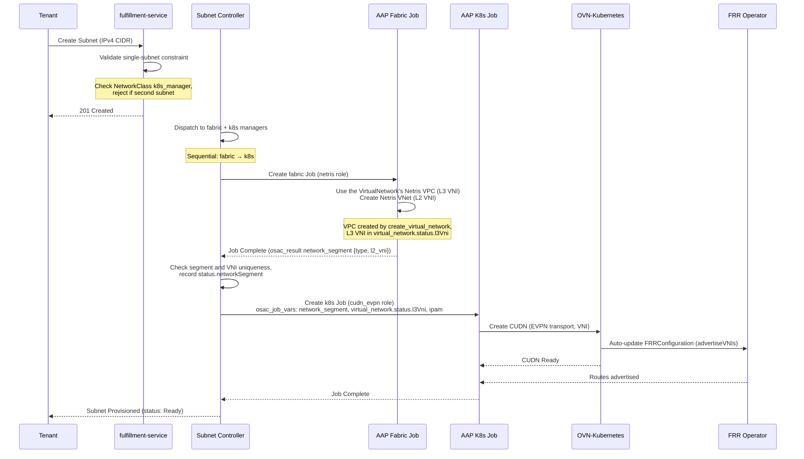

# CUDN EVPN K8s Manager Phase 1 Networking: Single-Cluster VM-to-Fabric Bridging

## Summary

This design extends OSAC-1433's NetworkClass two-manager architecture with a new k8s manager (`cudn_evpn`) that provisions OVN-Kubernetes ClusterUserDefinedNetwork (CUDN) with EVPN transport, enabling KubeVirt VMs to join the physical fabric via BGP EVPN route advertisement. The design covers sequential provisioning (fabric → k8s manager data flow), CUDN lifecycle, single-subnet validation, and integration test patterns. FRRConfiguration for BGP underlay peering is an installation prerequisite (not created by k8s manager); OVN-Kubernetes auto-updates it when CUDN appears. See [PRD](prd.md) for detailed requirements.

Other parts of this design predate the contract and differ from the `cudn_evpn` role in osac: the namespace and hub network names and ownership (contract §4.10, `cudn_evpn` limit), readiness (three CUDN conditions, no `Ready`), and the provisioning-package `JobTarget`, skip annotation, subnet-count auto-detection, metrics and events, which do not exist. Where they differ, the contract and the role's README are authoritative; a follow-up rewrites this design.

The data handoff from the Fabric Manager to `cudn_evpn` (the L3 and L2 VNIs, the address layout, the VM gateway, and the route targets) is the one [contract §4.8–§4.10](/enhancements/OSAC-1433-network-manager-integration-contract-networking/design.md#49-network-types-and-the-network-segment) defines; this design restates it where it uses it.

This manager inherits the [Unified Networking deployment support
boundary](/enhancements/OSAC-1433-unified-networking/design.md#deployment-support-boundary):
Phase 1 supports connected deployments only and does not add air-gapped or
disconnected networking support.
This manager also inherits the [Unified Networking hub support
boundary](/enhancements/OSAC-1433-unified-networking/design.md#networking-hub-support-boundary):
OSAC networking supports exactly one provider-owned hub per deployment.
Multi-hub networking placement, cross-hub resource coordination, and
cross-hub network connectivity are unsupported. This boundary applies only to
the networking area and does not define hub behavior for other OSAC areas.
Multiple hosting/workload clusters remain supported where a networking feature
explicitly specifies them.

## Related Designs

This design builds on and interacts with several networking designs:

- **OSAC-1435 VMaaS Networking** — VMs provisioned via `ComputeNetworkAttachment` consume the cudn_evpn namespaces created by this design. VMaaS placement logic must resolve the namespace name (same as subnet name) when placing VMs in EVPN-bridged Subnets. VMaaS must validate that the target Subnet has a CUDN (first subnet only) before allowing VM placement.
- **OSAC-1436 CaaS Networking** — CaaS clusters may run on EVPN-bridged subnets. Port-move primitive compatibility with EVPN transport (VXLAN encap vs VLAN trunking) is TBD (out of scope for Phase 1).
- **OSAC-1437 BMaaS Networking** — Bare-metal servers provisioned via `BareMetalNetworkAttachment` are L2/L3 peers of EVPN-bridged VMs. This design validates same-subnet (L2) and cross-subnet (L3 via fabric ipVRF) connectivity in test cases.
- **OSAC-1433 Default Networking** — Auto-provisioning of VN/Subnet/SG/NAT at tenant onboarding uses a default NetworkClass. `cudn_evpn` is **not suitable** as the default NetworkClass due to manual prerequisites (VTEP, FRR, BGP underlay). Default networking should use a simpler k8s manager (e.g., k8s-only or none).
- **OSAC-2135 CaaS BM Worker Provisioning** — System-tenant bare-metal instances reference tenant Subnets. If those Subnets use `cudn_evpn`, the BMI provisioning flow interacts with the EVPN namespace/CUDN. Interaction is TBD (out of scope for Phase 1).
- **OSAC-1382 Multi-Fabric East-West** — Phase 1 east-west isolation domains will need to work across EVPN-bridged and non-EVPN subnets. Inter-domain routing with EVPN transport is TBD (out of scope for Phase 1).

## Motivation

OSAC runs VMs on OpenShift using KubeVirt. VM IP addresses exist only within the OVN overlay network and are not visible on the physical fabric. This prevents VMs from sharing L2 subnets with bare-metal servers or communicating across L3 subnets via shared ipVRF, blocking workloads that span VMs and bare-metal infrastructure.

The CUDN LocalNet approach (OSAC-1511) was frozen in favor of OVN EVPN, which provides better scalability and multi-cluster support (validated by OSAC-1717 spike). This design delivers single-cluster EVPN bridging as Phase 1, with a constraint that OVN-Kubernetes cannot currently route between separate CUDNs on the same cluster (Connectors feature pending).

**Implementation Context:**
OSAC's NetworkClass dispatcher already supports dual-manager provisioning (fabric + k8s). This design adds the second k8s manager type (`cudn_evpn` alongside existing `k8s-only`) and solves the fabric-to-k8s data dependency: fabric manager allocates VNI, k8s manager consumes it to configure CUDN. The current multi-target provisioning evaluates targets sequentially within each reconcile cycle (both can be in-flight simultaneously on AAP); this design adds a gate to ensure the fabric target completes and produces output before the k8s target is evaluated.

### Goals

- Reuse NetworkClass dispatcher pattern and two-manager architecture from OSAC-1433
- Sequential provisioning pattern reusable for future fabric-to-k8s dependencies
- **Single-subnet-for-VMs constraint:**
  - Only single-subnet VirtualNetworks support VMs (CUDN provisioning)
  - First Subnet gets CUDN immediately (on Subnet provisioning, not VM creation)
  - CUDN persists when adding subnets, but VMs blocked in all subnets
  - API validation: Block second subnet creation if first has VMs (preserves VM topology)
  - VMaaS validation: Block VM creation if subnet count > 1 (enforces single-subnet constraint)
- K8s manager playbook creates CUDN as Kubernetes-native resource (no external API calls)
- FRRConfiguration for BGP underlay peering is installation prerequisite (auto-updated by OVN-Kubernetes, not by k8s manager)
- Installation prerequisites documented for Cloud Infrastructure Admin

### Non-Goals

- Multi-cluster VM placement (deferred to OSAC-3667 Phase 2)
- Inter-subnet L3 routing between VMs on same cluster (requires OVN Connectors)
- Multiple subnets per VirtualNetwork with multi-NIC VMs (deferred to Phase 2 when OVN-K supports secondary CUDNs — will enable VMs with multiple NICs, one per subnet)
- IPv6 or dual-stack support (Phase 1 is IPv4-only)
- Automatic gateway MAC coordination (manual prerequisite) (physical hosts on an EVPN Subnet only; open, contract §4.9)
- Automatic VTEP provisioning (manual prerequisite)

## Proposal

**Central Design Statement:**

Phase 1 extends an existing Netris VPC and its VNets into OpenShift. **Only single-subnet VirtualNetworks support VMs.** The first Subnet gets a CUDN immediately (on provisioning, not VM creation). If additional Subnets are added, the CUDN persists but VMaaS blocks VMs in all Subnets. Multi-subnet VirtualNetworks are fabric-only until secondary CUDN/multi-NIC support is available.

This design introduces a new k8s manager (`cudn_evpn`) registered via osac-installer ConfigMap, used when a NetworkClass declares `k8s_manager: "cudn_evpn"`.

**Resource Mapping:**

| OSAC Resource | Netris Resource | OVN-K Resource | VM Support |
|---------------|-----------------|----------------|------------|
| VirtualNetwork | Netris VPC (L3 ipVRF) | — | — |
| First Subnet (alone) | Netris VNet (L2 macVRF) | CUDN (primary) | ✅ VMs allowed |
| First Subnet (with second+) | Netris VNet (L2 macVRF) | CUDN (persists) | ❌ VMs blocked |
| Second+ Subnets | Netris VNet (L2 macVRF) | — | ❌ Fabric-only |

- **One CUDN per VirtualNetwork** (Phase 1 limitation - OVN-K lacks secondary CUDN support)
- **Multiple VNets per VPC** (Netris fabric capability - all share same IP-VRF)
- **First Subnet CUDN created immediately** (on Subnet provisioning, not VM creation)
- **CUDN persists when adding subnets** (but VMaaS blocks VMs in all subnets if multiple exist)

**Provisioning Trigger:** CUDN is created at **first Subnet** provisioning time (not VirtualNetwork creation).

**Subnet provisioning sequence:**

0. **Fabric manager** (Netris) runs when the parent VirtualNetwork is created (`create_virtual_network`): creates the Netris VPC (IP-VRF) and returns its L3 VNI as `osac_result.l3_vni`. OSAC records it in the VirtualNetwork CR's `status.l3Vni` ([contract §4.9](/enhancements/OSAC-1433-network-manager-integration-contract-networking/design.md#49-network-types-and-the-network-segment)).
1. **Fabric manager** (Netris) runs when Subnet is created (`create_subnet`):
   - Uses the VPC of the parent VirtualNetwork, whose L3 VNI arrives in the stored parent snapshot as `virtual_network.status.l3Vni`
   - Creates Netris VNet for this Subnet (allocates L2 VNI)
   - Returns `osac_result.network_segment: {type: evpn, l2_vni}` (no `l3_vni`)
2. **Subnet controller** checks the segment and the VNI's uniqueness, records it in `Subnet.status.networkSegment` (`{type, l2Vni}`), and passes it to the Kubernetes tasks as the launch key `network_segment`
3. **K8s manager** (cudn_evpn) provisions CUDN (first Subnet only):
   - `spec.network.evpn.macVRF = {vni: l2_vni, routeTarget: "0:<l2_vni>"}` (from `network_segment`)
   - `spec.network.evpn.ipVRF = {vni: l3_vni, routeTarget: "0:<l3_vni>"}` (from `virtual_network.status.l3Vni`)
   - `spec.network.layer2.defaultGatewayIPs = [ipam.gateway_ipv4]`: OVN-Kubernetes serves the VM gateway and routes into the IP-VRF (symmetric IRB)
   - `spec.network.layer2.infrastructureSubnets = [<gateway_ipv4>/32, <network + 2>/32]` (the gateway and OVN-Kubernetes' management port) and `reservedSubnets` = the fewest CIDRs covering the Subnet outside `ipam.overlay_ipv4_cidrs` and those two, so VMs get addresses only from the overlay range
   - `spec.network.layer2.mtu = 1500`
   - OVN-Kubernetes auto-updates FRRConfiguration when CUDN appears

**Important:**
- VirtualNetwork creation creates the Netris VPC (and returns its L3 VNI) but no CUDN
- First Subnet triggers VNet + CUDN (CUDN created immediately, not on VM creation)
- Second+ Subnets trigger only VNet (fabric-only, no CUDN)
- **CUDN persists when adding subnets**, but VMaaS blocks VMs in all subnets when multiple exist

Key resources:
- **VirtualNetwork** (fulfillment-service + osac-operator CRD): Fabric `create_virtual_network` creates the Netris VPC; its L3 VNI is recorded in `status.l3Vni`
- **NetworkClass** (fulfillment-service): extended with `k8s_manager` field (already exists)
- **Subnet** (fulfillment-service + osac-operator CRD): triggers fabric (VNet) and k8s (CUDN) provisioning; its L2 VNI is recorded in `status.networkSegment`
- **ClusterUserDefinedNetwork** (OVN-Kubernetes CRD): k8s manager creates with EVPN transport, macVRF/ipVRF VNI and explicit route targets `0:<VNI>`
- **FRRConfiguration** (FRR operator CRD): installation prerequisite (not created by k8s manager), auto-updated by OVN-Kubernetes when CUDN appears

### Workflow Description

**Actor:** Cloud Infrastructure Admin (prerequisite setup) and Tenant Admin (runtime usage)

**Starting State:**
- OCP cluster installed with OVN-Kubernetes, FRR operator, NMState operator
- VTEP CR exists (defines VTEP IPs for each worker node)
- BGP underlay configured (workers peer with fabric switches)
- NetworkClass exists with `fabric_manager: "netris"`, `k8s_manager: "cudn_evpn"`

**Runtime Flow:**



**Error Paths:**

- **Second subnet creation when VMs exist:** API returns 400 Bad Request. First subnet has running VMs, cannot add additional subnets (Phase 1 limitation). Tenant must delete VMs or create new VirtualNetwork for bare-metal workloads.
- **VM creation when multiple subnets exist:** VMaaS blocks VM placement with error. Only single-subnet VirtualNetworks support VMs. Multiple subnets → VMs blocked in ALL subnets (first subnet's CUDN persists but VM creation blocked by validation). Tenant must delete extra subnets or create new VirtualNetwork for VMs.
- **Subnet deletion when VMs exist:** Operator blocks deletion, emits "DeletionBlocked" event. Subnet with CUDN cannot be deleted while VMs running. Tenant must delete VMs first (ComputeInstance CRs), controller requeues every 30s.
- **Fabric job failure:** Controller requeues, does not start k8s job until fabric succeeds
- **Missing or malformed `network_segment`, or a VNI a live VirtualNetwork or Subnet holds:** OSAC rejects the result and marks Subnet as Failed ("VNI already in use" for a held VNI); a VNI held only by resources being deleted is retried with backoff ([contract §4.9](/enhancements/OSAC-1433-network-manager-integration-contract-networking/design.md#49-network-types-and-the-network-segment))
- **CUDN creation failure:** K8s job fails, controller requeues, Subnet status shows Failed with AAP job reference

### API Extensions

**New:**
- osac-installer ConfigMap `k8s-manager-cudn-evpn` (declares k8s manager capabilities)
- osac-aap fabric manager template role `netris` (creates Netris VPC/VNet, returns VNI)
- osac-aap k8s manager template role `cudn_evpn` (creates CUDN)
- **Subnet annotation `osac.openshift.io/skip-k8s-manager: "true"`** — optional annotation to explicitly skip k8s manager (fabric-only). If omitted, operator auto-detects: first subnet gets CUDN, second+ subnets are fabric-only.

**Modified:**
- osac-operator Subnet controller: sequential provisioning instead of parallel, auto-detects subnet count to skip k8s manager for second+ subnets under same VirtualNetwork (first subnet's CUDN persists, honors explicit skip annotation if present)

**External CRDs Used (not created by OSAC):**
- `ClusterUserDefinedNetwork` (k8s.ovn.org/v1, OVN-Kubernetes) — created by k8s manager
- `FRRConfiguration` (frrk8s.metallb.io/v1beta1, FRR operator) — installation prerequisite, auto-updated by OVN-Kubernetes when CUDN appears
- `VTEP` (k8s.ovn.org/v1, OVN-Kubernetes) — prerequisite, not created by k8s manager

**No changes** to existing fulfillment-service proto schema. NetworkClass.k8s_manager field already exists.

**Annotation Semantics:**

The `osac.openshift.io/skip-k8s-manager` annotation is **optional** and provides explicit control over k8s manager provisioning. When omitted, the operator automatically determines provisioning behavior based on subnet count.

```yaml
# First Subnet - creates Netris VNet + CUDN (auto-detected, VMs allowed)
apiVersion: osac.openshift.io/v1
kind: Subnet
metadata:
  name: vm-subnet
spec:
  virtualNetwork: vpc-1  # NetworkClass has k8s_manager: cudn_evpn
  ipv4CIDR: 10.0.1.0/24

---
# Adding second Subnet - first Subnet's CUDN persists, but no CUDN for second
# Phase 1 limitation: VMs blocked in ALL subnets when multiple subnets exist
apiVersion: osac.openshift.io/v1
kind: Subnet
metadata:
  name: baremetal-subnet
spec:
  virtualNetwork: vpc-1  # Same VPC
  ipv4CIDR: 10.0.2.0/24
# Result: vm-subnet's CUDN persists, baremetal-subnet gets fabric-only (no CUDN)
# VMaaS blocks VM creation in BOTH subnets (subnet count > 1)
```

**Provisioning behavior:**
- **First subnet (alone):** Operator provisions fabric + k8s manager (CUDN), VMs allowed
- **Second+ subnets:** Operator provisions fabric-only (no CUDN), first subnet's CUDN persists
- **Multiple subnets (2+):** VMs blocked in ALL subnets by VMaaS validation (subnet count > 1)
- **Explicit annotation:** skip k8s manager even if this is the only subnet (fabric-only by choice)
- Dispatcher only provisions fabric manager target for fabric-only subnets
- Netris role creates VNet under same VPC (VPC created by first Subnet, or new if none exists)
- No CUDN, no namespace, no k8s resources created for second+ subnets

**Important:** If VMs exist in the single subnet, API blocks creation of second subnet (see fulfillment-service validation above)

**Deletion behavior:**
- Subnet controller checks: did this Subnet provision a CUDN? (checks if namespace exists, namespace name = subnet name)
- **First Subnet (has CUDN):** k8s deprovision (CUDN + namespace) → fabric deprovision (Netris VNet)
- **Second+ Subnets (no CUDN):** skip k8s deprovision → fabric deprovision only (Netris VNet)
- VirtualNetwork deletion waits for ALL child Subnets deleted before deleting Netris VPC


## UX Alignment

*Skip this section — no `osac-ux` temp-api file exists for NetworkClass or Subnet (backend-only feature).*

### Implementation Details/Notes/Constraints

#### fulfillment-service: Subnet Validation

**API-Level VM Constraint**

When a NetworkClass has `k8s_manager: "cudn_evpn"`, fulfillment-service enforces a constraint: **if the first Subnet under a VirtualNetwork has VMs running, block creation of additional Subnets**.

```go
// internal/servers/subnet_server.go
func (s *SubnetServer) Create(ctx context.Context, req *v1.CreateSubnetRequest) (*v1.CreateSubnetResponse, error) {
    // ... existing validation ...

    // Fetch parent VirtualNetwork to get NetworkClass
    vnetResp, err := s.virtualNetworkServer.Get(ctx, &v1.GetVirtualNetworkRequest{
        Id: req.GetSubnet().GetSpec().GetVirtualNetwork(),
    })
    if err != nil {
        return nil, status.Errorf(codes.Internal, "failed to fetch parent VirtualNetwork: %v", err)
    }

    // Fetch NetworkClass to check k8s_manager
    ncResp, err := s.networkClassServer.Get(ctx, &v1.GetNetworkClassRequest{
        Id: vnetResp.GetVirtualNetwork().GetSpec().GetNetworkClass(),
    })
    if err != nil {
        return nil, status.Errorf(codes.Internal, "failed to fetch NetworkClass: %v", err)
    }

    // Enforce single-subnet-with-VMs constraint for cudn_evpn
    k8sManager := ncResp.GetNetworkClass().GetKubernetesManager()
    if k8sManager == "cudn_evpn" {
        // List existing Subnets under this VirtualNetwork
        listResp, err := s.List(ctx, &v1.ListSubnetsRequest{
            Filter: fmt.Sprintf("spec.virtualNetwork='%s'", vnetResp.GetVirtualNetwork().GetId()),
        })
        if err != nil {
            return nil, status.Errorf(codes.Internal, "failed to list existing subnets: %v", err)
        }

        // If at least one subnet exists, check if it has VMs (via k8s API)
        if len(listResp.GetSubnets()) > 0 {
            firstSubnet := listResp.GetSubnets()[0]

            // Check if first subnet has CUDN namespace with VMs
            hasVMs, err := s.checkSubnetHasVMs(ctx, firstSubnet.GetMetadata().GetName())
            if err != nil {
                return nil, status.Errorf(codes.Internal, "failed to check VMs in first subnet: %v", err)
            }

            if hasVMs {
                return nil, status.Errorf(codes.FailedPrecondition,
                    "Cannot create additional subnets under VirtualNetwork %q: "+
                    "first subnet %q has running VMs. "+
                    "Phase 1 limitation: cudn_evpn supports only one subnet per VirtualNetwork when VMs are present. "+
                    "To add subnets for bare-metal workloads, delete VMs first or create a new VirtualNetwork.",
                    vnetResp.GetVirtualNetwork().GetMetadata().GetName(),
                    firstSubnet.GetMetadata().GetName())
            }

            // First subnet exists but has no VMs → allow second subnet (will be fabric-only)
        }
    }

    // ... continue with normal create flow ...
}

func (s *SubnetServer) checkSubnetHasVMs(ctx context.Context, subnetName string) (bool, error) {
    // Query k8s for VirtualMachines in namespace (namespace name = subnet name)
    // Returns true if any VMs exist, false otherwise
    // Implementation uses k8s client to list VMs in namespace
}
```

**Rationale:**
- **Single subnet (no VMs):** Allow second subnet creation → second subnet is fabric-only (bare-metal)
- **Single subnet (with VMs):** Block second subnet creation → Phase 1 limitation, VMs lock subnet topology
- Fail-fast at API level prevents confusion (clear error before provisioning starts)
- Once VMs exist, topology is locked (cannot add fabric-only subnets for bare-metal)
- Tenant must choose: VMs-only VirtualNetwork OR delete VMs to add bare-metal subnets OR create new VirtualNetwork

#### VMaaS: VM Placement Validation

**Summary:**
- ✅ **Single subnet** under VirtualNetwork → **VMs allowed**
- ❌ **Multiple subnets** under VirtualNetwork → **VMs blocked in ALL subnets** by VMaaS validation
- CUDN persists (not deleted) when second subnet added, but VMs blocked by subnet count validation

**VM Creation Validation Logic:**

VMaaS enforces subnet count validation before allowing VM placement in EVPN-bridged subnets. Only single-subnet VirtualNetworks support VMs.

```go
// VMaaS ComputeInstance controller (pseudo-code)
func (r *ComputeInstanceReconciler) validateSubnetForVM(ctx context.Context, subnet *osacv1.Subnet) error {
    // Check if subnet has cudn_evpn k8s manager
    networkClass := getNetworkClass(ctx, subnet)
    if networkClass.Spec.KubernetesManager != "cudn_evpn" {
        // Not EVPN-bridged, use regular placement logic
        return nil
    }

    // For cudn_evpn: count total subnets under this VirtualNetwork
    var subnetList osacv1.SubnetList
    if err := r.List(ctx, &subnetList, client.MatchingLabels{
        "osac.openshift.io/virtual-network": subnet.Spec.VirtualNetwork,
    }); err != nil {
        return err
    }

    subnetCount := len(subnetList.Items)
    if subnetCount > 1 {
        return fmt.Errorf(
            "Cannot create VM in Subnet %q: VirtualNetwork %q has %d subnets. "+
            "Phase 1 limitation: VMs require single subnet per VirtualNetwork. "+
            "Multiple subnets = all fabric-only (bare-metal workloads only). "+
            "Solution: Delete extra subnets or create new VirtualNetwork with single subnet for VMs.",
            subnet.Name, subnet.Spec.VirtualNetwork, subnetCount)
    }

    // Single subnet → VM placement allowed
    return nil
}
```

**Placement Behavior:**

| Scenario | Subnet Count | CUDN Provisioned | VM Placement |
|----------|--------------|------------------|--------------|
| Single subnet under VPC | 1 | ✅ Yes (first subnet) | ✅ **Allowed** - Creates VM in CUDN namespace |
| First subnet with VMs, second+ added | 2+ | ✅ Yes (persists) | ❌ **Blocked** - VMaaS validation: subnet count > 1 |
| Multiple subnets, no VMs | 2+ | ✅ Yes (first subnet, persists) | ❌ **Blocked** - VMaaS validation: subnet count > 1 |
| Single subnet with skip annotation | 1 | ❌ No (explicit fabric-only) | ❌ **Blocked** - No CUDN to place VM into |

**Error Messages:**

When a tenant attempts to create a VM in a VirtualNetwork with multiple subnets:

```
Error: Cannot create VM in Subnet "subnet-1": VirtualNetwork "vpc-1" has 2 subnets.
Phase 1 limitation: VMs require single subnet per VirtualNetwork.
Multiple subnets → VMs blocked in all subnets (bare-metal workloads only).

Solution: Delete extra subnets or create new VirtualNetwork with single subnet for VMs.
```

When a tenant attempts to add a second subnet while VMs exist:

```
Error (API): Cannot create additional subnets under VirtualNetwork "vpc-1":
first subnet "subnet-1" has running VMs.
Phase 1 limitation: cudn_evpn supports only one subnet per VirtualNetwork when VMs are present.

Solution: Delete VMs first or create a new VirtualNetwork for bare-metal workloads.
```

**Rationale:**
- Subnet count check is the primary validation (multiple subnets = no VMs)
- CUDN namespace existence is secondary (provisioning in progress vs complete)
- Fail-fast validation prevents VM provisioning errors
- Clear error messages guide tenant to correct topology
- Single subnet topology works seamlessly (CUDN always provisioned)

#### osac-operator: Sequential Provisioning

**Provisioning Package Extension:**

Sequential provisioning is implemented in the provisioning package (`pkg/provisioning/`) for reusability across controllers. The `JobTarget` struct is extended with dependency fields:

```go
// pkg/provisioning/types.go (new fields)
type JobTarget struct {
    Name                 string
    Provider             ProvisioningProvider
    Callbacks            PollCallbacks
    CheckAPIServer       bool
    AbsorbsLegacyHistory bool
    DependsOn            string                 // NEW: name of target that must complete first
}
```

The `RunMultiTargetProvisioningLifecycle` function handles ordering generically:

```go
// pkg/provisioning/lifecycle.go (modified)
func RunMultiTargetProvisioningLifecycle(
    ctx context.Context,
    targets []JobTarget,
    callbacks TargetCallbacks,
) error {
    // Build dependency graph
    deps := buildDependencyGraph(targets)

    for _, target := range targets {
        // Gate dependent targets on their dependency's completion
        if target.DependsOn != "" {
            depTarget := findTargetByName(targets, target.DependsOn)
            if !isTargetComplete(depTarget, callbacks) {
                // Dependency not complete yet - skip this target, will eval next reconcile
                continue
            }

            // The dependency's accepted result is already in CR status (contract §4.9):
            // network_segment is added at launch from Subnet.status.networkSegment, and
            // the L3 VNI is in the stored virtual_network snapshot (status.l3Vni).
        }

        // Run provisioning for this target (existing logic)
        if err := runTargetProvisioningLifecycle(ctx, target, callbacks); err != nil {
            return err
        }
    }

    return nil
}
```

**Subnet Controller Usage:**

The controller auto-detects whether to provision k8s manager based on existing Subnets:

```go
// internal/controller/subnet_controller.go (modified)
func (r *SubnetReconciler) Reconcile(ctx context.Context, req reconcile.Request) (reconcile.Result, error) {
    subnet := &osacv1.Subnet{}
    if err := r.Get(ctx, req.NamespacedName, subnet); err != nil {
        return reconcile.Result{}, client.IgnoreNotFound(err)
    }

    // Dispatch to fabric + k8s managers
    plan, err := r.Dispatcher.Dispatch(ctx, "Subnet", getNetworkClassID(subnet))
    if err != nil {
        return reconcile.Result{}, err
    }

    // Determine if k8s manager should be skipped (fabric-only provisioning)
    skipK8sManager, err := r.shouldSkipK8sManager(ctx, subnet)
    if err != nil {
        return reconcile.Result{}, err
    }

    // Build targets with dependencies
    var targets []provisioning.JobTarget
    for _, dispatchTarget := range plan.Targets {
        // Skip k8s manager target if explicit annotation OR auto-detected
        if dispatchTarget.Role == dispatcher.K8sManager && skipK8sManager {
            continue
        }

        target := provisioning.JobTarget{
            Name:         dispatchTarget.TemplateName,
            TemplateName: dispatchTarget.TemplateName,
            ExtraVars:    dispatchTarget.ExtraVars,
            // ... other fields ...
        }

        // If this is a k8s manager and a fabric manager exists, add dependency
        if dispatchTarget.Role == dispatcher.K8sManager {
            fabricTarget := plan.GetFabricTarget()
            if fabricTarget != nil {
                target.DependsOn = fabricTarget.TemplateName
                // The k8s job gets network_segment from Subnet.status.networkSegment
            }
        }

        targets = append(targets, target)
    }

    // Provisioning package handles ordering generically
    return provisioning.RunMultiTargetProvisioningLifecycle(ctx, targets, r.buildCallbacks(subnet))
}

func (r *SubnetReconciler) shouldSkipK8sManager(ctx context.Context, subnet *osacv1.Subnet) (bool, error) {
    // Check explicit annotation first (takes precedence)
    if subnet.GetAnnotations()["osac.openshift.io/skip-k8s-manager"] == "true" {
        return true, nil
    }

    // Auto-detect: count total Subnets under this VirtualNetwork
    // Phase 1 limitation: only single-subnet VirtualNetworks support VMs (CUDN provisioning)
    // - First subnet (alone) → CUDN provisioned
    // - Second+ subnets → no CUDN provisioned (fabric-only)
    var subnetList osacv1.SubnetList
    if err := r.List(ctx, &subnetList, client.MatchingLabels{
        "osac.openshift.io/virtual-network": subnet.Spec.VirtualNetwork,
    }); err != nil {
        return false, err
    }

    subnetCount := len(subnetList.Items)

    // If multiple subnets exist, skip k8s manager (fabric-only)
    // First subnet's CUDN persists, but no new CUDNs provisioned
    if subnetCount > 1 {
        return true, nil  // Skip k8s manager (second+ subnet, fabric-only)
    }

    // First subnet (alone) → provision CUDN
    return false, nil  // Do not skip k8s manager
}

func getNetworkClassID(subnet *osacv1.Subnet) string {
    // Subnet CR references VirtualNetwork, which has osac.openshift.io/network-class-id annotation
    // Dispatcher uses this annotation to resolve the NetworkClass
    // (Annotation is set by VirtualNetwork feedback controller when VN is created)
    return subnet.Annotations["osac.openshift.io/network-class-id"]
}
```

**Rationale:**
- Auto-detection: only first Subnet (when alone) gets CUDN provisioned
- Subnet count check (simple and predictable): count > 1 → skip k8s manager for all new subnets
- **First subnet's CUDN persists** when second+ subnets added (operator doesn't delete it)
- Second+ subnets: operator skips k8s manager entirely (fabric-only, no CUDN provisioned)
- Explicit skip annotation overrides auto-detection (for first-subnet fabric-only case)
- Sequential logic in provisioning package (not controller) makes it reusable for ANY future fabric→k8s dependency
- Controllers declaratively specify dependencies via the `DependsOn` field
- Data path is the contract's: the Fabric job publishes `osac_result` with `set_stats` (`l3_vni` from `create_virtual_network`, `network_segment` from `create_subnet`); OSAC validates it, checks VNI uniqueness, and records it in CR status (`VirtualNetwork.status.l3Vni`, `Subnet.status.networkSegment`) with the task's `Succeeded` state
- The k8s job gets `network_segment` as a launch key and the L3 VNI in the stored `virtual_network` snapshot (`status.l3Vni`); OSAC stores no Subnet input until the VirtualNetwork records `status.l3Vni` — manager-agnostic interface
- [Research: §Sequential Provisioning Patterns] [PRD: In Scope — fabric-to-k8s data dependency]

#### osac-aap: netris Fabric Manager Role

This design **extends the existing netris role** (`collections/ansible_collections/osac/templates/roles/netris/`) with VirtualNetwork and Subnet provisioning tasks, and ports its ExternalIPPool, ExternalIP, and NATGateway tasks to the contract inputs. The SecurityGroup tasks are documented no-ops: `cudn_evpn` enforces SecurityGroups on the hub with NetworkPolicy, so Netris has nothing to enforce for VMs (see Fabric SecurityGroups below).

**Task files:**

```
collections/ansible_collections/osac/templates/roles/netris/tasks/
├── create_virtual_network.yaml      # Netris VPC + IPAM allocation; returns l3_vni
├── create_subnet.yaml               # IPAM subnet + V-Net in the VPC; returns network_segment
├── delete_virtual_network.yaml      # delete the allocation, then the VPC
├── delete_subnet.yaml               # delete the V-Net, then the IPAM subnet
├── create_security_group.yaml       # documented no-op (and delete_security_group.yaml)
├── create_external_ip_pool.yaml     # IPAM allocation (and delete_external_ip_pool.yaml)
├── create_external_ip.yaml          # /32 reservation (and delete_external_ip.yaml)
├── create_nat_gateway.yaml          # SNAT rule (and delete_nat_gateway.yaml)
├── attach_external_ip.yaml          # DNAT rule (and detach_external_ip.yaml)
├── create_fabric_domain.yaml        # Server Cluster (and delete_fabric_domain.yaml)
└── ...                              # the remaining contract tasks
```

Objects are named from API IDs in one place (`_names.yaml`): the VPC and its IPAM allocation `osac-vn-<VirtualNetwork ID>`, the V-Net and its IPAM subnet `osac-sn-<Subnet ID>`. Every create is get-or-create by name, so a rerun writes nothing.

The ExternalIP, NATGateway, and FabricDomain tasks use the same names:

| Resource | Netris object |
|---|---|
| ExternalIPPool | IPAM allocation `osac-pool-<ExternalIPPool ID>` for the pool's one CIDR, owned by `NETRIS_TENANT_ID`; no `<pool>-common` subnet. A prefix or tenant that differs from the name's is a final error. |
| ExternalIP | `/32` NAT reservation `osac-eip-<ExternalIP ID>` inside the pool's allocation, the first free host address; the same address on every rerun. A full pool is a final error. |
| NATGateway | SNAT rule `osac-natgw-<NATGateway ID>` in the VPC `osac-vn-<VirtualNetwork ID>`: the VirtualNetwork's IPv4 CIDR to the ExternalIP's `/32`. |
| ExternalIPAttachment | DNAT rule `osac-eipa-<attachment ID>` (Netris runs NAT rules on the SoftGates), from the ExternalIP's `/32` to the destination address, in the destination's VPC (`NETRIS_MGMT_VPC_ID` for `provider_management`). |
| FabricDomain | Server Cluster `osac-fd-<FabricDomain ID>` in the VirtualNetwork's VPC. |

A delete of a NAT rule that is already gone is a success. A rule whose addresses do not match the stored input is a final error: the delete writes nothing. `reserve_cluster_ingress_ip` fails as final, "not supported" (`retryable: false`), because a cluster ingress address is not reserved on Netris yet. `release_cluster_ingress_ip` is a no-op that succeeds, because nothing is reserved.

**Registration.** The installer renders the registration `ConfigMap` `osac-network-fabric-manager-netris` when `global.networking.fabricManager` is `netris` (`name: netris`, `ansible_role: osac.templates.netris`, `network_types: evpn`, `capabilities: eastWestEthernet,security_group_icmp`, `immutable: true`). Netris is OSAC-shipped, so it is the exception to the provider-applied Fabric registration ([contract §4.2](/enhancements/OSAC-1433-network-manager-integration-contract-networking/design.md#42-registration-and-capabilities)).

**tasks/create_virtual_network.yaml** (sketch of the flow):

```yaml
---
- name: Create the VPC osac-vn-<id> (get or create)
  ansible.builtin.include_role:
    name: netris.controller.vpc
    tasks_from: create
  vars:
    vpc_name: "{{ netris_names.vpc }}"           # osac-vn-<VirtualNetwork ID>

- name: Read the VPC for its VNI
  # Netris allocates the VNI when it creates the VPC; it is present in the
  # read after the create (lab probe). Netris owns the allocation (no OSAC range).
  ansible.builtin.include_role:
    name: netris.controller.vpc
    tasks_from: read

- name: Return the L3 VNI to OSAC
  ansible.builtin.include_tasks: _publish.yaml    # set_stats osac_result
  vars:
    netris_result: {backend_id: "{{ vpc_id }}", l3_vni: "{{ netris_vpc.vni | int }}"}
  # OSAC records it in VirtualNetwork.status.l3Vni (contract §4.9)
```

**tasks/create_subnet.yaml** (sketch of the flow):

```yaml
---
- name: Look up the VPC of the VirtualNetwork
  # retryable until it exists
- name: Stop when the VPC VNI is not the recorded l3Vni
  when: vpc.vni != osac_job_vars.virtual_network.status.l3Vni
  # final error: the VPC was replaced outside OSAC

- name: Create the IPAM subnet osac-sn-<id> and the V-Net osac-sn-<id> in the VPC
  # The V-Net serves gateway_ipv4/<prefix> on its anycast gateway (the lab
  # spike). OVN-Kubernetes serves the same address (defaultGatewayIPs); the
  # contract allows both (§4.9). Netris DHCP covers only
  # physical_ipv4_cidrs, enabled when a physical attachment is applied
  # (it answers any MAC: no host reservation in the collection);
  # OVN-Kubernetes assigns VM addresses.

- name: Read the V-Net and return the network segment to OSAC
  # vxlanID is present in the read after the create (lab probe)
  # osac_result: {network_segment: {type: evpn, l2_vni: <vxlanID>}}
  # Exactly {type, l2_vni}: OSAC rejects an l3_vni here (contract §4.9)
```

**tasks/delete_subnet.yaml:** delete the V-Net (this frees the `l2_vni`), then the IPAM subnet. The VPC remains for the VirtualNetwork's other Subnets. An object that is already gone is a success.

**Fabric SecurityGroups.** `create_security_group` and `delete_security_group` are documented no-ops on the Netris manager (contract §4.10 Enabled services). `cudn_evpn` is the only enforcement point for VMs. With BMaaS enabled, SecurityGroups therefore filter no bare-metal traffic on Netris, and the manager design says so.

**Rationale:**
- **Provisioning timing:** the VPC is created during VirtualNetwork provisioning, the V-Net during Subnet provisioning.
- Netris VPC (IP-VRF) maps to VirtualNetwork (L3 VNI for cross-Subnet routing via the fabric); Netris V-Net (MAC-VRF) maps to Subnet (L2 VNI for same-Subnet bridging).
- **Netris owns VNI allocation:** the VPC's `vni` is the `l3_vni` and the V-Net's `vxlanID` is the `l2_vni`. There is no OSAC VNI range for Netris.
- **Each VNI is returned once, by its owner**, through `set_stats` `osac_result` (contract §4.6, §4.9); OSAC passes them to the CUDN.
- Route targets are not returned: both sides use `0:<VNI>` (lab status in [Lab probe results](#lab-probe-results-netris)).
- No reserved range is returned: `cudn_evpn` derives `reservedSubnets` and `infrastructureSubnets` from the `ipam` layout OSAC passes to both managers (contract §4.8).
- **Gateway:** OVN-Kubernetes serves the VM gateway (`defaultGatewayIPs`) and routes into the IP-VRF; the Netris V-Net serves the same `gateway_ipv4` on its anycast gateway.
- **Physical attachments** on an EVPN Subnet are supported. The apply first enables Netris DHCP over `physical_ipv4_cidrs` (the V-Net keeps the gateway on `gateway_ipv4`, so bare metal has a local gateway), then takes every fabric port of the host off the provisioning V-Net and puts `interface.name` on the Subnet's V-Net. An empty `physical_ipv4_cidrs` is a final error ("no fabric address range for bare-metal DHCP"). DHCP stays on after the last attachment is removed; a delete moves back only that attachment's port. L2 VM to bare-metal traffic on one V-Net is verified on the lab spike.
- **DHCP deviation from contract §4.8:** the vendored Netris collection has no DHCP host reservation, so Netris range DHCP answers any MAC in `physical_ipv4_cidrs`, not only the MACs of physical attachments. Whether it answers VMs on the same EVPN Subnet is an open lab check (TC-R6-01, step 8).
- **Known gap:** concurrent attachment jobs on one V-Net can lose a port change, because the V-Net's port list is read and rewritten without a lock. The controller should serialize them (follow-up).
- **DNS is an installation matter:** the manager creates no DNS object for a VirtualNetwork and has no DNS setting. VMs get the cluster DNS from the DHCP of OVN-Kubernetes on the primary network. Bare-metal hosts get their resolver from the default DHCP option set of Netris, which the provider sets at installation (default `8.8.8.8`); a bare-metal host without internet access has no name resolution, and that is expected.
- **FabricDomain template (known limitation):** the Server Cluster template is the single distinct `server_cluster_template_id` in `NETRIS_RESOURCE_CLASS_MAP`; more than one is a final error. Follow-up: the FabricDomain snapshot carries the BareMetalInstanceType's `ethernet_ew` Netris profile instead.
- **ICMP:** a NetworkPolicy cannot match ICMP, so `cudn_evpn` does not declare the capability `security_group_icmp`, and Netris, whose SecurityGroup tasks are no-ops, does. The NetworkClass capability is true only if every manager declares it, so with `cudn_evpn` the API rejects an ICMP rule with `INVALID_ARGUMENT` and "use protocol all", which includes ICMP ([Unified — SecurityGroup](/enhancements/OSAC-1433-unified-networking/design.md#securitygroup)). The final error `cudn_evpn implementation limit: SecurityGroup rules with protocol icmp are not supported` stays as a safety net for a rule that reaches the role anyway.
- **Classified errors:** a missing VPC is retryable; a VPC whose VNI differs from the recorded `l3Vni` is final.

#### osac-aap: cudn_evpn K8s Manager Role

**Role Structure:**

```
collections/ansible_collections/osac/templates/roles/cudn_evpn/
├── meta/
│   └── osac.yaml                    # Capability declaration
├── tasks/
│   ├── create_subnet.yaml           # Create CUDN + FRRConfiguration
│   └── delete_subnet.yaml           # Delete VMs → wait → delete CUDN → delete namespace (ordered cleanup)
└── templates/
    └── cudn.yaml.j2                 # CUDN CR template
```

**meta/osac.yaml:**

```yaml
---
k8s_manager: cudn_evpn
capabilities:
  supports_ipv4: true
  supports_ipv6: false
  supports_dual_stack: false
  dpu_support: false
```

**tasks/create_subnet.yaml:**

```yaml
---
- name: Validate the network segment and the VirtualNetwork's L3 VNI
  ansible.builtin.assert:
    that:
      - osac_job_vars.network_segment.keys() | sort == ['l2_vni', 'type']
      - osac_job_vars.network_segment.type == 'evpn'
      - osac_job_vars.virtual_network.status.l3Vni is defined
      - osac_job_vars.network_segment.l2_vni != osac_job_vars.virtual_network.status.l3Vni
    fail_msg: "cudn_evpn received an invalid task input"   # retryable: false (an input OSAC never sends)

- name: Extract VNI values and the address layout
  ansible.builtin.set_fact:
    l2_vni: "{{ osac_job_vars.network_segment.l2_vni }}"            # launch key network_segment {type, l2_vni}
    l3_vni: "{{ osac_job_vars.virtual_network.status.l3Vni }}"      # stored parent snapshot
    gateway_ipv4: "{{ osac_job_vars.ipam.gateway_ipv4 }}"
    management_port_ipv4: "{{ osac_job_vars.resource.spec.ipv4Cidr | ansible.utils.ipmath(2) }}"   # network + 2
    # The fewest CIDRs covering the Subnet outside ipam.overlay_ipv4_cidrs, gateway_ipv4/32 and
    # <network + 2>/32, computed by the role's filter plugin (at most 25, else retryable: false)
    reserved_subnets: "{{ (osac_job_vars | osac.templates.cudn_evpn_plan).cudn_manifest.spec.network.layer2.reservedSubnets | default([]) }}"
    subnet_cidr: "{{ osac_job_vars.resource.spec.ipv4Cidr }}"
    subnet_id: "{{ osac_job_vars.resource.id }}"
    vn_id: "{{ osac_job_vars.virtual_network.id }}"
    tenant_id: "{{ osac_job_vars.tenant }}"
    hub_name: "osac-vn-{{ osac_job_vars.virtual_network.id }}"  # the VirtualNetwork's namespace and CUDN name

# The namespace osac-vn-<VN API ID> and its baseline deny come from Kubernetes
# create_virtual_network; create_subnet creates no namespace.

- name: Create ClusterUserDefinedNetwork
  kubernetes.core.k8s:
    state: present
    definition:
      apiVersion: k8s.ovn.org/v1
      kind: ClusterUserDefinedNetwork
      metadata:
        name: "{{ hub_name }}"
        labels:
          evpn: "true"  # Picked up by RouteAdvertisements
        annotations:
          osac.openshift.io/tenant: "{{ tenant_id }}"
          osac.openshift.io/owner-reference: "Subnet/{{ osac_job_vars.resource.metadata.name }}"
          osac.openshift.io/owner-subnet: "{{ subnet_id }}"   # the Subnet that owns the hub network
      spec:
        namespaceSelector:
          matchLabels:
            osac.openshift.io/virtualnetwork-id: "{{ vn_id }}"  # the VirtualNetwork's namespace
            osac.openshift.io/tenant: "{{ tenant_id }}"
        network:
          topology: Layer2
          transport: EVPN
          layer2:
            role: Primary
            subnets:
              - "{{ subnet_cidr }}"
            mtu: 1500
            defaultGatewayIPs:
              - "{{ gateway_ipv4 }}"           # OVN-Kubernetes serves the VM gateway (symmetric IRB into the IP-VRF)
            infrastructureSubnets:            # the gateway and OVN-Kubernetes' management port (network + 2)
              - "{{ gateway_ipv4 }}/32"
              - "{{ management_port_ipv4 }}/32"
            reservedSubnets: "{{ reserved_subnets }}"   # the role omits the key when the list is empty; VMs get only overlay addresses
            ipam:
              mode: Enabled
              lifecycle: Persistent           # VMs keep their address across restart and live migration
          evpn:
            vtep: tenant-vtep  # Cluster-wide singleton VTEP
            macVRF:
              vni: "{{ l2_vni | int }}"
              routeTarget: "0:{{ l2_vni }}"
            ipVRF:
              vni: "{{ l3_vni | int }}"
              routeTarget: "0:{{ l3_vni }}"

- name: Wait until the CUDN is ready
  kubernetes.core.k8s_info:
    api_version: k8s.ovn.org/v1
    kind: ClusterUserDefinedNetwork
    name: "{{ hub_name }}"
  register: cudn_status
  # OVN-Kubernetes 4.22 sets no Ready condition: wait for these three to be True
  until: >-
    cudn_status.resources[0].status.conditions | default([])
    | selectattr('type', 'in', ['TransportAccepted', 'NetworkCreated', 'NetworkAllocationSucceeded'])
    | selectattr('status', 'equalto', 'True') | list | length == 3
  retries: 30
  delay: 10
# Kubernetes create_subnet publishes no osac_result (contract §4.10)
```

**Rationale:**
- **Namespace and CUDN name = `osac-vn-<VirtualNetwork API ID>`**: one namespace per VirtualNetwork (from Kubernetes `create_virtual_network`) and one CUDN per VirtualNetwork, owned by one Subnet (contract §4.10, `cudn_evpn` limit)
- CUDN namespaceSelector matches by `osac.openshift.io/virtualnetwork-id` and `osac.openshift.io/tenant`
- Namespace label `k8s.ovn.org/primary-user-defined-network` required for UDN as primary network (set at namespace creation)
- VTEP reference = `tenant-vtep` (cluster singleton, installation prerequisite)
- VNI values: L2 (macVRF) from the launch key `network_segment.l2_vni`, L3 (ipVRF) from the stored parent snapshot `virtual_network.status.l3Vni` (contract §4.9)
- Route targets explicit: `0:<l2_vni>` on macVRF, `0:<l3_vni>` on ipVRF, the same values the Fabric imports and exports; they do not depend on the node AS, so every 24-bit VNI is usable
- Wait for the CUDN's `TransportAccepted`, `NetworkCreated` and `NetworkAllocationSucceeded` conditions before completing (prevents race with VM provisioning)
- **Addressing from `ipam`** (contract §4.8): `infrastructureSubnets` = `[<gateway_ipv4>/32, <network + 2>/32]` and `reservedSubnets` = the rest of the Subnet outside the overlay range, so OVN IPAM never hands out a fabric, LB VIP, gateway or management-port address; a layout needing more than 25 `reservedSubnets` entries fails as final
- `defaultGatewayIPs: [gateway_ipv4]` — OVN-Kubernetes serves the VM gateway and routes into the IP-VRF; MTU 1500
- set_stats publishes CUDN details (used by controller for status update, not for inter-job flow)
- [Demo: Phase 5.2 CUDN structure] [Research: §Existing Solutions — OVN-K CUDN]

**tasks/delete_subnet.yaml:**

```yaml
---
# Prerequisite: Subnet controller validates no ComputeInstances exist before triggering this job
# Separation of concerns: ComputeInstance controller owns VM lifecycle, not networking playbook

# Only the owner Subnet removes the hub network; any other Subnet changes nothing.
# The namespace osac-vn-<VN ID>, its baseline deny and the SecurityGroup policies stay
# until Kubernetes delete_virtual_network / delete_security_group.

- name: Extract resource identifiers
  ansible.builtin.set_fact:
    subnet_id: "{{ osac_job_vars.resource.id }}"
    vn_id: "{{ osac_job_vars.virtual_network.id }}"
    tenant_id: "{{ osac_job_vars.tenant }}"
    hub_name: "osac-vn-{{ osac_job_vars.virtual_network.id }}"  # the VirtualNetwork's CUDN name

- name: Read the VirtualNetwork's hub network
  kubernetes.core.k8s_info:
    api_version: k8s.ovn.org/v1
    kind: ClusterUserDefinedNetwork
    name: "{{ hub_name }}"
  register: cudn_live

- name: Delete the hub network this Subnet owns
  vars:
    _meta: "{{ (cudn_live.resources | first | default({})).metadata | default({}) }}"
  when:
    - cudn_live.resources | length > 0
    - (_meta.labels | default({}))['osac.openshift.io/virtualnetwork-id'] | default('') == vn_id
    - (_meta.labels | default({}))['osac.openshift.io/tenant'] | default('') == tenant_id
    - (_meta.annotations | default({}))['osac.openshift.io/owner-subnet'] | default('') == subnet_id
  kubernetes.core.k8s:
    api_version: k8s.ovn.org/v1
    kind: ClusterUserDefinedNetwork
    name: "{{ hub_name }}"
    state: absent
    wait: true   # wait until it is gone (not just deletionTimestamp set)
  # Waiting for full deletion ensures OVN has released the VNIs before the
  # Fabric delete_subnet frees the L2 VNI (Kubernetes delete runs first)
```

**Subnet Controller Pre-Delete Validation:**

The Subnet controller (not the playbook) enforces deletion ordering and VM validation:

```go
// internal/controller/subnet_controller.go
func (r *SubnetReconciler) handleDelete(ctx context.Context, subnet *osacv1.Subnet) (reconcile.Result, error) {
    // Check if this Subnet has CUDN (k8s networking)
    namespaceName := subnet.GetName()  // Namespace name = Subnet name
    namespace := &corev1.Namespace{}
    hasCUDN := false

    if err := r.Get(ctx, client.ObjectKey{Name: namespaceName}, namespace); err == nil {
        // Namespace exists → this Subnet has CUDN
        hasCUDN = true
    } else if !apierrors.IsNotFound(err) {
        // Unexpected error (not NotFound)
        return reconcile.Result{}, err
    }

    // If CUDN exists, check for VMs before allowing deletion
    if hasCUDN {
        vmList := &kubevirtv1.VirtualMachineList{}
        if err := r.List(ctx, vmList, client.InNamespace(namespaceName)); err != nil {
            return reconcile.Result{}, err
        }

        if len(vmList.Items) > 0 {
            r.Recorder.Event(subnet, corev1.EventTypeWarning, "DeletionBlocked",
                fmt.Sprintf("Cannot delete Subnet with CUDN: %d VMs still running in namespace %s. "+
                    "Delete VMs first (VMs must be deleted before Subnet).", len(vmList.Items), namespaceName))
            // Requeue - ComputeInstance controller will delete VMs when their CRs are deleted
            return reconcile.Result{RequeueAfter: 30 * time.Second}, nil
        }

        // No VMs → safe to proceed with CUDN + fabric deprovision
        // Run k8s deprovision job (CUDN delete → namespace delete)
        // Then trigger fabric deprovision (Netris VNet delete) only after CUDN fully deleted
    } else {
        // Fabric-only subnet (no CUDN) → proceed directly to fabric deprovision
        // No VM check needed (VMs cannot exist without CUDN namespace)
    }

    return r.runDeprovisionJob(ctx, subnet)
}
```

**Deletion Rationale:**
- **CUDN check first:** Determines if subnet has k8s networking (namespace exists)
- **VM validation (CUDN subnets only):** Block deletion if VMs running — enforces correct deletion order (VMs → Subnet)
- **Controller validation** (not playbook) enforces VM deletion prerequisite — separation of concerns (ComputeInstance controller owns VM lifecycle)
- **Fabric-only subnets:** Skip VM check (no CUDN = no VMs possible), proceed directly to fabric deprovision
- **CUDN subnets:** Playbook deletes CUDN → wait fully deleted → namespace, then fabric deprovision
- **CUDN wait for full deletion** (not just deletionTimestamp) ensures OVN has released VNI before fabric deprovision
- **Fabric deprovision after CUDN deleted** mitigates VNI reuse race (Netris may reuse VNI if VNet deleted while CUDN still exists)
- Namespace delete safe after CUDN gone (no finalizer race)
- **Stale VRF recovery (if needed):** See Support Procedures — manual troubleshooting step, not automated (ovnkube-node restart affects all VMs on node, too disruptive for routine delete)

**VirtualNetwork Deletion with Multiple Subnets:**

When a VirtualNetwork has multiple Subnets, deletion must follow this order:

1. **User deletes VirtualNetwork CR**
2. **VirtualNetwork controller blocks deletion** until all child Subnets are deleted (enforced via Kubernetes finalizer)
3. **Subnets must be deleted individually first:**
   - **First Subnet (has CUDN):** k8s manager deprovision (CUDN + namespace) → fabric deprovision (Netris VNet)
   - **Second+ Subnets (no CUDN):** fabric deprovision only (Netris VNet, no k8s resources to clean up)
   - **Any Subnet with `skip-k8s-manager` annotation:** fabric deprovision only (Netris VNet)
4. **After all Subnets deleted:** VirtualNetwork finalizer clears, fabric manager deprovision runs (deletes Netris VPC)

**Deletion Detection:**
- Controller checks if namespace exists (namespace name = subnet name)
- If namespace exists → Subnet has CUDN → run k8s deprovision job
- If namespace not found → Subnet is fabric-only → skip k8s deprovision, run fabric deprovision only

**Critical constraint:** Netris API rejects VPC deletion if any VNets exist under it. The VirtualNetwork fabric manager playbook must validate no child VNets exist before deleting VPC:

```yaml
# osac-aap netris role: tasks/delete_virtual_network.yaml
- name: Check for orphaned VNets before VPC deletion
  netris.controller.vnet_info:
    vpc: "{{ vpc_name }}"
  register: vnet_list

- name: Fail if VNets still exist (indicates Subnet finalizer didn't run)
  ansible.builtin.fail:
    msg: "Cannot delete VPC {{ vpc_name }} - {{ vnet_list.vnets | length }} VNets still exist. Delete all Subnets first."
  when: vnet_list.vnets | length > 0

- name: Delete Netris VPC
  netris.controller.vpc:
    name: "{{ vpc_name }}"
    state: absent
```

**Kubernetes finalizer logic** ensures proper ordering:
- VirtualNetwork has finalizer `osac.openshift.io/fabric-resources`
- Controller checks for child Subnets (via label selector `osac.openshift.io/virtual-network: <vn-name>`)
- If Subnets exist → requeue, do not remove finalizer
- After all Subnets deleted → run fabric deprovision → remove finalizer
- ✅ Works with mixed subnets (annotation checked per-Subnet during their own deletion)

**FRRConfiguration Handling:**

FRRConfiguration for underlay BGP peering is created during installation (manual prerequisite). The k8s manager does **not** create or modify FRRConfiguration. OVN-Kubernetes auto-updates FRR config when CUDN with `evpn: "true"` label is created.

Per demo Phase 5.3:
> "On CUDN creation, BGP FRR configuration is updated... advertise-all-vni"

The RouteAdvertisements CR (installation prerequisite) defines `frrConfigurationSelector: {matchLabels: {evpn: "true"}}`, which tells OVN-K to update any FRRConfiguration with that label when a CUDN with matching label appears.

**Assumption:** Installation-time FRRConfiguration exists in `openshift-frr-k8s` namespace with label `evpn: "true"`. K8s manager only creates CUDN; FRR integration is declarative via label matching.

[Demo: Phase 2.6 FRRConfiguration, Phase 2.5 RouteAdvertisements] [Research: §FRR Operator — advertiseVNIs]

**DHCP Coexistence:**

Both Netris and OVN run DHCP servers for the same subnet:
- **Netris DHCP:** Off when the Netris manager creates the V-Net of a Subnet with a network type; enabled only when a physical attachment is applied, over `ipam.physical_ipv4_cidrs` only
- **OVN DHCP:** Runs inside the logical switch for the CUDN subnet

**Expected behavior (open lab check):**
OVN intercepts DHCP requests inside the logical switch before they reach the fabric. VMs receive IP addresses from OVN DHCP, and are expected not to see Netris DHCP offers, because OVN intercepts their requests. This is an open lab check (TC-R6-01, step 8).

**IP allocation strategy (REQUIRED for correctness):**
- Both managers get the Subnet's address layout in `osac_job_vars.ipam` ([contract §4.8](/enhancements/OSAC-1433-network-manager-integration-contract-networking/design.md#48-addressing)); the Fabric Manager returns no reserved range
- `reservedSubnets` covers the Subnet outside `ipam.overlay_ipv4_cidrs` (the fabric DHCP and LB VIP ranges), and `infrastructureSubnets` holds `gateway_ipv4/32` and `<network + 2>/32` (OVN-Kubernetes' management port), so OVN IPAM never allocates an address the fabric or OVN-Kubernetes uses
- Netris DHCP hands out only addresses from `ipam.physical_ipv4_cidrs`, never an overlay address; it cannot filter by MAC, so whether it answers a VM request at all is an open lab check

**Operational notes:**
- Netris DHCP can remain enabled (no configuration change needed) — it serves bare-metal nodes on the fabric
- OVN DHCP serves only VMs in the CUDN namespace (expected: their requests do not reach Netris DHCP; open lab check)
- For clarity in troubleshooting, consider disabling Netris DHCP for EVPN-bridged VNets (optional)

[Earlier demo, different DHCP setup (Netris DHCP then enabled on the whole V-Net): the VM received its IP from OVN. This is not the current behavior; the current setup is the open lab check above (TC-R6-01, step 8).]

**Gateway Ownership (Critical Architecture Decision):**

OVN-Kubernetes serves the VM gateway ([contract §4.9](/enhancements/OSAC-1433-network-manager-integration-contract-networking/design.md#49-network-types-and-the-network-segment)):

**What happens:**
1. `cudn_evpn` sets `layer2.defaultGatewayIPs: [ipam.gateway_ipv4]` (the Subnet's network address + 1, e.g., 200.200.1.1)
2. OVN DHCP gives VMs that address as router
3. OVN-Kubernetes serves the gateway address and routes the VM's L3 traffic into the IP-VRF (symmetric integrated routing and bridging, ipVRF VNI = `l3_vni`)
4. Traffic to other Subnets and outside the VirtualNetwork is encapsulated (VXLAN) with the L3 VNI toward the fabric, which routes the IP-VRF
5. Same-subnet traffic to bare-metal hosts is bridged over the macVRF (L2 VNI)

**Phase 1 behavior:**
- `defaultGatewayIPs: [gateway_ipv4]` and `infrastructureSubnets` include the gateway, so OVN IPAM never hands it to a VM
- The fabric (Netris) carries the macVRF and ipVRF and routes the ipVRF. It may also serve `gateway_ipv4` on its devices ([contract §4.9](/enhancements/OSAC-1433-network-manager-integration-contract-networking/design.md#49-network-types-and-the-network-segment)). The Netris manager does: its V-Net serves `gateway_ipv4` on its anycast gateway, as the working lab spike does, and OVN-Kubernetes serves the same address. OVN-Kubernetes assigns VM addresses; Netris DHCP serves only `physical_ipv4_cidrs`, for physical attachments.
- Same-Subnet L2 traffic (VM to VM, VM to bare metal on one V-Net) is verified in the lab; routed traffic through the gateway is not yet verified. Routed traffic can see two gateway MACs (the follow-up below addresses it), because the two sides do not share the gateway MAC. Follow-up: set the Netris V-Net `customAnycastMac` to OVN-Kubernetes' fixed gateway MAC, `0a:58` followed by the four bytes of `gateway_ipv4` (research evidence; not yet tested in the lab)
- Route targets `0:<l2_vni>` (macVRF) and `0:<l3_vni>` (ipVRF) on both sides
- How a physical host on the same Subnet reaches `gateway_ipv4` without a second gateway on the segment is open in the contract and belongs to the BMaaS design

**History:** an earlier demo omitted `defaultGatewayIPs` and let a Netris SVI own `.1` (no OVN logical router port). That gateway model is superseded by the contract.

#### Lab probe results (Netris)

The Netris lab probe of 2026-10-29 (IPAM 172.16.0.0/24) gave these results. The probe V-Nets had no member ports.

- Netris assigned a VPC VNI (11) and V-Net VXLAN IDs (14 without a gateway, 17 with one), present in the response right after the create. An explicit `vxlanID` was honoured and read back.
- None of the VNIs or the probe VPC's VRF appeared on any leaf or SoftGate, with or without a gateway. Netris deploys a V-Net and its VRF only where a member port exists (interpretation). Open: whether it ever builds the VPC VRF on the leaves and SoftGates when the hub is the only attachment. Routed traffic needs it. Same-Subnet traffic does not.
- The Netris API has no route-target field. The leaves use `<ASN>:<VNI>` automatically. The SoftGates import and export `0:<VNI>`, the same as `cudn_evpn`. Routed traffic over Netris is not yet verified until Netris imports `0:<VNI>` on the leaves. NAT egress and ExternalIP traffic are not yet verified either. This is a follow-up, not a release gate. Three checks are open. First, whether routed EVPN reaches the VM: the leaves use `<ASN>:<VNI>` against `0:<VNI>`, and Netris builds no VPC VRF without member ports. Second, whether the NAT `/32` addresses need a "common" subnet. Third, whether the IPAM objects can sit outside the VPC while the rules sit inside it. A NAT task is READY when Netris accepted the configuration, not when traffic flows; an optional route-target field in the Fabric result is a follow-up.
- Netris reserves its private IP allocation (by default `10.0.0.0/8`), so the lab adds it to `excludedIpv4Cidrs`; tenant networks use another private range such as `172.16.0.0/12`.
- Names of 44 characters were accepted for the VPC and V-Net. 47 characters (`osac-natgw-<uuid>`) are not tested.

#### osac-installer: K8s Manager Registration

**New ConfigMap:**

```yaml
apiVersion: v1
kind: ConfigMap
metadata:
  name: osac-network-k8s-manager-cudn-evpn
  namespace: osac
  labels:
    osac.openshift.io/network-k8s-manager: "true"  # Matches OSAC-1433 label path
immutable: true
data:
  name: cudn_evpn  # Field name 'name' per OSAC-1433 schema (not 'manager')
  ansible_role: osac.templates.cudn_evpn
  network_type: evpn
  # No `capabilities` key: IPv4 is mandatory and is not a capability, and
  # cudn_evpn does not declare security_group_icmp (a NetworkPolicy cannot
  # match ICMP).
```

**Capability Fields:**
- The registration declares no capability. In particular it does not declare
  `security_group_icmp`, so a NetworkClass with `cudn_evpn` always has
  `status.security_group_icmp` false and the API rejects ICMP rules.
- IPv6 and dual-stack are not supported; IPv4 is not a capability token.
- The single-subnet-per-VirtualNetwork constraint is enforced by
  fulfillment-service validation; it is not a custom manager capability token.

**RBAC:**

```yaml
apiVersion: rbac.authorization.k8s.io/v1
kind: ClusterRole
metadata:
  name: osac-aap-cudn-evpn
rules:
- apiGroups: ["k8s.ovn.org"]
  resources: ["clusteruserdefinednetworks"]
  verbs: ["create", "get", "list", "watch", "update", "patch", "delete"]
- apiGroups: ["k8s.ovn.org"]
  resources: ["vteps"]
  verbs: ["get", "list"]  # Read-only, VTEP is prerequisite
---
apiVersion: rbac.authorization.k8s.io/v1
kind: ClusterRoleBinding
metadata:
  name: osac-aap-cudn-evpn
roleRef:
  apiGroup: rbac.authorization.k8s.io
  kind: ClusterRole
  name: osac-aap-cudn-evpn
subjects:
- kind: ServiceAccount
  name: osac-aap-runner  # AAP job execution SA
  namespace: osac
```

**Rationale:**
- ConfigMap registration follows existing pattern (cudn_localnet)
- RBAC grants CUDN create/delete, VTEP read-only
- No FRRConfiguration RBAC needed (not created by k8s manager)
- [Codebase: osac/osac-installer/charts/osac/templates/k8s-manager-*.yaml]


### Security Considerations

**Tenant Isolation:**

All OSAC resources include standard tenant isolation metadata:
- `osac.openshift.io/tenant` annotation on CUDN and namespace
- `osac.openshift.io/owner-reference` annotation linking CUDN to parent VirtualNetwork
- OPA policies enforce read/write isolation at fulfillment-service API layer

**New Isolation Boundary:**

CUDN namespace selector uses `matchLabels: {virtual-network: "<vnet-name>"}`. Phase 1: Each VirtualNetwork has one Subnet with one namespace. VMs in different VirtualNetworks cannot communicate at L2 or L3 (separate macVRF + ipVRF).

**BGP Security:**

Underlay BGP session (OCP ↔ fabric switch) uses MD5 authentication (configured during installation, not managed by OSAC). FRRConfiguration credentials stored in Kubernetes Secret.

**No New Attack Surface:**

- CUDN and FRRConfiguration are cluster-scoped CRDs, not tenant-facing APIs
- Tenants interact only via fulfillment-service Subnet API (existing auth/authz)
- AAP jobs run with service account (RBAC-controlled), not tenant credentials

**Input Validation:**

VNI values from fabric manager are integers from 1 to 16777215, validated by OSAC before it records them (contract §4.9) and again by the CUDN CRD schema. Route targets are the strings `0:<VNI>` that `cudn_evpn` builds. Subnet CIDR validated by fulfillment-service (existing validation).

### Failure Handling and Recovery

**Fabric Job Failure:**

- **What happens:** Netris API error, VNet already exists, quota exceeded
- **Recovery:** Controller requeues Subnet reconciliation, retries fabric job after backoff
- **User observes:** Subnet.status.phase = "Failed", Subnet.status.conditions show fabric job error

**Invalid Fabric Result:**

- **What happens:** Fabric job succeeds but its `osac_result` lacks `l3_vni` (VirtualNetwork) or `network_segment` (Subnet), has a string or out-of-range VNI, an extra key (for example `l3_vni` from `create_subnet`), or a value that differs from the recorded one
- **Recovery:** OSAC rejects the result ([contract §4.9](/enhancements/OSAC-1433-network-manager-integration-contract-networking/design.md#49-network-types-and-the-network-segment)) and marks the resource Failed; the recorded value, if any, stays
- **User observes:** The status message names the broken rule; delete and recreate the resource

**K8s Job Failure:**

- **What happens:** CUDN creation rejected (VNI collision, VTEP not found, invalid route target)
- **Recovery:** Controller requeues, retries k8s job after backoff
- **User observes:** Subnet.status.phase = "Failed", check AAP job logs for CUDN API error

**CUDN VNI Collision:**

- **What happens:** The Fabric returns a VNI that another VirtualNetwork's `status.l3Vni` or another Subnet's `status.networkSegment.l2Vni` holds
- **Recovery:** OSAC accepts L3 and L2 VNIs one at a time under one operator-wide lock, reading VirtualNetwork and Subnet CRs from the API server ([contract §4.9](/enhancements/OSAC-1433-network-manager-integration-contract-networking/design.md#49-network-types-and-the-network-segment)). A VNI held by a live resource fails the create as final; a VNI held only by resources being deleted puts the create in `Retrying` with backoff, and the idempotent rerun is checked again
- **Mitigation:** Netris must still guarantee VNI uniqueness and reuse a VNI only after the Fabric delete that held it succeeded
- **User observes:** The resource fails with "VNI already in use" (no VNI or other resource ID in the message)

**Controller Restart Mid-Reconciliation:**

- **What happens:** Controller crashes after fabric job completes, before k8s job starts
- **Recovery:** Idempotent reconciliation — controller re-reads Subnet status, detects fabric job complete, proceeds to k8s job
- **User observes:** No impact, reconciliation resumes

**Partial Cleanup (Delete Subnet):**

- **What happens:** CUDN deleted but Netris VNet delete fails
- **Recovery:** Finalizer blocks Subnet deletion until Netris cleanup succeeds
- **User observes:** Subnet stuck in "Terminating" state, check fabric manager logs

**OVN-K CUDN Not Ready:**

- **What happens:** CUDN created but OVN-K cannot provision (namespace missing, VTEP down)
- **Recovery:** K8s manager playbook waits for CUDN Ready condition (30 retries × 10s = 5 min timeout), then fails job
- **User observes:** AAP job timeout, check OVN-K operator logs

### RBAC / Tenancy

**Tenant Isolation Enforced:**

- fulfillment-service API: OPA policies filter Subnet list/get by `osac.openshift.io/tenant` annotation
- CUDN and namespace: labeled with `osac.openshift.io/tenant` for traceability (not enforced by K8s RBAC — cluster-scoped CRDs are admin-only)
- VMs: deployed into tenant namespace, NetworkPolicy can further restrict (out of scope)

**No RBAC Changes:**

Existing RBAC model applies. Tenant users interact via fulfillment-service API (gRPC/REST). CUDN and FRRConfiguration are cluster-scoped, created by AAP service account, not directly accessible to tenants.

**Owner Reference Annotations:**

- CUDN annotation `osac.openshift.io/owner-reference: "VirtualNetwork/<vnet-id>"` links to parent
- Used for garbage collection: deleting VirtualNetwork cascades to CUDN via finalizer

### Observability and Monitoring

**New Metrics:**

- `osac_subnet_reconcile_duration_seconds{manager="netris|cudn_evpn"}` — histogram of reconciliation time per manager
- `osac_subnet_sequential_provisioning_wait_seconds` — gauge of time between fabric job complete and k8s job start

**New Kubernetes Events:**

- `K8sManagerWaitingForFabric` (Normal): k8s job waiting for fabric job to complete
- `CUDNProvisioningFailed` (Warning): CUDN creation rejected by OVN-K

**Existing Mechanisms:**

- Subnet status conditions (existing): `Provisioned`, `Failed`, `Deleting`
- AAP job history in Subnet.status.jobHistory (existing): shows fabric and k8s job names, phases

**No New Alerts:**

Existing alerts on `osac_subnet_reconcile_failures_total` cover this feature. Threshold: >5% failure rate over 5min indicates systemic issue.

### Risks and Mitigations

| Risk | Mitigation |
|------|------------|
| **VNI allocation race condition** — two Subnets created simultaneously get same VNI | Fabric manager (Netris) guarantees cluster-wide VNI uniqueness atomically. OSAC also checks every accepted VNI against all VirtualNetwork and Subnet CRs under one lock: a VNI a live resource holds is rejected, one held only by resources being deleted is retried. VNI reuse during delete+recreate: fabric deprovision only after CUDN fully deleted (not just deletionTimestamp set) |
| **Gateway MAC mismatch** — manual coordination step skipped, L3 traffic breaks (physical hosts on an EVPN Subnet only; open, contract §4.9) | Document prerequisite clearly in installation guide, add diagnostic command to compare MACs (kubectl + fabric API) |
| **VTEP not created** — k8s manager assumes VTEP exists, CUDN creation fails | Installation validation script checks VTEP exists before allowing NetworkClass with k8s_manager=cudn_evpn |
| **Fabric output data loss** — fabric job completes but OSAC does not process its result | OSAC records the accepted VNIs in CR status (`VirtualNetwork.status.l3Vni`, `Subnet.status.networkSegment`) in the same status update that marks the Fabric task `Succeeded`; after a restart it resolves the job by its AAP label and processes the result (contract §4.7). |
| **IPv4-only regression** — future IPv6 support breaks existing CUDNs | CUDN VNI is immutable (delete+recreate required), no in-place upgrade |
| **FRRConfiguration conflict** — multiple OSAC installations on same cluster, label collision | Installation guide warns against multi-instance deployments, OR use namespace-scoped FRRConfiguration selector |
| **Dual DHCP confusion** — both fabric and OVN run DHCP, unclear which serves VMs | Expected behavior: OVN intercepts DHCP inside the logical switch, so VMs should not see fabric DHCP. Netris range DHCP answers any MAC in `physical_ipv4_cidrs`, so this stays an open lab check (TC-R6-01, step 8). |
| **cudn_evpn coupled to Netris-specific outputs** — k8s manager expects Netris VPC/VNet concepts, won't work with other fabric managers | Generic contract ([contract §4.9](/enhancements/OSAC-1433-network-manager-integration-contract-networking/design.md#49-network-types-and-the-network-segment)): `l3_vni` from `create_virtual_network`, `network_segment: {type, l2_vni}` from `create_subnet`, and the `ipam` layout. Any fabric manager (OpenStack Neutron, Cisco ACI, Netris) can provide this contract without k8s manager changes. Netris role is first implementation of the contract. |

### Drawbacks

**Manual Prerequisites:**

Cloud Infrastructure Admin must configure VTEP, FRRConfiguration, BGP underlay, and gateway MAC coordination (physical hosts on an EVPN Subnet only; open, contract §4.9) before tenants can use this feature. High operational complexity compared to CUDN LocalNet (which required only nmstate, no BGP).

**Trade-off justification:** EVPN scalability (millions of VNIs vs 4096 VLANs) and multi-cluster support (Phase 2) outweigh the installation burden for large deployments.

**Single-Subnet Limitation:**

Only the first Subnet under a VirtualNetwork receives CUDN (for VM workloads). Second+ Subnets are fabric-only (bare-metal workloads). VMaaS prevents VM placement in fabric-only subnets.

**Trade-off justification:** OVN Connectors (inter-subnet routing) and OVN-K secondary CUDN support (multi-NIC VMs) are pending. Phase 1 delivers single-cluster EVPN bridging with one CUDN per VirtualNetwork. Phase 2 will enable: (1) OVN Connectors for inter-subnet routing between VMs, (2) OVN-K secondary CUDN support for multi-NIC VMs (one NIC per subnet).

**Sequential Provisioning Latency:**

Subnet provisioning takes 2× the time of parallel provisioning (fabric job + k8s job serially instead of concurrently).

**Trade-off justification:** Data dependency requires sequencing. Measured overhead: ~30s fabric job + ~20s k8s job = ~50s total (vs ~30s parallel). Acceptable for infrequent Subnet creates.

## Alternatives (Not Implemented)

### Alternative 1: Unified AAP Workflow Template

**Approach:** Create single workflow template (`osac-create-subnet-fabric-k8s`) that calls Netris role, extracts VNI via set_stats, then calls cudn_evpn role within same AAP workflow.

**Pros:**
- set_stats data flow works natively (no controller VNI extraction)
- Simpler controller logic (single job instead of two)

**Cons:**
- Breaks dispatcher plugin architecture — NetworkClass can no longer route to arbitrary fabric/k8s manager combinations
- Hard-codes Netris + cudn_evpn coupling (not extensible to other fabric managers)
- AAP workflow template is more complex than individual role templates

**Rejection reason:** Preserving dispatcher extensibility is a design goal. Sequential provisioning at controller level keeps roles decoupled.

[Research: §Recommended Approach — why not unified workflow template]

### Alternative 2: Operator Webhook for Subnet Validation

**Approach:** Use osac-operator admission webhook instead of fulfillment-service API validation for single-subnet constraint.

**Pros:**
- Co-located with CUDN knowledge (can check Kubernetes API for existing CUDNs)
- Validation logic stays in operator

**Cons:**
- Webhook is async — API returns 201 Created, then webhook rejects, CR never provisions
- Poor UX: user sees successful API response, then Subnet stuck in Failed state
- Webhook must query fulfillment-service API to get parent VirtualNetwork's NetworkClass (cross-component dependency)

**Rejection reason:** Service-side validation provides immediate error feedback (400 Bad Request). Webhook validation adds latency and UX confusion.

### Alternative 3: k8s Manager Creates Per-Subnet FRRConfiguration

**Approach:** Each Subnet creates its own FRRConfiguration with VNI-specific route targets instead of relying on installation-time global FRRConfiguration.

**Pros:**
- Tenant-scoped FRRConfiguration lifecycle (delete Subnet → delete FRRConfiguration)
- No shared state between tenants in FRR config

**Cons:**
- FRRConfiguration merging is additive — multiple configs per node are allowed but increase reconciliation complexity
- Underlay BGP neighbor config must be duplicated in every FRRConfiguration (copy-paste from installation template)
- Research shows advertiseVNIs can reference multiple VNIs from one FRRConfiguration

**Rejection reason:** Installation-time FRRConfiguration with advertiseVNIs: All is simpler and follows demo pattern. OVN-K auto-updates FRR when CUDN appears.

[Demo: Phase 2.6 global FRRConfiguration, Phase 5.3 auto-update]

## Open Questions

### 1. Gateway MAC Coordination Mechanism

**Owner:** Cloud Infrastructure Admin (installation documentation owner)

**Impact:** Prerequisites documentation (§Test Plan)

Where is the authoritative MAC value? Does Netris VNet gateway MAC come from a pool (predictable), or is it random? Does CUDN gateway MAC come from a configurable field, or auto-generated? If both are random, manual coordination is impossible.

**Assumption:** Both sides support deterministic MAC generation or explicit MAC configuration. [Assumption]

**Status:** For VMs the coordination is a design choice of the Fabric Manager ([contract §4.9](/enhancements/OSAC-1433-network-manager-integration-contract-networking/design.md#49-network-types-and-the-network-segment)): OVN-Kubernetes serves the VM gateway (Gateway Ownership), and the Netris V-Net serves the same address with its own MAC until the shared-MAC follow-up. OVN-Kubernetes derives its gateway MAC from the gateway IP and has no field to set it; Netris accepts a per-V-Net `customAnycastMac`. Whether PRD R9 still applies to physical hosts on an EVPN Subnet is open with the physical-host gateway question in [contract §4.9](/enhancements/OSAC-1433-network-manager-integration-contract-networking/design.md#49-network-types-and-the-network-segment).

## Test Plan

### Unit Tests

**fulfillment-service (Go + Ginkgo):**

- `internal/servers/subnet_server_test.go`:
  - Subnet creation succeeds for first subnet under VirtualNetwork (no existing subnets)
  - Subnet creation succeeds for second subnet under VirtualNetwork when first has no VMs
  - Subnet creation fails (400 Bad Request) when first subnet has VMs (FailedPrecondition code)
  - Error message includes "first subnet has running VMs" and "delete VMs first or create new VirtualNetwork"
  - Subnet creation succeeds with skip-k8s-manager annotation

**osac-operator (Go + Ginkgo):**

- `internal/controller/subnet_controller_test.go`:
  - Auto-detection (single subnet): provisions fabric + k8s manager (CUDN created)
  - Auto-detection (multiple subnets): all subnets provision fabric-only (no CUDN for any)
  - Auto-detection: subnet count check determines skip (count > 1 → skip k8s manager)
  - Explicit skip annotation: subnet provisions fabric-only even if single subnet
  - Sequential provisioning: fabric job runs first, k8s job waits for fabric completion
  - Sequential provisioning: the VirtualNetwork records `status.l3Vni` from the Fabric `l3_vni`; the Subnet stores no input and launches nothing until it is recorded
  - Sequential provisioning: a valid `network_segment {type, l2_vni}` is recorded in `status.networkSegment`; a malformed one, or one with `l3_vni`, fails the Subnet as final
  - Sequential provisioning: k8s job receives `network_segment` as a launch key and `virtual_network.status.l3Vni` in the stored snapshot
  - Parallel provisioning fallback when only fabric manager exists (no k8s manager in NetworkClass)
  - Controller restart mid-provisioning resumes from fabric job complete state
  - **Deletion validation (CUDN subnet with VMs):** deletion blocked, emits DeletionBlocked event, requeues
  - **Deletion validation (CUDN subnet no VMs):** deletion proceeds, deprovision job runs
  - **Deletion validation (fabric-only subnet):** deletion proceeds directly, no VM check

**VMaaS (Go + Ginkgo):**

- `internal/controller/computeinstance_controller_test.go`:
  - VM creation succeeds when single subnet under VirtualNetwork (CUDN exists)
  - VM creation fails (validation error) when multiple subnets exist (no CUDN)
  - Error message includes subnet count and "requires single subnet for VMs"
  - VM creation fails when namespace doesn't exist (provisioning in progress)

**osac-aap (Ansible + ansible-test):**

- `collections/ansible_collections/osac/templates/roles/netris/`:
  - `create_virtual_network.yaml` creates/fetches Netris VPC and returns `osac_result.l3_vni` (an integer) with `network_type`
  - `create_subnet.yaml` creates Netris VNet with correct CIDR in the VPC of `virtual_network.id`
  - `create_subnet.yaml` returns `osac_result.network_segment: {type: evpn, l2_vni}` (no `l3_vni`), the same value on every rerun
  - `delete_subnet.yaml` deletes Netris VNet, VPC remains

- `collections/ansible_collections/osac/templates/roles/cudn_evpn/`:
  - `create_subnet.yaml` creates namespace with k8s.ovn.org/primary-user-defined-network label
  - `create_subnet.yaml` creates CUDN with macVRF/ipVRF VNIs from `network_segment.l2_vni` and `virtual_network.status.l3Vni`, route targets `0:<VNI>`, MTU 1500, `defaultGatewayIPs: [gateway_ipv4]`, `infrastructureSubnets: [gateway/32, network+2/32]`, and `reservedSubnets` outside the overlay range
  - `create_subnet.yaml` waits for CUDN Ready condition before completing
  - `create_subnet.yaml` sets tenant and owner-reference annotations on CUDN
  - `delete_subnet.yaml` enforces deletion order: VMs → wait for VMIs terminated → CUDN → namespace
  - Stale VRF recovery (if needed) is manual — see Support Procedures (not automated due to ovnkube-node restart impact)

### Integration Tests

**osac-operator (envtest - Kind cluster):**

- Create NetworkClass with fabric_manager="netris", k8s_manager="cudn_evpn"
- Create Subnet, verify dispatcher plan includes both fabric and k8s targets
- Mock fabric job completion with `osac_result` `l3_vni` (VirtualNetwork) and `network_segment` (Subnet)
- Verify the k8s job gets `network_segment` and `virtual_network.status.l3Vni`
- Verify Subnet.status.phase transitions: Pending → Provisioning → Ready
- Delete Subnet, verify finalizer blocks until fabric and k8s jobs complete

**fulfillment-service + osac-operator (Kind cluster, mocked Netris):**

- Create VirtualNetwork, create first Subnet → succeeds
- Create second Subnet under same VirtualNetwork → API returns 400 FailedPrecondition
- Create second VirtualNetwork, create Subnet → succeeds (different VirtualNetwork)

### E2E Tests

**osac-test-infra (pytest, real Netris fabric + OCP cluster):**

`tests/test_evpn_vm_to_fabric_connectivity.py`:

**Preconditions:**
- OCP cluster with OVN-Kubernetes, FRR operator, NMState operator installed
- VTEP CR exists (tenant-vtep)
- FRRConfiguration exists with underlay BGP peering (evpn: "true" label)
- RouteAdvertisements CR exists (frrConfigurationSelector matches FRRConfiguration)
- Netris fabric accessible, API credentials configured
- NetworkClass "netris-evpn" with fabric_manager="netris", k8s_manager="cudn_evpn"

**Test Flow:**

1. Create Tenant via fulfillment-service API
2. Create VirtualNetwork with IPv4 CIDR 200.200.0.0/16, networkClass="netris-evpn"
3. Create Subnet with IPv4 CIDR 200.200.1.0/24
4. Wait for Subnet.status.phase == "Ready" (timeout 300s)
5. Verify CUDN exists on OCP: `kubectl get clusteru

serdefinednetwork <vnet-name>`
6. Verify CUDN status.conditions Ready=True
7. Deploy VirtualMachine in CUDN namespace
8. Wait for VMI Running with IP in 200.200.1.0/24
9. Verify FRR VNI status: `vtysh -c "show evpn vni"` includes L2 VNI and L3 VNI
10. Verify BGP EVPN routes: `vtysh -c "show bgp l2vpn evpn"` includes Type-2 (MAC), Type-3 (VTEP), Type-5 (prefix)
11. Provision bare-metal node on Netris fabric in same subnet (200.200.1.0/24)
12. Verify L2 connectivity: VM pings bare-metal node (same subnet)
13. Provision bare-metal node in different subnet (200.200.2.0/24) under same VPC
14. Verify L3 connectivity: VM pings bare-metal node (cross-subnet via ipVRF)
15. Delete Subnet, verify CUDN deleted, VMs terminated
16. Verify Netris VNet deleted (API query)

**Expected Results:**

- VM receives IP from 200.200.1.0/24 range (OVN-K IPAM)
- VM MAC and IP advertised to fabric via BGP EVPN Type-2 route
- L2 ping succeeds (same-subnet VM ↔ bare-metal)
- L3 ping succeeds (cross-subnet VM ↔ bare-metal via VPC ipVRF routing)
- FRR shows VTEP 10.2.0.2 (ns-leaf-1) as remote VTEP for VNI
- Cleanup completes without orphaned resources

**Tricky Areas:**

- VNI acceptance: two creates returning one VNI at once (only one is accepted), and a VNI held by a resource being deleted (retried, then accepted)
- CUDN VNI collision: two Subnets created concurrently (stress test)
- Gateway MAC mismatch detection: compare CUDN gateway MAC with Netris VNet gateway MAC (physical hosts on an EVPN Subnet only; open, contract §4.9)
- `osac_result` VNIs must be JSON integers (`| int`), not strings; OSAC rejects a string VNI

## Graduation Criteria

Graduation criteria will be defined when targeting a release. Expected stages:

- **Dev Preview (0.3):** Single-cluster EVPN bridging with manual prerequisites, documented installation guide, E2E test in CI
- **Tech Preview (0.4):** Multi-cluster support (OSAC-3667 Phase 2), gateway MAC auto-coordination, VTEP automation
- **GA (0.5+):** OVN Connectors (inter-subnet routing), OVN-K secondary CUDN support (multi-NIC VMs), production SLA

Success signals for GA:
- 3+ customer deployments in production
- <1% Subnet provisioning failure rate
- <5min mean time to provision Subnet (fabric + k8s jobs)

## Upgrade / Downgrade Strategy

**Upgrade (0.2 → 0.3):**

This is a new API — no existing resources to migrate. Upgrade steps:

1. Upgrade osac-installer (adds ConfigMap k8s-manager-cudn-evpn, RBAC for CUDN CRDs)
2. Upgrade osac-aap (adds netris fabric manager role + cudn_evpn k8s manager role)
3. Upgrade osac-operator (adds sequential provisioning logic)
4. Upgrade fulfillment-service (adds single-subnet validation)
5. Complete installation prerequisites (VTEP, FRRConfiguration, RouteAdvertisements)
6. Create NetworkClass with fabric_manager="netris", k8s_manager="cudn_evpn"
7. Tenants create Subnets → Netris VNet + CUDN provisioned

The EVPN handoff applies only to fresh installations ([contract §8](/enhancements/OSAC-1433-network-manager-integration-contract-networking/design.md#8-impact-and-compatibility)): a VirtualNetwork created before it has no `status.l3Vni`, so its new Subnets stay `Progressing` ("waiting for the VirtualNetwork's l3_vni"). Recreate such a VirtualNetwork.

**Downgrade (0.3 → 0.2):**

Downgrade requires deleting all Subnets using NetworkClass with k8s_manager="cudn_evpn":

1. List all VirtualNetworks with networkClass containing cudn_evpn
2. Delete all Subnets under those VirtualNetworks (cascades CUDN deletion)
3. Delete NetworkClass
4. Downgrade osac components (fulfillment-service, osac-operator, osac-aap, osac-installer)
5. CUDN CRDs remain on cluster (OVN-Kubernetes owns them, safe to leave)

**Backward Compatibility:**

- Existing NetworkClass with k8s_manager="cudn_localnet" or empty k8s_manager unaffected
- Existing Subnet reconciliation unchanged (no k8s manager → no sequential provisioning)
- New validation logic is additive (only applies to k8s_manager="cudn_evpn")

## Version Skew Strategy

**fulfillment-service vs osac-operator:**

- fulfillment-service 0.3 + osac-operator 0.2: Subnet API accepts requests, but operator ignores k8s_manager (parallel provisioning only). Subnets with k8s_manager="cudn_evpn" fail (no cudn_evpn role). **Mitigation:** Upgrade operator before fulfillment-service.
- fulfillment-service 0.2 + osac-operator 0.3: Subnet API has no single-subnet validation. Operator supports sequential provisioning but never triggered (no k8s_manager set). Safe skew.

**Recommended upgrade order:** osac-aap → osac-operator → fulfillment-service → osac-installer

**CRD Version Migration:**

ClusterUserDefinedNetwork and FRRConfiguration are external CRDs (OVN-Kubernetes, FRR operator). OSAC does not manage their versions. If OVN-K upgrades CUDN from v1 to v1beta2, k8s manager playbook must update apiVersion. No automatic migration.

## Support Procedures

**Failure Detection:**

| Symptom | Likely Cause | Diagnostic Command |
|---------|-------------|-------------------|
| Subnet stuck in "Provisioning" >5min | Fabric job hanging or k8s job waiting for fabric | `kubectl get job -n osac \| grep <subnet-id>`, check AAP UI for job status |
| Subnet `Ready=False Failed`, message 'OSAC rejected the create_subnet result: …' | Fabric `osac_result` broke a §4.9 rule | read the Subnet's `status.jobs` entry message and the operator log |
| CUDN exists but VMs have no network | VTEP down, FRR not advertising routes | `oc get vtep tenant-vtep`, `oc exec -n openshift-frr-k8s <frr-pod> -- vtysh -c "show evpn vni"` |
| VM pings same-subnet bare-metal fail (L2) | VNI mismatch, gateway MAC mismatch (physical hosts on an EVPN Subnet only; open, contract §4.9) | Compare CUDN macVRF.vni with Netris VNet vxlanID, compare gateway MACs |
| VM pings cross-subnet bare-metal fail (L3) | ipVRF route target mismatch, fabric routing issue | `vtysh -c "show bgp l2vpn evpn" \| grep Type-5`, check Netris VPC routing table |
| Subnet delete completes but VRF device persists on worker node | Stale VRF not cleaned up by OVN after CUDN delete (rare race condition) | `oc debug node/<node-name> -- chroot /host ip link show type vrf` |

**Manual Recovery Procedures:**

**Stale VRF Cleanup (observed during testing, rare):**

If a VRF device persists on a worker node after CUDN deletion:

1. Identify the stale VRF:
   ```bash
   oc debug node/<node-name> -- chroot /host ip link show type vrf
   # Look for VRF named after the deleted VirtualNetwork
   ```

2. Verify CUDN is actually deleted:
   ```bash
   oc get clusteruserdefinednetwork <vnet-name>
   # Should return "NotFound"
   ```

3. **Manual cleanup (if VRF persists after CUDN gone):**
   ```bash
   # Option 1: Restart ovnkube-node pod on affected node (impacts all VMs on node)
   oc delete pod -n openshift-ovn-kubernetes -l app=ovnkube-node --field-selector spec.nodeName=<node-name>

   # Option 2: Direct VRF deletion (less disruptive, requires node access)
   oc debug node/<node-name>
   chroot /host
   ip link delete <vrf-name> type vrf
   ```

**Impact:** Restarting ovnkube-node disrupts all VMs on the affected node (not just the deleted namespace). Only use when VRF persists after confirming CUDN is deleted.

**Prevention:** This is a timing race in OVN-Kubernetes. No known mitigation. If observed frequently, report to OVN-Kubernetes upstream.

**Disabling the Feature:**

1. Delete all VirtualNetworks using NetworkClass with k8s_manager="cudn_evpn"
2. Delete the NetworkClass
3. Delete ConfigMap k8s-manager-cudn-evpn (prevents new registrations)

**Consequences:**
- **Cluster health:** No impact (CUDN and FRRConfiguration remain, harmless)
- **Existing workloads:** VMs in CUDN namespaces continue running (CUDN lifecycle independent of OSAC after provisioning)
- **New workloads:** Tenants cannot create new Subnets with cudn_evpn (NetworkClass validation fails)

**Re-Enabling:**

Recreate ConfigMap and NetworkClass. Existing CUDNs remain orphaned (no owner-reference to Subnet). Consistency maintained: Subnet delete will not cascade to CUDN if CUDN created before re-enable.

## Infrastructure Needed

None. All infrastructure (OCP cluster, Netris fabric, FRR operator) is assumed to exist per PRD assumptions.

---

**End of Design Document**
