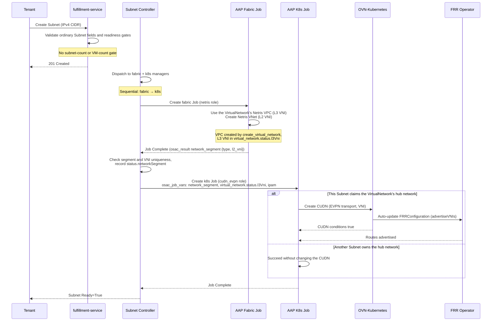

# CUDN EVPN K8s Manager Phase 1 Networking: Single-Cluster VM-to-Fabric Bridging

## Summary

This design extends OSAC-1433's NetworkClass two-manager architecture with a new k8s manager (`cudn_evpn`) that provisions OVN-Kubernetes ClusterUserDefinedNetwork (CUDN) with EVPN transport, enabling KubeVirt VMs to join the physical fabric via BGP EVPN route advertisement. The design covers sequential provisioning (fabric → k8s manager data flow), the owner-Subnet CUDN model, namespace and SecurityGroup policy ownership, lifecycle behavior, and integration test patterns. FRRConfiguration for BGP underlay peering is an installation prerequisite (not created by k8s manager); OVN-Kubernetes auto-updates it when CUDN appears. See [PRD](prd.md) for detailed requirements.

The design is normative for the owner-Subnet model in [contract §4.7–§4.10](/enhancements/OSAC-1433-network-manager-integration-contract-networking/design.md#47-ordering-concurrency-retries-and-ownership): every Subnet with a Kubernetes Manager runs Kubernetes `create_subnet`; the first Subnet whose task claims the VirtualNetwork's hub network owns it, and otherwise-valid sibling Subnets are accepted and become READY. A VM attachment on a non-owner Subnet fails at apply with the `cudn_evpn` implementation limit. The contract and the role's README are authoritative if this design differs. Superseded sketches are isolated in [Historical sketches (non-normative)](#historical-sketches-non-normative).

The data handoff from the Fabric Manager to `cudn_evpn` (the L3 and L2 VNIs, the address layout, the VM gateway, and the route targets) is the one [contract §4.8–§4.10](/enhancements/OSAC-1433-network-manager-integration-contract-networking/design.md#49-network-types-and-the-network-segment) defines; this design restates it where it uses it.

This manager inherits the [Unified Networking deployment support
boundary](/enhancements/OSAC-1433-unified-networking/design.md#deployment-support-boundary):
Phase 1 supports connected deployments only and does not add air-gapped or
disconnected networking support.
This manager also inherits the [Unified Networking hub support
boundary](/enhancements/OSAC-1433-unified-networking/design.md#networking-hub-support-boundary):
OSAC networking supports exactly one provider-owned hub per deployment.
Multi-hub networking placement, cross-hub resource coordination, and
cross-hub network connectivity are unsupported. This boundary applies only to
the networking area and does not define hub behavior for other OSAC areas.
Multiple hosting/workload clusters remain supported where a networking feature
explicitly specifies them.

## Related Designs

This design builds on and interacts with several networking designs:

- **OSAC-1435 VMaaS Networking** — VMaaS creates the NetworkAttachment, then creates the VM in the namespace returned by Kubernetes `apply_network_attachment` (`vm_attachment.namespace`). That namespace belongs to the VirtualNetwork (`osac-vn-<VirtualNetwork API ID>`), not to an individual Subnet. VMaaS neither derives a namespace from the Subnet name nor applies a subnet-count gate; a non-owner Subnet attachment fails at the Kubernetes apply as final.
- **OSAC-1436 CaaS Networking** — CaaS worker BareMetalInstances belong to the owning Cluster's tenant and reference that Cluster's Subnet and SecurityGroups. Physical worker attachments use the Fabric Manager path and do not need a VM namespace or CUDN; the VirtualNetwork's namespace, baseline deny, and SecurityGroup policies still exist for VM workloads.
- **OSAC-1437 BMaaS Networking** — Bare-metal servers provisioned via `BareMetalNetworkAttachment` are L2/L3 peers of EVPN-bridged VMs. This design validates same-subnet (L2) and cross-subnet (L3 via fabric ipVRF) connectivity in test cases.
- **OSAC-1433 Default Networking** — Tenant onboarding uses the deployment's single NetworkClass, created from `global.networking.networkClass`, `global.networking.fabricManager`, and `global.networking.k8sManager`. VMaaS requires a Kubernetes Manager, so a deployment with VMaaS must not default to no Kubernetes Manager. When the deployment selects `cudn_evpn`, the installation prerequisites are required and the default Subnet is the owner of the CUDN because the default Subnet must be READY before another Subnet of that VirtualNetwork can be created.
- **OSAC-2135 CaaS BM Worker Provisioning** — Worker BareMetalInstances use the owning Cluster's tenant and reference the Cluster's tenant Subnet and SecurityGroups. If the Subnet uses `cudn_evpn`, the worker uses the Fabric physical-attachment path; it does not join the VM CUDN or use the VM namespace. Worker lifecycle remains owned by OSAC-2135.
- **OSAC-1382 Multi-Fabric East-West** — Phase 1 east-west isolation domains will need to work across EVPN-bridged and non-EVPN subnets. Inter-domain routing with EVPN transport is TBD (out of scope for Phase 1).

## Motivation

OSAC runs VMs on OpenShift using KubeVirt. VM IP addresses exist only within the OVN overlay network and are not visible on the physical fabric. This prevents VMs from sharing L2 subnets with bare-metal servers or communicating across L3 subnets via shared ipVRF, blocking workloads that span VMs and bare-metal infrastructure.

The CUDN LocalNet approach (OSAC-1511) was frozen in favor of OVN EVPN, which provides better scalability and multi-cluster support (validated by OSAC-1717 spike). This design delivers single-cluster EVPN bridging as Phase 1, with a constraint that OVN-Kubernetes cannot currently route between separate CUDNs on the same cluster (Connectors feature pending).

**Implementation Context:**
OSAC's NetworkClass dispatcher already supports dual-manager provisioning (fabric + k8s). This design adds the second k8s manager type (`cudn_evpn` alongside existing `k8s-only`) and solves the fabric-to-k8s data dependency: fabric manager allocates VNI, k8s manager consumes it to configure CUDN. The current multi-target provisioning evaluates targets sequentially within each reconcile cycle (both can be in-flight simultaneously on AAP); this design adds an ordering rule so the fabric target completes and produces output before the k8s target is evaluated.

### Goals

- Reuse NetworkClass dispatcher pattern and two-manager architecture from OSAC-1433
- Sequential provisioning pattern reusable for future fabric-to-k8s dependencies
- **Owner-Subnet admission for one CUDN per VirtualNetwork:**
  - Every Subnet with `cudn_evpn` runs the Fabric and Kubernetes create tasks; sibling Subnets are otherwise valid and are not rejected
  - The first Subnet whose Kubernetes `create_subnet` claims the VirtualNetwork's hub network owns the CUDN; later Subnets succeed without changing it
  - VMs attach only to the owner Subnet; a non-owner VM attachment fails as final with the `cudn_evpn` implementation limit
  - No fulfillment-service subnet-count gate, VM-count check, or VMaaS subnet-count gate is added
- VirtualNetwork-scoped namespace and baseline policy, plus SecurityGroup policy objects bound per VM
- K8s manager playbook creates CUDN as Kubernetes-native resource (no external API calls)
- FRRConfiguration for BGP underlay peering is installation prerequisite (auto-updated by OVN-Kubernetes, not by k8s manager)
- Installation prerequisites documented for Cloud Infrastructure Admin

### Non-Goals

- Multi-cluster VM placement (deferred to OSAC-3667 Phase 2)
- Inter-subnet L3 routing between VMs on same cluster (requires OVN Connectors)
- Multiple fabric-reachable VM networks per VirtualNetwork, or multi-NIC VMs with a NIC per Subnet (deferred to Phase 2 when OVN-K supports secondary CUDNs)
- IPv6 or dual-stack support (Phase 1 is IPv4-only)
- Automatic gateway MAC coordination (manual prerequisite) (physical hosts on an EVPN Subnet only; open, contract §4.9)
- Automatic VTEP provisioning (manual prerequisite)

## Proposal

**Central Design Statement:**

Phase 1 extends an existing Netris VPC and its VNets into OpenShift. **A VirtualNetwork has one hub CUDN, owned by the first Subnet whose Kubernetes create claims it.** Every Subnet with `cudn_evpn` is provisioned through both managers, and sibling Subnets are accepted. The owner Subnet keeps the CUDN and supports VMs; a VM attachment on a sibling Subnet fails at apply with the implementation limit, while bare-metal attachments on that sibling continue to work. Secondary CUDNs and multi-NIC VMs remain deferred.

This design introduces a new k8s manager (`cudn_evpn`) registered via osac-installer ConfigMap, used when a NetworkClass declares `k8s_manager: "cudn_evpn"`.

**Resource Mapping:**

| OSAC Resource | Netris Resource | OVN-K Resource | VM Support |
|---------------|-----------------|----------------|------------|
| VirtualNetwork | Netris VPC (L3 ipVRF) | — | — |
| Owner Subnet (first Kubernetes create to claim) | Netris VNet (L2 macVRF) | CUDN (primary) | ✅ VMs allowed |
| Sibling Subnet | Netris VNet (L2 macVRF) | — (owner's CUDN persists) | ❌ VM attachment fails as final; bare metal works |

- **One CUDN per VirtualNetwork** (Phase 1 limitation - OVN-K lacks secondary CUDN support)
- **Multiple VNets per VPC** (Netris fabric capability - all share same IP-VRF)
- **CUDN created on Subnet provisioning** (not on VM creation)
- **CUDN persists when sibling Subnets are added**; only the owner Subnet's Kubernetes delete removes it

**Provisioning Trigger:** The CUDN is created by the first Subnet Kubernetes `create_subnet` that claims it. Ownership is recorded on the CUDN (`osac.openshift.io/owner-subnet`); later Subnets do not take over.

**Subnet provisioning sequence:**

0. **Fabric manager** (Netris) runs when the parent VirtualNetwork is created (`create_virtual_network`): creates the Netris VPC (IP-VRF) and returns its L3 VNI as `osac_result.l3_vni`. OSAC records it in the VirtualNetwork CR's `status.l3Vni` ([contract §4.9](/enhancements/OSAC-1433-network-manager-integration-contract-networking/design.md#49-network-types-and-the-network-segment)).
1. **Fabric manager** (Netris) runs when Subnet is created (`create_subnet`):
   - Uses the VPC of the parent VirtualNetwork, whose L3 VNI arrives in the stored parent snapshot as `virtual_network.status.l3Vni`
   - Creates Netris VNet for this Subnet (allocates L2 VNI)
   - Returns `osac_result.network_segment: {type: evpn, l2_vni}` (no `l3_vni`)
2. **Subnet controller** checks the segment and the VNI's uniqueness, records it in `Subnet.status.networkSegment` (`{type, l2Vni}`), and passes it to the Kubernetes tasks as the launch key `network_segment`
3. **K8s manager** (cudn_evpn) runs for every Subnet:
   - If this Subnet claims the VirtualNetwork's hub network, it creates the CUDN:
     - `spec.network.evpn.macVRF = {vni: l2_vni, routeTarget: "0:<l2_vni>"}` (from `network_segment`)
     - `spec.network.evpn.ipVRF = {vni: l3_vni, routeTarget: "0:<l3_vni>"}` (from `virtual_network.status.l3Vni`)
     - `spec.network.layer2.defaultGatewayIPs = [ipam.gateway_ipv4]`: OVN-Kubernetes serves the VM gateway and routes into the IP-VRF (symmetric IRB)
     - `spec.network.layer2.infrastructureSubnets = [<gateway_ipv4>/32, <network + 2>/32]` (the gateway and OVN-Kubernetes' management port) and `reservedSubnets` = the fewest CIDRs covering the Subnet outside `ipam.overlay_ipv4_cidrs`, so VMs get addresses only from the overlay range
     - `spec.network.layer2.mtu = 1500`
     - OVN-Kubernetes auto-updates FRRConfiguration when the CUDN appears
   - If another Subnet owns the network, Kubernetes `create_subnet` succeeds without changing it; the Subnet is READY

**Important:**
- VirtualNetwork creation creates the Netris VPC (and returns its L3 VNI) but no CUDN
- The owner Subnet triggers VNet + CUDN; sibling Subnets trigger VNet only and leave the CUDN to its owner
- **The CUDN persists when sibling Subnets are added**; VM attachments are supported only on the owner Subnet
- The VirtualNetwork namespace and baseline deny exist once Kubernetes `create_virtual_network` succeeds and are shared by all VMs of the VirtualNetwork

Key resources:
- **VirtualNetwork** (fulfillment-service + osac-operator CRD): Fabric `create_virtual_network` creates the Netris VPC; its L3 VNI is recorded in `status.l3Vni`
- **NetworkClass** (fulfillment-service): extended with `k8s_manager` field (already exists)
- **Subnet** (fulfillment-service + osac-operator CRD): triggers fabric (VNet) and Kubernetes (CUDN claim) provisioning; its L2 VNI is recorded in `status.networkSegment`
- **ClusterUserDefinedNetwork** (OVN-Kubernetes CRD): k8s manager creates with EVPN transport, macVRF/ipVRF VNI and explicit route targets `0:<VNI>`
- **VirtualNetwork namespace** (Kubernetes): `osac-vn-<VirtualNetwork API ID>`, owned by the VirtualNetwork; every VM and every SecurityGroup policy of the VirtualNetwork lives there
- **FRRConfiguration** (FRR operator CRD): installation prerequisite (not created by k8s manager), auto-updated by OVN-Kubernetes when CUDN appears

### Workflow Description

**Actor:** Cloud Infrastructure Admin (prerequisite setup) and Tenant Admin (runtime usage)

**Starting State:**
- OCP cluster installed with OVN-Kubernetes, FRR operator, NMState operator
- VTEP CR exists (defines VTEP IPs for each worker node)
- BGP underlay configured (workers peer with fabric switches)
- NetworkClass exists with `fabric_manager: "netris"`, `k8s_manager: "cudn_evpn"`

**Runtime Flow:**



**Error Paths:**

- **Sibling Subnet:** Accepted and becomes READY; its Kubernetes `create_subnet` succeeds without changing the owner's CUDN. The Fabric VNet and physical attachments work. A VM attachment on it fails as final with the `cudn_evpn implementation limit` message.
- **Subnet deletion with a workload reference:** Fulfillment-service deletion guards reject the delete with `FAILED_PRECONDITION`, with the count and the first blocking workload ID. Workload deletion belongs to VMaaS/BMaaS/CaaS; networking never deletes a VM, BareMetalInstance, or Cluster. After the workload and its NetworkAttachment are gone, Subnet deletion proceeds.
- **Fabric job retryable failure:** The Subnet stays `Ready=False`, reason `Progressing`, with the manager message and next retry time; the Kubernetes job does not start until Fabric `create_subnet` is `Succeeded` and `status.networkSegment` is recorded.
- **Fabric job final failure:** The Subnet stays `Ready=False`, reason `Failed`; the owner deletes the Subnet. No retry occurs without a new input.
- **Missing or malformed `network_segment`, or a VNI a live VirtualNetwork or Subnet holds:** OSAC rejects the result and marks Subnet as Failed ("VNI already in use" for a held VNI); a VNI held only by resources being deleted is retried with backoff ([contract §4.9](/enhancements/OSAC-1433-network-manager-integration-contract-networking/design.md#49-network-types-and-the-network-segment))
- **CUDN creation retryable failure:** The Kubernetes entry is `Retrying`; the Subnet stays `Ready=False`, reason `Progressing`, and OSAC retries with backoff. A final failure (`osac_error.retryable: false`, no `osac_error`, or a rejected result) sets `Ready=False`, reason `Failed`.

### API Extensions

**New:**
- osac-installer ConfigMap `osac-network-k8s-manager-cudn-evpn` (declares k8s manager capabilities)
- osac-aap fabric manager template role `netris` (creates Netris VPC/VNet, returns VNI)
- osac-aap k8s manager template role `cudn_evpn` (VirtualNetwork namespace, baseline deny, owner CUDN, SecurityGroup policies, and VM bindings)

**Modified:**
- osac-operator Subnet controller: runs Fabric `create_subnet` first and Kubernetes `create_subnet` after the Fabric result and `status.networkSegment` are recorded, for every Subnet with a Kubernetes Manager. Ownership is decided by the Kubernetes task, not by the controller.

**External CRDs Used (not created by OSAC):**
- `ClusterUserDefinedNetwork` (k8s.ovn.org/v1, OVN-Kubernetes) — created by k8s manager
- `FRRConfiguration` (frrk8s.metallb.io/v1beta1, FRR operator) — installation prerequisite, auto-updated by OVN-Kubernetes when CUDN appears
- `VTEP` (k8s.ovn.org/v1, OVN-Kubernetes) — prerequisite, not created by k8s manager
- `Namespace` and `NetworkPolicy` (core/v1 and networking.k8s.io/v1, Kubernetes) — the VirtualNetwork namespace, its baseline deny, and SecurityGroup policy objects

**No changes** to existing fulfillment-service proto schema. NetworkClass.k8s_manager field already exists.

**Topology admission and ownership:**

There is no skip annotation, subnet-count gate, or VM-count gate. The fulfillment service validates only the ordinary Subnet fields and the shared readiness gates. Every Subnet with `cudn_evpn` receives both manager tasks.

```yaml
# Owner Subnet - its Kubernetes create claims the VirtualNetwork's CUDN
apiVersion: osac.openshift.io/v1
kind: Subnet
metadata:
  name: vm-subnet
spec:
  virtualNetwork: vpc-1  # NetworkClass has k8s_manager: cudn_evpn
  ipv4CIDR: 10.0.1.0/24

---
# Sibling Subnet - accepted and READY; it does not take over the CUDN
apiVersion: osac.openshift.io/v1
kind: Subnet
metadata:
  name: baremetal-subnet
spec:
  virtualNetwork: vpc-1  # Same VPC
  ipv4CIDR: 10.0.2.0/24
# Result: vm-subnet keeps the CUDN and supports VMs. baremetal-subnet gets a
# Netris VNet and no CUDN; its VM attachment fails at apply, while bare-metal
# attachments work.
```

**Provisioning behavior:**
- **Owner Subnet:** provisions the Netris VNet and the VirtualNetwork's CUDN; VM attachments are allowed.
- **Sibling Subnet:** provisions the Netris VNet; Kubernetes `create_subnet` succeeds without changing the owner's CUDN; bare-metal attachments work and VM attachments fail as final.
- Netris creates the VNet in the VPC of the parent VirtualNetwork.
- The VirtualNetwork's namespace, baseline deny, and SecurityGroup policies are not recreated or owned by a Subnet.

**Deletion behavior:**
- Fulfillment-service deletion guards reject a Subnet delete while any workload's stored network attachment references it. Networking does not delete workloads.
- After dependent NetworkAttachments are gone, Kubernetes `delete_subnet` runs before Fabric `delete_subnet`.
- The **owner** Subnet removes the CUDN only. The VirtualNetwork namespace and baseline policy remain until Kubernetes `delete_virtual_network`.
- A **sibling** Subnet's Kubernetes `delete_subnet` changes no CUDN; Fabric `delete_subnet` removes its VNet.
- VirtualNetwork deletion is rejected while any child Subnet, SecurityGroup, NATGateway, or FabricDomain exists; after its children are gone, Kubernetes `delete_virtual_network` removes the namespace and baseline, then Fabric deletion removes the VPC.


## UX Alignment

*Skip this section — no `osac-ux` temp-api file exists for NetworkClass or Subnet (backend-only feature).*

### Implementation Details/Notes/Constraints

#### fulfillment-service: Subnet Validation

**No `cudn_evpn`-specific creation gate.**

The fulfillment service does not count Subnets, count VMs, inspect Kubernetes, or resolve the hub-network owner. A Subnet create is validated like any other Subnet ([Unified — Subnet](/enhancements/OSAC-1433-unified-networking/design.md#subnet)):

- the parent VirtualNetwork exists and is READY;
- in a tenant's default VirtualNetwork, the default Subnet is READY before another Subnet may be created, so the default Subnet becomes the `cudn_evpn` owner ([Unified — Creation readiness gates](/enhancements/OSAC-1433-unified-networking/design.md#creation-readiness-gates));
- the CIDR, address plan, and ordinary field checks pass.

Every Subnet whose NetworkClass has `cudn_evpn` is stored and provisioned by both managers. Otherwise-valid sibling Subnets are accepted and become READY; only Kubernetes `create_subnet` knows whether a Subnet may serve VMs. A non-owner Subnet's VM attachments fail at apply with `retryable: false` ([contract §4.7, Implementation limits](/enhancements/OSAC-1433-network-manager-integration-contract-networking/design.md#47-ordering-concurrency-retries-and-ownership)).

**Deletion guard, not workload deletion.** The fulfillment service rejects a Subnet delete with `FAILED_PRECONDITION` while any workload's stored network attachment references the Subnet, naming the first blocking workload ID ([Unified — Deletion dependency guards](/enhancements/OSAC-1433-unified-networking/design.md#deletion-dependency-guards)). Networking never deletes a ComputeInstance, BareMetalInstance, or Cluster; the owning workload service does. This guard is the only Subnet-level workload constraint this feature adds, and it applies to every Subnet, owner or sibling.

#### VMaaS: VM Placement Validation

VMaaS does not validate the Subnet count or the CUDN owner. It creates the NetworkAttachment first, then creates the VM in the namespace Kubernetes `apply_network_attachment` returns ([OSAC-1435 — Create](/enhancements/OSAC-1435-vmaas-networking/design.md#create)):

1. The ComputeInstance controller creates `NetworkAttachment computeinstance-<API ID>` with the selected Subnet and SecurityGroups.
2. The networking controller runs Kubernetes `apply_network_attachment`. On the owner Subnet it binds the VM to the SecurityGroup policies and returns `vm_attachment: {namespace: osac-vn-<VirtualNetwork API ID>}`.
3. VMaaS creates the VM in that namespace. The namespace belongs to the VirtualNetwork, not to the Subnet; VMaaS never derives it from a Subnet name.
4. A non-owner Subnet's apply fails as final with `cudn_evpn implementation limit`. The ComputeInstance stays `Ready=False` with its NetworkAttachment failure; VMaaS surfaces the message and does not retry until a new input starts the apply. VMaaS does not pre-check ownership, because only the Kubernetes Manager knows the owner ([contract §4.7, Implementation limits](/enhancements/OSAC-1433-network-manager-integration-contract-networking/design.md#47-ordering-concurrency-retries-and-ownership)).

| Subnet | Kubernetes `create_subnet` | VM attachment |
|---|---|---|
| Owner (first Subnet whose Kubernetes create claims the hub network) | Creates the CUDN | Succeeds; the VM runs in `osac-vn-<VN ID>` |
| Sibling under the same VirtualNetwork | Succeeds without changing the CUDN | Fails as final with `cudn_evpn implementation limit` |
| Subnet of another VirtualNetwork with its own owner Subnet | Creates that VirtualNetwork's CUDN | Succeeds; the VM runs in that VirtualNetwork's namespace |

`cudn_evpn` reports compute eligibility from `create_subnet` (`compute_instance_supported`, `compute_instance_unsupported_reason`, the contract's optional result fields), and OSAC records it in `Subnet.status.computeInstanceSupported` and `computeInstanceUnsupportedReason` so the API and CLI can show it. The existing output-only API field mapping, unknown API presence, and compatible task-result defaults are defined in [Unified — Compute eligibility](/enhancements/OSAC-1433-unified-networking/design.md#compute-eligibility). It is informational: VMaaS does not gate VM creation on it.

#### osac-operator: Sequential Provisioning

The Subnet controller plans one target per manager in the Subnet's `status.networkManagers` and runs the contract's jobs in order ([contract §4.7](/enhancements/OSAC-1433-network-manager-integration-contract-networking/design.md#47-ordering-concurrency-retries-and-ownership)). It does not count Subnets, read the CUDN, or decide ownership.

**Create order:**

1. Run Fabric `create_subnet` with the Subnet snapshot and the VirtualNetwork snapshot carrying `status.l3Vni`.
2. When the Fabric entry in `status.jobs` is `Succeeded`, validate `osac_result.network_segment: {type: evpn, l2_vni}` and record it in `status.networkSegment` in the same status update. Only then run Kubernetes `create_subnet` with `network_segment`, `virtual_network`, and `ipam`.
3. The Kubernetes task decides ownership: it claims the VirtualNetwork's hub network when none exists, leaves another Subnet's network unchanged, retries while a hub prerequisite is missing or the network is not yet ready, and fails as final on a foreign CUDN with the same name or on drift in a CUDN it owns. The Subnet is Ready when every recorded manager's create entry is `Succeeded`.
4. `cudn_evpn` publishes `compute_instance_supported` and `compute_instance_unsupported_reason` from its `create_subnet`; OSAC records them in the Subnet status.

**Delete order:** reverse. Kubernetes `delete_subnet` runs only after every overlay NetworkAttachment on the Subnet is gone, then Fabric `delete_subnet`. The owner's Kubernetes task removes the CUDN; a sibling's changes nothing; neither removes the VirtualNetwork namespace. OSAC keeps the Subnet finalizer until each manager whose create started has a successful delete ([contract §4.7, Finalizers and readiness](/enhancements/OSAC-1433-network-manager-integration-contract-networking/design.md#47-ordering-concurrency-retries-and-ownership)).

**Status and retries.** `status.jobs` is the source of truth: one entry `{task, manager, attempt, state, jobID, message}` per task and manager, with states `Running`, `Retrying`, `Succeeded`, `Failed`, and `Cancelled` ([contract §4.7, Job tracking](/enhancements/OSAC-1433-network-manager-integration-contract-networking/design.md#47-ordering-concurrency-retries-and-ownership)). There is no phase or job-history field.

- **Retryable failure:** the entry is `Retrying`; the Subnet is `Ready=False`, reason `Progressing` (API state PENDING), with the manager message and next retry time. There is no attempt limit; OSAC retries with backoff until a job succeeds or the Subnet is deleted.
- **Final failure:** the entry is `Failed`; the Subnet is `Ready=False`, reason `Failed` (API state FAILED). No retry starts without a new input; the owner deletes and recreates the Subnet.
- **Ready:** `Ready=True`, reason `Succeeded`, after every recorded manager's create succeeded (API state READY).
- A controller restart re-reads `status.jobs`, resumes from the last succeeded entry, and never launches the Kubernetes task before the Fabric result is recorded. The task input is stored in `status.taskInput`; the `virtual_network` snapshot carries `status.l3Vni`, and the launch key carries `network_segment`.

The data path is the contract's: Fabric `create_virtual_network` publishes `l3_vni` and `create_subnet` publishes `network_segment`; OSAC validates both, checks VNI uniqueness, and records them. The controller writes no CUDN-specific condition, metric, or event; the hub CUDN's own conditions are read only by the role.

[PRD: In Scope — fabric-to-k8s data dependency] [Contract §4.7]

#### osac-aap: netris Fabric Manager Role

This design **extends the existing netris role** (`collections/ansible_collections/osac/templates/roles/netris/`) with VirtualNetwork and Subnet provisioning tasks, and ports its ExternalIPPool, ExternalIP, and NATGateway tasks to the contract inputs. The SecurityGroup tasks are documented no-ops: `cudn_evpn` enforces SecurityGroups on the hub with NetworkPolicy, so Netris has nothing to enforce for VMs (see Fabric SecurityGroups below).

**Task files:**

```
collections/ansible_collections/osac/templates/roles/netris/tasks/
├── create_virtual_network.yaml      # Netris VPC + IPAM allocation; returns l3_vni
├── create_subnet.yaml               # IPAM subnet + V-Net in the VPC; returns network_segment
├── delete_virtual_network.yaml      # delete the allocation, then the VPC
├── delete_subnet.yaml               # delete the V-Net, then the IPAM subnet
├── create_security_group.yaml       # documented no-op (and delete_security_group.yaml)
├── create_external_ip_pool.yaml     # IPAM allocation + common subnet (and delete_external_ip_pool.yaml)
├── create_external_ip.yaml          # /32 reservation (and delete_external_ip.yaml)
├── create_nat_gateway.yaml          # SNAT rule (and delete_nat_gateway.yaml)
├── attach_external_ip.yaml          # DNAT rule (and detach_external_ip.yaml)
├── create_fabric_domain.yaml        # Server Cluster (and delete_fabric_domain.yaml)
└── ...                              # the remaining contract tasks
```

Objects are named from API IDs in one place (`_names.yaml`): the VPC and its IPAM allocation `osac-vn-<VirtualNetwork ID>`, the V-Net and its IPAM subnet `osac-sn-<Subnet ID>`. Every create is get-or-create by name, so a rerun writes nothing unless the object differs from the plan.

The ExternalIP, NATGateway, and FabricDomain tasks use the same names:

| Resource | Netris object |
|---|---|
| ExternalIPPool | IPAM allocation `osac-pool-<ExternalIPPool ID>` for the pool's one CIDR, plus a common subnet `osac-pool-<ExternalIPPool ID>-common` over the same CIDR, both owned by `NETRIS_TENANT_ID`. Netris blackholes the return traffic of a /32 nat address that has no common subnet around it. A prefix or tenant that differs from the name's is a final error. |
| ExternalIP | `/32` NAT reservation `osac-eip-<ExternalIP ID>` inside the pool's allocation, the first free host address; the same address on every rerun. A full pool is a final error. |
| NATGateway | SNAT rule `osac-natgw-<NATGateway ID>` in the VPC `osac-vn-<VirtualNetwork ID>`: the VirtualNetwork's IPv4 CIDR to the ExternalIP's `/32`. |
| ExternalIPAttachment | DNAT rule `osac-eipa-<attachment ID>` (Netris runs NAT rules on the SoftGates), from the ExternalIP's `/32` to the destination address, in the destination's VPC (`NETRIS_MGMT_VPC_ID` for `provider_management`). |
| FabricDomain | Server Cluster `osac-fd-<FabricDomain ID>` in the VirtualNetwork's VPC. |

A delete of a NAT rule that is already gone is a success. A rule whose addresses do not match the stored input fails the delete, which writes nothing; OSAC retries it, so the resource stays DELETING until the rule is repaired. The historical 2026-10-29 reservation-task result is no longer part of the target contract: the Fabric task set has no Cluster ingress reserve or release task. Fulfillment allocates the address from the Subnet's LB VIP range, and the Fabric carries the guest MetalLB L2 announcement, as the [Netris design](/enhancements/OSAC-2434-netris-fabric-manager-networking/design.md#cluster-ingress-addresses) and [CaaS design](/enhancements/OSAC-1436-caas-networking/design.md#osac-owned-guest-ingress-allocation) specify.

**Registration.** The installer renders the registration `ConfigMap` `osac-network-fabric-manager-netris` when `global.networking.fabricManager` is `netris` (`name: netris`, `ansible_role: osac.templates.netris`, `network_types: evpn`, `capabilities: eastWestEthernet,security_group_icmp,security_group_physical_noop`, `immutable: true`). Netris is OSAC-shipped, so it is the exception to the provider-applied Fabric registration ([contract §4.2](/enhancements/OSAC-1433-network-manager-integration-contract-networking/design.md#42-registration-and-capabilities)).

**tasks/create_virtual_network.yaml** (sketch of the flow):

```yaml
---
- name: Create the VPC osac-vn-<id> (get or create)
  ansible.builtin.include_role:
    name: netris.controller.vpc
    tasks_from: create
  vars:
    vpc_name: "{{ netris_names.vpc }}"           # osac-vn-<VirtualNetwork ID>

- name: Read the VPC for its VNI
  # Netris allocates the VNI when it creates the VPC; it is present in the
  # read after the create (lab probe). Netris owns the allocation (no OSAC range).
  ansible.builtin.include_role:
    name: netris.controller.vpc
    tasks_from: read

- name: Return the L3 VNI to OSAC
  ansible.builtin.include_tasks: _publish.yaml    # set_stats osac_result
  vars:
    netris_result: {backend_id: "{{ vpc_id }}", l3_vni: "{{ netris_vpc.vni | int }}"}
  # OSAC records it in VirtualNetwork.status.l3Vni (contract §4.9)
```

**tasks/create_subnet.yaml** (sketch of the flow):

```yaml
---
- name: Look up the VPC of the VirtualNetwork
  # retryable until it exists
- name: Stop when the VPC VNI is not the recorded l3Vni
  when: vpc.vni != osac_job_vars.virtual_network.status.l3Vni
  # final error: the VPC was replaced outside OSAC

- name: Create the IPAM subnet osac-sn-<id> and the V-Net osac-sn-<id> in the VPC
  # The V-Net serves gateway_ipv4/<prefix> on its anycast gateway (the lab
  # spike). OVN-Kubernetes serves the same address (defaultGatewayIPs); the
  # contract allows both (§4.9). Netris DHCP covers only
  # physical_ipv4_cidrs, enabled at creation when that range is non-empty
  # and repaired on rerun; a physical attachment also enables it
  # (it answers any MAC: no host reservation in the collection);
  # OVN-Kubernetes assigns VM addresses.

- name: Read the V-Net and return the network segment to OSAC
  # vxlanID is present in the read after the create (lab probe)
  # osac_result: {network_segment: {type: evpn, l2_vni: <vxlanID>}}
  # Exactly {type, l2_vni}: OSAC rejects an l3_vni here (contract §4.9)
```

**tasks/delete_subnet.yaml:** delete the V-Net (this frees the `l2_vni`), then the IPAM subnet. The VPC remains for the VirtualNetwork's other Subnets. An object that is already gone is a success.

**Fabric SecurityGroups.** `create_security_group` and `delete_security_group` are documented no-ops on the Netris manager (contract §4.10 Enabled services). `cudn_evpn` is the only enforcement point for VMs. With BMaaS enabled, SecurityGroups therefore filter no bare-metal traffic on Netris, and the manager design says so. The Netris registration declares `security_group_physical_noop`, so a Netris NetworkClass records `status.security_group_physical_noop: true` and CaaS surfaces the unfiltered-worker limitation (contract §4.2).

**Rationale:**
- **Provisioning timing:** the VPC is created during VirtualNetwork provisioning, the V-Net during Subnet provisioning.
- Netris VPC (IP-VRF) maps to VirtualNetwork (L3 VNI for cross-Subnet routing via the fabric); Netris V-Net (MAC-VRF) maps to Subnet (L2 VNI for same-Subnet bridging).
- **Netris owns VNI allocation:** the VPC's `vni` is the `l3_vni` and the V-Net's `vxlanID` is the `l2_vni`. There is no OSAC VNI range for Netris.
- **Each VNI is returned once, by its owner**, through `set_stats` `osac_result` (contract §4.6, §4.9); OSAC passes them to the CUDN.
- Route targets are not returned: both sides use `0:<VNI>` (lab status in [Lab probe results](#lab-probe-results-netris)).
- No reserved range is returned: `cudn_evpn` derives `reservedSubnets` and `infrastructureSubnets` from the `ipam` layout OSAC passes to both managers (contract §4.8).
- **Gateway:** OVN-Kubernetes serves the VM gateway (`defaultGatewayIPs`) and routes into the IP-VRF; the Netris V-Net serves the same `gateway_ipv4` on its anycast gateway.
- **Physical attachments** on an EVPN Subnet are supported. The apply ensures Netris DHCP over `physical_ipv4_cidrs` is enabled (create_subnet enables it at creation and repairs it on rerun; the V-Net keeps the gateway on `gateway_ipv4`, so bare metal has a local gateway), then takes every fabric port of the host off the provisioning V-Net and puts `interface.name` on the Subnet's V-Net. An empty `physical_ipv4_cidrs` is a final error ("no fabric address range for bare-metal DHCP"). DHCP stays on after the last attachment is removed; a delete moves back only that attachment's port. L2 VM to bare-metal traffic on one V-Net is verified on the lab spike.
- **DHCP deviation from contract §4.8:** the vendored Netris collection has no DHCP host reservation, so Netris range DHCP answers any MAC in `physical_ipv4_cidrs`, not only the MACs of physical attachments. Whether it answers VMs on the same EVPN Subnet is an open lab check (TC-R6-01, step 9).
- **Known gap:** concurrent attachment jobs on one V-Net can lose a port change, because the V-Net's port list is read and rewritten without a lock. The controller should serialize them (follow-up).
- **DNS is an installation matter:** the manager creates no DNS object for a VirtualNetwork and has no DNS setting. VMs get the cluster DNS from the DHCP of OVN-Kubernetes on the primary network. Bare-metal hosts get their resolver from the default DHCP option set of Netris, which the provider sets at installation (default `8.8.8.8`); a bare-metal host without internet access has no name resolution, and that is expected.
- **FabricDomain template (known limitation):** the Server Cluster template is the single distinct `server_cluster_template_id` in `NETRIS_RESOURCE_CLASS_MAP`; more than one is a final error. Follow-up: the FabricDomain snapshot carries the BareMetalInstanceType's `ethernet_ew` Netris profile instead.
- **ICMP:** a NetworkPolicy cannot match ICMP, so `cudn_evpn` does not declare the capability `security_group_icmp`, and Netris, whose SecurityGroup tasks are no-ops, does. The NetworkClass capability is true only if every manager declares it, so with `cudn_evpn` the API rejects an ICMP rule with `INVALID_ARGUMENT` and "use protocol all", which includes ICMP ([Unified — SecurityGroup](/enhancements/OSAC-1433-unified-networking/design.md#securitygroup)). The final error `cudn_evpn implementation limit: SecurityGroup rules with protocol icmp are not supported` stays as a safety net for a rule that reaches the role anyway.
- **Classified errors:** a missing VPC is retryable; a VPC whose VNI differs from the recorded `l3Vni` is final.

#### osac-aap: cudn_evpn K8s Manager Role

**Role Structure:**

```
collections/ansible_collections/osac/templates/roles/cudn_evpn/
├── meta/
│   └── osac.yaml                    # Capability declaration
├── tasks/
│   ├── create_virtual_network.yaml  # Namespace
│   ├── delete_virtual_network.yaml
│   ├── create_subnet.yaml           # CUDN of the owner Subnet; no FRR object
│   ├── delete_subnet.yaml           # Delete the CUDN this Subnet owns
│   ├── create_security_group.yaml   # NetworkPolicy
│   ├── delete_security_group.yaml
│   ├── apply_network_attachment.yaml  # Bind the VM to its SecurityGroups
│   └── delete_network_attachment.yaml
```

**meta/osac.yaml:**

```yaml
---
name: cudn-evpn
title: CUDN EVPN Kubernetes Manager
description: >
  OSAC's Kubernetes Manager for network type evpn: one namespace and one
  EVPN ClusterUserDefinedNetwork per VirtualNetwork, and one NetworkPolicy
  per SecurityGroup, on the hub where VMs run.
template_type: network
k8s_manager: cudn_evpn
capabilities:
  supports_ipv4: true
  supports_ipv6: false
  supports_dual_stack: false
```

The role's `meta/osac.yaml` describes the role to the execution environment;
it is not the manager registration. The registration ConfigMap above carries
no `capabilities` key.

**tasks/create_subnet.yaml:**

```yaml
---
- name: Validate the network segment and the VirtualNetwork's L3 VNI
  ansible.builtin.assert:
    that:
      - osac_job_vars.network_segment.keys() | sort == ['l2_vni', 'type']
      - osac_job_vars.network_segment.type == 'evpn'
      - osac_job_vars.virtual_network.status.l3Vni is defined
      - osac_job_vars.network_segment.l2_vni != osac_job_vars.virtual_network.status.l3Vni
    fail_msg: "cudn_evpn received an invalid task input"   # retryable: false (an input OSAC never sends)

- name: Extract VNI values and the address layout
  ansible.builtin.set_fact:
    l2_vni: "{{ osac_job_vars.network_segment.l2_vni }}"            # launch key network_segment {type, l2_vni}
    l3_vni: "{{ osac_job_vars.virtual_network.status.l3Vni }}"      # stored parent snapshot
    gateway_ipv4: "{{ osac_job_vars.ipam.gateway_ipv4 }}"
    management_port_ipv4: "{{ osac_job_vars.resource.spec.ipv4Cidr | ansible.utils.ipmath(2) }}"   # network + 2
    # The fewest CIDRs covering the Subnet outside ipam.overlay_ipv4_cidrs, gateway_ipv4/32 and
    # <network + 2>/32, computed by the role's filter plugin (at most 25, else retryable: false)
    reserved_subnets: "{{ (osac_job_vars | osac.templates.cudn_evpn_plan).cudn_manifest.spec.network.layer2.reservedSubnets | default([]) }}"
    subnet_cidr: "{{ osac_job_vars.resource.spec.ipv4Cidr }}"
    subnet_id: "{{ osac_job_vars.resource.id }}"
    vn_id: "{{ osac_job_vars.virtual_network.id }}"
    tenant_id: "{{ osac_job_vars.tenant }}"
    hub_name: "osac-vn-{{ osac_job_vars.virtual_network.id }}"  # the VirtualNetwork's namespace and CUDN name

# The namespace osac-vn-<VN API ID> and its baseline deny come from Kubernetes
# create_virtual_network; create_subnet creates no namespace.

- name: Create ClusterUserDefinedNetwork
  kubernetes.core.k8s:
    state: present
    definition:
      apiVersion: k8s.ovn.org/v1
      kind: ClusterUserDefinedNetwork
      metadata:
        name: "{{ hub_name }}"
        labels:
          evpn: "true"  # Picked up by RouteAdvertisements
          osac.openshift.io/virtualnetwork-id: "{{ vn_id }}"
          osac.openshift.io/tenant: "{{ tenant_id }}"
        annotations:
          osac.openshift.io/tenant: "{{ tenant_id }}"
          osac.openshift.io/owner-reference: "Subnet/{{ osac_job_vars.resource.metadata.name }}"
          osac.openshift.io/owner-subnet: "{{ subnet_id }}"   # the Subnet that owns the hub network
      spec:
        namespaceSelector:
          matchLabels:
            osac.openshift.io/virtualnetwork-id: "{{ vn_id }}"  # the VirtualNetwork's namespace
            osac.openshift.io/tenant: "{{ tenant_id }}"
        network:
          topology: Layer2
          transport: EVPN
          layer2:
            role: Primary
            subnets:
              - "{{ subnet_cidr }}"
            mtu: 1500
            defaultGatewayIPs:
              - "{{ gateway_ipv4 }}"           # OVN-Kubernetes serves the VM gateway (symmetric IRB into the IP-VRF)
            infrastructureSubnets:            # the gateway and OVN-Kubernetes' management port (network + 2)
              - "{{ gateway_ipv4 }}/32"
              - "{{ management_port_ipv4 }}/32"
            reservedSubnets: "{{ reserved_subnets }}"   # the role omits the key when the list is empty; VMs get only overlay addresses
            ipam:
              mode: Enabled
              lifecycle: Persistent           # VMs keep their address across restart and live migration
          evpn:
            vtep: tenant-vtep  # Cluster-wide singleton VTEP
            macVRF:
              vni: "{{ l2_vni | int }}"
              routeTarget: "0:{{ l2_vni }}"
            ipVRF:
              vni: "{{ l3_vni | int }}"
              routeTarget: "0:{{ l3_vni }}"

- name: Wait until the CUDN is ready
  kubernetes.core.k8s_info:
    api_version: k8s.ovn.org/v1
    kind: ClusterUserDefinedNetwork
    name: "{{ hub_name }}"
  register: cudn_status
  # OVN-Kubernetes 4.22 sets no Ready condition: wait for these three to be True
  until: >-
    cudn_status.resources[0].status.conditions | default([])
    | selectattr('type', 'in', ['TransportAccepted', 'NetworkCreated', 'NetworkAllocationSucceeded'])
    | selectattr('status', 'equalto', 'True') | list | length == 3
  retries: 30
  delay: 10
# Kubernetes create_subnet publishes only compute eligibility
# (compute_instance_supported, compute_instance_unsupported_reason); no VM or network result.
```

**Rationale:**
- **Namespace and CUDN name = `osac-vn-<VirtualNetwork API ID>`**: one namespace per VirtualNetwork (from Kubernetes `create_virtual_network`) and one CUDN per VirtualNetwork, owned by one Subnet (contract §4.10, `cudn_evpn` limit)
- CUDN namespaceSelector matches by `osac.openshift.io/virtualnetwork-id` and `osac.openshift.io/tenant`
- Namespace label `k8s.ovn.org/primary-user-defined-network` required for UDN as primary network (set at namespace creation)
- VTEP reference = `tenant-vtep` (cluster singleton, installation prerequisite)
- VNI values: L2 (macVRF) from the launch key `network_segment.l2_vni`, L3 (ipVRF) from the stored parent snapshot `virtual_network.status.l3Vni` (contract §4.9)
- Route targets explicit: `0:<l2_vni>` on macVRF, `0:<l3_vni>` on ipVRF, the same values the Fabric imports and exports; they do not depend on the node AS, so every 24-bit VNI is usable
- Wait for the CUDN's `TransportAccepted`, `NetworkCreated` and `NetworkAllocationSucceeded` conditions before completing (prevents race with VM provisioning)
- **Addressing from `ipam`** (contract §4.8): `infrastructureSubnets` = `[<gateway_ipv4>/32, <network + 2>/32]` and `reservedSubnets` = the rest of the Subnet outside the overlay range, so OVN IPAM never hands out a fabric, LB VIP, gateway or management-port address; a layout needing more than 25 `reservedSubnets` entries fails as final
- `defaultGatewayIPs: [gateway_ipv4]` — OVN-Kubernetes serves the VM gateway and routes into the IP-VRF; MTU 1500
- [Demo: Phase 5.2 CUDN structure] [Research: §Existing Solutions — OVN-K CUDN]

**Baseline deny and SecurityGroup binding:**

- Kubernetes `create_virtual_network` creates the namespace `osac-vn-<VirtualNetwork API ID>` and `osac-baseline-deny`. The baseline selects every pod, sets both `Ingress` and `Egress`, and allows only DHCP (egress UDP 67, ingress UDP 68); OVN-Kubernetes still allows ARP/ND implicitly.
- Kubernetes `create_security_group` creates `osac-sg-<SecurityGroup ID>` in that namespace. Its rules are the group's rules (`tcp`/`udp` with port/endPort, `all` without ports, the CIDR as `ipBlock`); its podSelector matches no pod until an attachment binds one, so the create needs no Subnet, CUDN, or VM.
- Kubernetes `apply_network_attachment` adds `osac.openshift.io/compute-instance-id: <VM ID>` to each selected group's podSelector and returns `vm_attachment: {namespace: osac-vn-<VN ID>}`. `delete_network_attachment` removes the VM ID. A rule update replaces the rules and keeps the members; a bind or unbind changes the members and keeps the rules.
- A VM with no SecurityGroup gets only the baseline deny. On a sibling Subnet, `apply_network_attachment` fails as final with `cudn_evpn implementation limit`; its delete succeeds because nothing was bound.

**tasks/delete_subnet.yaml:**

```yaml
---
# Fulfillment-service guards have already rejected the Subnet delete while a
# workload's stored network attachment references it. Networking never deletes
# a VM, BareMetalInstance, or Cluster; the owning workload service does.
#
# Only the owner Subnet removes the hub network; any other Subnet changes
# nothing. The namespace osac-vn-<VN ID>, its baseline deny and the
# SecurityGroup policies stay until delete_virtual_network /
# delete_security_group.

- name: Extract resource identifiers
  ansible.builtin.set_fact:
    subnet_id: "{{ osac_job_vars.resource.id }}"
    vn_id: "{{ osac_job_vars.virtual_network.id }}"
    tenant_id: "{{ osac_job_vars.tenant }}"
    hub_name: "osac-vn-{{ osac_job_vars.virtual_network.id }}"  # the VirtualNetwork's CUDN name

- name: Read the VirtualNetwork's hub network
  kubernetes.core.k8s_info:
    api_version: k8s.ovn.org/v1
    kind: ClusterUserDefinedNetwork
    name: "{{ hub_name }}"
  register: cudn_live

- name: Delete the hub network this Subnet owns
  vars:
    _meta: "{{ (cudn_live.resources | first | default({})).metadata | default({}) }}"
  when:
    - cudn_live.resources | length > 0
    - (_meta.labels | default({}))['osac.openshift.io/virtualnetwork-id'] | default('') == vn_id
    - (_meta.labels | default({}))['osac.openshift.io/tenant'] | default('') == tenant_id
    - (_meta.annotations | default({}))['osac.openshift.io/owner-subnet'] | default('') == subnet_id
  kubernetes.core.k8s:
    api_version: k8s.ovn.org/v1
    kind: ClusterUserDefinedNetwork
    name: "{{ hub_name }}"
    state: absent
    wait: true   # wait until it is gone (not just deletionTimestamp set)
  # Waiting for full deletion ensures OVN has released the VNIs before the
  # Fabric delete_subnet frees the L2 VNI (Kubernetes delete runs first)
```

**Deletion order and ownership:**

1. The fulfillment service rejects the Subnet delete with `FAILED_PRECONDITION` while any workload's stored network attachment references the Subnet, naming the first blocking workload ID ([Unified — Deletion dependency guards](/enhancements/OSAC-1433-unified-networking/design.md#deletion-dependency-guards)). The workload service deletes the workload and its NetworkAttachment; networking does not.
2. OSAC then runs Kubernetes `delete_subnet` (only after every overlay attachment is gone), followed by Fabric `delete_subnet` ([contract §4.7](/enhancements/OSAC-1433-network-manager-integration-contract-networking/design.md#47-ordering-concurrency-retries-and-ownership)).
3. The owner Subnet's Kubernetes task deletes the CUDN and waits until it is gone, so OVN releases the VNIs before Fabric `delete_subnet` frees the L2 VNI. A sibling's Kubernetes task changes nothing; Fabric removes its VNet.
4. The VirtualNetwork namespace, the `osac-baseline-deny` policy, and the `osac-sg-<SecurityGroup ID>` policies remain. They are owned by the VirtualNetwork and its SecurityGroups, not by a Subnet. Kubernetes `delete_virtual_network` removes the namespace and, with it, the baseline deny, only after the VirtualNetwork's children are gone.
5. Networking never deletes VMs, BareMetalInstances, or Clusters. A rejected Subnet delete leaves every workload untouched.

**Critical constraint:** Netris API rejects VPC deletion if any VNets exist under it. The VirtualNetwork fabric manager playbook must validate no child VNets exist before deleting VPC:

```yaml
# osac-aap netris role: tasks/delete_virtual_network.yaml
- name: Check for orphaned VNets before VPC deletion
  netris.controller.vnet_info:
    vpc: "{{ vpc_name }}"
  register: vnet_list

- name: Fail if VNets still exist (indicates Subnet finalizer didn't run)
  ansible.builtin.fail:
    msg: "Cannot delete VPC {{ vpc_name }} - {{ vnet_list.vnets | length }} VNets still exist. Delete all Subnets first."
  when: vnet_list.vnets | length > 0

- name: Delete Netris VPC
  netris.controller.vpc:
    name: "{{ vpc_name }}"
    state: absent
```

That check is a backend safety net for a failed child cleanup, not a workload-deletion mechanism.

**VirtualNetwork finalizer:** the VirtualNetwork keeps `osac.openshift.io/virtualnetwork-finalizer` while any child Subnet, SecurityGroup, NATGateway, or FabricDomain exists. After its children are gone, Kubernetes `delete_virtual_network` removes the namespace and baseline, and Fabric deletion removes the VPC ([Unified — Deletion dependency guards](/enhancements/OSAC-1433-unified-networking/design.md#deletion-dependency-guards)).

**FRRConfiguration Handling:**

FRRConfiguration for underlay BGP peering is created during installation (manual prerequisite). The k8s manager does **not** create or modify FRRConfiguration. OVN-Kubernetes auto-updates FRR config when CUDN with `evpn: "true"` label is created.

Per demo Phase 5.3:
> "On CUDN creation, BGP FRR configuration is updated... advertise-all-vni"

The RouteAdvertisements CR (installation prerequisite) defines `frrConfigurationSelector: {matchLabels: {evpn: "true"}}`, which tells OVN-K to update any FRRConfiguration with that label when a CUDN with matching label appears.

**Assumption:** Installation-time FRRConfiguration exists in `openshift-frr-k8s` namespace with label `evpn: "true"`. K8s manager only creates CUDN; FRR integration is declarative via label matching.

[Demo: Phase 2.6 FRRConfiguration, Phase 2.5 RouteAdvertisements] [Research: §FRR Operator — advertiseVNIs]

**DHCP Coexistence:**

Both Netris and OVN run DHCP servers for the same subnet:
- **Netris DHCP:** Serves `ipam.physical_ipv4_cidrs` only; enabled at Subnet creation when that recorded range is non-empty, repaired on rerun, and also enabled by a physical attachment
- **OVN DHCP:** Runs inside the logical switch for the CUDN subnet

Configuration caveat and implementation limitation: `netris_evpn_vnet_gateway_mode: none` deliberately makes the Netris manager create no gateway and no Fabric DHCP, which deviates from contract §4.10's DHCP duty; the creation-time enablement above applies only to the other gateway modes. Because the V-Net then has no gateway, a physical attachment on such a Subnet fails as final ("the V-Net has no gateway to serve DHCP from"); use another gateway mode when the Subnet carries physical workloads.

**Expected behavior (open lab check):**
OVN intercepts DHCP requests inside the logical switch before they reach the fabric. VMs receive IP addresses from OVN DHCP, and are expected not to see Netris DHCP offers, because OVN intercepts their requests. This is an open lab check (TC-R6-01, step 9).

**IP allocation strategy (REQUIRED for correctness):**
- Both managers get the Subnet's address layout in `osac_job_vars.ipam` ([contract §4.8](/enhancements/OSAC-1433-network-manager-integration-contract-networking/design.md#48-addressing)); the Fabric Manager returns no reserved range
- `reservedSubnets` covers the Subnet outside `ipam.overlay_ipv4_cidrs` (the physical and LB VIP ranges), and `infrastructureSubnets` holds `gateway_ipv4/32` and `<network + 2>/32` (OVN-Kubernetes' management port), so OVN IPAM never allocates an address the fabric or OVN-Kubernetes uses
- Netris DHCP hands out only addresses from `ipam.physical_ipv4_cidrs`, never an overlay address; it cannot filter by MAC, so whether it answers a VM request at all is an open lab check

**Operational notes:**
- Netris DHCP can remain enabled (no configuration change needed) — it serves bare-metal nodes on the fabric
- OVN DHCP serves only VMs in the CUDN namespace (expected: their requests do not reach Netris DHCP; open lab check)
- Do not disable Netris DHCP while `physical_ipv4_cidrs` is non-empty: create_subnet and its reruns keep the physical range enabled for bare-metal nodes

[Earlier demo, different DHCP setup (Netris DHCP then enabled on the whole V-Net): the VM received its IP from OVN. This is not the current behavior; the current setup is the open lab check above (TC-R6-01, step 9).]

**Gateway Ownership (Critical Architecture Decision):**

OVN-Kubernetes serves the VM gateway ([contract §4.9](/enhancements/OSAC-1433-network-manager-integration-contract-networking/design.md#49-network-types-and-the-network-segment)):

**What happens:**
1. `cudn_evpn` sets `layer2.defaultGatewayIPs: [ipam.gateway_ipv4]` (the Subnet's network address + 1, recorded in `Subnet.status.ipam`)
2. OVN DHCP gives VMs that address as router
3. OVN-Kubernetes serves the gateway address and routes the VM's L3 traffic into the IP-VRF (symmetric integrated routing and bridging, ipVRF VNI = `l3_vni`)
4. Traffic to other Subnets and outside the VirtualNetwork is encapsulated (VXLAN) with the L3 VNI toward the fabric, which routes the IP-VRF
5. Same-subnet traffic to bare-metal hosts is bridged over the macVRF (L2 VNI)

**Phase 1 behavior:**
- `defaultGatewayIPs: [gateway_ipv4]` and `infrastructureSubnets` include the gateway, so OVN IPAM never hands it to a VM
- The fabric (Netris) carries the macVRF and ipVRF and routes the ipVRF. It may also serve `gateway_ipv4` on its devices ([contract §4.9](/enhancements/OSAC-1433-network-manager-integration-contract-networking/design.md#49-network-types-and-the-network-segment)). The Netris manager does: its V-Net serves `gateway_ipv4` on its anycast gateway, as the working lab spike does, and OVN-Kubernetes serves the same address. OVN-Kubernetes assigns VM addresses; Netris DHCP serves only `physical_ipv4_cidrs`, enabled at creation and on rerun and used for physical attachments.
- Same-Subnet L2 traffic (VM to VM, VM to bare metal on one V-Net) is verified in the lab, as are NAT egress and ExternalIP ingress through the gateway; inter-Subnet routed traffic is not yet verified. Routed traffic can see two gateway MACs (the follow-up below addresses it), because the two sides do not share the gateway MAC. Follow-up: set the Netris V-Net `customAnycastMac` to OVN-Kubernetes' fixed gateway MAC, `0a:58` followed by the four bytes of `gateway_ipv4` (research evidence; not yet tested in the lab)
- Route targets `0:<l2_vni>` (macVRF) and `0:<l3_vni>` (ipVRF) on both sides
- How a physical host on the same Subnet reaches `gateway_ipv4` without a second gateway on the segment is open in the contract and belongs to the BMaaS design

**History:** an earlier demo omitted `defaultGatewayIPs` and let a Netris SVI own `.1` (no OVN logical router port). That gateway model is superseded by the contract.

#### Lab probe results (Netris)

The Netris lab probe of 2026-10-29 (IPAM 172.16.0.0/24) gave these results. The probe V-Nets had no member ports.

- Netris assigned a VPC VNI (11) and V-Net VXLAN IDs (14 without a gateway, 17 with one), present in the response right after the create. An explicit `vxlanID` was honoured and read back.
- None of the VNIs or the probe VPC's VRF appeared on any leaf or SoftGate, with or without a gateway. Netris deploys a V-Net and its VRF only where a member port exists (interpretation). Routed traffic needs the VPC VRF. Same-Subnet traffic does not.
- The Netris API has no route-target field. The leaves use `<ASN>:<VNI>` automatically. The SoftGates import and export `0:<VNI>`, the same as `cudn_evpn`. Routed traffic that depends on the leaves importing `0:<VNI>` is not yet verified. NAT egress and ExternalIP ingress over Netris pass in the lab (2026-11-01), with the IPAM objects outside the VPC and the rules inside it. They need the common subnet around the NAT `/32` addresses, which the manager creates with the ExternalIPPool. A NAT task is READY when Netris accepted the configuration, not when traffic flows; an optional route-target field in the Fabric result is a follow-up.
- Netris reserves its private IP allocation (by default `10.0.0.0/8`), so the lab adds it to `excludedIpv4Cidrs`; tenant networks use another private range such as `172.16.0.0/12`.
- Names of 44 characters were accepted for the VPC and V-Net. 47 characters (`osac-natgw-<uuid>`) are not tested.

#### osac-installer: K8s Manager Registration

**New ConfigMap:**

```yaml
apiVersion: v1
kind: ConfigMap
metadata:
  name: osac-network-k8s-manager-cudn-evpn
  namespace: osac
  labels:
    osac.openshift.io/network-k8s-manager: "true"  # Matches OSAC-1433 label path
immutable: true
data:
  name: cudn_evpn  # Field name 'name' per OSAC-1433 schema (not 'manager')
  ansible_role: osac.templates.cudn_evpn
  network_type: evpn
  # No `capabilities` key: IPv4 is mandatory and is not a capability, and
  # cudn_evpn does not declare security_group_icmp (a NetworkPolicy cannot
  # match ICMP).
```

**Capability Fields:**
- The registration declares no capability. In particular it does not declare
  `security_group_icmp`, so a NetworkClass with `cudn_evpn` always has
  `status.security_group_icmp` false and the API rejects ICMP rules.
- IPv6 and dual-stack are not supported; IPv4 is not a capability token.
- The owner-Subnet VM limit is a `cudn_evpn` implementation limit enforced by
  Kubernetes `create_subnet` and `apply_network_attachment`; it is not a
  manager capability token and not a fulfillment-service gate.

**RBAC:**

```yaml
apiVersion: rbac.authorization.k8s.io/v1
kind: ClusterRole
metadata:
  name: osac-aap-cudn-evpn
rules:
- apiGroups: ["k8s.ovn.org"]
  resources: ["clusteruserdefinednetworks"]
  verbs: ["create", "get", "list", "watch", "update", "patch", "delete"]
- apiGroups: ["k8s.ovn.org"]
  resources: ["vteps"]
  verbs: ["get", "list"]  # Read-only, VTEP is prerequisite
---
apiVersion: rbac.authorization.k8s.io/v1
kind: ClusterRoleBinding
metadata:
  name: osac-aap-cudn-evpn
roleRef:
  apiGroup: rbac.authorization.k8s.io
  kind: ClusterRole
  name: osac-aap-cudn-evpn
subjects:
- kind: ServiceAccount
  name: osac-aap-runner  # AAP job execution SA
  namespace: osac
```

**Rationale:**
- ConfigMap registration follows existing pattern (cudn_localnet)
- RBAC grants CUDN create/delete, VTEP read-only
- No FRRConfiguration RBAC needed (not created by k8s manager)
- [Codebase: osac/osac-installer/charts/osac/templates/k8s-manager-*.yaml]


### Security Considerations

**Tenant Isolation:**

All OSAC resources include standard tenant isolation metadata:
- `osac.openshift.io/tenant` annotation on CUDN and namespace
- `osac.openshift.io/owner-reference` annotation linking CUDN to the Subnet that owns it
- OPA policies enforce read/write isolation at fulfillment-service API layer

**New Isolation Boundary:**

CUDN namespace selector uses `matchLabels: {osac.openshift.io/virtualnetwork-id: "<VN ID>", osac.openshift.io/tenant: "<tenant>"}`. Each VirtualNetwork has one VirtualNetwork-owned namespace, `osac-vn-<VirtualNetwork API ID>`, and one owner CUDN. VMs live in that namespace and on the owner Subnet's network; sibling Subnets have no CUDN and accept no VMs. VMs in different VirtualNetworks cannot communicate at L2 or L3 (separate macVRF + ipVRF).

**Node reachability:**

OVN-Kubernetes treats every EVPN network as advertised and SNATs traffic toward the cluster node IPs to the network's management-port masquerade IP, so it reaches the host through the management port, inside the network's VRF. A VM whose SecurityGroup allows all egress can therefore ping the node that hosts it. Measured on the single-node lab: TCP to listening ports got a reset from the node kernel, consistent with `net.ipv4.tcp_l3mdev_accept=0`, and traffic beyond the node stopped at the VRF's `unreachable` default. A listening UDP service got port-unreachable, consistent with `net.ipv4.udp_l3mdev_accept=0`. Isolation of node services rests on those kernel defaults. Another node's address has not been measured, and no E2E checks this.

**BGP Security:**

Underlay BGP session (OCP ↔ fabric switch) uses MD5 authentication (configured during installation, not managed by OSAC). FRRConfiguration credentials stored in Kubernetes Secret.

**No New Attack Surface:**

- CUDN and FRRConfiguration are cluster-scoped CRDs, not tenant-facing APIs
- Tenants interact only via fulfillment-service Subnet API (existing auth/authz)
- AAP jobs run with service account (RBAC-controlled), not tenant credentials

**Input Validation:**

VNI values from fabric manager are integers from 1 to 16777215, validated by OSAC before it records them (contract §4.9) and again by the CUDN CRD schema. Route targets are the strings `0:<VNI>` that `cudn_evpn` builds. Subnet CIDR validated by fulfillment-service (existing validation).

### Failure Handling and Recovery

Status is the contract's: the `Ready` condition and `status.jobs`. Retryable and final failures are distinct ([contract §4.6](/enhancements/OSAC-1433-network-manager-integration-contract-networking/design.md#46-task-result-and-errors) and [§4.7](/enhancements/OSAC-1433-network-manager-integration-contract-networking/design.md#47-ordering-concurrency-retries-and-ownership)).

**Fabric job failure — retryable:**

- **What happens:** Netris API error, backend timeout, quota exceeded, or a conflict on a shared backend object
- **Recovery:** the Fabric `create_subnet` entry is `Retrying`; OSAC retries with backoff (two minutes, doubling to thirty). The Kubernetes task does not start until the Fabric entry is `Succeeded` and `status.networkSegment` is recorded
- **User observes:** `Ready=False`, reason `Progressing` (API state PENDING), with the manager message and next retry time

**Fabric job failure — final:**

- **What happens:** missing or malformed `osac_result`, a VNI held by a live resource, or `osac_error.retryable: false`
- **Recovery:** OSAC records `Failed`; `status.networkSegment` stays unset and no Kubernetes job starts. No retry occurs without a new input
- **User observes:** `Ready=False`, reason `Failed` (API state FAILED), with the manager or rejection message; delete and recreate the Subnet

**Kubernetes job failure:**

- **Retryable:** VTEP missing or not Accepted, the namespace or CUDN not ready, a Kubernetes API error, or a concurrent guarded-patch conflict. The entry is `Retrying`; `Ready=False`, reason `Progressing`
- **Final:** a CUDN with this name but foreign tenant or VirtualNetwork labels, drift in an owned CUDN, more than 25 `reservedSubnets`, or a rejected result. The entry is `Failed`; `Ready=False`, reason `Failed`. The message names the limit or object; delete and recreate through the dependency-ordered flow

**CUDN VNI Collision:**

- **What happens:** The Fabric returns a VNI that another VirtualNetwork's `status.l3Vni` or another Subnet's `status.networkSegment.l2Vni` holds
- **Recovery:** OSAC accepts L3 and L2 VNIs one at a time under one operator-wide lock, reading VirtualNetwork and Subnet CRs from the API server ([contract §4.9](/enhancements/OSAC-1433-network-manager-integration-contract-networking/design.md#49-network-types-and-the-network-segment)). A VNI held by a live resource fails the create as final; a VNI held only by resources being deleted puts the create in `Retrying` with backoff, and the idempotent rerun is checked again
- **Mitigation:** Netris must still guarantee VNI uniqueness and reuse a VNI only after the Fabric delete that held it succeeded
- **User observes:** The resource fails with "VNI already in use" (no VNI or other resource ID in the message)

**Controller Restart Mid-Reconciliation:**

- **What happens:** Controller crashes after fabric job completes, before k8s job starts
- **Recovery:** Idempotent reconciliation — the controller re-reads `status.jobs` and `status.taskInput`, finds the Fabric entry `Succeeded` and `status.networkSegment` recorded, and proceeds to the Kubernetes job
- **User observes:** No impact, reconciliation resumes

**Partial Cleanup (Delete Subnet):**

- **What happens:** CUDN deleted but Netris VNet delete fails
- **Recovery:** the Subnet finalizer stays until each manager whose create started has a successful delete; delete tasks retry after every failure
- **User observes:** the Subnet stays DELETING with the last message; check the Fabric `delete_subnet` entry in `status.jobs`

**OVN-K CUDN Not Ready:**

- **What happens:** CUDN created but OVN-K cannot provision it
- **Recovery:** the role waits for `TransportAccepted`, `NetworkCreated`, and `NetworkAllocationSucceeded` (30 retries × 10s). On timeout it fails the job with `retryable: true`, so OSAC retries
- **User observes:** the Kubernetes `create_subnet` entry is `Retrying`; `Ready=False`, reason `Progressing`; check the OVN-K operator logs

### RBAC / Tenancy

**Tenant isolation:**

- The fulfillment-service API filters Subnet list/get by the `osac.openshift.io/tenant` annotation through OPA.
- The VirtualNetwork namespace, baseline deny, CUDN, and SecurityGroup policies carry tenant labels and annotations for traceability. They are hub objects, not tenant-facing APIs.
- VM traffic policy is enforced on the hub. `osac-baseline-deny` selects every pod in the VirtualNetwork namespace, sets both `Ingress` and `Egress`, and allows only the DHCP exchange; OVN-Kubernetes always allows ARP/ND past NetworkPolicy, but not DHCP. `osac-sg-<SecurityGroup ID>` objects carry the group's rules and select only the VMs bound to the group by `apply_network_attachment`, through `osac.openshift.io/compute-instance-id`. A VM with no SecurityGroup gets only the baseline deny.
- The CUDN namespace selector matches `osac.openshift.io/virtualnetwork-id` and `osac.openshift.io/tenant`. VMs of different VirtualNetworks cannot reach each other at L2 or L3.

**No tenant-facing RBAC:** tenants interact only through the fulfillment-service API. The AAP network jobs run as the OSAC job service account with the hub permissions in [contract §4.12](/enhancements/OSAC-1433-network-manager-integration-contract-networking/design.md#412-security-rbac-and-tenancy); a tenant has no direct access to namespaces, `NetworkPolicy`, or CUDNs.

**Ownership annotations:**

- CUDN: `osac.openshift.io/owner-reference: "Subnet/<subnet-name>"` and `osac.openshift.io/owner-subnet: <subnet-id>`. The owner Subnet's `delete_subnet` removes it.
- Namespace: `osac.openshift.io/owner-reference: "VirtualNetwork/<vn-name>"`. Kubernetes `delete_virtual_network` removes it.
- SecurityGroup policies: `osac.openshift.io/owner-reference: "SecurityGroup/<sg-name>"`. `delete_security_group` removes them.
- The namespace and the CUDN also carry the labels `osac.openshift.io/owner-kind`, `osac.openshift.io/owner-id`, and `osac.openshift.io/k8s-manager: cudn_evpn`; the role matches objects by their owner labels before it changes or deletes them.
- Cleanup is by the owning task, not by cross-API-group Kubernetes owner references. Deleting a VirtualNetwork is rejected while any child exists.

### Observability and Monitoring

This feature adds no metric, alert, or Kubernetes event of its own. Observe progress through:

- `Subnet.status.jobs`: the per-task `manager`, `attempt`, `state`, `jobID`, and `message` ([contract §4.7, Job tracking](/enhancements/OSAC-1433-network-manager-integration-contract-networking/design.md#47-ordering-concurrency-retries-and-ownership)).
- The Subnet `Ready` condition: `Ready=True`/`Succeeded` is READY; `Ready=False`/`Progressing` is PENDING; `Ready=False`/`Failed` is FAILED ([Unified — Status](/enhancements/OSAC-1433-unified-networking/design.md#status)).
- The AAP job record named by `jobID` and the launch label, for logs.
- The hub CUDN's `TransportAccepted`, `NetworkCreated`, and `NetworkAllocationSucceeded` conditions, read by the role (OVN-Kubernetes 4.22 sets no CUDN `Ready`).

There is no `status.phase`, no `jobHistory`, and no per-manager reconcile histogram, `K8sManagerWaitingForFabric`, or `CUDNProvisioningFailed` event in the contract or implementation; do not build alerts on them.

### Risks and Mitigations

| Risk | Mitigation |
|------|------------|
| **VNI allocation race condition** — two Subnets created simultaneously get same VNI | Fabric manager (Netris) guarantees cluster-wide VNI uniqueness atomically. OSAC also checks every accepted VNI against all VirtualNetwork and Subnet CRs under one lock: a VNI a live resource holds is rejected, one held only by resources being deleted is retried. VNI reuse during delete+recreate: fabric deprovision only after CUDN fully deleted (not just deletionTimestamp set) |
| **Gateway MAC mismatch** — manual coordination step skipped, L3 traffic breaks (physical hosts on an EVPN Subnet only; open, contract §4.9) | Document prerequisite clearly in installation guide, add diagnostic command to compare MACs (kubectl + fabric API) |
| **VTEP not created** — k8s manager assumes VTEP exists, CUDN creation fails | Installation validation script checks VTEP exists before allowing NetworkClass with k8s_manager=cudn_evpn |
| **Fabric output data loss** — fabric job completes but OSAC does not process its result | OSAC records the accepted VNIs in CR status (`VirtualNetwork.status.l3Vni`, `Subnet.status.networkSegment`) in the same status update that marks the Fabric task `Succeeded`; after a restart it resolves the job by its AAP label and processes the result (contract §4.7). |
| **IPv4-only regression** — future IPv6 support breaks existing CUDNs | CUDN VNI is immutable (delete+recreate required), no in-place upgrade |
| **FRRConfiguration conflict** — multiple OSAC installations on same cluster, label collision | Installation guide warns against multi-instance deployments, OR use namespace-scoped FRRConfiguration selector |
| **Dual DHCP confusion** — both fabric and OVN run DHCP, unclear which serves VMs | Expected behavior: OVN intercepts DHCP inside the logical switch, so VMs should not see fabric DHCP. Netris range DHCP answers any MAC in `physical_ipv4_cidrs`, so this stays an open lab check (TC-R6-01, step 9). |
| **cudn_evpn coupled to Netris-specific outputs** — k8s manager expects Netris VPC/VNet concepts, won't work with other fabric managers | Generic contract ([contract §4.9](/enhancements/OSAC-1433-network-manager-integration-contract-networking/design.md#49-network-types-and-the-network-segment)): `l3_vni` from `create_virtual_network`, `network_segment: {type, l2_vni}` from `create_subnet`, and the `ipam` layout. Any fabric manager (OpenStack Neutron, Cisco ACI, Netris) can provide this contract without k8s manager changes. Netris role is first implementation of the contract. |

### Drawbacks

**Manual Prerequisites:**

Cloud Infrastructure Admin must configure VTEP, FRRConfiguration, BGP underlay, and gateway MAC coordination (physical hosts on an EVPN Subnet only; open, contract §4.9) before tenants can use this feature. High operational complexity compared to CUDN LocalNet (which required only nmstate, no BGP).

**Trade-off justification:** EVPN scalability (millions of VNIs vs 4096 VLANs) and multi-cluster support (Phase 2) outweigh the installation burden for large deployments.

**Owner-Subnet VM Limitation:**

Only the first Subnet whose Kubernetes `create_subnet` claims the VirtualNetwork's hub network can host VMs. Every Subnet with `cudn_evpn` is accepted and provisions its Fabric VNet; sibling Subnets carry bare-metal workloads, and a VM attachment on one fails at apply with the `cudn_evpn` implementation limit.

**Trade-off justification:** OVN Connectors (inter-subnet routing) and OVN-K secondary CUDN support (multi-NIC VMs) are pending. Phase 1 delivers single-cluster EVPN bridging with one CUDN per VirtualNetwork. Phase 2 will enable: (1) OVN Connectors for inter-subnet routing between VMs, (2) OVN-K secondary CUDN support for multi-NIC VMs (one NIC per subnet).

**Sequential Provisioning Latency:**

Subnet provisioning takes 2× the time of parallel provisioning (fabric job + k8s job serially instead of concurrently).

**Trade-off justification:** Data dependency requires sequencing. Measured overhead: ~30s fabric job + ~20s k8s job = ~50s total (vs ~30s parallel). Acceptable for infrequent Subnet creates.

## Alternatives (Not Implemented)

### Alternative 1: Unified AAP Workflow Template

**Approach:** Create single workflow template (`osac-create-subnet-fabric-k8s`) that calls Netris role, extracts VNI via set_stats, then calls cudn_evpn role within same AAP workflow.

**Pros:**
- set_stats data flow works natively (no controller VNI extraction)
- Simpler controller logic (single job instead of two)

**Cons:**
- Breaks dispatcher plugin architecture — NetworkClass can no longer route to arbitrary fabric/k8s manager combinations
- Hard-codes Netris + cudn_evpn coupling (not extensible to other fabric managers)
- AAP workflow template is more complex than individual role templates

**Rejection reason:** Preserving dispatcher extensibility is a design goal. Sequential provisioning at controller level keeps roles decoupled.

[Research: §Recommended Approach — why not unified workflow template]

### Alternative 2: API or admission gate for the owner Subnet

**Approach:** Reject a Subnet at the fulfillment-service API, or in an osac-operator admission webhook, unless it is the first Subnet of its VirtualNetwork; or reject a VM unless its Subnet owns the CUDN.

**Pros:**
- A tenant learns at create time that a sibling Subnet cannot host VMs.

**Cons:**
- Only the Kubernetes Manager knows the owner: ownership is claimed by Kubernetes `create_subnet`, and sibling Subnets are legitimate for bare-metal workloads.
- Counting Subnets or inspecting CUDNs in the API or webhook duplicates manager state and races the claim. A webhook rejection after `201 Created` leaves a stored Subnet that never provisions.
- It contradicts [contract §4.7](/enhancements/OSAC-1433-network-manager-integration-contract-networking/design.md#47-ordering-concurrency-retries-and-ownership): sibling Subnets are accepted, and the attachment apply fails as final with the implementation limit.

**Rejection reason:** Keep admission uniform and let Kubernetes `create_subnet` decide ownership; expose the outcome through `Subnet.status.computeInstanceSupported` and the attachment failure.

### Alternative 3: k8s Manager Creates Per-Subnet FRRConfiguration

**Approach:** Each Subnet creates its own FRRConfiguration with VNI-specific route targets instead of relying on installation-time global FRRConfiguration.

**Pros:**
- Tenant-scoped FRRConfiguration lifecycle (delete Subnet → delete FRRConfiguration)
- No shared state between tenants in FRR config

**Cons:**
- FRRConfiguration merging is additive — multiple configs per node are allowed but increase reconciliation complexity
- Underlay BGP neighbor config must be duplicated in every FRRConfiguration (copy-paste from installation template)
- Research shows advertiseVNIs can reference multiple VNIs from one FRRConfiguration

**Rejection reason:** Installation-time FRRConfiguration with advertiseVNIs: All is simpler and follows demo pattern. OVN-K auto-updates FRR when CUDN appears.

[Demo: Phase 2.6 global FRRConfiguration, Phase 5.3 auto-update]

## Open Questions

### 1. Gateway MAC Coordination Mechanism

**Owner:** Cloud Infrastructure Admin (installation documentation owner)

**Impact:** Prerequisites documentation (§Test Plan)

Where is the authoritative MAC value? Does Netris VNet gateway MAC come from a pool (predictable), or is it random? Does CUDN gateway MAC come from a configurable field, or auto-generated? If both are random, manual coordination is impossible.

**Assumption:** Both sides support deterministic MAC generation or explicit MAC configuration. [Assumption]

**Status:** For VMs the coordination is a design choice of the Fabric Manager ([contract §4.9](/enhancements/OSAC-1433-network-manager-integration-contract-networking/design.md#49-network-types-and-the-network-segment)): OVN-Kubernetes serves the VM gateway (Gateway Ownership), and the Netris V-Net serves the same address with its own MAC until the shared-MAC follow-up. OVN-Kubernetes derives its gateway MAC from the gateway IP and has no field to set it; Netris accepts a per-V-Net `customAnycastMac`. Whether PRD R9 still applies to physical hosts on an EVPN Subnet is open with the physical-host gateway question in [contract §4.9](/enhancements/OSAC-1433-network-manager-integration-contract-networking/design.md#49-network-types-and-the-network-segment).

### 2. Open lab checks (not verified by this design)

This design does not establish live DHCP, routing, or isolation behavior. The following remain lab checks; the test plan treats them as checks, not proven results:

- Fresh Subnet creation enables Netris DHCP over a non-empty recorded physical pool; a rerun repairs a missing or incorrect pool, and a physical attachment repairs it before moving the port.
- A bare-metal host obtains a lease from the recorded physical pool.
- A VM obtains its address, router, and DNS from OVN-Kubernetes DHCP.
- Which DHCP responder a VM accepts when the Netris physical-range offer reaches the shared segment (the responder question in TC-R6-01).
- Cross-Subnet routed traffic and the two-gateway-MAC behavior.
- Node-service isolation and cross-VirtualNetwork isolation.

## Test Plan

### Unit Tests

**fulfillment-service (Go + Ginkgo):**

- `internal/servers/subnet_server_test.go`:
  - Subnet creation succeeds for the owner Subnet and for an otherwise-valid sibling under the same VirtualNetwork; no Subnet-count, VM-count, or CUDN lookup runs
  - In a default VirtualNetwork, the default-Subnet readiness gate applies; no `cudn_evpn`-specific gate is added
  - Subnet delete is rejected with `FAILED_PRECONDITION` while a workload's stored network attachment references it, and the message names the first blocking workload ID
  - Subnet delete is accepted once the workload and its NetworkAttachment are gone
  - No code path deletes a ComputeInstance, BareMetalInstance, or Cluster

**osac-operator (Go + Ginkgo):**

- `internal/controller/subnet_controller_test.go`:
  - Every Subnet with `cudn_evpn` plans both Fabric and Kubernetes create targets; the controller never counts Subnets and never reads a CUDN
  - Sequential provisioning: Fabric `create_subnet` runs first; Kubernetes `create_subnet` starts only after the Fabric entry is `Succeeded` and `status.networkSegment` is recorded
  - Sequential provisioning: the VirtualNetwork records `status.l3Vni` from the Fabric `l3_vni`; the Subnet stores no input and launches nothing until it is recorded
  - Sequential provisioning: a valid `network_segment {type, l2_vni}` is recorded in `status.networkSegment`; a malformed one, or one with `l3_vni`, fails the Subnet as final
  - Sequential provisioning: k8s job receives `network_segment` as a launch key and `virtual_network.status.l3Vni` in the stored snapshot
  - Parallel provisioning fallback when only fabric manager exists (no k8s manager in NetworkClass)
  - Controller restart mid-provisioning resumes from the Fabric `Succeeded` entry and recorded `networkSegment`
  - Retryable Fabric failure: entry `Retrying`, `Ready=False`/`Progressing`, Kubernetes job not started
  - Final Fabric or Kubernetes failure: entry `Failed`, `Ready=False`/`Failed`, no retry
  - Owner annotation: the Kubernetes task claims for the first Subnet and returns `compute_instance_supported: true`; a sibling returns `false` with the reason and changes no CUDN
  - Deletion order: Kubernetes `delete_subnet` before Fabric `delete_subnet`; the owner removes the CUDN, a sibling's task changes nothing, and neither removes the namespace
  - Networking never deletes a VM, BareMetalInstance, or Cluster CR

**VMaaS (Go + Ginkgo):**

- `internal/controller/computeinstance_controller_test.go`:
  - The ComputeInstance controller creates the NetworkAttachment before the VM and reads the namespace from `vm_attachment.namespace`
  - The VM is created in `osac-vn-<VirtualNetwork API ID>`, never in a namespace derived from the Subnet name
  - No Subnet-count or CUDN-owner pre-check runs in VMaaS
  - A non-owner Subnet's final apply failure is surfaced as the ComputeInstance/NetworkAttachment failure and is not retried without a new input
  - A retryable apply failure keeps the ComputeInstance pending and retries

**osac-aap (Ansible + ansible-test):**

- `collections/ansible_collections/osac/templates/roles/netris/`:
  - `create_virtual_network.yaml` creates/fetches Netris VPC and returns `osac_result.l3_vni` (an integer) with `network_type`
  - `create_subnet.yaml` creates Netris VNet with correct CIDR in the VPC of `virtual_network.id`
  - `create_subnet.yaml` returns `osac_result.network_segment: {type: evpn, l2_vni}` (no `l3_vni`), the same value on every rerun
  - `delete_subnet.yaml` deletes Netris VNet, VPC remains
  - Netris DHCP: a non-empty `ipam.physical_ipv4_cidrs` enables DHCP over that recorded range at Subnet creation; a rerun repairs a missing or incorrect pool
  - Netris DHCP: a Subnet created with an empty physical pool leaves DHCP off, and a `delete_network_attachment` does not enable it
  - Netris DHCP: a physical `apply_network_attachment` repairs DHCP before moving the port
  - Netris DHCP: `netris_evpn_vnet_gateway_mode: none` creates no Netris gateway and no Fabric DHCP
  - The CUDN reservation is not expanded into a legacy first-half pool; only the region outside `ipam.overlay_ipv4_cidrs` is reserved

- `collections/ansible_collections/osac/templates/roles/cudn_evpn/`:
  - `create_virtual_network.yaml` creates the VirtualNetwork namespace `osac-vn-<VN API ID>` with the primary-UDN label and the `osac-baseline-deny` policy that allows only DHCP (plus OVN's implicit ARP/ND)
  - `create_security_group.yaml` creates `osac-sg-<SecurityGroup ID>` selecting no VM until an attachment binds one; a rule update replaces the rules and keeps the members
  - `apply_network_attachment.yaml` adds the VM's `osac.openshift.io/compute-instance-id` to each selected policy and returns `vm_attachment: {namespace: osac-vn-<VN ID>}`
  - `create_subnet.yaml` creates CUDN with macVRF/ipVRF VNIs from `network_segment.l2_vni` and `virtual_network.status.l3Vni`, route targets `0:<VNI>`, MTU 1500, `defaultGatewayIPs: [gateway_ipv4]`, `infrastructureSubnets: [gateway/32, network+2/32]`, and `reservedSubnets` outside the overlay range
  - `create_subnet.yaml` waits for the three CUDN conditions (`TransportAccepted`, `NetworkCreated`, `NetworkAllocationSucceeded`) before completing
  - `create_subnet.yaml` sets tenant, `osac.openshift.io/owner-reference: Subnet/<subnet-name>`, and `osac.openshift.io/owner-subnet: <subnet-id>` on the CUDN
  - A sibling's `create_subnet` and `delete_subnet` succeed without changing the owner's CUDN
  - `delete_subnet.yaml` removes the CUDN only when this Subnet owns it, waits until it is gone, and never deletes the VirtualNetwork namespace or the baseline policy
  - A VM attachment on a non-owner Subnet fails as final with `cudn_evpn implementation limit`; its delete succeeds because nothing was bound
  - Stale VRF recovery (if needed) is manual — see Support Procedures (not automated due to ovnkube-node restart impact)

### Integration Tests

**osac-operator (envtest - Kind cluster):**

- Create NetworkClass with fabric_manager="netris", k8s_manager="cudn_evpn"
- Create Subnet, verify the dispatcher plan includes both Fabric and Kubernetes targets for every `cudn_evpn` Subnet
- Mock fabric job completion with `osac_result` `l3_vni` (VirtualNetwork) and `network_segment` (Subnet)
- Verify the k8s job gets `network_segment` and `virtual_network.status.l3Vni`
- Verify `Subnet.status.jobs` entries transition `Running` → `Succeeded` and the Subnet reaches `Ready=True`/`Succeeded`
- Delete Subnet, verify finalizer blocks until fabric and k8s jobs complete

**fulfillment-service + osac-operator (Kind cluster, mocked Netris):**

- Start with a fresh VirtualNetwork, a READY fixture SecurityGroup, and a first Subnet that owns its CUDN; the owner Subnet has no workloads in this scenario
- Create a sibling Subnet under the same VirtualNetwork → succeeds and becomes READY; Kubernetes `create_subnet` changes no CUDN
- While the owner CUDN still exists, create a ComputeInstance referencing the sibling Subnet and fixture SecurityGroup → its attachment fails finally with `cudn_evpn implementation limit`; no VM is provisioned and the owner CUDN stays unchanged
- Delete the failed ComputeInstance through its workload cleanup; wait until its record and NetworkAttachment are gone
- Delete the sibling Subnet and wait for its removal → its Fabric VNet is removed and the owner CUDN stays unchanged
- Delete the owner Subnet (with no workload references) → owner CUDN removed; the namespace and `osac-baseline-deny` remain
- Delete the fixture SecurityGroup and any other VirtualNetwork children created by the fixture; wait until every child, including both Subnets, is gone
- Delete the VirtualNetwork → namespace and baseline removed

### E2E Tests

**`tests/e2e/networking/vmaas/test_vmaas_networking.py` (pytest, real Netris fabric + OCP cluster):**

The bare-metal and cross-Subnet steps below are not in this module; run them by hand (TC-R4-01, TC-R4-02).

**Preconditions:**
- OCP cluster with OVN-Kubernetes, FRR operator, NMState operator installed
- VTEP CR exists (tenant-vtep)
- FRRConfiguration exists with underlay BGP peering (evpn: "true" label)
- RouteAdvertisements CR exists (frrConfigurationSelector matches FRRConfiguration)
- Netris fabric accessible, API credentials configured
- NetworkClass "netris-evpn" with fabric_manager="netris", k8s_manager="cudn_evpn"

**Test Flow:**

1. Create Tenant via fulfillment-service API
2. Create VirtualNetwork with IPv4 CIDR `<vn-cidr>` from the deployment's excluded-range plan, networkClass="netris-evpn"; create a SecurityGroup in it that allows the test traffic and wait until it is READY
3. Create Subnet with IPv4 CIDR `<subnet-cidr>`; record `Subnet.status.ipam` (`overlay_ipv4_cidrs`, `physical_ipv4_cidrs`, `gateway_ipv4`)
4. Wait for the Subnet's `Ready=True` condition, reason `Succeeded` (timeout 300s); do not read a phase
5. Verify the CUDN exists on OCP: `oc get clusteruserdefinednetwork osac-vn-<vn-id>`
6. Verify CUDN status.conditions TransportAccepted, NetworkCreated and NetworkAllocationSucceeded are True
7. Create the VM through the ComputeInstance API using the owner Subnet and fixture SecurityGroup; verify its VirtualMachine is in the VirtualNetwork's CUDN namespace
8. Wait for the VMI Running with an IP in `status.ipam.overlay_ipv4_cidrs`; record it as `<vm-overlay-ip>`
9. Verify FRR VNI status: `vtysh -c "show evpn vni"` includes L2 VNI and L3 VNI
10. Verify BGP EVPN routes: `vtysh -c "show bgp l2vpn evpn"` includes Type-2 (MAC), Type-3 (VTEP), Type-5 (prefix)
11. Provision an OSAC-managed BareMetalInstance on the Netris fabric in the same Subnet, with the fixture SecurityGroup; obtain its address from `query_dhcp_lease`, not a fixed host offset. Record it as `<physical-dhcp-lease>` and verify it is in `status.ipam.physical_ipv4_cidrs`
12. Verify L2 connectivity: VM pings `<physical-dhcp-lease>` (same subnet)
13. Create a sibling Subnet `<sibling-subnet-cidr>` under the same VirtualNetwork and wait until it is READY; provision a second OSAC-managed BareMetalInstance on it with the fixture SecurityGroup. Record its lease as `<sibling-physical-dhcp-lease>` and verify it lies in that Subnet's recorded physical pool
14. Verify L3 connectivity: VM pings bare-metal node (cross-subnet via ipVRF)
15. Attempt to delete the owner Subnet while the VM and first BareMetalInstance exist → `FAILED_PRECONDITION` reports the blocking workload count and first blocking ID; both workloads remain untouched
16. Delete the VM through ComputeInstance cleanup; wait until the VM, VMI, ComputeInstance record, and its NetworkAttachment are gone
17. Delete both BareMetalInstances through BMaaS cleanup; wait until their records and physical NetworkAttachments are gone and the fabric ports have been restored. Physical workload references must be removed before deleting either Subnet
18. Delete the sibling Subnet and wait until it and its Netris VNet are gone; verify the owner CUDN is unchanged
19. Delete the owner Subnet and wait until its CUDN is removed before its Netris VNet; the VirtualNetwork namespace, `osac-baseline-deny`, and fixture SecurityGroup policy remain
20. Delete the fixture SecurityGroup and wait until its record and policy are gone; verify both Subnet records are gone and the VirtualNetwork has no remaining child Subnets, SecurityGroups, NATGateways, or FabricDomains
21. Delete the VirtualNetwork → namespace and baseline removed; verify both Netris VNets and the VPC are gone (API query)
22. Delete the fixture Tenant through its API; tenant cleanup owns removal of its default networking

**Expected Results:**

- VM receives `<vm-overlay-ip>` from the recorded `overlay_ipv4_cidrs` (OVN-K IPAM), with `gateway_ipv4` as router
- Bare-metal addresses come from the recorded `physical_ipv4_cidrs` and match the actual DHCP leases
- VM MAC and IP advertised to fabric via BGP EVPN Type-2 route
- L2 ping succeeds (same-subnet VM ↔ bare-metal)
- L3 ping succeeds (cross-subnet VM ↔ bare-metal via VPC ipVRF routing)
- FRR shows the lab VTEP (from `oc get vtep tenant-vtep`) as remote VTEP for the VNI
- Networking never deletes the VM; ComputeInstance cleanup does
- Cleanup completes without orphaned CUDNs, namespaces, VNets, or VPCs

**Tricky Areas:**

- VNI acceptance: two creates returning one VNI at once (only one is accepted), and a VNI held by a resource being deleted (retried, then accepted)
- CUDN VNI collision: two Subnets created concurrently (stress test)
- Gateway MAC mismatch detection: compare CUDN gateway MAC with Netris VNet gateway MAC (physical hosts on an EVPN Subnet only; open, contract §4.9)
- `osac_result` VNIs must be JSON integers (`| int`), not strings; OSAC rejects a string VNI

## Graduation Criteria

Graduation criteria will be defined when targeting a release. Expected stages:

- **Dev Preview (0.3):** Single-cluster EVPN bridging with manual prerequisites, documented installation guide, E2E test in CI
- **Tech Preview (0.4):** Multi-cluster support (OSAC-3667 Phase 2), gateway MAC auto-coordination, VTEP automation
- **GA (0.5+):** OVN Connectors (inter-subnet routing), OVN-K secondary CUDN support (multi-NIC VMs), production SLA

Success signals for GA:
- 3+ customer deployments in production
- <1% Subnet provisioning failure rate
- <5min mean time to provision Subnet (fabric + k8s jobs)

## Upgrade / Downgrade Strategy

**Upgrade (0.2 → 0.3):**

This is a new API — no existing resources to migrate. Upgrade steps:

1. Upgrade osac-installer (adds ConfigMap osac-network-k8s-manager-cudn-evpn, RBAC for CUDN CRDs)
2. Upgrade osac-aap (adds netris fabric manager role + cudn_evpn k8s manager role)
3. Upgrade osac-operator (adds sequential provisioning logic)
4. Upgrade fulfillment-service (records `Subnet.status.computeInstanceSupported`; no new Subnet gate)
5. Complete installation prerequisites (VTEP, FRRConfiguration, RouteAdvertisements)
6. Create NetworkClass with fabric_manager="netris", k8s_manager="cudn_evpn"
7. Tenants create Subnets → Netris VNet + CUDN provisioned

The EVPN handoff applies only to fresh installations ([contract §8](/enhancements/OSAC-1433-network-manager-integration-contract-networking/design.md#8-impact-and-compatibility)): a VirtualNetwork created before it has no `status.l3Vni`, so its new Subnets stay `Progressing` ("waiting for the VirtualNetwork's l3_vni"). Recreate such a VirtualNetwork.

**Downgrade (0.3 → 0.2):**

Downgrade requires emptying every VirtualNetwork that uses a NetworkClass with `k8s_manager="cudn_evpn"`, in dependency order:

1. List all VirtualNetworks with networkClass containing cudn_evpn
2. Delete every workload and its NetworkAttachment that references a Subnet of those VirtualNetworks
3. Delete the Subnets; the owner Subnet removes the CUDN, a sibling removes only its VNet
4. Delete the SecurityGroups, then the VirtualNetworks; Kubernetes `delete_virtual_network` removes the namespace and baseline, and Fabric deletion removes the VPC
5. Delete the NetworkClass
6. Downgrade osac components (fulfillment-service, osac-operator, osac-aap, osac-installer)
7. CUDN CRDs remain on the cluster (OVN-Kubernetes owns them, safe to leave)

**Backward Compatibility:**

- Existing NetworkClass with k8s_manager="cudn_localnet" or empty k8s_manager unaffected
- Existing Subnet reconciliation unchanged (no k8s manager → no sequential provisioning)
- No new fulfillment-service validation; the owner limit is enforced by the Kubernetes task

## Version Skew Strategy

**fulfillment-service vs osac-operator:**

- fulfillment-service 0.3 + osac-operator 0.2: Subnet API accepts requests, but operator ignores k8s_manager (parallel provisioning only). Subnets with k8s_manager="cudn_evpn" fail (no cudn_evpn role). **Mitigation:** Upgrade operator before fulfillment-service.
- fulfillment-service 0.2 + osac-operator 0.3: neither release has a `cudn_evpn` Subnet gate. The operator supports sequential provisioning, but it is never triggered without a k8s_manager. Safe skew; the status field is unavailable in 0.2.

**Recommended upgrade order:** osac-aap → osac-operator → fulfillment-service → osac-installer

**CRD Version Migration:**

ClusterUserDefinedNetwork and FRRConfiguration are external CRDs (OVN-Kubernetes, FRR operator). OSAC does not manage their versions. If OVN-K upgrades CUDN from v1 to v1beta2, k8s manager playbook must update apiVersion. No automatic migration.

## Support Procedures

**Failure Detection:**

| Symptom | Likely Cause | Diagnostic Command |
|---------|-------------|-------------------|
| Subnet PENDING or `Ready=False`/`Progressing` >5min | Fabric job hanging or Kubernetes job waiting for the Fabric result | read `status.jobs`, then check the AAP job record named by `jobID` |
| Subnet `Ready=False Failed`, message 'OSAC rejected the create_subnet result: …' | Fabric `osac_result` broke a §4.9 rule | read the Subnet's `status.jobs` entry message and the operator log |
| CUDN exists but VMs have no network | VTEP down, FRR not advertising routes | `oc get vtep tenant-vtep`, `oc exec -n openshift-frr-k8s <frr-pod> -- vtysh -c "show evpn vni"` |
| VM pings same-subnet bare-metal fail (L2) | VNI mismatch, gateway MAC mismatch (physical hosts on an EVPN Subnet only; open, contract §4.9) | Compare CUDN macVRF.vni with Netris VNet vxlanID, compare gateway MACs |
| VM pings cross-subnet bare-metal fail (L3) | ipVRF route target mismatch, fabric routing issue | `vtysh -c "show bgp l2vpn evpn" \| grep Type-5`, check Netris VPC routing table |
| Subnet delete completes but VRF device persists on worker node | Stale VRF not cleaned up by OVN after CUDN delete (rare race condition) | `oc debug node/<node-name> -- chroot /host ip link show type vrf` |

**Manual Recovery Procedures:**

**Stale VRF Cleanup (observed during testing, rare):**

If a VRF device persists on a worker node after CUDN deletion:

1. Identify the stale VRF:
   ```bash
   oc debug node/<node-name> -- chroot /host ip link show type vrf
   # Look for VRF named after the deleted VirtualNetwork
   ```

2. Verify CUDN is actually deleted:
   ```bash
   oc get clusteruserdefinednetwork <vnet-name>
   # Should return "NotFound"
   ```

3. **Manual cleanup (if VRF persists after CUDN gone):**
   ```bash
   # Option 1: Restart ovnkube-node pod on affected node (impacts all VMs on node)
   oc delete pod -n openshift-ovn-kubernetes -l app=ovnkube-node --field-selector spec.nodeName=<node-name>

   # Option 2: Direct VRF deletion (less disruptive, requires node access)
   oc debug node/<node-name>
   chroot /host
   ip link delete <vrf-name> type vrf
   ```

**Impact:** Restarting ovnkube-node disrupts all VMs on the affected node (not just the deleted namespace). Only use when VRF persists after confirming CUDN is deleted.

**Prevention:** This is a timing race in OVN-Kubernetes. No known mitigation. If observed frequently, report to OVN-Kubernetes upstream.

**Disabling the Feature:**

Disabling is an ordered cleanup; the fulfillment-service dependency guards reject out-of-order deletes instead of leaving orphaned backend objects.

1. Delete every workload and its NetworkAttachment that references a Subnet of a VirtualNetwork using `cudn_evpn`.
2. Delete the Subnets. Each owner Subnet's Kubernetes `delete_subnet` removes the CUDN; a sibling's changes nothing; Fabric deletes each VNet.
3. Delete the SecurityGroups; `delete_security_group` removes each `osac-sg-<SecurityGroup ID>` policy.
4. Delete the VirtualNetworks; Kubernetes `delete_virtual_network` removes `osac-vn-<VN ID>` and `osac-baseline-deny`, then Fabric deletes the VPC.
5. Delete the NetworkClass.
6. Delete the ConfigMap `osac-network-k8s-manager-cudn-evpn` to prevent new registrations.

A VirtualNetwork delete is rejected with `FAILED_PRECONDITION` while any child Subnet, SecurityGroup, NATGateway, or FabricDomain exists; it never succeeds while children remain. A Subnet delete is rejected while any workload's stored network attachment references it. Networking never deletes a VM, BareMetalInstance, or Cluster.

**Consequences:**
- **Cluster health:** no impact.
- **Existing workloads:** they must be deleted before their Subnets; the guards block the Subnet delete otherwise.
- **New workloads:** tenants cannot create new `cudn_evpn` Subnets without the NetworkClass and registration.

**Re-Enabling:**

Recreate the ConfigMap and NetworkClass, then recreate the VirtualNetworks and Subnets from the desired configuration. Kubernetes `create_virtual_network` recreates the VirtualNetwork namespace and baseline deny, and the first Subnet's Kubernetes `create_subnet` claims a new CUDN.

There is no supported state where a supported cleanup leaves a CUDN orphaned: the owner Subnet's delete removes it, and the next Subnet claims a new one. If a CUDN is found without its `osac.openshift.io/owner-subnet` annotation, treat it as drift: confirm no Subnet owns it, remove it, and recreate the Subnet. Do not rely on the next create to adopt it.

## Historical sketches (non-normative)

These ideas appeared in earlier revisions of this design and are superseded by the contract and the `cudn_evpn` role. They are kept only so reviewers can recognize old references; none is normative.

- **API rejection of a second Subnet.** Superseded by owner-Subnet admission: sibling Subnets are accepted and become READY.
- **VMaaS subnet-count gate.** Superseded: VMaaS creates the NetworkAttachment first and uses the returned VirtualNetwork namespace; a non-owner attachment fails at apply.
- **`osac.openshift.io/skip-k8s-manager` annotation and controller subnet-count auto-detection.** Removed. Every Subnet with `cudn_evpn` runs both managers.
- **Subnet-name namespace.** Superseded by the VirtualNetwork-owned `osac-vn-<VirtualNetwork API ID>` namespace, shared by the VirtualNetwork's VMs and SecurityGroup policies.
- **Provisioning-package `JobTarget.DependsOn` and a generic dependency graph.** The controller orders the contract tasks from `status.jobs`; no new dependency field exists.
- **Subnet deletion deletes the namespace and VMs.** Superseded: workloads block Subnet deletion; the owner Subnet removes only the CUDN; Kubernetes `delete_virtual_network` removes the namespace and baseline.
- **`Subnet.status.phase` and `status.jobHistory`.** Superseded by the `Ready` condition and `status.jobs` entries.
- **Old DHCP sketches:** a first-half physical pool, delayed DHCP enablement, and a CUDN preflight or mandatory delete-and-recreate migration. Superseded by the recorded `ipam.physical_ipv4_cidrs`, DHCP enabled at creation and repaired on rerun, and no first-half pool. `netris_evpn_vnet_gateway_mode: none` still deliberately creates no gateway or DHCP.

## Infrastructure Needed

None. All infrastructure (OCP cluster, Netris fabric, FRR operator) is assumed to exist per PRD assumptions.

---

---

## Provenance

Authored: respond @ design 0.15.0 - 87d14ea, workspace main @ 74c7c4fb3
Phases: revise, revise, revise, revise, revise, revise, respond, respond, respond, respond, respond

> This document's phase history does not include an initial /draft — structure was not verified against the template from origin.

<!-- ai-workflow-provenance:{"schema_version":1,"provenance_kind":"session","workflow":"design","workflow_version":"0.15.0","ai_workflows":"87d14ea","source_repo":"74c7c4fb3","source_repo_branch":"main","commits_behind_main":0,"commits_ahead_main":0,"main_ref":"main","phases":["revise","revise","revise","revise","revise","revise","respond","respond","respond","respond","respond"],"authoring_modes":["skill"],"context_changed":false,"origin_untracked":true} -->

**End of Design Document**
