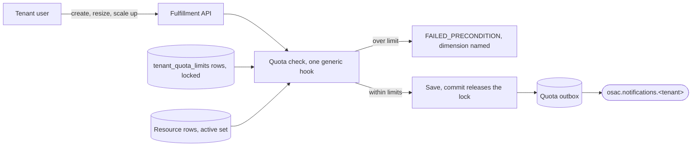

# Quota Foundation

| Field       | Value   |
|-------------|---------|
| Author(s)   | Omer Vishlitzky |
| Jira        | [OSAC-4500](https://redhat.atlassian.net/browse/OSAC-4500) |
| PRD         | [PRD](prd.md) |
| Date        | 2026-11-03 |

## Summary

A tenant can hold as many VMs, clusters, bare-metal hosts, volumes, and addresses as it asks for. One tenant can
consume a deployment's shared capacity and block every other tenant. This design adds tenant-scoped usage quota
inside the fulfillment service:

- **Each resource declares its own cost.** Proto annotations name the dimensions a resource holds. A registry walks the
  annotations, and the checker names no resource. A new service ships annotations and gets enforcement.
- **The check runs inside the request transaction.** One generic hook in the shared CRUD path locks the tenant's limit
  rows, counts held usage, and rejects the order before anything is saved.
- **Usage is counted, never stored.** The resource rows are the usage, so no counter can drift and quota state that is
  lost rebuilds by counting rows.

See [PRD](prd.md) for detailed requirements.

## Proposal

### Big picture



| Who | When | What it does |
|---|---|---|
| Tenant user | On create, resize, scale up | Submits the order and sees the rejection or the accepted order. |
| Quota check | Inside the request transaction | Locks the tenant's limit rows, counts usage, prices the order. |
| Controllers | After an order is granted | Create owned sub-resources that carry owner references and skip the check. |
| Tenant onboarding | When a tenant is created | Copies the default limits into the tenant's rows. |
| Quota publisher | Continuously | Drains the quota outbox into the notifications topic. |

### Key ideas

1. **A resource declares its own cost.** The declaration sits beside the resource's fields, the way metering's
   annotations declare what is tracked. A new resource type or dimension is annotations and limit rows, both data.
2. **The check sits on the provisioning path, under lock.** It runs in the shared CRUD path, inside the request
   transaction, before the save. This is the core architecture's invariant: quota reads the database under lock.
3. **Usage is counted from the rows on demand.** The check and the tenant view count the tenant's active rows, so no
   stored counter exists that could drift.
4. **One attribution rule.** A resource counts through exactly one declaration: its own, or its owner's when the system
   created it to execute an order.
5. **Quota events ride the notifications outbox.** A threshold crossing rides the request's transaction; a rejection is
   written after the abort; a publisher delivers both.

### Running example

Tenant `acme`, project `web`. Dana is the Cloud Provider Admin. `dev@acme` is a tenant user. VM `vm-7` is of instance
type `small` (2 vCPUs, 8 GiB). Cluster `prod` has node set `compute` with workers of bare-metal type `acme-1tb`.
Acme's limits: 8 vCPUs, 32 GiB of memory, 10 `acme-1tb` instances, 5 control planes, 20 external IPs.

| When | What happens |
|---|---|
| 09:00 | Onboarding copies Dana's default limits into acme's rows. |
| 09:00 | Default networking adds one NAT gateway and one IP to usage. |
| 09:30 | Acme's tenant admin sets a warning threshold at 50 percent of the vCPU dimension. |
| 10:00 | `dev@acme` submits cluster `prod`: node set `compute` of 3 workers, plus two endpoint IPs. |
| 10:00 | The check locks acme's rows, counts usage, and prices the order: 1 control plane, 3 `acme-1tb`, 2 IPs. |
| 10:00 | Everything is within limits, so the order commits. |
| 10:00:01 | The controller creates the 3 workers and 2 IPs. Each carries an owner reference to `prod`. |
| 10:05 | `dev@acme` submits `vm-8` (6 vCPUs) while a script submits `vm-9` (2 vCPUs). Held: 2 vCPUs on `vm-7`. |
| 10:05 | The two orders serialize on the lock. `vm-9` commits first: usage 4, and the threshold event rides along. |
| 10:05 | `vm-8` is rejected: vCPUs, limit 8, in use 4, requested 6. |
| 10:10 | `dev@acme` scales node set `compute` from 3 to 5. The check prices the difference: 2 more, held 3, limit 10. |
| 10:15 | `dev@acme` scales the node set from 5 to 12. Rejected: `acme-1tb`, limit 10, in use 5, requested 7. |
| 11:00 | Dana lowers the vCPU limit from 8 to 2. `vm-7` and `vm-9` keep running. |
| 11:00 | New VM orders are rejected, and the tenant view shows usage 4 against limit 2. |
| 11:30 | `dev@acme` deletes `vm-9`. Usage drops to 2 when the delete commits. |
| 12:00 | `dev@acme` submits cluster `staging`. The order commits and holds its cost from submission. |
| 12:30 | Provisioning fails and the cleanup deletes the cluster, its workers, and its IPs. Usage drops with the rows. |

## Motivation

- The API enforces no upper bound on what a tenant holds. A single tenant can consume shared capacity and block every
  other tenant, and the provider cannot enforce the limits it sold.
- A Tenant User learns a resource is unavailable only when provisioning fails partway through, with no way to see the
  headroom beforehand or the reason after.
- Metering cannot serve as the check. It reports consumption integrated over time, and it reports eventually. Quota
  needs what a tenant holds right now, answered before the order commits.
- Budget quota and billing enforcement need a settled usage foundation first, which this design provides.

## Behavior changes

- A create, resize, or scale up that carries a quota cost is checked before the save. An order over limit is rejected
  with `FAILED_PRECONDITION` naming the dimension, the limit, the usage, and the requested amount.
- Concurrent orders for one tenant serialize on the tenant's limit rows, inside the request transaction.
- Sub-resources created to execute an order carry an owner reference to the order's resource. Cluster workers already
  do; the external IPs a cluster creates for its endpoints gain one.
- New APIs: an admin service for tenant limits, a tenant-facing usage view, and services for thresholds and increase
  requests.
- New tables for limits, thresholds, and the quota event outbox.
- Tenant onboarding copies the deployment's default limits into the tenant's rows.
- Quota writes threshold and rejection events to its outbox, and a publisher drains them to
  `osac.notifications.<tenant>`.
- The reserved `system` and `shared` tenants stay outside quota, matching the billing design's exemption.

## Goals and Non-Goals

### Goals

- Quota decides inside the request transaction, before anything is saved.
- One generic checker. A new resource type or dimension arrives as annotations and limit rows.
- Atomic enforcement across concurrent orders for one tenant.
- Composite orders priced whole: a cluster order covers its control plane, its workers, and its endpoint IPs.
- Usage recomputable from the resource rows at any time.
- The PRD's dimensions, scoped to the tenant.

### Non-Goals

- Budget quota, limits in currency, and billing enforcement. They build on this foundation later.
- Project-scoped and label-scoped quota. The PRD scopes quota to the tenant.
- Fair-share, borrowing, preemption, and expiring allocations. The PRD rules them out.
- Capacity reservation. A limit permits provisioning up to an amount and guarantees no hardware.
- Quota on workloads inside a tenant's own cluster or VM. OSAC cannot observe them.
- MaaS token and request rate limits. A rate over a time window is a separate PRD.
- Historical usage reporting. The tenant view shows current usage against limits.

## Design Details

### Dimensions and declarations

A dimension is a resource kind and its unit, spelled as one flat key such as `compute.vcpus`. A typed dimension
embeds the class name: the storage tier, the GPU type, the bare-metal instance type. Limits are stored per tenant
and dimension, so a new class is a new key, which is a row of data. The initial dimensions, from the PRD:

| Dimension | Unit | Held by |
|---|---|---|
| `compute.vcpus` | cores | a VM, through its instance type |
| `compute.memory_gib` | GiB | a VM, through its instance type |
| `compute.gpu.<gpu type>` | count | a VM, through its instance type |
| `storage.volumes` | count | a volume |
| `storage.<tier>.gib` | GiB | a volume |
| `images.count` | count | a tenant-uploaded image |
| `images.gib` | GiB | a tenant-uploaded image |
| `network.external_ips` | count | an external IP |
| `network.nat_gateways` | count | a NAT gateway |
| `network.virtual_networks` | count | a virtual network |
| `bare_metal.instances.<instance type>` | count | a standalone instance, a cluster node set |
| `caas.control_planes` | count | a cluster |

A resource's proto declares its cost beside its fields, the way metering's annotations declare tracked fields. Four
cost kinds cover every case, and a cost may carry a guard, a boolean field that switches it on:

| Kind | The resource holds | Example |
|---|---|---|
| count | one of the dimension | a virtual network holds one `network.virtual_networks` |
| field | a field's value of the dimension | a volume holds its `size_gib` of `storage.<tier>.gib` |
| through | the costs a referenced type declares | a VM holds its instance type's vCPUs and memory |
| set | per map entry, the entry's size times the entry's type costs | a node set holds size times the type's count |

The shape of a declaration (the final proto option syntax is settled in implementation):

```proto
message ComputeInstanceSpec {
  // The VM holds what its instance type declares: 2 vCPUs and 8 GiB for `small`.
  InstanceTypeReference instance_type = 1 [(osac.private.v1.quota) = {
    through: {vcpus: "compute.vcpus", memory_gib: "compute.memory_gib"}
  }];
}

message ClusterSpec {
  // Each node set holds its size in instances of its bare-metal type, and the
  // cluster holds one control plane and, while the guard is set, two endpoint IPs.
  map<string, ClusterNodeSet> node_sets = 3 [(osac.private.v1.quota) = {
    set: {dimension: "bare_metal.instances.{baremetal_instance_type}", size: "size"}
  }];
}
```

A `through` cost resolves the reference and reads the referenced type's own declaration. An instance type declares its
vCPUs and memory as field costs, so a VM inherits them. A bare-metal instance type declares one count of its own key,
so a standalone instance holds one `bare_metal.instances.<its type>` and a node set holds its size of the same key.

A registry, `proto/quota`, mirrors `proto/metering`: it walks the compiled private protos, collects every quota
annotation, and fails loudly on an invalid one. It rejects a path that does not resolve, a referenced type that
declares no costs, and an annotation unreachable from a resource message. The checker and the tenant view read this
one registry, and the dimension keys live in the annotations and the limits rows. No Go map of dimension names
exists to edit.

**A new service is data.** Suppose OSAC adds WaaS, and a WaaS deployment holds units of another service, WaaS2. The
WaaS proto declares a `set` on its WaaS2 pools, the way a cluster declares node sets, and the WaaS2 type declares its
own costs. The registry picks the annotations up, the checker prices a WaaS order in the WaaS2 dimensions, and the
admin sets limits on the new keys. The quota engine changes nothing. Metering already has this property, and quota
matches it: new resource types and dimensions are data.

### Where the check sits

Fulfillment serves every write through one shared CRUD path: the public server maps the object, the private server
validates it, and `GenericServer` saves it through the DAO. A gRPC interceptor opens one transaction per request and
commits when the handler returns, and database triggers capture the save into the `changes` outbox in the same
transaction.

The quota check is one hook in that path. `GenericServerBuilder` installs it for every resource whose proto declares a
cost, and the hook runs in candidate preparation: after validation, before the save, on create and update alike. On
update it sees the stored object and the proposal, so it prices the difference. Controllers write through the private
API, so system writes reach the same hook.

What the caller sees:

- gRPC: `FAILED_PRECONDITION`, reason `QUOTA_EXCEEDED`, with the dimension, the limit, the usage, and the requested
  amount. A composite rejection names the part of the order that hit the limit: node set `compute` of cluster `prod`,
  `bare_metal.instances.acme-1tb`, limit 10, in use 5, requested 7.
- REST: the gateway's mapping of `FAILED_PRECONDITION`, 400, with the same body.
- The message names the quota, so a quota denial is told apart from a permission denial from the error alone.

A dry-run create runs the check and returns the candidate without saving, so a Tenant User can see whether an order
fits before submitting it. The tenant view (below) shows the headroom per dimension.

### Counting usage, atomically

The check runs inside the request transaction, in four steps:

1. Lock the tenant's rows in `tenant_quota_limits`, with one `SELECT ... FOR UPDATE` ordered by dimension.
2. Count held usage: for every declared resource, list the tenant's active rows and sum their declared costs. Rows
   that carry an owner reference are skipped here, because their cost sits on their owner.
3. Price the order from the candidate, including its sub-resources.
4. Compare per dimension: usage plus requested against the limit. Over limit: return the error. The transaction rolls
   back and nothing is saved.

The lock is the serialization point, and it releases at commit. Two concurrent orders for the last headroom: the
first takes the lock, counts, saves, commits. The second waits, then counts the first order's committed rows, and it
is rejected when the headroom is gone. This is the row-lock pattern the external IP pools already use for capacity,
with the tenant as the unit of serialization.

The lock is always taken before any resource row is touched, and counting reads rows without locking them. No
transaction ever waits for a resource row while holding quota locks, so deadlocks cannot form between two orders.

Usage is counted, never stored. Deleting a resource moves its row out of the active set in the delete's transaction,
so usage is released on deletion with no quota code on the delete path. A delete only lowers usage, so it needs no
check.

Resizes and scale ups price the difference: the proposal's cost replaces the stored object's cost, and the check
compares the increase against headroom. A decrease always passes, and a dimension already over limit rejects any
increase.

**A granted order holds its cost from submission.** The order's row commits at submission and carries the full
cost, including sub-resources the controller creates later. Later orders see the committed cost, so the granted
order always has room for its workers. When provisioning fails and the cleanup deletes the resource, usage drops
with the rows. A resource the tenant keeps counts until the tenant deletes it, whatever its state: running, idle,
or stopped.

**Quota fails closed.** The check and the save share one database and one transaction, so a quota state that cannot be
read also blocks the save, and the order is rejected. No mode exists in which the check is skipped while the write
proceeds. A tenant always owns limit rows: onboarding creates them, and a startup sync adds rows when new dimensions
ship. A check that finds a dimension without a row fails closed with an internal error, because that state means the
deployment is broken.

### Composite resources and ownership

Provisioning one resource can provision others under it: a cluster provisions worker instances, and with endpoint IPs
enabled it provisions two external IPs. Quota attributes every sub-resource through one rule.

**A resource counts through exactly one declaration: its own, or its owner's.** A sub-resource created to execute an
order carries an owner reference, a typed reference naming the resource it serves, and counts through the owner's
declaration. A resource without an owner reference counts its own declaration. The link is the same one metering
uses: the `owner_resource` annotation on the owner-reference field, which cluster workers already carry, and quota
reads the same annotation.

So the cluster's workers, rows in `bare_metal_instances`, are skipped by the standalone count because they carry
`status.cluster`, and their cost sits in the cluster's own row through its node sets. The order was checked whole at
submission, and the controller's later writes execute a granted order: they skip the check and count once committed.
The endpoint IPs a cluster creates name their target through an attachment today; this design adds an owner reference
to them so they count through the cluster the same way.

**Attachments answer who uses a resource; owner references answer who caused it.** An IP attachment records that a VM
uses an IP. Both resources already exist and both count their own dimensions in the tenant, so the attachment changes
no count. An owner reference records that the system created a resource for one order, and that is the link quota
follows. The two mechanisms stay what they are, and quota reads each for what it carries, which is how the core
architecture's attribution model is meant to be read.

**System-created tenant machinery counts and is never blocked.** Default networking, a virtual network with a NAT
gateway and an IP, is created for a whole tenant at onboarding with no owner resource. It counts toward usage so the
tenant sees it, and the write carries `creator: system`, so it skips the check. Blocking it would make a new tenant
unusable while dimensions default to zero. The bypass is one rule: a write whose object carries an owner reference,
or whose creator is `system`, skips the check and still counts.

### Limits, defaults, and the tenant view

Three new tables, all regular resources served by the generic server, so they get tables, change events, and audit
capture with no extra machinery:

- `tenant_quota_limits`: one row per tenant and dimension, holding the limit and whether it came from a default.
  Locked by the check, written by the admin API and by onboarding.
- `tenant_quota_thresholds`: one row per tenant and dimension, holding a warning percent.
- `quota_outbox`: threshold and rejection events, drained by the publisher.

Default limits live in `quota_default_limits`, one row per dimension, owned by the Cloud Provider Admin. Onboarding
copies the defaults into the tenant's rows; the tenant reconciler, which already creates default networking, does the
copy. Later default changes apply to new tenants. A dimension with no default row reads as zero.

The APIs:

- `TenantQuotaLimits`, Cloud Provider Admin: get, list, and set a tenant's limit per dimension. A change takes the
  same tenant lock as a check, so a check never reads a limit mid-change.
- `TenantQuotas`, tenant-scoped read: per dimension, the limit, the usage, the headroom, and the over-limit flag.
  Computed on demand with the same counting code, with no lock. This powers the UI (OSAC-4504, OSAC-4505) and the CLI.
- `TenantQuotaThresholds`, Tenant Admin: set and clear warning thresholds.
- `TenantQuotaRequests`: the increase workflow. A request stores the tenant, dimension, requested limit, reason, and
  status. Approval writes the limit through `TenantQuotaLimits`; denial records the reason.

Every quota change is a row change on a quota table, captured by the `changes` outbox like any resource change and
folded by the audit design. That gives the who, when, previous value, and new value. The acting user arrives on
events with request capture (OSAC-6154).

### Quota events

Quota follows the notifications design's emission contract:

- **A threshold crossing rides the request's transaction.** An accepted order that moves usage across a threshold
  writes the event into `quota_outbox` in the same transaction as the change, so the event exists exactly when the
  change commits. Crossing back writes a cleared event.
- **A rejection is written after the abort.** The request transaction rolled back, so quota writes the rejection
  event in its own small committing transaction, naming the dimension, the limit, and the usage.
- **A publisher drains the outbox** to `osac.notifications.<tenant>`, the side-channel topic family. The event types
  are `osac.quota.threshold.crossed.v1`, its cleared variant, and `osac.quota.rejected.v1`. A threshold is warning
  severity. A condition opens once per crossing, keyed by tenant and dimension, so a tenant above its threshold gets
  one notice and silence until usage drops below and crosses again.
- **A delivery failure never fails the flow that caused it.** The publisher owns retries and quarantine, per the
  notifications design.

### Rebuild and recovery

Usage has no stored copy to lose or recompute. The check and the tenant view count the tenant's active rows, so a
recount at any time produces the same numbers when nothing changed. Direct SQL writes are counted, because they are
rows. A direct SQL write skips the check, which is today's behavior for every guard and serves as an operational
escape hatch.

Quota's own tables hold configuration: limits, thresholds, requests. They restore with the database like any table,
and every change to them is in the change log.

### What happens when

| Situation | What happens |
|---|---|
| Two orders race for the last headroom | The lock serializes them; the second is rejected when it no longer fits. |
| An order is rejected | The error names dimension, limit, usage, and requested amount; nothing is saved. |
| A rejection event | Written after the abort, in its own committing transaction. |
| Provisioning fails after the order commits | The cleanup deletes the resource and sub-resources; usage drops. |
| A tenant keeps a resource in a failed state | It counts until the tenant deletes it. |
| A limit is lowered below usage | Resources keep running; orders on that dimension are rejected; the view flags it. |
| A resize or scale up | The check prices the difference against headroom; a decrease always passes. |
| A sub-resource reaches the hook | It carries an owner reference; it skips the check and counts through its owner. |
| Default networking is created | The write has `creator: system`; it skips the check and counts. |
| The CSI driver creates a volume for a PVC | Open question; see Open Questions. |
| Quota state cannot be read mid-order | The order is rejected; the check and the save share one transaction. |
| A dimension ships with no default | It reads as zero; every order on it is rejected until a limit is set. |
| A row is written by direct SQL | It is counted, because counting reads rows; it skips the check, as any guard does. |
| A new resource type ships | Its proto carries the annotations; the registry and the checker pick it up. |
| A tenant is offboarded | Its limit, threshold, and request rows go with the tenant. |

## Risks and Mitigations

- **The check pays a count per write.** One pass over the tenant's active rows per checked write, bounded by tenant
  size and served by the existing tenant index. If profiling shows a cost at scale, maintained counters replace the
  count and change only how usage is read.
- **The annotation shape is the hard part.** Composites and catalog lookups are where declarations get intricate. The
  registry fails loudly on a bad annotation, and quota keeps one copy of the contract, the registry itself, where
  metering keeps a SQL twin beside it.
- **Rollout can lock existing tenants.** With every dimension defaulting to zero, enforcement that activates on
  upgrade blocks every tenant until limits are set. The activation story is an open question.

## Drawbacks

A tenant's checked writes serialize on one lock, so one slow order adds its latency to the next order's wait. Every
checked write counts the tenant's rows, so write cost grows with tenant size. The declaration work lands on every
team that adds a resource type: annotations are now part of what a new offering ships.

## Alternatives

- **A separate quota service with its own database.** The check would race the request outside its transaction, which
  the core architecture forbids, and the count needs the resource rows, which live in the fulfillment database.
- **Usage counters maintained by database triggers.** A second SQL copy of the cost contract, with JSON extraction and
  catalog joins in SQL, plus a recompute path after incidents. It buys speed the foundation does not need yet.
- **A transaction-scoped advisory lock for serialization.** The lock would store nothing, and the limits table
  exists anyway. The row lock keeps the serialization point visible to row-based deadlock analysis.
- **An async check that reconciles over-limit tenants.** Rejection would arrive after provisioning began, which the
  PRD rules out.
- **Quota as a consumer of the metering pipeline.** Metering reports consumption over time and eventually; quota
  needs instantaneous holdings decided in under a second. Quota reuses metering's declaration mechanism and leaves
  its event contract alone.

## Open Questions

1. CSI volumes: does block-storage quota block PVC creation inside tenant clusters, or count without blocking in this
   foundation? Blocking turns the rejection into a stuck PVC; letting it through lets a tenant exceed its storage
   quota through its cluster.
2. Rollout: how does enforcement activate on an existing deployment so the upgrade does not block every tenant before
   limits are set? A deployment-wide switch, or activation on first configuration?
3. Who owns the dimension vocabulary: the proto annotations alone, or a published list the limits API validates
   against?
4. Does the increase-request workflow land with the foundation or as a follow-up? The PRD lists it; it is UI-heavy
   and separable.
5. Does a resize that stays within its own dimension pass while another dimension is over limit? This design prices
   only the dimensions the order touches; confirm that is the product's intent.

## Test Plan

Behaviors to check, one per PRD criterion:

1. Every dimension defaults to zero: an order on an unconfigured dimension is rejected.
2. A new tenant starts with the configured default limits.
3. Raising and lowering a limit takes effect at once; lowering below usage blocks new orders and terminates nothing.
4. Concurrent orders for one tenant cannot together exceed a limit that any one of them alone would fit: submit
   parallel orders for the last headroom and count the acceptances.
5. A rejection names the dimension, the limit, the usage, and the requested amount; a composite rejection names the
   underlying dimension and the part of the order that hit it.
6. Usage stays accurate through a failed order: the cleanup releases it.
7. A composite order is priced whole: a cluster order covers its control plane, its workers, and its endpoint IPs.
8. A resource counts from creation until deletion, whether running, idle, or stopped.
9. A threshold crossing writes the event in the request's transaction; crossing back clears it; one notice arrives
   per crossing.
10. The tenant view shows usage, limits, headroom, and the over-limit state.
11. The registry fails loudly on an invalid annotation: a wrong path, an unknown reference, an unreachable field.
12. A new resource type with annotations is enforced with no checker change, proven with a test resource in the suite.
13. Every quota change is captured by the change log with the previous and new values.
14. Sub-resources with owner references skip the check and count through their owner; writes with `creator: system`
    skip the check and count.
15. The `system` and `shared` tenants are never checked.

---

## Provenance

Authored: design draft, 2026-11-03, from the merged PRD and the quota research digest.

> Authoring phases not recorded this session.
