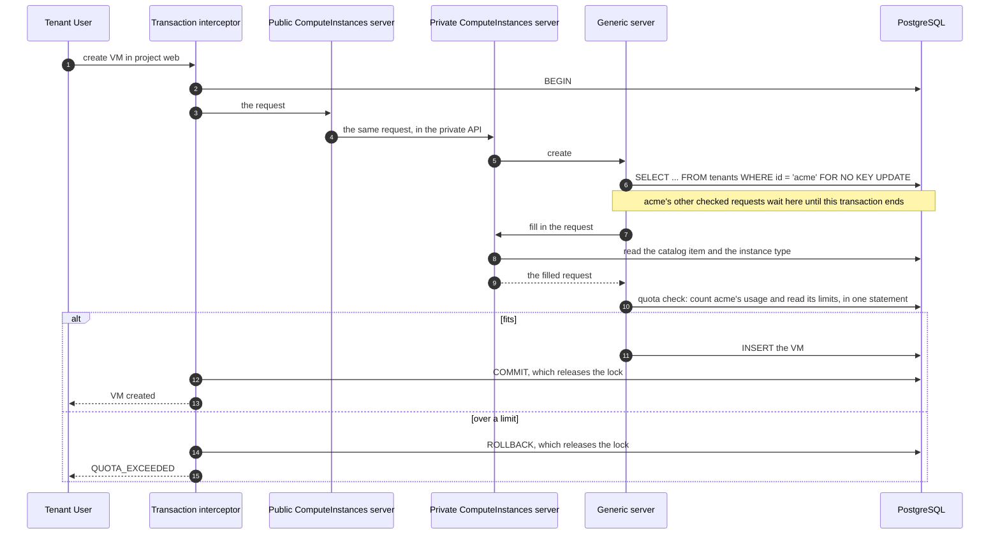

# Quota Foundation

| Field       | Value   |
|-------------|---------|
| Author(s)   | Omer Vishlitzky |
| Jira        | [OSAC-4500](https://redhat.atlassian.net/browse/OSAC-4500) |
| PRD         | [PRD](prd.md) |
| Date        | 2026-11-03 |

## Summary

Today nothing limits what a tenant creates, so one tenant can fill the provider's servers and block every other
tenant. This design adds quota: limits on what each tenant, and each project in it, can use. See the [PRD](prd.md)
for the requirements.

1. **Each resource declares its price in quota annotations on its proto fields.** A VM's `instance_type`
   field says the VM uses that instance type's vCPUs and memory. A cluster's node set says OSAC will create `size`
   hosts of the node set's host type.
2. **On each create or update, the fulfillment service computes the request's full price.** The resource's private
   gRPC server, such as `osac.private.v1.ComputeInstances` for a VM, fills in the request, for example from its
   catalog item. Then the quota check follows the annotations down through everything OSAC will create for the
   request, such as a VM's disks or a cluster's hosts, and adds it up.
3. **The quota check compares the price with the limits.** It adds the price to what the tenant uses now, and checks the
   sum against the limits of the request's project, each project above it, and the tenant. If the sum is over any
   limit, the request fails with `QUOTA_EXCEEDED` and nothing is written.
4. **Requests in one tenant are checked one at a time.** Before the fill-in, the generic server's shared create and
   update code locks the tenant's row until the request commits or rolls back. So
   the tenant's next request counts only after this one is done, and other tenants don't wait.
5. **The controllers then create the resources, and quota counts them in place of what was asked for.** Each
   resource OSAC creates is linked to the resource it was made for. Quota counts the larger of what is asked for and
   what exists, so a cluster that asks for 3 hosts counts 3 hosts before and after they exist, never 6.
6. **Admins set the limits.** The Cloud Provider Admin sets default limits for all tenants and overrides for one
   tenant. A Tenant Admin sets project limits and warning thresholds, and asks for higher limits. A project limit
   can be higher than the tenant's; the tenant's limit still holds. A tenant limit nobody set is 0, so after
   install every create that uses resources fails until the defaults are set. The built-in `shared` and `system`
   tenants aren't checked.

## Motivation

Today nothing limits what a tenant creates. Tenant `acme` can create VMs until the provider's servers are full, and
then every tenant's next create fails. A Tenant Admin also can't cap what each of its projects uses, and nobody is
warned before a tenant runs out.

### Goals

- Check each create and update in full, with all that OSAC will create for it, before anything is written.
- Count usage from the database on each request, with no stored total that can drift.
- Check OSAC's own creates like a user's.
- Add a new resource, a storage tier or a host type, with no change to the quota code.

### Non-Goals

- Limits in money, and billing enforcement, which build on this design later.
- Limits by label, shared or borrowed limits, limits that expire, and capacity reservations.
- Limits on what runs inside a tenant's cluster or VM, such as pods.
- Image size, which disk images don't record today.
- Checking several requests as one, warnings for the Cloud Provider Admin, and dry runs of updates.

## Proposal

| Part | What is new or changes |
|---|---|
| Quota annotations | New proto options that declare what each resource uses |
| Quota check | New, in the generic server's create and update, after the private server fills in the request |
| Tenant lock | Taken first by the generic server in each checked request. Today only the VM and networking creates take it |
| Private Clusters server | In a checked update, locks the cluster's row after the tenant lock |
| Quota APIs | Four new gRPC services: limits, usage, thresholds and limit requests |
| Quota tables | Five new tables: limits, default limits, thresholds, limit requests and unsent warnings |
| Quota publisher | New. Sends each warning to the tenant through the notifications API |

### Rules that always hold

| Rule | What keeps it true |
|---|---|
| A request over a limit writes nothing | The check and the write share one transaction |
| Two requests in one tenant never both take the last vCPU | The lock before the count, at READ COMMITTED; a test |
| A checked request locks its tenant before any other row | The generic server; a test |
| Each resource declares its price in annotations; the quota code hard-codes no resource | The annotations; a test |
| A resource and what OSAC creates for it count once, never less than what exists | The larger-of rule |
| A link counts only when its creator is `system` | The count query |
| A type's price never changes under running resources | `validateInstanceTypeImmutability`; `check_immutable_columns` |
| A resource's tenant and project never change | `check_immutable_columns` (migration 100) |

### Workflow Description

**Cloud Provider Admin** sets default limits, such as 10 vCPUs for every tenant, and overrides for one tenant. They
approve or deny limit requests; approving one sets the tenant's override.

**Tenant Admin** sets limits on projects, such as 8 vCPUs for project `web`, and thresholds, such as a warning at 80%
of a limit. They see usage and room left in `QuotaUsage`, and ask for a higher limit in `QuotaLimitRequests`.

**Tenant User** creates resources as today. Example: tenant `acme` has a limit of 10 vCPUs and project `web` has a
limit of 8. `web` runs a single VM with 2 vCPUs.

1. The user creates a VM in `web` from a catalog item with instance type `small`, which consumes 2 vCPUs.
2. The check counts 2 + 2 = 4 vCPUs. That fits `web`'s 8 and `acme`'s 10, so the VM is created.
3. The user then creates a VM from instance type `large`, 6 vCPUs. 4 + 6 = 10 is over `web`'s 8, so the request fails:

```text
FAILED_PRECONDITION: quota exceeded: project web, compute.vcpus: limit 8, usage 4, adding 6
```

Nothing is written, and the user can retry after deleting other resources or getting a higher limit.



### API Extensions

- **New gRPC services** in the fulfillment API, with REST through the existing gateway:
  - `QuotaLimits` gets, lists, sets and clears limits: defaults, tenant overrides and project limits.
  - `QuotaUsage` is read-only. For the tenant and each project, it shows each limit, the usage and the room left,
    and marks each dimension that is over its limit.
  - `QuotaThresholds` gets, lists, sets and clears thresholds; a threshold is a percent of a limit. It refuses a
    threshold on a scope with no limit, the tenant or a project.
  - `QuotaLimitRequests` holds limit requests, which are pending, approved or denied.
- **Quota annotations:** new options in the private protos: `osac.private.v1.quota` on a field and
  `osac.private.v1.quota_message` on a message.
- **New error:** `FAILED_PRECONDITION` (HTTP 400) with ErrorInfo reason `QUOTA_EXCEEDED` and a QuotaFailure that
  names the limit, the usage and what the request adds. It also names the part of the request that adds it, such as
  node set `workers`. `FAILED_PRECONDITION` tells clients the request can pass only after a delete or a higher
  limit. The reason is not `RESOURCE_EXHAUSTED`: that maps to HTTP 429 and tells clients to retry soon, but usage
  frees only when resources are deleted or a limit is raised.
- **Changed behavior:** today's dry run of a create (`X-Dry-Run`) now runs the check too.

## UX Alignment

There is no quota UI yet. OSAC-4504 designs the quota screens, and OSAC-4505 builds them.

## Implementation Details/Notes/Constraints

### Quota annotations declare the price

A **dimension** is one quantity a limit counts, such as `compute.vcpus`, `storage.fast.gib` or
`bare_metal.instances.metal-1tb`. The dimensions are:

- `compute.vcpus`
- `compute.memory_gib`
- `compute.gpu.<resource_name>`
- `storage.volumes`
- `storage.<tier>.gib`
- `images.count`
- `network.external_ips`
- `network.nat_gateways`
- `network.virtual_networks`
- `bare_metal.instances.<host type>`
- `caas.control_planes`

A **type** is a resource that other resources point to for their size, such as an
instance type or a host type. A type itself counts toward no limit.

| Option | Where it goes | What it means |
|---|---|---|
| `dimension` | On a field | The field's value is how much of the dimension one resource uses, such as a volume's `size_gib` |
| `dimension` | On a message | Each resource uses 1 of the dimension, such as 1 control plane per cluster. On a type, each resource of that type uses 1 |
| `through` | On a field that points to a type | The resource uses what the type's annotations say, such as a VM using its instance type's vCPUs and memory |
| `larger_of` | Next to `through` | A second field that points to the same type. The resource uses the larger amount on each dimension, as the counting rule below says |
| `creates` | On a field | OSAC will create resources of the given `kind` for the field: one for a message that is present or a bool that is true, one for each list entry or map value |
| `each` | Inside `creates` | A list inside the field's message, such as `items`. Each entry of that list is one item |
| `count` | Inside `creates` | How many resources to create for each item, as a fixed number |
| `count_field` | Inside `creates` | How many resources to create for each item, read from a field of the item, such as a node set's `size` |
| `set` | Inside `creates` | Fields of each new resource. Each key is a field of the new resource, and each value is a path from the item |
| `created_for` | On a message, or on the field that holds the link | How a resource that OSAC creates for a parent points back to it: by a field, by its name, or by labels |

**Paths** start at the resource, such as `status.instance_type`. A path in braces puts its value into a dimension,
such as `storage.{spec.storage_tier}.gib`. Inside `creates`, `count_field` and the values in `set` are paths from the
**item**: the field's value, each entry of its list, or each value of its map. In a name, `{parent}` is the parent's
ID.

The annotations are declarations, not data: nothing fills them in. At check time the checker walks the filled request
against them and sums what it reads.

```proto
message InstanceTypeSpec {
  int32 vcpus = 1 [(osac.private.v1.quota) = {dimension: "compute.vcpus"}];
  int32 memory_gib = 2 [(osac.private.v1.quota) = {dimension: "compute.memory_gib"}];
}

message ComputeInstanceSpec {
  // One volume for the boot disk. additional_disks has the same annotation plus each: "items", one volume per disk.
  optional ComputeInstanceDisk boot_disk = 8 [(osac.private.v1.quota) = {creates: {
    kind: "Volume", set: {"spec.size_gib": "size_gib", "spec.storage_tier": "storage_tier.name"}
  }}];
  InstanceTypeReference instance_type = 17 [(osac.private.v1.quota) = {
    through: "InstanceType", larger_of: "status.instance_type"
  }];
  // One external IP address, when the field is true.
  optional bool auto_external_ip_attachment = 18 [(osac.private.v1.quota) = {creates: {kind: "ExternalIP"}}];
}

message Volume {
  // A VM's disk volume is named "ci-", the VM's ID, then the disk.
  option (osac.private.v1.quota_message) = {
    dimension: "storage.volumes",
    created_for: {parent: "ComputeInstance", name_prefix: "ci-{parent}-"}
  };
}

message VolumeSpec {
  int64 size_gib = 2 [(osac.private.v1.quota) = {dimension: "storage.{spec.storage_tier}.gib"}];
}

message ExternalIP {
  // An automatic external IP address holds its parent's ID and what the parent is, in two labels.
  option (osac.private.v1.quota_message) = {
    dimension: "network.external_ips",
    created_for: {id_label: "osac.openshift.io/auto-created-for", kind_label: "osac.openshift.io/auto-created-kind"}
  };
}

message Cluster {
  option (osac.private.v1.quota_message) = {dimension: "caas.control_planes"};
}

message ClusterSpec {
  // For each node set, as many hosts as its size, each of the node set's host type.
  map<string, ClusterNodeSet> node_sets = 3 [(osac.private.v1.quota) = {creates: {
    kind: "BareMetalInstance", count_field: "size", set: {"spec.instance_type": "baremetal_instance_type"}
  }}];
  // Two external IP addresses: one for the cluster's API and one for its apps.
  optional bool auto_external_ip_attachment = 10 [(osac.private.v1.quota) = {
    creates: {kind: "ExternalIP", count: 2}
  }];
}

message BareMetalInstanceSpec {
  BareMetalInstanceTypeReference instance_type = 11 [(osac.private.v1.quota) = {through: "BareMetalInstanceType"}];
  optional bool auto_external_ip_attachment = 9 [(osac.private.v1.quota) = {creates: {kind: "ExternalIP"}}];
}

message BareMetalInstanceStatus {
  ClusterLocalReference cluster = 8 [(osac.private.v1.quota) = {created_for: {parent: "Cluster"}}];
}

message BareMetalInstanceType {
  // Each host of this type uses 1 of the type's own dimension, such as bare_metal.instances.metal-1tb.
  option (osac.private.v1.quota_message) = {dimension: "bare_metal.instances.{metadata.name}"};
}
```

Instance type sizes and host type names can't change, so the price of a type never changes under a running resource.

### The check computes the full price after the fill-in

The resource's private server calls the generic server's create or update, which calls back into the private server to
fill in the request. Then the check runs, inside the same transaction, on:

- each create of an annotated resource, except a type;
- each update whose field mask names a spec field an annotation reads, such as a node set's `size`;
- each update with no field mask.

Deletes aren't checked. Status fields don't trigger the check, since they record what already exists, such as the type
a VM runs. A request must fit only on the dimensions it adds to, so a create that adds nothing fits even
at a limit of 0. An update adds the difference between the new and the old version, so a shrink always fits.

### The check counts usage from the database

Usage is counted on each request with one SQL statement over the tenant's rows, one query per resource type, under READ
COMMITTED. One statement means every query sees the same committed rows. A resource counts until OSAC archives it,
including stopped resources.

### One request per tenant at a time

**How locking works today.**

- Each gRPC request runs in one database transaction. The fulfillment service's transaction interceptor begins it
  before any server code runs, and commits or rolls it back after the server returns. Every row lock that the
  request takes is held until then.
- The public server maps the request to the private API and calls the resource's private server, in the same process
  and transaction. The private server calls the generic server, which calls back into the private server to fill in
  the request, and then writes the row.
- VM and networking creates lock the tenant's row with `SELECT ... FOR UPDATE` during the fill-in, so a create and
  the tenant's delete never both succeed. No other create or update of a tenant's resources locks the tenant's row.
- An update locks the resource's own row with `SELECT ... FOR UPDATE` before it changes it. The private Clusters
  server's update locks the cluster's row before any other row.

So today, two creates in one tenant can run at the same time, and nothing adds up what the tenant holds.

**How quota uses it.** Each checked request locks its tenant's row before any other row, and counts only after it
holds that lock. The lock is on the request's tenant row in the `tenants` table. There is one row per tenant, so one
lock covers all of the tenant's projects. The lock mode is `FOR NO KEY UPDATE`, which doesn't block foreign-key
checks on the tenant's row. Nearly every table references `tenants` (migration 68), so inserts that don't take the
lock don't wait for it.

A checked create takes these steps in the request's transaction:

1. The public server calls the resource's private server, which calls the generic server's create.
2. The generic server sets the creator and the tenant, then locks the tenant's row:
   `SELECT ... FROM tenants WHERE id = $1 FOR NO KEY UPDATE`. This is the request's first lock.
3. The generic server calls back into the private server, which fills in the request. It may lock other rows, such
   as a subnet. VM and networking creates also take today's tenant lock here, and `lockTenantForCreate` now takes
   `FOR NO KEY UPDATE` too. It is the same row and mode in the same transaction, so it doesn't wait.
4. The quota check counts usage and compares it with the limits.
5. The generic server inserts the row.
6. The interceptor commits, which releases every lock. On any error it rolls back, which also releases them, and
   nothing is written.

A checked update first reads the stored resource's tenant, which never changes, and locks the tenant's row. Then it
locks the resource's row, as today, and the private Clusters server locks the cluster's row after the tenant lock.
Because every checked request takes the tenant lock first, two requests never wait for each other's locks in opposite
order. Unchecked requests keep today's locks.

**Why two requests can't both pass:** a request counts only after it holds the lock. Suppose `acme` uses 9 of its 10
vCPUs, and requests A and B each create a VM with 1 vCPU at the same moment:

| Step | Request A | Request B |
|---|---|---|
| 1 | Locks `acme`'s row | |
| 2 | Counts 9 vCPUs. 9 + 1 = 10 fits | Tries to lock `acme`'s row, and waits |
| 3 | Inserts its VM and commits. The lock is released | Still waiting |
| 4 | | Gets the lock. Counts 10 vCPUs, A's VM included |
| 5 | | 10 + 1 = 11 is over 10, so it rolls back with `QUOTA_EXCEEDED` |

B's count sees A's VM because the fulfillment service runs at PostgreSQL's default isolation level, READ COMMITTED.
There, each statement sees every row committed before the statement starts, and B's count starts after A's commit. At
REPEATABLE READ, B's snapshot would date from its first statement, before A's commit, and B would count 9. The design
depends on READ COMMITTED.

### Quota counts the larger of what is asked for and what exists

**Asked** is what a resource's spec asks for, plus what OSAC will create for it. **Exists** is what is really there:
what the OSAC operator reports in the resource's status, and the resources OSAC has created for it. For each resource
and dimension, quota counts the larger of the two. The two differ until OSAC acts on a request. Counting only what
exists would let a tenant create clusters faster than their hosts appear, and counting both would count each host
twice.

Example, for node set `workers` of cluster `prod`:

| Time | What happens | Asked | Exists | Counted |
|---|---|---|---|---|
| 10:00 | The user creates `prod` with 3 hosts | 3 | 0 | 3 |
| 10:05 | The OSAC operator has created the 3 hosts | 3 | 3 | 3 |
| 11:00 | The user scales `workers` to 5 | 5 | 3 | 5 |
| 11:10 | The 2 new hosts exist | 5 | 5 | 5 |
| 12:00 | The user scales `workers` back to 3 | 3 | 5 | 5 |
| 12:20 | OSAC archives 2 hosts | 3 | 3 | 3 |

The created hosts count in the hosts' own query, and the cluster's query adds only what the cluster asks for beyond
them: at 11:00, the hosts' query counts 3 and the cluster's query adds 2.

The same rule covers a VM resize, through `larger_of`, and this is why the VM needs it. `spec.instance_type` changes
as soon as the user asks for a resize, but the VM keeps running the old type until the restart the resize needs. The
OSAC operator writes the type that runs into `status.instance_type`. Counting the spec alone would let a resize down
free quota that the VM still uses:

- `acme`'s limit is 10 vCPUs, and `vm-1` runs as `large`, 6 vCPUs.
- The user resizes `vm-1` to `small`, 2 vCPUs, and doesn't restart it. `vm-1` still runs 6 vCPUs.
- The user creates `vm-2` with 8 vCPUs. By the spec alone, `vm-1` now counts 2 and 2 + 8 = 10 fits, so `acme` runs 14
  vCPUs on a limit of 10 until `vm-1` restarts.
- With `larger_of`, `vm-1` counts 6 until it runs as `small`, so 6 + 8 = 14 is over 10 and `vm-2` is refused.

A resize up counts the new type at once either way, because the spec is the larger.

**Links:** quota knows which parent a created resource belongs to by its link. It trusts a link only when the
resource's creator is `system`, which only the private API and OSAC's own code record:

- a host links to its cluster through `status.cluster`, the cluster's ID, in the cluster's project;
- an automatic IP address is written by its parent's private server with creator `system` and two labels:
  `osac.openshift.io/auto-created-for`, the parent's ID, and `osac.openshift.io/auto-created-kind`, what the parent
  is. It counts in the parent's project;
- a disk volume is named `ci-` + the VM's ID + `-boot` or `-disk-N`, in the VM's project.

The operator asks for no automatic IPs for a cluster's hosts.

### Limits

The Cloud Provider Admin sets a default limit for all tenants, and an override replaces it for one tenant. A dimension
with no default has limit 0. A project limit applies to the project and the projects inside it, and can be higher
than the tenant's; the tenant's limit still holds. A project limit is optional: a project with no limit of its own
is simply bound by the limits above it, its ancestor projects' and the tenant's. The built-in `shared` and `system`
tenants aren't checked: they hold the provider's own records, such as the disk images every tenant can use, and
`lockTenantForCreate` skips them today.

Each change to a limit goes to the existing `changes` table, and limit rows keep their previous value; OSAC-6154 adds
who made the change.

### Warnings

A warning is sent when a request takes usage from below a threshold to at or above it. The check writes the warning
to `quota_outbox` in the request's transaction.

A change to a limit or a threshold also writes a warning for each tenant or project it puts at or above a threshold.
Lowering `acme`'s limit from 10 to 5 vCPUs while it uses 4 puts it at 80%. A change to a default limit does this one
tenant at a time, after the change commits.

The quota publisher sends each warning to the tenant through the notifications API (OSAC-75, a dependency).

### Security Considerations

- **No tenant can read another tenant's limits, usage, thresholds or limit requests.** The quota APIs go through the
  same OPA policies as the other fulfillment APIs.
- **Until OSAC-4197, an admin inside one tenant's cluster can use up another tenant's limits.** The CSI drivers of all
  tenant clusters sign in as one Keycloak client, `osac-csi-driver`, which can create volumes in any tenant. Those
  volumes count against the other tenant, and their creator `system` lets one named like a VM's disk volume count as
  part of that VM. OSAC-4197 gives each cluster its own client.

### Failure Handling and Recovery

| Situation | What happens |
|---|---|
| The count or the lock fails | The request fails and nothing is written |
| Two requests in one tenant race for the last vCPU | The second waits for the lock, then counts the first |
| An admin lowers a limit below usage | Resources keep running; requests that add to that dimension fail |
| The operator creates a host for `prod` while a user scales `prod` up | The second waits; the host counts once |
| An order fails after it is written | Its resources count, in state FAILED, until they are deleted and archived |
| A new tenant has no room for its default networking | The tenant stays not ready, and the tenant controller retries |
| The notifications API is down | Warnings stay in `quota_outbox` until the publisher sends them |

### RBAC / Tenancy

The Cloud Provider Admin sets default limits and tenant overrides, and approves limit requests. A Tenant Admin sets
project limits and thresholds, and creates limit requests. Tenant Users can read usage.

### Observability and Monitoring

Metrics: refused requests per dimension, check time, lock wait time, and warnings waiting in `quota_outbox`.

### Risks and Mitigations

- **The tenant lock slows a tenant's parallel creates.** It is held only for the request's transaction, and other
  tenants don't wait.
- **A wrong annotation counts the wrong amount.** Each annotated resource has a unit test of its price.

### Drawbacks

Each checked request takes the tenant lock, so creates in one tenant run one at a time.

## Alternatives (Not Implemented)

- **A stored usage counter.** It drifts when a write fails or a resource changes outside the API.
- **Checking in the controllers after the write.** The resource would exist before it is refused.
- **Per-resource quota code instead of annotations.** Every new resource would need its own code.
- **An in-memory usage cache.** It is a second source of truth, and the count is one statement per resource type.

## Test Plan

The test plan lives in [testplan.md](testplan.md): unit tests for each annotated resource's price and the larger-of
rule, integration tests for limits, races and warnings, and one E2E test for a cluster create counting its hosts once.

## Graduation Criteria

Quota is enforced from the first release; there is no feature gate.

### Removing a deprecated feature

Nothing is removed.

## Upgrade / Downgrade Strategy

After the upgrade, every tenant's limit is 0. The Cloud Provider Admin can set the defaults only once the new version
runs. Until then, every create that uses resources fails, including new tenants' default networking and new PVCs.
Running resources keep running. A downgrade restores the database from backup, as for any release with new migrations.

## Version Skew Strategy

During a rolling upgrade, replicas still on the old version don't run the check.

## Support Procedures

To see why a request failed, read the error's QuotaFailure, or the tenant's `QuotaUsage`. To unblock a tenant, raise
its override with `QuotaLimits`.

## Infrastructure Needed [optional]

None.

## Provenance

Authored: design draft, 2026-11-03, from the merged PRD and the quota research digest.
Revised: 2026-11-04, review answers applied to ownership, open questions, and the resize rule; full revision
pass the same day: invariants table, hold vocabulary, composite compression, query cost and fallback.
Revised: 2026-11-04, project scope per Omer; coderabbit: hold changes, children-first deletes, bypass, crossings.
Revised: 2026-11-04, coderabbit round 2: linkage trust gate, null-scope unique index, immutable project column.
Revised: 2026-11-05, codebase-audit hardening: CSI trust gap, linkage value shapes, creator gate, status test.
Revised: 2026-11-05, deletion restated as a prerequisite (OSAC-7302); linkage removal, unique keys, example fix.
Revised: 2026-11-05, VM disks hold storage through the VM; CSI question narrowed to tenant-created PVCs.
Revised: 2026-11-08, review rewrite: chain summary, annotation tree walk, larger-of counting, no caller bypass,
tenant lock, live default limits, CSI volumes checked.
Revised: 2026-11-10, readability rewrite: today's create path, one story, plain rules, one larger-of rule, annotation
table, overrides, QuotaUsage and QuotaLimitRequests, automatic IPs' creator, FOR NO KEY UPDATE, one-statement count,
all template sections restored.
Revised: 2026-11-10, each section answers only its title: Summary is the flow, Motivation is the problem,
story moved to Workflow, unrelated text cut.
Revised: 2026-11-10, review answers: lock steps and race example, one larger-of rule with an example, annotation
options defined, private and generic servers named, sequence diagram redrawn, automatic IP kind label fixed.
Revised: 2026-11-10, locking: how it works today and how quota uses it.
Revised: 2026-11-11, review answers: resource replaces kind, optional project limits bound by the scopes above
them, thresholds are a percent of a limit, annotations are declarations not data, shrink updates always fit,
node set example renamed workers, in-memory usage cache listed as an alternative.
Revised: 2026-11-11, test plan extracted to testplan.md; the design section points to it.

> Authoring phases not recorded this session.
