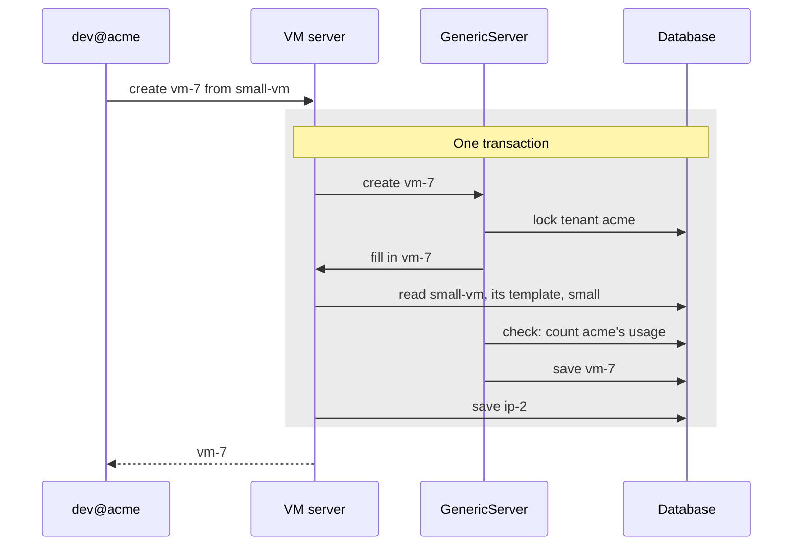

# Quota Foundation

| Field       | Value   |
|-------------|---------|
| Author(s)   | Omer Vishlitzky |
| Jira        | [OSAC-4500](https://redhat.atlassian.net/browse/OSAC-4500) |
| PRD         | [PRD](prd.md) |
| Date        | 2026-11-03 |

## Summary

Quota limits how much each tenant and each of its projects can use, and the fulfillment service checks each create
and update against those limits before it saves anything.

- The Cloud Provider Admin sets a **default limit** for all tenants on each **dimension**, one thing a limit counts,
  such as vCPUs (`compute.vcpus`), and can change it for one tenant. The Tenant Admin sets limits on its projects.
- Each resource type declares what one record uses, in **quota annotations** on its proto fields. An annotation on a
  VM's `instance_type` field says "this VM uses that type's vCPUs and memory". One on a cluster's `node_sets` field
  says "each node set makes OSAC create `size` hosts of its host type".
- The **quota check** runs in the fulfillment service before each create or update is saved, once the call is filled
  in from its catalog item or template. It follows the annotations down from the record in the call, through every
  record OSAC will create for it, and adds up what they all use.
- The check adds that to **usage**, what the saved records use now, and compares the sum with the limits of the call's
  project, every project above it and the tenant. A lock on the tenant, held until the save, stops two calls from
  both taking the last vCPU.
- Each record OSAC creates for a call names the call's record, and the two count once, as the larger of what was
  asked for and what was created. Records count until OSAC has torn them down and archived them.
- Tenants see usage, set warnings and ask for more through new gRPC services in the fulfillment API.
- **A call that fits:** tenant `acme` has a limit of 10 `acme-1tb` hosts and uses none. A user creates cluster `prod`
  with 3 such hosts. The check follows `node_sets` to 3 hosts, finds 0 + 3 within 10, and saves `prod`. The 3 hosts
  that OSAC then creates name `prod`, so usage stays at 3.
- **A call that doesn't fit:** the user then creates cluster `test`, whose node set `compute` has 8 `acme-1tb` hosts.
  The check finds 3 + 8 over 10, saves nothing, and returns
  `quota exceeded: tenant acme, bare_metal.instances.acme-1tb: limit 10, usage 3, adding 8 (node set compute)`.

## Motivation

See [PRD](prd.md) for the requirements.

- A tenant can create VMs, clusters, hosts, volumes and IPs without limit, so one tenant can take the capacity that
  all tenants share.
- The Cloud Provider Admin can't enforce the limits sold to each tenant.
- The fulfillment service keeps no count of what a tenant holds now. Metering reports use minutes later, summed over
  time, so a check can't use it.

### Goals

- The PRD's dimensions, limited per tenant and per project.
- Each call checked in full before the save: a cluster's create covers its control plane, its hosts and its IPs.
- A new resource type or dimension needs only quota annotations, with no change to the check.
- Usage counted from the saved records, so it can't drift from them.

### Non-Goals

- Limits in money, and billing enforcement. They build on this design later.
- Limits by label. The PRD sets limits on tenants and projects.
- Sharing or borrowing limits between tenants, and limits that expire. The PRD rules them out.
- Reserving hardware. A limit caps use, and the Cloud Provider Admin sizes the limits to the hardware.
- Limits on what runs inside a tenant's cluster or VM, such as pods. The OSAC volume behind a PVC still counts.
- Image capacity, `images.gib`. Disk images record no size today, and the limit starts once they do.
- Rate limits on model tokens and requests (MaaS), and usage history.

## Proposal

Quota lives in the fulfillment service, inside the API call that creates or updates a record. **The registry**, a new
package `proto/quota`, reads the quota annotations from the compiled protos at startup, as `proto/metering` does for
metering annotations.

| Who | What they do |
|---|---|
| Dana, the Cloud Provider Admin | Sets default limits and tenant limits, and answers requests for more |
| Lee, `acme`'s Tenant Admin | Sets project limits and warning thresholds, and asks Dana for more |
| `dev@acme`, a Tenant User | Creates, updates and deletes resources |
| The VM, cluster and host servers | Fill in each call from its catalog item or template, and create its automatic IPs |
| The quota check, in `GenericServer` | Counts usage and rejects a call that doesn't fit, before the save |
| The registry, `proto/quota` | Tells the check what each record uses, and which records it makes OSAC create |
| The OSAC operator | Creates a cluster's hosts after the cluster's create or scale-up is saved |
| The ComputeInstance controller | Creates the volume record for each VM disk, and names the VM in it |
| The CSI driver | Creates the volume record for each PVC in a tenant's cluster |
| The tenant controller | Creates a new tenant's default networking |
| The quota publisher | Sends quota events to the tenant's notifications topic |

### Guarantees

These always hold, and each names what makes it hold.

| Guarantee | Enforced by |
|---|---|
| Usage is counted from saved records, and no counter is stored | No counter table exists; a test recounts usage |
| A call is checked with every record its annotations make OSAC create | The check, before the save |
| Each field the check reads is final once the call is filled in | A test per type, created from a catalog item |
| Each type declares its own use, and the check names no type | The registry; a test type with only annotations |
| A call fits its project's, each parent project's and its tenant's limits | The check; the nested-project test |
| A record and the records created for it count once | The count takes the larger of the two, per dimension |
| Usage never reads lower than what exists | The same rule, and a VM's larger instance type |
| Calls from users and controllers are checked the same way | The check reads only the call's data |
| Calls in one tenant take turns, and other tenants never wait | A lock on the tenant's row, taken first |
| A count that can't run blocks the save | The check and the save share one transaction |
| The `system` and `shared` tenants are never checked | The check skips them; a test |

### Workflow Description

`acme` has projects `web` and `app`. VM instance types `small` and `large` have 2 and 6 vCPUs, and 8 and 24 GiB of
memory. `acme-1tb` is a host type, a `BareMetalInstanceType`, and `fast` is a storage tier. Catalog item `small-vm`
makes a VM of type `small`, with a 50 GiB boot disk on `fast` and an automatic IP.

Dana's default limits:

| Dimension | Default limit |
|---|---|
| `compute.vcpus` | 10 |
| `compute.memory_gib` | 64 |
| `storage.volumes` | 20 |
| `storage.fast.gib` | 500 |
| `bare_metal.instances.acme-1tb` | 10 |
| `caas.control_planes` | 5 |
| `network.virtual_networks` | 5 |
| `network.external_ips` | 20 |
| `network.nat_gateways` | 2 |

What a call **adds** is the change it makes to the tenant's usage.

| When | What happens |
|---|---|
| 09:00 | Dana creates tenant `acme`, which follows her default limits. |
| 09:00 | The tenant controller creates `acme`'s default networking: a network, an IP and a NAT gateway. They fit. |
| 09:10 | Lee sets a limit of 8 vCPUs on `web` and on `app`, and a warning at 40% of `acme`'s vCPU limit. |
| 09:45 | `dev@acme` creates `vm-7` in `web`, and names only catalog item `small-vm`. |
| 09:45 | The VM server fills in type `small`, the disk and the IP from `small-vm`. Then the check runs. |
| 09:45 | `vm-7` asks for 2 vCPUs, 8 GiB, 1 volume, 50 GiB of `fast` and 1 IP. It fits, and is saved with `ip-2`. |
| 09:46 | The ComputeInstance controller creates volume `ci-vm-7-boot`, which names `vm-7`. It adds 0. |
| 10:00 | `dev@acme` creates cluster `prod` in `web`: node set `compute` of 3 `acme-1tb` hosts, and automatic IPs. |
| 10:00 | `prod` asks for 1 control plane, 3 `acme-1tb` hosts, and 2 IPs for its API and ingress. It fits. |
| 10:01 | The OSAC operator creates hosts `w-1`, `w-2` and `w-3`, each naming `prod`. They add 0. |
| 10:05 | `dev@acme` creates `vm-8` (`large`), while a script creates `vm-9` (`small`), both in `web`. |
| 10:05 | `vm-9` gets the lock first and is saved. `acme` uses 4 of its 10 vCPUs, 40%, so Lee gets a warning. |
| 10:05 | `vm-8` fails on `web`'s limit: 4 vCPUs in use, plus 6, is over 8. |
| 10:10 | `dev@acme` scales `compute` from 3 hosts to 5. The update adds 2 hosts, they fit, and it is saved. |
| 10:11 | The OSAC operator creates `w-4` and `w-5` for `prod`. They add 0. |
| 10:15 | `dev@acme` scales `compute` to 12. It fails on `acme`'s limit: 5 hosts, plus 7, is over 10. |
| 11:00 | Lee asks for 12 vCPUs through `TenantQuotaRequests`. Dana approves, which sets `acme`'s own limit to 12. |
| 11:00 | `acme` now uses 4 of its 12 vCPUs, 33%, so Lee's warning clears. |
| 11:30 | `dev@acme` deletes `vm-9`. It keeps counting while OSAC tears it down. |
| 11:31 | OSAC archives `vm-9`, and `acme`'s vCPU usage drops from 4 to 2. |

### API Extensions

- **New gRPC services** in the fulfillment API, with REST through the gateway, like `ComputeInstances`:
  - `QuotaLimits` gets, lists and sets a limit on one dimension: a default, tenant or project limit.
  - `TenantQuotas` shows each dimension's limit, usage and room left, for the tenant and each project.
  - `QuotaThresholds` sets or clears a warning at a percent of a limit, on the tenant or one project.
  - `TenantQuotaRequests` holds a Tenant Admin's request for a higher tenant limit, and Dana's answer.
- **Quota annotations,** new proto options in `proto/quota`, on the fields of each resource type that uses quota.
- **A new field,** `status.compute_instance` on `Volume`, the VM that a disk volume was created for.
- **Changed behavior of existing calls:**
  - A create or update of a VM, cluster, host, volume, image, IP, network or NAT gateway can fail on quota.
  - Calls from the OSAC operator, the tenant controller and the CSI driver are checked too.
  - The tenant controller retries default networking that fails on quota.
  - The ComputeInstance controller names the VM in each disk volume it creates.

### Implementation Details/Notes/Constraints

#### Dimensions and annotations

A dimension's key names a kind of resource and what it counts, such as `compute.vcpus`. A key can hold a name from
data, such as a tier or a host type, so a new tier is a new key with no code change.

| Dimension | Unit | Used by |
|---|---|---|
| `compute.vcpus`, `compute.memory_gib` | vCPUs, GiB | a VM, from its instance type |
| `compute.gpu.<resource_name>` | count | a VM, from its instance type's GPU, such as `nvidia.com/GB100` |
| `storage.volumes`, `storage.<tier>.gib` | count, GiB | a volume; a VM, from its disks |
| `images.count` | count | a disk image a tenant creates |
| `network.external_ips` | count | an IP; a VM, a host or a cluster with `auto_external_ip_attachment` set |
| `network.nat_gateways`, `network.virtual_networks` | count | a NAT gateway, a virtual network |
| `bare_metal.instances.<type>` | count | a host; a cluster, from the hosts its node sets create |
| `caas.control_planes` | count | a cluster |

Five kinds of quota annotation cover every resource type in OSAC today:

| Kind | What it says | Example |
|---|---|---|
| `fixed` | the record uses a fixed amount: 1, or its `amount` | a cluster uses one `caas.control_planes` |
| `field` | the value of this field is used | a 100 GiB volume on `fast` uses 100 of `storage.fast.gib` |
| `through` | the record uses what the type in this field declares | a `small` VM uses `small`'s 2 vCPUs and 8 GiB |
| `each` | each entry of this map or list makes OSAC create records | node set `compute` of size 3 creates 3 hosts |
| `created_for` | this field names the resource the record was created for | a host's `status.cluster` |

A `fixed` amount can depend on a boolean field, such as `auto_external_ip_attachment`. Quota annotations sit beside
metering's on the same fields. The pull request sets the exact syntax:

```proto
message InstanceTypeSpec {
  int32 vcpus = 1 [(osac.private.v1.quota) = {field: "compute.vcpus"}];
  int32 memory_gib = 2 [(osac.private.v1.quota) = {field: "compute.memory_gib"}];
}

message ComputeInstanceSpec {
  optional ComputeInstanceDisk boot_disk = 8 [(osac.private.v1.quota) = {each: {creates: "Volume"}}];
  InstanceTypeReference instance_type = 17 [(osac.private.v1.quota) = {through: {}}];
  optional bool auto_external_ip_attachment = 18 [(osac.private.v1.quota) = {fixed: "network.external_ips"}];
}

message ClusterSpec {
  option (osac.private.v1.quota_message) = {fixed: "caas.control_planes"};
  map<string, ClusterNodeSet> node_sets = 3 [(osac.private.v1.quota) = {
    each: {creates: "BareMetalInstance", times: "size", instance_type: "baremetal_instance_type"}
  }];
  optional bool auto_external_ip_attachment = 10 [(osac.private.v1.quota) = {
    fixed: "network.external_ips", amount: 2
  }];
}

message BareMetalInstanceType {
  option (osac.private.v1.quota_message) = {fixed: "bare_metal.instances.{name}"};
}

message BareMetalInstanceStatus {
  ClusterLocalReference cluster = 8 [(osac.private.v1.quota) = {created_for: {}}];
}

message VolumeStatus {
  ComputeInstanceLocalReference compute_instance = 11 [(osac.private.v1.quota) = {created_for: {}}];
}
```

**The check follows each annotation to the bottom.** For `prod`, it reads `ClusterSpec`: 1 control plane, 2 IPs,
and node set `compute`, which creates 3 hosts. It counts each host with `BareMetalInstanceSpec`'s own annotations:
`instance_type` points at `acme-1tb`, which declares 1 `bare_metal.instances.acme-1tb`. So a host counts the same in
a cluster and alone. In the same way, each VM disk counts as the volume OSAC creates for it: one `storage.volumes`,
and its `size_gib` of its tier.

**Types use nothing themselves.** An instance type, a host type and a storage tier carry annotations that say what a
record pointing at them uses. Creating a type uses no quota.

**A type's numbers never change.** `validateInstanceTypeImmutability` rejects a change to an instance type's `vcpus`,
`memory_gib` or `gpu`. So the check and the OSAC operator, which reads the type later, see the same numbers.

**A new resource type is data.** A new type with annotations and no other code is enforced, and a test proves it
with a test type. The registry stops the service at startup on an annotation that names a missing field or type. A
test lists every resource type, and each has annotations or a place on the list of types that use nothing.

#### Where the check runs



**The check runs after the type's server fills in the call, and before the save.** At 09:45, `dev@acme` names only
catalog item `small-vm`. The VM server's `prepareCreate` applies the item's rules (`resolveCatalogItem`) and its
template's defaults (`applyComputeTemplate`). It then loads instance type `small` (`validateInstanceType`). The check
runs right after that, at the start of `GenericServer.createPrepared`, and takes `small`'s 2 vCPUs and 8 GiB from
that record. Clusters and hosts fill in their node sets and instance types the same way, in their own
`prepareCreate`.

**Each field the check reads is final once the call is filled in.** The servers already require these fields:
`ValidateRequiredSpecFields` rejects a VM with no instance type or boot disk, and `validateClusterNodeSetMap` rejects
a cluster with no node set. A test creates a VM, a cluster and a host from catalog items only, and checks what the
check sees.

**The check locks the tenant first.** It locks `acme`'s row in `tenants` before the type's server locks any other
row, the order the fulfillment service already follows (`networking_lifecycle_guards.go`). This is the lock that
`lockTenantForCreate` takes today for VM, IP and network creates. An update reads its record's tenant, which never
changes, then locks the tenant, then the record.

A later lock would deadlock. `prod`'s create would hold `acme`'s default subnet and wait for `acme`, while `vm-9`
holds `acme` and waits for the subnet.

**An update is checked by what it adds:** usage after the call, minus usage before. At 10:10, scaling `compute`
from 3 hosts to 5 adds 2. An update that lowers usage adds nothing, and an update that changes no annotated field,
such as a status update, skips the check.

**What the caller sees:**

- gRPC: `FAILED_PRECONDITION`, the code a full IP pool returns (`SelectExternalIPPool`), with the reason
  `QUOTA_EXCEEDED`. The details name the limit that failed, the dimension, the usage, what the call adds, and the
  part of the call that asks for it.
- REST: HTTP 400 with the same details.
- The errors at 10:05 and 10:15:

  ```text
  quota exceeded: project web, compute.vcpus: limit 8, usage 4, adding 6 (instance type large)
  quota exceeded: tenant acme, bare_metal.instances.acme-1tb: limit 10, usage 5, adding 7 (node set compute)
  ```

- A create with the `X-Dry-Run` header runs the check and saves nothing.

#### Counting usage

At 10:05, `vm-8` and `vm-9` reach the check at once, both in `web`. In each call's transaction:

1. **Lock the tenant.** `SELECT ... FOR UPDATE` on `acme`'s row in `tenants`. `vm-9` gets it first, and `vm-8`
   waits.
2. **Add up the call.** `vm-9` adds 2 vCPUs.
3. **Count usage** on each dimension the call adds to, for the project, its parent projects and the tenant.
   `web` and `acme` each use 2 vCPUs, from `vm-7`.
4. **Compare.** 2 + 2 = 4 fits `web`'s 8 and `acme`'s 10, so `vm-9` is saved, and the commit releases the lock.
   Then `vm-8` finds 4 + 6 = 10, over `web`'s 8, and fails.

Other tenants never wait for `acme`'s lock, and the count reads records without locking them.

**The count sees every call that committed before it.** The fulfillment service runs at PostgreSQL's default
isolation, READ COMMITTED, so `vm-8`'s count, which runs after it gets the lock, sees `vm-9`. A test fails on any
other isolation level.

**The count runs one SQL query per resource type that the call adds to,** through the existing index on `tenant`.
The registry builds each query from the type's annotations. The query for a type that makes OSAC create records also
reads those records.

**A record counts until OSAC archives it.** A delete sets the record's `deletion_timestamp`, and the record stays
while OSAC tears its resource down (`generic_dao_delete.go`). Then OSAC moves it to its archive table, such as
`archived_compute_instances`, and it stops counting. A record counts in every state: running, stopped or failed.

**A record and the records created for it count once, as the larger of what the record asks for and what those
records use,** per dimension. At 10:01, `prod` asks for 3 hosts and `w-1` to `w-3` exist, so `prod` counts 3. After
a scale-down from 5 hosts to 3, `prod` counts 5 until 2 hosts are archived.

**A VM uses the larger of its two instance types.** `spec.instance_type` is the type asked for, and
`status.instance_type` is the type running, which changes after the restart a resize needs. Shrinking a VM from
`large` to `small` frees 4 vCPUs once the restart applies it.

**A project's limit covers the projects under it.** Each record's `project` column is a PostgreSQL `ltree` that
holds the full path, such as `web.eu`, so `project <@ 'web'` selects `web` and everything under it. The create sets
a record's project, and the `check_immutable_columns` trigger rejects any change to it.

**A record created for another counts in that resource's project.** `ip-2` lives in `acme`'s root project, as every
automatic IP does, and counts in `web` as part of `vm-7`.

#### Records created for another resource

A record is **created for** another resource when OSAC creates it because that resource asks for it. Three kinds
exist, and each names its resource in a field the tenant can't write:

| Record | Created by | Names its resource in |
|---|---|---|
| Host | the OSAC operator, for a cluster's node set | `status.cluster`, which exists today |
| Automatic IP | the VM, cluster or host server, in the call | label `auto-created-for`, creator `system` |
| VM disk volume | the ComputeInstance controller, for each disk | `status.compute_instance`, a new field |

**Hosts.** The operator sets `status.cluster` in the create, and metering's fixed-once-set trigger keeps it from
changing (migration 128). Public API calls can't write status.

**Automatic IPs.** In `vm-7`'s create transaction, `createAutomaticExternalIPs` writes `ip-2` straight to the
database. It sets creator `system` and the labels `osac.openshift.io/auto-created: true` and
`osac.openshift.io/auto-created-for: vm-7`, which `isAutomatic` already reads. `ip-2` adds 0, since `vm-7` asks for
one IP.

**VM disk volumes.** Before the VM playbook runs, the ComputeInstance controller creates `ci-vm-7-boot` through the
private Volumes API. It records the volume's ID in `vm-7`'s `status.volumes` (`disk_registration.go`). In that
create, it now also sets the volume's `status.compute_instance` to `vm-7`. Deleting `vm-7` deletes its volumes
first, and OSAC archives `vm-7` after them (`volume_record_cleanup.go`).

**`status.compute_instance` names the VM, by ID.** The ComputeInstance controller sets it, in the create, and the
count reads it. The private Volumes server checks that the VM exists in the volume's tenant, and metering's
fixed-once-set trigger keeps it from changing. A wrong value can't lower usage: the volume still counts, as the
larger of the two.

**Everything else counts on its own,** even when OSAC creates it: default networking, an IP a tenant creates and
attaches, and the volume for a PVC in a tenant's cluster. A test covers each create path, and checks that the
record names its resource in the write that creates it.

#### Limits, defaults and the tenant view

| Table | One row per | Holds |
|---|---|---|
| `quota_limits` | tenant or project, and dimension | A limit someone set, and the limit before it |
| `quota_default_limits` | dimension | Dana's default limit, and the limit before it |
| `quota_thresholds` | tenant or project, and dimension | A warning percent |
| `quota_requests` | request | The dimension, the limit asked for, the state and the reason |
| `quota_outbox` | event | Threshold and rejection events, until the publisher sends them |

**Tenants follow Dana's default limits.** The check reads them on each call, so a changed default reaches every
tenant at once. A row in `quota_limits` replaces a default for one tenant. Default limits apply to tenants.

**Lee sets project limits.** Each limit holds on its own: `web` and `app` may each allow 8 vCPUs, while `acme`
allows 10.

**Each dimension key keeps one meaning.** The keys are generated from the annotations and published as versioned
files, as the metering event contract is (OSAC-6056). A rename is a new key, plus a migration that moves the limits.

**Every change to a limit keeps its old and new value.** Each limit row holds the limit before its last change, so
the `changes` outbox row of each update carries both values. Each quota table's migration adds the `enqueue_change`
trigger, as other new tables' migrations do. Actor attribution (OSAC-6154) adds who made the change.

**`TenantQuotas` counts on demand, with no lock.** It shows each dimension's limit, usage and room left, for the
tenant and each project. A dimension whose usage is above its limit shows as over the limit.

#### Quota events

**A threshold crossing is written in the transaction that caused it.** At 10:05, `vm-9` brings `acme` to 40% of its
vCPU limit, so quota writes `osac.quota.threshold.crossed.v1` to `quota_outbox`. At 11:00, Dana's approval brings
`acme` to 33%, so quota writes `osac.quota.threshold.cleared.v1`.

**Quota looks for crossings on each checked call, each archive, and each change to a limit or a threshold.** The
archive runs in the database layer (`generic_dao_request.go`), and its crossing check takes the tenant lock too. A
new threshold that usage already passes writes its crossed event at once.

**A rejection is written after the call fails.** `vm-8`'s transaction saves nothing, so quota writes
`osac.quota.rejected.v1` in a small transaction of its own. A dry run writes no event.

**The quota publisher sends the events.** It runs in the fulfillment service and sends each event in `quota_outbox`
to `osac.notifications.acme`, the tenant's topic in the notifications API (OSAC-75). It retries a failed delivery,
and a failed delivery never fails the call that caused the event.

**Events carry quota numbers only.** Each event holds the tenant, the project, the dimension, the limit, the usage,
the threshold and the record's name. It holds no user's identity.

### Security Considerations

- **A record with a false name still counts,** as the larger of the two. Public API calls can't write status, and
  the server sets each record's creator.
- **A tenant sees only its own usage.** The quota APIs go through the same OPA policies as the other fulfillment
  APIs, and the quota tables carry the tenant, like the other resource tables.
- **The CSI driver can act for any tenant until OSAC-4197 lands.** Today the CSI drivers of all tenant clusters
  share one client, `osac-csi-driver`, with access to every tenant (`authz.rego`, OSAC-4109). An admin of `prod`'s
  cluster can read its secret and create a 500 GiB volume in tenant `beta`, which uses up `beta`'s
  `storage.fast.gib`. OSAC-4197 gives each tenant cluster its own client, and the server then takes the tenant from
  that client.

### Failure Handling and Recovery

| Situation | What happens |
|---|---|
| A dimension has no default limit, such as a new tier or host type | Its limit is 0 until Dana sets a default |
| A project has no limit of its own | Its parent projects' and its tenant's limits still hold |
| Two calls race for the last vCPU | The tenant lock makes them take turns, and the second counts the first |
| A dry run fits, and another call takes the room first | The real create fails |
| Provisioning fails after the call is saved | The record stays FAILED, and counts until the tenant deletes it |
| The teardown of a deleted record fails | The record keeps counting until OSAC archives it |
| Dana lowers a limit below usage | Resources keep running; calls that add to it fail; `TenantQuotas` marks it over |
| Dana lowers a default limit | Every tenant with no limit of its own gets the lower limit at once |
| An update adds vCPUs while memory is over its limit | It is saved if the vCPUs fit, since it adds no memory |
| `prod` goes from 5 hosts to 3, then to 4, before hosts are archived | The scale to 4 adds 0: `prod` counts 5 |
| A VM is shrunk and not yet restarted | It counts its running instance type until the restart |
| The operator creates a 6th host for `prod` | The create fails, and the operator retries the slot later |
| A record names the wrong resource | It still counts, as the larger of the two |
| A bug creates a record without naming its resource | The two count separately until the record is fixed |
| A record's resource is archived first, or is in another tenant | The record counts on its own |
| A template creates a counted resource outside the spec | It is checked at its own create, so provisioning can fail |
| A new tenant has no room for its default networking | The tenant stays not ready, and the tenant controller retries |
| A PVC in `prod` asks for more storage than `acme` has left | The PVC stays Pending, with the quota error as an event |
| The quota publisher can't reach the topic | It retries, and the call that caused the event stays saved |
| A tenant or a project is removed | Its limit and threshold rows go with it |
| A team adds a resource type without annotations | The test of resource types fails |

### RBAC / Tenancy

| Service | Dana, Cloud Provider Admin | Lee, Tenant Admin | `dev@acme`, Tenant User |
|---|---|---|---|
| `QuotaLimits` | Sets default and tenant limits | Sets limits on `acme`'s projects | Reads `acme`'s limits |
| `TenantQuotas` | Reads any tenant | Reads `acme` | Reads `acme` |
| `QuotaThresholds` | — | Sets and clears `acme`'s warnings | — |
| `TenantQuotaRequests` | Approves or denies | Creates and tracks `acme`'s requests | — |

OPA policies enforce each row, as for the other fulfillment APIs. Each quota row carries its tenant.

### Observability and Monitoring

- A histogram of the check's time, lock wait included, per resource type. A rising p99 means a tenant's counts are
  slow (see Risks and Mitigations).
- A counter of calls that fail on quota, by dimension and by the limit that failed: tenant or project.
- A gauge of events in `quota_outbox` that wait to be sent.

### Risks and Mitigations

- **A slow count makes the tenant's next call wait,** because it runs under the tenant's lock. Each count reads only
  the tenant's records, through the index on `tenant`, and the histogram tracks it. Usage can move to a stored table
  later, with the count as its test.
- **Annotations on complex types, such as clusters, are easy to get wrong.** The registry stops the service at
  startup on a bad annotation, and tests cover each kind.
- **A new code path can lock a row before its tenant.** That can deadlock, and PostgreSQL then fails one of the
  calls. A test runs a cluster create and a VM create on the same subnet at once, and both finish.

### Drawbacks

Each team that adds a resource type writes its quota annotations. Calls in one tenant take turns on one lock, so a
slow check adds to the next call's wait.

## Alternatives (Not Implemented)

- **Checking each record only at its own create,** as the major clouds do. A cluster could stop at 9 of 10 hosts,
  and the PRD rejects the whole call up front.
- **Skipping the check for controllers.** The CSI driver's volumes and default networking would escape quota.
- **Counting a record created for another as 0.** A scale-down would lower usage before its hosts are gone, and a
  volume with a false name would count nowhere.
- **Copying default limits into each tenant.** A new tier would have no row, and a changed default would reach only
  new tenants.
- **Freeing usage at the delete call.** A VM would free its vCPUs while it still runs.
- **A separate quota service with its own database.** It can't share the call's transaction, so two calls could
  take the last vCPU.
- **Usage counters kept by triggers.** Each rule would exist twice, in the annotations and in SQL, and drift would
  need repair.
- **Checking after the save.** A call over its limit would start provisioning, which the PRD rules out.
- **Reading usage from metering.** Metering reports usage minutes later, and the check needs it now.

## Open Questions

- Should an upgrade ship with the check off, until Dana sets default limits?

## Test Plan

### Unit Tests

- The registry stops the service on an annotation with a wrong field or type.
- A test type with annotations and no other code is enforced.
- Each resource type has annotations, or a place on the list of types that use nothing.
- The check counts a cluster's hosts with the host's own annotations, and a tenant's own host the same way.
- A call adds the change it makes to usage: 3 to 5 hosts adds 2, and 5 to 3 to 4, before archives, adds 0.
- A VM uses the larger of its two instance types.
- The error names the limit that failed, the dimension, the usage, what the call adds and the part of the call.

### Integration Tests

- A dimension with no default limit has limit 0, and a call that adds to it fails.
- A tenant follows Dana's current default limits, and a row in `quota_limits` replaces one.
- Raising and lowering a limit takes effect on the next call. Lowering it below usage stops new calls only.
- `TenantQuotas` shows each limit, usage, room left and each project, and marks a dimension over its limit.
- A recount of a tenant's records equals the usage `TenantQuotas` shows.
- Parallel calls for the last vCPU, in one project and across projects: only the calls that fit are saved.
- A cluster create and a VM create on the same subnet at once both finish.
- A VM, a cluster and a host created from catalog items only are checked with their full spec.
- A record counts in every state, running, stopped or failed, until it is archived.
- Hosts, automatic IPs and disk volumes add 0 while their resource asks for them, and a 6th host counts.
- An automatic IP counts in its VM's project.
- A volume that names `vm-7` falsely still counts.
- Public calls can't set `status.cluster`, `status.compute_instance` or an IP's creator.
- Default networking, and the volume for a PVC in a tenant's cluster, are checked.
- A call in `web.eu` fails on the limit of `web.eu`, `web` or `acme`, and the error names that limit.
- A dry run gets the real call's result, and saves nothing.
- Each threshold crossing writes one event, on a call, an archive or a limit change, and falling back clears it.
- Each change to a limit, default limit, threshold or request appears in the `changes` outbox, with both values.
- Calls in the `system` and `shared` tenants skip the check.
- The count runs at READ COMMITTED.

### E2E Tests

- Through the REST API, `prod`'s create fits, its scale to 5 fits, and its scale to 12 fails with the quota error.
- A PVC in `prod`'s cluster that doesn't fit stays Pending, with the quota error in its events.
- Lee's warning event reaches `osac.notifications.acme`.

## Upgrade / Downgrade Strategy

- An upgrade adds the quota tables empty, so every dimension has limit 0, as on a new deployment. Calls that add
  usage fail until Dana sets default limits through `QuotaLimits`, and running resources keep running.
- The upgrade's migration sets `status.compute_instance` on each existing VM disk volume, from its VM's
  `status.volumes`.
- A downgrade leaves the quota tables unused, and the older service checks nothing.

## Version Skew Strategy

- During a rolling upgrade, calls that an older copy of the fulfillment service serves skip the check. Usage can pass
  a limit until the rollout ends, and then calls that add to it fail, as for a lowered limit.
- The OSAC operator needs no change. It already treats `FAILED_PRECONDITION` on a host create as a final answer for
  that slot (`isDefinitiveCreateRejection`).

---

## Provenance

Authored: design draft, 2026-11-03, from the merged PRD and the quota research digest.
Revised: 2026-11-04, review answers applied to ownership, open questions, and the resize rule; full revision
pass the same day: invariants table, hold vocabulary, composite compression, query cost and fallback.
Revised: 2026-11-04, project scope per Omer; coderabbit: hold changes, children-first deletes, bypass, crossings.
Revised: 2026-11-04, coderabbit round 2: linkage trust gate, null-scope unique index, immutable project column.
Revised: 2026-11-05, codebase-audit hardening: CSI trust gap, linkage value shapes, creator gate, status test.
Revised: 2026-11-05, deletion restated as a prerequisite (OSAC-7302); linkage removal, unique keys, example fix.
Revised: 2026-11-05, VM disks hold storage through the VM; CSI question narrowed to tenant-created PVCs.
Revised: 2026-11-08, review rewrite: chain summary, annotation tree walk, larger-of counting, no caller bypass,
tenant lock, live default limits, CSI volumes checked.

> Authoring phases not recorded this session.
