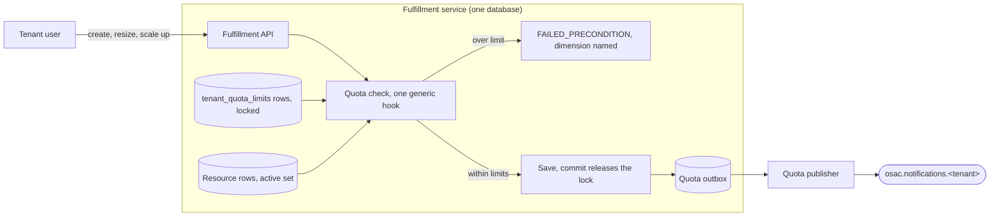

# Quota Foundation

| Field       | Value   |
|-------------|---------|
| Author(s)   | Omer Vishlitzky |
| Jira        | [OSAC-4500](https://redhat.atlassian.net/browse/OSAC-4500) |
| PRD         | [PRD](prd.md) |
| Date        | 2026-11-03 |

## Summary

A tenant can hold as many VMs, clusters, bare-metal hosts, volumes, and addresses as it asks for. One tenant can
consume a deployment's shared capacity and block every other tenant. This design adds tenant-scoped usage quota
inside the fulfillment service:

- **Each resource declares its own holdings.** Proto annotations name the dimensions a resource holds. A registry
  walks the annotations, and the checker is generic; no resource type is hardcoded in it. A new service ships
  annotations and gets enforcement.
- **The check runs inside the request transaction.** One generic hook in the shared CRUD path locks the tenant's
  limit rows, counts held usage, and rejects the order before anything is saved.
- **Usage is counted, never stored.** The resource rows are the usage, so no counter can drift and quota state that
  is lost rebuilds by counting rows.

See [PRD](prd.md) for detailed requirements.

## Proposal

### Big picture



| Who | When | What it does |
|---|---|---|
| Tenant user | On create, resize, and scale (a decrease always passes) | Submits the order and sees the result. |
| Quota check | Inside the request transaction | Locks the limit rows, counts usage, sums the order's holdings. |
| Controllers | After an order is granted | Create the order's sub-resources; the bypass rule applies to these writes. |
| Tenant onboarding | When a tenant is created | Copies the default limits into the tenant's rows. |
| Quota publisher | Continuously | Drains the quota outbox into the notifications topic. |

### Invariants

What must always hold, and what enforces it. Tests are numbered as in the Test Plan.

| Invariant | Enforced by |
|---|---|
| Usage is counted from rows on demand, never stored | No counter table exists; the recount test (test 10) |
| A resource declares its own holdings in proto annotations; the checker is generic | The registry walk; test 12 |
| New resource types and dimensions are data, with no checker change | The same walk; test 12's test resource |
| The check runs in the request transaction, after validation, before the save | The hook (`PrepareCandidateFunc`) |
| Quota fails closed: unreadable state blocks the save and rejects the order | The shared request transaction |
| A resource counts once: its own declaration, or its parent's creation edge | The linkage filter; tests 16, 17 |
| A controller creates sub-resources with their linkage set on the creating write | The conformance test (test 16) |
| One tenant's orders never wait on another tenant's lock | `SELECT ... FOR UPDATE` on the tenant's limit rows |
| The `system` and `shared` tenants are never checked | The hook skips them (test 15) |

### Running example

Tenant `acme`, project `web`. Dana is the Cloud Provider Admin. `dev@acme` is a tenant user. VM `vm-7` is of
instance type `small` (2 vCPUs, 8 GiB). Cluster `prod` has node set `compute` with workers of bare-metal type
`acme-1tb`. Acme's limits: 8 vCPUs, 32 GiB of memory, 10 `acme-1tb` instances, 5 control planes, 20 external IPs.

| When | What happens |
|---|---|
| 09:00 | Onboarding copies Dana's default limits into acme's rows. |
| 09:00 | Default networking adds one NAT gateway and one IP to usage (system-created; it skips the check). |
| 09:30 | Acme's tenant admin sets a warning threshold at 50 percent of the vCPU dimension. |
| 10:00 | `dev@acme` submits cluster `prod`: node set `compute` of 3 workers, plus two endpoint IPs. |
| 10:00 | Locks acme's rows, counts usage, sums the order's holdings: 1 control plane, 3 `acme-1tb`, 2 IPs. |
| 10:00 | Everything is within limits, so the order commits. |
| 10:00:01 | The controller creates the 3 workers and 2 IPs. Each carries its declared linkage to `prod`. |
| 10:05 | `dev@acme` submits `vm-8` (6 vCPUs) while a script submits `vm-9` (2 vCPUs). Held: 2 vCPUs on `vm-7`. |
| 10:05 | The two orders serialize on the lock. `vm-9` commits first: usage 4, and the threshold event rides along. |
| 10:05 | `vm-8` is rejected: vCPUs, limit 8, in use 4, requested 6. |
| 10:10 | `dev@acme` scales `compute` from 3 to 5. The check sums the difference: 2 more, held 3, limit 10. |
| 10:15 | `dev@acme` scales the node set from 5 to 12. Rejected: `acme-1tb`, limit 10, in use 5, requested 7. |
| 11:00 | Dana lowers the vCPU limit from 8 to 2. `vm-7` and `vm-9` keep running. |
| 11:00 | New VM orders are rejected, and the tenant view shows usage 4 against limit 2. |
| 11:30 | `dev@acme` deletes `vm-9`. Usage drops to 2 when the delete commits. |
| 12:00 | `dev@acme` submits cluster `staging`. The order commits and holds its full amount from submission. |
| 12:30 | Provisioning fails and the cleanup deletes the cluster, its workers, and its IPs. Usage drops with the rows. |

## Behavior changes

- A create, resize, or scale up that carries a hold is checked before the save and rejected when over limit.
  Concurrent orders for one tenant serialize on the tenant's limit rows.
- Creation relationships are declared in the registry, beside the holdings: what an order implicitly creates, and
  which field on each created row carries the link.
- New APIs and tables: an admin service for tenant limits, a tenant-facing usage view, services for thresholds
  and increase requests, and tables for limits, thresholds, and the quota outbox. Onboarding copies the
  deployment's default limits into the tenant's rows.
- Quota writes threshold and rejection events to its outbox, and a publisher drains them to
  `osac.notifications.<tenant>`. The reserved `system` and `shared` tenants stay outside quota, matching the
  billing design's exemption.

## Goals and Non-Goals

### Goals

- The PRD's dimensions, enforced per tenant.
- Composite orders summed whole: a cluster order covers its control plane, its workers, and its endpoint IPs.
- A tenant-facing usage view, an admin API for limits, and an increase-request workflow.

### Non-Goals

- Budget quota, limits in currency, and billing enforcement. They build on this foundation later.
- Project-scoped and label-scoped quota. The PRD scopes quota to the tenant.
- Fair-share, borrowing, preemption, and expiring allocations. The PRD rules them out.
- Capacity reservation. A limit permits provisioning up to an amount and guarantees no hardware.
- Quota on workloads inside a tenant's own cluster or VM. OSAC cannot observe them.
- MaaS token and request rate limits. A rate over a time window is a separate PRD.
- Historical usage reporting. The tenant view shows current usage against limits.

## Design Details

### Dimensions and declarations

A dimension is a resource kind and its unit, spelled as one flat key such as `compute.vcpus`. A typed dimension
embeds the class name: the storage tier, the GPU type, the bare-metal instance type. Limits are stored per tenant
and dimension, so a new class is a new key, which is a row of data. The initial dimensions, from the PRD:

| Dimension | Unit | Held by |
|---|---|---|
| `compute.vcpus`, `compute.memory_gib` | cores, GiB | a VM, through its instance type |
| `compute.gpu.<type>` | count | a VM, through its instance type |
| `storage.volumes`, `storage.<tier>.gib` | count, GiB | a volume |
| `images.count`, `images.gib` | count, GiB | a tenant-uploaded image |
| `network.external_ips` | count | an external IP |
| `network.nat_gateways`, `network.virtual_networks` | count | a NAT gateway, a virtual network |
| `bare_metal.instances.<instance type>` | count | a standalone instance, a cluster node set |
| `caas.control_planes` | count | a cluster |

A resource's proto declares its holdings beside its fields, the way metering's annotations declare tracked fields.
No new proto fields are added: each annotation rides an existing field, and the kind says how the held amount is
derived from it. Four kinds cover every case, and a hold may carry a guard, a boolean field that switches it on:

| Kind | The resource holds | Example |
|---|---|---|
| count | one of the dimension | a virtual network holds one `network.virtual_networks` |
| field | a field's value of the dimension | a volume holds its `size_gib` of `storage.<tier>.gib` |
| through | the holds a referenced type declares | a VM holds its instance type's vCPUs and memory |
| set | per map entry, its size times the referenced type's holds | a node set holds size times the type's count |

The `set` shape (the final proto option syntax is settled in implementation):

```proto
message ClusterSpec {
  map<string, ClusterNodeSet> node_sets = 3 [(osac.private.v1.quota) = {
    set: {dimension: "bare_metal.instances.{baremetal_instance_type}", size: "size"}
  }];
}
```

A `through` hold resolves the reference and reads the referenced type's own declaration. An instance type
declares its vCPUs and memory as field holds, so a VM inherits them. A bare-metal instance type declares one
count of its own key, so a standalone instance holds one and a node set holds its size of that key.

A registry, `proto/quota`, mirrors `proto/metering`: it walks the compiled private protos, collects every quota
annotation, and fails loudly on an invalid one. It rejects a path that does not resolve, a referenced type that
declares no holds, and an annotation unreachable from a resource message. The walk stays separate from metering's
package: metering refuses repeated and map fields, and quota's `set` kind lives on a map field, so the walker is
extended either way. Sharing helpers is an implementation detail. The checker and the tenant view read this one
registry. The dimension keys live in the annotations and the limits rows; no Go map of dimension names exists
to edit.

**A new service is data.** A WaaS proto that declares a `set` on its WaaS2 pools, with the WaaS2 type declaring
its own holds, is enforced with no engine change. Test 12 proves it with a test resource.

### Where the check sits

Fulfillment serves every write through one shared CRUD path: the public server maps the object, the private
server validates it, and `GenericServer` saves it through the DAO. A gRPC interceptor opens one transaction per
request and commits on return; triggers capture the save into the `changes` outbox in that transaction.

The quota check is one hook in that path. `GenericServerBuilder` installs it for every resource whose proto
declares a hold, and the hook runs in candidate preparation (`PrepareCandidateFunc`): after validation, before
the save, on create and update alike. On update it sees the stored object and the proposal, so it sums the
difference. Controllers write through the private API, so their writes reach the same hook; sub-resource creates
pass it by the bypass rule (see Composite resources and ownership).

What the caller sees:

- gRPC: `FAILED_PRECONDITION`, reason `QUOTA_EXCEEDED`, with the dimension, the limit, the usage, and the
  requested amount. A composite rejection names the part of the order that hit the limit.
- REST: the gateway maps `FAILED_PRECONDITION` to 400 with the same body. The message names the quota, so a
  quota denial is told apart from a permission denial from the error alone.
- A dry-run create runs the check and returns the candidate without saving, so a Tenant User can see whether an
  order fits before submitting it. The tenant view (below) shows the headroom per dimension.

### Counting usage, atomically

The check runs inside the request transaction, in four steps:

1. Lock the tenant's rows in `tenant_quota_limits`, with one `SELECT ... FOR UPDATE` ordered by dimension.
2. Count held usage: one SQL aggregate per resource kind over the existing tenant index, `SUM` with the linkage
   filter. The filter skips rows whose linkage field is set, because their parent holds them. No rows are
   materialized in the application.
3. Sum the order's holdings from the candidate, including its sub-resources.
4. Compare per dimension: usage plus requested against the limit. Over limit: return the error. The transaction
   rolls back and nothing is saved.

The lock is that tenant's own limit rows, so one tenant's orders never wait on another tenant's lock; only
same-tenant orders serialize. It is taken before any resource row is touched, and counting reads rows without
locking them, so deadlocks cannot form between two orders. This is the row-lock pattern the external IP pools
already use for capacity, with the tenant as the unit of serialization.

The count's cost is bounded by the tenant's own limits, because quota caps how many rows a tenant can hold. The
cases outside that bound: limits lowered below usage, system-created machinery such as default networking, and
direct SQL writes. The count runs while holding the tenant's lock, so a slow count widens that tenant's
serialization window.

Deleting a resource moves its row out of the active set in the delete's transaction, so usage is released on
deletion with no quota code on the delete path. A delete only lowers usage, so it needs no check. Resizes and
scale ups sum the difference: the proposal's hold replaces the stored object's hold, and the check compares the
increase against headroom. The check sums only the dimensions an order touches. A resize that increases one
dimension passes while another is over limit; the over-limit dimension blocks only orders that would increase
it. A decrease always passes.

**A granted order holds its full amount from submission.** The order's row commits at submission and carries the
full hold, including sub-resources the controller creates later. Later orders see the committed hold, so the
granted order always has room for its workers. When provisioning fails and the cleanup deletes the resource,
usage drops with the rows. A resource the tenant keeps counts until the tenant deletes it, whatever its state:
running, idle, or stopped.

**Quota fails closed.** The check and the save share one database and one transaction, so a quota state that
cannot be read also blocks the save, and the order is rejected. A tenant always owns limit rows: onboarding
creates them, and a startup sync adds rows when new dimensions ship. A check that finds a dimension without a
row fails closed with an internal error, because that state means the deployment is broken.

### Composite resources and ownership

Provisioning one resource can provision others under it: a VM with an auto IP creates one ExternalIP; a cluster
creates its workers and, with endpoint IPs enabled, two more. Creation relationships are declared in the
registry, beside the hold declarations. Each edge names the resource created and the existing field on the
created row that carries the link. The fields already exist: a worker's `status.cluster`, an endpoint IP's
attachment, the auto-created IP's `osac.openshift.io/owner-reference` annotation, which the compute reconciler
already requires. The registry is the one source of truth for what an order implicitly creates.

**Who creates a resource decides how it counts.** A resource the system creates while executing an order carries
its creation edge and counts inside its parent's composite. A resource the tenant creates and attaches later
counts standalone, always, because the parent's order cannot know at provisioning time. Attachments never
affect counting.

A guard field covers optional auto-creation: a VM order that requests an auto IP carries the IP's hold, and one
that does not, does not.

**The bypass rule.** A write whose object carries its declared linkage, or whose creator is `system`, skips the
check and still counts; the hook runs for these writes and lets them through. Default networking, a virtual
network with a NAT gateway and an IP, is created for a whole tenant at onboarding with no parent resource. It
counts toward usage so the tenant sees it, and the bypass rule applies to its write. Blocking it would make a
new tenant unusable while dimensions default to zero.

**CI rejects undeclared creation paths.** A code path that creates a resource on behalf of another declares its
creation edge in the registry first. The conformance test fails on an undeclared path and asserts that the
linkage field is set on the creating write (see the Test Plan).

### Limits, defaults, and the tenant view

Three new tables, all regular resources served by the generic server, so they get change events and audit
capture with no extra machinery:

- `tenant_quota_limits`: one row per tenant and dimension, the limit and whether it came from a default. Locked
  by the check; written by the admin API and by onboarding.
- `tenant_quota_thresholds`: one row per tenant and dimension, a warning percent.
- `quota_outbox`: threshold and rejection events, drained by the publisher.

Default limits live in `quota_default_limits`, one row per dimension, owned by the Cloud Provider Admin. The
tenant reconciler, which already creates default networking, copies them into the tenant's rows at onboarding;
later default changes apply to new tenants. A dimension with no default row reads as zero, so a tenant can
start over its limit: default networking counts against a zero limit. The system write skips the check, the
view flags the over-limit state, and orders on that dimension are rejected until the admin sets a limit. Quota
is greenfield: every tenant is onboarded after the defaults exist.

The dimension vocabulary is generated from the annotations and published as versioned contract artifacts,
following the metering event contract's generator pattern (OSAC-6056). A published version never changes; a new
dimension is a new artifact version.

The APIs:

- `TenantQuotaLimits`, Cloud Provider Admin: get, list, and set a limit per dimension. A change takes the same
  tenant lock as a check, so a check never reads a limit mid-change.
- `TenantQuotas`, tenant read: per dimension, the limit, usage, headroom, and over-limit flag, computed on
  demand with the counting code and no lock. Powers the UI (OSAC-4504, OSAC-4505) and the CLI.
- `TenantQuotaThresholds`, Tenant Admin: set and clear warning thresholds.
- `TenantQuotaRequests`: the increase workflow; with every dimension defaulting to zero, an admin's limit
  change is the only way to unblock a tenant, so it lands with this foundation. Approval writes the limit
  through `TenantQuotaLimits`; denial records the reason.

Every quota change is a row change on a quota table, captured by the `changes` outbox like any resource change
and folded by the audit design. That gives the who, when, previous value, and new value; the acting user arrives
on events with request capture (OSAC-6154).

### Quota events

Quota follows the notifications design's emission rules:

- **A threshold crossing rides the request's transaction.** An accepted order that moves usage across a
  threshold writes the event into `quota_outbox` in the same transaction as the change, so the event exists
  exactly when the change commits. Crossing back writes a cleared event.
- **A rejection is written after the abort.** The request transaction rolled back, so quota writes the
  rejection event in its own small committing transaction, naming the dimension, the limit, and the usage.
- **A publisher drains the outbox** to `osac.notifications.<tenant>`, the side-channel topic family. The event
  types are `osac.quota.threshold.crossed.v1`, its cleared variant, and `osac.quota.rejected.v1`. A threshold
  is warning severity. A condition opens once per crossing, keyed by tenant and dimension: one notice, then
  silence until usage drops below and crosses again.
- **A delivery failure never fails the flow that caused it.** The publisher owns retries and quarantine, per
  the notifications design.

### Rebuild and recovery

Usage has no stored copy to lose or recompute; see Invariants. A recount at any time produces the same numbers
when nothing changed. Direct SQL writes are counted, because they are rows, and they skip the check, which is
today's behavior for every guard and serves as an operational escape hatch. Quota's own tables hold
configuration: limits, thresholds, requests. They restore with the database, and the change log holds every
change to them.

### What happens when

| Situation | What happens |
|---|---|
| Two orders race for the last headroom | The lock serializes them; the second is rejected when it no longer fits. |
| An order is rejected | Nothing is saved; see the error format under Where the check sits. |
| Provisioning fails after the order commits | The cleanup deletes the resource and sub-resources; usage drops. |
| The cleanup itself fails | Rows keep counting. Cleanup retries as controller work; a tenant delete drops usage. |
| A tenant keeps a resource in a failed state | It counts until the tenant deletes it. |
| A limit is lowered below usage | Resources keep running; orders on that dimension are rejected; the view flags it. |
| A write with linkage or `creator: system` | The bypass rule applies: it skips the check and still counts. |
| The CSI driver creates a volume for a PVC | Open question; see Open Questions. |
| Quota state cannot be read mid-order | The order is rejected; quota fails closed. |
| A tenant is offboarded | Its limit, threshold, and request rows go with the tenant. |

## Risks and Mitigations

- **The check pays a count per write.** The count is bounded by the tenant's own limits and runs while holding
  the tenant's lock, so a slow count widens that tenant's serialization window (see Counting usage,
  atomically). If profiling shows a cost at scale, usage moves to a stored table whose updater is generated
  from the registry. A hand-written SQL copy of the holdings is the one thing this design forbids. The count
  stays as the auditor: a recount must equal the stored totals, as a test and as the repair path. The cost of
  the fallback: the trigger fires on every row write, including status-only updates.
- **The annotation shape is the hard part.** Composites and catalog lookups are where declarations get
  intricate. The registry fails loudly on a bad annotation, and the registry is quota's one copy of the
  holdings, where metering keeps a SQL twin beside its own.

## Drawbacks

The declaration work lands on every team that adds a resource type: annotations are now part of what a new
offering ships. A tenant's checked writes serialize on one lock, so one slow order adds its latency to the
next order's wait (see Risks).

## Alternatives

- **A separate quota service with its own database.** The check would race the request outside its transaction,
  which the core architecture forbids, and the count needs the resource rows, which live in the fulfillment
  database.
- **Usage counters maintained by database triggers.** A second SQL copy of the holdings, with JSON extraction
  and catalog joins in SQL, plus a recompute path after incidents. It buys speed the foundation does not
  need yet.
- **A transaction-scoped advisory lock for serialization.** The lock would store nothing, and the limits table
  exists anyway. The row lock keeps the serialization point visible to row-based deadlock analysis.
- **An async check that reconciles over-limit tenants.** Rejection would arrive after provisioning began,
  which the PRD rules out.
- **Quota as a consumer of the metering pipeline.** Metering reports consumption over time and eventually;
  quota needs instantaneous holdings decided in under a second. Quota reuses metering's declaration mechanism
  and leaves the metering event contract alone.

## Open Questions

1. **CSI volumes: block at the driver, or count without blocking.** A tenant creates a PVC inside its cluster.
   Kubernetes admits the PVC at once, and OSAC plays no part at admission. The CSI driver then calls volume
   create on the fulfillment private API, carrying the tenant and project taken from the PVC. The options:
   - Block at the CSI driver. The volume-create call goes through the quota check. An over-quota PVC stays
     Pending, with the quota reason in its events. Kubernetes natively holds pods that wait for a pending PVC.
   - Count without blocking. The driver's writes count toward usage and never reject. A tenant can exceed its
     storage quota through its cluster, with no rejection.
2. **Vocabulary evolution.** When a dimension is renamed, or a resource's declared holdings change, what happens
   to existing limit rows and to usage counted under the old definition? Metering answers schema change with a
   published schema that never changes, plus replay under the schema in effect at write time. Quota counts live
   rows on demand and has no replay, so the analogue is undecided.

## Test Plan

Behaviors to check, grouped: the PRD's criteria first, then the mechanism.

PRD criteria:

1. Every dimension defaults to zero: an order on an unconfigured dimension is rejected.
2. A new tenant starts with the configured default limits.
3. Raising and lowering a limit takes effect at once; lowering below usage blocks new orders and terminates
   nothing.
4. Concurrent orders for one tenant cannot together exceed a limit that any one of them alone would fit: submit
   parallel orders for the last headroom and count the acceptances. The PRD's line, "a limit that any one of
   them would have been rejected for alone", is read here as serial equivalence.
5. A rejection names the dimension, the limit, the usage, and the requested amount; a composite rejection
   names the underlying dimension and the part of the order that hit it.
6. Usage stays accurate through a failed order: the cleanup releases it.
7. A composite order is summed whole: a cluster order covers its control plane, its workers, and its endpoint IPs.
8. A resource counts from creation until deletion, whether running, idle, or stopped.
9. A threshold crossing writes the event in the request's transaction; crossing back clears it; one notice
   arrives per crossing.
10. The tenant view shows usage, limits, headroom, and the over-limit state, and a recount of the rows equals
    the view's usage.

Mechanism:

11. The registry fails loudly on an invalid annotation: a wrong path, an unknown reference, an unreachable field.
12. A new resource type with annotations is enforced with no checker change, proven with a test resource.
13. Every quota change is captured by the change log with the previous and new values.
14. A sub-resource write whose declared linkage or `creator: system` is set skips the check and still counts.
15. The `system` and `shared` tenants are never checked.
16. A conformance test maps every controller code path that creates a resource on behalf of another to a
    declared creation edge, and fails on an undeclared path. It also asserts that the linkage field is set on
    the creating write. Late linkage counts the row standalone while the parent's composite already holds it,
    inflating usage until the linkage lands; later orders in that dimension are spuriously rejected. The
    create itself is never rejected, because system writes pass the bypass rule.
17. A sub-resource row whose declared linkage field is set is counted once, through its parent's composite,
    and never standalone.

---

## Provenance

Authored: design draft, 2026-11-03, from the merged PRD and the quota research digest.
Revised: 2026-11-04, review answers applied to ownership, open questions, and the resize rule; full revision
pass the same day: invariants table, one declarations home, hold vocabulary, composite compression, query cost
and fallback.

> Authoring phases not recorded this session.
