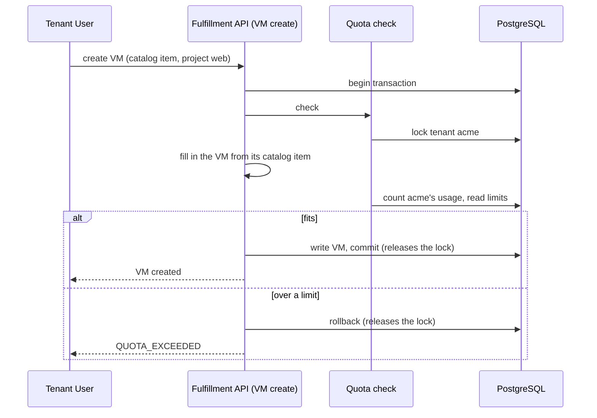

# Quota Foundation

| Field       | Value   |
|-------------|---------|
| Author(s)   | Omer Vishlitzky |
| Jira        | [OSAC-4500](https://redhat.atlassian.net/browse/OSAC-4500) |
| PRD         | [PRD](prd.md) |
| Date        | 2026-11-03 |

## Summary

Today nothing limits what a tenant creates, so one tenant can fill the provider's servers and block every other
tenant. This design adds quota: limits on what each tenant, and each project in it, can use. See the [PRD](prd.md)
for the requirements.

1. **Each kind of resource declares its price in quota annotations on its proto fields.** A VM's `instance_type`
   field says the VM uses that instance type's vCPUs and memory. A cluster's node set says OSAC will create `size`
   hosts of the node set's host type.
2. **On each create or update, the fulfillment service computes the request's full price.** The kind's handler
   first fills in the request, for example from its catalog item. Then the quota check follows the annotations down
   through everything OSAC will create for the request, such as a VM's disks or a cluster's hosts, and adds it up.
3. **The check compares the price with the limits.** It adds the price to what the tenant uses now, and checks the
   sum against the limits of the request's project, each project above it, and the tenant. If the sum is over any
   limit, the request fails with `QUOTA_EXCEEDED` and nothing is written.
4. **Requests in one tenant are checked one at a time.** The check locks the tenant's row inside the request's
   transaction, so two requests can't both take the last vCPU. Other tenants don't wait.
5. **The controllers then create the resources, and the real ones replace the prediction.** Each resource OSAC
   creates is linked to the resource it was made for. Quota counts the larger of what the parent asks for and what
   exists, so nothing counts twice.
6. **Admins set the limits.** The Cloud Provider Admin sets default limits for all tenants and overrides for one
   tenant. A Tenant Admin sets project limits and warning thresholds, and asks for higher limits. A limit nobody set
   is 0, so after install every create that uses resources fails until the defaults are set.

## Motivation

Today nothing limits what a tenant creates. Tenant `acme` can create VMs until the provider's servers are full, and
then every tenant's next create fails. A Tenant Admin also can't cap what each of its projects uses, and nobody is
warned before a tenant runs out.

### Goals

- Check each create and update in full, with all that OSAC will create for it, before anything is written.
- Count usage from the database on each request, with no stored total that can drift.
- Check OSAC's own creates like a user's.
- Add a kind of resource, a storage tier or a host type with no change to the quota code.

### Non-Goals

- Limits in money, and billing enforcement, which build on this design later.
- Limits by label, shared or borrowed limits, limits that expire, and capacity reservations.
- Limits on what runs inside a tenant's cluster or VM, such as pods.
- Image size, which disk images don't record today.
- Checking several requests as one, warnings for the Cloud Provider Admin, and dry runs of updates.

## Proposal

| Part | What is new or changes |
|---|---|
| Quota annotations | New proto options that declare what one resource of each kind uses |
| Quota check | New, in the shared create and update code, after the handler fills in the request |
| Tenant lock | Taken first by the shared code in each checked request. Today only the VM and networking creates take it |
| Cluster update handler | In a checked update, locks the cluster's row after the tenant lock |
| Quota APIs | Four new gRPC services: limits, usage, thresholds and limit requests |
| Quota tables | Five new tables: limits, default limits, thresholds, limit requests and unsent warnings |
| Quota publisher | New. Sends each warning to the tenant through the notifications API |

### Workflow Description

**Cloud Provider Admin** sets default limits, such as 10 vCPUs for every tenant, and overrides for one tenant. They
approve or deny limit requests; approving one sets the tenant's override.

**Tenant Admin** sets limits on projects, such as 8 vCPUs for project `web`, and thresholds, such as a warning at 80%
of a limit. They see usage and room left in `QuotaUsage`, and ask for a higher limit in `QuotaLimitRequests`.

**Tenant User** creates resources as today. Example: tenant `acme` has a limit of 10 vCPUs and project `web` has 8.
`web` runs one VM with 2 vCPUs.

1. The user creates a VM in `web` from a catalog item with instance type `small`, 2 vCPUs.
2. The check counts 2 + 2 = 4 vCPUs. That fits `web`'s 8 and `acme`'s 10, so the VM is created.
3. The user then creates a VM with 6 vCPUs. 4 + 6 = 10 is over `web`'s 8, so the request fails:

```text
FAILED_PRECONDITION: quota exceeded: project web, compute.vcpus: limit 8, usage 4, adding 6
```

Nothing is written, and the user can retry after a delete or a higher limit.



### API Extensions

- **New gRPC services** in the fulfillment API, with REST through the existing gateway:
  - `QuotaLimits` gets, lists, sets and clears limits: defaults, tenant overrides and project limits.
  - `QuotaUsage` is read-only. For the tenant and each project, it shows each limit, the usage and the room left.
  - `QuotaThresholds` gets, lists, sets and clears thresholds. It refuses a threshold on a project with no limit.
  - `QuotaLimitRequests` holds limit requests, which are pending, approved or denied.
- **Quota annotations:** new options in the private protos: `osac.private.v1.quota` on a field and
  `osac.private.v1.quota_message` on a message.
- **New error:** `FAILED_PRECONDITION` (HTTP 400) with ErrorInfo reason `QUOTA_EXCEEDED` and a QuotaFailure that
  names the limit, the usage and what the request adds.
- **Changed behavior:** today's dry run of a create (`X-Dry-Run`) now runs the check too.

## UX Alignment

There is no quota UI yet. OSAC-4504 designs the quota screens, and OSAC-4505 builds them.

## Implementation Details/Notes/Constraints

### Quota annotations declare the price

Each annotation names a **dimension**, one thing a limit counts, such as `compute.vcpus`, storage GiB on one tier, or
hosts of one type. An annotation can:

- count a value of the resource, such as a disk's `size_gib`;
- count through a type, such as the vCPUs of a VM's instance type (`through`), taking the larger of
  `spec.instance_type` and `status.instance_type` (`larger_of`);
- declare what OSAC will create for the resource (`creates`: the kind, the count or a field that holds it, and the
  fields to set), such as `size` hosts per node set;
- mark a kind as created for a parent (`created_for`), so its resources replace what the parent predicted.

Paths start at the resource; inside `creates`, they start at the item. `{parent}` is the parent's ID. Instance type
sizes and host type names can't change, so the price of a type never changes under a running resource.

### The check computes the full price after the fill-in

The kind's handler calls the shared create or update code, which calls back into the handler to fill in the
request. Then the check runs, inside the same transaction:

- each create of an annotated kind, except a type;
- each update whose field mask names a field an annotation reads, such as a node set's `size`;
- each update with no field mask.

Deletes aren't checked. A request must fit only on the dimensions it adds to, so a create that adds nothing fits even
at a limit of 0. An update adds the difference between the new and the old version.

### The check counts usage from the database

Usage is counted on each request with one SQL statement over the tenant's rows, one query per kind, under READ
COMMITTED. One statement means every query sees the same committed rows. A resource counts until OSAC archives it,
including stopped resources.

### One request per tenant at a time

The check locks the tenant's row with `SELECT ... FOR NO KEY UPDATE` before it counts. That mode doesn't block the
foreign-key checks of the five tables that reference `tenants`. The lock is released at commit or rollback. In a
checked update, the cluster update handler locks the cluster's row after the tenant lock, so the order is always
tenant first. Unchecked requests keep today's locks.

### Created resources replace the prediction

A parent and what OSAC creates for it count the larger of what the parent asks for and what exists, per parent and
dimension. Created resources count in their own kind's query, and the parent's query adds only what it asks for
beyond them. A link counts only when the resource's creator is `system`, which only the private API and OSAC's own
code record:

- a host links to its cluster through `status.cluster`, in the cluster's project;
- an automatic IP address is written by the parent's handler with creator `system` and the labels
  `osac.openshift.io/auto-created-for` and `osac.openshift.io/auto-created-for-kind`; it counts in the parent's project;
- a disk volume is named `ci-` + the VM's ID + `-boot` or `-disk-N`, in the VM's project.

The operator asks for no automatic IPs for a cluster's hosts.

### Limits

A tenant's limit on a dimension is its override, else the default, else 0. A project limit applies to the project and
the projects inside it, and can be higher than the tenant's; the tenant's limit still holds. Projects have no
defaults. The built-in `shared` and `system` tenants aren't checked. Each change to a limit goes to the existing
`changes` table, and limit rows keep their previous value; OSAC-6154 adds who made the change.

### Warnings

A warning is sent when a request takes usage from below a threshold to at or above it. The check writes the warning
to `quota_outbox` in the request's transaction. The quota publisher sends it to the tenant through the notifications
API (OSAC-75, a dependency).

### Security Considerations

- **No tenant can read another tenant's limits, usage, thresholds or limit requests.** The quota APIs go through the
  same OPA policies as the other fulfillment APIs.
- **Until OSAC-4197, an admin inside one tenant's cluster can use up another tenant's limits.** The CSI drivers of all
  tenant clusters sign in as one Keycloak client, `osac-csi-driver`, which can create volumes in any tenant. Those
  volumes count against the other tenant, and their creator `system` lets one named like a VM's disk volume count as
  part of that VM. OSAC-4197 gives each cluster its own client.

### Failure Handling and Recovery

| Situation | What happens |
|---|---|
| The count or the lock fails | The request fails and nothing is written |
| Two requests in one tenant race for the last vCPU | The second waits for the lock, then counts the first |
| An admin lowers a limit below usage | Resources keep running; requests that add to that dimension fail |
| A created resource exists before its parent's request counts it | The larger-of rule counts it once |
| The notifications API is down | Warnings stay in `quota_outbox` until the publisher sends them |

### RBAC / Tenancy

The Cloud Provider Admin sets default limits and tenant overrides, and approves limit requests. A Tenant Admin sets
project limits and thresholds, and creates limit requests. Tenant Users can read usage.

### Observability and Monitoring

Metrics: refused requests per dimension, check time, lock wait time, and warnings waiting in `quota_outbox`.

### Risks and Mitigations

- **The tenant lock slows a tenant's parallel creates.** It is held only for the request's transaction, and other
  tenants don't wait.
- **A wrong annotation counts the wrong amount.** Each annotated kind has a unit test of its price.

### Drawbacks

Each checked request takes the tenant lock, so creates in one tenant run one at a time.

## Alternatives (Not Implemented)

- **A stored usage counter.** It drifts when a write fails or a resource changes outside the API.
- **Checking in the controllers after the write.** The resource would exist before it is refused.
- **Per-kind quota code instead of annotations.** Every new kind would need its own code.

## Test Plan

### Unit Tests

- Each annotated kind's price, including what OSAC creates for it.
- The larger-of rule before, while and after OSAC creates resources.
- The limit order: override, default, 0.

### Integration Tests

- A create or update over a project or tenant limit fails and writes nothing.
- Two parallel creates for the last vCPU: one succeeds.
- A crossed threshold writes one warning.

### E2E Tests

- A cluster create counts its hosts, and the hosts don't count twice once they exist.

## Graduation Criteria

Quota is enforced from the first release; there is no feature gate.

### Removing a deprecated feature

Nothing is removed.

## Upgrade / Downgrade Strategy

After the upgrade, every tenant's limit is 0, so the Cloud Provider Admin sets the defaults before tenants create
anything. A downgrade restores the database from backup, as for any release with new migrations.

## Version Skew Strategy

During a rolling upgrade, replicas still on the old version don't run the check.

## Support Procedures

To see why a request failed, read the error's QuotaFailure, or the tenant's `QuotaUsage`. To unblock a tenant, raise
its override with `QuotaLimits`.

## Infrastructure Needed [optional]

None.

## Provenance

Authored: design draft, 2026-11-03, from the merged PRD and the quota research digest.
Revised: 2026-11-04, review answers applied to ownership, open questions, and the resize rule; full revision
pass the same day: invariants table, hold vocabulary, composite compression, query cost and fallback.
Revised: 2026-11-04, project scope per Omer; coderabbit: hold changes, children-first deletes, bypass, crossings.
Revised: 2026-11-04, coderabbit round 2: linkage trust gate, null-scope unique index, immutable project column.
Revised: 2026-11-05, codebase-audit hardening: CSI trust gap, linkage value shapes, creator gate, status test.
Revised: 2026-11-05, deletion restated as a prerequisite (OSAC-7302); linkage removal, unique keys, example fix.
Revised: 2026-11-05, VM disks hold storage through the VM; CSI question narrowed to tenant-created PVCs.
Revised: 2026-11-08, review rewrite: chain summary, annotation tree walk, larger-of counting, no caller bypass,
tenant lock, live default limits, CSI volumes checked.
Revised: 2026-11-10, readability rewrite: today's create path, one story, plain rules, one larger-of rule, annotation
table, overrides, QuotaUsage and QuotaLimitRequests, automatic IPs' creator, FOR NO KEY UPDATE, one-statement count,
all template sections restored.

> Authoring phases not recorded this session.
Revised: 2026-11-10, each section answers only its title: Summary is the flow, Motivation is the problem, story moved to Workflow, unrelated text cut.
