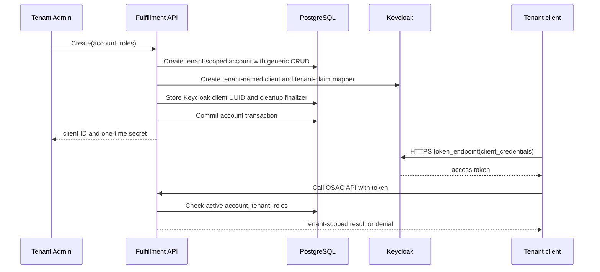

# Tenant-Scoped Service Account Management

## Summary

Fulfillment adds a tenant-owned `ServiceAccount` (*managed account*) backed by a Keycloak confidential OIDC client. Explicit stored roles authorize public and private API methods within the account's tenant. API, UI, and CLI disclose secrets only on creation and regeneration. See the [PRD](prd.md) for requirements.

## Motivation

Fulfillment's Keycloak adapter manages Organizations and human users, and RoleBindings target human `User` objects. Neither provides a tenant-facing client lifecycle. Ordinary JWTs without privileged roles currently enter the broad `is_client` policy; managed accounts need a separate authorization path enforcing explicit grants. [Codebase: `fulfillment-service/internal/idp/client.go`, `fulfillment-service/internal/auth/policies/authz.rego`]

### Goals

- Give Tenant Admins equivalent account and role management through API, UI, and scriptable CLI.
- Let Tenant Users automate only explicitly granted methods within their tenant.
- Deny access unless the account's tenant, active state, and roles are verified.
- Disclose each secret once and exclude it from later views and logs.

### Non-Goals

- Provider-wide inventory, audit history, or per-tenant account quotas.
- Secondary secrets, overlap periods, or separate previous-secret revocation.
- Direct tenant Keycloak administration, external identity federation, or credential delivery to tenant clusters. [OSAC-4197](https://redhat.atlassian.net/browse/OSAC-4197) owns CSI credential delivery and existing-client migration.
- Changes to service resource schemas or provisioning workflows.
- Managed-account event streams and VM console sessions, which cannot continuously check revocation; automation polls permitted Get/List APIs.

## Proposal

PostgreSQL stores each account's tenant, metadata, `spec.roles`, and Keycloak identifiers. Keycloak stores its OIDC client, secret, and tenant-claim mapper. Fulfillment is the tenant-facing control plane and never forwards tenant tokens to the Keycloak Admin API.

Create and regeneration run synchronously through the existing `idp.Client` so their responses can return the one-time secret. The controller handles deletion through generic finalizers. Shared authorization and tenant-filtered handlers cover BMaaS, CaaS, and VMaaS without changing their workflows. The PRD's MaaS example has no API yet. [Codebase: `fulfillment-service/internal/idp/client.go`, `fulfillment-service/internal/auth/grpc_authz_interceptor.go`, `docs/features/OSAC-4683-per-service-enablement.md`]

### Workflow Description

1. A Tenant Admin creates an account with a tenant-local name, optional display metadata, and roles. Fulfillment derives its tenant from the authenticated subject.
2. Within the request transaction, Fulfillment reserves the name and generates an account UUID, creates a disabled Keycloak client, configures its tenant claim, then enables it. It stores the client UUID and cleanup finalizer before commit, then returns the account, client ID, and initial secret. Dry-run validates without calling Keycloak or returning a secret.
3. Get/List and ordinary updates omit secrets. Role changes update only PostgreSQL and apply on the next request.
4. The client discovers Keycloak's HTTPS `token_endpoint` from the deployment's HTTPS issuer and requests `grant_type=client_credentials` directly. It must reach and trust both discovery and token endpoints and validate TLS. It then calls a permitted OSAC API; Fulfillment checks the account on every request.
5. `RegenerateSecret` returns one replacement secret. The old secret immediately stops obtaining new tokens; already-issued tokens remain valid until expiry, subject to account and role checks.
6. Delete sets `metadata.deletion_timestamp`, immediately denying existing tokens. The controller disables and removes the Keycloak client and mapper, then clears the finalizer so the DAO archives the account. Disabling the client stops new tokens.



### API Extensions

Edit `proto/private/osac/private/v1/`; generate `proto/public/` and `proto/gen/`. `RegenerateSecret` is an action RPC because each invocation produces a new one-time value rather than stable desired state. REST Create and RegenerateSecret serialize the full response, without `response_body: "object"`, to retain the secret field. No operator CRD or AAP API changes are needed. [Codebase: `fulfillment-service/docs/API.md`, `proto/AGENTS.md`]

| ID | Interface change | Requirement |
|---|---|---|
| IC-1 | `ServiceAccounts.Create/Get/List/Update/Delete`; REST `/api/fulfillment/v1/service_accounts`; Create returns one-time `client_secret` | IS-1, IS-2, IS-3 |
| IC-2 | `ServiceAccounts.RegenerateSecret` and REST action; returns one-time replacement `client_secret` | IS-3 |
| IC-3 | `ServiceAccount.spec.roles` and update mask for atomic grant/revoke | IS-1, IS-2 |
| IC-4 | Tenant-scoped public/private authorization from explicit roles; no implicit baseline, Watch, or console sessions | IS-2 |
| IC-5 | Tenant Admin UI for CRUD, roles, rotation, and transient secret display | IS-1, IS-3 |
| IC-6 | Scriptable `osac` CRUD, file-based role updates, and regeneration | IS-1, IS-3 |
| IC-7 | Tenant Admin/User credential-management and token-use guides | IS-4 |

### Implementation Details/Notes/Constraints

Use the standard Fulfillment object shape:

```protobuf
message ServiceAccount {
  string id = 1;
  Metadata metadata = 2;
  ServiceAccountSpec spec = 3;
  ServiceAccountStatus status = 4;
}
message ServiceAccountSpec { repeated RoleReference roles = 1; }
message ServiceAccountStatus {
  string client_id = 1;
  string keycloak_client_uuid = 2 [(cleanapi.field).private = true];
}
message ServiceAccountsCreateResponse {
  ServiceAccount object = 1;
  string client_secret = 2; // write-only response; never persisted
}
message ServiceAccountsRegenerateSecretResponse {
  string client_secret = 1; // write-only response; never persisted
}
```

- `spec.roles` is an unordered set of `RoleReference` IDs; reject duplicates and unsupported roles.
- `metadata.name` is an immutable DNS label, unique per tenant; `metadata.project` must be empty. Only display name, description, labels, and roles are mutable, using `update_mask` and optimistic `lock`.
- `status.client_id` is readable; the Keycloak UUID is private. Ignore input status, but reject status update masks. No Ready state or separate Keycloak service-account-user ID is needed: client setup precedes commit, and deletion state blocks use.
- Set `metadata.tenant` and `metadata.annotations["osac.openshift.io/tenant"]` server-side; no owner reference applies to this directly tenant-owned resource.

A numbered migration adds `service_accounts` and archive storage, an active-row unique `(tenant, name)` index, and an indexed `client_id` lookup. Never store secrets or tokens. Reuse GenericServer/DAO for CRUD, filtering, locks, deletion timestamps, and archiving. [Codebase: `proto/private/osac/private/v1/metadata_type.proto`, `fulfillment-service/internal/servers/generic_server.go`, `fulfillment-service/internal/database/migrations/100_add_name_uniqueness_and_immutability.up.sql`]

Derive `client_id = osac-sa-<tenant-identifier>-<account-UUID>`, distinct from Keycloak's internal UUID. The immutable Tenant ID equals its DNS-label name: at most 63 characters, yielding a maximum client ID of 108 (8-character prefix + 63 + separator + 36-character UUID). This satisfies the [Feature's tenant-identifying ID requirement](https://redhat.atlassian.net/browse/OSAC-5137) and avoids built-in privileged client names. [Codebase: `fulfillment-service/internal/servers/private_tenants_server.go`]

Extend `idp.Client` with create/disable/delete, mapper setup, and secret regeneration; client-ID lookup already exists. Enable only client credentials, disable browser/direct grants, set the `osac-api` audience and `fullScopeAllowed=false`, and grant no `realm-management` roles to managed clients. A client-specific `oidc-hardcoded-claim-mapper` emits exactly one signed string `osac_tenant` access-token claim with the canonical tenant identifier; no Organization membership is assumed. Stored role grants need no Keycloak synchronization. Regeneration uses `POST /admin/realms/{realm}/clients/{client-uuid}/client-secret` and locks the account with DAO `Get().SetLock(true)` against concurrent rotation/deletion. [Keycloak: [26.6.4 Admin REST API](https://www.keycloak.org/docs-api/26.6.4/rest-api/)]

Create persists the `fulfillment-controller` cleanup finalizer before commit, without waiting for reconciliation. Ignore caller-supplied finalizers and reject mutation masks. An immediate Delete or stopped controller therefore retains the deleting record until Keycloak removal succeeds; an already-absent client counts as success. [Codebase: `fulfillment-service/internal/database/dao/generic_dao_get.go`, `fulfillment-service/internal/database/dao/generic_dao_delete.go`]

The RPC interceptor and `SelfSubjectAccessReviews/Create` share an evaluator that performs an uncached, indexed account lookup on every request and fails closed. It uses existing tenant visibility, including `SetTotalProjectVisibility(tenant)`, separately from method permissions. Measure lookup load in component tests; the PRD sets no account-volume target. Watch authorizes only at opening, and the console proxy's ticket/default 30-minute timeout cannot enforce account revocation; both remain unavailable to managed accounts. [Codebase: `fulfillment-service/internal/auth/authorization_evaluator.go`, `fulfillment-service/internal/servers/private_self_subject_access_reviews_server.go`, `fulfillment-service/internal/servers/events_server.go`, `fulfillment-service/docs/VM_CONSOLE.md`]

Reuse `idp.credentials`; add no installer value or management principal. Mount its Kubernetes Secret only in the gRPC server and controller. Add `realm-management` roles `create-client` and `manage-clients` to the principal's existing organization/user roles in the realm import, never `realm-admin`. These privileges are realm-wide; see [Risks and Mitigations](#risks-and-mitigations). This design assumes matching OSAC component versions. Apply the OSAC-6366 catalog cleanup and IDP permissions before deploying proto/Fulfillment changes, then UI/CLI. Enable Create/RegenerateSecret only after IDP credentials and tenant-claim/audience configuration exist. [Codebase: `fulfillment-service/charts/service/values.yaml`, `fulfillment-service/charts/service/templates/controller/deployment.yaml`, `osac-installer/charts/osac-infra/files/realm.json`]

The CLI supports `osac create -f`, `osac get serviceaccounts`, `osac get serviceaccount NAME`, `osac delete serviceaccount NAME`, non-interactive `osac serviceaccount update -f FILE` for metadata/roles, and `osac serviceaccount regenerate-secret NAME -o json`. Create/rotate support structured JSON with the one-time secret. Extend `docs/guides/tenant-identity-and-access-guide.md` and CLI/API references.

#### Tenant Admin UI Flow

Tenant Admin navigation opens `/tenant/service-accounts`; direct navigation remains API-authorized. Tenant Users use issued credentials and the token guide, with no management page.

| UI action | Public API calls | Behavior |
|---|---|---|
| List/detail | `List`, `Get` | Show tenant accounts, roles, client IDs, and deletion state; no secrets. |
| Create | `Roles/List`, `Create` | Enter name/display metadata and select roles with visible public/private permissions. Explain empty-role denial. No tenant, project, or Keycloak inputs. Show initial credentials once. |
| Edit/roles | `Roles/List`, `Update` | Update display metadata and explicit grants through an update mask. |
| Rotate | `RegenerateSecret` | Confirm old-secret invalidation for new tokens; show replacement once. |
| Delete | `Delete` | Confirm; show deleting state until cleanup completes. |

The secret view offers copy/save guidance and discards the secret on dismissal, navigation, or reload. It never enters query cache, browser storage, URLs, or analytics. After an uncertain create/rotate response, do not retry automatically: refresh list/detail and offer explicit regeneration if the account exists but its secret was not received.

### Security Considerations

For account management, authorize Tenant Admins before account lookup or IDP calls. Reject caller-supplied account IDs on Create and mismatched `metadata.tenant`; ignore server-owned tenant annotations. Derive client IDs server-side and load regeneration/deletion targets from the tenant-scoped stored record, never public input. Tenants receive no IDP management credential or Keycloak Admin API access.

After JWT issuer, signature, expiry, and audience validation, identify managed clients only by generated tenant client IDs. Require `azp` to match the client ID recomputed from the stored tenant/account UUID and exactly one signed string `osac_tenant` claim matching that tenant. Do not infer tenancy from the client ID. Missing/malformed claims, inactive/missing accounts, lookup failure, or unsupported stored roles deny access. Ignore Keycloak realm-role claims and never fall through to legacy `is_client`/`is_csi`; existing human and built-in service-account paths remain unchanged. [Codebase: `fulfillment-service/internal/auth/auth_context_extraction.go`, `fulfillment-service/internal/auth/policies/authz.rego`]

Redact service-account client secrets from every non-create/rotate response and from all audit events, errors, and logs. Extend the gRPC body logger's existing `Secret.data` redaction to both `client_secret` response fields and test with body logging enabled. CLI documentation must explain protecting create/rotate output. Security review covers claim spoofing, cross-tenant targeting, role escalation, secret exposure, and the IDP principal's realm-wide privileges. [Codebase: `fulfillment-service/internal/logging/logging_interceptor.go`]

### Failure Handling and Recovery

On Create handler failure, best-effort remove any partial Keycloak client. A later transaction-commit failure requires the separate recovery below.

| Failure | Result and recovery |
|---|---|
| Invalid name, role, tenant, or update mask | `INVALID_ARGUMENT`; no IDP call or persisted change. |
| Duplicate tenant/name | `ALREADY_EXISTS`; no existing account or secret returned. |
| Keycloak unavailable or mapper setup fails during Create | `UNAVAILABLE`; roll back without returning a secret and best-effort disable/delete any partial client. Mapper failure leaves it disabled. Log the generated client ID for operator cleanup if compensation fails. |
| Database commit fails after Keycloak mutation | `INTERNAL` from the transaction interceptor. The handler cannot compensate after this failure; log the generated client ID for orphan removal. No active DB record means OSAC denies its token. Role updates apply only after commit. |
| Successful create/rotate response is lost | No secret readback; explicitly regenerate. |
| Delete before reconciliation, stopped controller, or Keycloak outage | Retain the deleting record and finalizer; deny tokens immediately. Resume/retry cleanup before clearing the finalizer and archiving. |

Delete retries are idempotent by stored Keycloak UUID/generated client ID. A deleting account remains visible until cleanup finishes.

### RBAC / Tenancy

Tenant Admins assign roles only within their tenant. Permissions are the union of explicit, predefined method sets; empty `spec.roles` grants no resource access. Mappings can include public or private methods, with no wildcard private grant or tenant-defined permission rules. Account lifecycle and authorization stay generic; CSI is the first private-API consumer.

This feature builds on the [OSAC-6366 role catalog cleanup](https://redhat.atlassian.net/browse/OSAC-6366) and adds `tenant-automation` and `osac-csi-driver` for managed accounts only. Human RoleBindings must reject these two roles.

| Assigned role | Permitted methods |
|---|---|
| `tenant-automation` | Ordinary public tenant operations except `Secrets/Get`, `Events/Watch`, and `ConsoleSessions/Create`; plus `Projects/Get/List`, `ProjectMemberships/List`, and `SelfSubjectAccessReviews/Create`. Secret create/update/delete remain available with redacted responses. |
| `tenant-idp-manager` | `tenant-automation` plus the current IdP manager allowlist: IdentityProviders, Users/Get/List, Roles/Get/List, and RoleBindings. |
| `tenant-admin` | `tenant-automation` plus current tenant-admin methods, ServiceAccounts management, and `Secrets/Get`. |
| `osac-csi-driver` | Only private `osac.private.v1.Volumes/Create`, `Get`, `List`, and `Delete`; no implicit public resource access. |

Reuse static OPA method sets; new mappings require code review and tests. Reject unsupported roles, removed `tenant-user`/`tenant-reader`, provider roles, and `realm-management`. Every managed role, including `tenant-admin`, denies `Events/Watch` and `ConsoleSessions/Create`. Revocation/deletion applies on the next public or private RPC. [Codebase: `fulfillment-service/internal/auth/policies/authz.rego`]

Both API surfaces use the verified tenant and existing DAO visibility checks across that tenant's projects. Cross-tenant account Get/Update/Delete/RegenerateSecret returns `NOT_FOUND`; unauthorized managers receive `PERMISSION_DENIED` before lookup. List filters before pagination/totals. Private Volumes reject foreign tenant metadata and exclude other tenants' volumes; managed accounts never inherit legacy CSI wildcard tenancy. Volume Create discards supplied status and persists server-derived values.

`tenant-automation` and roles containing it can read inline compute/bare-metal `spec.user_data` throughout their tenant, including embedded credentials. Only `tenant-admin` can read raw `Secret.data`; denying `Secrets/Get` does not redact inline user data. Use Secret references for separately protected credentials. [Codebase: `fulfillment-service/internal/servers/secrets_server.go`]

### Observability and Monitoring

Log account ID, tenant, operation, and outcome for create/update/rotate/delete and cleanup, without secrets. Existing RPC/controller metrics expose failures; retained deletion finalizers identify stalled cleanup. Historical audit queries are out of scope.

### Risks and Mitigations

- **Keycloak contract:** An isolated test using the current realm import and installer-default Keycloak 26.6.4 confirmed the tenant mapper without Organization membership and rotation with old-secret `401 unauthorized_client`/replacement `200`. The realm has no client policies. A repeatable deployed-realm test must verify signed claim/audience, the 108-character client ID, rotation, and management-role sufficiency. Disable any future secondary-secret policy or set zero overlap. [Keycloak: [secret rotation](https://www.keycloak.org/docs/26.6.4/server_admin/index.html)]
- **Realm-wide privilege:** `manage-clients` covers every realm client and client scope; fine-grained permissions cannot narrow this built-in role. A compromised credential holder could modify unrelated clients. The design accepts this privilege, restricts credential mounts, and tests tenant requests cannot target unrelated clients. Those tests prove Fulfillment isolation, not Keycloak isolation; a separate principal with verified fine-grained permissions would be needed for the latter. [Keycloak: [delegated administration](https://www.keycloak.org/docs/26.6.4/server_admin/)]
- **Two-store consistency:** PostgreSQL and Keycloak share no transaction. Compensation/finalizers handle retries; missing active records deny orphan tokens, and logged client IDs enable operator cleanup.
- **Inline credentials:** Document the `user_data` visibility policy above and prefer Secret references; do not describe the role restriction as general credential redaction.

### Drawbacks

Create/rotate depend on Keycloak availability while ordinary reads can continue. Fulfillment coordinates two stores, expands the API server's IDP privilege, and requires manual orphan cleanup after rare commit failures. Lost secret responses require regeneration.

## Alternatives (Not Implemented)

- **Human `User`/`RoleBinding`:** Mixes human and client lifecycles, exposes machine users in human lists, and lacks the client-ID/secret contract.
- **Keycloak-only storage:** Isolated 26.6.4 checks supported client-ID search/pagination, but custom tenant-attribute filtering returned `400` and the tested count endpoint `404`. Matching Fulfillment's tenant-filtered, ordered List/total contract would require an unbounded scan; the PRD sets no quota. Immediate denial of issued tokens is a separate design choice.
- **Asynchronous creation:** Avoids the API server's admin credential but requires a new retrieval protocol for the PRD's initial secret.
- **Separate fine-grained admin principal:** Could reduce compromise impact, but requires a proven permission and credential lifecycle for dynamic clients.
- **Secrets in spec/status:** Exposes them through generic reads, updates, or events; separate response fields constrain disclosure.

## Test Plan

[Testplan.md](testplan.md) retains requirement/interface mappings, commands, real/simulated boundaries, and execution gaps. `[DEV]` owns Unit/component tests; `[QE]` owns deployed journeys. These are planned tests, not execution claims.

### Unit Tests

- Validate names/uniqueness, tenant/project scope, roles, masks, optimistic updates, server-owned IDs/finalizers, and dry-run behavior. Cover compensation, commit failure, and immediate Delete before reconciliation.
- Enumerate public/private permissions, empty-role denial, unions, malformed/mismatched claims, revocation, self-access reviews, and legacy-path isolation. Preserve human/built-in CSI decisions and verify Volume tenant/status handling and inline `user_data` visibility.
- Verify response/error/log redaction with body logging enabled, IDP HTTP requests/errors, and UI role selection, one-time display/discard, confirmations, and uncertain-response handling.

### Integration Tests

Extend Fulfillment's real Kind `it/` suite for API/CLI CRUD, filtering, optimistic updates, roles, and the Keycloak contract above. Verify HTTPS discovery/TLS, token claims/audience, rotation with retained-token acceptance, cleanup, and unrelated-client preservation through Fulfillment. Exercise all four private Volume methods, isolation/status handling, and revocation with real authentication and a valid tier fixture, without provider provisioning.

### E2E Tests

[OSAC-6557](https://redhat.atlassian.net/browse/OSAC-6557) owns the OpenShift `full-ci` journey beside tenant onboarding: Tenant Admin lifecycle/roles, Tenant User token acquisition, permitted BMaaS/CaaS/VMaaS calls, private Volume permission checks, cross-tenant denial, rotation, and deletion/revocation. Reuse identity/CLI helpers with TLS-verifying token acquisition; fixture details and bounded cleanup are in [the test plan](testplan.md#e2e-deployment-and-fixtures).

## Graduation Criteria

Tentative target: 0.4, without an implied Dev Preview requirement. API, UI, CLI, documentation, and authorization coverage must satisfy all in-scope operations; real Keycloak tests must pass; deployed journeys must prove tenant/role isolation across BMaaS/CaaS/VMaaS and private Volumes.

## Support Procedures

Inspect secret-free logs and retained finalizers; restore Keycloak connectivity/permissions and retain the finalizer until client removal succeeds. Remove failed-create orphans by logged generated client ID. Tenant Admins regenerate lost secrets; operators never read/relay them. Delete revokes OSAC access immediately, with Keycloak issuance stopping when cleanup disables the client.

## Infrastructure Needed

Extend the existing Fulfillment Kind suite and its Keycloak Admin API helper; no separate harness is needed. Runners must reach and trust issuer discovery and token endpoints. OSAC-6557 owns the OpenShift `full-ci` fixtures, compatible feature images, TLS helper, cleanup, and execution evidence. Any new backend/shared workflow belongs in `osac-test-infra`; E2E cases remain in the monorepo's `tests/e2e/`.

---

## Provenance

Authored: draft @ design 0.11.5 - 86ccbe7, workspace OSAC-5137-design @ 248e6b2be
Final: revise @ design 0.11.5 - d1824b1, workspace main @ e485993ef

> Context changed between draft and revise.

<!-- ai-workflow-provenance:{"schema_version":1,"provenance_kind":"session","workflow":"design","workflow_version":"0.11.5","ai_workflows":"d1824b1","source_repo":"e485993ef","source_repo_branch":"main","commits_behind_main":0,"commits_ahead_main":1936,"main_ref":"main","phases":["draft","revise","respond","revise","revise","revise","revise","revise"],"authoring_modes":["skill"],"context_changed":true,"origin_untracked":false} -->
