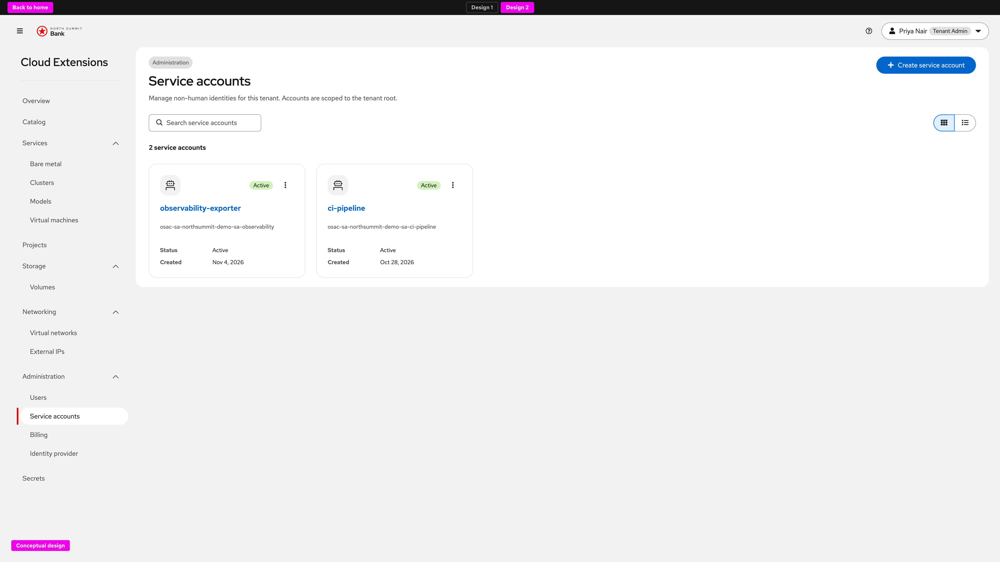
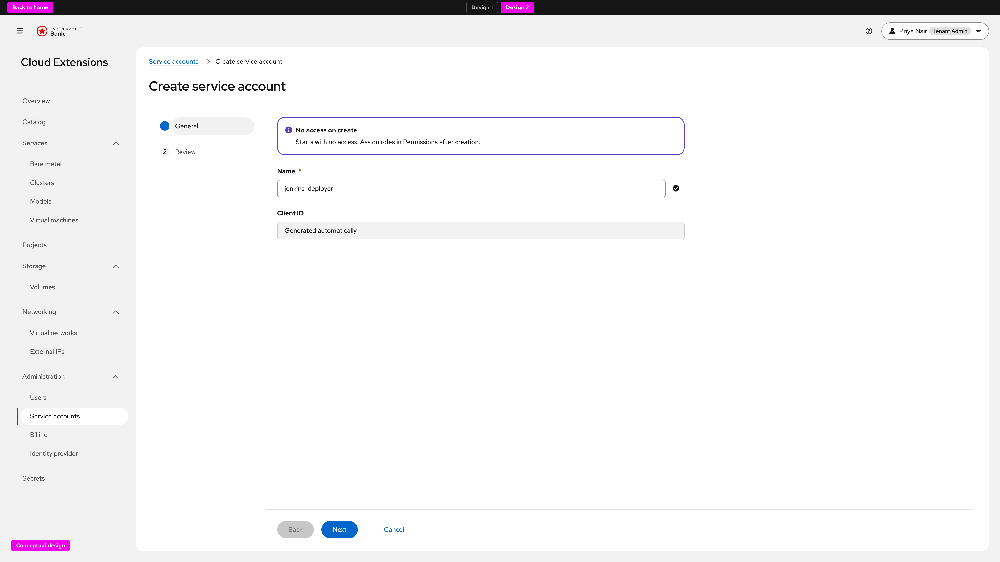
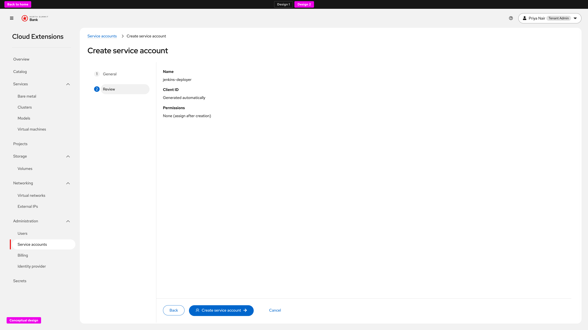
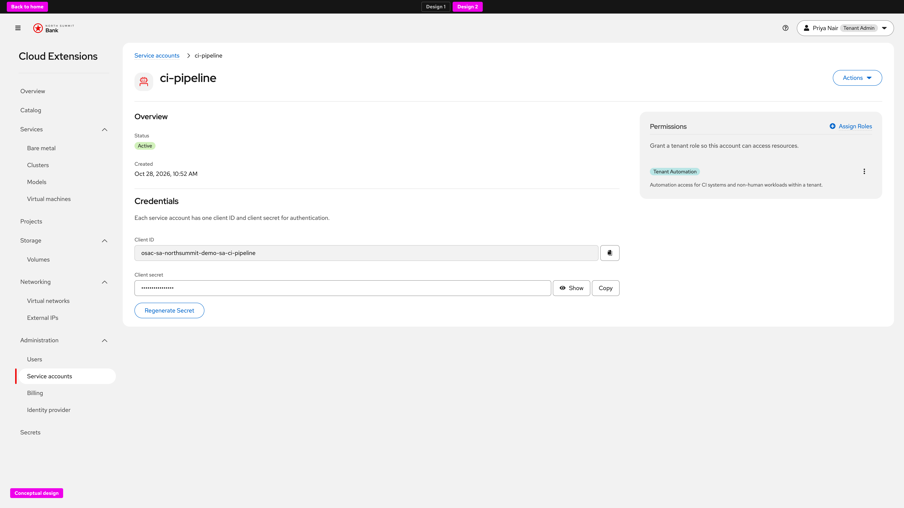
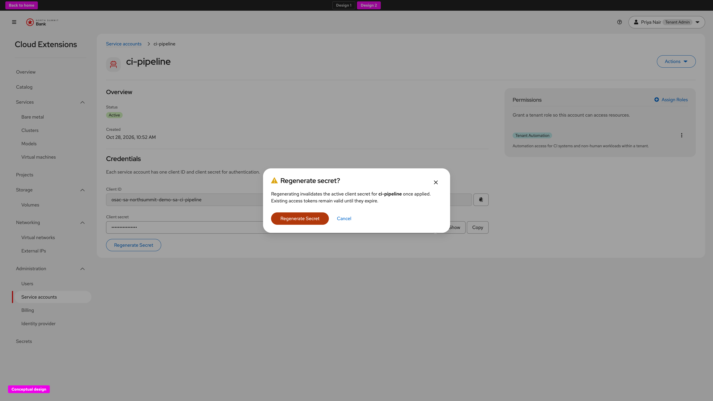
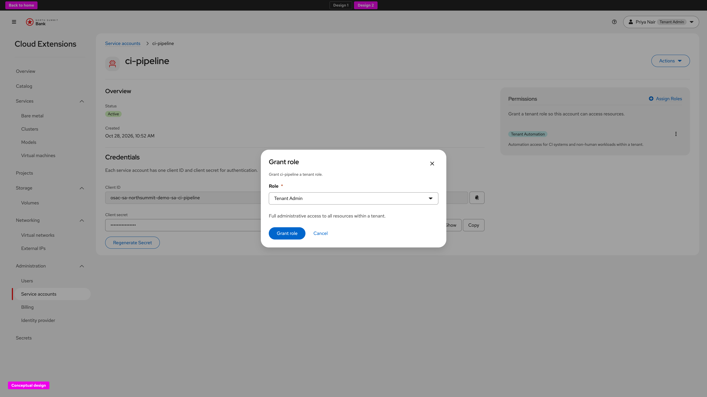

# Tenant-Scoped Service Accounts — UX Design

Conceptual UX for **tenant-scoped service account management**
([OSAC-5137](https://redhat.atlassian.net/browse/OSAC-5137)), captured from
**Design 2** in the live click-through prototype.

**Prototype (developers):**

- [Service accounts list (Design 2)](https://heyethankim.github.io/osac-design-lab/tenant-admin/northsummit/workspace?nav=administration-service-accounts&hub=1&topic=service-accounts&design=2)
- [Create → General](https://heyethankim.github.io/osac-design-lab/tenant-admin/northsummit/workspace?nav=administration-service-accounts&hub=1&topic=service-accounts&design=2&action=create-service-account&step=general)
- [Create → Review](https://heyethankim.github.io/osac-design-lab/tenant-admin/northsummit/workspace?nav=administration-service-accounts&hub=1&topic=service-accounts&design=2&action=create-service-account&step=review)

Requirements: [prd.md](prd.md). Backend design: [design.md](design.md).

## Product decisions (this release)

- **Administration → Service accounts.** Tenant Admins manage machine identities
  from **Administration → Service accounts**. Accounts are **tenant-scoped**
  (tenant root), not project-scoped. Tenant Users have no management page; they
  use issued credentials with the token guide.
- **Create with zero permissions.** Create asks only for a DNS-label **Name**.
  An info alert states the account **starts with no access**; roles are assigned
  afterward under **Permissions**. Review shows
  **Permissions: None (assign after creation)**.
- **Server-generated client ID.** Create shows **Client ID** as read-only
  *Generated automatically*. After create, the ID follows
  `osac-sa-<tenant-id>-<account-UUID>` and is always visible (copyable).
- **One client secret per account.** Each account has a single client secret.
  **Regenerate Secret** replaces it; the previous secret can no longer obtain
  new tokens. Already-issued access tokens remain valid until they expire.
- **Roles after create.** Assignable roles are **Tenant Admin**, **Tenant
  Automation**, and **Tenant IdP Manager**. Empty permissions mean the account
  cannot call tenant APIs until a role is granted.
- **Name is immutable.** The service account name cannot change after creation.
- **Deleting is visible.** Delete confirms immediate access end; status shows
  **Deleting** while cleanup finishes, then the account disappears from the
  list.

---

## 1. Service accounts list

**What this screen is for.** Give Tenant Admins one place to browse tenant
machine identities and start create, credentials, rotation, or delete
([prd.md](prd.md) list / manage stories).

**Explanation.** **Administration → Service accounts** lede: *Manage non-human
identities for this tenant. Accounts are scoped to the tenant root.* Primary
**+ Create service account**. Search filters by name, client ID, or status.
Grid/list toggle; cards (or table rows) show name, **Active** / **Deleting**
status, client ID, and created date. Kebab: **View details**, **View
Credentials**, **Regenerate Secret**, **Delete**. Empty state offers create
when none exist.

---

## 2. Create service account — General

**What this screen is for.** Collect the immutable account name and set
expectations that create does not grant access
([prd.md](prd.md) create story; [design.md](design.md) Tenant Admin UI Flow).

**Explanation.** Wizard **General → Review**. Breadcrumb
`Service accounts > Create service account`. Inline info alert **No access on
create**: *Starts with no access. Assign roles in Permissions after creation.*
Required **Name** (lowercase DNS label). Read-only **Client ID** preview:
*Generated automatically*. No project picker, description, or role selector on
this step. **Next** / **Cancel**.

---

## 3. Create service account — Review

**What this screen is for.** Confirm name and pending credential generation
before the account is created.

**Explanation.** Review summarizes **Name**, **Client ID** (*Generated
automatically*), and **Permissions** (*None (assign after creation)*). Primary
**Create service account** issues the account and its initial client secret;
**Back** returns to General; **Cancel** leaves without creating.

---

## 4. Service account detail

**What this screen is for.** Inspect identity, credentials, and role grants for
one account ([prd.md](prd.md) get / update / rotate stories).

**Explanation.** Breadcrumb `Service accounts > {name}`. Header **Actions**
includes regenerate, assign roles, and delete. **Overview** shows **Status**
and **Created**. **Credentials** explains one client ID and client secret;
client ID is copyable; client secret is masked with **Show** / **Copy** and
**Regenerate Secret**. **Permissions** rail lists granted roles (for example
**Tenant Automation**) with descriptions and **Assign Roles**; empty state
reads *No roles granted yet.*

---

## 5. Regenerate secret

**What this screen is for.** Replace a compromised or rotated client secret so
automation can adopt a new credential
([prd.md](prd.md) regenerate story).

**Explanation.** **Regenerate Secret** (detail or list kebab) opens a warning
modal: regenerating invalidates the active client secret once applied; existing
access tokens remain valid until they expire. Danger primary **Regenerate
Secret**; **Cancel** dismisses. After success, the credentials panel shows the
replacement secret for copy/save.

---

## 6. Grant role

**What this screen is for.** Grant a tenant role so the account can call
permitted APIs ([prd.md](prd.md) grant/revoke stories).

**Explanation.** **Assign Roles** opens **Grant role** with a required **Role**
select of roles not already bound (**Tenant Admin**, **Tenant Automation**,
**Tenant IdP Manager**). Helper text describes the selected role. Primary
**Grant role**; already-bound roles are omitted. Revoke is available from each
permission row’s kebab (**Remove**).

---

## Notes vs design.md

| Topic | This UX design (Design 2) | [design.md](design.md) |
| --- | --- | --- |
| Create roles | No roles on create; assign under Permissions after | Create may include role selection with visible permissions |
| Secret disclosure | Detail Credentials supports Show / Copy of the active secret | Disclose secret only on create / regenerate; redact elsewhere |
| Assignable roles | Tenant Admin, Tenant Automation, Tenant IdP Manager | Also `osac-csi-driver` for managed accounts (private Volumes) |
| Scope | Tenant root only; no project field | `metadata.project` empty; tenant-derived |
| Navigation | Administration → Service accounts | `/tenant/service-accounts` |

Align implementation secret handling with [design.md](design.md) one-time
disclosure (create / regenerate responses only) even if the prototype keeps
Show on detail for demo. Surface `osac-csi-driver` in Permissions when that
role ships for CSI consumers.
