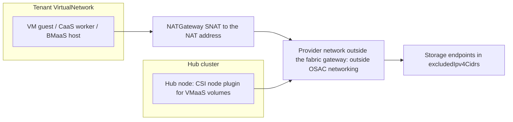

# Storage Connectivity Through Networking

## Summary

OSAC storage is not attached to the servers that use it: volumes, disks, and mounts live on a storage system
that workloads reach over the network. Every storage operation therefore depends on a working network path
from the workload, or from the hub node for VMaaS volumes, to the storage endpoints, and on tenant networks
never covering storage addresses. This design defines that path for storage reached over Ethernet with IP
protocols, the only transport in scope for now.

Tenant workloads reach IP storage through the outbound SNAT of their VirtualNetwork's NATGateway, and the
provider lists storage ranges in the existing `global.networking.excludedIpv4Cidrs` so that no tenant
network captures them. The design is documentation only: it adds no code change, API field, setting,
check, manager capability, or manager task, so every existing installation and client keeps working. A
Cluster's pod and service networks are not checked against storage ranges; the documentation tells the
admin and catalog authors how to keep them apart. See [PRD](prd.md) for detailed requirements.

OSAC networking's responsibility ends at the NATGateway's SNAT. The design assumes the NATGateway exists
and works as the contract states. Everything after the NAT (routing to storage, the network between the
fabric gateway and storage, and storage-side access control) is outside the managed fabric and outside
OSAC networking.

| Term | Meaning in this design |
|------|---------|
| **IP storage** | NFS, iSCSI, and NVMe/TCP over Ethernet. Fibre Channel, InfiniBand, and RDMA transports (RoCE, NVMe over RDMA, iSER) are out of scope. |
| **Storage endpoint** | A data address (often a pool of virtual IPs) or a storage management address that a client connects to. |
| **Storage range** | A CIDR that holds storage endpoints, listed in `excludedIpv4Cidrs`. |
| **Excluded ranges** | The installation setting `global.networking.excludedIpv4Cidrs` (fulfillment service flag `--networking-excluded-ipv4-cidrs`). |
| **NAT address** | The `address` of the ExternalIP of a VirtualNetwork's NATGateway; the PRD's "outbound address". |
| **Cluster networks** | A Cluster's pod and service CIDRs; the PRD's "cluster internal networks". See [Default Cluster networks](#default-cluster-networks). |

## Motivation

The storage designs leave the network path to the provider: "CaaS cluster nodes have network reachability
to the storage backend" ([OSAC-1332 PRD](/enhancements/OSAC-1332-caas-cluster-storage/prd.md)), and
"Network connectivity is an infrastructure prerequisite"
([OSAC-2117](/enhancements/OSAC-2117-pure-storage-flashblade/design.md)). The networking designs already
hold every piece of a path but never apply them to storage:

- A NATGateway gives "Outbound SNAT for the VirtualNetwork through one ExternalIP"
  ([Unified](/enhancements/OSAC-1433-unified-networking/design.md#resource-hierarchy)), and "Without a
  NATGateway, OSAC promises no outbound path outside the VirtualNetwork"
  ([Unified](/enhancements/OSAC-1433-unified-networking/design.md#virtualnetwork)).
- The contract's `create_nat_gateway` must "Translate the source address of outbound traffic from the
  VirtualNetwork's CIDR to `external_ip.address` (source NAT, SNAT). Allow no new inbound connections."
  ([contract §4.10](/enhancements/OSAC-1433-network-manager-integration-contract-networking/design.md#fabric-create_nat_gateway--delete_nat_gateway)).
  Every conformant Fabric Manager implements it; the only capabilities are `eastWestEthernet` and
  `security_group_icmp`.
- `global.networking.excludedIpv4Cidrs` holds "canonical IPv4 CIDRs (default empty) that the provider's
  infrastructure uses". A VirtualNetwork or ExternalIPPool CIDR that overlaps one is rejected, and "The
  fulfillment service refuses to start when the setting overlaps the NetworkClass default
  `virtual_network_ipv4_cidr`, an existing VirtualNetwork, or an ExternalIPPool"
  ([Unified](/enhancements/OSAC-1433-unified-networking/design.md#virtualnetwork)).

Cluster networks are not checked against excluded ranges. The CaaS design rejects a Cluster whose pod and
service CIDRs "overlap the VirtualNetwork CIDR, any range in `global.networking.excludedIpv4Cidrs`, or any
ExternalIPPool CIDR" ([CaaS](/enhancements/OSAC-1436-caas-networking/design.md#network-attachment-and-validation)),
but `PrivateClustersServer` runs none of these checks
([Codebase: fulfillment-service/internal/servers/private_clusters_server.go]), and the startup check skips
Clusters on purpose: "Cluster pod and service networks are internal to a cluster, so an excluded
infrastructure range is not compared with them"
([Codebase: fulfillment-service/internal/startup/installation_settings.go]). A pod or service network that
covers a storage address keeps that traffic inside the Cluster, so its volumes never mount. This design
does not add the check: excluded ranges hold more than storage, and the installation guide tells Netris
users to exclude `10.0.0.0/8`, which holds the default pod network `10.132.0.0/14`. The check would reject
every default Cluster create there ([Known gaps](#known-gaps), [Locked: D10]).

### Goals

- Use only the contract's `create_nat_gateway` behavior, the ExternalIP, ExternalIPPool and NATGateway
  model, and `excludedIpv4Cidrs`. No vendor or Fabric Manager branch in OSAC. [Locked: D1, D2, D3]
- Define the path, the guarantee, and the assumptions outside OSAC networking for every storage consumer in
  one table.
- Document the Cluster networks that a Cluster gets, and how the admin keeps them off storage ranges.
- State NAT capacity with numbers and assumptions.
- Keep backward compatibility: no code change. [Locked: D10]

### Non-Goals

- A new storage CIDR field, NetworkClass field, capability, or manager task. [Locked: D3]
- A creation gate for workloads on a VirtualNetwork without a NATGateway. [Locked: D4]
- Dedicated storage networks or second NICs (OSAC-6121, open EP PRs #393 and #396), and tenant-isolated
  storage networking (OSAC-5073). The BMaaS `storage` port role stays reserved "for future storage network
  attachments" ([OSAC-1201](/enhancements/OSAC-1201-baremetal-instance-types/design.md)).
- Storage over transports other than Ethernet and IP: Fibre Channel, InfiniBand, and RDMA (RoCE, NVMe over
  RDMA, iSER), which cannot pass through SNAT. Also inbound connections from storage, and storage QoS.
- The path after the NAT and storage-side access control (export rules, accounts, address rules). They
  are outside OSAC networking. [Locked: D7]
- A startup check of existing Cluster networks. The startup check keeps skipping Clusters; the admin checks
  them before adding a range ([workflow step 7](#workflow-description)). [Locked: D6]
- Any Cluster-side overlap check of the CaaS design. See [Known gaps](#known-gaps). [Locked: D8, D10]

## Proposal

The proposal has two parts, both documentation:

1. **One path model** for every storage consumer (below). OSAC guarantees the tenant side up to the
   NAT; everything after it is assumed and outside OSAC networking.
2. **Documentation** in the installation guide, the tenant guide, and the descriptions of
   `excludedIpv4Cidrs` in the Helm values and schema ([IC-2](#ic-2-storage-documentation)).

No product code changes. The documentation work also updates the networking decisions index
(`docs/agent-context/networking-decisions.md`) in the osac repository.

### Storage paths

| Consumer | Traffic origin | Path to storage | Source address at storage |
|---|---|---|---|
| VMaaS volumes (PVCs, VM disks) | CSI node plugin on a hub node | Hub node network; not the tenant VirtualNetwork, not a NATGateway | Hub node address |
| VM guest mounting storage itself | VM on a tenant Subnet | Tenant VirtualNetwork, then the NATGateway's SNAT | NAT address |
| CaaS workers (CSI node plugin) | Bare-metal worker on a tenant Subnet, host network namespace | Tenant VirtualNetwork, then the NATGateway's SNAT | NAT address |
| CaaS OSAC CSI Driver controller (control calls, not storage I/O) | Pod on a worker | Same SNAT path to the hub fulfillment API and its OIDC issuer | NAT address, seen by the hub endpoints |
| CaaS vendor CSI driver (control calls) | Pods on the workers | Same SNAT path to the storage management endpoint | NAT address |
| BMaaS hosts | Host on a tenant Subnet after the port move | Tenant VirtualNetwork, then the NATGateway's SNAT; the tenant configures the client | NAT address |
| BMaaS host at first boot | Host on the provisioning network | Provider-owned provisioning network and its SNAT, not a tenant VirtualNetwork | Provider-defined |
| Bare-metal host in a FabricDomain with a storage network | Host NIC on a template storage V-Net | The FabricDomain's storage network ([OSAC-1382](/enhancements/OSAC-1382-multi-fabric-east-west-networking/design.md)); not a NAT path and not covered here | Host storage address |
| Any service, provider networking disabled | Hub nodes, cluster pod network, or provisioning network | Provider-owned; no ExternalIP, so no NATGateway | Provider-defined |

Notes on the rows:

- **VMaaS volumes.** VM disks are PVCs on the hub, mounted by the hub's CSI node plugin on the node that
  runs the VM. "OSAC networking supports exactly one hub: the management cluster where the OSAC operator,
  OSAC CRs, AAP, and VMs run"
  ([Unified](/enhancements/OSAC-1433-unified-networking/design.md#networking-hub-support-boundary)), and
  the hub operator calls the vendor CSI controllers while the node plugin does the iSCSI, NVMe, or NFS
  work on the node ([OSAC-2872](/enhancements/OSAC-2872-storage-control-plane/design.md)).
- **CaaS workers.** Mounts "originate from worker-node IPs, not pod CIDRs, because the CSI node plugin
  performs mounts in the host network namespace"
  ([OSAC-2117](/enhancements/OSAC-2117-pure-storage-flashblade/design.md)). With `evpn`, "OVN-Kubernetes
  routes the VMs' traffic into the IP-VRF"
  ([contract §4.9](/enhancements/OSAC-1433-network-manager-integration-contract-networking/design.md#49-network-types-and-the-network-segment)),
  and the Fabric Manager applies the SNAT.
- **CaaS vendor CSI driver.** Some storage roles install a vendor CSI driver on the target cluster with
  per-tenant management credentials; that driver calls the storage management endpoint from the cluster
  (for example the VAST role,
  [Codebase: osac-aap/collections/ansible_collections/osac/templates/roles/vast_storage/tasks/ensure_csi_operator.yaml]).
  The CaaS workers then need the storage management endpoint through the NAT, and that endpoint belongs in
  a storage range.
- **BMaaS first boot.** "The tenant OS, with its `user_data`, first boots on the provisioning network and
  stays there while a port move waits"
  ([OSAC-1437](/enhancements/OSAC-1437-bmaas-networking/design.md#security-considerations)), and
  "first-boot egress uses the isolated provisioning network"
  ([OSAC-1437](/enhancements/OSAC-1437-bmaas-networking/design.md#provisioning-network-and-port-moves)).
  A mount in first-boot `user_data` therefore uses the provider's provisioning network, not the NAT path.
- **FabricDomain storage network.** OSAC-1382 lets a server cluster template put a storage V-Net on its own
  NICs. That path is outside this design.

The diagram shows the two kinds of path. Tenant workloads always leave through their VirtualNetwork's
NATGateway, so the storage system sees one NAT address per VirtualNetwork. VMaaS volumes never touch a
tenant network; they use the hub node network. The provider may list that network in
`excludedIpv4Cidrs`, which defaults to empty.

### What OSAC guarantees and what is assumed outside it

| OSAC guarantees | Source |
|---|---|
| No VirtualNetwork (so no Subnet), ExternalIPPool, or NetworkClass default overlaps a listed range. VirtualNetwork creates through the UI, CLI, and API, and ExternalIPPool creates through the private API, fail with `INVALID_ARGUMENT` and "overlaps the excluded range <CIDR>". Cluster networks are not checked (see [Default Cluster networks](#default-cluster-networks)). | Unified |
| A READY NATGateway translates outbound traffic from the VirtualNetwork's CIDR to its ExternalIP and allows no new inbound connections, with every conformant Fabric Manager. | Contract §4.10 |
| Every ExternalIPPool address is routed "to the fabric from wherever the provider exposes external addresses". | Contract §4.10 |
| A tenant's default VirtualNetwork gets a NATGateway when provider networking is enabled. | Default networking |
| With provider networking enabled, a Cluster create needs a READY NATGateway on its VirtualNetwork. | Unified gates |

The following are assumptions, not OSAC duties. They sit after the NAT (or, for hub nodes, outside tenant
networks), outside the managed fabric. The provider and the storage system own them; OSAC does not
configure or check them.

| Assumption outside OSAC networking | Why |
|---|---|
| A route from where the Fabric Manager sends NAT traffic to every storage endpoint, and a route from the storage network back to every ExternalIPPool CIDR, so that replies reach the place where the provider exposes external addresses. | The contract promises SNAT and the pool route, not destinations or the storage side's return route. Any pool can hold a NAT address: the default NATGateway's ExternalIP "uses the READY IPv4 pool with the lowest API ID that has `available` > 0" ([Default networking](/enhancements/OSAC-1433-default-networking/design.md#server-validation-fulfillment-service)), and a tenant may pick any pool. |
| Hub nodes reach the storage data endpoints, and the hub reaches the storage management endpoint. | VMaaS volumes and the hub vendor controllers. |
| A route from NAT addresses to the hub fulfillment API and the OIDC issuer (Keycloak in the CSI chart values) that the OSAC CSI Driver uses on CaaS clusters. A storage management endpoint is routed from NAT addresses when a tenant-network client needs it, such as a vendor CSI driver on CaaS workers. | The CaaS management publication covers the hosted control plane endpoints, not these ([CaaS](/enhancements/OSAC-1436-caas-networking/design.md#network-attachment-and-validation)). |
| The storage system controls access. | Storage-side access control is outside OSAC networking. See [Security](#security-considerations). |
| Firewalls between the NAT and storage allow the storage ports. | General protocol knowledge: NFS 2049, iSCSI 3260, NVMe/TCP 4420 and discovery 8009. |
| iSCSI redirect portals and NVMe/TCP discovery referrals point only to addresses inside the listed ranges. | A referral outside them can be captured by a tenant network. |
| Cluster networks do not cover storage endpoints. | Nothing checks them ([Default Cluster networks](#default-cluster-networks)). |

This mirrors the [CaaS precedent](/enhancements/OSAC-1436-caas-networking/design.md#network-attachment-and-validation), where "The provider supplies DNS for the management hostnames and the
route from the NATGateway's ExternalIP to the management endpoints".

### Default Cluster networks

A Cluster's pod and service CIDRs come from, in order:

1. `spec.network.pod_cidr` and `service_cidr` on the request, from the API, the CLI, the UI wizard, or a
   catalog item's policy.
2. The ClusterTemplate's `spec_defaults.network`, merged into the spec when the request leaves a field
   unset ([Codebase: fulfillment-service/internal/utils/cluster_spec_defaults.go] `mergeClusterNetworkDefaults`).
3. The AAP role defaults, pod `10.132.0.0/14` and service `172.31.0.0/16`, when neither sets them
   ([Codebase: osac-aap/collections/ansible_collections/osac/service/roles/hosted_cluster/defaults/main.yml];
   the `cluster_settings` role resolves "explicit CR field > role defaults").

No create path checks any of them against excluded ranges, the VirtualNetwork CIDR, or ExternalIPPool
CIDRs. The admin and the catalog author keep them off storage ranges; a tenant who sets them follows the
same guidance from the tenant guide.

### Workflow Description

Actors: the Cloud Infrastructure Admin owns the storage ranges and the path after the NAT; the
Cloud Provider Admin onboards tenants; the Tenant Admin owns networking resources; the Tenant User creates
workloads.

1. **Collect the ranges.** Before installation, the Cloud Infrastructure Admin gets from the storage
   administrator every storage address a tenant workload or hub node may connect to: the data address
   pools and any storage management endpoint routable from tenant networks. A list entry can be one CIDR
   per pool or one CIDR that covers every pool. A covering CIDR means a new per-tenant pool carved from it
   needs no rollout.
2. **Check them against the address ranges already in use.** Storage ranges must not overlap:
   - the NetworkClass default `virtual_network_ipv4_cidr` (installer default `10.200.0.0/16`). The
     installer's `create-network-class` step fails with "excludedIpv4Cidrs range <CIDR> overlaps the default
     VirtualNetwork CIDR <CIDR>", and the fulfillment service refuses to start with "excludedIpv4Cidrs range
     <CIDR> overlaps the NetworkClass default ...";
   - the [default Cluster networks](#default-cluster-networks): pod `10.132.0.0/14` and service
     `172.31.0.0/16`, and every ClusterTemplate `spec_defaults.network` and catalog item policy in use.
     Nothing rejects a Cluster whose networks cover a storage endpoint; its storage traffic stays inside
     the Cluster;
   - the hub cluster's own pod and service networks, and the OVN-Kubernetes internal ranges on the hub
     (join, transit, and masquerade subnets; in current OpenShift releases `100.64.0.0/16`, `100.88.0.0/16`
     and `169.254.0.0/17` by default). Read the hub's values from its network configuration. Hub-node
     traffic for VMaaS volumes to such an address stays inside the hub's cluster network.

   Do not put storage on hub node addresses for VM guests: with `cudn_evpn`, VM traffic toward hub node
   IPs enters the host through the management port and is refused there
   ([networking decisions](https://github.com/osac-project/osac/blob/main/docs/agent-context/networking-decisions.md)).
   An excluded range that holds no storage, such as the Netris private allocation `10.0.0.0/8` in the
   installation guide, may cover the default Cluster networks; only storage ranges must stay outside them.
3. **Install or roll out.** The admin adds the ranges to `global.networking.excludedIpv4Cidrs` in the Helm values
   (whether the Enclave Wizard renders this array value is not verified) and sets up the
   [assumptions outside OSAC networking](#what-osac-guarantees-and-what-is-assumed-outside-it).
4. **Onboard.** The Cloud Provider Admin creates a Tenant. With provider networking enabled, onboarding
   creates the default VirtualNetwork and its NATGateway with the ExternalIP `default-nat`
   ([Default networking](/enhancements/OSAC-1433-default-networking/design.md)). The tenant's storage
   address is that ExternalIP's address.
5. **Use more networks.** A Tenant Admin who creates another VirtualNetwork creates a NATGateway on it so
   that its workloads reach storage. Its ExternalIP is a new source address at storage.
6. **Create a Cluster.** The Cluster gets the networks of [Default Cluster networks](#default-cluster-networks).
   The catalog author picks ClusterTemplate defaults and catalog item policies outside every storage range.
   A tenant who sets pod or service CIDRs follows the tenant guide; nothing rejects an overlap.
7. **Extend the ranges later.** The admin adds entries in a later rollout. If a new entry overlaps the
   NetworkClass default, an existing VirtualNetwork, or an ExternalIPPool, the fulfillment service refuses
   to start with "excludedIpv4Cidrs range <CIDR> overlaps <kind> <ID or CIDR>". The startup check does not
   compare Cluster networks (see [Motivation](#motivation)), and this design keeps that.
   A Cluster whose pod or service network overlaps the new entry keeps running but silently loses storage
   at addresses in the overlap. So before the rollout, the admin lists every tenant's Clusters through the
   private Clusters API and compares each `spec.network.pod_cidr` and `service_cidr` with each new entry.
   When a field is unset, the admin uses the ClusterTemplate's `spec_defaults.network`, or else the role
   defaults `10.132.0.0/14` and `172.31.0.0/16`. The installation guide gives this check. The admin then
   removes the entry or the conflict: VirtualNetwork and ExternalIPPool specs are immutable, so they are
   deleted and recreated with another range. A Cluster's `spec.network` is accepted by Update today, but
   this design does not claim that a running Cluster re-networks, so recreate the Cluster. The NetworkClass
   default changes only by the [NetworkClass replacement](/enhancements/OSAC-1433-default-networking/design.md#replacing-the-networkclass).
   Removing an entry lifts the protection for new resources only.

### API Extensions

No new or changed API fields, CRDs, webhooks, or finalizers, and no behavior change.

### Interface Changes

The design has one interface change, and it is documentation. IC-1, a Cluster network check at create in an
earlier draft, is dropped ([Locked: D10]); IC-2 keeps its ID.

#### IC-2: Storage documentation

**Requirements:** FR-1, FR-3, FR-4, FR-7

The descriptions of `global.networking.excludedIpv4Cidrs` in `values.yaml` and `values.schema.json` add
storage endpoints to the examples and state that neither Cluster creates nor the startup check compare
Cluster networks. The installation guide gets a storage connectivity section: the path table, the
guarantees and the assumptions outside OSAC networking, choosing and extending ranges with the checks of
[workflow step 2](#workflow-description), the [default Cluster networks](#default-cluster-networks) and
their sources, the existing-Cluster check of [workflow step 7](#workflow-description), the NAT address as
the source address at storage and how long it identifies a tenant, [capacity](#capacity) with its
assumptions, and troubleshooting. The tenant guide states that a VirtualNetwork needs a READY NATGateway to
reach storage, and that pod and service CIDRs a tenant sets must not cover storage ranges. The chart README
follows the value description.

## UX Alignment

The tracked osac-ui Cluster create wizard exposes optional pod and service CIDR fields under "Customize
cluster network", subject to catalog policy
([Codebase: osac-ui/libs/ui-components/src/components/Cluster/CreateWizard/ClusterNetworkingStep.tsx];
[OSAC-1421 wizard design](/enhancements/OSAC-1421-cluster-and-vm-provisioning-wizard/design.md)). The
wizard validates only the CIDR format, and this design adds no check, so a UI user can create a Cluster
whose networks cover a storage range and see no error. When the fields are left empty, the
[default Cluster networks](#default-cluster-networks) apply; workflow step 2 keeps storage ranges outside
them. No UI change and no deviation.

### Implementation Details/Notes/Constraints

#### Documentation changes

- The installation guide and the tenant guide, as in [IC-2](#ic-2-storage-documentation).
- The `excludedIpv4Cidrs` descriptions in `osac-installer` `values.yaml`, `values.schema.json` and the
  chart README. These are description edits; `make helm-networking-test` keeps passing.
- The networking decisions index in the osac repository, by the same documentation work.
- `checkExcludedRanges` in the startup check and its test entry "a Cluster default pod and service
  network, which are not compared" do not change.

#### Known gaps

- **Cluster network checks.** The CaaS design rejects pod and service CIDRs that overlap any range in
  `excludedIpv4Cidrs`, the Cluster's VirtualNetwork CIDR, or any ExternalIPPool CIDR. None of the three is
  implemented on Cluster create, and this design deliberately does not add them, to keep backward
  compatibility ([Locked: D8, D10]). Only the ExternalIPPool create side checks existing Cluster networks.
- **Wrong defaults in the existing ExternalIPPool check.** The fulfillment helper `clusterCIDRs`
  ([Codebase: fulfillment-service/internal/servers/networking_guards.go]) and the CaaS design assume the
  defaults `10.128.0.0/14` and `172.30.0.0/16` for an unset Cluster network. The real defaults are those of
  [Default Cluster networks](#default-cluster-networks). The ExternalIPPool-versus-Cluster check therefore
  compares the wrong defaults, and ignores ClusterTemplate defaults. Not fixed here.
- **Integration testing guide note.** The Networking design note of the integration testing guide says the
  dev profile "sets no `excludedIpv4Cidrs`", but `osac-installer/values/dev/kind-instance.yaml` sets
  `192.0.2.0/24`. The documentation work corrects the note.

#### Capacity

Every number here is general protocol knowledge, not an OSAC or contract promise. The contract promises
nothing about port capacity or throughput.

- **Flows per NAT address.** NAT tells flows apart by protocol, addresses, and ports. With one source
  address, the upper bound is the unprivileged source port space: 64,512 ports (1024 to 65535). How far
  that bound stretches depends on how the NAT allocates ports. A NAT with one shared port pool for all
  destinations (common with endpoint-independent mapping) gives about 64,000 flows per NAT address in
  total. A NAT that reuses a source port toward different destinations gives that many per destination
  address and port; Linux netfilter SNAT does this when the connection tuple stays unique. The port range
  and the allocation depend on the Fabric Manager's NAT, and its manager design should state them.
  Without that statement, plan for one shared pool: about 64,000 flows per NAT address in total.
- **NFS privileged ports.** The Linux NFS client uses a source port below 1024 by default, and NFS servers
  often require one (the `secure` export option). A NAT that keeps privileged ports privileged (netfilter
  maps them into 600 to 1023) has about 424 such ports. With one shared pool, that is about 424 NFS flows
  per NAT address in total, across all NFS servers; with per-destination reuse, 424 per NFS server
  address. A NAT that remaps them to high ports makes `secure` exports refuse the mount. With
  `nconnect=16`, 424 flows serve about 26 client mounts. Options: an `insecure` export (the flows then use
  the unprivileged range), more VirtualNetworks, or, with per-destination reuse only, more NFS data
  addresses.
- **Connections per client.** An NFS client usually opens one TCP connection per server address, up to 16
  with `nconnect`. iSCSI opens one per session (per target and path). NVMe/TCP opens one per queue: one
  admin queue plus, by default, one I/O queue per CPU, for each controller (each subsystem and path).
- **Example.** A Cluster of 20 workers with 64 CPUs each, NVMe/TCP, one subsystem, and two paths opens
  20 x 2 x 65 = 2,600 flows. 100 hosts with 128 CPUs open 100 x 2 x 129 = 25,800, inside the headroom
  below but close to it; a second subsystem doubles that to 51,600, past it.
- **Headroom.** Keep the planned peak per NAT address under half the bound (about 32,000 flows), so a
  reconnect storm after a path failure still fits.
- **Throughput.** All of a VirtualNetwork's storage I/O crosses the Fabric Manager's NAT data path, which may
  be a software gateway. The provider measures it. On `evpn` Subnets the contract keeps "every workload on the
  Subnet at MTU 1500", so storage gets no jumbo frames.

When this is not enough, in order of effort:

1. Lower the NVMe/TCP I/O queue count per controller in the storage client settings.
2. With per-destination port reuse, add storage data addresses: each one adds a destination.
3. Spread workloads over more VirtualNetworks, each with its own NATGateway and address. A NATGateway has
   exactly one immutable ExternalIP, and a Cluster uses one Subnet, so this works per VirtualNetwork, not per
   Cluster.
4. Move the load to a dedicated storage network once OSAC-6121 or OSAC-5073 delivers one.

#### Protocol notes

From general protocol knowledge: a protocol that needs the server to open a connection to the client does
not work through SNAT. NFSv3 lock callbacks and NFSv4.0 delegation callbacks are such cases, and NFSv3 also
needs the portmapper (111) and mountd ports. Only NFSv4.1 and later are supported on this path; they reuse
the client's connection. iSCSI and NVMe/TCP connections are client-initiated. A NAT drops idle flows after a
timeout, so enable TCP keepalives (or protocol keepalives) shorter than the NAT's idle timeout.

### Security Considerations

- **No inbound path through the NATGateway.** The NATGateway admits no new inbound connections, so the
  storage system cannot open a connection to a workload through the NAT address. This does not cover a
  workload with an ExternalIPAttachment: `attach_external_ip` creates "one-to-one inbound destination NAT
  (DNAT)" for that workload
  ([contract §4.10](/enhancements/OSAC-1433-network-manager-integration-contract-networking/design.md#fabric-attach_external_ip--detach_external_ip)),
  and [automatic external access](/enhancements/OSAC-1433-unified-networking/design.md#automatic-external-access),
  which CaaS needs for its API and ingress, adds such attachments. Those workloads stay reachable as
  designed, also from the storage network.
- **Source address at storage.** The storage system sees the NAT address as the source of tenant traffic
  (and hub node addresses for VMaaS volumes). Tenant VirtualNetwork CIDRs repeat across tenants, and an
  ExternalIP has one consumer, so two tenants never share a NAT address at the same time. The NAT address
  identifies a tenant only while its ExternalIP exists: deleting an ExternalIP releases the address
  ("Release the reservation", [contract §4.10](/enhancements/OSAC-1433-network-manager-integration-contract-networking/design.md#fabric-create_external_ip--delete_external_ip)),
  and the pool can give it to another tenant. The default `default-nat` address is stable for the
  tenant's life: tenants cannot use `default-nat` or create a NATGateway on the default VirtualNetwork
  ([Default networking](/enhancements/OSAC-1433-default-networking/design.md#proto-fulfillment-service)).
  Keeping storage-side rules in step with NAT addresses is outside OSAC networking. [Locked: D7]
- **Shared path.** Every tenant's storage traffic crosses the same NAT data path and provider network.
  OSAC isolates tenant networks from each other, not tenants on the path after the NAT.
- **SecurityGroups.** The installer's default SecurityGroup rules allow all egress, and the automatic
  Cluster SecurityGroup allows egress to `0.0.0.0/0`. A tenant SecurityGroup with narrower egress must allow the storage ports.

### Failure Handling and Recovery

| Failure | What happens | Recovery | User observes |
|---|---|---|---|
| A new range overlaps the NetworkClass default, a VirtualNetwork, or an ExternalIPPool. | The fulfillment service refuses to start, or the installer's `create-network-class` step fails; the rollout fails. | Remove the entry, or delete and recreate the resource. | The rollout error names the first overlap. |
| A new range overlaps an existing Cluster's pod or service network. | Not detected; the rollout completes, and that Cluster's traffic to the overlap stays inside the Cluster. | Remove the entry, or recreate the Cluster with other networks. The admin check of [workflow step 7](#workflow-description) prevents it. | Mount timeouts on that Cluster only. |
| A new Cluster's network covers a storage range. | Not detected; the Cluster is created, and its traffic to the overlap stays inside the Cluster. | Recreate the Cluster with other networks, or fix the ClusterTemplate default or catalog policy. | Mount timeouts on that Cluster only. |
| The VirtualNetwork has no NATGateway. | No outbound path; storage connections time out. | The Tenant Admin creates a NATGateway. | Mount timeouts; PVCs stay Pending. |
| A route to storage or back to a pool is missing. | SNAT works, packets are lost. | The provider adds the route. | Mount timeouts. |
| The NAT runs out of ports. | New connections fail; existing ones continue. | See [Capacity](#capacity). | New mounts hang; running volumes work. |
| A hub node cannot reach storage. | VMaaS volumes do not attach. | The provider fixes the hub path. | VM disks fail to attach. |
| CaaS CSI cannot reach the hub API or Keycloak. | Volume create and attach calls fail. | The provider adds the route. | PVCs stay Pending. |

The fulfillment service retries nothing here: every existing check is synchronous, and the startup refusal
repeats on every start until the setting or the data changes.

### RBAC / Tenancy

No RBAC or tenancy changes required. `excludedIpv4Cidrs` is an installation setting that only the provider
controls.

### Observability and Monitoring

No new observability changes. Existing monitoring mechanisms apply: request metrics count rejected
VirtualNetwork and ExternalIPPool creates, the startup refusal is a pod log line and a failed rollout, and
NATGateway and ExternalIP state show the NAT side.

### Risks and Mitigations

| Risk | Mitigation |
|---|---|
| A range added later overlaps an existing Cluster's pod or service network, which the startup check skips, so that Cluster silently loses storage. | The installation guide gives the admin check of [workflow step 7](#workflow-description) before every rollout that adds a range. |
| Storage ranges overlap the default Cluster networks, or a ClusterTemplate default, catalog policy, or a tenant's own CIDRs cover a storage range, so those Clusters silently lose storage. Nothing rejects them. | [Workflow step 2](#workflow-description) keeps storage ranges outside the default networks; the catalog author keeps templates and policies outside them; the tenant guide tells tenants which ranges to avoid. |
| Storage designs that restrict access by worker or node address refuse tenant traffic: OSAC-2117's export policy restricts "client access to the tenant's workload cluster worker-node CIDRs", and OSAC-2872 has mounts that are "IP-based (using the export ACL set during attach)", but through SNAT the storage system sees the NAT address. | Those storage designs key on the NAT address of the workload's VirtualNetwork, or on credentials. Follow-up owned by the storage team; OSAC networking still ends at the SNAT. |
| A released NAT address goes to another tenant while storage rules still name it. | The storage administrator updates rules when an ExternalIP is deleted; `default-nat` is stable. Outside OSAC networking. [Locked: D7] |
| Storage load exceeds one NAT address. | [Capacity](#capacity) gives numbers and steps. |
| A software NAT data path limits storage throughput. | The provider measures it; a dedicated storage network is the later fix. |

### Drawbacks

All tenant storage I/O crosses NAT, which adds a hop, caps flows per address, and gives no jumbo frames on
`evpn` Subnets. Listing broad storage ranges also takes those ranges away from every tenant network. Cluster
networks stay unchecked, so the protection for Clusters is documentation only. These are acceptable while a
dedicated storage network does not exist; the path needs no new API and works with every conformant Fabric
Manager.

## Alternatives (Not Implemented)

- **Per-tenant storage VLAN or second storage NIC** (OSAC-6121, EP PRs #393 and #396; OSAC-5073). No NAT,
  real per-tenant isolation, and jumbo frames. It needs a multi-NIC API, per-tenant storage-side VLANs, and
  manager work that do not exist yet. Kept as the later path.
- **Fabric static routes for storage ranges.** The Fabric Manager would route storage destinations out of
  every VRF, whatever the tenant CIDRs. It needs a new contract task or capability, differs per fabric, and
  still lets a Cluster pod network capture the traffic inside the Cluster. Rejected. [Locked: D2]
- **Routing tenant CIDRs to storage without NAT.** Tenant CIDRs overlap across tenants, so return routes
  are ambiguous without per-tenant VRFs on the storage side. Rejected.
- **A new `storage_cidrs` field** (the earlier version of this design). It duplicates the meaning and checks
  of `excludedIpv4Cidrs` and adds an immutable NetworkClass field that cannot grow without a NetworkClass
  replacement. Rejected. [Locked: D3]
- **A Cluster network check against excluded ranges at create** (an earlier draft of this design). Excluded
  ranges hold more than storage. The installation guide tells Netris users to exclude `10.0.0.0/8`, which
  holds the default pod network `10.132.0.0/14`, so every default Cluster create there would fail.
  Rejected to keep backward compatibility. [Locked: D10]
- **A NATGateway gate for storage workloads.** Default VirtualNetworks have a NATGateway and Clusters
  already need one, so a gate would only block VMs and hosts that may not need storage. Rejected. [Locked: D4]

## Open Questions

None.

## Test Plan

[testplan.md](testplan.md) holds the test cases and the coverage matrix. The design changes no code, so the
plan verifies the existing behavior it relies on and reviews the documentation. In short:

| Tier | Owner | What |
|---|---|---|
| Unit (`internal/startup`, PostgreSQL test server) | [DEV] fulfillment-service | The existing startup entries for FR-4, unchanged. |
| Component integration (`it/`) | [DEV] fulfillment-service | The existing VirtualNetwork and ExternalIPPool rejection (TC-IPAM-03) for FR-2, with the dev profile's excluded range `192.0.2.0/24`. |
| Contract (Helm contract) | [DEV] osac-installer | `make helm-networking-test` after the IC-2 description edits. |
| Manual review | [DEV] | The Cluster network guidance (FR-3), the existing-Cluster check (FR-4), and the absence of vendor and Fabric Manager settings (NFR-1). |
| E2E | [QE] | A VM guest, a CaaS PVC, a BMaaS host and a second tenant mount NFS through their NATGateways; the storage side sees each NAT address; no inbound path through the NATGateway. Blocked: the labs have no IP storage endpoint on the NAT path. |

## Graduation Criteria

Graduation criteria will be defined when targeting a release. Expected stages: Dev Preview -> Tech
Preview -> GA based on production deployment feedback. Leaving Dev Preview needs the documentation
published and the E2E cases for FR-5, NFR-2 and NFR-3 passing in a lab with an IP storage endpoint on the
NAT path.

## Upgrade / Downgrade Strategy

No code changes, so nothing changes on upgrade or downgrade. Existing Clusters, VirtualNetworks, and
ExternalIPPools keep working, and every Cluster create that works today keeps working. Adding storage ranges
in a later rollout follows [workflow step 7](#workflow-description).

## Version Skew Strategy

No component changes, so no skew applies.

## Support Procedures

For a workload that cannot reach storage:

1. Find the workload's VirtualNetwork and confirm it has a READY NATGateway: `osac get natgateways`.
2. READY means the Fabric Manager accepted the configuration, not that traffic flows ("A NAT task is READY
   when Netris accepted the configuration, not when traffic flows",
   [contract §4.9](/enhancements/OSAC-1433-network-manager-integration-contract-networking/design.md#49-network-types-and-the-network-segment)).
   From a workload on the VirtualNetwork, open a TCP connection to the storage endpoint's port (for
   example `nc -vz <endpoint> 2049`) and confirm that the endpoint or a capture after the NAT sees the NAT
   address.
3. Read the NATGateway's ExternalIP address; that is the source the storage system sees. Access at the
   storage system is checked by its administrator, outside OSAC networking.
4. Confirm the storage endpoint is inside a range of `excludedIpv4Cidrs`.
5. For a Cluster, confirm its pod and service CIDRs, or the [defaults](#default-cluster-networks) it got,
   do not cover the endpoint. Nothing checks this at create.
6. From the provider network, confirm the route to the storage endpoint and the route back to the pool CIDR.
7. For VMaaS volumes, test the hub node path to the data endpoint instead.
8. For NFS, confirm the client uses NFSv4.1 or later.

To stop using the documented setup, remove the storage ranges from `excludedIpv4Cidrs`; existing resources
and paths keep working, and new tenant networks may overlap storage again.

## Infrastructure Needed

A vendor-neutral storage server in the `osac-test-infra` Netris lab (`infra/netris/`), owned by [QE] with
test-infra, to run the E2E cases:

- A plain Linux NFS server first; an iSCSI or NVMe/TCP target can follow. No storage vendor is needed.
- Placed outside the fabric gateway, reached from the NAT path, with a route back to the lab's
  ExternalIPPool CIDRs.
- Its range listed in `excludedIpv4Cidrs` in the lab's installer values.
- A lab verify step that mounts from a VM on a tenant default network and checks that the server logs the
  NAT address as the client.

No Jira ticket exists yet.

---

## Provenance

Authored: draft @ design 0.14.0 - 70405a6, workspace main @ 21e5dba7c (52 behind origin/main)

<!-- ai-workflow-provenance:{"schema_version":1,"provenance_kind":"session","workflow":"design","workflow_version":"0.14.0","ai_workflows":"70405a6","source_repo":"21e5dba7c","source_repo_branch":"main","commits_behind_main":52,"commits_ahead_main":0,"main_ref":"main","phases":["draft"],"authoring_modes":["skill"],"context_changed":false,"origin_untracked":false} -->
