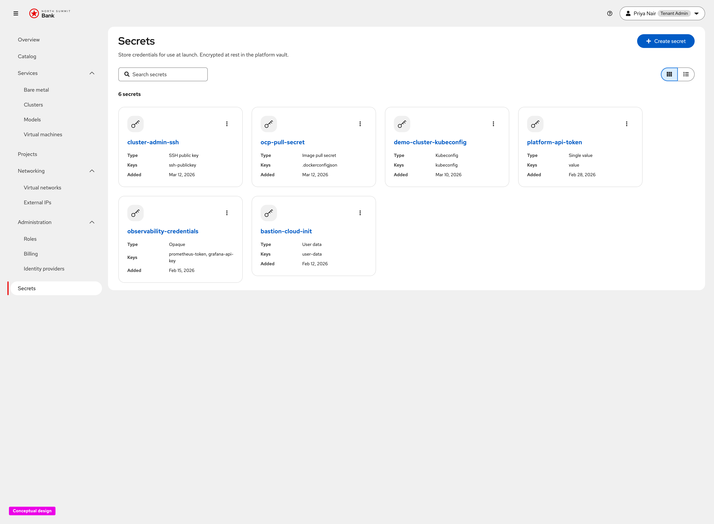
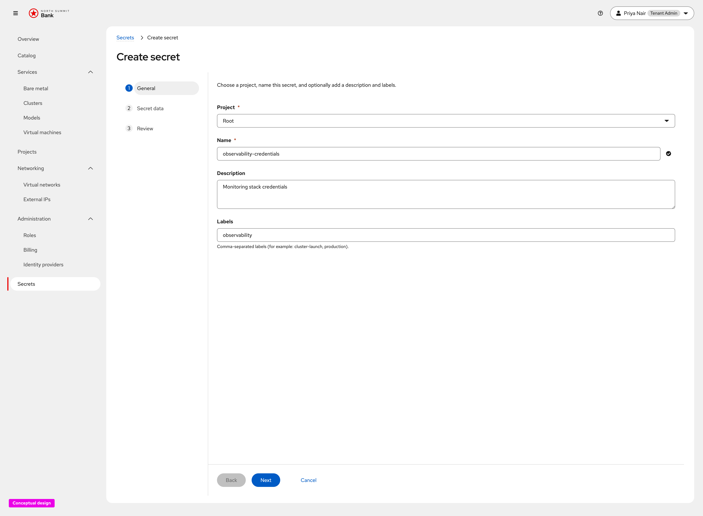
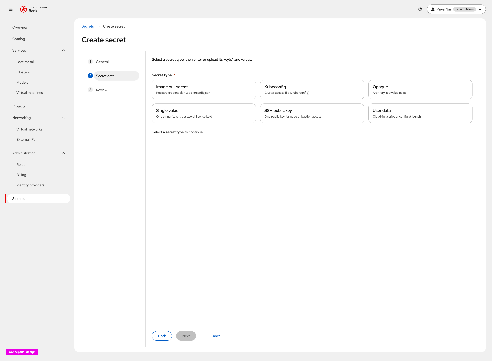
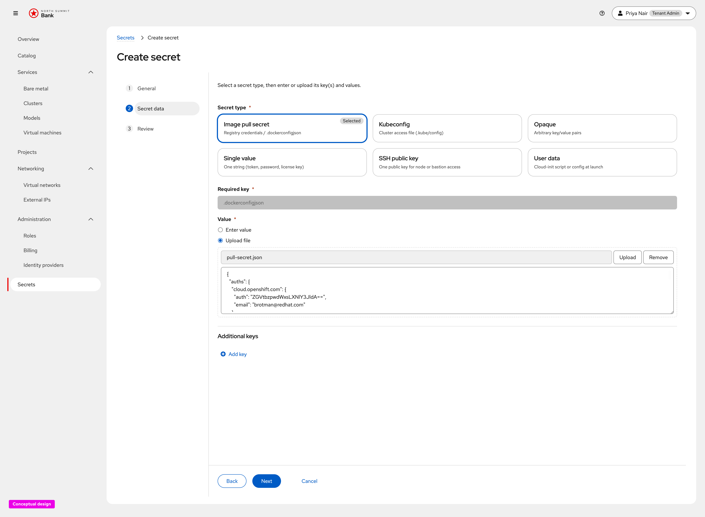
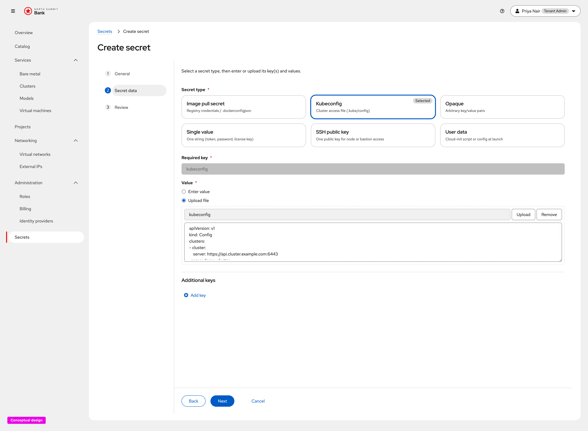
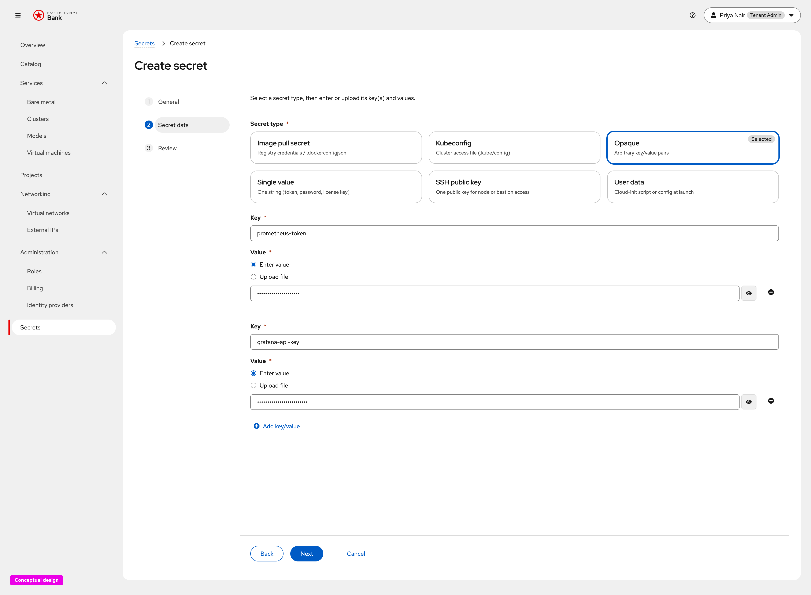
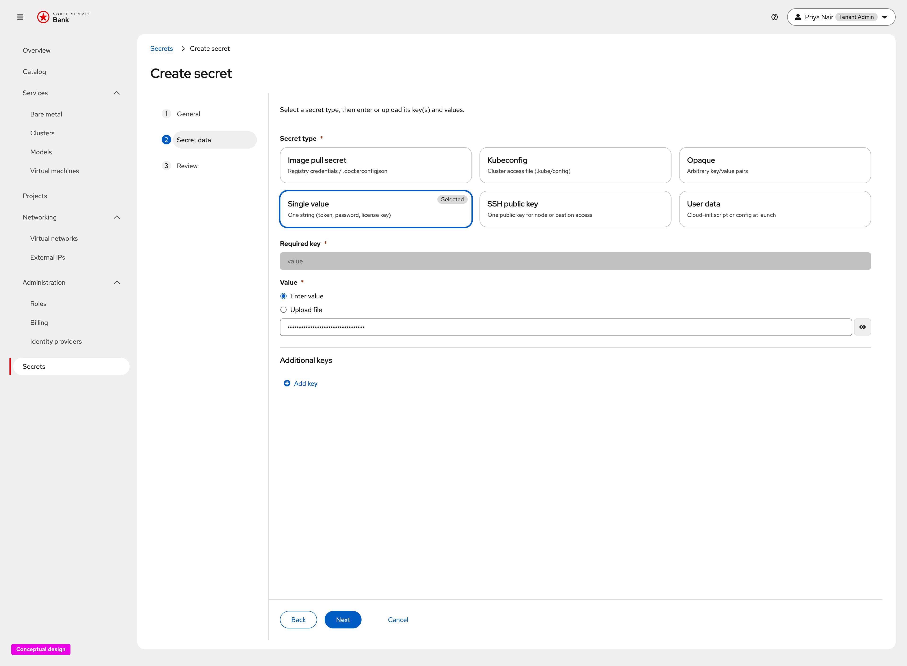
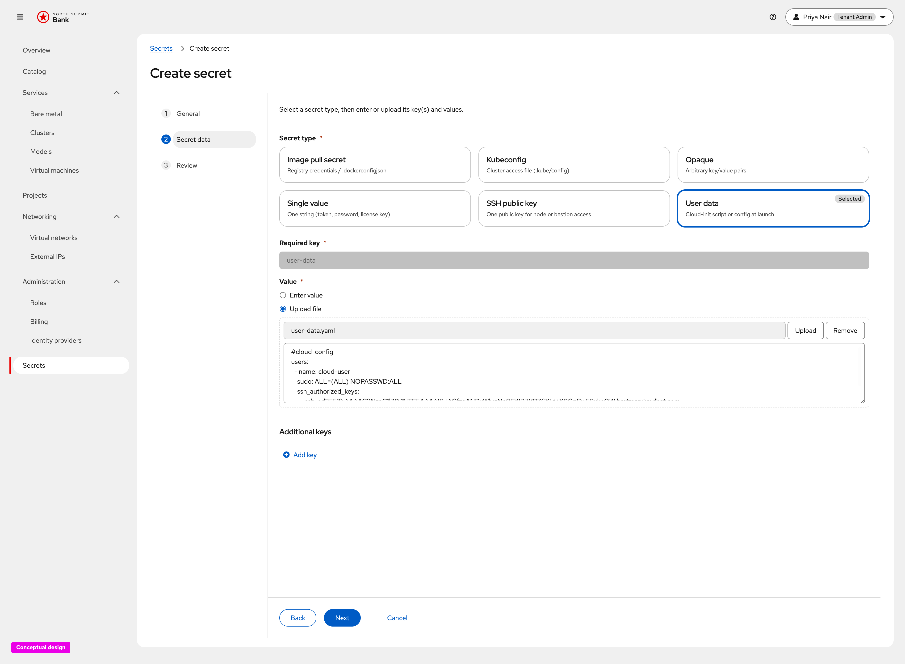
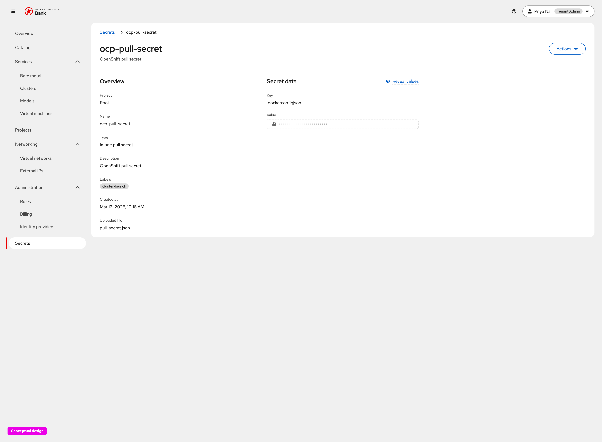
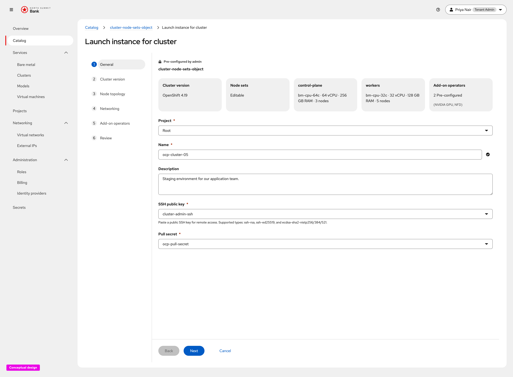

# Secret Management — UX Design

Conceptual UX for **general tenant Secret management**
([OSAC-5913](https://redhat.atlassian.net/browse/OSAC-5913)), captured from the
live click-through prototype. This document covers the shared Secrets list,
typed create wizard, masked detail/retrieve flow, and Secret pickers in
resource workflows. SSH public key as a specialized type is out of focus here;
see [OSAC-51](https://redhat.atlassian.net/browse/OSAC-51) for that registry
experience.

**Prototype (developers):**

- [Secrets list](https://heyethankim.github.io/osac-bmaas/tenant-admin/northsummit/workspace?nav=secrets)
- [Create secret](https://heyethankim.github.io/osac-bmaas/tenant-admin/northsummit/workspace?nav=secrets&action=create-secret&step=general)
- [Launch cluster → General (Secret pickers)](https://heyethankim.github.io/osac-bmaas/tenant-admin/northsummit/workspace?nav=catalog&action=launch-instance&item=cluster-node-sets-object&step=general)

Requirements: [OSAC-1567 prd.md](../OSAC-1567-secret-management/prd.md).
Backend design: [design.md](../OSAC-1567-secret-management/design.md).
Implementation-oriented UI contract:
[ui-design.md](../OSAC-1567-secret-management/ui-design.md).

## Product decisions (this release)

- **One Secrets surface for all credential types.** Tenants create, list, and
  inspect secrets from **Administration → Secrets**. Types include image pull
  secrets, kubeconfigs, opaque key/value pairs, single values, user data, and
  related credentials — not a separate tool per credential kind.
- **Metadata-only lists.** The list shows name, type label, key names, and
  created date. Plaintext values never appear in list rows, search results,
  notifications, or URLs.
- **Typed create wizard.** Create uses **General → Secret data → Review**.
  **General** captures project, name, and optional description/labels.
  **Secret data** starts with a type card grid; each type pre-fills required
  data keys (for example `.dockerconfigjson` for image pull secrets) and
  supports enter-value or upload where appropriate.
- **Values masked by default.** Detail separates Overview metadata from Secret
  data. Opening detail retrieves values, but the UI masks them immediately and
  requires **Reveal values** (and optional copy/download) for access.
- **Select by name in workflows.** Resource forms that need credentials (for
  example cluster **Pull secret**) use a Secret picker filtered to the matching
  type. The menu lists secrets by name and can offer **Create secret** so a
  missing credential can be registered without leaving the wizard.
- **No secret-store administration in this UX.** Vault/backend configuration,
  automated rotation, and provider-admin tenant-secret browsing remain out of
  scope ([prd.md](../OSAC-1567-secret-management/prd.md) Out of Scope /
  [ui-design.md](../OSAC-1567-secret-management/ui-design.md) Non-goals).

---

## 1. Secrets list

**What this screen is for.** Give Tenant Admins and Tenant Users a single place
to browse credentials available for launch and retrieval
([prd.md](../OSAC-1567-secret-management/prd.md) list stories).

**Explanation.** **Secrets** under Administration shows a searchable grid (or
list) with **+ Create secret**. Cards show name, type (Image pull secret,
Kubeconfig, Opaque, Single value, User data, and others), key names, and added
date. Opening a card navigates to detail; kebabs offer type-appropriate actions
without exposing values in the list.

---

## 2. Create secret — General

**What this screen is for.** Name the secret and attach it to a project before
entering sensitive data
([ui-design.md](../OSAC-1567-secret-management/ui-design.md) create wizard).

**Explanation.** Step **General** asks for project (when more than one is
available), a Kubernetes-valid **Name**, optional **Description**, and optional
comma-separated **Labels**. Lede: *Choose a project, name this secret, and
optionally add a description and labels.* Type and values come on the next
step so metadata stays separate from secret material.

---

## 3. Create secret — Secret data (type picker)

**What this screen is for.** Choose the public Secret type so the form can
require the correct data keys
([ui-design.md](../OSAC-1567-secret-management/ui-design.md) type table).

**Explanation.** **Secret data** presents type cards (alphabetical by label):
Image pull secret, Kubeconfig, Opaque, Single value, SSH public key, and User
data. Lede: *Select a secret type, then enter or upload its key(s) and
values.* **Next** stays disabled until a type is selected. Shared controls
after type selection:

- **Required key** (when the type defines one) — read-only key name the API
  expects.
- **Value** — masked by default; **Enter value** or **Upload file** (upload
  preferred for file-oriented types).
- **Show value** / hide toggle on entered text.
- **Add key** — available for types that allow additional pairs (notably
  Opaque).

### Secret type fields

Fields below are the in-scope general types for this UX. Production data keys
match [ui-design.md](../OSAC-1567-secret-management/ui-design.md); the
prototype may use slightly different key strings (noted where they differ).
SSH public key is listed only as a type card in the picker; its field contract
lives under [OSAC-51](https://redhat.atlassian.net/browse/OSAC-51).

#### Image pull secret

| Field | Required | Behavior |
| --- | --- | --- |
| Type card | Yes | Label **Image pull secret**; description *Registry credentials / .dockerconfigjson*. |
| Required key | Yes (fixed) | `.dockerconfigjson` — not editable. |
| Value | Yes | Registry pull credentials as JSON (Docker/`auths` config). Prefer **Upload file** (for example `pull-secret.json`); **Enter value** also allowed. Masked until revealed. |
| Additional keys | No | Optional via **Add key** in the prototype; production pull secrets are typically the single required key. |

Selecting the card expands the required-key field and defaults **Value** to
**Upload file**, with a content preview after upload.

Used at cluster launch as the **Pull secret** picker (see §5).

#### Kubeconfig

| Field | Required | Behavior |
| --- | --- | --- |
| Type card | Yes | Label **Kubeconfig**; description *Cluster access file (.kube/config)*. |
| Required key | Yes (fixed) | `kubeconfig` — not editable. |
| Value | Yes | Full kubeconfig document. Prefer **Upload file**; **Enter value** for paste. Masked until revealed. Detail may offer download named from the Secret. |
| Additional keys | No | Not the primary path; one kubeconfig payload per Secret. |

Same pattern as image pull: fixed key, upload-first value with YAML preview.

Often system-created after cluster provision; user-created kubeconfigs follow the
same fields for import/reuse.

#### Opaque

| Field | Required | Behavior |
| --- | --- | --- |
| Type card | Yes | Label **Opaque**; description *Arbitrary key/value pairs*. |
| Required key | None | No fixed key convention. |
| Key / Value rows | Yes (≥1 pair) | User-defined keys (for example `prometheus-token`, `grafana-api-key`). Each value is masked; enter or upload per row. |
| Add key | Optional | Adds another key/value row. At least one non-empty pair required to continue. |

Selecting Opaque replaces the fixed required-key control with editable **Key** /
**Value** rows and **+ Add key/value**.

Default/general-purpose type when no specialized type fits (OIDC client
secrets, monitoring tokens, and similar).

#### Single value

| Field | Required | Behavior |
| --- | --- | --- |
| Type card | Yes | Label **Single value**; description *One string (token, password, license key)*. |
| Required key | Yes (fixed) | `value` — not editable. |
| Value | Yes | One string credential. **Enter value** by default; upload optional. Masked until revealed. |
| Additional keys | No | Single payload; no multi-key editor emphasis. |

Selecting the card shows fixed key `value` and a masked single-line **Enter
value** field (upload remains available).

#### User data

| Field | Required | Behavior |
| --- | --- | --- |
| Type card | Yes | Label **User data**; description *Cloud-init script or config at launch*. |
| Required key | Yes (fixed) | Production: `userdata` ([ui-design.md](../OSAC-1567-secret-management/ui-design.md)). Prototype: `user-data`. |
| Value | Yes | Cloud-init user-data script or config. Prefer **Upload file**; **Enter value** for paste. Masked until revealed. |
| Additional keys | No | One user-data document per Secret. |

Selecting the card locks the required key and defaults to **Upload file** with
a cloud-init content preview (for example `#cloud-config`).

Referenced when a launch or catalog field accepts user-data / cloud-init by
Secret name rather than inline paste.

---

## 4. Secret detail — retrieve with masking

**What this screen is for.** Inspect metadata and retrieve credential values
only after an explicit reveal
([prd.md](../OSAC-1567-secret-management/prd.md) retrieve / metadata stories).

**Explanation.** Example: `ocp-pull-secret` (Image pull secret). Overview lists
project, name, type, description, labels, created time, and uploaded file when
present. **Secret data** shows keys (for example `.dockerconfigjson`) with
masked values and **Reveal values**. **Actions** covers update/delete subject
to permissions; system-managed secrets stay non-editable when the API marks
them read-only. Review and list never show plaintext values.

---

## 5. Launch workflow — Secret pickers

**What this screen is for.** Reference an existing Secret by name when
provisioning a resource that needs credentials
([prd.md](../OSAC-1567-secret-management/prd.md) Secret pickers in resource
workflows).

**Explanation.** On **Launch instance for cluster → General**, credential
fields such as **Pull secret** are Secret selects filtered to the matching
type (for example `ocp-pull-secret`). The same pattern applies to other typed
references in catalog launch flows. Launch stores a secret reference; Review
shows the secret **name**, not the bytes. The picker can include **Create
secret** so tenants register a missing credential without abandoning the
wizard.

