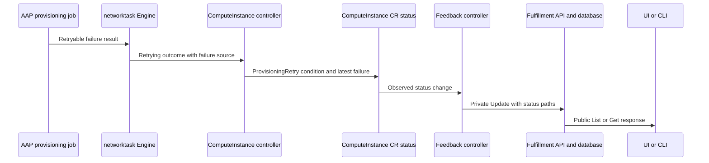

# Expose ComputeInstance Provisioning Failures During Retries

## Summary

Add a `ProvisioningRetry` condition and a singular
`last_provisioning_failure` field to ComputeInstance status. The operator
maps retryable AAP provisioning failures into these system-owned fields, the
feedback bridge persists them, and the VM list, VM details, and CLI status
commands render them. VM power state, metering, and retry scheduling remain
unchanged. See [PRD](prd.md) for detailed requirements.

## Motivation

A retryable provisioning failure is recorded internally as a
`NetworkJobStatus` with state `Retrying`, but the ComputeInstance controller
only checks `Outcome.Failed()`, which is true only for a final `Failed`
outcome. When no KubeVirt VM exists yet, the controller therefore overwrites
the visible `Provisioned` condition with `WaitingForVM`. The retry remains
scheduled, but tenants see the same generic waiting state as a first
provisioning attempt and lose the failure details
[Codebase: osac-operator/internal/controller/computeinstance_controller.go].

`ComputeInstanceState` is the VM power/lifecycle state and is metered together
with `state_transition_time`. A `RETRYING` state would conflate provisioning
work with power state and fragment the metering timeline. The accepted
ComputeInstance status model keeps conditions orthogonal to lifecycle state,
so retry belongs in a condition
[Codebase: enhancement-proposals/enhancements/OSAC-1027-computeinstance-phase-condition-expansion/README.md].

The current job message is operational rather than a reviewed tenant-facing
contract. It can contain task and manager names, AAP job IDs, provider text,
and the next retry time. A purpose-built latest-failure value can expose a
stable reason, a bounded tenant-safe message, the failed attempt number, and
an observation timestamp without exposing job internals.

### Goals

- Preserve `ComputeInstanceState` as the metered VM power/lifecycle state.
- Represent retry as an orthogonal `ProvisioningRetry` condition.
- Expose only the latest provisioning failure, with explicit success clearing.
- Derive tenant-safe failure details from already classified engine outcomes.
- Keep retry classification, backoff, limits, and scheduling unchanged.
- Render retry and failure details in the supported UI and CLI status surfaces.

### Non-Goals

- Do not add retry limits, timeouts, or new transient/permanent classification.
- Do not change retry backoff or job launch behavior.
- Do not expose `status.jobs`, job history, AAP logs, or raw provider errors.
- Do not expand VM operation, configuration, or deletion status; that broader
  work belongs to OSAC-6578.
- Do not add roles, permissions, or a support-only diagnostic surface.

## Proposal

The shared ComputeInstance contract gains one condition type and one singular
structured status field. The operator sets them from the provision task
outcome, the feedback controller synchronizes them through the existing
private Update path, and the public List and Get responses expose them to the
existing UI and CLI consumers. No endpoint, request shape, or writable field
is added.

### Workflow Description

Starting from a newly created ComputeInstance whose first provisioning attempt
fails with a retryable error:

1. AAP returns the failed job result to `networktask.Engine`.
2. The engine records the existing `status.jobs` entry as `Retrying`, applies
   the existing backoff, and returns a `Retrying` outcome with a failure
   source and tenant-safe message.
3. The ComputeInstance controller sets:
   - `Provisioned=False`, reason `ProvisioningRetry`.
   - `ProvisioningRetry=True`, reason `RetryScheduled`.
   - `last_provisioning_failure` to the latest reason, message, attempt, and
     observation timestamp.
4. The feedback bridge maps the CR condition and field into the private
   ComputeInstance object and includes `status.last_provisioning_failure` in
   its explicit Update field mask
   [Codebase: osac-operator/internal/controller/computeinstance_feedback_controller.go].
5. Public List and Get expose the retry condition and latest failure to
   authorized UI and CLI consumers. UI presentation is defined in separate UX
   files.
6. When the retry becomes due, the engine launches the next attempt. The
   controller changes the `ProvisioningRetry` reason to `RetryRunning` and
   retains the previous failure until that attempt succeeds or fails.
7. If the retry succeeds, the controller sets `Provisioned=True`, sets
   `ProvisioningRetry=False` with reason `AsExpected`, and removes
   `last_provisioning_failure`. The UI and CLI stop showing retry and failure.
8. If the retry fails again, the controller replaces the singular failure with
   the newer attempt's details and leaves the retry condition true.



The diagram shows the unchanged provisioning path on the left and the additive
status propagation path on the right. The engine still owns retry scheduling;
only the classification needed for tenant-safe display is carried forward.

### API Extensions

No service or endpoint is added. `ComputeInstanceStatus` receives these
additive, output-only changes:

```protobuf
enum ComputeInstanceConditionType {
  // Existing values remain unchanged.
  COMPUTE_INSTANCE_CONDITION_TYPE_PROVISIONING_RETRY = 10;
}

enum ComputeInstanceProvisioningFailureReason {
  COMPUTE_INSTANCE_PROVISIONING_FAILURE_REASON_UNSPECIFIED = 0;
  COMPUTE_INSTANCE_PROVISIONING_FAILURE_REASON_PROVIDER_REPORTED = 1;
  COMPUTE_INSTANCE_PROVISIONING_FAILURE_REASON_RESULT_REJECTED = 2;
  COMPUTE_INSTANCE_PROVISIONING_FAILURE_REASON_TIMED_OUT = 3;
  COMPUTE_INSTANCE_PROVISIONING_FAILURE_REASON_JOB_LOST = 4;
  COMPUTE_INSTANCE_PROVISIONING_FAILURE_REASON_JOB_NOT_STARTED = 5;
  COMPUTE_INSTANCE_PROVISIONING_FAILURE_REASON_INVALID_RESULT = 6;
  COMPUTE_INSTANCE_PROVISIONING_FAILURE_REASON_PROVIDER_ERROR = 7;
}

message ComputeInstanceProvisioningFailure {
  ComputeInstanceProvisioningFailureReason reason = 1;
  string message = 2;
  int32 attempt = 3;
  google.protobuf.Timestamp observed_at = 4;
}

message ComputeInstanceStatus {
  // Existing fields 1 through 12 remain unchanged.
  optional ComputeInstanceProvisioningFailure last_provisioning_failure = 13;
}
```

The condition value uses the first unused value after the reserved values 7
and 8. The status field uses the first unused field number after 12.

The failure reason describes the already observed failure source; it does not
reclassify retryability:

| Engine outcome | Failure reason | Tenant-safe message |
|---|---|---|
| Valid `osac_error` | `PROVIDER_REPORTED` | The contract-defined `osac_error.message` |
| Successful job with malformed or unexpected `osac_result` | `RESULT_REJECTED` | `OSAC could not accept the provisioning result.` |
| Failed job with a missing or malformed `osac_error` | `INVALID_RESULT` | `The provisioning provider returned an invalid or incomplete result.` |
| AAP timeout | `TIMED_OUT` | `The provisioning attempt timed out.` |
| AAP job no longer exists | `JOB_LOST` | `The provisioning job was lost before its result could be read.` |
| AAP never started the job | `JOB_NOT_STARTED` | `The provisioning job did not start.` |
| AAP job ended with an infrastructure error | `PROVIDER_ERROR` | `The provisioning provider reported an infrastructure error.` |

`osac_error.message` is used verbatim only when the artifact passes the
existing strict parser, because that message is contract-defined, plain
language, and tenant-visible. Every other source uses the fixed message above.
The mapping is safe by construction: it never selects AAP job IDs, task names,
manager names, logs, tracebacks, next-retry timestamps, or unreviewed provider
error text.

Final failure is existing engine behavior, not a new classification introduced
by this design. For the non-cleanup `provision` task, the engine reaches
`Failed` only when:

1. AAP reports a failed job with a valid `osac_error` whose `retryable` value
   is `false`.
2. AAP reports a failed job with a missing or malformed `osac_error`.
3. AAP reports a successful job whose `osac_result` is malformed or contains
   an unexpected key, which the existing no-output acceptance rule rejects.

Valid retryable `osac_error`, AAP timeout, AAP infrastructure error, a lost
job, and a job AAP never started remain `Retrying`. A terminal failure stays
final for the same desired configuration; only a later configuration change
starts a new provision attempt.

The new condition uses the existing condition object fields:

| Field | Meaning |
|---|---|
| `type` | CR: `ProvisioningRetry`; API: `COMPUTE_INSTANCE_CONDITION_TYPE_PROVISIONING_RETRY` |
| `status` | `True` while a retry is scheduled or running; `False` otherwise. The API uses the corresponding `CONDITION_STATUS_TRUE` / `CONDITION_STATUS_FALSE` enum values. |
| `reason` | Stable lifecycle reason from the table below; distinct from the failure-source reason in `last_provisioning_failure`. |
| `message` | Fixed tenant-safe lifecycle explanation from the table below; never operational job text. |

| Phase | `status` | `reason` | `message` |
|---|---|---|---|
| First attempt running or provisioning succeeds | `False` | `AsExpected` | No provisioning retry is active. |
| Waiting for backoff | `True` | `RetryScheduled` | A provisioning attempt failed; another attempt is scheduled. |
| Retry running | `True` | `RetryRunning` | A provisioning retry is running. |
| Terminal failure | `False` | `RetryNotScheduled` | Provisioning failed; no retry is scheduled. |
| Delete cancels retry | `False` | `Cancelled` | The provisioning retry was cancelled. |

`Provisioned` remains a separate existing condition. During retry its status
is `False`, its reason is `ProvisioningRetry`, and its message matches the
scheduled or running retry explanation above. Outside retry it retains the
existing progress, success, failure, or deletion semantics.

Condition semantics are:

| Provision job state | `Provisioned` | `ProvisioningRetry` | `last_provisioning_failure` |
|---|---|---|---|
| First attempt running | `False`, existing progress reason | `False`, `AsExpected` | Absent |
| Retry waiting for backoff | `False`, `ProvisioningRetry` | `True`, `RetryScheduled` | Latest failure |
| Retry attempt running | `False`, `ProvisioningRetry` | `True`, `RetryRunning` | Retained latest failure |
| Retry succeeds | `True`, existing success reason | `False`, `AsExpected` | Absent |
| Final failure | `False`, `ProvisioningFailed` | `False`, `RetryNotScheduled` | Latest failure |
| Delete cancels the job | Existing delete behavior | `False`, `Cancelled` | Absent |

An example public status during retry is:

```json
{
  "status": {
    "state": "COMPUTE_INSTANCE_STATE_STARTING",
    "conditions": [
      {
        "type": "COMPUTE_INSTANCE_CONDITION_TYPE_PROVISIONED",
        "status": "CONDITION_STATUS_FALSE",
        "reason": "ProvisioningRetry",
        "message": "A provisioning attempt failed; another attempt is scheduled."
      },
      {
        "type": "COMPUTE_INSTANCE_CONDITION_TYPE_PROVISIONING_RETRY",
        "status": "CONDITION_STATUS_TRUE",
        "reason": "RetryScheduled",
        "message": "A provisioning attempt failed; another attempt is scheduled."
      }
    ],
    "last_provisioning_failure": {
      "reason": "COMPUTE_INSTANCE_PROVISIONING_FAILURE_REASON_PROVIDER_REPORTED",
      "message": "backend busy",
      "attempt": 2,
      "observed_at": "2026-11-11T08:15:00Z"
    }
  }
}
```

`last_provisioning_failure` is a singular, output-only object:

| Field | Type | Meaning |
|---|---|---|
| `reason` | `ComputeInstanceProvisioningFailureReason` enum | Observed failure source from the mapping above; does not determine retryability. |
| `message` | string | Tenant-safe failure detail: the strictly parsed `osac_error.message`, or the fixed fallback for that source. |
| `attempt` | int32 | One-based number of the provisioning attempt that failed, using the engine's existing attempt counter; not the currently running retry's number. |
| `observed_at` | protobuf Timestamp | Time the engine observed the failed outcome; retained with that failure during backoff and an active retry. |

A later failed attempt replaces the entire object. Success, deletion that
cancels provisioning, or a fresh attempt for a new desired configuration
removes it. A terminal failure retains it until that clearing event.

When the field is present, `reason` is not `UNSPECIFIED`, `message` is
non-empty, `attempt` is at least 1, and `observed_at` is set. The field is
removed, rather than replaced with an empty message, when the failure clears.
Public callers cannot write it; the existing public Update path rejects all
status paths, while the operator uses the private feedback path.

## UX Alignment

The matching UI API module is
`osac-ux/libs/ui-components/src/api/v1/compute-instance.ts`. After the
authorized generated-types update, the fields map directly:

| UI field (`@temp-api` TypeScript) | Proto field (this EP) | Notes / deviation |
|---|---|---|
| `status.conditions[type=PROVISIONING_RETRY].status` | `status.conditions[].type` and `status.conditions[].status` | Direct mapping; UI derives a Boolean |
| `status.lastProvisioningFailure.reason` | `status.last_provisioning_failure.reason` | Direct enum mapping |
| `status.lastProvisioningFailure.message` | `status.last_provisioning_failure.message` | Direct string mapping |
| `status.lastProvisioningFailure.attempt` | `status.last_provisioning_failure.attempt` | Direct integer mapping |
| `status.lastProvisioningFailure.observedAt` | `status.last_provisioning_failure.observed_at` | Direct timestamp mapping |

There are no sub-resource actions, string-union storage classes, Kubernetes
internal fields, one-time secrets, or RHOAI operator fields. The tracked
`osac-ui` implementation requires explicit authorization to advance the
selected API baseline and one `pnpm gen-types` run; generated types are never
edited by hand.

### Implementation Details/Notes/Constraints

The operator CRD mirrors the public status shape:

```go
type ComputeInstanceProvisioningFailure struct {
    Reason     string      `json:"reason,omitempty"`
    Message    string      `json:"message,omitempty"`
    Attempt    int32       `json:"attempt,omitempty"`
    ObservedAt *metav1.Time `json:"observedAt,omitempty"`
}
```

`ComputeInstanceStatus` gains
`LastProvisioningFailure *ComputeInstanceProvisioningFailure` and the CRD
condition type `ProvisioningRetry`. The reason strings are
`ProviderReported`, `ResultRejected`, `TimedOut`, `JobLost`,
`JobNotStarted`, `InvalidResult`, and `ProviderError`. CRD deepcopy,
manifests, and Helm CRD copies are regenerated from source.

`networktask.Outcome` gains a `Retrying()` method and an optional failure
classification value. `Engine.fail` continues to make the existing retry
decision and write the existing operational `status.jobs` message; it also
returns the failure source, tenant-safe message, attempt, and observation time
to the caller. The ComputeInstance controller persists that value in its own
status and evaluates retry before the generic no-VM `WaitingForVM` branch, so
the retry reason can no longer be overwritten.

On a controller restart during backoff, the persisted CR condition and
`last_provisioning_failure` remain authoritative. The engine reconstructs its
retry wait from the persisted job entry; no in-memory failure cache is
required. A new provisioning attempt for a new desired configuration clears a
stale terminal failure before launch, and the field is repopulated if that
attempt fails.

The UI consumes the public retry condition and latest-failure object using
generated types. Copy, visual treatment, placement, and interaction behavior
are defined in separate UX files. This design specifies the data contract;
it does not select labels, tooltips, rows, or components.

CLI changes are:

- `osac get computeinstances` adds a `PROVISIONING` column containing
  `Retrying` or `-`, and a `LAST FAILURE` column containing the reason label
  or `-`.
- `osac describe computeinstance ID|NAME` adds rows for provisioning retry,
  failure reason, failure message, failed attempt, and observed time.
- The renderer formats the timestamp as RFC 3339 and omits failure rows when
  the field is absent.

Proto sources are edited only under `proto/private/`. The implementation runs
`make -C proto generate` and `make -C proto lint`, then reviews the generated
public and Go diffs. Operator CRD generation runs `make manifests generate`,
`make helm-crds`, and `make check-helm-crds`.

### Documentation Impact

The implementation stories must update the public API reference for the new
status fields, CLI help and output examples, and UI i18n strings. No separate
end-user runbook change is required because the tenant-facing behavior is
limited to the existing List, Get, and CLI status surfaces.

### Security Considerations

No authentication or authorization rule changes. Callers who can already
List or Get a ComputeInstance can read its new status fields; callers who
cannot read the instance receive the existing denial and no failure data.

The failure field is output-only and system-owned. Safe diagnostics are
selected at the engine-to-controller boundary rather than copied from
`NetworkJobStatus.Message`. Only a strictly parsed `osac_error.message` is
passed through; all other outcomes use fixed messages. AAP job IDs, task and
manager names, logs, raw tracebacks, and unreviewed provider errors are not
exposed.

### Failure Handling and Recovery

- **Retryable attempt fails:** the controller sets both indicators and the
  latest failure. The engine's existing backoff and requeue are unchanged.
- **Retry is running:** the controller changes the condition reason to
  `RetryRunning` and retains the previous failure.
- **Retry succeeds:** both indicators clear and the failure field is removed.
- **Retry fails again:** the singular failure is replaced with the newer
  attempt; no history is accumulated.
- **Final failure occurs:** the engine reaches it only in the terminal cases
  defined in API Extensions. The controller sets `Provisioned=False` with
  reason `ProvisioningFailed`, `ProvisioningRetry=False` with reason
  `RetryNotScheduled`, and retains the latest failure until a later provision
  attempt succeeds or a new desired configuration starts a fresh attempt.
- **ComputeInstance is deleted:** the engine cancels the pending retry, the
  retry condition becomes false with reason `Cancelled`, and the failure field
  is removed. Broader deletion diagnostics remain with OSAC-6578.
- **Operator restarts during backoff:** persisted CR status and the existing
  `status.jobs` entry reconstruct the visible state and retry wait.
- **Feedback Update fails:** the existing feedback reconciliation retries.
  Provisioning and retry behavior do not depend on this status write; the UI
  and CLI remain on the last persisted status until the update succeeds.
- **Failure source is missing or malformed:** a missing or malformed
  `osac_error` uses the fixed `INVALID_RESULT` message, while a malformed or
  unexpected `osac_result` uses the fixed `RESULT_REJECTED` message. Neither
  path falls back to raw operational job text.
- **AAP reports an infrastructure error:** the controller uses the fixed
  `PROVIDER_ERROR` message and the engine retains its existing retry decision.

### RBAC / Tenancy

No RBAC or tenancy changes are required. ComputeInstance authorization,
tenant/project filtering, and the `osac.openshift.io/tenant` isolation model
are unchanged. Tenant Admins and Tenant Users who already have read access see
the same status fields; no cross-tenant support view is introduced.

### Observability and Monitoring

No new observability changes. Existing operator logs, Kubernetes conditions,
and component monitoring apply. No metric, alert, event, or tracing contract
is added, and metering does not consume the new fields. No Kubernetes Event is
emitted for a retry or terminal failure; the status fields are the
tenant-facing source of truth and avoid creating event churn or duplicate
support signals.

### Risks and Mitigations

| Risk | Mitigation |
|---|---|
| Older Fulfillment builds reject the new field-mask path during rollout | Deploy the Fulfillment service and operator from the same additive contract release; the feedback controller retries transient Update failures, and workload reconciliation does not depend on the status write |
| Older UI or CLI clients do not understand the new enum or field | The change is protobuf-additive. Old clients continue existing behavior; updated UI and CLI are required for the new display |
| A provider omits or malforms `osac_error`, or returns an unexpected `osac_result` | Strict parsing and no-output acceptance remain the gate; those outcomes use fixed `INVALID_RESULT` or `RESULT_REJECTED` messages |
| Generated UI types advance implicitly | The implementation story requires explicit UI-maintainer authorization and a single reviewed `pnpm gen-types` change |
| UI presentation diverges from the API contract | Separate UX files define presentation against the retry condition and structured latest-failure fields |

### Drawbacks

The API gains one condition type, one nested message, and one status field,
and the UI must render two status concepts instead of one. Tenant-safe
messages also intentionally omit provider internals, so support engineers may
still need administrator-side diagnostics. These costs are justified because
the alternative either corrupts power-state semantics or exposes unsafe
operational job data.

## Alternatives (Not Implemented)

- **Do nothing.** This requires no contract or UI change, but it leaves retry
  hidden behind `WaitingForVM` and provides no actionable failure detail.
- **Add `RETRYING` to `ComputeInstanceState`.** This is simple for a single
  status label, but it conflates provisioning work with VM power state and
  creates metering transitions that do not represent a power change.
- **Use only the `Provisioned` condition reason and message.** This avoids a
  new status field, but it loses a machine-readable failure reason, attempt
  count, and observation timestamp, and makes UI and CLI parsing string-based.
- **Expose `status.jobs` or job history.** This requires no new status model,
  but it leaks internal task, manager, AAP job ID, and retry-scheduling
  details and retains more than the PRD's single latest failure.
- **Retain a failure history.** This could help debugging, but the PRD requires
  only the latest failure and explicit clearing after success; history would
  add storage and privacy exposure without a requirement.

## Open Questions

### 3. Should the deployed UI and CLI journeys run under this feature or be
consolidated with OSAC-6578?

- **Owner:** VMaaS / QE
- **Impact:** Test Plan and [QE] story ownership

### 4. Is advancing the UI selected API baseline authorized for the
implementation story?

- **Owner:** UI maintainers
- **Impact:** generated-types update and UI implementation sequencing

## Test Plan

The detailed requirement-to-interface matrix is in
[testplan.md](testplan.md). The required tiers are:

- **Unit:** engine failure-source mapping, condition precedence, output-only
  API mapping, UI rendering, and CLI rendering.
- **Integration:** operator Envtest for retry and clearing semantics; Kind
  ComputeInstance integration for the real API, database, installed operator,
  and controlled AAP boundary; Fulfillment authorization and tenant isolation.
- **E2E:** deployed CLI and UI journeys using a real AAP test job that fails
  once with a retryable `osac_error` and succeeds on its next attempt.

### Unit Tests

- Table-test every failure source in the reason mapping.
- Assert `Retrying` takes precedence over `WaitingForVM`.
- Assert success removes the condition and failure field.
- Assert public Update rejects the new status path.
- Assert UI consumers and CLI output expose retry and failure data; detailed
  UI presentation assertions belong to the separate UX specification.

### Integration Tests

- Use Envtest to replace the failure across two retry attempts and verify only
  the latest is retained.
- Use the Kind ComputeInstance suite to verify CR-to-public-API feedback.
- Use the deployed Fulfillment suite to verify tenant authorization and
  cross-tenant denial.

### E2E Tests

- Run a CLI journey that observes retry and failure, then success clearing.
- Verify deployed ComputeInstance fields during retry and after success.
- Defer browser presentation checks until the separate UX specification is available.
- Disclose that the AAP playbook is a controlled test fixture and does not
  prove every real provider failure mode.

## Graduation Criteria

Graduation criteria will be defined when targeting a release. Expected stages:
Dev Preview, Tech Preview, then GA based on production deployment feedback.

## Upgrade / Downgrade Strategy

The protobuf and CRD changes are additive and require no database migration.
The operator adds the false retry condition and absent failure field on its
next reconcile of an existing ComputeInstance. Updated UI and CLI clients
display the fields; older clients ignore them or show an unknown enum label.

Downgrade to an older operator stops writing the new fields. Existing
protobuf data is retained where the older serializer preserves unknown
fields, but older UI and CLI clients do not display it. Workload provisioning
and existing retry behavior remain available; only the new visibility is
lost.

## Version Skew Strategy

Fulfillment and the operator should roll out from the same release containing
the additive contract. If a new operator briefly runs against an older
Fulfillment build, its private Update may fail until the service is current;
the existing feedback retry converges the status after both components are
available. Provisioning and retry reconciliation do not depend on that status
write. Older UI and CLI clients continue to render the existing power state.

## Support Procedures

Failure is detected through the VM list or details page,
`osac describe computeinstance`, or the ComputeInstance CR conditions and
`lastProvisioningFailure` field. The safe message and reason identify the
observed source; administrators continue using existing operator logs and AAP
job diagnostics for internal investigation.

There is no independent feature flag. Rolling back the UI, CLI, or operator
removes the new visibility but does not stop provisioning retries or affect
running workloads. Re-applying the additive release restores status
synchronization without manual data repair.

## Infrastructure Needed

None.

---

## Provenance

Authored: draft @ design 0.15.0 - 87d14ea, workspace OSAC-6011 @ b8e43caed
Final: respond @ design 0.15.0 - cd88680, workspace OSAC-6011 @ b8e43caed

> Context changed between draft and respond.

<!-- ai-workflow-provenance:{"schema_version":1,"provenance_kind":"session","workflow":"design","workflow_version":"0.15.0","ai_workflows":"cd88680","source_repo":"b8e43caed","source_repo_branch":"OSAC-6011","commits_behind_main":0,"commits_ahead_main":0,"main_ref":"main","phases":["draft","revise","respond","respond"],"authoring_modes":["skill"],"context_changed":true,"origin_untracked":false} -->
